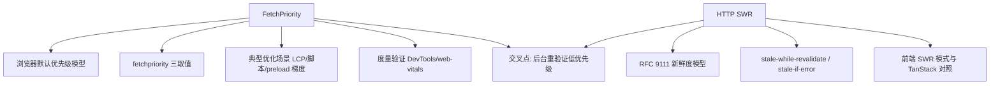

:::note 事实基线
本篇是「FetchPriority 与 HTTP SWR」带解答题库，共 **72 题**，事实来源为 `content/fe/fetchpriority-swr.md`。`fetchpriority` 按 **Baseline 2024-10 newly available**（Firefox 132 为最晚落地引擎）口径撰写；HTTP 缓存按 **RFC 9111** 新鲜度模型口径。本篇与 [Next.js / Vite / TanStack 题库](/interview/qa/nextjs-vite-tanstack) 的前端 SWR 部分互补——本篇侧重 FetchPriority 与 HTTP 层缓存指令。
:::

本篇是「FetchPriority 与 HTTP SWR」题库。这两个主题在一处相遇：**资源加载的优先级调度**（fetchpriority）与**过期数据的容忍策略**（stale-while-revalidate）。本篇分两部分：FetchPriority（浏览器优先级模型、典型优化场景、度量验证）与 HTTP SWR（RFC 9111 新鲜度、缓存扩展指令、前端 SWR 模式）。

**主线一览**



## 一、浏览器默认优先级模型

### Q1. Chrome 的默认资源优先级分层是什么？

以 Chrome 的资源优先级分层为例（不同引擎具体分层与命名不完全一致）：

| 层级    | 典型资源                                     |
| ------- | -------------------------------------------- |
| Highest | 主 HTML 文档、阻塞渲染的关键 CSS             |
| High    | 同步脚本、视口内的图片、被可见文本引用的字体 |
| Medium  | 较晚发现的 CSS 与脚本、部分图片              |
| Low     | `async`/`defer` 脚本、视口外图片、音视频     |
| Lowest  | `prefetch` 资源                              |

**这个模型在多数页面上是合理的，因此覆盖它的默认行为属于例外而非常态**。开发者应只在有明确性能问题或明确业务语义时介入。

### Q2. fetchpriority 在 HTTP/1.1 与 HTTP/2/3 下的作用有什么不同？

要理解内部优先级最终如何作用到网络上，才能解释「为什么有时看不出效果」：

- **HTTP/1.1**：每个源有固定的并发连接上限，优先级主要决定「**哪个请求先占用空闲连接**」，即排队顺序；连接一旦被占满，低优先级请求只能等待。
- **HTTP/2 与 HTTP/3**：所有请求复用一条连接，优先级被映射为**流（stream）的相对权重与依赖**，决定的是**带宽如何在并发流之间分配**，浏览器还会按 RFC 9218 的 `Priority` 头（urgency 与 incremental 两个参数）把提示告知服务端。

因此同一处 `fetchpriority` 改动，**在 HTTP/1.1 上表现为「更早开始下载」，在 HTTP/2/3 上更多表现为「分到更多带宽」**；当页面资源很少、连接远未饱和时，两种协议下都可能观察不到差异。

**采分点**：能说出「**HTTP/1.1 决定先占哪个连接（排队顺序），HTTP/2/3 决定流的带宽权重**」——这是「为什么 fetchpriority 有时看不出效果」的根本原因。

## 二、fetchpriority 语义与取值

### Q3. fetchpriority 的三个取值是什么？属性名怎么写？

`fetchpriority` 是一个枚举属性，可取值只有三个：

| 取值   | 含义                                                   |
| ------ | ------------------------------------------------------ |
| `high` | 相对其他外部资源以更高优先级获取                       |
| `low`  | 相对其他外部资源以更低优先级获取                       |
| `auto` | 不设置偏好，由浏览器自行决策；缺省值与非法值都等同于此 |

**属性值不区分大小写。属性名是 `fetchpriority`，全小写，不带连字符**。

### Q4. fetch() 的 priority 选项与 HTML 属性有什么不同？

JavaScript 侧的对应入口是 `fetch()` 初始化参数中的 **`priority` 字段**。注意**字段名与 HTML 属性名不同**，这里写作 `priority`：

```js
// 用户正在等待的搜索建议: 提高优先级
await fetch(`/api/suggestions?q=${encodeURIComponent(query)}`, {
  priority: "high",
  signal: abortController.signal,
});
// 后台埋点上报: 降低优先级, 不阻塞用户操作
await fetch("/api/telemetry", {
  method: "POST",
  priority: "low",
  keepalive: true,
  headers: { "Content-Type": "application/json" },
  body: JSON.stringify(payload),
});
```

不传 `priority` 即等同 `auto`。

### Q5. fetchpriority 支持哪些元素？iframe 为什么不支持？

`fetchpriority` 在 HTML 规范中只定义于三个元素：**``**（图片资源）、**`<link>`**（preload、prefetch、样式表等）、**`<script>`**（脚本资源）。此外 SVG 中有同名的 `fetchpriority` 属性，作用于 `image`、`feImage`、`script` 三个 SVG 元素（比 HTML 属性更晚标准化，兼容面更窄）。

**`<iframe>` 不支持该属性**，主流浏览器也未实现。对非关键 iframe（如第三方嵌入），应改用 `loading="lazy"` 延迟加载或在需要时动态插入；对关键 iframe，把它放在 HTML 靠前的位置并减少其前面的阻塞资源更有效。

### Q6. fetchpriority 与 preload/prefetch/lazy 的关系是什么？

- **`fetchpriority` 是排队**（调整并发请求之间的调度顺序），**`preload` 是提前发现资源**（让浏览器尽早知道要加载什么）——常常一起用但不可互换。
- **`prefetch`** 资源默认已是低优先级（为未来页面预取），再标 `low` 是为了确保当前页面资源紧张时不抢占带宽。
- **`loading="lazy"`** 让资源在接近视口前不加载（延迟发现时机），`fetchpriority="low"` 让它在真正加载时排在后面——**二者各自解决一个问题，可以组合**。

**采分点**：能说出「**fetchpriority 是排队，preload 是提前发现，lazy 是延迟发现——三个维度正交，可组合**」——这是资源加载优化的三个独立旋钮。

## 三、典型优化场景

### Q7. 提升 LCP 图片优先级的两种情况？

投入产出比最高的场景是**首屏主视觉图片（LCP 元素）**。两种情况区别对待：

```html
<!-- 图片在 HTML 中直接出现: 加属性即可 -->

<!-- 图片由 CSS background-image 定义: 发现时机晚, 用 preload 提前 -->
<link
  rel="preload"
  as="image"
  href="/images/css-hero.webp"
  fetchpriority="high"
/>
```

**响应式主图要把优先级提示与候选集一起声明**：`` 上的 `fetchpriority` 作用于 `srcset`/`sizes` 最终选中的那个候选；若主图由 CSS 或脚本注入、需要用 `preload` 提前发现，则要在 `<link>` 上同时给出 `imagesrcset` 与 `imagesizes`，否则浏览器只能预加载固定的一张，与真正渲染的候选不一致时反而浪费带宽。**`<picture>` 的 `<source>` 不支持 `fetchpriority`，提示必须写在 `` 上**。

**采分点**：能说出「**CSS background-image 的 LCP 图发现时机晚，要用 preload + fetchpriority 提前**」+「**响应式图要 imagesrcset/imagesizes 一起声明，否则预加载的候选与渲染的不一致**」——这是 LCP 图片优化的两个关键细节。

### Q8. 框架里怎么用 fetchpriority？

在框架里这一属性同样可用，但写法随 JSX 属性命名规则变为驼峰：**React 19 的 ``、`<script fetchPriority>`、`<link fetchPriority>` 会被渲染为对应的小写 HTML 属性**；**Next.js 的 `<Image>` 用 `preload` 表达提前发现与立即加载，`fetchPriority` prop 落到 `` 与预加载 `<link>` 的 `fetchpriority` 上**。

同时给出宽高可以避免布局偏移，这与优先级调整是两件互补的事。**若 LCP 元素是文本，则应优先优化字体加载与阻塞资源，给图片调优先级没有意义**。

### Q9. 降低非关键图片优先级与懒加载怎么组合？

首屏以下、缩略图、装饰性图片可以降低优先级，避免与关键资源争抢带宽：

```html

```

`loading="lazy"` 让它在接近视口前不加载，`fetchpriority="low"` 让它在真正加载时排在后面。**需要注意 `low` 只是降低排位，不是延迟或取消：网络空闲时它照样立即下载**。

### Q10. 控制脚本优先级怎么做？fetchpriority 改变执行语义吗？

页面依赖一个核心脚本来渲染交互界面，同时又加载若干第三方脚本（分析、广告、客服）时，把第三方统一标为低优先级，让浏览器优先下载核心脚本：

```html
<script src="/js/app-core.js" fetchpriority="high"></script>
<script
  src="https://analytics.example.com/tracker.js"
  async
  fetchpriority="low"
></script>
```

**注意 `fetchpriority` 不改变脚本的执行语义，`async`/`defer` 与模块依赖顺序仍由原有规则决定**——它只影响下载优先级，不影响执行时机与顺序。

### Q11. 在多个 preload 之间建立梯度怎么做？

当页面有多个 `preload` 时，用 `fetchpriority` 区分轻重缓急：

```html
<link rel="preload" as="image" href="/hero.webp" fetchpriority="high" />
<link
  rel="preload"
  as="font"
  type="font/woff2"
  href="/fonts/main.woff2"
  crossorigin
/>
<link rel="prefetch" href="/next-page/data.json" fetchpriority="low" />
```

`prefetch` 资源默认已是低优先级，再标 `low` 是为了确保当前页面资源紧张时不会抢占带宽。

### Q12. 动态请求怎么用 priority？

对运行时发起的请求，`priority` 适合区分「**用户正在等待**」和「**后台进行**」两类流量。搜索建议、自动补全属于前者；埋点、日志上报、预取下一页数据属于后者。**配合 `AbortController` 取消过期请求，效果比单纯调优先级更明显**。

## 四、收益度量与渐进增强

### Q13. 怎么度量与验证 fetchpriority 的收益？

优先级调整在快速网络下往往看不出差别，**在慢速网络或高并发资源加载时才明显**。验证时先模拟慢速网络，再观察关键资源的开始下载时间。

- **Chrome DevTools Network 面板**：右键列标题勾选 **Priority 列**，即可看到每个资源的优先级标签；对比调整前后关键资源的排位与瀑布图位置。
- **Performance 面板**：观察整体加载过程中关键资源是否更早开始。
- **PerformanceObserver 度量 LCP**：`observe({ type: "largest-contentful-paint", buffered: true })`。
- **Resource Timing 确认资源下载时机**：`observe({ type: "resource", buffered: true })`，看 startTime/duration/transferSize。
- **生产环境用 web-vitals 采集字段数据**：`onLCP` 上报到分析平台，按真实用户的网络条件评估收益。

**评估原则**：以同一页面调整前后的**字段数据对比**为准，不看单次实验室数据的抖动。**如果 LCP 元素并非图片，或页面的瓶颈在服务端响应时间（TTFB），那么调整资源优先级不会有可观测收益**。

**采分点**：能说出「**以字段数据（真实用户）对比为准，不看单次实验室抖动**」+「**瓶颈在 TTFB 时调优先级无收益**」——这是性能优化的度量纪律。

### Q14. fetchpriority 的支持范围与渐进增强？

`fetchpriority` 以 **Firefox 132（2024-10）为最晚落地引擎**，在 2024 年 10 月进入 Baseline "newly available"，按 Baseline 30 个月规则推算将于 2027 年 4 月转为 "widely available"。各引擎起始支持版本：Chrome/Edge 101、Firefox 132、Safari/iOS Safari 17.2。

**对不支持的浏览器，该属性会被静默忽略，不产生错误也没有副作用**；`fetch()` 中多传的 `priority` 字段同样被忽略。因此这是一个**天然渐进增强的特性，不需要 polyfill 或特性检测即可安全使用**。若确实需要检测，可以通过 `'fetchPriority' in HTMLImageElement.prototype` 判断。相比之下，`loading="lazy"` 已是广泛可用的特性，覆盖面更广。

### Q15. fetchpriority 的常见误区有哪些？

- **认为它能加快资源下载速度**——它不改变带宽或服务端响应速度，只改变并发请求之间的调度顺序。**页面只有一个资源待加载时，标 `high` 没有任何效果**。
- **把 `fetchpriority` 等同于 `preload`**——前者是排队，后者是提前发现资源，常常一起用但不可互换。
- **认为 `low` 会延迟或取消加载**——`low` 只是降低排位，网络空闲时照样立即下载。
- **期望在快速网络/单资源页面看到效果**——收益只在慢速网络或高并发资源加载时明显。

## 五、HTTP 层 SWR：缓存扩展指令

### Q16. RFC 9111 的新鲜度模型是什么？

HTTP 缓存的基线行为由 RFC 9111 定义：**一个可缓存的响应在「新鲜生命周期」内可以直接返回，过期（stale）之后原则上必须通过条件请求重新验证**（`ETag` 配 `If-None-Match`，或 `Last-Modified` 配 `If-Modified-Since`）。新鲜时长由 `max-age` 决定（`Expires` 头在 `max-age` 存在时被忽略）；对共享缓存，`s-maxage` 进一步覆盖 `max-age` 与 `Expires`。

两条关键约束：**`must-revalidate`、`proxy-revalidate` 与 `s-maxage` 都禁止共享缓存在验证成功之前返回过期响应**。对这些响应，不存在「先给旧数据」的余地。

### Q17. stale-while-revalidate 指令怎么工作？

`Cache-Control: max-age=60, stale-while-revalidate=30` 的语义：**新鲜期（60s）内直接返回缓存；过期后的 30s 窗口内，先立即返回旧数据，同时后台异步发起重新验证**；验证完成后缓存更新，下次请求拿到新数据；超过 60+30s 则必须同步验证。

**这是拿一致性换延迟的旋钮**——前提是业务能容忍短暂旧数据；容忍度为零的读路径不要用。

**采分点**：能说出「**SWR 窗口内先返回旧数据、后台异步验证，超过窗口必须同步验证**」+「**拿一致性换延迟，容忍度为零的读路径不要用**」——这是 HTTP 层 SWR 的核心语义与适用边界。

### Q18. stale-if-error 指令怎么工作？

`Cache-Control: stale-if-error=600` 的语义：**当源站返回错误（5xx）或连接失败时，在 600s 内容忍返回过期的旧数据**，而不是把错误直接暴露给用户。这是「出错时容忍旧数据」的降级策略——源站抖动时用户仍能看到（略旧的）内容，而不是错误页。

### Q19. CDN 与代理生态对 SWR 的支持？

`stale-while-revalidate` 与 `stale-if-error` 被主流 CDN（Fastly、Cloudflare、Akamai 等）广泛支持，但**浏览器原生对这两个指令的支持有限**（浏览器主要实现 `max-age`/`no-cache` 等基础指令，SWR 扩展指令更多由 CDN/代理层执行）。因此 SWR 的收益主要体现在 **CDN 边缘缓存**，而不是浏览器本地缓存。

### Q20. 典型 Cache-Control 组合有哪些？

- **静态资源（带哈希指纹）**：`max-age=31536000, immutable`——一年不变，永不重新验证。
- **HTML 入口**：`no-cache`（每次重新验证，保证拿到最新入口）或短 `max-age`。
- **API 响应（可容忍短暂旧数据）**：`max-age=60, stale-while-revalidate=30`。
- **个性化/敏感数据**：`no-store`（完全不缓存）或 `private, no-cache`。

## 六、前端数据获取模式的 SWR

### Q21. 前端 SWR 模式的三步流程是什么？

HTTP 层的 SWR 由缓存在响应链路里自动执行；**前端层的 SWR 是应用代码里的显式策略**，流程固定为三步：

1. **读取时若缓存里有数据，立即用它渲染，不等待网络**。
2. **同时（或紧随其后）发起后台重新验证请求**。
3. **新数据返回后替换缓存，界面就地更新**。

**收益是消除了「请求往返期间界面空白」**：没有骨架屏等待，二次进入页面瞬间有数据。**代价与 HTTP 层一致——首次渲染的数据可能是旧的，且必须接受「后台刷新可能失败或更晚到达」**。这个模式成立的前提与 HTTP 层相同：数据允许短暂陈旧。

### Q22. 手写 SWR 的三个能力是什么？

仓库内的手写 SWR 方案（见 [前端监控 SDK 题库](/interview/qa/frontend-monitoring-sdk) 与 data.md）用约 155 行核心代码提供三个能力，恰好是 SWR 模式的最小集合：

| 能力                   | 实现要点                                                                                        |
| ---------------------- | ----------------------------------------------------------------------------------------------- |
| 预加载                 | 内联脚本在 HTML 解析阶段发起请求，早于框架 bundle 下载完成；promise 先入缓存，结果后补          |
| 去重                   | 缓存条目同时持有 promise 与 result 两个锚点；在途时多个消费方共享同一个 promise，天然不重复请求 |
| stale-while-revalidate | result 已就绪时立即返回旧数据（耗时接近 0），同时后台静默重新验证，新数据回来后更新缓存         |

消费侧按「**result 命中 → promise 复用 → 冷启动重建**」三级降级，任何接入状态下都能正确工作。它与 HTTP 层 SWR 的结构对应关系是直接的：「result 命中」对应 fresh 期直接返回，「后台静默重新验证」对应 SWR 窗口内的异步验证；区别在于它没有窗口参数，采用「每次命中都后台刷新」的激进策略，适合分钟级以下变化的低频数据。

### Q23. 手写 SWR 与 TanStack Query v5 的对照？

| 维度       | 手写 SWR                                                         | TanStack Query v5                                                            |
| ---------- | ---------------------------------------------------------------- | ---------------------------------------------------------------------------- |
| 缓存结构   | 全局 Map，条目含 promise / result / timestamp                    | QueryCache 按 queryHash 存 Query，key 经确定性哈希（对象键排序）             |
| 新鲜度判定 | 无 TTL，每次命中都后台刷新                                       | `staleTime` 参数化：过期只是「允许重取」，触发时机是挂载、窗口聚焦、网络重连 |
| 失效控制   | 无主动失效（TTL、主动失效、按 key 过期策略是几十行内的演进方向） | `invalidateQueries` 前缀匹配 + 写后直写 + 乐观更新回滚                       |
| 请求去重   | promise 在途复用                                                 | 相同 queryKey 共享同一 Query 实例与在途请求                                  |
| 预加载     | 内联脚本，早于 bundle                                            | `queryClient.query` / `usePrefetchQuery`，运行在 bundle 内                   |
| 失败处理   | 后台刷新失败保留旧数据，下次消费再重试                           | `retry` / `retryDelay` 指数退避，离线 `paused` 挂起                          |
| 能力覆盖   | 刻意只做三件事                                                   | 分页、无限滚动、SSR 水合、持久化等完整能力                                   |

**最关键的分野仍是预加载时机**：手写方案把请求发起点提前到 HTML 解析阶段的内联脚本，此时 bundle 还在下载，网络请求与脚本加载并行——**任何运行在 bundle 内部的库都无法利用这个时间窗口，因为库本身就是 bundle 的一部分**。这正是 MPA 多页、老新框架共存的存量项目选择手写方案的决策点；新项目若需要失效、写后同步、分页等能力，TanStack Query 的成熟度则是净收益。

**采分点**：能说出「**手写 SWR 的预加载早于 bundle（内联脚本），库的预取最早也只能在应用初始化后**」——这是「存量项目手写 vs 新项目用库」的核心决策点。

## 七、交叉点与深挖

### Q24. 后台重新验证请求的优先级交叉点是什么？

fetchpriority 与 SWR 在一处相遇：**后台重新验证发起的请求，用户看不见、不阻塞交互，正适合标记低优先级**（`fetch(..., { priority: "low" })`）。这样后台重验证不会与用户正在等待的请求争抢带宽——SWR 的「后台刷新」与 fetchpriority 的「低优先级后台流量」天然契合。

**采分点**：能说出「**后台重验证是用户看不见的流量，标 low 避免与用户等待的请求争带宽**」——这是两个主题的交叉应用。

### Q25-Q72. 快速自检与深挖补充

**Q25. 一句话解释 fetchpriority 不改变什么。** 不改变带宽或服务端响应速度，只改变并发请求之间的调度顺序——单资源页面标 high 无效果。

**Q26. 一句话解释为什么默认优先级模型多数合理。** 浏览器的默认分层（主文档/CSS 最高，prefetch 最低）覆盖了多数页面——覆盖它是例外而非常态。

**Q27. 一句话解释 auto 与非法值。** 缺省值与非法值都等同 auto（浏览器自行决策）——属性值不区分大小写。

**Q28. 一句话解释为什么 iframe 不支持 fetchpriority。** 主流浏览器未实现——非关键 iframe 用 loading=lazy，关键 iframe 放靠前位置减少前置阻塞资源。

**Q29. 一句话解释 SVG 的 fetchpriority。** 作用于 image/feImage/script 三个 SVG 元素，比 HTML 属性更晚标准化，兼容面更窄。

**Q30. 一句话解释 preload 为什么要配 as。** as 声明资源类型，让浏览器正确设置优先级与 CORS 模式——缺 as 的 preload 可能被忽略。

**Q31. 一句话解释 CSS background LCP 图为什么要 preload。** background-image 在 CSS 解析+应用后才发现，时机晚——preload 提前发现，配 fetchpriority=high。

**Q32. 一句话解释响应式 preload 为什么要 imagesrcset/imagesizes。** 否则浏览器只预加载固定一张，与 srcset/sizes 实际选中的候选不一致时浪费带宽。

**Q33. 一句话解释 picture 的 source 为什么不支持 fetchpriority。** 规范只允许写在 img 上——source 不支持，提示写 img。

**Q34. 一句话解释 React 19 的 fetchPriority 驼峰。** JSX 属性命名规则转驼峰，渲染为小写 HTML 属性——img/script/link 的 fetchPriority。

**Q35. 一句话解释 Next Image 的 preload 与 fetchPriority。** preload 表达提前发现与立即加载，fetchPriority prop 落到 img 与预加载 link 的 fetchpriority。

**Q36. 一句话解释为什么给宽高与优先级是互补的。** 宽高防布局偏移（CLS），优先级调度下载顺序——两件独立的事，都要做。

**Q37. 一句话解释 LCP 是文本时调图片优先级为什么无意义。** 瓶颈在字体加载与阻塞资源，不在图片——应优化字体。

**Q38. 一句话解释 low 不是延迟或取消。** 只降低排位，网络空闲时照样立即下载——要延迟用 loading=lazy。

**Q39. 一句话解释 fetchpriority 为什么不改变脚本执行语义。** async/defer 与模块依赖顺序仍由原规则决定——只影响下载优先级。

**Q40. 一句话解释 prefetch 为什么默认低优先级。** 为未来页面预取，不是当前页面关键资源——再标 low 确保不抢占当前带宽。

**Q41. 一句话解释动态请求 priority 的两类流量。** 用户正在等待（搜索建议）标 high，后台进行（埋点/日志/预取）标 low——配 AbortController 取消过期请求效果更好。

**Q42. 一句话解释为什么验证要模拟慢速网络。** 快速网络下看不出差别，慢速/高并发才明显——先模拟慢速再观察关键资源开始下载时间。

**Q43. 一句话解释 DevTools Priority 列怎么看。** Network 面板右键列标题勾选 Priority——看每个资源的优先级标签，对比调整前后排位与瀑布图位置。

**Q44. 一句话解释 largest-contentful-paint 的 buffered。** buffered: true 拿到 observer 注册前的历史 LCP 条目——LCP 可能在 observer 注册前就发生。

**Q45. 一句话解释 Resource Timing 看什么。** startTime/duration/transferSize——确认具体资源的下载时机是否提前。

**Q46. 一句话解释 web-vitals 字段数据的价值。** 按真实用户网络条件评估收益，不看单次实验室抖动——onLCP 上报到分析平台。

**Q47. 一句话解释为什么 TTFB 是瓶颈时调优先级无收益。** 瓶颈在服务端响应时间，不在资源调度——应先优化 TTFB。

**Q48. 一句话解释 Baseline 30 个月规则。** newly available 后 30 个月转 widely available——fetchpriority 2024-10 newly，2027-04 widely。

**Q49. 一句话解释为什么 fetchpriority 天然渐进增强。** 不支持的浏览器静默忽略，无错误无副作用——不需要 polyfill 或特性检测。

**Q50. 一句话解释特性检测怎么写。** 'fetchPriority' in HTMLImageElement.prototype——判断 HTML 属性是否受支持。

**Q51. 一句话解释 loading=lazy 为什么覆盖面更广。** 已是广泛可用特性——不支持 fetchpriority 的环境中，lazy 仍能承担大部分「降低非关键资源影响」。

**Q52. 一句话解释 RFC 9111 的过期重新验证。** 过期后原则上必须条件请求重新验证（ETag/If-None-Match 或 Last-Modified/If-Modified-Since）。

**Q53. 一句话解释 max-age 与 Expires 的关系。** max-age 存在时 Expires 被忽略——max-age 优先。

**Q54. 一句话解释 s-maxage 的作用。** 对共享缓存覆盖 max-age 与 Expires——CDN 缓存时长单独控制。

**Q55. 一句话解释 must-revalidate 的约束。** 禁止共享缓存在验证成功前返回过期响应——不存在「先给旧数据」的余地。

**Q56. 一句话解释 SWR 的三段窗口。** 新鲜期直接返回，过期后 SWR 窗口内先旧后异步验证，超窗口必须同步验证。

**Q57. 一句话解释 stale-if-error 的降级。** 源站 5xx 或连接失败时，窗口内容忍返回过期旧数据——出错时给用户略旧内容而非错误页。

**Q58. 一句话解释 SWR 为什么主要在 CDN 层。** 浏览器原生对 SWR 扩展指令支持有限，主要由 CDN/代理执行——收益在边缘缓存。

**Q59. 一句话解释静态资源为什么用 immutable。** 带哈希指纹的资源一年不变，immutable 告诉缓存永不重新验证——省掉条件请求。

**Q60. 一句话解释 HTML 入口为什么用 no-cache。** 每次重新验证保证拿到最新入口——入口引用的带哈希资源才能更新。

**Q61. 一句话解释个性化数据为什么 no-store。** 完全不缓存——敏感/个性化数据不该被共享缓存或本地缓存。

**Q62. 一句话解释前端 SWR 消除什么。** 消除「请求往返期间界面空白」——二次进入页面瞬间有数据，无骨架屏等待。

**Q63. 一句话解释前端 SWR 的代价。** 首次渲染的数据可能是旧的，后台刷新可能失败或更晚到达——前提是数据允许短暂陈旧。

**Q64. 一句话解释手写 SWR 的去重锚点。** 缓存条目同时持有 promise 与 result——在途时多消费方共享同一 promise，天然不重复请求。

**Q65. 一句话解释手写 SWR 的三级降级。** result 命中 → promise 复用 → 冷启动重建——任何接入状态都正确工作。

**Q66. 一句话解释手写 SWR 为什么每次命中都后台刷新。** 没有窗口参数，激进策略——适合分钟级以下变化的低频数据。

**Q67. 一句话解释 TanStack 的 staleTime 参数化。** 过期只是「允许重取」，触发时机是挂载/窗口聚焦/网络重连——比手写的「每次刷新」精细。

**Q68. 一句话解释手写 SWR 预加载为什么早于 bundle。** 内联脚本在 HTML 解析阶段发起请求，bundle 还在下载——库的预取最早也只能在应用初始化后。

**Q69. 一句话解释存量项目为什么选手写 SWR。** MPA 多页、老新框架共存，需要早于 bundle 的预加载 + 跨技术栈通用——手写方案满足，库不满足。

**Q70. 一句话解释新项目为什么选 TanStack Query。** 需要失效、写后同步、分页、SSR 水合等完整能力——成熟度是净收益。

**Q71. 一句话解释后台重验证为什么标 low。** 用户看不见、不阻塞交互——避免与用户等待的请求争带宽。

**Q72. 一句话总结两个主题的关系。** fetchpriority 管「并发请求的调度顺序」（排队），SWR 管「过期数据的容忍策略」（拿一致性换延迟）——两者在「后台重验证标低优先级」处交叉，共同服务于「关键资源优先、用户感知最快」。

---

**延伸阅读**

- [Next.js / Vite / TanStack Query 题库](/interview/qa/nextjs-vite-tanstack)：TanStack Query 缓存模型与前端 SWR 的完整对照。
- [前端监控 SDK 题库](/interview/qa/frontend-monitoring-sdk)：手写 SWR 的完整实现与性能监控。
- [CSS 与布局工程题库](/interview/qa/css-layout-engineering)：渲染性能与资源加载的样式侧。
- [前端监控与可观测性题库](/interview/qa/frontend-observability)：Web Vitals、LCP、Resource Timing 的指标口径。
- [工作文档 · FetchPriority 与 SWR](/fe/fetchpriority-swr)：本篇的事实来源。
