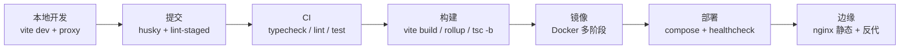
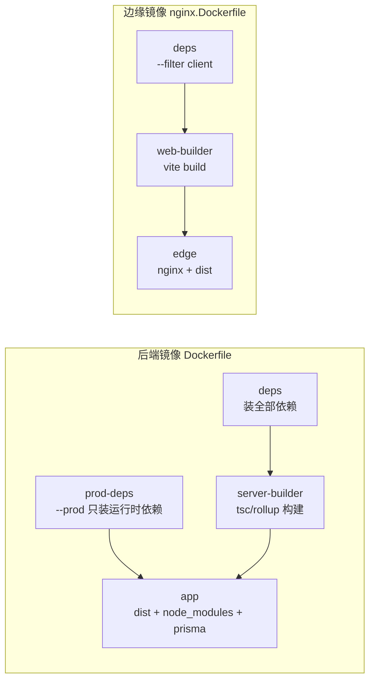
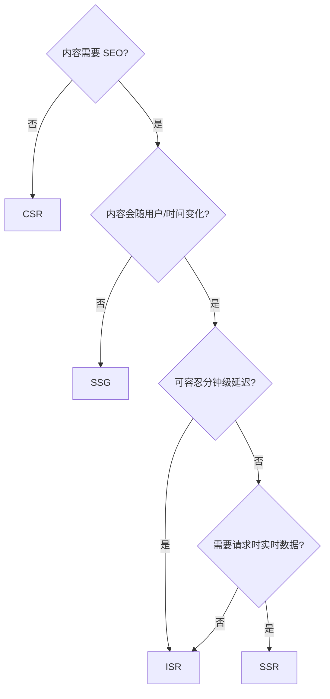

本章覆盖前端工程化全链路：包管理与 monorepo、构建工具原理、质量工具链、测试、CI/CD 与容器化部署、渲染模式选型，以及代码生成平台与供应链安全。所有「项目里」的陈述均实读源码，证据来源如下。

| 仓库（本机路径）            | HEAD      | 本文引用的证据点                                                                                                              |
| --------------------------- | --------- | ----------------------------------------------------------------------------------------------------------------------------- |
| `26autumn`（本站）          | `1e7ed4b` | `eslint.config.mjs`、`prettier.config.js`、`pnpm-workspace.yaml`、`tsconfig.json`、`install.js`、`.husky/pre-commit`          |
| `yukino-chat`               | `555f625` | `Dockerfile`、`docker-compose.yml`、`docker/nginx.conf.template`、`docker/entrypoint.sh`、`client/vite.config.ts`             |
| `yukino-codegen`            | `da904a2` | `client/vite.config.ts`、`client/eslint.config.ts`、`server/rollup.config.js`、`server/src/middleware/security-middleware.ts` |
| `yukino-dev-agent`          | `ea0fd19` | `next.config.ts`、`instrumentation.ts`、`prisma/schema.prisma`                                                                |
| `node-pool`（generic-pool） | `ee5db9d` | `index.js`、`lib/PoolDefaults.js`、`lib/Pool.js`、`test/`                                                                     |



题目按十个主题分组：包管理 → 构建 → 产物优化 → 质量工具链 → TS 工程 → 测试 → CI/CD → 渲染模式 → 代码生成 → 供应链。深挖题附「采分点」。

## 一、Monorepo 与包管理

### Q1. Monorepo 解决什么问题，又引入什么新问题？

**解决**：跨包原子修改（改接口同时改前后端调用方，一个 commit 完成）；单一 lockfile 保证依赖一致性；工具链（lint/format/TS 配置）统一复用；依赖关系显式可见。**引入**：仓库体积与 clone 成本上升；CI 需要按受影响范围增量化，否则每次全量构建；需要 workspace 工具（pnpm/yarn workspaces、turborepo）管理任务编排；权限边界变粗（一个仓库一套权限）。**事实基线**：`yukino-chat` 与 `yukino-codegen` 都是 `client + server` 双包 workspace，根 `package.json` 只做任务编排，业务代码全在子包。

### Q2. pnpm 的依赖布局与 npm/yarn 有何本质区别？

npm/yarn 把依赖**扁平化**铺到 `node_modules` 根，未声明的包也能 import（幽灵依赖温床）；pnpm 用**全局 store + 硬链接**把真实文件放在 `node_modules/.pnpm/`，`node_modules` 根下只有**直接依赖的符号链接**，未声明的包在运行时解析失败——把幽灵依赖从「静默可用」变成「显式报错」。附带收益：磁盘占用大幅下降（硬链接共享）、安装确定性更强。

```text
# npm (扁平): 间接依赖也可被 import
node_modules/
  express/
  body-parser/     # express 的依赖, 但你也能 import 到 ← 幽灵依赖

# pnpm (符号链接): 只有直接依赖可见
node_modules/
  express -> .pnpm/express@4.x/node_modules/express
  .pnpm/
    express@4.x/node_modules/
      body-parser -> ...   # 只对 express 可见
```

### Q3. pnpm workspace 如何组织？`-C` 与 `--filter` 有何区别？

`pnpm-workspace.yaml` 的 `packages` 字段声明成员（`yukino-chat` 为 `client`、`server`）。**`pnpm -C client dev`**：在指定目录执行命令，定位方式是路径；**`pnpm --filter client dev`**：按包名/路径/依赖关系过滤，支持 `server...`（含依赖闭包）等表达式。事实基线：`yukino-chat` 根脚本用 `-C`（`"dev:client": "pnpm -C client dev"`），`yukino-codegen` 用 `--filter`（`"dev:client": "pnpm --filter client dev"`）——两者语义等价，团队选一种保持一致即可。注意 `pnpm-workspace.yaml` 在 pnpm 10 还承担**全局配置**职责：`26autumn` 的该文件没有 `packages` 字段，只放 `allowBuilds` 与 `minimumReleaseAge`。

### Q4. workspace 根如何编排子包并行任务？

两个真实对照：`yukino-chat` 用 `npm-run-all2` 的 `run-p`（`"dev": "run-p dev:*"`，通配符匹配所有 `dev:` 前缀脚本）；`yukino-codegen` 用 `concurrently` 显式列出（`"dev": "concurrently \"pnpm dev:client\" \"pnpm dev:server\""`）。两者都并行执行并加前缀混排输出。取舍：`run-p` 靠命名约定自动发现新子包；`concurrently` 显式可控、可配成功策略。大规模 monorepo 再上 turborepo/nx 做缓存与依赖图调度。

### Q5. `packageManager` 字段有什么用？为什么 Dockerfile 里动态解析它？

`packageManager: "pnpm@12.10.1"` 让 corepack/CI 锁定包管理器版本，避免「本地 pnpm 12、CI pnpm 9」导致 lockfile 不兼容。`yukino-chat` 的 `Dockerfile` 更进一步：`npm install -g "pnpm@$(node -p "require('./package.json').packageManager.split('@')[1]")"`——**镜像构建时从 package.json 现读版本号**，保证容器里的 pnpm 与仓库声明永远一致，升级只需改一处。三个项目（26autumn、yukino-chat、yukino-codegen、yukino-dev-agent）统一 pin 在 `pnpm@12.10.1`。

### Q6. pnpm 的 `allowBuilds` 与 `minimumReleaseAge` 是什么？

pnpm 10 起**默认阻断依赖的安装脚本**（postinstall 是供应链攻击主入口），需要原生编译的包必须显式放行：`26autumn` 只放行 `esbuild: true`；`yukino-chat` 放行 `@prisma/engines`、`better-sqlite3`、`esbuild`、`prisma`、`protobufjs`——恰好全是含原生二进制的包。`minimumReleaseAge` 拒绝安装发布未满 N 天的版本，给社区留出发现恶意发布的时间窗；两仓库都设为 `0`（不启用），属于**有意识的取舍**：个人项目追新，生产仓库建议设 7 天左右。

### Q7. 什么是幽灵依赖？危害与检测手段？

代码 import 了未在自己 `package.json` 声明、仅因扁平化 node_modules 恰好存在的包。危害：依赖升级/移除时**随机崩溃**；换包管理器（pnpm）直接跑不起来；版本不受自己 lockfile 控制。检测：pnpm 的严格布局天然暴露（import 直接失败）；npm 系可用 `eslint-plugin-import` 的 `import/no-extraneous-dependencies`。修复：显式加进 `dependencies`。

### Q8. CI 为什么必须 `--frozen-lockfile`？

防止 CI 在 lockfile 与 package.json 不一致时**静默重写 lockfile**——那意味着构建产物与代码评审时的依赖不同，还可能掩盖「有人改了依赖没提交 lockfile」的错误。`yukino-chat` 的 `Dockerfile` 两处安装都是 `pnpm install --frozen-lockfile`（构建阶段 `--filter server`、生产阶段 `--prod --filter server...`），不一致直接失败。

### Q9. 依赖版本 pin 死（`=x.y.z`）与范围（`^x.y.z`）如何取舍？

`^` 允许 minor/patch 自动升级，享受修复但引入「不同时间安装得到不同版本」的风险；lockfile 已锁定实际版本，范围只影响**升级时机**。需要 pin 的场景：生态强耦合的包组。事实基线：`yukino-chat` 的 `client/package.json` 把 5 个 tiptap 包全部 pin 死（`"@tiptap/core": "=3.30.5"` 等）——富文本编辑器各子包版本必须严格一致，否则运行时协议不兼容。

## 二、构建工具原理

### Q10. Vite dev 与 webpack dev 的本质区别？

webpack dev server 启动时把**整个模块图打包进内存**再提供服务，冷启动与 HMR 成本随项目规模线性增长；Vite 利用浏览器原生 ESM：启动时只用 esbuild **预构建依赖**，源码按需转换、按请求下发，冷启动成本约等于依赖预构建成本；HMR 只失效变更模块及其 importer 边界，与项目总量解耦。代价：dev 与 prod 行为差异（dev 是原生 ESM 按需加载，prod 是 Rollup 打包），需要 preview 验证。

| 维度       | webpack dev         | vite dev                       |
| ---------- | ------------------- | ------------------------------ |
| 启动成本   | O(全部模块) 先打包  | O(依赖预构建)，源码按需转换    |
| 更新成本   | 重建受影响 chunk    | 失效模块 URL + 时间戳破缓存    |
| 规模敏感度 | 随项目增大线性变慢  | 基本恒定                       |
| 一致性风险 | dev/prod 同一打包器 | dev(ESM)/prod(Rollup) 两套行为 |

### Q11. esbuild 依赖预构建解决什么问题？

三个问题：一是 node_modules 里海量小文件 ESM（一个 lodash-es 几百个模块），浏览器裸跑会发起**瀑布式请求**，预构建合并成单文件；二是把 CJS/UMD 依赖**转换成 ESM** 供浏览器消费；三是把深层 import 路径（`/node_modules/.pnpm/...`）重写成可缓存的稳定路径。缓存键基于 lockfile 与配置哈希，依赖不变则秒级启动。

### Q12. Vite 的 HMR 为什么比 webpack 快？

Vite 基于 ESM 模块图做**精确失效**：文件变更 → 找到最近的 `import.meta.hot.accept` 边界 → 只重新请求受影响的模块 URL（带时间戳 query 破缓存），不重新打包；webpack 的 HMR 需要重新构建受影响 chunk 的 bundle 片段并经 WebSocket 推送。项目越大差距越明显：Vite 的更新成本与**变更范围**相关，webpack 与**包体积**相关。

### Q13. rspack/rsbuild 是什么？为什么 Rust 构建器能兼容 webpack 生态？

rspack 用 Rust 重写 webpack 的编译内核（模块图、loader、plugin 执行），保留 webpack 的 API 形状（loader 签名、plugin hooks），存量 webpack 配置低成本迁移；并行化 + 原生代码带来数量级的速度提升。rsbuild 是其上层约定式框架（类似 Vite 之于 Rollup）。本站（26autumn）使用的 Rspress 2 即构建于 Rspack 生态之上（`@rspress/core@^2.0.23`）。

### Q14. Rollup 在 Vite 生产构建中扮演什么角色？

dev 用 esbuild 做单文件转换（快但不擅长应用级分包），**prod 用 Rollup 打包**：成熟的 ESM 静态分析、Tree Shaking、代码分割与插件生态。`yukino-codegen` 的 `client/vite.config.ts` 里 `build.rollupOptions.onwarn` 就是在定制这条链路的告警策略。趋势是 Rolldown（Rust 版 Rollup）统一 dev/prod 双引擎，消除行为差异。

### Q15. 如何把 Node 后端打包成单文件？externals 怎么写？

事实基线（`yukino-codegen/server/rollup.config.js`）：`input: "src/index.ts"` → `output: { file: "dist/index.js", format: "esm", sourcemap: true }`；externals 用**正则批量排除**：`/^node:/`（内置模块）、`/^@prisma\//`、`/^@hono\//`、`/^@yukino\.js\//`，再加具名列表（`hono`、`ioredis`、`minio`、`pg`、`zod`、`bullmq`、`generic-pool`、`node-pty` 等）；插件链 `node-resolve + commonjs + json + typescript`（`module: ESNext`、`moduleResolution: bundler`、`declaration: false`）。产物是单文件 ESM，`node dist/index.js` 直接跑，部署只需 `dist + node_modules + prisma`。

```js
// yukino-codegen/server/rollup.config.js (节选)
external: [
  /^node:/,        // 内置模块一律排除
  /^@prisma\//,    // Prisma 引擎是运行时二进制, 打包即坏
  /^@hono\//,
  "hono", "ioredis", "minio", "pg", "zod",
  "bullmq", "generic-pool", "node-cron", "node-pty", // ...
],
```

### Q16. 为什么有些包必须 external 而不能打进 bundle？

三类原因：**原生模块**（`better-sqlite3`、`node-pty`、Prisma engines）通过文件路径加载二进制，打包即坏；**运行时动态加载**（Prisma 引擎、`require` 动态路径）静态分析不可见；**体积与 sourcemap 卫生**（把整个 `pg` 打进去毫无收益）。Next.js 同理：`yukino-dev-agent` 的 `next.config.ts` 声明 `serverExternalPackages: ["redis", "knex"]`，告诉 Next 这两个包保持原样加载、不要参与服务端打包。

### Q17. 如何写一个 Vite 插件？用真实例子说明 hooks。

事实基线（`yukino-chat/client/vite.config.ts` 自定义了两个插件）：**`moveSourcemaps`**——`configResolved` 记住 outDir，`closeBundle` 时遍历 `dist` 把所有 `*.map` 移进 `dist/.sourcemaps/`，避免 sourcemap 随静态资源上线；**`fetchPriorityHints`**——`enforce: "post"` + `transformIndexHtml`，给 `<link rel="stylesheet">` 和 `<script type="module" crossorigin>` 注入 `fetchpriority="high"`。写插件三件套：选对 hook 时机（config/transform/emit/closeBundle）、明确 `apply: "build" | "serve"`、用 `this.warn/info` 而不是 console。

### Q18. dev server 代理有什么用？WebSocket 怎么代理？

消除开发期跨域：浏览器只与 dev server 同源，`/api` 转发到真实后端，**不需要后端开 CORS**。事实基线（`yukino-codegen/client/vite.config.ts`）：`server.proxy["/api"] = { target: "http://localhost:3000", changeOrigin: true, ws: true }`——`ws: true` 让 `/api` 路径下的 WebSocket 升级请求也被转发；`changeOrigin` 把 Host 头改成目标地址。另有 `resolve.alias` 把 `@` 指向 `./src`，与 `tsconfig` paths 保持一致。

### Q19. 生产环境为什么要移走 sourcemap？

sourcemap 能还原全部源码，随静态资源公开等于**开源私有代码**。正确姿势：构建产物保留 map 但移到私有存储（错误监控平台符号化用），公网只发 js。事实基线：`yukino-chat` 用 `moveSourcemaps` 插件把 map 归集到 `dist/.sourcemaps/`（nginx 不会把该目录当静态资源暴露）；配合 `@yukino.js/sentry` 的 `sentryPlugin` 上传 sourcemap 做线上错误还原。

## 三、Tree Shaking 与代码分割

### Q20. Tree Shaking 的三个前提条件？

1. **ESM 静态结构**：`import/export` 编译期可分析（CJS 不行）；2. **无副作用证明**：模块顶层代码不影响外部世界，或由 `sideEffects` 字段显式声明；3. **纯调用标注**：`@__PURE__` 注释告诉压缩器「结果不用即可整体删除」。三者缺一，dead code 就会活下来。

| 前提缺失           | 后果                         | 修复                          |
| ------------------ | ---------------------------- | ----------------------------- |
| 依赖只发 CJS       | 整个模块保留，导出级摇除失效 | 换 ESM 产物 / 找替代包        |
| 顶层有副作用未声明 | 模块被保守保留               | 重构为惰性初始化 / 标注白名单 |
| 类方法装饰器调用   | 压缩器不敢删                 | 构建目标加 `/* @__PURE__ */`  |

### Q21. `sideEffects` 字段怎么用？误报会怎样？

`package.json` 里 `"sideEffects": false` 声明所有模块可安全摇除；更常见的是数组白名单：`["./src/**/*.css", "./src/polyfills.ts"]`。**误报后果**：把真有副作用的模块摇掉——CSS 丢失、polyfill 缺失、装饰器/全局注册静默失效，且只在 prod 复现（dev 不摇）。库作者的铁律：拿不准就列进数组。

### Q22. 为什么 CommonJS 无法 Tree Shaking？

CJS 的 `require` 是**运行时函数调用**：路径可动态拼接、导出是运行时构造的普通对象（`exports.foo = ...` 可在任意分支执行），静态分析无法确定「哪些导出一定没人用」。打包器对 CJS 最多做**模块级**整体消除，做不到导出级。这也是生态坚持「发包必须带 ESM 产物」的根本原因。

### Q23. `@__PURE__` 注解是什么？INVALID_ANNOTATION 告警怎么处理？

`/* @__PURE__ */ fn()` 告诉 minifier：该调用无副作用，结果未使用则连同参数一起删除——Tree Shaking 能摇掉「调用了但没用结果」的表达式。注解位置不合法时 Rollup 报 `INVALID_ANNOTATION`。事实基线：`yukino-codegen` 在 `build.rollupOptions.onwarn` 里**选择性静默**——仅当 `warning.code === "INVALID_ANNOTATION"` 且 `warning.id` 在 `node_modules/` 时跳过（zod 的文档注释里恰好出现 `@__PURE__` 字样被误识别），其余告警照常上抛。关键词：**按 code + 来源过滤，而不是 `onwarn: () => {}` 全量吞掉**。

:::tip 采分点
能说出「注解位置不合法 → Rollup 无法判断修饰哪个调用 → 保守地不摇除该表达式」这条因果链，再给出「按 code+来源白名单静默」的工程处理，比背概念高一档。
:::

### Q24. 代码分割有哪些入口？路由级懒加载怎么做？

三类入口：**entry 分割**（多入口应用）、**动态 `import()`**（最常用，React 里 `React.lazy + Suspense` 做路由级分包，首屏只加载当前路由）、**manualChunks**（把 react/zod 等大依赖抽成稳定 vendor chunk，利用长缓存）。配套动作：路由切换前 `prefetch` 下一路由 chunk，避免点进去白屏。

### Q25. modulepreload / prefetch / fetchpriority 分别优化什么？

`<link rel="modulepreload">`：**当前导航必需**的 ESM chunk 提前并行拉取（不走低优先级队列）；`<link rel="prefetch">`：**未来导航**可能用到的资源，空闲时低优先级预取；`fetchpriority="high"` 是优先级提示 API，把关键 CSS/JS 提到高优先级队列。事实基线：`yukino-chat` 的 `fetchPriorityHints` 插件在 HTML 注入阶段给样式表与入口脚本统一加 `fetchpriority="high"`，对抗浏览器把 `<script type="module">` 默认降级的问题。

### Q26. 静态资源缓存策略怎么设计？

事实基线（`yukino-chat/docker/nginx.conf.template`）：`/assets/` 下是**内容哈希命名**的构建产物 → `Cache-Control: public, max-age=604800, immutable`（一周内永不协商）；`/sw.js`（Service Worker）必须 `no-cache`——SW 是更新的入口，缓存住就永远收不到新版本；其余路径 `try_files $uri $uri/ /index.html` 交给 SPA 路由。**铁律**：immutable 的前提是文件名含内容哈希，`index.html` 本身绝不能长缓存。

## 四、Lint、格式化与 Git Hooks

### Q27. ESLint flat config 与旧 `.eslintrc` 有何区别？

flat config 是**单个 `eslint.config.mjs` 导出配置对象数组**：没有 extends 级联查找、没有 plugins 字符串解析、没有环境魔法，一切显式 import。事实基线（`26autumn/eslint.config.mjs`）：`defineConfig` 组合——`ignores`（`dist`、`node_modules`、`doc_build`）→ `eslint.configs.recommended` → `tseslint.configs.strict` + `stylistic` → `globals`（browser + node）→ 局部覆盖（`no-unused-vars: off`）。数组顺序即优先级，后者覆盖前者。

```js
// 26autumn/eslint.config.mjs (节选)
export default defineConfig(
  { ignores: ["**/dist/**", "**/node_modules/**", "doc_build/**"] },
  eslint.configs.recommended,
  tseslint.configs.strict,
  tseslint.configs.stylistic,
  { languageOptions: { globals: { ...globals.browser, ...globals.node } } },
  { rules: { "@typescript-eslint/no-unused-vars": "off" } },
);
```

### Q28. 什么是 type-aware lint？代价是什么？

让 ESLint 拿到 TS 类型信息，启用语义级规则。事实基线（`yukino-codegen/client/eslint.config.ts`）：`parserOptions.projectService` 接入 TS 项目服务（`allowDefaultProject` 兜底 `.storybook/*.ts`），于是能开 `@typescript-eslint/no-unsafe-argument / no-unsafe-assignment / no-unsafe-call`、`no-explicit-any`、`consistent-type-assertions: never`、`ban-ts-comment` 并全部设为 `error`。代价：**慢**（每个文件过类型检查）且必须有正确的 tsconfig 映射；所以 CI 用 `--max-warnings 0` 守门，本地开发可只跑快速规则集。

:::tip 采分点
`consistent-type-assertions: ["error", { assertionStyle: "never" }]` 是最严档位——**禁止一切 `as` 断言**，倒逼用类型守卫收窄。能解释「为什么断言是类型系统的豁口」比列举规则名更得分。
:::

### Q29. ESLint 与 Prettier 如何分工避免冲突？

原则：**质量归 ESLint，格式归 Prettier**，关掉 ESLint 里一切格式类规则（eslint-config-prettier 或干脆不启用 stylistic 的格式子集），避免两个工具打架。事实基线（两种真实形态）：`26autumn` 的 `prettier.config.js` 就是 `export default {}`（全默认），提交时 lint-staged 只跑 prettier；`yukino-codegen` client 额外用 `prettier-plugin-tailwindcss` 自动排序 class。反例警示：同时开 ESLint stylistic 格式规则 + Prettier 又不关冲突规则，保存时两个工具互相回滚。

### Q30. husky + lint-staged 怎么工作？本仓库配置有什么坑？

`.husky/pre-commit` 钩子执行 `pnpm exec lint-staged`，lint-staged 只对 git 暂存文件跑任务，把「全量 lint」缩到「增量 lint」。事实基线与坑：`26autumn` 的 lint-staged 配置是 `"sh -c 'pnpm format'"`——匹配一堆扩展名后执行的却是 `prettier -w ./`（**格式化整个仓库**而非暂存文件）。后果：提交时会把别人未暂存的改动也一并格式化，大仓库还会慢。规范写法应把文件参数透传给 prettier（`prettier --write` 作用于暂存文件列表）。`yukino-dev-agent` 是同样的模式，属于刻意的「提交即全量格式化」约定。

```jsonc
// 26autumn/package.json (节选) —— 注意 sh -c 后是全仓库 format
"lint-staged": {
  "*.{json,jsonc,js,cjs,mjs,jsx,ts,cts,mts,tsx,html,vue,css,scss,md,mdx}": [
    "sh -c 'pnpm format'"   // pnpm format = prettier -w ./ --experimental-cli
  ]
}
// 规范写法: "prettier --ignore-unknown --write" (lint-staged 自动追加暂存文件列表)
```

### Q31. CI 与本地的 lint 严格度应如何分层？

本地要**快与自动修复**：`26autumn` 的 `lint` 是 `eslint --fix --cache --quiet`（cache 增量、quiet 隐藏 warning）。CI 要**零容忍与可读报告**：`yukino-codegen` client 是 `eslint . --max-warnings 0`（warning 也挂），server 是 `biome check --reporter=github`（输出 GitHub PR 行内注解）。大项目还要给内存：`yukino-dev-agent` 的 lint/typecheck 都带 `NODE_OPTIONS=--max-old-space-size=8192`。

### Q32. Biome 与 ESLint+Prettier 如何取舍？同一仓库能共存吗？

Biome 是 Rust 单二进制，format + lint 一体，速度数量级领先，但插件生态与类型感知规则远不如 ESLint。务实答案按「该包需要什么」选：事实基线——`yukino-codegen` 同一仓库内 **client 用 ESLint+Prettier**（需要 react-hooks、react-refresh、unicorn、type-aware 规则），**server 用 Biome**（`biome.json`，脚本 `format/check/check:ci`），各取所需，互不干扰。

## 五、TypeScript 工程配置

### Q33. `moduleResolution: bundler` 意味着什么？

TS 5 引入的解析模式：**按打包器的行为解析模块**——支持 `package.json` 的 `exports` 条件导出、不要求写文件扩展名、不强制 ESM/CJS 的 import 规则。适合由 Vite/Rollup/rsbuild 消费的应用代码（`26autumn` 的 `tsconfig.json` 即 `module: esnext` + `moduleResolution: bundler`）。若要发布给 Node 直接执行的包，应选 `node16/nodenext` 并遵守其扩展名规则。

### Q34. `isolatedModules` 解决什么问题？

声明「每个文件会被**独立转译**」（esbuild/swc/Babel 的现实），于是 TS 禁止只在跨文件类型分析下才安全的写法：类型再导出必须 `export type`、`const enum` 受限等。开了它，`tsc` 的检查结果才与真实构建工具的行为一致。事实基线：`26autumn` 的 tsconfig 显式开启 `isolatedModules: true`。

```ts
// isolated-modules 下的硬规则
export { SomeType }; // ✗ 转译器无法判断 SomeType 是值还是类型
export type { SomeType }; // ✓ 显式标记, 单文件转译可安全擦除
```

### Q35. `tsc -b` 与 project references 解决什么？

把一个大工程拆成多个子项目（各有 tsconfig），`tsc -b` 按依赖图**增量构建**并缓存产物。事实基线：`yukino-codegen` client 的 `build` 是 `tsc -b && vite build`，目录里有 `tsconfig.json`（引用入口）+ `tsconfig.app.json`（应用代码，DOM lib）+ `tsconfig.node.json`（vite.config.ts 等 Node 侧代码）——**应用代码与构建脚本的类型环境彻底分离**，互不污染 lib/types。

### Q36. 为什么 `noEmit`？类型检查与转译如何分工？

现代前端「**tsc 只查错，bundler 负责转译**」：esbuild/swc 转译快但**完全不做类型检查**，类型错误只能靠独立的 `tsc --noEmit`（或 `tsc -b`）在 CI/IDE 兜住。事实基线：`26autumn` 的 tsconfig `noEmit: true` + 独立 `typecheck` 脚本；`yukino-codegen` client 的 `typecheck: tsc -b --noEmit`。漏掉这一步 = 类型系统形同虚设。

### Q37. 环境变量如何做类型安全校验？

启动时用 zod schema 校验 env，缺/错立即 fail-fast，而不是运行到一半才 `undefined`。事实基线：`yukino-codegen` server 有 `src/config/env.schema.ts` + `env.ts`（zod 解析后导出强类型 `env`，`security-middleware.ts` 里 `env.CORS_ALLOWED_ORIGINS`、`env.REQUEST_BODY_LIMIT_BYTES` 直接取用）；`yukino-chat` client 依赖 `@t3-oss/env-core` 做同构校验。**安全边界**：Vite 只把 `VITE_` 前缀变量打进浏览器 bundle，密钥类变量绝不能带该前缀。

## 六、测试策略

### Q38. 测试金字塔在前端如何落地？

**单元**（纯函数、状态机、工具逻辑）：vitest，毫秒级，占大头；**组件/集成**（组件 + store + mock API 的交互流）：testing-library 风格，验证用户可见行为而非实现细节；**E2E**（真实浏览器跑关键业务流）：Playwright，最贵最少。判断标准：**逻辑越纯越往下放**；UI 细节变化频繁的测试注定维护成本高。

| 层级      | 工具形态          | 速度   | 置信度     | 典型对象                  |
| --------- | ----------------- | ------ | ---------- | ------------------------- |
| 单元      | vitest (node env) | 毫秒   | 逻辑正确性 | 工具函数、状态机、解析器  |
| 组件/集成 | vitest + jsdom    | 百毫秒 | 交互行为   | 表单流、错误态、权限渲染  |
| E2E       | Playwright        | 秒级   | 真实链路   | 登录→核心操作→产出 主干流 |

### Q39. Vitest 相比 Jest 的优势在哪？

与 Vite **共用一套配置**：alias、插件、TS/JSX 转换零额外配置。事实基线：`yukino-codegen/client/vitest.config.ts` 只声明了与 vite 相同的 `resolve.alias["@"]` 和 `test: { environment: "node", include: ["tests/**/*.test.ts"] }`；`client/package.json` 的 `test: vitest run`。注意 environment 选择：该 client 的测试跑在 `node` 环境——测的是逻辑而非 DOM，按需选 jsdom/happy-dom 可省启动成本。

### Q40. 覆盖率的口径与陷阱？

行覆盖高 ≠ 测得好：`if (a && b)` 一行全真也算覆盖，**分支覆盖**才暴露漏掉的组合。陷阱：追 100% 行覆盖会逼出「断言实现细节」的脆弱测试。务实口径：关键路径（钱、权限、数据一致性）分支覆盖优先；覆盖率做**棘轮**（只升不降）而非一刀切指标。

### Q41. 并发与时序逻辑怎么测？

两板斧：**假定时器**（`vi.useFakeTimers`）控制时间流逝；**手动门控 deferred**（手写 promise + resolve 句柄）精确安排任务交错。事实基线：`yukino-codegen` server 的 `tests/agent-runtime-concurrency.test.ts`、`turn-gate.test.ts` 直接测并发语义；本文 [Promise 并发池](/interview/code/promise-concurrency) 的七组自测全部用 deferred 门控，零真实耗时、结果确定。

### Q42. 给第三方库写测试应该覆盖什么？

看成熟库的测试布局就是答案。事实基线（`node-pool/test/`）：按**生命周期风险点**拆文件——`generic-pool-acquiretimeout-test.js`（获取超时）、`generic-pool-destroytimeout-test.js`（销毁超时）、`doubly-linked-list-test.js`（内部数据结构）、以及 **`GH-159-test.js`**：以 issue 编号命名的**回归测试**，修一个 bug 留一个永不删除的用例。这套「超时路径 + 数据结构 + 回归档案」的组合值得照抄。

### Q43. 组件测试与 E2E 的边界在哪？

组件测试 mock 网络、验证**交互逻辑**（点击 → 状态 → 视图）；E2E 验证**真实链路**（路由、鉴权、网络、跨页面流）。事实基线：`yukino-codegen` client 的 `tests/` 按 `pages/` 与 `shared/` 组织，与源码结构镜像。经验法则：一个流如果跨了三个页面或依赖真实后端状态，就别在组件层硬测。

## 七、CI/CD 与容器化部署

### Q44. 前端项目 CI 流水线最少要哪些阶段？

`install（frozen lockfile）→ typecheck → lint → test → build → 产物/部署`。事实基线：`yukino-codegen` server 的 `ci` 脚本是三段式 `pnpm prisma:validate && pnpm build && pnpm check:ci`——**先校验 Prisma schema 合法性**（schema 坏了后面全白跑），再构建，最后以 CI reporter 出 lint 报告。顺序原则：失败成本低的检查放前面。

### Q45. Docker 多阶段构建与层缓存的关键点？

事实基线（`yukino-chat/Dockerfile`，四阶段 `deps → server-builder → prod-deps → app`）：**按变更频率从低到高 COPY**——先 `package.json`，再 lockfile + workspace 配置，再各子包 `package.json`，装完依赖**才** COPY 源码；改一行业务代码不会击穿依赖层缓存。细节：`apk add python3 make g++` 为原生模块编译准备；pnpm 版本从 `packageManager` 字段现读（见 Q5）；`--filter server` 只装后端 workspace，前端构建在独立的 nginx 镜像里（关注点分离，注释写明 "The frontend is NOT baked in"）。



:::tip 采分点
能画出四阶段流向并解释「为什么构建依赖与运行时依赖分两条线」（builder 需要 devDeps，最终镜像只要 prodDeps，体积与安全面都更小），再补一句「COPY 顺序 = 缓存命中率」，就是满分答案。
:::

### Q46. 为什么单独开 prod-deps 阶段？`--filter server...` 的省略号是什么？

构建阶段需要 devDependencies（tsc、rollup），运行时不需要；若直接复制构建阶段的 node_modules，镜像会背上全部 dev 依赖。`prod-deps` 阶段用 `pnpm install --frozen-lockfile --prod --filter server...` 只装生产依赖再 COPY 进最终镜像。`server...` 的省略号是 pnpm filter 语法：**server 及其依赖闭包**（workspace 内被 server 依赖的包也带上）。

### Q47. 容器启动时如何安全地跑数据库迁移？

事实基线（`yukino-chat/docker/entrypoint.sh`）：`./node_modules/.bin/prisma migrate deploy` 后 `exec node dist/index.js`。三个要点：**用本地 CLI**（版本与 lockfile 一致，Dockerfile 注释明确 prisma 因此是运行时依赖）；`migrate deploy` 是幂等的「应用未执行迁移」命令，无交互、失败即退出（对比 `migrate dev` 会提示重置）；**`exec` 让 node 成为 PID 1**，正确接收 SIGTERM 实现优雅退出。

### Q48. healthcheck 与 `depends_on` 怎么写才有意义？

事实基线（`yukino-chat/docker-compose.yml`）：postgres 用 `pg_isready -U yukino -d yukino_chat`（interval 5s / timeout 3s / retries 12），redis 用 `redis-cli ping`，app 用 `wget -q -O /dev/null http://127.0.0.1:8000/health`（`start_period: 30s` 给冷启动豁免期）；依赖声明用 **`depends_on: { postgres: { condition: service_healthy } }`**——只有 `condition: service_healthy` 才等健康检查通过，裸 `depends_on` 只等容器启动。全部服务 `restart: unless-stopped`。

### Q49. 前端 edge 镜像（nginx）有哪些必配项？

事实基线（`yukino-chat/docker/nginx.conf.template` + `docker/nginx.Dockerfile`）：**WebSocket 升级**——`map $http_upgrade $connection_upgrade` + `proxy_set_header Upgrade/Connection`；**流式响应**——`proxy_buffering off`、`proxy_request_buffering off`、`proxy_read_timeout 3600s`（详见 [SSE 客户端](/interview/code/sse-retry)）；**前缀剥离**——`proxy_pass http://upstream/;` 结尾斜杠去掉 `/api/` 前缀；`client_max_body_size 100m`（分片上传）；gzip 白名单不含 `text/event-stream`；`/assets/` immutable、`/sw.js` no-cache、SPA fallback。模板经官方镜像的 envsubst hook 渲染（`${YUKINO_API_UPSTREAM}` 是唯一替换变量，`$uri` 等 nginx 变量不受影响）。

```nginx
# yukino-chat/docker/nginx.conf.template (节选)
map $http_upgrade $connection_upgrade { default upgrade; '' close; }

location /api/ {
    proxy_pass http://yukino_api/;      # 尾斜杠剥离 /api/ 前缀
    proxy_http_version 1.1;             # WS 升级必须 1.1
    proxy_set_header Upgrade $http_upgrade;
    proxy_set_header Connection $connection_upgrade;
    proxy_read_timeout 3600s;           # 长连接/流式不被 60s 默认值掐断
    proxy_buffering off;                # 关缓冲, 否则流式变批式
    proxy_request_buffering off;
}
location /assets/ { add_header Cache-Control "public, max-age=604800, immutable"; }
location = /sw.js { add_header Cache-Control "no-cache"; }  # PWA 更新入口
location / { try_files $uri $uri/ /index.html; }            # SPA fallback
```

### Q50. 前端环境变量：构建时注入 vs 运行时注入？

浏览器 bundle 的环境变量在**构建时冻结**：`yukino-chat` 的 `nginx.Dockerfile` 用 `ARG VITE_API_URL=/api` 在 build 阶段注入（默认同源 `/api`，由 nginx 反代，浏览器永远只和 nginx 说话）。运行时变量只属于服务端/边缘层：`YUKINO_API_UPSTREAM` 在容器启动时 envsubst 进 nginx 配置；`DATABASE_PROVIDER=pg|sqlite` 是运行时 feature flag（compose 注释写明切换方式）。**规则**：需要按环境变化的值，要么走运行时注入层，要么一环境一构建。

:::tip 采分点
能说出「同源 `/api` 默认值让浏览器只和 nginx 对话，从而开发/部署两态都不需要 CORS」这层设计意图，比背「VITE_ 前缀会进 bundle」更体现工程理解。
:::

## 八、Next.js 与渲染模式

### Q51. CSR / SSR / SSG / ISR 如何选型？

| 模式 | 渲染时机        | 适合                                 | 代价                  |
| ---- | --------------- | ------------------------------------ | --------------------- |
| CSR  | 浏览器运行时    | 登录后的重交互应用                   | 首屏白屏、SEO 弱      |
| SSG  | 构建时          | 内容稳定（文档、营销页）             | 内容变更需重新构建    |
| ISR  | 构建 + 定期再生 | 内容会变但可容忍分钟级延迟（商品页） | 再生策略与缓存一致性  |
| SSR  | 每次请求        | 强个性化、实时数据                   | 服务器成本、TTFB 压力 |

真实项目多为混合：`yukino-dev-agent`（Next.js 16）按路由分别选择，Agent 对话页是运行时渲染 + 流式输出，静态页走预渲染。



### Q52. RSC 的组件边界怎么划？`serverExternalPackages` 解决什么？

Server Component 直接访问数据、零 JS 下发，但**不能**有状态与事件；Client Component（`"use client"`）承担交互。边界原则：**交互树叶节点 client，数据主干 server**。`serverExternalPackages` 是服务端打包豁免名单：事实基线（`yukino-dev-agent/next.config.ts`）声明 `["redis", "knex"]`——这类带原生/TCP 连接的包被 Next 打包会坏，必须保持运行时原样加载（与 Q16 同理）。同文件还有 `turbopack.root: resolve(dirname__, "..", "..")`——应用嵌在 monorepo 两层深处时，显式告诉 Turbopack 工作区根在哪。

```ts
// yukino-dev-agent/next.config.ts (节选)
const nextConfig: NextConfig = {
  reactStrictMode: false, // 启动副作用系统, 避免 dev 双调用
  serverExternalPackages: ["redis", "knex"], // 原生/TCP 包不参与服务端打包
  allowedDevOrigins: ["127.0.0.1"],
  turbopack: { root: resolve(dirname__, "..", "..") }, // monorepo 根
};
export default withNextIntl(nextConfig); // next-intl 插件包裹
```

### Q53. `instrumentation.ts` 何时执行？为什么要判 `NEXT_RUNTIME`？

Next.js 的服务端启动钩子，dev 与生产 server 启动各执行一次 `register()`。事实基线（`yukino-dev-agent/instrumentation.ts`）：先 `if (process.env.NEXT_RUNTIME !== "nodejs") return;`——**排除 edge runtime**（观测与索引依赖 Node API）；然后动态 import 三件事：`initObservability()`（OTel/Langfuse 初始化）、`indexDataDir()`（启动时知识库索引，try/catch 包裹**失败不阻断启动**）、`startAutoSyncLoop()`（后台定时同步）。动态 import 的意义：这些重依赖不进 edge 构建产物，也延迟到真正需要时加载。

### Q54. `reactStrictMode: false` 与 `allowedDevOrigins` 是什么考量？

StrictMode 在 dev 下**双调用** render/effect 以暴露副作用不纯——对纯 UI 是好事，但对启动即产生真实副作用的系统（建立连接、启动调度器、索引任务）会造成重复初始化，`yukino-dev-agent` 因此显式关闭（`reactStrictMode: false`）。`allowedDevOrigins: ["127.0.0.1"]` 是 Next 15+ 的 dev 来源校验白名单，允许从该 origin 访问 dev server 而不报警。另注意 build 脚本 `pnpm db:generate && next build`：Prisma client 必须先生成，否则构建期类型缺失。

## 九、代码生成平台与脚手架

### Q55. AI 代码生成平台的架构长什么样？

事实基线（`yukino-codegen` server `src/`）：**配置层** `config/`（zod 校验的 env 与 AI 配置 schema）；**工作区层** `workspace/`——`workspace-manager.ts`（工作区生命周期）、`sandbox-session.ts`（沙箱会话）、`static-preview.ts` + `preview-bridge.ts`（生成产物的静态预览与通信桥）；**业务分层** `user/` 按 `service / repository / mapper / schema` 四层组织；**横切层** `middleware/`（error-handler、security）、`observability/`（metrics-service、health-service）；提示词独立存放于 `prompts/site-generator-system-prompt.md`；数据模型（Prisma）含 `AgentSession`、`AgentWorkspace`、`AgentMcpServer`、`AgentHook`、`AgentTranscriptEvent` 等——**会话、工作区、工具、钩子、事件流全部持久化**，可审计可回放。

### Q56. 生成的代码如何安全预览？

三道防线：**服务端隔离**——生成产物经 `static-preview` 作为静态内容服务、`preview-bridge` 做受控通信，而不是在主应用进程里执行；**客户端消毒**——`yukino-codegen` client 依赖 `dompurify + marked` 组合，Markdown 渲染前必须先过 sanitizer（对应 [Web 安全](/interview/qa/web-security-auth) 的 XSS 防线）；**原则**——不可信产物永远在独立 origin/沙箱运行，不与主站共享 cookie 与 DOM。

### Q57. 如何写一个健壮的仓库克隆/脚手架脚本？

事实基线（`26autumn/install.js`）：仓库清单声明 `{ name, url, branch? }`（默认 `DEFAULT_BRANCH = "main"`，`node-pool` 单独指定 `master`——**尊重上游默认分支差异**）；用 `spawn`（而非 `exec`）流式执行 git，stdout/stderr 逐行加 `[name]` 前缀混排输出，其中 `rest` 变量处理**跨 chunk 的半行**缓冲；`--dry-run` 只打印不执行；`existsSync` 跳过已存在目录保证幂等。安全要点：参数走数组形式传给 spawn，不拼 shell 字符串，杜绝命令注入。

## 十、供应链安全与 Node 资源管理

### Q58. npm 供应链攻击有哪些攻击面？如何分层防御？

攻击面：**typosquatting**（近似包名）、**dependency confusion**（私有包名被公网抢注）、**install 脚本投毒**（postinstall 执行任意代码）、**维护者账号被盗后发布恶意版本**、lockfile 篡改。防御分层（均有事实基线）：pnpm 10 默认阻断安装脚本 + `allowBuilds` 白名单显式放行（Q6）；`minimumReleaseAge` 延迟安装新发布版本；`--frozen-lockfile` 防 lockfile 漂移（Q8）；`packageManager` 锁定工具链版本（Q5）；CI 跑 `pnpm audit`；新依赖人工评审。

### Q59. `generic-pool` 的工厂模式怎么用？

事实基线（`node-pool`，generic-pool v3.9.0）：`createPool(factory, config)`——factory 约定 `{ create: () => Promise<Resource>, destroy: (r) => Promise<void> }`（README 示例：`create` 建 DB 连接、`destroy` 断开）；`config` 核心是 `{ max, min }`；使用方 `await pool.acquire()` 借出、`pool.release(r)` 归还、关机时 `pool.drain()`。`index.js` 只导出 `Pool / Deque / PriorityQueue / DefaultEvictor / createPool`——**队列与驱逐策略都是可替换组件**，这是「库做机制、用户做策略」的 API 设计范本。

```js
// node-pool/README.md 示例 (节选)
const factory = {
  create: () => DbDriver.createClient(),
  destroy: (client) => client.disconnect(),
};
const pool = genericPool.createPool(factory, { max: 10, min: 2 });
const client = await pool.acquire();
try {
  /* ... */
} finally {
  pool.release(client);
} // 必须归还, 否则池泄漏
await pool.drain(); // 关机时排空
```

### Q60. 资源池的默认参数与驱逐机制说明什么？

事实基线（`node-pool/lib/PoolDefaults.js`）：`fifo: true`、`priorityRange: 1`（默认无优先级）、`testOnBorrow/testOnReturn: false`（借出/归还默认不体检）、`autostart: true`、`evictionRunIntervalMillis: 0`（**驱逐默认关闭**）、`numTestsPerEvictionRun: 3`（每轮分批检测 3 个，避免一次性全量体检）、`softIdleTimeoutMillis: -1`（软空闲禁用）、`idleTimeoutMillis: 30000`。`Pool.js` 里 `_evict()` 用迭代器分批遍历空闲对象、`_ensureMinimum()` 补齐 min。读懂默认值 = 读懂库作者对「合理默认」的判断。

```js
// node-pool/lib/PoolDefaults.js (节选)
this.fifo = true; // 先进先出借出
this.priorityRange = 1; // 优先级分桶数, 1 = 无优先级
this.testOnBorrow = false; // 借出不体检 (体检有成本)
this.evictionRunIntervalMillis = 0; // 驱逐循环默认关闭!
this.numTestsPerEvictionRun = 3; // 每轮最多体检 3 个, 分批摊销
this.idleTimeoutMillis = 30000; // 空闲 30s 可被驱逐
this.acquireTimeoutMillis = null; // ← 默认无限等待, 生产必改
this.maxWaitingClients = null; // ← 默认无限排队, 生产必改
```

### Q61. `acquireTimeoutMillis / maxWaitingClients` 默认为 null 有什么风险？

两者默认 `null` 即**无限制**：池耗尽时，`acquire` 会**永远挂起**（无超时），等待队列**无限增长**（无上限）——慢查询或连接泄漏会先表现为「请求越堆越多」，最后 OOM 或全员超时，且极难定位。生产必须显式设置：获取超时（快速失败 + 告警）与等待队列上限（背压，超限拒绝）。这与 [Promise 并发池](/interview/code/promise-concurrency) 的背压结论完全一致——**一切调度器都必须回答「排不下时怎么办」**。

:::tip 采分点
把「默认值即风险位」讲成方法论：接手任何池/队列类库，先看默认配置里哪些是 `null/-1/0`（无限制/禁用），逐个问「生产环境我要不要显式设置」。源码里 `PoolDefaults.js` 甚至自带 `// FIXME: no defaults!` 注释——作者自己都知道这是风险位。
:::

## 高频误区纠偏

| 误区                                  | 纠正                                                                                     |
| ------------------------------------- | ---------------------------------------------------------------------------------------- |
| 「Vite 不用打包」                     | dev 不打包源码但**预构建依赖**，prod 仍用 Rollup 打包；只是打包时机与对象变了            |
| 「Tree Shaking 能删未使用的整个依赖」 | 摇除粒度是**导出**不是包；包级消除靠 sideEffects + 压缩器，且只对 ESM 生效               |
| 「sourcemap 不上传就安全了」          | 还要确认 CDN/静态目录里没有残留 `.map`；`yukino-chat` 用插件物理移走才是彻底方案         |
| 「lockfile 提交了就不会幽灵依赖」     | lockfile 锁的是版本，不锁「你没声明却能 import」这件事；换 pnpm 立刻现形                 |
| 「`depends_on` 能保证依赖就绪」       | 裸 `depends_on` 只等容器**启动**；要 `condition: service_healthy` + healthcheck 才等就绪 |
| 「覆盖率 100% = 质量好」              | 行覆盖可被「无断言的执行」刷满；分支覆盖 + 关键路径才是有效口径                          |
| 「CI 里 lint 和本地一样严」           | 应分层：本地快 + 自动修复，CI 零容忍 + 可读报告；否则开发体验与质量门禁双输              |

## 速记卡

- **pnpm 三件套**：严格布局杀幽灵依赖、`--frozen-lockfile` 锁 CI、`allowBuilds` 白名单管安装脚本。
- **构建分工**：dev 靠 esbuild 预构建 + 原生 ESM 按需转换；prod 靠 Rollup 打包；原生模块与动态加载包必须 external。
- **缓存铁律**：哈希文件名 + immutable；`index.html` 与 `sw.js` 绝不长缓存。
- **质量分层**：本地 `--fix --cache --quiet`，CI `--max-warnings 0`；tsc 查错、bundler 转译，两步都不能少。
- **容器化**：按变更频率排 COPY 保层缓存；prod-deps 甩掉 dev 依赖；`exec` 让应用当 PID 1；healthcheck + `service_healthy` 才有真依赖顺序。
- **调度器通识**：超时、上限、背压三问必答——`generic-pool` 的 null 默认值就是反面教材。

## 延伸阅读

[Web 安全与认证](/interview/qa/web-security-auth) · [Promise 并发池](/interview/code/promise-concurrency) · [SSE 客户端与重连退避](/interview/code/sse-retry) · [浏览器与 React](/interview/fundamentals/frontend-browser) · [全量题库](/interview/question-bank)
