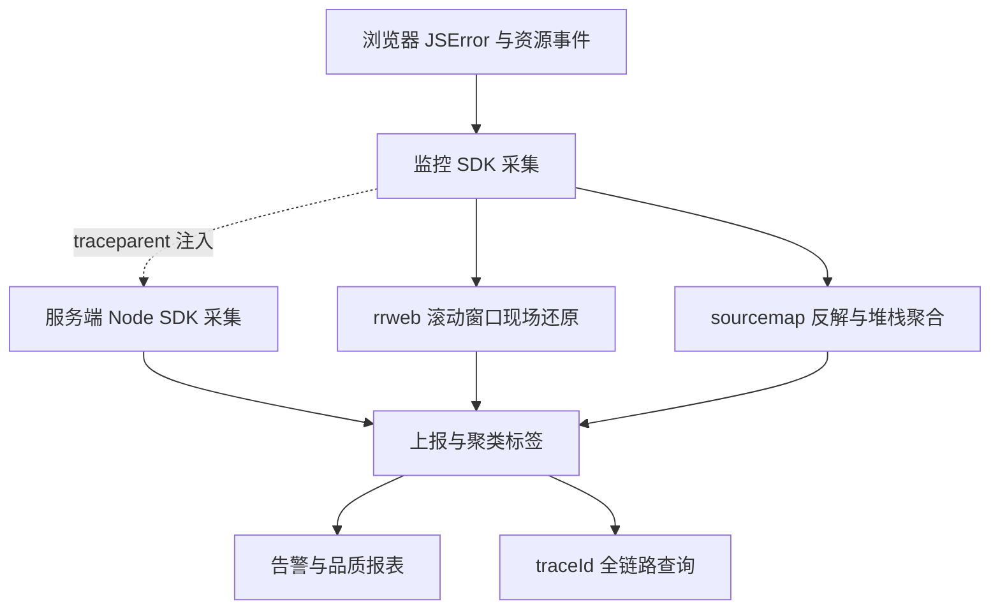

:::note 事实基线
本篇是「前端监控 SDK」带解答题库，共 **90 题**，事实来源为 `content/docs/data.md`（前端监控与数据请求工程实践）。SDK 相关章节（JSError 模型、滚动窗口录屏、sourcemap 反解、FSP 计算、网络监听与批量上报、全链路 trace）对照本地仓库 `~/github/yukino-sentry/sentry` @ `75500f83` 核验，源码路径标注于对应小节；其余章节（资源竞态、手写 SWR、引导脚本监控）为通用工程实践总结。
:::

本篇是「前端监控 SDK」带解答题库。这块内容在面试里的价值在于：**它考察「如何在错误发生前留下现场」「如何把压缩栈还原到源码行」「如何用 traceId 串起前后端」三个硬核能力**。本篇的组织顺序是：**先讲现场还原（rrweb 滚动窗口）→ 再讲 JSError 数据模型与 componentStack → 再讲 sourcemap 反解与聚合 → 再讲全链路 trace → 再讲资源竞态与 FSP → 最后讲手写 SWR 与 SDK 工程化**。

**主线一览**



## 一、故障现场还原：rrweb 滚动窗口

### Q1. 为什么「错误发生前的信息」最难留？核心思路是什么？

页面报错后的排查链条通常很长：用户反馈模糊、错误堆栈被压缩、无法复现操作路径。要建立的闭环是「**错误上报 → 现场还原 → 自动分析**」，其中最棘手的一步是：**错误发生时机不可预测，如何记录错误发生之前的信息**。

**不能等错误发生后再去补录之前，而是始终在录、但只在内存里保留最近 N 秒**。这就是**滚动窗口**（rolling window，也称环形缓冲）策略，类似行车记录仪：一直在录，出事时保存最近一段，其余丢弃。录制是常态化的，错误触发时直接从内存缓冲区取快照即可。

**采分点**：能说出「**滚动窗口能成立的前提是录制本身足够便宜**」——如果是录视频，常态录制不可行；而**结构化事件录制（DOM 增量加交互事件）的开销很小，全程录制是可行的**。

### Q2. rrweb 的工作原理是什么？

rrweb（record and replay the web）是录制与回放用户浏览器操作的开源方案，由 record、replay、snapshot 三部分组成：

1. **录制时不录视频，而是录「DOM 与事件的增量描述」**：首帧做全量 DOM 快照，深度遍历 DOM 树，把每个节点序列化为自定义的序列化节点（含标签、属性、文本、样式），生成一份可脱离原页面重建页面的数据；后续帧只录增量，基于 **MutationObserver** 捕获 DOM 增删改，基于事件监听捕获鼠标移动、点击、滚动、输入、视口尺寸变化等，每条事件带时间戳。
2. **回放时在沙箱 iframe 中按时间戳重放**：先用全量快照重建 DOM，再按时间轴应用增量变更与交互事件，还原出与真实页面一致的动态过程。

相比录屏视频：

| 维度   | rrweb 结构化事件录制           | 录屏视频           |
| ------ | ------------------------------ | ------------------ |
| 体积   | 文本化增量，压缩后通常几十 KB  | 视频流，体积大     |
| 清晰度 | 矢量渲染，任意分辨率文字都清晰 | 分辨率固定，放大糊 |
| 可检索 | 事件是结构化数据，可统计与聚合 | 只能人眼看         |
| 隐私   | 录制侧可配 mask 规则脱敏       | 需要额外打码       |

**采分点**：能说出「**rrweb 录的是 DOM 增量与事件，不是视频**」——这是它体积小、可检索、可脱敏的根本原因。MutationObserver 是 DOM 增量的采集机制。

### Q3. 滚动窗口的三步实现是什么？

1. **常态录制、内存缓冲**：启动录制后，每产生一个事件（DOM 增量、点击、滚动）就推进一个数组。因为录的是结构化增量而非视频，开销很小。
2. **滚动淘汰、只留最近一段**：每次事件到达时执行窗口裁剪，以 `事件时间戳 - 窗口长度` 作为截止线，把数组头部更早的事件移除。**内存占用恒定**，也不会记录用户完整操作历史，兼顾隐私与体积。
3. **错误触发、取快照上报**：上报事件命中触发类型（`Error` / `Xhr` / `Fetch` / `Resource` / `UnhandledRejection`）时置位录屏标记，下一次事件到达时把当前窗口内的事件做 JSON 序列化、`pako.gzip` 压缩、base64 编码，作为独立的录屏事件上报。

### Q4. checkout 机制为什么必要？

回放需要从一个**完整的 DOM 快照**开始重建，但滚动窗口会不断淘汰旧事件——如果全量快照被淘汰了，回放就没有起点。**checkout 机制**：定期（或按事件数）插入一个新的全量快照（checkout 点），保证**窗口内始终有一个可用的全量快照作为回放起点**。

**采分点**：能说出「**checkout 是回放起点，滚动淘汰不能把最近的全量快照淘汰掉**」——这是滚动窗口录屏能正确回放的关键约束。

### Q5. 录屏方案的边界是什么？体积怎么治理？

边界：① 录屏是**辅助还原手段**，不能替代错误堆栈与 breadcrumbs；② 窗口长度是**体积、隐私与还原能力之间的旋钮**——窗口越长还原越完整，但体积与隐私风险越大；③ 录屏事件体积大，要**压缩 + 按需上报**（只在错误触发时上报，不是常态上传）。

体积治理：① **gzip 压缩 + base64 编码**；② **mask 脱敏**（输入框内容打码）减少敏感数据也减少体积；③ **单事件超过阈值时丢弃**（避免录屏与大量资源条目顶过上报请求体上限，造成永久卡死的重试）；④ **采样**（不是每个会话都录，按采样率）。

**采分点**：能说出「**窗口长度是体积/隐私/还原能力的旋钮**」+「**录屏只在错误触发时上报，不是常态上传**」——这是成本与价值的平衡。

## 二、JSError 数据模型

### Q6. JSError 上报字段的组织原则是什么？四层是什么？

组织原则是**能定位、能归因、能复现**，信息分四层：

1. **第一层：错误本身（定位到代码行）**——message、filename、name、line/column、stack。
2. **第二层：事件上下文（归因）**——url、timestamp、traceId、type、status、框架上下文（componentStack）。
3. **第三层：用户与设备维度（缩小排查范围）**——deviceId、sessionId、userId、deviceInfo。
4. **第四层：行为与现场（复现）**——breadcrumbs、录屏事件、关联 HTTP 数据。

**采分点**：能说出「**四层分别服务定位、归因、缩小范围、复现**」——这是错误数据模型的设计框架，比记住字段名重要。

### Q7. 第一层「错误本身」有哪些字段？为什么有两条捕获路径？

| 字段          | 来源                               | 作用                                       |
| ------------- | ---------------------------------- | ------------------------------------------ |
| message       | ErrorEvent.message / Error.message | 错误描述，聚合与检索的主键之一             |
| filename      | ErrorEvent.filename                | 出错脚本 URL，用于匹配对应版本的 sourcemap |
| name          | Error.name                         | 错误类型名（如 TypeError、ReferenceError） |
| line / column | ErrorEvent.lineno / colno          | 出错行列号，配合 sourcemap 反解到源码      |
| stack         | Error.stack                        | 完整调用栈，反解后还原调用链               |

**为什么存在两条捕获路径**：

- **window error 事件（未捕获的运行时异常）**：浏览器派发 ErrorEvent，HTML 规范规定事件对象**直接携带 filename、lineno、colno**，采集时直接取值，无需解析。
- **运行时抛出的 Error 对象**（try-catch 捕获、Promise 拒绝的 reason、框架错误处理器的入参）：ECMAScript 规范**只规定了 name 与 message，没有行号列号**；但 stack 字符串（非标准，主流引擎都实现）里带帧信息。V8 的每帧形如 `at 函数名 (文件:行:列)`，SpiderMonkey 则是 `函数名@文件:行:列`，行列号藏在字符串里，需要正则提取。

两类错误在实际页面中同时存在，采集逻辑必须**两套兜底**：有 ErrorEvent 时优先用它的 filename/lineno/colno，只有 Error 对象时退回解析 stack 的帧信息，归一化成同一套数据模型后再交给 sourcemap 反解。**只写一种分支会漏掉另一类错误的行列号**。

**采分点**：能说出「**ErrorEvent 直接带行列号，Error 对象要从 stack 字符串正则提取**」这个区别——这是「为什么采集逻辑要两套兜底」的根本原因。

### Q8. 第二层「事件上下文」里 url 为什么要快照？

**SPA 中报错页面与当前页面可能已经不同**——用户从 /order 跳到 /profile 后，/order 的异步回调才抛错。所以 url 必须在**事件产生时快照**（错误发生时的 location.href），而不是上报时取当前 url。

### Q9. 第三层「用户与设备维度」的 deviceId 与 sessionId 怎么存？

- **deviceId**：**localStorage** 持久化的设备 ID，**跨会话聚合**同一设备的错误。
- **sessionId**：**sessionStorage** 的会话 ID，**串联一次会话内**的行为。

**采分点**：能说出「**localStorage 跨会话、sessionStorage 单会话**」——deviceId 用 localStorage（跨会话聚合），sessionId 用 sessionStorage（会话内串联），存储选择与聚合粒度匹配。

### Q10. 第四层「行为与现场」的 breadcrumbs 分哪几类？

breadcrumbs（面包屑）是错误前的用户行为序列，按类型分为**路由切换、HTTP 请求、点击、资源加载、代码错误**等，回答「**报错前用户做了什么**」。配合录屏事件（错误前几秒的 DOM 变更与交互）与关联 HTTP 数据（错误前失败的接口请求），构成完整的复现素材。

**采分点**：能说出「**很多前端报错的根因是接口异常**」——所以关联 HTTP 数据（状态码、耗时、请求响应体摘要）是 breadcrumbs 里最有价值的一类。

### Q11. 错误去重怎么做？为什么 filename 为空时跳过去重？

用 **`Error-message-filename-line-column` 拼接的字符串作为错误签名**，放入容量 1000 的 **BoundedSet**，超出容量时淘汰最早插入的记录，相同错误只上报一次（由 `repeatCodeError` 配置开关），**防止循环报错打爆上报通道**。

**对于 filename 为空或 unknown 的错误则跳过去重始终上报**——因为这类错误没有可靠签名，去重键会**误合并不同错误**。

**采分点**：能说出「**去重签名不可靠时宁可不去重**」——filename 为空的错误（如跨域 Script error）签名会误合并，所以跳过去重。这是「去重不能以误合并为代价」的纪律。

### Q12. 批量聚合怎么做？

每条错误入队都会**重置 2000ms 的防抖窗口**，窗口内无新错误后批量发送；按 `type-name-message` 分组的同一错误**达到 5 次及以上时，折叠为一条**带 `batchErrorLength`（聚合条数）与 `batchErrorLastHappenTime`（最后发生时间）的记录，不足 5 次仍逐条上报。

**采分点**：能说出「**防抖窗口 + 同类折叠**」——防抖把短时间内的多条错误攒成一批，同类折叠把重复错误压成一条带计数的记录，两者共同降低上报量。

### Q13. 跨域脚本错误只有 "Script error" 的成因与解决？

**成因**：出于安全考虑，浏览器对**跨域脚本**抛出的错误只暴露 `"Script error."`，不暴露 message、filename、行列号（防止跨域信息泄露）。

**解决**：① 给 `<script>` 标签加 **`crossorigin="anonymous"`** 属性；② 服务器响应头加 **`Access-Control-Allow-Origin`**。两者都满足时，浏览器才会暴露完整的错误信息。

**采分点**：能说出「**crossorigin + CORS 响应头两个条件都要满足**」——只加 crossorigin 但服务器没返回 CORS 头，仍然是 Script error。

## 三、componentStack：组件树维度的归因

### Q14. componentStack 是什么？从哪来？

componentStack 是 **React ErrorBoundary 捕获错误时附带的组件层级栈**——它给出的是**组件树路径**而不是 JS 调用栈（如 `in OrderList (at Order.tsx:142) in OrderPage (at App.tsx:20)`）。

**采分点**：能说出「**componentStack 是组件树维度，error.stack 是 JS 调用栈维度，两者互补**」——componentStack 回答「哪个组件出错」，error.stack 回答「哪行代码出错」。

### Q15. componentStack 与 error.stack 的区别？

| 维度       | componentStack                       | error.stack                   |
| ---------- | ------------------------------------ | ----------------------------- |
| 维度       | **组件树路径**（组件父子关系）       | **JS 调用栈**（函数调用关系） |
| 回答       | 哪个组件出错                         | 哪行代码出错                  |
| 来源       | React ErrorBoundary 的 ErrorInfo     | Error 对象的 stack 属性       |
| 事件处理器 | **没有**（事件处理器错误没有组件栈） | 有                            |

**采分点**：能说出「**事件处理器与异步代码抛的错误没有 componentStack**」——因为 componentStack 只在 React 渲染/生命周期阶段捕获错误时生成，事件处理器里的错误不走 ErrorBoundary。

### Q16. React 16 与 React 17+ 的 componentStack 生成机制有什么差异？

- **React 16 及之前**：生产环境的 componentStack **只有组件名，没有位置信息**（`in OrderList in OrderPage`）——只能当辅助归因维度，无法 sourcemap 反解。
- **React 17+**：生产环境的 componentStack **带 bundle 行列号**（`in OrderList (at chunk-xyz.js:1:23456)`）——可以走 sourcemap 反解，独立参与定位。

**采分点**：能说出「**React 17 是分水岭**」——17 之前生产环境没有位置信息，componentStack 只能辅助归因；17 起带 bundle 行列号，配合 sourcemap 可独立定位。无论哪个版本，**displayName 都是成本最低的可读性保障**。

### Q17. 怎么保住组件名可读性（displayName）？

生产构建会 mangle 组件名（`OrderList` 变成 `a`），componentStack 就不可读了。三种自动注入 displayName 的方案：

| 维度         | Webpack 插件     | Babel 插件                        | Vite/Rollup 自定义插件 |
| ------------ | ---------------- | --------------------------------- | ---------------------- |
| 接入成本     | 极低（一行配置） | 极低（一行配置）                  | 中等（需添加插件文件） |
| 维护状态     | 停更于 2022      | 长期停更                          | 自主可控               |
| 适用构建工具 | 仅 Webpack       | Webpack + Vite（需切 Babel 模式） | Vite / Rollup          |

选型：Webpack 项目用现成插件；Vite 项目且已切 Babel 模式用 Babel 插件；Vite 项目用 esbuild/SWC 时写自定义插件，不牺牲构建速度。自定义插件的核心是 **AST 遍历**：识别函数声明、箭头函数赋值、`forwardRef`/`memo`/`lazy` 包装、继承 React.Component 的类声明，在这些语句之后插入 `ComponentName.displayName = "ComponentName"`。

体积代价：**keep_fnames/keep_classnames 属于中等代价**（保留所有函数或类名，几到几十 KB），**手动或自动注入 displayName 代价极低**（仅若干字符串字面量）。如果只是为了 componentStack 可读性，**displayName 更划算**。

**采分点**：能说出「**displayName 比 keep_fnames 更划算**」——keep_fnames 保留所有函数名（体积大），displayName 只给组件加（体积极小），针对性更强。

### Q18. sourcemap 反解 componentStack 的流程与边界？

React 17+ 生产环境的 componentStack 带 bundle 行列号，可以走 sourcemap 反解：

1. 构建时生成 sourcemap（**隐藏式 sourcemap，不部署到公网**），上传至监控平台，与项目加版本关联。
2. 运行时采集含 bundle URL 加行列号的 componentStack。
3. 服务端按 URL 匹配对应版本的 sourcemap，逐帧把 bundle 行列号反解为原始文件路径与行号。

**还原能力的边界**：能把 bundle 行列号还原为原始文件路径与行号；若 sourcemap 包含源码内容，可还原出错行附近的原始源码；**无法可靠还原被压缩工具 mangle 掉的组件名**（sourcemap 的 names 字段是位置相关的符号映射，不等同于组件的语义名称）。因此反解后**文件路径与行号是主定位依据，组件名仅作辅助**，这也是 displayName 仍有价值的原因。

**高频踩坑点**：sourcemap 版本必须严格对应出错产物（源码小改动会造成偏移量剧变，用错版本还原结果全错）；若在浏览器端拉取 sourcemap，CDN 需要配置跨域响应头；sourcemap 中的 sourceRoot 指向本地开发路径会导致解析器找不到原始文件，构建时应置空；多层转换（TypeScript → Babel → Terser）要确保每层正确传递上一层的 sourcemap，否则映射链断裂。

### Q19. componentStack 与静态代码知识图谱怎么互补？

- **信息形态同构**：componentStack 本身是「出错组件到组件树根的组件名序列」，恰好对应代码图里的一条组件父子链路径——每一行都能映射成图上的节点与边，等于给自动分析提供了一条现成的图遍历起点序列。
- **查询入口互补**：有源码文件行列号的帧可以按位置命中符号；只有组件名的帧可以按符号名查询；React 17+ 的 bundle 行列号先经 sourcemap 反解再按位置查询。
- **归因维度互补**：有了代码图，按组件归因可以从扁平的名字列表升级为结构化子树聚合——多条上报都经过同一个中间组件时，可沿子组件边确认它们属于同一个子树。
- **覆盖互补**：事件处理器与异步代码抛的错误没有 componentStack，而代码图可以通过事件绑定与动态分发边把错误关联回触发它的组件。

**采分点**：能说出「**componentStack 是代码图的一条现成遍历起点序列**」——这把「运行时错误」与「静态代码结构」连接起来，是自动定位的基础。

## 四、Sourcemap 反解、堆栈聚合与报警

### Q20. sourcemap 反解的完整流程是什么？

1. **构建时**：生成 sourcemap（隐藏式，不部署公网），上传至监控平台，**与项目 + 版本关联**。
2. **运行时**：SDK 采集压缩栈（bundle URL + 行列号）。
3. **服务端**：按 bundle URL 匹配对应版本的 sourcemap，**逐帧反解**为原始文件路径与行号。

**采分点**：能说出「**sourcemap 必须与版本严格关联**」——用错版本的 sourcemap 反解，结果全错（偏移量剧变）。这与沙箱篇「钉死 commit」、性能篇「符号文件随版本归档」是同一条纪律。

### Q21. 堆栈聚合（fingerprint）怎么做？

单个错误是噪声，**同类错误聚成 Issue** 才有价值。聚合依据是 **fingerprint（指纹）**：通常用 `errorType + 反解栈 top3 帧 + 路由` 拼接哈希。同 fingerprint 的错误聚成一个 Issue，统计影响用户数、出现次数、首次/最后出现时间。

**采分点**：能说出「**fingerprint 用反解后的栈帧（不是压缩栈）**」——压缩栈每次构建都变（chunk 名、行列号偏移），反解后的源码栈帧才稳定，才能跨版本聚合。

### Q22. 异常报警机制有哪些？

- **宏观报警**：错误率突增（整体错误率超过阈值）、新增 Issue（首次出现的 fingerprint）。
- **微观报警**：单个 Issue 影响用户数超阈值、P0 页面出现错误。
- **版本关联**：错误与 release 版本关联，能回答「哪个版本引入的」。
- **git blame 自动分配**：根据反解出的文件与行号，git blame 找到负责人，自动分配 Issue。

**采分点**：能说出「**版本关联 + git blame 自动分配**」——这把「错误报警」与「责任归属」打通，是监控闭环的关键一环（也是沙箱自动修复的触发入口）。

## 五、前后端全链路 Trace

### Q23. 为什么需要一个贯穿前后端的 traceId？

前端 JSError 里相当一部分的根因在后端：接口 500、网关超时、响应结构非法导致前端解析抛错。监控体系通常有两个入口——浏览器端与服务端——但**两端的上报是两条孤立的数据流**：前端事件有页面地址与会话 ID，后端事件有进程日志与请求路径，关联手段只剩时间戳加用户 ID 加 URL 的人工对齐，在流量大或链路跨多级服务时几乎无法排查。

**缺的不是采集能力，而是一个贯穿两端的关联键**。标准答案是 **W3C Trace Context**：给每条端到端链路分配全局唯一的 `traceId`（32 位十六进制），链路内每个操作持有 `spanId`（16 位十六进制），进程之间用 `traceparent` 请求头传播：

```text
traceparent: 00-<traceId>-<spanId>-01
```

只要前端事件、后端事件与请求传播都携带同一个 traceId，无论故障从哪一端上报，都能凭 traceId 拉出前后端完整链路。

### Q24. 前端：为什么页面视图是 trace 的根？

浏览器端**没有天然的「请求」概念**，SDK 选择**页面视图作为 trace 的根**：初始化（首个 PageLoad）、每次 history/hash 路由切换与手动 PV 上报都会**生成新的 traceId**（`renewTraceContext`），`getBaseData()` 把当前 traceId 打进每条事件。同一页面视图内的 JSError、HTTP 事件、点击、PV、性能指标与录屏事件**天然聚合在同一个 traceId 下**。

一个顺序细节：路由切换时为上一页补发的停留时长事件（PageDwell）**先于上下文轮换上报**，因此携带旧 traceId——停留时长属于上一个页面视图的链路，语义恰好正确。

**采分点**：能说出「**浏览器没有请求概念，所以用页面视图做 trace 根**」——这是前端 trace 与后端 trace（以请求为根）的本质区别。

### Q25. 传播：被监控请求怎么注入 traceparent？三条边界是什么？

SDK 本来就 hook 了 XHR 与 fetch，注入点是现成的：每个被监控请求生成自己的 spanId，发起前按传播规则注入 `traceparent` 头。三条必须守住的边界：

1. **CORS 安全**：`traceparent` **不是 CORS 安全列表头**，跨源注入会触发预检甚至导致请求失败。因此浏览器**默认只对同源请求传播**（相对路径视为同源），跨源目标必须用 `tracePropagationTargets` 显式选择加入；Node 运行时没有 CORS 约束，默认对全部出站请求传播。
2. **防御性注入**：XHR 的 `setRequestHeader` 包在 try/catch 里且仅在 `readyState === OPENED` 时执行，注入失败只记日志、不打断业务请求；fetch 按「Request 自带头 → init 头 → traceparent」的顺序合并，不丢失任何一方的头。
3. **自身排除**：发往上报端点（dsn）的请求在忽略判定阶段就被排除，监控流量不携带无意义的头。

**采分点**：第 1 条最关键——「**traceparent 不是 CORS 安全列表头，跨源注入会触发预检**」，所以浏览器默认只同源传播，跨源要显式配置。这是前端 trace 传播的第一坑。

### Q26. 后端：continueTrace + AsyncLocalStorage 怎么还原请求上下文？

服务端要解决的是「**这条事件属于哪个请求**」。Node SDK 用 **`AsyncLocalStorage`** 实现：导出 `continueTrace(traceparent, callback)`，解析入站头（继承其 traceId、给自己签发新 spanId，拒绝畸形与全零 id），在 ALS 上下文内运行回调。框架接入是一行中间件：

```ts
import { continueTrace } from "@yukino.js/sentry/node";
// Koa
app.use((ctx, next) =>
  continueTrace(ctx.req.headers.traceparent, () => next()),
);
// Express
app.use((req, _res, next) => continueTrace(req.headers.traceparent, next));
```

上下文内创建的所有事件（含 await 之后的异步延续）都携带入站请求的 traceId：请求处理中的 `traceError`、失败的出站 fetch、未处理拒绝全部自动归入同一条链路；出站 fetch 继续注入 `traceparent`，多级服务可以级联串起来。**ALS 上下文沿异步调用链传播**，恰好覆盖「一次请求穿过多层异步函数」的服务形态。

**采分点**：能说出「**AsyncLocalStorage 让 traceId 沿异步调用链传播**」——这是 Node 服务端 trace 的核心机制，解决了「异步代码里事件归属哪个请求」的问题。

### Q27. 全链路 trace 的边界有哪些？

- **进程级崩溃无法归因到请求 trace**：`uncaughtException` 到达处理器时 **ALS 上下文已丢失**，这类事件获得独立的新 traceId。这是所有基于 ALS 方案的共同限制，需要归因的业务错误应在请求上下文内捕获并用 `traceError` 手动上报。
- **未在 continueTrace 内上报的事件每次获得新 traceId**——诚实地标记「无上下文」，而不是错误地绑定到某个陈旧值。
- **采样、去重与批量聚合都发生在 traceId 分配之后**——traceId 是顶层检索维度，不受这些处理影响。

**采分点**：能说出「**uncaughtException 时 ALS 上下文已丢失**」——这是 ALS 方案的固有限制，进程级崩溃无法归因到请求。

### Q28. 怎么按 traceId 查询完整链路？

traceId 是上报外壳的顶层字段，日志服务端用一个等值查询就能聚合：`GET /api/logs/trace?traceId=<id>` 按时间升序返回该 trace 的全部事件。一条完整链路形如：**PageLoad PV → 一批资源/性能事件 → 失败的 fetch 事件（带 spanId）→ 前端 JSError → 同一 trace 下后端服务的错误事件**；现场由录屏事件与面包屑同时保留。

**采分点**：能说出「**取代时间戳人工对齐**」——有了 traceId，前后端故障的关联从「时间戳 + 用户 ID + URL 人工对齐」变成「一次等值查询」。

## 六、资源加载竞态与 FSP

### Q29. monaco worker 加载错误这类资源竞态的成因是什么？

懒加载资源（如 monaco editor 的 worker）的竞态：**worker 脚本的加载是异步的，如果主代码在 worker 加载完成前就尝试使用它，会报错**。成因是加载与使用的时序没有保证——网络抖动、资源 404、加载顺序错乱都会触发。

### Q30. 资源竞态的三层防御是什么？

懒加载资源的竞态**无法被根除，只能被分层缓解**：

1. **import 重试**：动态 import 失败时重试（消化网络抖动）。
2. **错误边界给用户出口**：加载失败时错误边界捕获，给用户一个可见的降级界面（而不是白屏）。
3. **资源错误上报提供定位**：resource error 上报（哪个资源、什么错误），便于定位与修复。

配合**预加载**：按首屏是否包含目标资源选择时机——首屏需要的资源尽早预加载，非首屏的按需加载。

**采分点**：能说出「**竞态无法根除，只能分层缓解**」——import 重试消化抖动、错误边界给出口、上报提供定位，三层各司其职。这是「接受不确定性、分层兜底」的工程思想。

### Q31. FSP（首屏渲染时间）为什么需要独立指标？

**LCP（Largest Contentful Paint）便宜但可能选到骨架屏**——骨架屏是首屏最大的元素，LCP 会把它当作「首屏完成」，但用户看到的还是骨架。**FSP（First Screen Paint）更贴近用户感受**——它度量「首屏有意义内容渲染完成」的时间。

**采分点**：能说出「**LCP 可能选到骨架屏，FSP 更贴近用户感受**」——这是「为什么需要独立首屏指标」的核心。但 FSP 也有局限（见 Q32）。

### Q32. FSP 的计算原理与边界？

**计算原理**：FSP 通常基于「首屏区域内 DOM 节点的渲染时间」——监听首屏区域内的元素变化，取「首屏内容稳定」的时间点作为 FSP。实现上结合 MutationObserver 与元素可见性判断。

**边界与局限**：① **骨架屏先出**——如果骨架屏算首屏内容，FSP 会偏早；② **服务端直出（SSR）**——内容在 HTML 里就有，FSP 的「渲染完成」判断要特殊处理；③ **路由切换**——SPA 路由切换后的「首屏」如何定义。**首屏指标没有唯一正确答案**，按业务形态选择并明确其边界，比换一个更精确的指标更有价值。

**采分点**：能说出「**首屏指标没有唯一正确答案，按业务形态选择并明确边界**」——这体现对指标本质的理解（指标是近似，不是真理）。

## 七、手写 SWR 与数据请求

### Q33. 手写 SWR 解决什么问题？两阶段设计是什么？

业务约束：存量多页项目，需要在**框架执行之前**就发起关键接口请求（预加载），并对在途请求做**去重与缓存**（stale-while-revalidate）。

**两阶段设计**：

1. **预加载阶段**：在 HTML 解析阶段（早于 bundle 下载执行）就发起请求，把 promise 挂到全局对象（如 `window.__PRELOAD__`）。这比框架内的预取更早——框架的预取最早也只能在应用初始化时触发，无法早于 bundle 下载。
2. **消费阶段**：框架就绪后，从全局对象认领预加载的 promise，直接 await（如果已完成则立即拿到结果，未完成则等待）。配合缓存与后台刷新（SWR）。

**采分点**：能说出「**预加载发生在 HTML 解析阶段，早于 bundle 下载**」——这是手写方案相对框架预取的核心优势（时间窗口更早）。

### Q34. 消费阶段的三级降级是什么？

消费时按优先级降级：① **命中预加载缓存**（全局对象里有该 key 的 promise）→ 直接 await；② **在途请求去重**（有相同 key 的在途请求）→ 复用该 promise；③ **都没有** → 发起新请求。

**采分点**：能说出「**三级降级的核心是『把在途请求变成可共享的句柄』**」——去重的本质是不重复发起相同请求，复用同一个 promise。

### Q35. 为什么存量项目手写而不是用现成的 hook 库？

三个原因：① **预加载要早于 bundle**——现成库的预取运行在 bundle 内部，最早也只能在应用初始化时触发，无法早于 bundle 下载；手写方案的预加载发生在 HTML 解析阶段。② **缓存挂在库的客户端实例上、消费侧依赖 Provider 包裹**——非组件页面无法使用；手写方案的消费入口是普通函数，全局对象认领，任何技术栈页面都能用。③ **能力覆盖度与接入成本的比值**——需求只有三个能力（预加载、去重、缓存）时，引入提供三十个能力的库不是收益。

**采分点**：能说出「**手写方案的预加载发生在 HTML 解析阶段，消费入口是普通函数**」——这两点差异正是存量多页项目选择它的原因。同时能说出「**当需求扩展到乐观更新、缓存失效、轮询等复杂形态时，现成库的成熟度与生态就是净收益**」——体现选型的动态判断。

### Q36. 手写 SWR 怎么做缓存失效？

当前实现是「**每次命中都后台刷新**」的激进策略，适合低频变化数据。可扩展方向：基于时间戳的 TTL 判断（TTL 内不刷新）、暴露主动失效方法供写操作后调用、按 key 配置不同过期策略。

**采分点**：能说出「**SWR 的 revalidate 是后台刷新，不阻塞当前展示**」——先用 stale 数据立即展示，后台刷新后更新，这是 stale-while-revalidate 的核心语义。

## 八、引导脚本性能监控与 SDK 工程化

### Q37. 为什么启动链路的监控要手写引导脚本而不是用 SDK？

三个现实原因：

1. **采集时机必须早于 SDK 本身**：监控对象是启动链路，而第三方 SDK 是 JS bundle 的一部分，只有 bundle 下载执行后才就位；依赖 SDK 就意味着 SDK 加载之前的启动阶段全部测不到。**引导脚本手写采集加全局队列暂存，让数据先于 SDK 产生，SDK 就位后异步消费队列**。
2. **指标是业务启动链路的私有定制**：业务码归因长任务、指定接口的单独耗时、多个并行菜单请求中找最慢的一个、低采样率的模块路径上报——通用监控 SDK 的标准采集项覆盖不到。
3. **引导脚本有严格的体积与稳定性约束**：它运行在关键路径上，每多一个依赖都会拖慢被测量的启动过程，监控代码自身异常更不能中断业务启动，所以标记、测量、上报全部包错误处理。

**采分点**：能说出「**采集要早于 SDK，所以数据先于 SDK 产生、SDK 就位后异步消费队列**」——这与插件化 SDK 的预收集机制是同一思路。

### Q38. 引导脚本监控的五部分是什么？

全部基于浏览器原生 Performance 接口：

1. **启动打点**：脚本入口第一行执行启动标记，启动流程完成后打结束标记，用测量接口计算启动总耗时（测量封装错误处理，标记不存在时不抛错）。
2. **长任务监听**：用 PerformanceObserver 观察 longtask 类型条目，只上报超过 **50ms** 的任务（50ms 是长任务判定阈值），附带页面路径与业务码；启动采集完成时断开监听。
3. **资源加载采样**：记录启动后一段窗口内执行的模块，按低采样率上报模块路径（监控反哺优化：先采样观测，再决定预加载清单）。
4. **关键指标采集**：启动完成后一次性采集导航计时、资源计时（**先扩大资源计时缓冲区防止条目被丢弃**，再按 URL 匹配找关键接口耗时，对并行发起的多个菜单请求排序找最慢的）、自定义测量。
5. **队列化上报**：所有数据推入全局队列，格式统一为动作加参数的事件结构，由后加载的监控 SDK 异步消费；上报动作全部包错误处理。

**采分点**：能说出「**扩大资源计时缓冲区**」——默认 ResourceTiming 缓冲区只有 150 条，超出会丢弃，所以采集前要 `performance.setResourceTimingBufferSize` 扩大。这是容易忽略的细节。

### Q39. 监控 SDK 的插件化架构解决什么？

**插件化保证不用就不打包**：SDK 的能力拆成插件（错误采集、性能采集、录屏、网络监听等），按需引入——不用的插件不进 bundle。配合**动态导入**（用了也不进首屏）与**任务切片/延迟执行**（不影响首屏），核心包体积与监听耗时都纳入基线监控持续治理。

**采分点**：能说出「**监控 SDK 自身的体积与执行开销必须被当作产品指标管理**」——插件化、动态导入、任务切片是三个手段，核心包体积与监听耗时是治理对象。

### Q40. 监控 SDK 的性能怎么衡量与优化？

衡量：① **核心包体积**（gzip 后多少 KB）；② **监听耗时**（各 hook 的执行时间）；③ **上报频率与体积**。优化：① 插件化（不用不打包）；② 动态导入（不进首屏）；③ 任务切片与延迟执行（`requestIdleCallback` / 时间切片，不阻塞首屏）；④ 批量上报 + 防抖（降低上报频率）；⑤ 采样（不是所有事件都采）。

**采分点**：能说出「**监控不能拖慢被监控的页面**」——这是监控 SDK 的第一约束，所有优化都服务于「把监控自身的开销降到最低」。

### Q41-Q90. 快速自检与深挖补充

**Q41. 一句话解释滚动窗口的核心。** 始终在录、只在内存保留最近 N 秒，错误触发时取快照上报——像行车记录仪，录制常态化，出事保存最近一段。

**Q42. 一句话解释 rrweb 为什么比录屏视频好。** 录的是 DOM 增量与事件（结构化），体积小（几十 KB）、矢量清晰、可检索聚合、可 mask 脱敏——视频流大、糊、只能人眼看。

**Q43. 一句话解释 MutationObserver 在 rrweb 里的作用。** 捕获 DOM 增删改作为增量事件——首帧全量快照后，后续帧只录 MutationObserver 捕获的增量。

**Q44. 一句话解释 checkout 机制。** 定期插入全量快照作为回放起点，保证滚动淘汰不会把最近的全量快照淘汰掉——回放必须从完整快照开始。

**Q45. 一句话解释窗口长度是哪三者的旋钮。** 体积、隐私、还原能力——窗口越长还原越完整，但体积与隐私风险越大。

**Q46. 一句话解释为什么录屏只在错误触发时上报。** 录屏体积大，常态上传成本高——只在命中触发类型（Error/Xhr/Fetch/Resource/UnhandledRejection）时取窗口快照上报。

**Q47. 一句话解释 JSError 四层数据模型。** 错误本身（定位）、事件上下文（归因）、用户设备维度（缩小范围）、行为现场（复现）——分别服务定位、归因、缩小范围、复现。

**Q48. 一句话解释为什么采集要两套兜底。** ErrorEvent 直接带行列号，Error 对象要从 stack 字符串正则提取——两类错误同时存在，只写一种分支会漏掉另一类的行列号。

**Q49. 一句话解释 SPA 里 url 为什么要快照。** 报错页面与当前页面可能已不同（异步回调延迟抛错），所以 url 必须在事件产生时快照，不是上报时取当前值。

**Q50. 一句话解释 deviceId 与 sessionId 的存储选择。** deviceId 用 localStorage（跨会话聚合），sessionId 用 sessionStorage（会话内串联）——存储选择与聚合粒度匹配。

**Q51. 一句话解释去重签名为何用 message+filename+line+column。** 这四个字段组合能唯一标识「同一个错误」——相同错误只上报一次，防止循环报错打爆上报通道。

**Q52. 一句话解释为什么 filename 为空时跳过去重。** 这类错误（如跨域 Script error）没有可靠签名，去重键会误合并不同错误——宁可不去重。

**Q53. 一句话解释批量聚合的防抖 + 折叠。** 每条错误重置 2000ms 防抖窗口，窗口内无新错误后批量发送；同类错误达 5 次以上折叠为一条带计数的记录。

**Q54. 一句话解释 Script error 的解决。** script 标签加 crossorigin="anonymous" + 服务器返回 Access-Control-Allow-Origin，两个条件都满足才暴露完整错误信息。

**Q55. 一句话解释 componentStack 与 error.stack 的维度差异。** componentStack 是组件树路径（哪个组件出错），error.stack 是 JS 调用栈（哪行代码出错）——互补。

**Q56. 一句话解释为什么事件处理器错误没有 componentStack。** componentStack 只在 React 渲染/生命周期阶段捕获错误时生成（ErrorBoundary），事件处理器里的错误不走 ErrorBoundary。

**Q57. 一句话解释 React 17 的 componentStack 分水岭。** 17 之前生产环境只有组件名无位置，17 起带 bundle 行列号可 sourcemap 反解——17 之前只能辅助归因，17 起可独立定位。

**Q58. 一句话解释为什么 displayName 比 keep_fnames 划算。** keep_fnames 保留所有函数名（几到几十 KB），displayName 只给组件加（极小）——只为 componentStack 可读性时 displayName 更划算。

**Q59. 一句话解释 sourcemap 反解后为什么组件名仅辅助。** sourcemap 的 names 字段是位置相关的符号映射，不等同于组件语义名称，无法可靠还原 mangle 掉的组件名——文件路径与行号是主定位依据。

**Q60. 一句话解释 sourcemap 版本为什么要严格对应。** 源码小改动会造成偏移量剧变，用错版本还原结果全错——sourcemap 必须与出错产物版本严格关联。

**Q61. 一句话解释多层转换的 sourcemap 链。** TypeScript → Babel → Terser 每层要正确传递上一层的 sourcemap，否则映射链断裂——反解需要完整的映射链。

**Q62. 一句话解释 fingerprint 为什么用反解后的栈帧。** 压缩栈每次构建都变（chunk 名、偏移），反解后的源码栈帧才稳定，才能跨版本聚合。

**Q63. 一句话解释版本关联 + git blame 自动分配的价值。** 把错误报警与责任归属打通——根据反解出的文件行号 git blame 找负责人自动分配 Issue，也是沙箱自动修复的触发入口。

**Q64. 一句话解释为什么浏览器用页面视图做 trace 根。** 浏览器没有天然的请求概念，页面视图（PageLoad/路由切换/PV）是最自然的链路边界——同一视图内的事件聚合在同一 traceId 下。

**Q65. 一句话解释 traceparent 为什么不是 CORS 安全列表头。** 它是自定义头，跨源注入会触发预检甚至请求失败——所以浏览器默认只同源传播，跨源要 tracePropagationTargets 显式配置。

**Q66. 一句话解释 XHR 注入 traceparent 的防御性。** setRequestHeader 包在 try/catch 里且仅在 readyState === OPENED 时执行，注入失败只记日志不打断业务请求。

**Q67. 一句话解释 AsyncLocalStorage 在 trace 里的作用。** 让 traceId 沿异步调用链传播——continueTrace 在 ALS 上下文内运行回调，上下文内所有事件（含 await 后）都携带入站 traceId。

**Q68. 一句话解释 uncaughtException 为什么无法归因到请求 trace。** 到达处理器时 ALS 上下文已丢失——这是所有基于 ALS 方案的共同限制，进程级崩溃获得独立新 traceId。

**Q69. 一句话解释 traceId 查询取代了什么。** 取代时间戳 + 用户 ID + URL 的人工对齐——凭 traceId 一次等值查询拉出前后端完整链路。

**Q70. 一句话解释资源竞态为什么无法根除。** 懒加载资源的加载与使用时序没有绝对保证，网络抖动/404/顺序错乱都会触发——只能分层缓解（import 重试 + 错误边界 + 上报定位）。

**Q71. 一句话解释 import 重试消化什么。** 网络抖动导致的偶发加载失败——重试一次通常就成功，把抖动从「错误」降级为「延迟」。

**Q72. 一句话解释 LCP 为什么会选到骨架屏。** 骨架屏是首屏最大的元素，LCP 把最大内容绘制当作首屏完成——但用户看到的还是骨架，所以 LCP 偏早。

**Q73. 一句话解释 FSP 的三个局限。** 骨架屏先出（FSP 偏早）、服务端直出（内容在 HTML 里，渲染完成判断要特殊处理）、路由切换（SPA 首屏如何定义）——首屏指标没有唯一正确答案。

**Q74. 一句话解释手写 SWR 预加载为什么比框架预取早。** 预加载发生在 HTML 解析阶段（早于 bundle 下载执行），框架预取最早也只能在应用初始化时触发——手写方案的时间窗口更早。

**Q75. 一句话解释在途请求去重的本质。** 把在途请求变成可共享的句柄（promise 挂全局对象），相同 key 复用同一个 promise，不重复发起。

**Q76. 一句话解释消费阶段三级降级。** 命中预加载缓存 → 复用在途请求 → 发起新请求——核心是「在途请求变可共享句柄」。

**Q77. 一句话解释 SWR 的 revalidate 语义。** 先用 stale 数据立即展示，后台刷新后更新——不阻塞当前展示，是 stale-while-revalidate 的核心。

**Q78. 一句话解释为什么采集要早于 SDK。** 监控对象是启动链路，SDK 是 bundle 的一部分（bundle 下载执行后才就位）——引导脚本手写采集 + 全局队列暂存，数据先于 SDK 产生，SDK 就位后异步消费。

**Q79. 一句话解释长任务阈值为什么是 50ms。** 50ms 是长任务判定阈值（PerformanceObserver longtask）——超过 50ms 的任务会阻塞主线程造成可感知卡顿。

**Q80. 一句话解释为什么要扩大资源计时缓冲区。** 默认 ResourceTiming 缓冲区只有 150 条，超出丢弃——采集前 setResourceTimingBufferSize 扩大，防止关键接口的资源条目被丢弃。

**Q81. 一句话解释「监控反哺优化」。** 先采样观测（低采样率上报模块路径），再决定预加载清单——用数据决定优化方向，而不是拍脑袋。

**Q82. 一句话解释插件化架构的三个手段。** 插件化（不用不打包）、动态导入（用了也不进首屏）、任务切片与延迟执行（不影响首屏）——把 SDK 自身体积与开销当产品指标管理。

**Q83. 一句话解释监控 SDK 的第一约束。** 监控不能拖慢被监控的页面——所有优化（插件化、动态导入、切片、批量、采样）都服务于把监控自身开销降到最低。

**Q84. 一句话解释引导脚本为什么全部包错误处理。** 它运行在关键路径上，监控代码自身异常不能中断业务启动——标记、测量、上报全部包 try/catch。

**Q85. 一句话解释「数据先于 SDK 产生」的机制。** 引导脚本把数据推入全局队列，SDK 就位后异步消费队列——与插件化 SDK 的预收集机制同一思路，只是预收集的是性能打点。

**Q86. 一句话解释为什么启动总耗时可能等于最慢网络请求的等待时间。** 框架挂载延迟若与网络请求并行则被覆盖——启动链路的瓶颈通常是最慢的网络请求，不是框架挂载。

**Q87. 一句话解释「多个并行菜单请求找最慢的」的意义。** 启动链路瓶颈是最慢的那个请求——找出它才能针对性优化（预加载、合并、缓存）。

**Q88. 一句话解释 rrweb 的 mask 脱敏。** 录制侧可配 mask 规则（输入框内容打码）——既保护隐私，也减少体积。

**Q89. 一句话解释「单事件超阈值丢弃」的目的。** 录屏与大量资源条目可能顶过上报请求体上限，造成永久卡死的重试——超阈值丢弃，避免卡死。

**Q90. 一句话总结本篇的闭环。** 错误上报（四层数据模型）→ 现场还原（rrweb 滚动窗口 + breadcrumbs）→ 定位（sourcemap 反解 + componentStack + fingerprint 聚合）→ 关联（traceId 全链路）→ 自动分析/修复（版本关联 + git blame 触发）——每一环都为下一环提供素材。

---

**延伸阅读**

- [Agent 沙箱与 JSError 自动修复题库](/interview/qa/agent-sandbox-autofix)：本篇的下游——sourcemap 反解、录屏、fingerprint 是自动修复的输入。
- [移动端性能采集与 Profiling 题库](/interview/qa/mobile-perf-profiling)：设备侧采集与本篇的浏览器侧采集对照。
- [前端监控与可观测性题库](/interview/qa/frontend-observability)：Web Vitals、长任务、资源计时的指标口径。
- [AI 流式前端题库](/interview/qa/ai-streaming-ui)：流式渲染与前端状态管理。
- [工作文档 · 前端监控与数据请求工程实践](/docs/data)：本篇的事实来源，含 yukino-sentry 源码路径。
