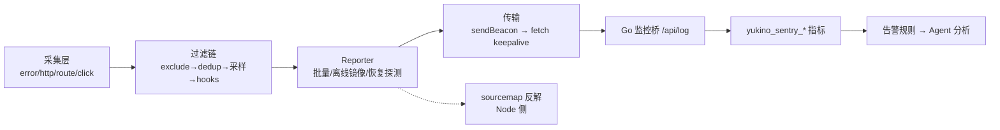
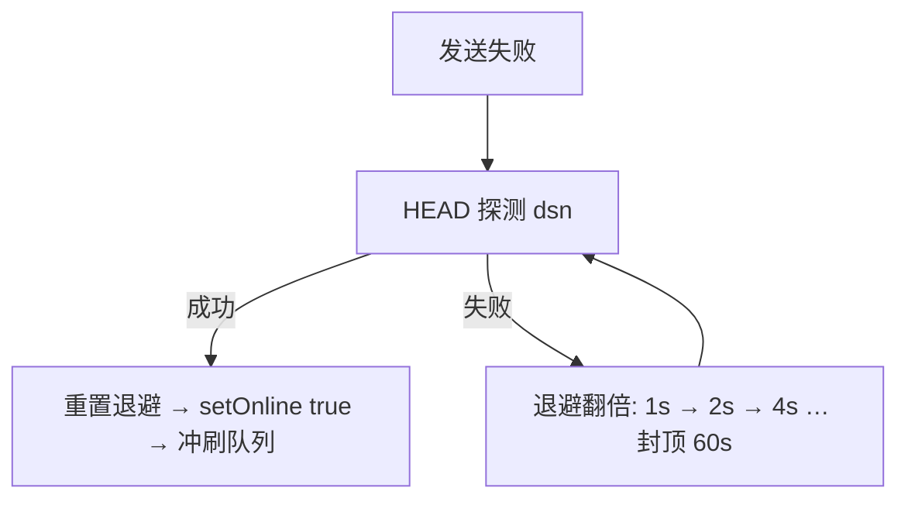

前端可观测性的完整闭环是「**采集 → 过滤 → 上报 → 还原 → 指标化 → 告警**」，每一环都有独立的工程取舍。本篇 59 题以一个真实 SDK 为主线展开——`@yukino.js/sentry@0.0.1`（框架无关浏览器监控 SDK），并延伸到它对接的 Go 监控桥。

:::note 证据口径（本篇特殊）
sentry 源码仓库本机未检出，佐证按以下优先级，引用时逐条标注来源级别：

| 级别 | 来源                                                                                             | 性质                       |
| ---- | ------------------------------------------------------------------------------------------------ | -------------------------- |
| ①    | 已安装包实码 `26autumn/node_modules/@yukino.js/sentry/`（`dist/` 产物 + 包内 `README.md`）       | **代码事实**（当前安装版） |
| ②    | `content/fe/yukino-sentry.md`（603 行源码笔记，frontmatter `local_commit b2f2e70`）              | **基于源码笔记**           |
| ③    | 本站接入 `26autumn/rspress.config.ts`；`yukino-chat/client/vite.config.ts`                       | 代码事实                   |
| ④    | Go 监控桥 `yukino.go/apps/agent/server/internal/app/sentry_metrics_handler.go`（HEAD `facf5d6`） | 代码事实                   |
| ⑤    | `yukino-chat` / `yukino-chatbot` client 已核实的错误处理、超时、WS 重连逻辑                      | 代码事实                   |

后端 Prometheus 告警与 LLM 评测归 [LLM 评测与可观测性](/interview/qa/llm-eval-observability)；流式 UI 的质量监控已在 [AI 流式前端专题](/interview/qa/ai-streaming-ui) 第七节展开，本篇从简并交叉引用。
:::



## 一、错误捕获全景

### Q1. 前端运行时错误有哪几个捕获入口？各覆盖什么

**基础**。四个入口缺一不可：

| 入口                               | 覆盖                                         | 盲区                                  |
| ---------------------------------- | -------------------------------------------- | ------------------------------------- |
| `window.addEventListener("error")` | JS 运行时错误 + **资源加载错误**（捕获阶段） | Promise 拒绝、被 catch 的错误         |
| `window.onerror`                   | 同上（老式五参回调）                         | 资源错误（不触发 onerror 的资源路径） |
| `unhandledrejection`               | 未处理的 Promise 拒绝                        | 已 catch 的拒绝                       |
| 框架错误边界 / errorHandler        | 组件树渲染错误（含 componentStack）          | 事件处理器、异步代码                  |

事实基线（①）：SDK 在 `dist/core/decorates.js` 用 `globalThis.addEventListener("error", handler, !0)`（**capture=true**）统一接运行时与资源错误，另装饰 `console.error` 捕获「只打日志不抛出」的错误：

```js
// dist/core/decorates.js（压缩产物还原语义）
let reentrant = false;
decorate(
  console,
  "error",
  (original) =>
    function (...args) {
      if (!reentrant) {
        reentrant = true;
        try {
          pub(EventType.Error, {
            extra:
              args.find((a) => a instanceof Error) ??
              args.map(stringify).join(" "),
          });
        } finally {
          reentrant = false; // 重入守卫：SDK 自身日志不会被再捕获
        }
      }
      original.call(this, ...args);
    },
);
```

`unhandledrejection` 处理器从事件里 `Reflect.get(event, "reason")` 提取真实拒绝值（`dist/core/handle-events.js`）。

### Q2. 资源加载错误为什么必须用捕获阶段监听

**进阶**。`/<script>/<link>` 加载失败触发的 error 事件**不冒泡**（只在目标元素上触发），document 级冒泡监听永远收不到；但它在**捕获阶段**会经过 window → document → … → 目标的路径，所以 `addEventListener("error", fn, true)` 能拦截。事实基线（①）：`dist/core/handle-error.js` 对资源错误事件读 `event.target` 的 `localName/src/href`，生成 `Failed to load ${localName}: ${src||href}` 消息、`type: Resource` 上报，并按 `Resource-${localName}-${url}` 签名去重。Go 桥侧对应指标 `yukino_sentry_resource_errors_total{tag}`，help 文本明确「by failing element tag (img/script/link)」（④）。

### Q3. 跨域脚本的 `Script error.` 是什么？如何拿到真实堆栈

**进阶**。无 CORS 授权的跨域脚本抛错时，浏览器出于信息泄露考虑把 message 抹成 `Script error.`、行列号归零、stack 为空。修复三件套：① `<script crossorigin="anonymous">`（或动态脚本设 `crossOrigin`）；② 服务端响应带 `Access-Control-Allow-Origin`；③ 打包产物配 sourcemap 供反解。三者缺一仍得到空错误。工程兜底：把 `Script error.` 加进 `ignoreErrors` 防噪声刷屏——SDK 的 README 示例正是 `ignoreErrors: ["Script error.", /ResizeObserver loop limit exceeded/]`（①），后者是 Chrome 的已知无害噪声。

### Q4. `unhandledrejection` 的 reason 有哪些形态？如何归一化

**进阶**。reason 可能是 `Error` 实例、字符串、任意对象甚至 `undefined`（`Promise.reject()` 无参）。归一化策略（①，`dist/core/handle-error.js` 分支链）：是 ErrorEvent → 走代码错误管线；是 Error 实例 → 取 `name/message/stack`；是字符串 → 直接作 message；其他 → `JSON.stringify` 兜底为 "Unknown Error"。治理侧：全局监听只兜「漏网之鱼」，业务代码应显式 catch——`yukino-chat` 的 http 层把网络/超时/业务错误统一收敛为 `ApiError`（⑤，`client/src/service/http.ts`），从源头减少裸 rejection。

### Q5. React 与 Vue 的框架级错误如何接入同一条上报管线

**进阶**。React：类组件 ErrorBoundary 的 `componentDidCatch(error, errorInfo)` 拿 error + componentStack。事实基线（①）：SDK 的 `@yukino.js/sentry/react` 导出 `ReactErrorBoundary`，`fallback` 支持节点或 `(error, errorInfo) => ReactNode` 函数，上报 `type: React` 事件（error、stack、ErrorInfo）。Vue：`app.config.errorHandler` 全局钩子；SDK 的 `vuePlugin` 安装自己的 errorHandler 上报 `type: Vue` 事件后**链式调用先前存在的 handler**（不吞用户逻辑）。Go 桥的 `yukino_sentry_errors_total` help 文本枚举了 `Error/React/Vue/OtherFrameworks` 四类（④）——框架错误与裸 JS 错误分型统计，才能回答「错误集中在哪个技术栈」。

### Q6. 错误去重与突发聚合怎么做

**深挖**。两层：**签名去重**——相同错误只报一次，事实基线（①）：`dist/core/error-dedup.js` 的 `reportOncePerError` 以 `${type}-${name}-${message}` 为键（资源错误用 `${type}-${localName}-${url}`），默认开启，`repeatCodeError: true` 可放行重复；**突发聚合**——错误风暴（如渲染循环里抛错）折叠为一条批次报告，事实基线（④）：Go 桥指标 `yukino_sentry_batch_error_groups_total` 的 help 文本写明「Error bursts the SDK collapsed into a single batched report (**5+ identical errors within 2s**)」，批次错误额外携带条数与最后发生时间（②）。**采分点**：去重防「同一错误刷屏」，聚合防「错误风暴打爆上报通道」，两者键不同（签名 vs 时间窗+签名）、目的不同。

### Q7. 面包屑（breadcrumbs）应该记什么、附在哪

**进阶**。面包屑 = 错误发生前的**用户操作轨迹**（点击、路由、请求、资源、自定义），是「复现路径」的数据化。事实基线（②，基于源码笔记）：面包屑只附加到**六类错误事件**（JS 错误、未处理拒绝、资源错误、Vue、React、其他框架）——给每条批量事件都带会让载荷成倍膨胀且无诊断价值；条目带六种 userAction（Http/Click/Route/Resource/Code Error/Custom）；容量 `maxBreadcrumbs: 30`（①，`dist/constants/index.js`）滚动保留最新；写入前过 `beforeBreadcrumb` 钩子（可脱敏/丢弃）。

### Q8. 错误前录屏（session replay）如何做到「只录错误前几秒」

**深挖**。事后补录不可能——错误时机不可预测，必须**滚动窗口**常录常丢。事实基线（①+②）：`ScreenRecordPlugin` 基于 `@rrweb/record`（依赖锁定 `2.1.0`）维护滚动录制窗口，默认 `screenRecordDurationMs: 3000`（3 秒）；触发类型 `screenRecordEventTypes` 默认 `[Error, Xhr, Fetch, Resource, UnhandledRejection]`——命中时把最近窗口的录制作为 `ScreenRecord` 事件上报；载荷经 `pako` gzip 压缩（`unzipScreenRecord` 异步解压，pako 按需加载）。已知边界（②）：压缩在主线程执行，大量数据可能占用主线程；录屏插件**初始化即加载 rrweb**，未出错的会话也付这次加载成本。Go 桥**不**为 ScreenRecord 建指标——help 文本注明它只携带 rrweb 不透明 blob（④）。

### Q9. 白屏检测有哪些方案？采样法如何工作

**深挖**。方案对比：DOM 判空（`document.body.children` 太粗）、 MutationObserver 监听（SPA 局部更新误报多）、**视口采样点法**（主流）。事实基线（①+②）：SDK 在页面 ready 后**每 1 秒**（`WHITE_SCREEN_SAMPLE_INTERVAL = 1000`）对视口若干采样点执行 `document.elementFromPoint`，检查命中元素是否仍是配置的根容器（`rootCssSelectors` 默认 `["html","body","#app","#root"]`）；一旦采到真实内容立即停止采样；**连续 10 次**（`MAX_WHITE_SCREEN_SAMPLE_COUNT = 10`）全是根元素才上报 WhiteScreen。伪代码：

```ts
// 采样法核心逻辑（依 dist/core/white-screen.js 语义还原）
const timer = setInterval(() => {
  const blank = samplePoints.every((p) => {
    const el = document.elementFromPoint(p.x, p.y);
    return rootSelectors.some((sel) => el?.matches(sel)); // 仍是根容器 = 空白
  });
  if (!blank) return stop(); // 见到真实内容，永久停采
  if (++blankCount >= 10) {
    report();
    stop();
  }
}, 1000);
```

骨架屏模式（`hasSkeleton: true`）首次采样记录屏上选择器**基线**，仅当骨架在采样窗口内从未变成不同内容才上报——区分「骨架屏卡死」与「真白屏」。

### Q10. SDK 自己的错误如何避免「监控自激」

**进阶**。监控 SDK 的最高纪律是**不能成为被监控对象**。事实基线（①+②）：① `console.error` 装饰器带重入守卫（`dist/core/decorates.js` 的布尔标志），SDK 内部日志不会被自己捕获成错误；② debug 日志使用**装饰前捕获的原生 `console.error`** 引用输出，打开调试不会自报；③ `beforeSend/afterSend` 钩子抛错只记调试日志，「不会触发递归上报也不会中断管道」（②）； 上报端点自身要进 `excludeAPIs`（README 生产配置示例：`excludeAPIs: ["https://example.com/api/log"]`），否则上报失败又产生 HTTP 错误事件、再上报、再失败——死循环。

## 二、性能指标采集

### Q11. Web Vitals 如何用 PerformanceObserver 采集

**进阶**。每类指标对应一种 entryType：LCP → `largest-contentful-paint`、CLS → `layout-shift`、INP → `event`（交互事件耗时）、TTFB → `navigation`、FCP → `paint`。要点：注册时带 `buffered: true` 拿注册前的历史条目；LCP 条目持续产生直到用户交互，取**最后一条**；观察器要在页面隐藏时结算：

```js
// CWV 采集的最小骨架（与 web-vitals 库同源思路）
new PerformanceObserver((list) => {
  const entries = list.getEntries();
  lastLCP = entries[entries.length - 1]; // LCP 候选持续替换
}).observe({ type: "largest-contentful-paint", buffered: true });

addEventListener(
  "visibilitychange",
  () => {
    if (document.visibilityState === "hidden") report(lastLCP); // 隐藏时结算
  },
  { once: true },
);
```

事实基线（①）：SDK 的 `PerformancePlugin` 依赖 `web-vitals` 库（`^5.3.0`）采集，另收 Navigation Timing、Resource Timing、Long Task、动态资源的 resource-element timing 回退（MutationObserver）、`performance.measureUserAgentSpecificMemory`（可选），「Unsupported browser capabilities are skipped safely」。Go 桥把结果落成 `yukino_sentry_web_vitals{name,rating}` gauge（help：LCP/FCP/INP/TTFB/**FSP** 单位 ms、CLS 无量纲）与 `yukino_sentry_web_vital_samples_total{name,rating}` counter（help：「for rate-based degradation alerts」）（④）——FSP（首屏）是 SDK 在标准 CWV 之外补的自定义指标（②）。

### Q12. LCP 测量有哪些坑

**深挖**。① LCP 元素是「视口内最大的图像/文本块」，候选随加载推进**不断更换**，必须以用户首次交互或页面隐藏为截止取最后候选；② `opacity: 0` 的元素不计入，懒加载图片若占位不当会让 LCP 落在小图上；③ 跨域图片无 `Timing-Allow-Origin` 头时 load 延迟不可见，LCP 被高估；④ SPA 路由切换**不产生**新 LCP（同一 document），要手动按路由分段观测（web-vitals 库的 `reportAllChanges` 与软导航处理）。治理动作：LCP 资源 `fetchpriority="high"` + 预加载、避免渲染阻塞 CSS、服务端直出首屏主内容。

### Q13. INP 为什么取代 FID？怎么测

**进阶**。FID 只测**首次输入延迟**（First Input Delay），不反映点击后的处理与渲染耗时，且只采一次；INP（Interaction to Next Paint）观察**整个页面生命周期内所有交互**，取近似最差值（P98），覆盖「输入延迟 + 事件处理 + 渲染呈现」全链。测量：`PerformanceObserver` 观察 `event` 类型条目（需事件可归因，`duration` 字段），排除浏览器默认行为时间。优化抓手与长任务治理重合：拆任务、`startTransition` 降优、减少主线程 JS——详见 [React 与浏览器](/interview/qa/react-and-browser) Q46–Q47。

### Q14. CLS 的会话窗口算法是什么

**深挖**。CLS 不是全部偏移求和，而是取**会话窗口最大值**：窗口内相邻两次偏移间隔 <1s 且窗口总长 <5s，窗口得分 = 影响区域 × 移动距离的乘积和；报告最大窗口分。豁免：用户输入后 500ms 内的偏移不计。常见元凶：无尺寸的图片/广告位、动态注入的横幅、字体交换（FOUT）。治理：一切异步内容**先占位**（aspect-ratio / min-height），`transform` 动画不产生 layout shift。

### Q15. Navigation Timing 如何拆解页面加载阶段

**进阶**。关键相位（PerformanceNavigationTiming，level 2）：`redirectStart → fetchStart → domainLookup → connect → requestStart → responseStart(TTFB) → responseEnd → domInteractive → domContentLoaded → loadEventEnd`。事实基线（④）：Go 桥的 `yukino_sentry_navigation_timing_ms` 是 `{phase}` 维度直方图，buckets `[10,50,100,300,500,1000,2000,5000,10000,30000]` ms——相位分桶让「慢在 DNS 还是慢在 DOM 构建」直接可查。面试常考：TTFB = responseStart − requestStart；白屏时间 ≈ domInteractive 前的渲染阻塞链；DOM 解析被同步 script 打断的代价在 `domInteractive − responseEnd` 里显形。

### Q16. Resource Timing 能看出什么？缓存命中如何判定

**进阶**。每个静态资源一条 `PerformanceResourceTiming`：`initiatorType`（script/link/img/fetch…）、各阶段耗时、`transferSize/encodedBodySize/decodedBodySize`。**缓存命中判定**：`transferSize === 0`（或小于 encodedBodySize 且响应头无变化）即来自本地缓存。事实基线（④）：Go 桥按 `{initiator_type, from_cache}` 双维度记 `yukino_sentry_resource_entries_total` 与 `yukino_sentry_resource_duration_ms`，`yukino_sentry_resource_transfer_bytes` 的 help 注明「0 for cache hits」，buckets 从 1KB 到 5MB。用途：缓存命中率看板、按资源类型定位体积异常、CDN 质量对比。

### Q17. 长任务采集与动态插入资源有什么不同处理

**进阶**。长任务：`PerformanceObserver({type:"longtask", buffered:true})`，每条 entry 带 `duration/attribution`；事实基线（④）：桥侧 `yukino_sentry_long_tasks_total` 计数 + `yukino_sentry_long_task_duration_ms` 直方图（buckets `[50,100,200,500,1000,2000,5000]`）。动态资源：运行时 `appendChild` 的 script/img 可能错过 Resource Timing 的常规归因，事实基线（①）：PerformancePlugin 提供「Fallback resource-element timing for dynamically inserted resources」，②补充其实现是 **MutationObserver** 监听节点插入再关联 timing——这是「观察器能力检测 + 回退路径」渐进增强的实例。

### Q18. 浏览器内存监控可行吗

**进阶**。`performance.measureUserAgentSpecificMemory()` 是唯一标准化的页面级内存 API：**仅 Chromium**、要求 `crossOriginIsolated`（COOP+COEP 头）、结果按 iframe/worker/JS 堆分桶（`breakdown` 带 attribution kinds）。事实基线（①+④）：SDK 在支持时采集（不支持安全跳过）；Go 桥落 `yukino_sentry_browser_memory_bytes` gauge 与 `yukino_sentry_browser_memory_breakdown_bytes{kind}`。局限：采样有开销、数值粗粒度、跨浏览器不可比——只能做**同浏览器趋势告警**（持续上涨 = 泄漏嫌疑），配合 heap snapshot 定位。`performance.memory` 是非标准旧 API，同样只作趋势参考。

## 三、行为与用户追踪

### Q19. SPA 的 PV 与停留时长如何采集

**进阶**。SPA 无整页加载，PV 靠**路由拦截**：装饰 `history.pushState/replaceState` + 监听 `popstate/hashchange`。事实基线（①+②）：SDK 初始化时报一条 `PageLoad` PV；路由变化时**去重未变 URL** → 为上一页报 `PageDwell`（停留时长）→ 为下一页报新 PV；`pagehide` 时尽力冲刷当前停留；**停留 ≤100ms 忽略**（误触/重定向噪声）。手动补报用 `tracePageView({name, message, extra})`。坑：停留时长上报发生在页面隐藏瞬间，必须走同步快路径 + sendBeacon（见 Q28），普通异步请求会被浏览器掐掉。

### Q20. 声明式点击埋点与全量埋点、代码埋点如何取舍

**深挖**。三方案对比：

| 方案       | 侵入性 | 数据质量             | 维护成本             |
| ---------- | ------ | -------------------- | -------------------- |
| 代码埋点   | 高     | 高（语义精确）       | 埋点散落业务代码     |
| 全量埋点   | 零     | 低（噪声大、无语义） | 存储与隐私成本高     |
| **声明式** | 低     | 高                   | 属性即文档，模板集中 |

事实基线（①）：SDK 选声明式——只有元素或其 composedPath 祖先带 `yukino-sentry-*` 属性才上报（「Plain clicks are not reported」）；保留属性 `yukino-sentry-ev`（事件 ID）、`yukino-sentry-msg`（可读消息）、`yukino-sentry-view`（视图 ID 兼 ev 回退），其余自定义属性收进 `params`：

```html
<section yukino-sentry-view="profile-card" yukino-sentry-src="home">
  <button
    yukino-sentry-ev="save-profile"
    yukino-sentry-msg="Save"
    yukino-sentry-campaign="spring"
  >
    Save
  </button>
</section>
<!-- ev=save-profile, msg=Save, params={campaign:"spring"}, view 作祖先提供归属 -->
```

Go 桥按 `{ev}` 维度记 `yukino_sentry_clicks_total`（④）——事件 ID 直接成为指标标签。

### Q21. 点击载荷里为什么要带 elementPath 与坐标

**进阶**。事实基线（①，README `DeclarativeClickData` 表）：载荷含 `ev`（回退链：`yukino-sentry-ev` → `title` → `yukino-sentry-view` → 标签名）、`msg`（回退链：`yukino-sentry-msg` → 文本内容 → `aria-label` → 标签名）、`x/y`（元素偏移 + 滚动偏移的页面绝对坐标）、`elementPath`（**最近 5 层**带 id/class 的 CSS 选择器式祖先路径，**最长 128 字符**）、`triggerTime`、`triggerPageUrl`。用途：ev/msg 回退链保证「没埋全也有可读身份」；elementPath + 坐标支撑热区分析与无埋点回溯（先声明式上线，事后按 path 补语义）；`clickThrottleDelay`（默认 0）防连点风暴。

### Q22. 曝光埋点如何实现？什么时候算一次曝光

**进阶**。事实基线（①）：`ExposurePlugin` 基于 IntersectionObserver，`observe({target, threshold, params})` 支持单个/数组与 `unobserve`；**上报时机是元素可见之后离开视口**（而非进入时），载荷含 threshold、observe time、show time、show end time、**duration** 与用户 params——「离开时结算」才能拿到完整曝光时长，广告/推荐位计费与效果分析都依赖 duration 而非瞬间可见。已知边界（②）：用户关闭页面时仍在视口内的元素**不会补发**（没有离开事件）——要补需在 pagehide 时主动结算，这是该 SDK 明示的取舍。Go 桥有对应 `yukino_sentry_exposures_total`（④）。

### Q23. 匿名用户、访客、登录用户三层身份如何设计

**进阶**。事实基线（①）：SDK 维护三个身份——`anonymousId`（FingerprintJS 生成的匿名访客 ID，存 localStorage 键 `yukino_sentry_anonymous_id`，`enableFingerprint` 默认 **false**、启用时才动态加载指纹库）、`visitorId`（后端绑定的访客 ID，`setVisitorId` 写入）、`userId`（登录用户，`setUserId` 写入），`getIdentity()` 统一读取。设计动机：登录前的行为要能**归因到登录后**（anonymousId 跨会话稳定）、多系统 SSO 场景 visitorId 由服务端统一发、userId 随登录态切换——三层并存才能把「匿名浏览 → 注册 → 下单」串成一条漏斗。合规注意：指纹属个人信息采集，默认关闭 + 显式开启是正确的合规姿态。

### Q24. 设备信息与会话如何采集而不拖慢首屏

**进阶**。事实基线（②，基于源码笔记）：`deviceInfo`（设备、浏览器、OS、语言、屏幕）**惰性采集**——ua-parser-js 随核心加载但「解析惰性执行」，首次组装上报外壳时才跑；payload 内含事件级唯一 id 与设备/会话标识（`dist/utils/session.js`、`uuid.js`）。原则：每条事件都带的维度（设备/会话/身份）必须便宜且缓存，贵的解析（UA 字符串）只做一次。会话切分口径（超时切分 vs 页面级）影响漏斗统计，要在指标字典里写死——口径纪律见[指标口径与基线定义](/interview/metrics-baseline)。

### Q25. history 路由拦截的实现细节与边界

**进阶**。实现：保存原始 `pushState/replaceState` 引用 → 替换为「先调原始方法，再派发路由事件」的装饰函数（①，`dist/core/decorate-route.js` 经 `decorate-prop` 工具）；配合 `popstate/hashchange` 监听覆盖前进后退。边界：① `destroy()` 必须**还原**被装饰的方法（SDK 明确清理「decorated global methods」，微前端卸载场景必需）；② 装饰要幂等（重复 init 不能套两层）；③ 与 React Router 等框架的路由事件是**平行来源**，PV 去重靠 URL 比较（②：「Deduplicates unchanged URLs」）。

## 四、上报管道与可靠性

### Q26. 批量上报的参数如何定

**进阶**。事实基线（①，`dist/constants/index.js`）：`cacheMaxLength: 10`（单批上限）、`cacheWaitingTime: 2000`（批量等待 ms）、`maxQueueLength: 200`（队列上限）。管道行为（②）：新事件入队后启动/重置 2s 定时器，**定时器被新事件重置**（活跃期攒批）；队列达单批上限或事件标记 immediate 则立发；发送后队列仍有数据则 **100ms 后继续**形成流水线；`isFlushing` 防并发冲刷。取舍：批越大越省请求但**丢批代价越大**（一次失败丢 10 条）、延迟越高；错误类事件倾向 immediate（时效性），行为类倾向攒批（吞吐）。

### Q27. sendBeacon、fetch keepalive、image ping 如何选

**深挖**。事实基线（①+②）：SDK 传输优先级——**`navigator.sendBeacon` 用于 ≤60KB 的批次**（`dist/reporter/transports.js` 的 `MAX_KEEPALIVE_BYTES = 61440`），**fetch POST 兜底、body ≤60KB 时才开 `keepalive`**。三者对比：

| 通道            | 卸载可靠                         | 自定义头 | 拿响应                 | 体积限制     |
| --------------- | -------------------------------- | -------- | ---------------------- | ------------ |
| sendBeacon      | ✓（浏览器保证发出）              | ✗        | ✗                      | 约 64KB 配额 |
| fetch keepalive | ✓（64KB **在途预算**，超限拒绝） | ✓        | ✓                      | 60KB 内安全  |
| image ping      | ✓                                | ✗        | ✗（只能 1 字节级 GET） | URL 长度     |

②给出 keepalive 只在小载荷开启的原因：浏览器对 keepalive 请求有约 64KB 在途预算，超限被拒的请求会**卡死队头**。传输层实码（①，`dist/reporter/transports.js`）：

```js
const MAX_KEEPALIVE_BYTES = 61440; // 60KB
const getBodyByteLength = (body) => new TextEncoder().encode(body).byteLength; // 实测字节，多字节不低估
const sendBeacon = (body) =>
  !(typeof navigator === "undefined" || !navigator.sendBeacon) &&
  navigator.sendBeacon(options.dsn, body); // Node 无 navigator 自然回落 fetch
// fetch POST 兑底：Content-Type: application/json，body ≤ 60KB 才开 keepalive；
// 非 2xx 或抛错 → 回调 onFail（回插队头 + 启动恢复探测）
```

beacon 发 `text/plain`、fetch 发 `application/json`——服务端要两种都吃（见 Q46）。

### Q28. 为什么上报管道必须有「同步快路径」

**深挖**。事实基线（②，基于源码笔记）：「无异步钩子时, 整条管道从入队到传输层必须保持同步: 一个无条件 `await` 即使面对同步返回值也会强切一个微任务, 而页面隐藏时触发的停留时长上报等不起这个微任务——页面可能在回调恢复前就被销毁, beacon 永远发不出去」。因此代码用「是否 Promise」的**类型守卫**代替无条件 await：钩子返回同步值走同步分支，返回 Promise 才等待。这是 `pagehide` 可靠性的生死线，也是「async 函数传染性」在监控场景的具体代价——面试能把微任务时序（见 [JS/TS 语言](/interview/qa/js-ts-language) Q3）与 beacon 存活联系起来即是深度信号。

### Q29. 离线缓存如何设计才不丢数据、不撑爆存储

**深挖**。事实基线（①+②）：三层协作——**内存队列为主**（离线期间事件留在队列，localStorage 只是**镜像**，恢复在线无需重载即可发送）；镜像写入时机 = 入队发现离线 / 发送发现离线 / 发送失败回插后，键 `yukino_sentry_offline_cache`，写前**裁剪到 `maxQueueLength: 200`** 防撑爆；下次发送成功后清除镜像防重放。加载镜像时用 **zod schema 校验**（`dist/reporter/offline-cache.js` 的 `reportDataListSchema.safeParse`）：校验通过才删除并装回，**不合法的缓存原样保留便于排查**，只有 JSON.parse 直接抛错才删除——「宁可留证据，不静默丢弃」（②）。Node 环境（`window` 不存在）整体禁用镜像，失败批次只留内存等退避重试。

### Q30. 「客户端离线」与「服务端不可达」为什么要分开处理

**深挖**。`navigator.onLine` 只反映**本机网卡状态**，服务端 500/网关挂了时 onLine 仍是 true。事实基线（①+②）：SDK 双轨——online/offline 事件监听处理客户端离线；**发送失败**（fetch 拒绝或非 2xx）则进入服务端不可达流程：失败批次**回插队头** + 持久化镜像 + 启动恢复探测：



（①`dist/reporter/server-recovery.js`：`delay` 从 1000ms 起步、`Math.min(delay * 2, retryIntervalMilliseconds)` 封顶 60000，成功后 `resetServerRecovery` 归位 1s。）探测回调经 `isActive` 守卫，SDK 销毁后不再安排（防僵尸定时器）。

### Q31. 采样与过滤链应该分几层

**进阶**。事实基线（②，基于源码笔记）：五层漏斗，**越靠前越省成本**：

```text
事件产生
  └─ 采集层: excludeAPIs(HTTP) / ignoreErrors(错误)   ← 字符串或 RegExp
       └─ 去重层: 有界集合按签名去重
            └─ 采样层: Math.random() > tracesSampleRate 则丢弃
                 └─ beforeSend(单条, 可改写/返回 false 拒绝)
                      └─ beforeSendBatch(整批, 可过滤)
                           └─ 最终上报
```

`tracesSampleRate` 默认 1（全量）。设计要点：采集层拦截的事件**不进采样**（已知噪声连随机数都不配消耗）；采样是全局随机而非按用户分桶——要「同一用户体验一致」需改成按 anonymousId 哈希分桶（方案推导）；`beforeSendBatch` 的 README 示例是只留非 OK 事件（`eventList.filter(item => item.status !== "OK")`）——批级钩子适合做「成功请求只在开启 enableHttpPerformance 时才要」这类策略。

### Q32. 上报失败的重试为什么是「回插队头」而不是无限重试

**进阶**。事实基线（②）：失败批次回插**队头**（保序：旧事件先于新事件重发）、队列裁剪到上限（宁可丢最旧的积压也不撑爆内存）、持久化镜像、然后交给恢复探测节奏（HEAD + 指数退避）而非紧密重试循环。理由：① 服务端故障时高频重试 = DDoS 自己的日志端点，还会在恢复瞬间造成**积压洪峰**；② 队头回插 + isFlushing 守卫保证失败请求不会与新一轮冲刷并发竞态；③ 裁剪是有损降级——监控数据可容忍丢尾部积压，不可容忍拖垮宿主页面。

### Q33. Reporter 为什么做成懒加载单例代理

**进阶**。事实基线（②，基于源码笔记）：上报器以**代理对象**导出，首次属性访问才实例化。四个理由：构造有副作用（注册 online/offline 监听、从 localStorage 恢复上一会话镜像）——模块加载期实例化会**早于 init 配置**；支持 destroy 后置空、下次访问重建（测试/微前端重置）；作为中间层打断多模块循环依赖；方法访问时绑定 this，使用方可安全解构。这是「模块级单例 + 惰性初始化 + 可重置」三需求的标准解法，对照 `yukino-chat` 的 WS store 用模块级 `let socket` 显式管理生命周期（⑤）是同一问题的另一种答案。

### Q34. 上报数据的外壳（envelope）应该带哪些字段

**基础**。事实基线（①，README Report Data 表 + ②）：统一外壳 = 检索维度，payload = 事件细节。外壳字段：`id`（Reporter 实例 id，同实例事件共享）、`type/name/message`、`status`（OK/Error）、`time/timestamp`（ISO + 数值）、`url`、三层身份（`userId/anonymousId/visitorId`）、`projectId/sdkVersion`、`deviceInfo`（惰性采集）、`breadcrumbs`（仅错误类）、`payload`（内含事件级唯一 id 与设备/会话标识）。设计原则：**维度进外壳**（服务端建索引/标签），**明细进 payload**（不索引、按需展开）——Go 桥正是只解外壳的 `type/name/status/projectId` 建指标标签，payload 按类型选择性解析（④）。

## 五、SDK 架构设计

### Q35. 采集与处理为什么要用事件总线解耦

**进阶**。事实基线（②，基于源码笔记）：核心是 `Map<EventType, Set<TEventHandler>>` 的发布订阅总线（`dist/core/bus.js`）——采集侧（装饰器/监听器）只管 `pub(type, payload)`，处理侧（handler → reporter）订阅消费；白屏检测是唯一例外（由 setup 直接启动不走总线）。收益：① 采集与上报可独立启停（`enableXhr: false` 只拆采集端）；② 多消费者（面包屑、录屏触发、上报）互不感知；③ 测试可只订阅总线断言事件流。对照：直接函数调用链会让「加一个消费者」变成改采集代码。

### Q36. 插件体系如何划分核心与扩展

**进阶**。事实基线（①）：插件类继承 `SentryPlugin`、实现 `init`（可选 `destroy`），`enablePlugin(new PerformancePlugin(), ...)` 注册进 plugin registry，`destroy()` 逐个调插件清理。三个官方插件都是**重能力**：Performance（web-vitals + 各类 timing）、ScreenRecord（rrweb + pako）、Exposure（IntersectionObserver）。包结构配合：`@yukino.js/sentry/plugins` 独立 subpath export，核心入口不引插件代码——「不使用就不进包」（②）。划分判据：核心 = 所有用户都要的错误/HTTP/PV + 上报管道；插件 = 有显著体积或运行时成本、部分用户才要的能力。

### Q37. 猴子补丁（monkey patch）的安全纪律

**进阶**。SDK 装饰了 `XMLHttpRequest.prototype.open/send`、`globalThis.fetch`、`history.pushState/replaceState`、`console.error`（①+②）。纪律：① **保存原始引用**，destroy 时逐一还原（SDK 明确清理 decorated global methods——微前端多次挂载/卸载不叠加补丁）；② 装饰逻辑 try/finally 包裹，**补丁自身异常不能影响宿主调用**（console.error 装饰器的重入守卫 + finally 还原标志即此意，①`dist/core/decorates.js`）；③ 幂等安装（重复 init 不套娃）；④ 透传返回值与 this（fetch 装饰必须返回原 Promise 链）。HTTP 采集内容：method、URL、状态码、耗时、请求数据、响应数据、**Server-Timing** 头（①）。

### Q38. 监控 SDK 的体积治理策略

**深挖**。事实基线（②，基于源码笔记的依赖分层表）：

| 依赖                 | 用途                | 加载策略                           |
| -------------------- | ------------------- | ---------------------------------- |
| zod                  | 运行时配置/数据校验 | **随核心**（常驻）                 |
| ua-parser-js         | 设备信息            | 随核心，解析惰性执行               |
| web-vitals           | CWV                 | 随 PerformancePlugin               |
| @fingerprintjs       | 匿名访客 ID         | `enableFingerprint` 时**动态导入** |
| @rrweb/record + pako | 录屏与压缩          | 录屏插件初始化期**动态导入**       |
| source-map           | 堆栈反解            | **仅 Node 侧**，不进浏览器产物     |

取舍逻辑：校验与 UA 解析是每条事件的必经路径 → 常驻；重库按启用状态动态 import；Node-only 能力物理隔离进 `dist/source-map/` 与 `dist/node/`。已知代价（②）：录屏插件**初始化即触发 rrweb 加载**，未出错会话也付这份成本——更激进的做法是首次命中触发类型才加载（牺牲首窗录制）。

### Q39. 浏览器兼容与运行时兼容如何渐进增强

**进阶**。事实基线（①，README Browser Compatibility + ②）：`sendBeacon` 优先、fetch 兜底（Node 无 navigator 自然回落单通道）；PerformanceObserver/MutationObserver/IntersectionObserver/requestIdleCallback 全部**能力检测**，缺失安全跳过或走回退；`measureUserAgentSpecificMemory` 可选；随机标识**三级降级**（crypto.randomUUID → 弱随机 → 常量），存储访问失败（隐私模式 localStorage 抛错）不阻塞上报；定时器句柄做结构判断——浏览器是数字直接跳过，Node 才调 `unref()`（否则批量定时器**阻止进程退出**，测试挂死，②「同步快路径与定时器处理」节）。

### Q40. 配置校验为什么放在运行时而不是只靠 TS 类型

**进阶**。事实基线（①）：`init(options)` 用 **zod schema**（`dist/core/options-schema.js`）校验后合并默认值，「`dsn` must be a non-empty string. If `dsn` is empty, initialization is rejected」；离线缓存加载同样过 schema（Q29）。理由与 [JS/TS 语言](/interview/qa/js-ts-language) Q66 同源：TS 类型编译期擦除，挡不住 JS 调用方、服务端注入的配置、被篡改的 localStorage——监控 SDK 是「最后一道防线」，自身输入必须按边境校验。配套：非法配置**显式抛错**而非静默降级（②「配置校验」节），错误配置在 init 时爆炸好过在事故现场静默失效。

## 六、Sourcemap 与开发体验

### Q41. 为什么生产堆栈必须反解？行列号如何对应

**基础**。生产产物经过压缩混淆，堆栈里的 `app.3f2a.js:1:23456` 对人是噪声。sourcemap 记录「产物位置 → 原始位置」映射（VLQ 编码的 mappings 段），用产物的**行:列**查询即得源文件、行、列、函数名。细节（②）：浏览器堆栈行列号是 **1 起始**，查询映射前要把列号转 **0 起始**——差一错误是反解对不上行的头号原因。前提：产物与 map 必须来自**同一次构建**（版本错配比没有 map 更糟——它会自信地指向错误源码）。

### Q42. 开发期没有日志后端，如何闭环调试上报链路

**进阶**。事实基线（①+②）：SDK 为 Vite/webpack dev server 各提供 **mock 上报端点**插件——`sentryPlugin({ dsn: "/api/log" })` 拦截发往该路径的 POST，把整批事件作为一行 JSON 追加写入 `logs/sentry_YYYYMMDDHHMMSS.jsonl`，并**用 dev server 的模块图 sourcemap 反解错误堆栈**后落盘，始终返回 `{code: 0, message: "success"}`；请求体非法 JSON 时原样落盘不丢数据。Vite 版仅 `apply: "serve"` 生效（生产构建零影响），导出 `sentryPlugin`（Vite 8）与 `sentryPlugin7`（Vite 7）双版本；webpack 版通过 compiler 资产钩子收集 `.map`（精确路径优先、文件名兜底），插件把中间件**插到最前且不带路径挂载**（带路径挂载会剥掉 URL 前缀破坏精确匹配，②）。价值：本地跑通「页面报错 → 上报 → 反解到源码行」全链路，JSONL 一行一批便于 tail 与脚本分析。

### Q43. 堆栈解析要兼容哪些格式？帧数为什么设上限

**进阶**。事实基线（②，基于源码笔记）：反解模块兼容两种帧格式，**最多取 30 帧**：

```text
Chrome:  at handleClick (https://app.example.com/assets/app.3f2a.js:1:23456)
Firefox: handleClick@https://app.example.com/assets/app.3f2a.js:1:23456
```

三条反解规则——错误事件带数值行列号 → 按 name（出错脚本地址）反解单帧；payload 附加字段是堆栈样字符串 → 整段解析反解；React/Vue/框架错误 → 从顶层 stack 字段（回退 extra 嵌套 stack）反解。产出 `sourcemap.frames` 字段，每帧带原始位置、解析出的源码位置与函数名，map 含 sourcesContent 时附**出错行上下各 3 行**源码片段（出错行高亮）。候选 map 先过 schema 校验（必含 `version/sources/names/mappings`）再使用；所有反解失败**静默处理**：单帧失败保留原始帧并标记未解析，记录级失败原样写入（②）。帧数上限的理由：深递归错误的堆栈可达千帧，反解成本与载荷体积都要有界；30 帧足够定位业务代码（更深的通常是框架内部帧）。

### Q44. 生产环境 sourcemap 应该怎么管理

**进阶**。事实基线（②+③）：推荐**隐藏式 sourcemap**——产物不追加 `//# sourceMappingURL` 注释（浏览器与外部用户拿不到源码），map 文件单独收集到内部监控平台，按「出错脚本地址 + 构建版本」匹配还原；剥离 map 不影响用户下载体积。项目实证：`yukino-chat` 的 vite 构建用自定义插件 `moveSourcemaps` 把 dist 内全部 `.map` **移动到 `dist/.sourcemaps/` 独立目录**（`client/vite.config.ts`），部署时该目录不进静态服务——与隐藏式策略同一思路。反例纪律：把 map 和产物一起公开部署等于开源私有代码。

### Q45. 服务端错误聚合的分组键与标签基数怎么治理

**深挖**。分组：按 `type + name + message`（或规范化后的 stack 顶帧）聚合成 issue，避免同一错误按用户/时间炸成万条——SDK 端签名去重（Q6）是第一道，服务端聚合是第二道。标签基数：前端事件的天然维度（URL、message、ev）都是**高基数**字段，直接进 Prometheus 标签会基数爆炸。事实基线（④）：Go 桥的做法是**标签收敛**——`yukino_sentry_errors_total` 只取 `{type, name, project_id}`（不含 message/URL 明细），`clicks_total` 只取 `{ev}`，明细留在事件存储侧；`content/be/yukino-agent.md` 的测试清单里「监控桥的指标族完整性、事件明细、标签收敛与畸形载荷存活」把标签收敛列为被测行为。原则：**指标做聚合告警，明细做检索归因**，两套存储各司其职。

## 七、前后端全链路

### Q46. 前端事件如何变成 Prometheus 指标（监控桥）

**深挖**。事实基线（④，`yukino.go/apps/agent/server/internal/app/sentry_metrics_handler.go`）：Go 后端 `POST /api/log`（`handleSentryLog`）就是 SDK 的 `dsn`——接收批量上报 `[]sentryReportItem`（每项 `type/name/status/projectId/payload`），转成 `yukino_sentry_*` 指标族，`/api/metrics` 用**私有 registry**（`sentryRegistry`，与全局默认 registry 隔离）暴露：

```go
// sentry_metrics_handler.go（节选）
var sentryRegistry = prometheus.NewRegistry()

var sentryEventsTotal = prometheus.NewCounterVec(prometheus.CounterOpts{
    Name: "yukino_sentry_events_total",
    Help: "Events reported by the yukino-sentry browser SDK, by type and status.",
}, []string{"type", "status", "project_id"})
```

细节：SDK 的 sendBeacon 发 `text/plain`、fetch 发 `application/json`，处理器用 `BindJSON` 解码**不嗅探 Content-Type**，两种都吃；解码失败计 `report_batches_total{outcome="invalid"}` 并返回 400；成功则记 `accepted` 与批量大小直方图，逐条按 type 分派，每条都落 `events_total` 与 `event_last_seen_timestamp_seconds`（②笔记与 `content/be/yukino-agent.md` 同证）。这条桥让「前端异常」进入后端告警体系——**前端可观测性的终点不是看板，是告警与自动分析**。

### Q47. 监控桥的指标族如何覆盖 SDK 事件面

**进阶**。事实基线（④，指标 help 文本）：`events_total{type,status,project_id}`（全事件计数）、`errors_total{type,name,project_id}`（Error/React/Vue/OtherFrameworks，批内逐条计数）、`batch_error_groups_total`（风暴聚合组）、`resource_errors_total{tag}`、`http_requests_total{method,status_code,status,project_id}`（help 注明成功请求仅在 `enableHttpPerformance` 开启时出现——与 SDK 侧默认值互证）、`http_request_duration_ms`（buckets 50–10000ms）、`web_vitals{name,rating}` + `web_vital_samples_total`、`navigation_timing_ms{phase}`、`resource_entries_total{initiator_type,from_cache}`、`resource_duration_ms`、`resource_transfer_bytes`、`long_tasks_total` + `long_task_duration_ms`、`browser_memory_bytes{kind}`、`clicks_total{ev}`、`exposures_total`。**唯独不含 ScreenRecord**（只携带 rrweb 不透明 blob，无指标价值）。rating 标签（good/needs-improvement/poor）让「P75 劣化率」可以直接用 counter 比值表达。

### Q48. Server-Timing 头有什么用

**进阶**。服务端在响应头 `Server-Timing: db;dur=53.2, view;dur=12` 中透出**服务端内部耗时分解**，浏览器把它挂进 PerformanceResourceTiming/NavigationTiming 的 `serverTiming` 属性——前端性能数据第一次能回答「这 800ms 里服务端花在哪」。事实基线（①）：SDK 的 HTTP 采集明确捕获 `Server-Timing`（README HTTP Capture 节），随请求事件上报；`dist/utils/server-timing.js` 是专门解析模块。全链路口径：前端总耗时 = 网络 + 服务端（Server-Timing 分解）+ 浏览器处理，三段对齐才有归因——与 [大 Body 与并发容量](/interview/answers/large-payload-capacity) 的容量口径互补。

### Q49. 前端 span 如何与后端 OTel / Langfuse 贯通

**深挖**。标准是 **W3C Trace Context**：前端发起请求时注入 `traceparent: 00-{trace-id}-{span-id}-01` 头，后端（OTel SDK）以该 trace-id 续接 span，全链路共享一棵树。要点：① 前端 SDK 生成 trace-id 并随**每个**被采集请求注入（fetch/XHR 装饰器是天然注入点，Q37 的猴子补丁在此复用）；② CORS 预检要把 `traceparent` 加进 `Access-Control-Allow-Headers`，否则注入触发额外预检失败；③ LLM 链路侧，后端把同一 trace-id 挂进 Langfuse span（见 [LLM 评测与可观测性](/interview/qa/llm-eval-observability)），前端 TTFT 埋点与后端 prefill/检索 span 就能在同一时间轴对齐（方案推导：`@yukino.js/sentry` 当前版本未内建 traceparent 注入，需经 beforeSend/自定义 fetch 包装实现——如实标注为缺口）。

### Q50. 「前端异常反向触发 Agent 分析」是什么闭环

**深挖**。事实基线（④+`content/be/yukino-agent.md`）：`yukino_agent`（Go，CloudWeGo Eino 编排）承担监控桥角色——`/api/log` 收 SDK 上报转 `yukino_sentry_*` 指标，`/api/metrics` 暴露给 Prometheus；告警规则消费这些指标（如错误率突增、web_vitals rating 劣化），触发的告警再进入 Agent 的 **Plan-Execute-Replan** 自主分析流水线（工具集含 Prometheus 查询/MCP/MySQL/文档检索），产出排查报告——「前端异常」由此反向驱动「Agent 分析」。架构边界（笔记明示）：桥指标是**进程内累积**、与对话能力同进程，可观测性要独立扩缩需把 `/api/log + /api/metrics` 拆单独服务。这是 AIOps 闭环的完整实例：采集 → 指标 → 告警 → 自动归因。

## 八、AI 应用特有监控

### Q51. 流式 AI 应用要补哪些前端指标

**进阶**。标准 CWV 之外四件套（口径详见 [AI 流式前端专题](/interview/qa/ai-streaming-ui) Q55–Q58，此处只列指标定义）：**TTFT**（点击发送 → 首个内容 chunk 上屏）、**流中断率**（未收到 `[DONE]`/`stream_end` 哨兵即关闭的流占比）、**TPS 感知速率**（chunk 字符数/时间，衡量打字机流畅度）、**停止率**（用户主动 abort 占比——高停止率是答非所问的行为信号）。上报通道注意：流式请求本身耗时可达分钟级，HTTP 采集的耗时直方图 buckets 要覆盖（Go 桥的 `http_request_duration_ms` 最大桶 10000ms，分钟级流会落进 `+Inf`——如实指出这是当前口径的边界）。

### Q52. token 用量如何归属与展示

**进阶**。事实基线（⑤）：`yukino-chat` 的 agent 桥接收 `agent/usage` 事件更新 `{inputTokens, outputTokens}`，`AgentStatus` 组件常显 `formatTokens(inputTokens)↑ outputTokens↓`（`client/src/components/agent/agent-status.tsx`）。归属设计：usage 必须带**会话/消息/用户**三级外键才能做成本分摊——前端展示是透明度，服务端按 userId 聚合才是计费与配额依据；WS 事件里带 usage（而非另开接口）保证用量与消息同生命周期。监控侧：token 速率突增可作成本告警指标（方案推导，归 [LLM 评测与可观测性](/interview/qa/llm-eval-observability) 的成本监控节）。

### Q53. LLM API 请求的 HTTP 采集有什么特殊性

**进阶**。四点：① **耗时分布极端**——普通 API 的 P99 是秒级，LLM 流式是分钟级，直方图 buckets 要单独设计（复用 Q51 的边界分析）；② **状态分类失真**——流式响应 HTTP 200 后中途断流，状态码是 OK 但业务失败，要靠哨兵缺失判定（HTTP 层看不出）；③ **请求体巨大且敏感**——prompt 全文进采集载荷既有体积问题又有隐私问题，`excludeAPIs` 排除 LLM 端点或 beforeSend 里裁剪 body 是必要动作（方案推导）；④ 上报端点自身必须排除（Q10 的自激防护）——README 生产配置示例把 dsn 写进 `excludeAPIs` 正是此意（①）。

### Q54. 监控数据的隐私脱敏在哪几层做

**深挖**。四层递进：① **采集层**——不采密码字段/敏感 URL 参数（SDK 的 HTTP 采集含请求与响应数据（①），脱敏责任在接入方）；② **钩子层**——`beforeSend` 改写单条（正则抹掉邮箱/手机号/token）、`beforeBreadcrumb` 过滤操作轨迹、`beforeSendBatch` 整批裁剪，这是 SDK 预留的**官方脱敏位**（①）；③ **录屏层**——rrweb 支持对输入框/敏感区域打码（`blockClass` 类约定），错误前录屏含用户可见的一切，脱敏不当就是录下密码；④ **身份层**——指纹默认关闭（`enableFingerprint: false`，①）、userId 用业务侧不可逆 ID。合规口径：监控数据也是个人数据，采集范围要进隐私政策——「默认最小采集 + 显式开启」是 SDK 给出的默认姿态（HTTP 成功请求、指纹、debug 全默认关，②）。

### Q55. 本站（26autumn）的接入现状说明了什么

**进阶**。事实基线（③）：`rspress.config.ts` 顶部 `import * as yukinoSentry from "@yukino.js/sentry"`，但注册的 `yukinoSentryPlugin` 是**本地占位插件**（`{ name: "yukino-sentry", globalStyles: "" }`）——SDK 已进依赖树（`package.json` 的 `"@yukino.js/sentry": "^0.0.1"`），Rspress 侧的初始化尚未接线；对照 `yukino-chat` 的完整接入（`sentryPlugin` 进 vite plugins + `moveSourcemaps` 分离映射，③⑤）。这个「半成品状态」本身就是面试素材：接入监控 SDK 的最小闭环 = **init（dsn/projectId）+ 构建期 sourcemap 管理 + 服务端接收端**三件齐备，缺一件链路就断在本站这种状态——采集了没人收，或收了反解不了。

### Q56. 监控 SDK 自身如何调试

**进阶**。事实基线（②，基于源码笔记「调试能力」节）：`debug: true`（默认关）后输出分组折叠日志覆盖事件采集、入队、传输结果（含耗时）、插件初始化；info/success/error 三级，数组用表格输出、对象进 Details 分组、success 可附毫秒耗时；开关在**每次调用时实时读取**全局单例配置，运行时切换立即生效无需重新 init；错误级输出用**装饰前捕获的原生 `console.error`**，保证调试日志不会被自己当错误上报（Q10 自激防护的另一面）。配套：开发期 mock 端点的 JSONL 日志（Q42）可 tail 观察批次内容——「控制台看采集、JSONL 看上报」两条调试通道互补。

### Q57. Node.js 服务端如何复用同一条上报管线

**进阶**。事实基线（②，基于源码笔记 Node.js SDK 节）：SDK 提供独立 Node 入口（`node/index` 的 init/destroy 与手动 API，`node/setup` 做进程级捕获），复用同一套 Reporter 管线。运行时适配的具体点（①+②交叉验证）：无 `navigator` → sendBeacon 不可用自然回落 fetch 单通道；无 `window`（`isBrowserRuntime` 判定）→ 离线镜像整体禁用，失败批次只留内存队列等退避重试；`navigator.onLine` 不存在 → 恒视为在线；定时器句柄做结构判断后 `unref()`，防批量/探测定时器阻止进程退出。价值：前后端同一 dsn、同一数据模型，服务端异常与浏览器异常在后端同一张表里检索。

### Q58. 前端监控的告警规则应该怎么设计

**深挖**。前端指标的信噪比远低于后端（用户网络/设备不可控），告警设计三原则：① **比率化而非绝对值**——错误率（errors/events）、劣化率（rating=poor 样本占比）才可比；事实基线（④）：`yukino_sentry_web_vital_samples_total` 的 help 文本写明用途是「**for rate-based degradation alerts**」，配合 `web_vitals{name,rating}` 的 good/needs-improvement/poor 三档标签；② **断流告警**——`event_last_seen_timestamp_seconds` gauge 让「某类事件超过 N 分钟未出现」可告警（采集链路自身挂了比错误更隐蔽）；③ **风暴聚合后再告警**——`batch_error_groups_total`（2s 内 5+ 同错误）比原始错误计数更适合做阈值，避免一次发布事故刷出万条告警。告警归属与分级治理的方法论见[续传、虚拟滚动与告警治理](/interview/answers/upload-scroll-alerting-deadlock)，口径纪律见[指标口径与基线定义](/interview/metrics-baseline)。

### Q59. 监控 SDK 与监控桥如何做回归测试

**进阶**。事实基线：① SDK 包 devDependencies 含 `jsdom`、`vitest`、`@vitest/coverage-v8`（浏览器 API 在 jsdom 里仿真，覆盖率进质量门禁）；② Go 桥的 `sentry_metrics_handler_test.go` 断言**指标族完整性清单**（`yukino_sentry_events_total` 到 `resource_entries_total` 逐个在列），`content/be/yukino-agent.md` 的测试清单把「监控桥的指标族完整性、事件明细、标签收敛与**畸形载荷存活**」列为被测行为（④+②笔记同证）。方法论：监控系统的测试重点是**契约而非逻辑**——指标名/标签集是告警规则的依赖，改名即破坏下游（指标族清单测试就是契约锁）；畸形载荷（非法 JSON、缺字段、超大 batch）不能打倒接收端（对应 `report_batches_total{outcome="invalid"}` 的 400 路径）；SDK 侧 destroy/重建的幂等性测试防微前端场景泄漏。

## 速记卡

- **错误捕获四入口**：window error（**capture=true** 才能接资源错误）、unhandledrejection（reason 归一化）、console.error 装饰（重入守卫）、框架边界（React ErrorBoundary / Vue errorHandler 链式）。
- **跨域错误**：`Script error.` 要 `crossorigin="anonymous"` + CORS 头 + sourcemap 三件齐；`ResizeObserver loop` 进 ignoreErrors。
- **去重两层**：签名去重（`${type}-${name}-${message}`）防刷屏；突发聚合（**2s 内 5+ 同错误**折叠）防风暴。
- **白屏**：1s 采样 elementFromPoint × **连续 10 次**命中根选择器才报；骨架屏走基线对比。
- **录屏**：rrweb **滚动 3s 窗口**，Error/Xhr/Fetch/Resource/UnhandledRejection 触发，pako 压缩在主线程（已知边界）。
- **上报**：批量 10 条/2s（新事件重置定时器）→ sendBeacon ≤**61440B** → fetch keepalive ≤60KB；字节数 TextEncoder 实测；pagehide 走**同步快路径**（无条件 await 会害死 beacon）。
- **离线**：内存队列为主、localStorage 是镜像（键 `yukino_sentry_offline_cache`、裁剪 200 条）；加载过 zod 校验、坏缓存**留证据**；服务端不可达走 HEAD 探测 + 指数退避 1s→60s。
- **过滤五层**：excludeAPIs/ignoreErrors → 签名去重 → tracesSampleRate → beforeSend → beforeSendBatch，越靠前越省。
- **体积**：zod/ua-parser 常驻，web-vitals 随插件，fingerprint/rrweb 动态导入，source-map 仅 Node。
- **反解**：Chrome/Firefox 双格式、≤30 帧、列号 1→0 起始；生产用**隐藏式 sourcemap**（yukino-chat 的 moveSourcemaps 实证）。
- **监控桥**：`/api/log` BindJSON 吃 text/plain 与 application/json 双通道；指标标签**收敛**（errors_total 不带 message）；ScreenRecord 不入指标；前端异常 → Prometheus → 告警 → Agent 分析的 AIOps 闭环。
- **AI 特有**：TTFT/流中断率/停止率/token 归属四件套；LLM 端点要出 excludeAPIs 与脱敏；分钟级流会溢出 10s 最大桶（口径边界如实讲）。
- **告警三原则**：比率化（rating=poor 占比）、断流告警（last_seen 陈旧度）、风暴聚合后再告警（batch_error_groups）。
- **测试契约**：指标族完整性清单锁住告警依赖；畸形载荷存活；destroy/重建幂等（微前端）。

## 延伸阅读

[LLM 评测与可观测性](/interview/qa/llm-eval-observability) · [AI 流式前端专题](/interview/qa/ai-streaming-ui) · [React 与浏览器](/interview/qa/react-and-browser) · [JavaScript 与 TypeScript 语言](/interview/qa/js-ts-language) · [Web 安全与可观测性知识卡](/interview/fundamentals/security-observability) · [续传、虚拟滚动与告警治理](/interview/answers/upload-scroll-alerting-deadlock) · [指标口径与基线定义](/interview/metrics-baseline) · [全量题库](/interview/question-bank)
