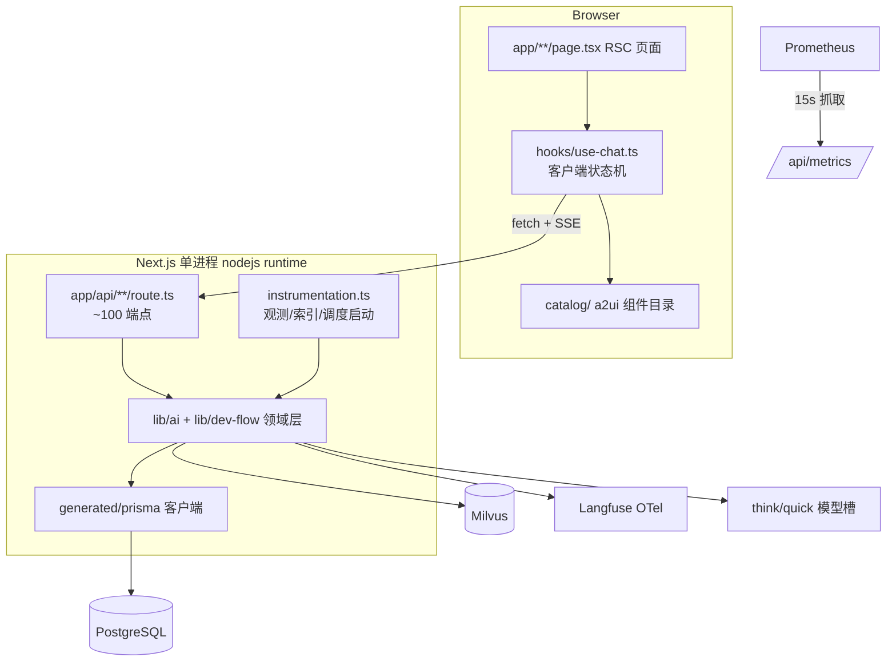
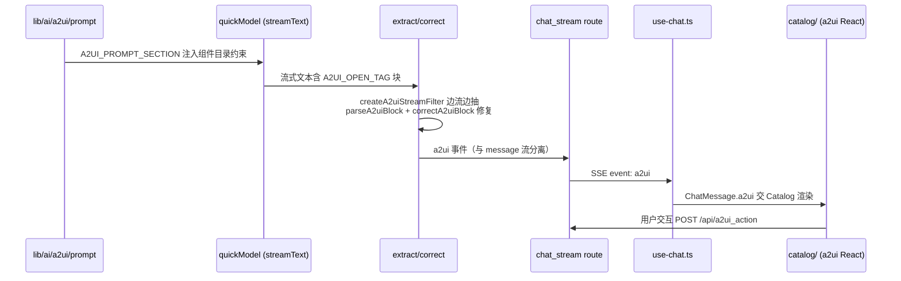

面向 **AI 全栈工程师** 岗位的应用架构专题题库，聚焦「架构与数据流」层。主证据仓库：`yukino-dev-agent`（本机 `$HOME/github/yukino-dev-agent`，HEAD `ea0fd19`，Next.js 16.2.9 + React 19.2.4 + Prisma 7 + LangGraph + Milvus + Langfuse 的 AI 运维/研发流平台）；对比佐证：`yukino-ecomm-agent`（HEAD `c90c843`，Lit 3 client + Hono/LangGraph server）与 `yukino-chatbot`（HEAD `13332f3`，React 19 client + 分层 Node server）。流式 UI 渲染细节见 [AI 流式前端题库](/interview/qa/ai-streaming-ui)，构建工具见 [前端工程化题库](/interview/qa/frontend-engineering)，本篇不重复。

| 证据锚点    | 路径（yukino-dev-agent）                                                                                                 |
| ----------- | ------------------------------------------------------------------------------------------------------------------------ |
| 框架配置    | `next.config.ts`、`instrumentation.ts`、`package.json`                                                                   |
| 数据层      | `prisma/schema.prisma`（662 行 / 36 model）、`prisma.config.ts`、`lib/db.ts`、`generated/prisma/`                        |
| API 面      | `app/api/**/route.ts`（约 100 个端点）、`app/**/page.tsx`（17 页）                                                       |
| 流式契约    | `app/api/chat_stream/route.ts`、`app/api/ai_ops/stream/route.ts`、`hooks/aiops-stream.ts`、`hooks/use-chat.ts`（778 行） |
| 领域层      | `lib/ai/`（models/pipelines/tools/a2ui）、`lib/dev-flow/`（crypto/sanitize/permissions/scheduler/sync…）                 |
| i18n / 配置 | `i18n/request.ts`、`lib/i18n/`、`messages/{en,zh-CN}.json`、`lib/config.ts`                                              |
| 运维        | `app/api/ready/route.ts`、`app/api/metrics/route.ts`、`prometheus.yml`、`prometheus.rules.yml`                           |



## 一、全栈架构总览与仓库分层

### Q1. 三个 AI 应用仓库分别是什么架构形态？一张表对比。

**事实基线**（实读三仓库）：

| 维度 | yukino-dev-agent                        | yukino-ecomm-agent                               | yukino-chatbot                                             |
| ---- | --------------------------------------- | ------------------------------------------------ | ---------------------------------------------------------- |
| 形态 | **单包 Next.js 全栈**（app/api 即后端） | pnpm monorepo：`client/` + `server/`             | pnpm monorepo：`client/` + `server/`                       |
| 前端 | React 19 RSC + 客户端 hooks             | **Lit 3.3** Web Components（`light-element.ts`） | React 19（stores/hooks/router 分层）                       |
| 后端 | Next.js route handlers                  | Hono + LangGraph 图执行                          | 经典分层：`router → controller → service → dao → model/db` |
| 数据 | Prisma 7 + PG + Milvus                  | Prisma + PG + Milvus（双写）                     | 自建 dao/model 层                                          |
| 契约 | `lib/schemas.ts` zod 共享               | `server/src/api/schemas.ts` zod                  | 类型目录 `client/src/types`                                |

**采分点**：能说清「同一个团队在不同产品阶段选了三种形态」以及各自的驱动因素（见 Q2），比背一种「标准架构」更加分。

### Q2. 单包 Next.js 全栈与 client/server 分仓怎么选？

**事实参照**：dev-agent 选单包——前后端同进程、同 tsconfig、同 lint/format 链，`@/lib` 被 route 与组件共享，zod schema 一份定义两端使用；ecomm-agent 分仓——server 是独立的 LangGraph 服务（可单独部署/扩容），client 是纯静态 Lit 应用。**判据**：① 团队与部署是否需要同步发布（单包）还是独立伸缩（分仓）；② 后端是否有重运行时（图执行、长任务）需要与 SSR 进程隔离；③ 前端是否是嵌入式/多宿主（Lit 组件可被任意页面挂载）。**没有优劣，只有约束匹配**。

### Q3. dev-agent 的目录分层逻辑是什么？

**事实基线**：`app/`（路由与页面，薄）→ `hooks/`（客户端状态机，`"use client"` 边界）→ `lib/`（领域层：`lib/ai` 模型与管线、`lib/dev-flow` 研发流领域、`lib/milvus` 检索、`lib/i18n`、`lib/config`）→ `generated/prisma`（生成代码）→ `components/` + `catalog/`（UI 与 a2ui 目录）→ `types/`。**route handler 只做协议层**（解析/校验/流封装），业务全部下沉 `lib/`——这是 Next.js 全栈不变成「大泥球」的关键纪律。

### Q4. client/server 契约怎么保证不漂移？

**事实基线**：dev-agent 的 `lib/schemas.ts` 定义 `chatResponseSchema / chatReferenceSchema / a2uiActionResponseSchema / uploadResponseSchema`，`hooks/use-chat.ts` 用它校验每个 SSE 帧与服务端响应；服务端 route 用同一套 zod schema 校验入参（`chat_stream` 的 `streamRequestSchema`）。aiops 流更进一步：**帧协议本身是 zod discriminatedUnion**（`hooks/aiops-stream.ts` 的 `frameSchema`，7 种 type）。**一份 schema 三处生效：服务端入参校验、服务端出参构造约束、客户端帧校验**——漂移在编译期或运行期第一时间暴露。

### Q5. 两个产品域（AI Ops 与 Dev-Flow）共存一个应用，怎么隔离？

**事实基线**：API 前缀隔离——`app/api/{chat,ai_ops,knowledge,...}` 是运维问答域，`app/api/dev-flow/**`（60+ 端点）是研发流域；页面同构（`app/page.tsx` vs `app/dev-flow/**/page.tsx` 15 页）；领域代码分目录（`lib/ai` vs `lib/dev-flow`）；数据同库不同表族（AiOpsRun/DiagnosticCaseRecord vs Repository/Issue/PullRequest/...）。**共享的是基础设施**（db/config/observability/metrics/i18n），**隔离的是领域与路由面**。这是「模块化单体」的标准形态——比微服务便宜，比大泥球有序。

### Q6. 为什么 AI 应用常见「Python 后端 + JS 前端」，而这三个仓库全是 TS 全栈？

**方案推导**：TS 全栈的收益在 AI 应用里被放大——① 流式协议（SSE 帧 schema）前后端共享一份 zod 定义（Q4）；② LangChain/LangGraph 有成熟 JS 实现（dev-agent 的 `opsGraph` 就是 `StateGraph`）；③ 类型安全贯穿「模型结构化输出 → API → 前端渲染」全链路。Python 优势在训练/数据科学生态。**选型口径**：应用层（agent 编排 + Web）用 TS 全栈，重模型/重数据管线才引入 Python 服务——按生态密度而不是语言信仰选。

### Q7. lib/dev-flow/http.ts 这类「响应 helper」解决什么问题？

**事实基线**：webhook 等 route 统一用 `ok / fail / failRaw / errorMessage` 构造响应，`fail(401, "invalidWebhookSignature")` 传的是 **i18n key 而不是文案**，由 helper 结合 `getTranslations` 渲染成当前 locale 的消息；`export { OPTIONS } from "@/lib/dev-flow/http"` 统一 CORS 预检。**API 错误也是产品文案**——集中 helper 保证「结构一致 + 多语言 + 不泄漏内部错误细节」三件事一次做对。

### Q8. 生成代码（generated/）应该进仓库吗？

**事实基线**：dev-agent 的 Prisma client 生成到 `generated/prisma`（schema 里 `output = "../generated/prisma"`），`lib/db.ts` 从 `@/generated/prisma/client` 导入；`package.json` 的 `build` 脚本是 `pnpm db:generate && next build`——**生成步骤进构建链**。ecomm-agent 同样有 `server/generated/prisma/`。取舍：进仓库（可 diff、CI 免生成、IDE 直接可用）vs 忽略（仓库干净、杜绝手改）；两仓库都选择「生成物入库 + 构建前强制重新生成」的折中——**以构建链为准，入库只为开发体验**。

## 二、Next.js App Router 与 RSC

### Q9. App Router 的三种文件角色在 AI 应用里怎么分工？

**事实基线**（dev-agent）：`layout.tsx`（全局 Provider 树）、`page.tsx`（17 个页面，RSC）、`route.ts`（约 100 个 API 端点）。AI 应用的特殊性：**route.ts 承担了传统后端的 controller 层**（含 SSE 流端点），page.tsx 主要做首屏与 SEO/元数据，重交互全部下沉到 `"use client"` 的 hooks + 组件。**「页面是壳，流是魂」**——聊天类产品的核心数据流不经过 RSC 渲染路径。

### Q10. RSC 与客户端组件的边界怎么划？

**事实基线**：`hooks/use-chat.ts`、`hooks/aiops-stream.ts` 顶部都是 `"use client"`；`app/layout.tsx` 是 async RSC（`await getLocale()` / `getMessages()`）。划分原则：① 需要浏览器 API/状态/事件（AbortController、localStorage、EventSource 解析）→ client；② 需要服务端资源（cookies、DB、翻译目录）→ RSC；③ Provider 树在 RSC 里组装（NextIntlClientProvider/ThemeProvider/SentryProvider 嵌套），内容透传。**边界画在「状态与副作用出现的地方」**。

### Q11. layout.tsx 里的 Provider 嵌套顺序有讲究吗？

**事实基线**：`NextIntlClientProvider → ThemeProvider → SentryProvider → {children} + Toaster`。顺序逻辑：intl 最外（主题/监控组件的文案也要翻译）；theme 在 sentry 外（主题错误可被监控捕获）；Toaster 与 children 平级（全局浮层）。另有两处防闪烁细节：`<head>` 内联 `THEME_SCRIPT`（首帧前设置暗色类，避免 FOUC）+ `<html suppressHydrationWarning>`（内联脚本改 DOM 导致的 hydration 差异豁免）。**Provider 顺序 = 依赖方向；防闪烁 = 内联脚本 + hydration 豁免的组合拳**。

### Q12. instrumentation.ts 是什么？项目用它做了什么？

**事实基线**：Next.js 的启动钩子，`register()` 仅在 `process.env.NEXT_RUNTIME === "nodejs"` 时执行（排除 edge runtime），做三件事：① `initObservability()`（Langfuse OTel SDK）；② `indexDataDir()`（启动即预热知识索引，失败仅 `console.error` 不阻断启动）；③ `startAutoSyncLoop()`（dev-flow 仓库自动同步定时器）。**这是「应用服务器」形态的 Next.js 才有的能力**——传统认知里 Next 只是渲染层，instrumentation 让它承载了后台任务与观测初始化。

### Q13. 单进程里跑定时器/后台任务有什么风险？怎么缓解？

**事实基线**（`lib/dev-flow/scheduler.ts`）：① **HMR 重复启动**——用 `globalThis.devFlowAutoSync` 句柄去重，已存在直接 return；② **多实例重复执行**——auto-sync 默认关闭（`DEV_FLOW_AUTO_SYNC_ENABLED === "true"` 才开），`MIN_INTERVAL_SECONDS = 30` 兜底；③ **单点故障扩散**——`runOnce` 对每个 repo 独立 try/catch，一个仓库同步失败不影响其余；④ 停止语义——`handle.stopped` 标志 + 清 timer。**风险清单要主动讲**：serverless 部署下定时器根本不可用，这是「长驻进程」假设——所以它只适合 self-host 形态。

### Q14. globalThis 单例模式在 Next.js 里为什么到处都是？

**事实基线**：三处同构——`lib/db.ts`（`globalForPrisma.prisma`，仅非 production 缓存）、`lib/observability.ts`（`globalStore.__yukinoObservabilitySdk`）、`scheduler.ts`（`globalForAutoSync`）。原因：dev 模式 HMR 会重复执行模块顶层代码，没有 globalThis 兜底就会**每次热更泄漏一个连接池/SDK/定时器**。production 构建模块只初始化一次，所以 db.ts 特意加了 `NODE_ENV !== "production"` 条件。**这是 Next.js 全栈的必修细节**，答不出说明没写过带 DB 的 Next 应用。

### Q15. next.config.ts 里这几个配置各解决什么问题？

**事实基线**：

| 配置                     | 值                             | 动机                                                                            |
| ------------------------ | ------------------------------ | ------------------------------------------------------------------------------- |
| `serverExternalPackages` | `["redis", "knex"]`            | 含原生绑定/动态 require 的包不进 server bundler，保持 external 由 Node 直接加载 |
| `allowedDevOrigins`      | `["127.0.0.1"]`                | dev server 跨源访问白名单（安全默认收紧后的显式放行）                           |
| `turbopack.root`         | `resolve(dirname, "..", "..")` | monorepo 场景显式指定仓库根，避免 Turbopack 推断错误                            |
| `reactStrictMode`        | `false`                        | 关闭双调用（与流式/副作用重的 agent 管线配合的取舍）                            |
| `createNextIntlPlugin`   | 包裹导出                       | next-intl 的编译期集成                                                          |

**采分点**：逐条讲「问题 → 配置 → 代价」，特别是 `serverExternalPackages`——这是全栈 Next 接数据库/消息队列客户端的常见坑位。

### Q16. RSC 的数据获取与 API route 并存，会不会重复建数据通道？

**事实基线**：dev-agent 两者都用——RSC 页面直接 `prisma` 查询做首屏（服务端组件特权），交互数据走 `app/api` + hooks。**边界纪律**：首屏只读数据走 RSC（省一次往返），一切「会话态/流式/写操作」走 API route。反模式是 RSC 里发起 LLM 流（渲染生命周期与长连接不匹配）。**两条通道共享 lib/ 领域层**，所以不存在逻辑重复，只有传输形态差异。

## 三、数据层：Prisma 与 schema 设计

### Q17. Prisma 7 的 driver adapter 模式与经典模式有什么区别？

**事实基线**（`lib/db.ts` + `prisma.config.ts`）：schema 的 `datasource db` **只声明 provider 不含 url**，连接串移到 `prisma.config.ts`（CLI 用）与运行时 `new PrismaPg({ connectionString: config.database.url })`（driver adapter，基于 `pg` 连接池）。区别：经典模式 Prisma 自带 Rust query engine 二进制；adapter 模式**直接用 Node 驱动执行 SQL**，无引擎进程、部署产物更小、连接池归驱动管。`next.config.ts` 把相关原生包列进 `serverExternalPackages` 与之呼应。

### Q18. 36 个 model 的 schema 是怎么组织的？

**事实基线**（`prisma/schema.prisma`，662 行）：以 `Repository` 为聚合根——它反向关联 Issue/PullRequest/WorkflowRun/KnowledgeDocument/ActionDraft/Conversation/ProjectIndex/CodeSymbol/CodeRelation/KnowledgeGraphEdge/TeamMember/ThreadMemory/MemoryCandidate/RecallEvent 等 18 个关系。表族可分五类：**代码资产**（Repository/Issue/PR/PrFile/PrReviewComment/WorkflowRun/CodeSymbol/CodeRelation）、**知识**（KnowledgeDocument(+Body)/KnowledgeGraphEdge/ProjectIndex/KnowledgeBaseConfig/RetrievalTestRun）、**会话与记忆**（Conversation/ChatMessage/ConversationMemory/ThreadMemory/MemoryCandidate/RecallEvent）、**agent 运行**（AgentWorkflowRun/AgentTaskRun/AiOpsRun/ActionDraft/ToolCallAudit）、**人与反馈**（User/TeamMember/AuditLog/ChatFeedback/UserFeedback/DiagnosticCaseRecord）。**按领域读表族**是快速理解任何系统 schema 的方法。

### Q19. schema 里有哪些值得抄的设计细节？

**事实基线**：① `Issue.@@unique([repoId, githubIssueId])`——外部系统 id 与本地 uuid 双键，幂等 upsert 的基础；② `onDelete: Cascade` 挂在 repo 关系上（删仓库级联清 issues/PR）；③ `labels String[]`、`assignees String[]` 用 PG 原生数组而不是关联表（低查询需求的标签类数据）；④ `githubId BigInt?` 可空——本地先建、GitHub id 后补的同步时序；⑤ `tokenEncrypted String?`——**敏感字段命名自带加密契约**（见 Q35）；⑥ `KnowledgeDocumentBody` 单独拆表——大文本与元数据分离，列表查询不拖正文；⑦ `@@index([repoId, number])` 按真实查询路径建索引。

### Q20. 审计类表（AuditLog / ToolCallAudit / RecallEvent）为什么必须独立建模？

**事实基线**：三张表分别记「人的操作」「agent 的工具调用」「记忆召回事件」。独立建模的理由：① 写入路径与业务解耦（业务失败审计也要在）；② 只增不改（append-only，查询模式是时间窗扫描）；③ 合规与回放——AI 应用里「模型当时调了什么工具、拿到什么结果」是事故复盘的第一现场（`lib/ai/tool-audit.ts` 的 `recordToolAudit` 在管线里同步落库）。**审计表是 AI 应用的黑匣子，schema 设计时就要留**。

### Q21. db push 与 migrate dev 的纪律怎么定？

**事实基线**：`package.json` 同时提供 `db:push`（prisma db push，无迁移文件直推）与 `db:migrate`（prisma migrate dev，生成 SQL 迁移），`prisma.config.ts` 指定 `migrations.path = "prisma/migrations"`。**纪律**（方案推导）：本地原型可 push；**共享环境必须 migrate**——迁移文件是 schema 变更的审计日志与回滚依据；CI 里 `migrate deploy` 只应用不生成；破坏性变更（删列/改类型）走 expand-contract 两步。AI 应用迭代快，最容易在「push 一时爽」上翻车——被追问时主动讲这条纪律。

### Q22. 记忆（Memory）为什么有四张表？

**事实基线**：`ConversationMemory`（会话级记忆）、`ThreadMemory`（仓库级单例线程记忆，`Repository.threadMemory ThreadMemory?`）、`MemoryCandidate`（候选记忆，待确认）、`RecallEvent`（召回事件流水）。分层逻辑：**候选 → 确认 → 存储 → 召回审计**的记忆生命周期各占一表；会话记忆随会话走，线程记忆跨会话沉淀（repo 维度单例）。对照进程内 `lib/memory.ts` 的 `SimpleMemory`（LRU 100 会话、6 对消息触发摘要、摘要封顶 1200 字符）——**热路径用进程内摘要，冷路径落库**，两层记忆各司其职。

### Q23. 多租户在这个 schema 里怎么体现？

**事实基线**：dev-agent 的租户维度是 `Repository`（一切资产挂 repo）+ `TeamMember`（成员-仓库-角色）；ecomm-agent 则是 `userId` 贯穿会话与订单归属校验（`ownsOrder`）。**推导**：AI 应用的多租户要在三层同时落——数据层（外键 + 复合唯一键）、检索层（向量库 filter 下推，见 [RAG 与检索深挖题库](/interview/qa/rag-and-retrieval) Q71）、权限层（RBAC 绑定租户角色，见 Q34）。只在数据层做租户隔离的系统，迟早从检索层泄漏。

### Q24. Prisma 客户端在 dev HMR 下怎么不泄漏连接？

见 Q14 的 `lib/db.ts` 单例；补充细节：`globalForPrisma.prisma ?? createPrismaClient()` 的 `??` 语义保证已存在即复用；**production 不挂 globalThis**（构建后模块单次初始化，挂全局反而掩盖重复实例化 bug）。连接池参数归 `PrismaPg`（pg Pool）管，Prisma 不再自带池——adapter 模式下池配置要直接对驱动做。

## 四、API 层与流式端到端

### Q25. 约 100 个 route.ts 的 REST 面是怎么规划的？

**事实基线**：资源命名一致（`/api/dev-flow/repos/[id]/{issues,pulls,sync,memory,workspace,...}` 嵌套子资源）；动作型端点显式后缀（`/analyze`、`/analyze/stream`、`/reindex`、`/retry`、`/check`）；**同一资源的同步与流式版本成对出现**（`issues/[id]/analyze` 与 `analyze/stream`）——非流式给脚本/回退，流式给 UI。规划纪律：能用名词不用动词，必须用动词时（analyze/sync）保持全仓一致。

### Q26. 服务端 SSE 是怎么手写的？逐行讲关键处。

**事实基线**（`app/api/chat_stream/route.ts`，81 行）：

```ts
// app/api/chat_stream/route.ts（节选）
const stream = new ReadableStream<Uint8Array>({
  async start(controller) {
    const send = (event: string, data: string) => {
      const dataLines = data
        .split("\n")
        .map((l) => `data: ${l}`)
        .join("\n");
      controller.enqueue(
        encoder.encode(`id: ${Date.now()}\nevent: ${event}\n${dataLines}\n\n`),
      );
    };
    send("connected", JSON.stringify({ status: "connected", client_id: id }));
    try {
      for await (const ev of chatStream(id, question)) {
        /* 按 ev.type 分发 */
      }
      send("done", "Stream completed");
    } catch (e) {
      send("error", e instanceof Error ? e.message : String(e));
    } finally {
      controller.close();
    }
  },
});
return new Response(stream, {
  headers: {
    "Content-Type": "text/event-stream",
    "Cache-Control": "no-cache",
    Connection: "keep-alive",
    ...CORS_HEADERS,
  },
});
```

关键点：① **多行 data 逐行加 `data:` 前缀**（SSE 规范要求，裸换行会截断帧）；② 命名事件（`event:` 字段）让客户端按类型分发；③ `connected` 首帧确认通道；④ `done`/`error` 终帧显式收尾，`finally` 必关流；⑤ 响应头三件套（event-stream / no-cache / keep-alive）。

### Q27. 事件类型是怎么设计的？为什么 reasoning/tool/a2ui 要分开？

**事实基线**：chat_stream 的事件面：`connected / message / reasoning / tool / a2ui / references / done / error`；`tool` 帧带 `{id, name, state}`，state 是 `call | result | error` 三态机（`use-chat.ts` 的 `ChatToolCall`）。分开的原因：**每类事件的渲染语义与生命周期不同**——message 增量拼接、reasoning 折叠展示、tool 按 id 原地更新状态、a2ui 交给 catalog 渲染、references 终态一次性给。**混在一个 text 流里客户端就要做解析猜测；分事件类型 = 把协议复杂度留在服务端一次做对**。

### Q28. 客户端为什么用 fetch + reader 而不是 EventSource？

**事实基线**（`hooks/aiops-stream.ts`）：`fetch("/api/ai_ops/stream", { method: "POST", ..., signal })` → `resp.body.getReader()` → TextDecoder 增量解码 → 按 `\n\n` 切帧 → 逐行解析 `data:` → `frameSchema`（zod discriminatedUnion）校验后分发到 handlers。不用 EventSource 的硬理由：① **EventSource 只支持 GET**，而流式请求要 POST 带 body（query/alert）；② EventSource 自动重连不可控（AI 长任务重连语义复杂，宁可手动）；③ fetch 支持 AbortController 精确取消。**代价是自己写帧解析**——所以帧协议必须 zod 化（Q4）。

### Q29. plan-execute-replan 的事件流怎么设计？

**事实基线**：`ai_ops/stream` 的帧类型（`frameSchema`）：`run_started{runId} → plan_created{steps[]} → step_start{index,step} → step_done{index,output} → replan{done,remaining[]} → done{runId,status,result,detail[],a2ui?} | error{error}`。服务端是 LangGraph `opsGraph`（`lib/ai/pipelines/plan-execute-replan/graph.ts:509` 的 `StateGraph`），Langfuse 侧打 `tags: ["ai-ops"]`、`traceMetadata: { pipeline: "plan-execute-replan" }`。**采分点**：agent 执行的每个语义节点（计划/步进/重规划/终态）都是一等事件——前端因此能渲染步骤进度条而不是干等；`replan` 事件把「agent 改主意了」显式化，这是可解释性的协议层实现。

### Q30. 流式中断与恢复怎么处理？

**事实基线**：中断——`use-chat.ts` 持 `AbortController` state（两处 `new AbortController()`），用户停止即 `abort()`，服务端 `for await` 循环随请求终止而退出；恢复——聊天历史落 localStorage（`STORAGE_KEY = "yukino-dev-agent-chat-histories"`，`MAX_HISTORIES = 50` 条会话封顶），刷新后 UI 可恢复**结果**但不续传**中断的流**。**方案推导**（真续传）：SSE `id:` 字段已带时间戳，配合服务端把 run 状态落库（`AiOpsRun.runId` 已存在），重连时按 runId 查终态或从断点重放事件——`/api/ai_ops/runs/[id]` 就是这个查询端点。**「中断可取消、结果可恢复、过程可查询」三层，逐层加码**。

### Q31. 前后端状态怎么同步？pending 与三态工具卡片的意义？

**事实基线**（`use-chat.ts`）：`ChatMessage.pending` 标记「assistant 消息正在流式构建」；工具调用按 `id` 定位原地更新 state（`tools[idx] = { ...tools[idx], state: parsedTool.data.state }`）；zod 校验失败的帧直接丢弃不进状态。同步模型：**服务端事件流是唯一事实源，客户端状态机只做投影**——事件按 id 幂等更新，乱序/重复帧被 schema 与 id 消化。注释里还有一条纪律：新 run 用全新 controller「never depends on stale closure state」（避免闭包陈旧状态）。

### Q32. GitHub webhook 接入怎么保证安全与幂等？

**事实基线**（`app/api/dev-flow/webhooks/github/route.ts`）：① 签名——`x-hub-signature-256` 头，HMAC-SHA256（`config.github.webhookSecret`）+ **`timingSafeEqual` 常数时间比较**（先比长度再比内容，防时序攻击）；secret 未配置时放行（本地开发模式，显式取舍）；② 原始 body——`Buffer.from(await request.arrayBuffer())` 先取原始字节再解析（签名对原始 body 计算，JSON 重序列化会破坏签名）；③ 事件过滤——`SYNC_EVENTS` 白名单（issues/pull_request/workflow_run/push/check_suite/check_run）之外的直接 ok；④ 幂等——同步逻辑按 `@@unique([repoId, githubIssueId])` upsert（Q19）。**四步缺一不可**，尤其「先字节后解析」。

### Q33. API 层的输入校验与错误响应有什么统一约定？

**事实基线**：入参 zod `safeParse`（`chat_stream` 的 `streamRequestSchema`），失败返回 400 + i18n 化消息（`t("missingIdOrQuestion")`）；dev-flow 域统一 `ok/fail` helper（Q7）；readiness 探针把内部错误截断 200 字符（`e.message.slice(0, 200)`）防泄漏。**约定三件事**：校验在边界一次做完（领域层信任入参）、错误消息面向用户可翻译、错误细节不进响应体（进日志）。

## 五、鉴权、权限与安全

### Q34. RBAC 是怎么建模的？

**事实基线**（`lib/dev-flow/permissions.ts`）：权限点 7 个（`repo:read / repo:sync / agent:run / draft:create / draft:approve / eval:read / settings:manage`），角色 4 档（owner/maintainer/developer/viewer），`ROLE_PERMISSIONS: Record<string, ReadonlySet<Permission>>` 静态映射；越权抛类型化 `PermissionError(permission)`。**设计要点**：权限点是「资源:动作」字符串联合类型（编译期防拼错）；角色是权限集合的命名快照；`draft:create` 与 `draft:approve` 分离——**AI 产出的动作草稿（ActionDraft 表）创建与批准是两个人**，这是 agent 写操作的职责分离。

### Q35. 第三方令牌（GitHub token）怎么存储？

**事实基线**（`lib/dev-flow/crypto.ts`）：`Repository.tokenEncrypted` 列存密文；加密 AES-256-GCM——密钥 `scryptSync(config.devFlow.secret, "dev-flow-token-v1", 32)` 派生，随机 12 字节 IV，输出 `iv.tag.ciphertext` 三段 base64 点分；解密失败（含格式不对/GCM tag 校验失败）返回 `null` 而不是抛错。**采分点**：① GCM 自带完整性（tag），改一个字节就解不出；② SALT 带版本号（`-v1`）为密钥轮换留缝；③ 主密钥来自环境变量（`DEV_FLOW_SECRET`），**库里泄漏≠令牌泄漏**；④ 失败静默返回 null 让调用方走「重新授权」流程。

### Q36. CI 日志进 LLM 前为什么要脱敏？怎么做的？

**事实基线**（`lib/dev-flow/sanitize.ts`）：`sanitizeCiLog` 按 7 组正则替换——PEM 私钥块、GitHub token（`gh[pousr]_` 前缀）、AWS AKIA 键、JWT 三段式、`authorization: bearer` 头、GitHub Actions `::add-mask::`、通用 `key=value` 形态的 secret/password/token 字段。原因：CI 日志要喂给模型分析（`analyze-stream`），**日志里混着的凭据一旦进 prompt 就进了第三方 API 与 trace 存储**——脱敏必须在数据离开信任边界前完成，而不是指望模型「别说出来」。

### Q37. 这个应用的鉴权现状是什么？面试怎么如实讲？

**事实基线**：`ensureDemoUser()`——取最早创建的 User，没有则建 demo 用户并赋 owner 角色；无登录/session/JWT 流程。**如实表述**：这是 self-host 单团队工具的信任模型（部署在内网/本机，Prometheus 抓 `host.docker.internal`），RBAC 与审计表已经把「多用户扩展」的接缝留好（User.role、TeamMember、AuditLog），但**认证层是显式缺位而非遗漏**——被追问时讲清「当前边界 + 已有接缝 + 补全路径（OIDC 接入 → session → ensureDemoUser 退役）」，比假装完整更加分。

### Q38. CORS 策略在这个应用里是怎么定的？

**事实基线**：`/api/metrics` 与 `/api/chat_stream` 都是 `Access-Control-Allow-Origin: *` + 显式 OPTIONS 204。合理性：metrics 被容器内 Prometheus 抓取（非浏览器场景，`*` 无害）；chat_stream 服务于本地多前端形态（Lit client 可从任意 origin 挂）。**风险口径**：`*` 与凭据（cookies）互斥是浏览器强制的，所以无认证现状下 `*` 可用；**一旦引入 cookie 会话，CORS 必须收敛到白名单 origin + `credentials: true`**——这条演进约束要主动讲。

### Q39. 工具调用审计（ToolCallAudit）在全栈里怎么闭环？

**事实基线**：`lib/ai/tool-audit.ts` 的 `recordToolAudit` 在 chat 管线执行工具时落库；`/api/tool_audits` 提供查询端点；schema 里 `ToolCallAudit` 独立成表（Q20）。闭环：**执行点埋审计 → 表存储 → API 暴露 → 管理页展示**。AI 应用的审计与传统的差别：要记「模型为什么调」（当时的上下文/参数由模型生成），所以审计表要带 prompt 侧信息而不只是调用参数。

### Q40. 上传（/api/upload）与文件类端点的安全要点？

**事实基线 + 推导**：dev-agent 有 `/api/upload` 与 `knowledge_docs/[name]`、`FILE_DIR=./data/docs` 配置；文档解析依赖 `mammoth`（docx）与 `unpdf`（pdf）。要点：① 类型白名单 + 魔数校验（扩展名可伪造）；② 存储路径与 Web 根隔离（`data/docs` 不在 `public/`）；③ 解析器是攻击面（恶意 docx/pdf 触发解析漏洞）——依赖要保持更新、解析超时限额；④ 文件内容进 RAG 前过 sanitize（Q36 同理）。**上传的安全成本大头在「文件被谁消费」**——这里的消费者是 LLM 管线，所以脱敏与大小限制比病毒扫描更前置。

## 六、i18n 与配置管理

### Q41. next-intl 的服务端架构是怎么接的？

**事实基线**：`next.config.ts` 挂 `createNextIntlPlugin()`；`i18n/request.ts` 的 `getRequestConfig` 每请求解析 locale——**cookie（`yukino_locale`）优先，其次 `accept-language` 协商，兜底 `defaultLocale = "en"`**；消息目录静态 import（`messages/en.json`、`zh-CN.json`）保证服务端同步可用；`formats` 统一日期/数字格式。RSC 里 `getTranslations`/`getLocale`/`getMessages` 直接 await，客户端经 `NextIntlClientProvider` 注入。

### Q42. accept-language 协商的实现细节？

**事实基线**（`lib/i18n/negotiate.ts`）：手写解析——按逗号切分、提取 `q=` 权重（缺省 1）、按 q 降序、忽略 `*`；匹配用**前缀语义**（`zh` 开头 → `zh-CN`，`en` 开头 → `en`）。不引库的理由：协商逻辑 20 行、零依赖、可单测。**面试点**：q 值排序与前缀回退是 RFC 9110 语义的最小实现，能手写说明真懂而不是只会配库。

### Q43. API 错误消息也国际化，这有什么代价与收益？

**事实基线**：route handler 里 `await getTranslations("api.oncall")` 再 `t("missingIdOrQuestion")`——**服务端按请求 locale 渲染错误文案**。收益：前端直接展示 message 无需错误码映射表；代价：① 客户端程序化判断只能靠 status code（文案随语言变）；② API 消费者若是第三方，本地化文案反而不如稳定错误码。**权衡口径**：第一方前后端（本项目）文案 i18n 合理；开放 API 应该「错误码 + 可选本地化 message」双轨。

### Q44. lib/config.ts 的集中配置模式好在哪？

**事实基线**：单文件把 30+ 环境变量收敛成**类型化嵌套对象**——`config.openai.{think,quick}.{model,apiKey,baseURL}`、`config.anthropic`（含 `thinking` 布尔与 `maxOutputTokens=8192` 解析）、`config.rerank`（timeoutMs=10000/maxRetries=2）、`config.milvus`、`config.devFlow.{secret,autoSync,feedback,workspace}`、`config.provider`（`"openai" | "anthropic"` 类型断言）。好处：① `process.env` 只在边界出现一次，领域层零字符串键；② 默认值集中可见；③ Number/boolean 解析在配置层做完（`Number.parseInt` + 默认值），下游拿到的都是正确类型。**对照 ecomm-agent 的 `settings` + `num()/bool()` 校验器**——同一模式的两种实现，后者多了「非法值抛错」的严格性。

### Q45. think / quick 双模型槽是什么设计？

**事实基线**：`config.openai.think` 与 `config.openai.quick`（anthropic 同构），`lib/ai/models.ts` 导出 `thinkModel / quickModel`；`LLM_PROVIDER` 环境变量整体切换供应商。**语义**：think 槽给深度推理（诊断规划），quick 槽给高频轻任务（chat 管线 import 的是 `quickModel`）——**按任务价值分配模型成本**，与 ecomm-agent 的 chat/intent/summary 三 slot 同构（见 [Agent 框架与架构对比题库](/interview/qa/agent-frameworks) Q77）。全栈视角的增量：槽位配置直接来自环境变量，运维改模型不用改代码。

### Q46. 供应商差异在适配层怎么消化？举项目里最典型的例子。

**事实基线**（`lib/ai/models.ts`）：`patchAnthropicThinkingSignatures`——Anthropic 偶发返回缺 `signature` 的 thinking 块导致 ai-sdk 解析拒绝，项目**自定义 fetch 包装**：拦截 JSON 响应、检测 `type === "message"` 的 content 里无 signature 的 thinking 块、回填空串、重造 Response（删 content-length/content-encoding 头）。`providerOptions` 里 thinking budget 设为 `maxOutputTokens - 1`（Anthropic 要求 budget 小于 max tokens）。**这是「上游 SDK 严格性 vs 供应商实现毛刺」的真实工程样本**：在 fetch 层打补丁而不是 fork SDK，差异被限制在一个函数里。

## 七、可观测与运维

### Q47. readiness 探针应该探测什么？

**事实基线**（`app/api/ready/route.ts`，144 行）：七项依赖逐一探测——`database`（`SELECT 1`）、`vectorStore`（Milvus count，16s 超时）、`embedding`、`llm`、`rerank`、`prometheus`、`mcp`；每项 `check()` 包装返回 `{name, ok, latencyMs, detail}`，异常截断 200 字符。**设计要点**：① AI 应用的「就绪」包含**模型上游可达**——只探 DB 的 readiness 会让「LLM 全挂」的实例继续接流量；② 每项带延迟，慢依赖可定位；③ 与 `/api/config_check`（配置自检）互补——一个探运行时依赖，一个探配置完备性。

### Q48. 全栈可观测的三块拼图在这个项目里怎么落？

**事实基线**：① **指标**——`lib/metrics.ts` prom-client（Node 运行时 + 前端上报指标，全带 `project_id` 标签），`/api/metrics` 暴露，Prometheus 15s 抓取；② **追踪**——`instrumentation.ts` 启动 Langfuse OTel SDK，`aiOpsCallbacks/withAiOpsTrace` 按 sessionId 组 trace；③ **前端监控**——`SentryProvider`（`@yukino.js/sentry`）+ `/api/log` 上报端点，浏览器错误/白屏/Web Vitals 进 Prometheus 指标。告警规则 25+ 条见 [LLM 评测与可观测性题库](/interview/qa/llm-eval-observability) Q41。**三块共享 project_id/sessionId 关联键**（同篇 Q60）。

### Q49. 部署拓扑是什么样的？从配置能读出什么？

**事实基线**：`prometheus.yml` 抓 `host.docker.internal:3000`——**Prometheus 跑容器里，Next.js 跑宿主机**；`next.config.ts` 的 `allowedDevOrigins: ["127.0.0.1"]` 与 config 默认值（`127.0.0.1:5432` PG、`localhost:19530` Milvus、`127.0.0.1:9090` Prometheus）勾勒出自托管单机拓扑；`FILE_DIR=./data/docs`、`DEV_FLOW_REPO_CHECKOUT_DIR=./data/workspaces` 是本地盘状态。**读配置还原部署图**是架构面试的硬功夫——这套默认值明说「单实例 self-host」，水平扩展前要先解决 Q13（定时器）与 Q22（进程内记忆）两个进程本地状态。

### Q50. 自动同步调度器与 webhook 是什么关系？

**事实基线**：双通道——webhook（Q32）是**事件驱动**的实时同步（push/issue/PR 事件触发 `syncRepository`）；`startAutoSyncLoop` 是**轮询兜底**（默认关，开启后每 `intervalSeconds=900` 全量仓库同步一轮，单轮 limit=30）。为什么都要：webhook 会丢（网络/重启窗口/未配置），轮询保证最终一致；轮询有延迟，webhook 保证实时。**「事件驱动 + 定时兜底」是所有同步系统的标准双保险**，两通道共用同一个幂等 `syncRepository`。

### Q51. 启动预热（indexDataDir）失败为什么只 log 不退出？

**事实基线**：`instrumentation.ts` 里 `try { await indexDataDir() } catch (e) { console.error(...) }`。理由：知识索引是**增强能力**（RAG 检索质量），不是服务可用性的必要条件——chat 主链路在索引缺失时仍可降级回答；启动失败即退出会让「Milvus 暂时不可达」放大成「整个平台起不来」。**对照 readiness**：探针如实报告 vectorStore 不可用（Q47），编排层据此决定接不接流量——**启动宽容 + 探针诚实**是一对配套设计。

### Q52. 这个应用的成本观测怎么做？

**事实基线 + 交叉引用**：Langfuse trace 记录每次生成的 usage（`withAiOpsTrace` 包裹管线）；`AiOpsRun` 表落 run 级记录（runId/status/result）；模型槽（think/quick）本身就是成本分账维度。系统化方法（按意图/按 run 聚合、报表与告警）见 [LLM 评测与可观测性题库](/interview/qa/llm-eval-observability) Q37–Q38。**全栈增量视角**：成本要能归因到「哪个页面哪个动作」——前端发起时带业务上下文（sessionId/tags），否则账单只能看到模型维度。

## 八、AI 特有的全栈问题

### Q53. a2ui 生成式 UI 的端到端链路是怎么贯通的？

**事实基线**（全链路五段）：



组件目录：`catalog/index.ts` 注册 18 个基础组件（Text/Image/Icon/Video/AudioPlayer/Row/Column/List/Card/Tabs/Divider/Modal/Button/TextField/CheckBox/ChoicePicker/Slider/DateTimeInput）+ shadcn 扩展，`Catalog` 来自 `@a2ui/web_core/v0_9`，目录 id 是一个可解析的 URL（`SHADCN_CATALOG_ID`）。**采分点**：生成式 UI 的难点不在渲染在**流式抽取与修复**——模型边生成边抽 a2ui 块（`createA2uiStreamFilter`），语法残缺时 `correctA2uiBlock` 修复，交互经独立 action 端点回流（协议细节见 [Agent 框架与架构对比题库](/interview/qa/agent-frameworks) Q49–Q52）。

### Q54. 进程内记忆（SimpleMemory）与数据库会话怎么分工？

**事实基线**（`lib/memory.ts`）：进程内 `memoryMap`——**手写 LRU**（命中即 delete+set 重插到尾部，满 `MAX_SESSIONS = 100` 淘汰 `keys().next()` 的最旧项）；摘要触发 `SUMMARY_TRIGGER_PAIRS = 6` 对消息、摘要封顶 `SUMMARY_MAX_CHARS = 1200`、待摘要队列上限 `MAX_PENDING_PAIRS = 12`。持久会话在 DB（Conversation/ChatMessage）。分工：**进程内存放「本次运行的热上下文」（摘要 + 近期窗口），DB 放「跨运行冷历史」**。风险要主动讲：多实例部署时 memoryMap 不共享——要么会话粘性路由，要么记忆外置（Redis/DB），这是 Q49 扩展清单的一项。

### Q55. 检索证据怎么从 Milvus 一路透传到前端引用卡片？

**事实基线**：`lib/milvus/retriever.ts` 的 `retrieve` 返回 `RetrievedDoc`；chat 管线把引用放进 `references` SSE 事件；前端 `ChatReference` 带 `title/source/score/excerpt/knowledgeType` 与 **`stages: {vectorRank, vectorScore, bm25Rank, bm25Score, rerankRank, rerankScore}`**——三段检索每一段的排名与分数都暴露给 UI（`components/msg-list.tsx` 逐段渲染 `#rank (score)`）。**设计意识**：把检索中间态透传到前端，调试与用户信任同时受益；这也是「三段归因」（[RAG 与检索深挖题库](/interview/qa/rag-and-retrieval) Q59）在产品层的延伸——归因数据不在报告里睡着，在每次回答的引用卡里活着。

### Q56. token 成本归属在全栈里怎么落地？

综合事实：① 模型槽分账（think/quick，Q45）；② Langfuse trace 按 sessionId/tags 聚合（Q52）；③ `AiOpsRun`/`ToolCallAudit` 把 run 与工具调用落库可 join；④ 前端每个动作发起时携带业务 id（chat 的 `id`、aiops 的 alert 上下文）。**归属链**：UI 动作 → API 请求（业务 id）→ trace（sessionId）→ run 记录（runId）→ 模型账单。**断在任何一环，成本就只能按总量摊派**——全栈工程师的职责是把这条链在写第一行代码时就接通。

### Q57. 流式响应与数据库写入的时序怎么安排？

**事实基线 + 推导**：chat 管线边流边审计（`recordToolAudit` 在工具执行点同步落库）；会话消息在流结束后持久化（ChatMessage）；aiops 的 run 状态由 `done` 帧携带 runId 落 `AiOpsRun`。**时序原则**：① 审计与副作用在**动作发生点**写（不等流结束，否则中断即丢失）；② 最终答案在**流完成点**写（避免半截答案入库）；③ 前端乐观状态（pending）与库中事实以「流终态事件」对齐。**中断场景推演**：用户 abort → 工具审计已在库、答案未入库 → 历史恢复时该轮显示为未完成——这是可接受的诚实状态。

### Q58. 知识索引管线（knowledge-index）在全栈里的位置？

**事实基线**：`lib/ai/pipelines/knowledge-index.ts` 定义 `KnowledgeType`；启动时 `indexDataDir()` 预热（Q51）；`/api/dev-flow/knowledge/**` 提供文档 CRUD/chunks/retry/search/ask/retrieval-tests 端点；`KnowledgeDocument(+Body)` 与 `RetrievalTestRun` 落库；向量进 Milvus（`yukino_knowledge` collection）。**全栈链路**：上传（upload/knowledge_docs）→ 解析（mammoth/unpdf）→ 切分（`lib/dev-flow/chunking.ts`）→ 向量化（embedder）→ 双存储（PG+Milvus）→ 检索（retriever+rerank）→ 前端（references 卡片 + retrieval-tests 页面自测）。**「检索测试页」是产品化的评测入口**——运营改完知识当场验证召回，不用等工程师跑脚本。

### Q59. MCP 连接管理（mcp_connections）为什么需要 CRUD + check？

**事实基线**：`McpConnection` 表 + `/api/mcp_connections/[id]/check` 端点；chat 管线经 `getLogMcpTools`（`lib/ai/tools/query-log.ts`）把 MCP 工具并入工具集（`LOG_TOPIC_REGION/LOG_TOPIC_ID` 环境变量注入日志查询上下文）。**为什么**：MCP server 是外部进程，连接会失效——`check` 端点做主动健康探测（对应 readiness 的 `mcp` 项，Q47）；连接配置入库而不是写死环境变量，让「加工具源」成为运营动作而非发布动作。**外部依赖三件套：配置化、健康检查、失败降级**。

### Q60. 从这三个仓库提炼「AI 全栈应用」的参考架构？

**方案推导**（全部构件都有源码对应）：

| 层    | 构件                                                                | 事实出处                                          |
| ----- | ------------------------------------------------------------------- | ------------------------------------------------- |
| 协议  | SSE 命名事件 + zod 帧 schema + 契约共享                             | dev-agent chat_stream / aiops-stream              |
| 应用  | 单包全栈或 client/server 分仓，领域层独立于路由                     | 三仓库对比（Q1）                                  |
| Agent | 图编排（LangGraph）+ 工具注册/审计 + 双模型槽                       | opsGraph / ToolCallAudit / think-quick            |
| 知识  | 切分→双写→检索→rerank→引用透传                                      | knowledge-index / milvus / stages                 |
| 状态  | 进程内 LRU 热记忆 + DB 冷历史 + 检查点                              | SimpleMemory / Conversation / checkpoint-postgres |
| 安全  | RBAC + 令牌加密 + 日志脱敏 + webhook 签名                           | permissions / crypto / sanitize                   |
| 运维  | instrumentation 启动钩子 + readiness 七探 + metrics/告警 + Langfuse | Q47–Q51                                           |
| 呈现  | RSC 壳 + client 状态机 + a2ui 生成式 UI                             | layout / use-chat / catalog                       |

**面试表述**：按「协议→应用→Agent→知识→状态→安全→运维→呈现」八层展开，每层给一个本套题库可核对的源码锚点。

## 速记卡

- **三形态**：dev-agent 单包 Next 全栈 / ecomm Lit+Hono 分仓 / chatbot React+分层 server——选型看部署与伸缩约束，不看信仰。
- **Next 全栈三坑**：globalThis 单例防 HMR 泄漏（db/SDK/timer 三处同构）；`serverExternalPackages` 放行原生包；instrumentation 只在 nodejs runtime 跑启动任务。
- **Prisma 7**：datasource url 出 schema 进 config，PrismaPg driver adapter 直连 pg；生成物入库 + build 前强制 regenerate。
- **schema 细节**：外部 id 复合唯一键做幂等、大文本拆表（DocumentBody）、审计表 append-only、记忆四表分生命周期。
- **SSE 契约**：服务端 ReadableStream 手写帧（多行 data 逐行前缀 + 命名事件 + done/error 终帧）；客户端 fetch+reader（POST/abort 需要）+ zod discriminatedUnion 校验。
- **事件分型**：message/reasoning/tool(id+三态)/a2ui/references 各走各的渲染语义；plan-execute-replan 把 agent 决策过程协议化。
- **安全四件套**：RBAC 7 权限×4 角色（create/approve 分离）、AES-256-GCM 令牌加密（版本化 SALT）、CI 日志 7 组脱敏正则、webhook HMAC+timingSafeEqual（先字节后解析）。
- **i18n**：cookie 优先 + accept-language q 值协商 + 前缀匹配；API 错误文案也走翻译（第一方合理，开放 API 要错误码双轨）。
- **运维**：readiness 探七个依赖（含 LLM/向量库）；启动预热失败只 log（启动宽容 + 探针诚实）；webhook 实时 + 900s 轮询兜底双通道。
- **AI 特有**：think/quick 成本分账、进程内 LRU(100) 热记忆 vs DB 冷历史、检索 stages 透传到引用卡、a2ui 流式抽取+修复+action 回流、成本归属链「UI 动作→trace→run→账单」。

## 延伸阅读

[AI 流式前端题库](/interview/qa/ai-streaming-ui) · [前端工程化题库](/interview/qa/frontend-engineering) · [Agent 框架与架构对比题库](/interview/qa/agent-frameworks) · [RAG 与检索深挖题库](/interview/qa/rag-and-retrieval) · [LLM 评测与可观测性题库](/interview/qa/llm-eval-observability) · [Web 安全与认证题库](/interview/qa/web-security-auth) · [全量题库](/interview/question-bank)
