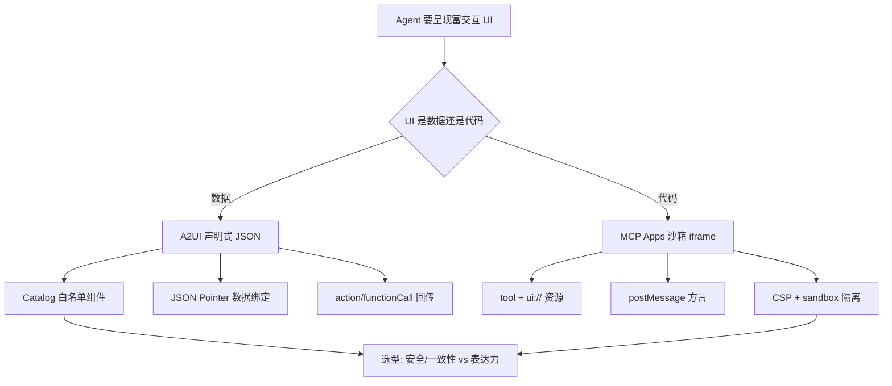

:::note 事实基线
本篇是「生成式 UI 协议」带解答题库，共 **88 题**，事实来源为 `content/docs/a2ui.md`（对照 `$HOME/Downloads/a2ui` @ `08f41cfb`）与 `content/docs/mcp-app.md`（对照 `~/github/yukino-code/apps/mcp` 的 `create_app` 工具实现）。A2UI 是「**UI 是数据**」路线，MCP Apps 是「**UI 是代码**」路线——两者是同一问题域（Agent 如何跨信任边界呈现富交互 UI）的两个极点。
:::

本篇是「生成式 UI 协议」带解答题库。Agent 要向用户呈现富交互界面（尤其是远程/第三方 Agent），有两条相反的路线：**A2UI 让 Agent 说一种 UI 语言（声明式 JSON，客户端按白名单组件渲染）**，**MCP Apps 让 Agent 产出可执行 HTML（沙箱 iframe 关起来执行）**。理解「**这条 UI 是代码还是数据**」这一个问题，就能推演出两者全部的设计差异与选型边界。本篇先讲 A2UI（第一节到第六节），再讲 MCP Apps（第七节到第十节），最后做对比与选型（第十一节）。

**主线一览**



## 一、A2UI：协议要解决的问题

### Q1. A2UI 解决什么问题？为什么两条替代路线都有硬伤？

生成式模型擅长产出文本与代码，但要让 Agent 向用户呈现富交互界面很困难，尤其是**远程 Agent、或跨越信任边界的 Agent**——编排器把一个任务委托给第三方 Agent，后者要往主聊天窗口里渲染一块 UI。

两条常见的替代路线都有硬伤：① **让 Agent 生成 HTML/CSS/JS 并由客户端执行**——模型产出的脚本属于不可信代码，直接执行意味着任意脚本执行的风险，iframe 隔离又带来样式割裂与通信开销；② **让模型直接生成目标框架的组件源码**——既无法在运行时安全执行，又与客户端技术栈强耦合，无法跨端复用。

A2UI 的取向是让 Agent「**说一种 UI 语言**」：Agent 不产出代码，而是产出一段**声明式 JSON**，描述 UI 的结构（组件树）与数据（数据模型）；客户端用自身原生组件库渲染这段描述，并把用户交互回传给 Agent。官方概括是 **safe like data, but expressive like code**。

### Q2. A2UI 的四条设计哲学是什么？各对应什么机制？

| 哲学                     | 含义                                                                                  | 对应机制                                        |
| :----------------------- | :------------------------------------------------------------------------------------ | :---------------------------------------------- |
| Security first           | Agent 只能请求渲染客户端「catalog」中预批准的可信组件，客户端不执行任何 Agent 代码    | Catalog 白名单 + 按名引用的函数（FunctionCall） |
| LLM-friendly、可增量更新 | UI 是带 ID 引用的扁平组件列表，便于 LLM 增量生成与渐进渲染                            | 邻接表 + JSON Pointer 数据绑定 + 流式增量消息   |
| 框架无关、可移植         | 结构描述与实现分离，同一份 payload 可映射到任意框架的原生组件                         | 传输契约 + 多语言 Core SDK + 框架适配层         |
| Flexibility（开放注册）  | 开发者可把任意自有组件（含安全 iframe 容器）注册为「Smart Wrapper」接入绑定与事件系统 | 自定义 catalog + 组件实现注册                   |

### Q3. A2UI 与传统方式（生成 HTML/生成框架代码）的对比？

| 维度       | Agent 生成 HTML/JS     | Agent 生成框架代码 | A2UI                        |
| :--------- | :--------------------- | :----------------- | :-------------------------- |
| UI 载体    | 可执行文档             | 可执行源码         | **声明式 JSON**             |
| 执行面     | 有（需沙箱）           | 有                 | **无（只渲染白名单组件）**  |
| 样式一致性 | 与宿主隔离，需手工对齐 | 与宿主一致         | **原生继承宿主设计系统**    |
| 跨端复用   | 仅 Web                 | 与框架绑定         | **同一份 payload 多端渲染** |
| 增量更新   | 整文档替换             | 整文件重生成       | **按组件 ID 增量**          |

**采分点**：能说出「**A2UI 没有执行面**」——这是它与「生成代码」路线最本质的安全差异：客户端永远不执行 Agent 下发的代码，只渲染白名单组件。

## 二、A2UI：消息模型与 Catalog

### Q4. A2UI 的消息信封与传输契约是什么？

A2UI 是**传输无关**的：消息信封可以走 A2A、AG-UI、MCP 等任意传输层。核心消息类型：`createSurface`（创建 UI 表面）、组件树更新、`updateDataModel`（数据模型更新）、`action`（用户交互回传）、`error`（校验失败）。

**Surface 生命周期规则**：必须先 `createSurface` 再给组件树，root 组件存在，surfaceId 全局唯一且是 kebab-case。

### Q5. 邻接表组件模型是什么？为什么对 LLM 友好？

A2UI 的 UI 是**带 ID 引用的扁平组件列表**（邻接表），而不是嵌套的树：每个组件有 id，持有子组件的 id 引用（`ComponentId` 类型）。

为什么对 LLM 友好：① **便于增量生成**——可以逐个组件生成，不需要一次性产出完整嵌套树；② **便于渐进渲染**——组件可以乱序到达，渲染器按 id 引用组装（引用类问题由渐进渲染天然容忍）；③ **便于增量更新**——更新单个组件只需发该组件，不需要重发整棵树。

**采分点**：能说出「**邻接表（扁平 + id 引用）而非嵌套树，是为了 LLM 增量生成与渐进渲染**」——这是「LLM-friendly」设计哲学的具体落地。

### Q6. Catalog 是什么？为什么校验器要求 ComponentId/ChildList 用 $ref？

**Catalog** 是客户端预批准的**可信组件白名单**——Agent 只能请求渲染 catalog 中的组件。官方有三份 catalog：**basic**（基础组件）、**MCP**（含 `callMcpTool` 与 `McpApp`）、**VegaChart**（图表）。

自定义 catalog 与 basic 同构。**为了让校验器能检查父子引用完整性，任何持有子组件 ID 的属性必须使用 `common_types.json` 中的 `ComponentId` 类型（`$ref`），不能写成裸 string；任何持有子列表或模板的属性必须使用 `ChildList` 类型**。校验器正是靠这两个 `$ref` 识别哪些字段是结构链接——写成裸 string 会被当作静态文本，不再检查目标组件是否存在。

**采分点**：能说出「**ComponentId/ChildList 用 $ref 是为了让校验器识别结构链接、检查悬空引用**」——这是 catalog 设计的工程细节，裸 string 会让校验器漏检。

### Q7. MCP catalog 的 v0.9 与 v1.0 形态有什么差异？

- **v0.9 形态**：声明 `callMcpTool` 函数（在 Surface 内调用 MCP 工具），以及一组字符串处理函数（`concat`、`formatDate`、`jmespath`、`split`、`regexCapture`、`regexReplace`、`updateDataModel`）。
- **v1.0 形态**：保留 `callMcpTool` 并**新增 `McpApp` 组件**——在 Surface 内渲染一个沙箱化的第三方 MCP App。`McpApp` 的属性包括 `htmlContent`（必填，`url_encoded:` 前缀的值会先解码，经 `srcdoc` 渲染）、`allowedTools`（app 可调用的 MCP 工具白名单）、`allowedFunctions`、`data.paths`（状态键到数据模型 JSON Pointer 的映射，含保留键 `toolInput`/`toolResult`/`modelContext`）、`csp` 与 `permissions`。**未列入白名单的工具调用与函数调用以 JSON-RPC 错误拒绝**。

**采分点**：能说出「**A2UI v1.0 用 McpApp 组件承载 MCP Apps 路线**」——两条路线不是互斥的，A2UI 可以用 McpApp 组件嵌套 MCP Apps（数据路线承载代码路线）。

### Q8. McpApp 的双 iframe 沙箱代理是怎么设计的？

双 iframe 沙箱代理由 `typescript/catalogs/shared/sandbox/` 实现：**外层是代理页**，不带 `sandbox` 属性，靠 `document.referrer` 与 origin 检查确认嵌入者身份并中继消息；**内层承载不可信内容**，默认沙箱位为 `allow-scripts allow-forms allow-modals`（`DEFAULT_INNER_SANDBOX`），**刻意不含 `allow-same-origin`**（隔离存储与 origin）、`allow-popups`（防一键链接外泄）、`allow-top-navigation` 系列（防顶层窗口劫持）。

代理页默认由宿主同源提供（`/a2ui-sandbox/`），生产环境建议用 `configureSandbox({baseUrl})` 指向专用 origin；跨帧 payload 还有结构化校验（原型污染键、嵌套深度、序列化大小）。

**采分点**：能说出「**外层代理页不带 sandbox（靠 referrer/origin 检查 + 消息中继），内层带 sandbox 但不含 allow-same-origin**」——这是「承载不可信代码的 iframe」的标准双层设计，与 MCP Apps 篇的「allow-scripts 与 allow-same-origin 绝不能同时授予」是同一红线。

### Q9. 能力协商怎么做？pre-shared 与 inline catalog 的区别？

客户端支持哪些 catalog 通过两种方式告诉服务端：

- **pre-shared catalog**：客户端只声明 `supportedCatalogIds` 字符串列表，服务端预先已知这些 catalog 的内容。
- **inline catalog**：客户端把组件的完整 JSON Schema 内联进能力对象发送给服务端，服务端据此注入 prompt。服务端是否接受由 AgentCard 中 `acceptsInlineCatalogs` 声明，缺省 false。

能力对象按协议版本分组：v0.9/v0.9.1 渲染器发 `{"v0.9": {...}}`，v1.0 渲染器发 `{"v1.0": {...}}`，v0.8 是唯一的例外（能力对象本身就是裸形态不带版本键）。

## 三、A2UI：数据绑定与事件

### Q10. 数据绑定的路径与作用域规则是什么？

数据绑定基于 **JSON Pointer（RFC 6901）**，并扩展支持相对路径：

- 以 `/` 开头的**绝对路径**始终从 Data Model 根解析，与组件在树中的位置无关。
- 不以 `/` 开头的**相对路径**只在 ChildList 模板创建的子作用域内有效，解析到当前迭代项（遍历 `/users` 的模板中，相对路径 `firstName` 在第一项解析为 `/users/0/firstName`）。
- 在数组段的路径段上使用非数字索引是错误。
- 模板内部仍可用绝对路径访问根作用域。

**渐进渲染期间路径可能解析为 `undefined`，渲染器应优雅处理**（空串或 loading 占位）。非字符串值插值时的类型转换规则：数字/布尔转标准字符串表示；null/undefined 转空串；对象/数组转 JSON 字符串，以保证跨语言实现一致。

### Q11. updateDataModel 的 upsert 语义在 v0.9 与 v1.0 有什么差异？

`updateDataModel` 采用严格的 upsert 语义：路径存在则更新，不存在则创建。

- **v0.9 族**：省略 `value`（或置为 `undefined`）则**删除该键**；数组场景下把对应索引置为 `undefined` 以保持长度。
- **v1.0**：`value` **必填**，删除键要**显式写 `null`**，省略 `value` 是 schema 校验错误。
- 省略 `path`（或为 `/`）则替换整个数据模型。

**采分点**：能说出「**v1.0 把删除从『省略 value』改成『显式 null』**」——这是「隐式语义变显式」的协议演进，省略 value 在 v0.9 是删除、在 v1.0 是错误，消除了歧义。

### Q12. 双向绑定与状态回传是怎么工作的？

输入组件（TextField、CheckBox、Slider、ChoicePicker、DateTimeInput）与数据模型建立**双向绑定**：

- **读（Model → View）**：渲染时从绑定路径读值；服务端更新数据模型后组件自动重渲染。
- **写（View → Model）**：用户输入立即写回本地数据模型，绑定同一路径的其他组件实时联动。
- **本地数据模型是唯一数据源；键入等被动变化不触发网络请求**。

状态回传**只在 `action` 触发时发生**：通过 `action.context` 引用数据路径，或对 Surface 开启 `sendDataModel`——开启后客户端在每次发给创建该 Surface 的服务的消息 metadata 里附带该 Surface 完整数据模型。**数据模型只投递给创建者，不会泄漏给其他 Agent**。

**采分点**：能说出「**键入不触发网络请求，回传只在 action 触发时**」+「**数据模型只投递给创建者**」——前者是性能与隐私（不实时上传输入），后者是定向投递安全。

### Q13. action 的两种形态是什么？

交互组件通过 `action` 属性声明行为，二选一：

| 形态           | 语义                                                                                                              |
| :------------- | :---------------------------------------------------------------------------------------------------------------- |
| `event`        | 触发**发往服务端的事件**，携带 `name` 与可选 `context`（v1.0 另有 `userMessage`）；context 中的动态值在触发时解析 |
| `functionCall` | 在**客户端本地执行** catalog 函数，**Agent 不会收到本地函数调用的通知**                                           |

**采分点**：能说出「**functionCall 是客户端本地执行，Agent 不收到通知**」——这是「本地交互不经过模型」的关键，与 MCP Apps 的「App 内本地交互绕过模型」同源。

### Q14. checks 校验与 formatString 是什么？

**checks**：输入组件可以声明 `checks` 校验列表，每项是一个条件（通常为 FunctionCall）加失败文案，校验失败时展示对应错误信息；**Button 的 `checks` 失败会自动禁用按钮**，因此按钮状态可以依赖数据模型的有效性。v0.9 族校验函数必须返回布尔值；v1.0 改为可返回 `ValidationResult` 对象。

**formatString**：唯一支持内嵌表达式的字符串函数，语法为 `${...}`——`${/user/profile/name}` 绝对路径插值，`${firstName}` 相对路径插值，函数调用以括号识别（`${formatDate(value:${/currentDate}, format:'yyyy-MM-dd')}`），要输出字面量 `${` 需转义为 `\${`。

**采分点**：能说出「**校验在客户端本地执行（catalog 函数），不依赖 Agent 自觉**」——这是「校验在执行边界完成」的安全原则。

### Q15. macros（可编程组件）解决什么问题？

组件扩展通常意味着客户端要新增渲染实现。Python Agent SDK 提供了另一条路径：用 `@macro` 装饰器注册高层布局函数，**模型像写 catalog 组件一样写 macro 组件，服务端在下发前把它们同步展开为标准原语组件子树，客户端零改动**。

宏的注册读取 Python 函数的签名与类型提示，把参数类型逐条映射为协议 JSON Schema；docstring 被解析为参数描述。展开器支持宏中嵌套宏的递归展开（受最大递归深度约束）。

**采分点**：能说出「**macros 让服务端扩展组件而客户端零改动**」——这是「服务端展开」的扩展路径，与「客户端注册自定义组件」是两条互补的扩展面。

## 四、A2UI：生成可靠性与安全

### Q16. A2UI 的生成可靠性三步循环是什么？

v0.9 是 **prompt-first 设计**：schema 嵌入 prompt，LLM 不受结构化输出格式强约束。协议文档明确这是该方案的代价——**生成后必须做校验与修复**。标准使用模式是一个三步循环：

```text
Prompt（期望 UI 描述 + 协议 JSON Schema + catalog + 合法示例）
  → Generate（模型输出 JSON）
  → Validate（对照 schema 校验，通过则下发，失败则回喂错误）
```

校验失败的标准错误形态即客户端 `error` 消息的 `VALIDATION_FAILED` 变体，带 **JSON Pointer 级别的路径信息**，便于模型理解并定位修复：

```json
{
  "error": {
    "code": "VALIDATION_FAILED",
    "surfaceId": "user_profile_card",
    "path": "/components/0/text",
    "message": "Expected stringOrPath, got integer"
  }
}
```

**采分点**：能说出「**prompt-first 的代价是必须校验 + 纠错重试**」+「**错误带 JSON Pointer 路径便于模型定位修复**」——这是生成式 UI 可靠性的标准模式（与 yukino-dev-agent 的 A2UI 纠错重试同源）。

### Q17. conformance validator 钉住了哪些失败类？

conformance 的三个 validator 套件（v0_8/v0_9/v1_0）以同一套严格模式钉住了校验器必须覆盖的失败类：**信封与组件 schema 检查、重复 ID、缺 root、悬空引用、环、可达性（含列表模板）、嵌套深度上限、非法路径、多 Surface、增量更新**。

协议对失败的最小处理要求是：**逐条处理、单条原子、`undefined` 优雅处理**；引用类问题（组件乱序、引用未到达）由渐进渲染天然容忍，**生命周期类问题（缺 `createSurface`、杂散 `createSurface`）会破坏状态机，必须由应用层防御**。

**采分点**：能说出「**引用类问题渐进渲染天然容忍，生命周期类问题必须应用层防御**」——这区分了「可自愈的失败」与「破坏状态机的失败」。

### Q18. A2UI 的安全模型由哪几条机制保证？

- **声明式数据而非代码**：Agent 只能请求渲染 catalog 内组件，客户端永远不执行 Agent 下发的代码；`functionCall` 是 Agent 与渲染环境交互的唯一通道，且 v1.0 下执行边界（`allowedCallers`/`requiresUserActivation`）由渲染器在运行时强制。
- **catalog 白名单**：生产应用通常自定义 catalog，把 Agent 限制在自己的设计系统内。
- **定向投递**：开启 `sendDataModel` 时，UI 状态只回传给创建该 Surface 的服务端。
- **身份归属防伪**（v0.9 族）：编排者负责校验或覆写 `iconUrl` 与 `agentDisplayName`，防止冒充；v1.0 把身份归属移出协议层。
- **不可信内容的沙箱化承载**：`McpApp` 与共享双 iframe 代理隔离第三方内容，工具与函数调用按白名单放行。
- **校验在执行边界完成**：校验类逻辑用 catalog 函数声明并在客户端本地执行，不依赖 Agent 自觉。

### Q19. A2UI 适合与不适合的场景？

**适合**：Agent 需要在对话内动态生成结构化交互界面（卡片、列表、表单、图表），且组件集可由 catalog 覆盖；UI 由远程或第三方 Agent 产出，需要跨信任边界安全渲染；需要跨端渲染同一份 UI 描述（Web/Angular/Lit/React/Flutter/SwiftUI）；生成链路需要可校验、可纠错。

**不适合**：需要承载任意 Web 应用或重型可视化库（地图、3D、完整游戏）——超出 catalog 表达能力，可走 MCP Apps 这类代码沙箱路线；界面结构固定、由开发者设计时产出——直接用框架组件更省成本；只需要一张静态图片或一段富文本——普通消息即可。

**采分点**：能说出「**A2UI 的天花板是 catalog 表达能力**」——需要任意 Web 应用/重型可视化时，A2UI 力不从心，要走 MCP Apps。

## 五、MCP Apps：协议契约

### Q20. MCP Apps 是什么？由哪两个原语组合？

MCP Apps 是 MCP 协议的一个**扩展**：它让 MCP 工具返回一段可交互的 HTML 应用，由 MCP 宿主渲染在对话流内部的沙箱 iframe 中。它由两个已有 MCP 原语组合而成：

- **Tool（工具）**：在定义元数据里声明 `_meta.ui.resourceUri`，指向一个 UI 资源；
- **Resource（资源）**：URI 以 `ui://` 开头，MIME 类型为 `text/html;profile=mcp-app`，内容是一份自包含的 HTML 文档。

宿主调用工具时，先拉取（甚至预加载）这份 HTML，渲染进沙箱 iframe，再把工具结果推送进去——UI 与数据由此接通。**工具本身仍然是普通工具**：出现在 tools/list 里，被模型照常调用。

### Q21. MCP Apps 解决什么问题？四点价值是什么？

纯文本响应的表达力有限，而「做一个独立 Web 应用再发链接」又会切断对话上下文。MCP Apps 提供四点价值：

1. **上下文保持**：App 活在对话里，用户不切标签页、不丢对话线程；
2. **双向数据流**：App 可以通过宿主代理调用同一 MCP Server 上的任意工具，宿主也会把最新的工具结果推给 App；
3. **复用宿主能力**：App 可以把动作委托给宿主（打开链接、追加消息等）；
4. **安全保证**：App 跑在宿主控制的沙箱 iframe 里，访问不了父页面 DOM、读不到 Cookie、逃不出容器——**这是整个扩展存在的前提**。

### Q22. MCP Apps 与普通 MCP 工具的关系？为什么是「增强而非替代」？

对纯文本客户端**没有破坏性影响**：工具本身照常出现在 tools/list、照常被模型调用；返回结果里的 content（文本）照常进入模型上下文；**只有当宿主声明了 MCP Apps 能力时，才会拉取 UI 资源并渲染 iframe**。

因此「给工具加 UI」是**增量增强**：不支持的宿主只多看到一段元数据，支持的宿主多渲染一块交互界面。

**采分点**：能说出「**MCP Apps 是增量增强，对纯文本客户端无破坏性影响**」——这是协议扩展的正确设计（向后兼容）。

### Q23. 服务端怎么声明 tool + ui:// 资源？

```typescript
import { registerAppTool, registerAppResource,
         RESOURCE_MIME_TYPE } from "@modelcontextprotocol/ext-apps/server";
const resourceUri = "ui://create-app/create-app.html";
registerAppTool(server, "get-time", {
  description: "Returns the current server time.",
  inputSchema: {}, annotations: { readOnlyHint: true },
  _meta: { ui: { resourceUri } },
}, async () => ({
  content: [{ type: "text", text: new Date().toISOString() }], // 文本降级
  structuredContent: { time },   // 小体积结构化数据（模型可见）
  _meta: { html },               // UI 专用大数据（模型不可见）
}));
registerAppResource(server, "Get Time UI", resourceUri, {...}, async () => ({...}));
```

### Q24. 能力协商与降级怎么做？

宿主声明 MCP Apps 能力（扩展能力标识 `io.modelcontextprotocol/ui`），服务端在工具元数据里声明 `_meta.ui.resourceUri`。**不支持的宿主**：只看到工具的文本 content（降级为纯文本）；**支持的宿主**：拉取 ui:// 资源渲染 iframe。资源元数据里申报 CSP 域（connectDomains/resourceDomains/frameDomains/baseUriDomains）与权限。

## 六、MCP Apps：生命周期与安全

### Q25. 一次调用的完整生命周期时序是什么？

```text
阶段一  准备（与生成交错）
  宿主 -> resources/read ui://... 拉取 HTML（可预加载）
  模型 -> 生成 tool_use（引用 resourceUri）-> 宿主先知道要渲染哪个 UI
  宿主 -> 挂载沙箱 iframe + ui/initialize 握手 -> shell
  宿主 -> tool-input-partial -> shell（状态条显示生成进度）
阶段二  工具执行
  宿主 -> tools/call create_app -> Server
    <- { content, structuredContent:{title}, _meta:{html} }
阶段三  结果分叉与渲染（一次结果，两条通道）
  宿主 -> 一行文本回执（tool_result）-> 模型上下文（只含 content）
  宿主 -> tool-result（含 _meta.html）-> shell（HTML 走 UI 专用通道，模型不可见）
  shell -> 内层 iframe srcDoc = html -> 沙箱执行 JS -> UI 首帧呈现
```

要点：**入参即产物**（HTML 是模型现场写出来的）；**准备与生成交错**（资源拉取、iframe 挂载、流式预览都不必等 HTML 生成完）；**结果一分为二**（文本回模型、_meta 给 UI）。

### Q26. 三个通道的可见性分工是什么？为什么大 HTML 不能放 structuredContent？

| 通道              | 模型可见          | 本例用途                            |
| ----------------- | ----------------- | ----------------------------------- |
| content（文本）   | 是                | 一句话回执加非 UI 宿主的降级说明    |
| structuredContent | 是                | 小数据（标题）                      |
| _meta             | **否（UI 专用）** | 大数据（完整 HTML，上限 20 万字符） |

**大 HTML 绝不能放进 structuredContent**——那是普通工具结果，会被完整回灌给模型，造成数万 token 的重复。**UI 专属数据放 \_meta，经 tool-result 通知推给 App，模型完全看不到**。

**采分点**：这是 **MCP Apps 工程里最重要的可见性决策**——能说出「**大 HTML 放 \_meta 而不是 structuredContent，否则数万 token 重复回灌模型**」，就是做过 MCP Apps 的人。

### Q27. postMessage 上的 MCP 方言是什么？

宿主与 iframe 之间的通信走 **postMessage**，承载 MCP 方言的消息：`ui/initialize`（握手）、`tool-input-partial`（流式入参）、`tool-result`（工具结果推送）、`ui/update-model-context`（App 通知模型）、`ui/requests/function-call`（App 请求调用 catalog 函数）、teardown（卸载）。App 侧用 `PostMessageTransport(window.parent, window.parent)` 连接。

### Q28. MCP Apps 的沙箱边界是什么？为什么 allow-scripts 与 allow-same-origin 不能同时给？

宿主把 App HTML 渲染进沙箱 iframe，App 天然无法：访问父页面 DOM 或在父上下文执行脚本；读取宿主的 Cookie/localStorage/sessionStorage（**沙箱内源为 opaque origin，存储 API 直接抛错**）；导航父页面、逃出容器。所有通信只能走宿主中转的 postMessage 通道，宿主可以审查每一个请求。

**需要特别注意的组合陷阱**：`allow-scripts` 与 `allow-same-origin` **绝不能同时授予可能与宿主同源的文档**，否则脚本可以摘掉自己的沙箱——**这是所有承载不可信代码的 iframe 方案共同的红线**。

**采分点**：能说出「**allow-scripts + allow-same-origin 同时给 = 脚本能摘掉自己的沙箱**」——这是 iframe 安全的第一红线，与 A2UI 双 iframe 内层「刻意不含 allow-same-origin」是同一纪律。

### Q29. CSP 的「默认全拒，显式申报」是什么意思？

MCP App HTML **没有同源服务器**，所有外部来源都必须在资源元数据里申报，**漏报会静默失败**（资源加载不出来、请求发不出去）。SDK 会把声明映射为宿主施加的 CSP 指令：

| 声明字段        | 映射 CSP 指令                                       | 用途                    |
| --------------- | --------------------------------------------------- | ----------------------- |
| connectDomains  | connect-src                                         | fetch / XHR / WebSocket |
| resourceDomains | img-src、script-src、style-src、font-src、media-src | 静态资源                |
| frameDomains    | frame-src                                           | 嵌套 iframe             |
| baseUriDomains  | base-uri                                            | 文档 base URI           |

### Q30. MCP Apps 的信任假设与残余风险有哪些？

沙箱模型的本质是「**假设代码不可信，隔离执行**」。它比「根本不执行代码」的路线（A2UI）多出几类需要宿主持续防守的攻击面：

- **资源耗尽**：沙箱不提供 CPU/内存配额，死循环仍能冻结渲染进程；
- **表单外泄**：若授予 allow-forms，页面可以把用户输入提交到任意域名（CSP 的 connectDomains **不覆盖 form-action**，需要宿主补齐 `form-action 'none'`）；
- **钓鱼弹窗**：allow-popups 允许打开任意新标签页；
- **CSP 组合漏洞**：申报过宽的 resourceDomains（如整个 CDN）意味着信任该 CDN 的全部内容。

因此 **MCP Apps 的安全是「宿主实现质量」敏感的**：同一个 App 在严谨的宿主里安全，在粗糙的宿主里可能漏。**这是它与 A2UI 安全模型最本质的差别**。

**采分点**：能说出「**MCP Apps 的安全依赖宿主实现质量，A2UI 的安全是协议级的（不执行代码）**」——这是两条路线安全模型的本质差异。

## 七、MCP Apps：工程实践（create_app）

### Q31. create_app 工具的结构与数据通道是什么？

```text
create-app/
  tool.ts            # registerAppTool + registerAppResource（服务端）
  resolve-app.ts     # 依次从结果 _meta、structuredContent、工具入参解析 html 与 title
  create-app.html    # UI 入口
  create-app.tsx     # React shell: App 生命周期 + 沙箱 iframe
  frame-size.ts      # 高度上报: 向内层 HTML 注入测量脚本, 解析 iframe 高度
  global.css         # 样式入口
```

### Q32. App 侧怎么渲染不可信 HTML？

shell 拿到 `_meta.html` 后渲染进**二级沙箱 iframe**：

```tsx
<iframe
  sandbox="allow-scripts allow-forms allow-modals allow-popups"
  srcDoc={state.phase === "ready" ? state.html : undefined}
/>
```

**shell 本身已运行在宿主的沙箱 iframe（opaque origin）里，内层 iframe 再隔离一层**：模型生成的 HTML 拿不到 shell 的 DOM，更碰不到宿主。两个渲染时机都处理：部分入参到达时显示生成进度（字节数），完整入参或权威结果到达时渲染最终内容。工具被取消时切到失败态。

**采分点**：能说出「**二级沙箱：shell 在宿主沙箱里，内层 iframe 再隔离一层**」——模型生成的 HTML 是不可信的，即使 shell 已经被沙箱化，内层还要再隔离。

### Q33. 构建管线为什么是 tsup → vite singlefile？

```text
tsup（清空 dist，产出 dist/main.js）
  -> vite + vite-plugin-singlefile（emptyOutDir: false，产出自包含的 dist/create-app.html）
```

- **UI 依赖（React、Tailwind、daisyUI、vite 插件）全部进 devDependencies**——它们只参与打包，服务端运行时不需要；**ext-apps 是例外**：服务端运行时 import 其 server 入口，因此位于 dependencies。
- 前端构建单独成脚本，开发与测试流程都先跑它，保证运行时读到的是构建产物。
- **服务端从构建产物目录读 HTML，文件缺失时抛错而不是降级**——静默返回占位 HTML 会把「没构建」伪装成「渲染成功」。

**采分点**：能说出「**UI 依赖进 devDependencies（只参与打包），ext-apps 进 dependencies（运行时 import）**」+「**文件缺失抛错而不是降级**」——前者是依赖分类的精确性，后者是「不把没构建伪装成渲染成功」。

### Q34. create_app 已踩过的坑有哪些？

1. **打包器把 CJS 依赖打进 ESM bundle 时，动态 require 会抛错**，需要在 banner 里补 `createRequire(import.meta.url)`；
2. **打包器的清空行为会删掉构建目录**，前端构建必须后跑且不重复清空（`emptyOutDir: false`）；
3. **依赖 data-theme 的组件库（daisyUI）需要手动镜像宿主主题**。

## 八、MCP Apps：闭环全景

### Q35. 完整闭环的三圈是什么？

| 触发源         | 通道                                   | 经过模型                | UI 更新方式 | 内层状态 |
| -------------- | -------------------------------------- | ----------------------- | ----------- | -------- |
| 首次需求       | tools/call + tool-result 推送          | 是（生成 HTML 入参）    | 首次挂载    | -        |
| 更新需求       | 新 tool_use + 推送（资源/iframe 复用） | 是（重新生成整页 HTML） | 整体替换    | **清零** |
| App 内本地交互 | 无（内层 JS 直改 DOM）                 | **否**                  | 局部更新    | 保留     |
| App 内回程取数 | postMessage -> shell -> 宿主代理       | **否**                  | 局部更新    | 保留     |
| App 通知模型   | ui/update-model-context                | 注入（受控）            | 不直接改 UI | 保留     |
| 结束           | teardown 通知                          | -                       | 卸载        | -        |

整条闭环的设计意图可以压缩成一句：**模型负责「决定 UI 长什么样」（唯一进上下文的部分）；一旦 UI 活起来，后续交互与数据刷新尽量留在沙箱内、走协议旁路，模型只在被显式叫到时才回到对话里**。

### Q36. 更新需求为什么是「整体替换、状态清零」？

用户说「改成折线图，加上环比」，这条更新走对话正向链路：模型生成新的 tool_use，引用同一个资源 URI。**因为资源未变、iframe 已挂载，宿主不重拉资源也不重建 iframe，只把新的工具结果推给 shell；shell 用整体替换文档的方式更新 UI，内层状态清零**。

三个关键语义：**资源复用**（新调用引用同一 ui:// 资源，宿主不再发起读取）；**全量替换**（内层文档整体重建，用户的滚动位置、未提交表单、JS 内存状态清零）；**上下文成本**（每次「改需求」模型都要重新生成整份 HTML，旧版入参仍留在历史里）。

**采分点**：能说出「**长交互不该依赖『更新需求』这条路保留状态**」——整体替换会清零状态，要保留状态的交互应该走「App 内本地交互」（不经过模型）。

### Q37. App 内回程取数的「直连型」与「托管型」有什么区别？

- **直连型 App**（App 代码本身就是 App bridge 的持有者）：直接调用服务器的工具。
- **托管型 App**（如 create_app，bridge 在外层 shell 手里，内层是不可信 srcdoc）：**必须经 shell 中转**——内层 postMessage 给 shell，shell 先校验消息确实来自自己的 iframe（**沙箱下 origin 恒为 null，只能靠 source 比对**）并核对工具白名单，再代理调用宿主，结果原路返回。

**采分点**：能说出「**沙箱下 origin 恒为 null，只能靠 source 比对校验消息来源**」——这是 postMessage 安全校验的关键细节（不能用 origin 校验，因为 opaque origin 是 null）。

### Q38. ui/update-model-context 是什么？为什么是「唯一一条 App 到模型的显式通道」？

若 App 内发生的事需要模型知道，调 `ui/update-model-context` 把结构化摘要注入模型上下文。**这是唯一一条「App 到模型」的显式通道**——App 内本地交互、回程取数都不经过模型，只有显式调用 update-model-context 才会把信息注入模型上下文。

**采分点**：能说出「**模型只在被显式叫到时才回到对话里**」——这是 MCP Apps 闭环的核心设计意图（控制上下文成本）。

## 九、A2UI 与 MCP Apps 对比

### Q39. 两者的根本分歧是什么？

两者的目标一致：**Agent 如何跨越信任边界，向用户呈现富交互 UI**。但信任策略相反：

> **MCP Apps：UI 是代码**。代码不可信，所以用浏览器沙箱加 CSP 把它关起来执行。
> **A2UI：UI 是数据**。数据永远不该被执行，所以只发声明式 JSON，客户端按白名单组件渲染。

这个根本分歧派生出下面所有差异。**理解「这条 UI 是代码还是数据」这一个问题，就能推演出两者全部的设计差异与选型边界**。

### Q40. 两者逐维度对照是什么？

| 维度       | A2UI（数据路线）              | MCP Apps（代码路线）               |
| ---------- | ----------------------------- | ---------------------------------- |
| UI 载体    | 声明式 JSON                   | 自包含 HTML/CSS/JS                 |
| 执行面     | **无**（只渲染白名单组件）    | 有（沙箱 iframe 执行）             |
| 安全模型   | **协议级**（不执行代码）      | **宿主实现质量敏感**（沙箱 + CSP） |
| 表达力     | 受 catalog 天花板限制         | **任意 Web 能力**                  |
| 样式一致性 | **原生继承宿主设计系统**      | 与宿主隔离（iframe）               |
| 跨端       | **同一份 payload 多端渲染**   | 仅 Web（iframe）                   |
| 传输       | **传输无关**（A2A/AG-UI/MCP） | 绑定 MCP 宿主                      |
| 增量更新   | 按组件 ID 增量                | 整体替换（状态清零）               |
| 上下文成本 | 低（只发结构 + 数据）         | 高（每次改需求重发整页 HTML）      |

### Q41. 两者可以互相嵌套吗？

可以。**A2UI v1.0 用 `McpApp` 组件承载 MCP Apps**（数据路线里嵌一个代码沙箱组件）；反过来 MCP Apps 的 App 内也可以渲染 A2UI 风格的声明式内容。两者不是互斥的，而是**可以组合的两个层次**。

**采分点**：能说出「**A2UI 的 McpApp 组件是『数据路线承载代码路线』的嵌套**」——这体现对两条路线关系的深入理解（不是二选一，而是可组合）。

### Q42. 选型建议是什么？

- **选 A2UI**：需要跨信任边界安全渲染、跨端一致、与宿主设计系统统一、组件集可由 catalog 覆盖、生成链路需要可校验可纠错。
- **选 MCP Apps**：需要任意 Web 能力（地图、3D、重型可视化、完整交互应用）、绑定 MCP 宿主、接受沙箱 + CSP 的安全成本。
- **组合**：A2UI 做主体（结构化卡片/表单/图表），需要重型可视化时用 McpApp 组件嵌一个 MCP App。

**采分点**：能说出「**选型的核心问题是『这条 UI 需要任意 Web 能力吗』**」——需要则 MCP Apps（代码），不需要则 A2UI（数据，更安全更一致）。

## 十、生态与落地

### Q43. MCP Apps 的宿主与生态现状？

MCP Apps 是**核心 MCP 规范之外的扩展，宿主支持可选**。定位上最接近的同类物：**Claude Artifacts**（体验相似，但是宿主内建功能、无法由第三方 Server 提供；MCP Apps 把这个能力开放给了整个 MCP 生态）、**OpenAI Apps SDK**（同为「工具返回 UI」，MCP Apps 走开放规范路线）。生态件包括宿主侧渲染组件、SDK 内置的 AppBridge（自建宿主用）、一批官方示例与模板。

### Q44. A2UI 的多语言 SDK 能力面？

A2UI 提供多语言 Core SDK（TypeScript、Python 等）与框架适配层（Web/Angular/Lit/React/Flutter/SwiftUI）。Core SDK 负责消息处理（MessageProcessor 校验分发）、SurfaceModel（组件树与数据模型）、能力协商；框架适配层负责把声明式 JSON 映射到原生组件渲染。

### Q45. A2UI 与 A2A 怎么集成？

A2UI 是**传输无关**的，可以走 A2A（Agent2Agent）传输：编排器把一个任务委托给第三方 Agent，第三方 Agent 用 A2UI 消息往主聊天窗口渲染 UI。A2A 负责 Agent 间的任务派发与状态更新，A2UI 负责 UI 呈现——两者是不同层次的协议。

### Q46. A2UI Express DSL 是什么？

若还需要压缩模型输出成本，可以进一步用 **A2UI Express DSL**（官方 ANTLR4 语法在 `specification/inference_formats/express/Express.g4`）作为生成格式，由宿主编译器展开为标准 wire payload。这是「用更紧凑的 DSL 降低模型输出 token」的优化。

### Q47-Q88. 快速自检与深挖补充

**Q47. 一句话解释 A2UI 的核心取向。** 让 Agent「说一种 UI 语言」——产出声明式 JSON 描述结构与数据，客户端用原生组件渲染，不执行任何 Agent 代码（safe like data, expressive like code）。

**Q48. 一句话解释 A2UI 为什么没有执行面。** 客户端只渲染 catalog 白名单组件，functionCall 是按名引用的预定义函数——Agent 下发的永远是数据，不是可执行代码。

**Q49. 一句话解释邻接表为什么对 LLM 友好。** 扁平组件列表 + id 引用，便于增量生成（逐个组件）、渐进渲染（乱序到达按 id 组装）、增量更新（只发变化的组件）。

**Q50. 一句话解释 Catalog 的安全角色。** 客户端预批准的可信组件白名单，Agent 只能请求渲染 catalog 内组件——生产应用自定义 catalog 把 Agent 限制在自己的设计系统内。

**Q51. 一句话解释 ComponentId 为什么必须用 $ref。** 让校验器识别哪些字段是结构链接、检查悬空引用——写成裸 string 会被当作静态文本，不再检查目标组件是否存在。

**Q52. 一句话解释 McpApp 组件的意义。** A2UI v1.0 用它在 Surface 内渲染沙箱化的第三方 MCP App——数据路线承载代码路线，两条路线可嵌套组合。

**Q53. 一句话解释双 iframe 沙箱的内外层分工。** 外层代理页不带 sandbox（靠 referrer/origin 检查 + 消息中继），内层带 sandbox 但不含 allow-same-origin（隔离存储与 origin）。

**Q54. 一句话解释 JSON Pointer 的绝对与相对路径。** / 开头从 Data Model 根解析（与组件位置无关），非 / 开头只在 ChildList 模板子作用域内有效（解析到当前迭代项）。

**Q55. 一句话解释渐进渲染期间 undefined 怎么处理。** 路径可能解析为 undefined，渲染器应优雅处理（空串或 loading 占位）——渐进渲染天然容忍引用未到达。

**Q56. 一句话解释 updateDataModel v1.0 的删除语义变化。** v0.9 省略 value 是删除，v1.0 value 必填、删除要显式写 null——隐式语义变显式，消除歧义。

**Q57. 一句话解释双向绑定为什么不实时上传。** 本地数据模型是唯一数据源，键入等被动变化不触发网络请求——回传只在 action 触发时（性能 + 隐私）。

**Q58. 一句话解释 sendDataModel 的定向投递。** 开启后数据模型只投递给创建该 Surface 的服务端，不泄漏给其他 Agent——定向投递安全。

**Q59. 一句话解释 action 的 event 与 functionCall 区别。** event 发往服务端（Agent 收到），functionCall 客户端本地执行（Agent 不收到通知）——本地交互不经过模型。

**Q60. 一句话解释 checks 为什么在客户端执行。** 校验类逻辑用 catalog 函数声明并在客户端本地执行，不依赖 Agent 自觉——校验在执行边界完成。

**Q61. 一句话解释 Button checks 失败的效果。** 自动禁用按钮——按钮状态可以依赖数据模型的有效性，无需服务端往返。

**Q62. 一句话解释 macros 的扩展价值。** 服务端用 @macro 注册高层布局函数，下发前同步展开为标准原语组件子树，客户端零改动——服务端扩展组件的路径。

**Q63. 一句话解释 prompt-first 的代价。** schema 嵌入 prompt，LLM 不受结构化输出强约束——生成后必须校验与修复（Prompt → Generate → Validate 三步循环）。

**Q64. 一句话解释 VALIDATION_FAILED 为什么带 JSON Pointer 路径。** 便于模型理解并定位修复——纠错重试时把路径级错误回喂给模型。

**Q65. 一句话解释引用类与生命周期类失败的区别。** 引用类（组件乱序、引用未到达）渐进渲染天然容忍；生命周期类（缺 createSurface、杂散 createSurface）破坏状态机，必须应用层防御。

**Q66. 一句话解释 A2UI 安全模型的核心。** 声明式数据而非代码 + catalog 白名单 + 定向投递 + 沙箱化承载不可信内容 + 校验在执行边界完成——客户端永远不执行 Agent 代码。

**Q67. 一句话解释 A2UI 的天花板。** catalog 表达能力——需要任意 Web 应用/重型可视化（地图、3D、游戏）时超出 catalog，要走 MCP Apps 代码沙箱路线。

**Q68. 一句话解释 MCP Apps 的两个原语。** Tool（声明 _meta.ui.resourceUri）+ Resource（ui:// 开头，MIME text/html;profile=mcp-app）——工具返回可交互 HTML。

**Q69. 一句话解释 MCP Apps 为什么是增强而非替代。** 工具照常出现在 tools/list、content 照常进模型上下文，只有声明了 MCP Apps 能力的宿主才渲染 iframe——对纯文本客户端无破坏性影响。

**Q70. 一句话解释 MCP Apps 的四点价值。** 上下文保持（App 活在对话里）、双向数据流（经宿主代理调工具）、复用宿主能力、安全保证（沙箱 iframe）。

**Q71. 一句话解释三通道可见性分工。** content（文本，模型可见，降级回执）、structuredContent（小数据，模型可见）、_meta（大 HTML，模型不可见，UI 专用）——大 HTML 放 _meta 避免数万 token 重复回灌。

**Q72. 一句话解释生命周期「准备与生成交错」。** 资源拉取、iframe 挂载、流式预览都不必等 HTML 生成完——模型先知道要渲染哪个 UI（引用 resourceUri），宿主提前准备。

**Q73. 一句话解释 postMessage MCP 方言的关键消息。** ui/initialize（握手）、tool-input-partial（流式入参）、tool-result（结果推送）、ui/update-model-context（App 通知模型）、teardown（卸载）。

**Q74. 一句话解释沙箱内 origin 为什么是 null。** 沙箱 iframe 是 opaque origin，存储 API 直接抛错——所以 postMessage 校验只能靠 source 比对，不能用 origin。

**Q75. 一句话解释 allow-scripts + allow-same-origin 的红线。** 同时授予可能与宿主同源的文档，脚本可以摘掉自己的沙箱——所有承载不可信代码的 iframe 方案共同的红线。

**Q76. 一句话解释 CSP 默认全拒。** MCP App HTML 没有同源服务器，所有外部来源必须在资源元数据申报，漏报静默失败——connectDomains/resourceDomains/frameDomains/baseUriDomains 映射为 CSP 指令。

**Q77. 一句话解释 MCP Apps 的残余风险。** 资源耗尽（沙箱无 CPU/内存配额）、表单外泄（connectDomains 不覆盖 form-action）、钓鱼弹窗（allow-popups）、CSP 过宽——安全依赖宿主实现质量。

**Q78. 一句话解释 create_app 的二级沙箱。** shell 已在宿主沙箱 iframe（opaque origin）里，内层 iframe 再隔离一层——模型生成的 HTML 拿不到 shell 的 DOM。

**Q79. 一句话解释 UI 依赖为什么进 devDependencies。** 它们只参与打包（vite singlefile 产出自包含 HTML），服务端运行时不需要——ext-apps 例外（运行时 import server 入口）。

**Q80. 一句话解释构建产物缺失为什么抛错而不降级。** 静默返回占位 HTML 会把「没构建」伪装成「渲染成功」——抛错让问题显式暴露。

**Q81. 一句话解释更新需求为什么状态清零。** 整体替换内层文档，滚动位置/未提交表单/JS 内存状态清零——长交互不该依赖这条路保留状态，要走 App 内本地交互。

**Q82. 一句话解释直连型与托管型 App 的区别。** 直连型 App 代码本身持有 bridge 可直接调工具；托管型（create_app）bridge 在外层 shell，内层不可信 srcdoc 必须经 shell 中转（校验 source + 工具白名单）。

**Q83. 一句话解释 ui/update-model-context 的唯一性。** 它是唯一一条「App 到模型」的显式通道——本地交互、回程取数都不经过模型，只有显式调用才注入上下文。

**Q84. 一句话解释 MCP Apps 闭环的设计意图。** 模型负责「决定 UI 长什么样」（唯一进上下文的部分），UI 活起来后交互与数据刷新尽量留在沙箱内走协议旁路，模型只在被显式叫到时才回到对话。

**Q85. 一句话解释两者的根本分歧。** MCP Apps：UI 是代码，用沙箱关起来执行；A2UI：UI 是数据，永不执行只渲染白名单组件——理解「代码还是数据」就能推演全部差异。

**Q86. 一句话解释两者安全模型的本质差异。** A2UI 安全是协议级的（不执行代码），MCP Apps 安全是宿主实现质量敏感的（同一个 App 在严谨宿主里安全、粗糙宿主里可能漏）。

**Q87. 一句话解释选型的核心问题。** 「这条 UI 需要任意 Web 能力吗」——需要则 MCP Apps（代码，表达力强但攻击面大），不需要则 A2UI（数据，更安全更一致跨端）。

**Q88. 一句话总结两条路线的关系。** 同一问题域（Agent 跨信任边界呈现富交互 UI）的两个极点——MCP Apps 信任沙箱、用表达力换攻击面，A2UI 信任数据、用 catalog 天花板换安全与一致性；两者可互相嵌套（A2UI 的 McpApp 组件承载 MCP App）。

---

**延伸阅读**

- [MCP 协议与 Agent 安全题库](/interview/qa/mcp-and-agent-security)：MCP 核心协议、传输、安全边界。
- [Yukino Dev Agent 项目深挖题库](/interview/qa/yukino-dev-agent-project)：A2UI 在真实全栈应用里的落地（流式过滤、纠错重试、动作闭环）。
- [AI 流式前端题库](/interview/qa/ai-streaming-ui)：流式渲染与前端状态管理。
- [工作文档 · A2UI 声明式 UI 协议](/docs/a2ui) 与 [MCP Apps](/docs/mcp-app)：本篇的事实来源。
