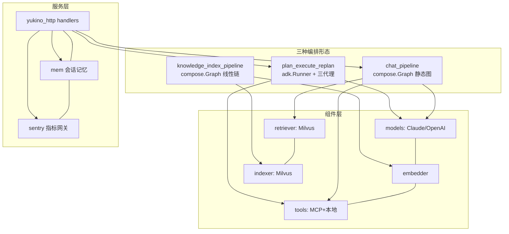
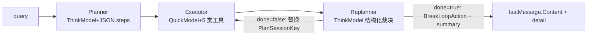
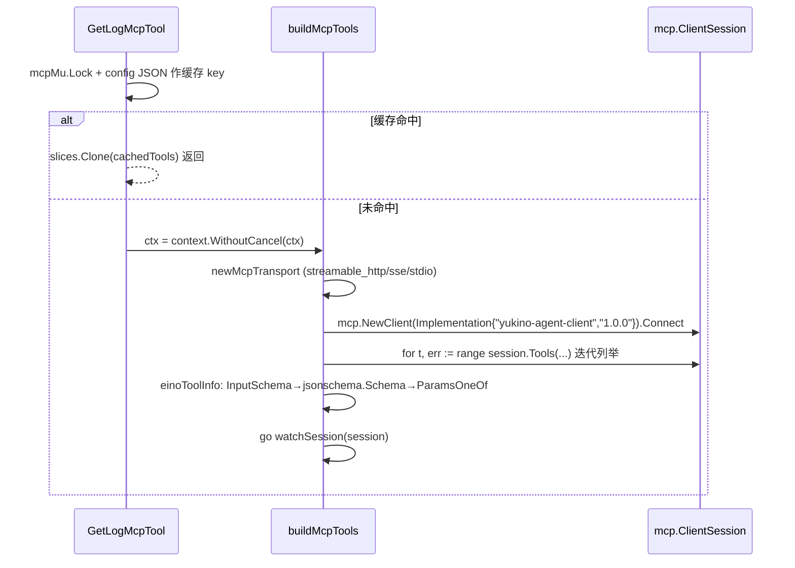

本篇是「Go 语言视角的 AI Agent 工程」带解答题库（56 题），证据仓库为 `$HOME/github/yukino.go/apps/agent`（HEAD `facf5d6`，`server/go.mod` 声明 **go 1.26.0**，核心依赖 **`github.com/cloudwego/eino v0.9.22`**、`modelcontextprotocol/go-sdk v1.8.0`、`milvus-sdk-go/v2 v2.4.2`、`anthropic-sdk-go v1.84.0`、`gorm v1.31.2`、`prometheus/client_golang v1.25.0`）。路径为 `apps/agent/server/` 下相对路径。TS 侧 agent loop 细节见 [Agent 执行循环与工具体系](/interview/qa/agent-loop-and-tools)，task_flow/agent_proxy 见 [服务架构与任务系统](/interview/qa/service-architecture)，本篇聚焦 **Go 实现层**。



## 一、语言与框架选型

### Q1. 为什么用 Go 写 AI Agent？给出工程层面的取舍。

**事实基线**：本仓库用 Go + Eino 实现了完整的 RAG chat agent、plan-execute-replan 运维 agent 与知识索引流水线。取舍：

| 维度     | Go 的优势                                             | Go 的代价                              |
| -------- | ----------------------------------------------------- | -------------------------------------- |
| 并发     | goroutine 天然适配「多工具并行、流式泵送、会话隔离」  | 生态里 async 组合子不如 TS 丰富        |
| 部署     | 单二进制 + 一个 config.json，无运行时依赖             | —                                      |
| 类型安全 | 图编排的输入输出编译期检查（`compose.NewGraph[I,O]`） | 动态 schema 要靠反射/代码生成          |
| 性能     | 网关/代理/指标类旁路组件零解释开销                    | LLM 调用本身是网络瓶颈，语言性能不敏感 |
| 生态     | Eino（CloudWeGo）提供 Graph/Chain/adk 全套            | AI 新范式落地通常 Python/TS 先行       |

**面试表述**：Agent 的「智能」在模型，「工程」在编排、并发、可观测与部署——后者恰是 Go 的强项；当 Agent 作为**长驻服务**（多租户、SSE 流式、指标上报）而非本地 CLI 时，Go 的收益最大。

### Q2. Eino 是什么？它的三层编排原语在本项目各用在哪？

**事实基线**（go.mod + 三个 pipeline 包）：Eino 是 CloudWeGo 开源的 Go LLM 应用框架。三层原语：

1. **`compose.Chain`**（线性链）：`cmd/llm_tool/main.go` 用 `compose.NewChain[[]*schema.Message, *schema.Message]().AppendChatModel(...)` 做最小工具调用 demo；
2. **`compose.Graph`**（静态图，支持扇出/汇聚）：`chat_pipeline`（菱形拓扑）与 `knowledge_index_pipeline`（Loader→Splitter→Indexer 线性图）；
3. **`adk.Runner` + `adk.Agent`**（代理级抽象，事件迭代器驱动）：`plan_execute_replan` 用 `adk.NewRunner(ctx, adk.RunnerConfig{Agent: planExecuteAgent})` 跑 planner/executor/replanner 三代理循环。

选型逻辑：**数据流确定用 Graph，控制流动态（循环、中断、重规划）用 adk**——与 LangGraph 的 graph/checkpoint 分层同构（框架对比见 [Agent 框架与架构对比](/interview/qa/agent-frameworks)）。

### Q3. Go 泛型在 Agent 编排里解决了什么问题？

**事实基线**：`compose.NewGraph[*UserMessage, *schema.Message]`（chat_pipeline/orchestration.go）、`compose.NewGraph[document.Source, []string]`（knowledge_index_pipeline）、`compose.Runnable[I,O]`、`compose.AnyLambda(agent.Generate, agent.Stream, nil, nil)`、`tools.TolerateEmptyArguments[T any]()`。价值：**图的入口/出口类型在编译期锁死**——`runner.Invoke(ctx, userMsg)` 传错类型直接编译失败，而 Python/TS 的图编排入参多为 dict/any，错误推迟到运行时。这是「类型安全换迭代速度」在 Agent 领域的具体兑现。

### Q4. Eino 的组件协议（interface）如何支撑可插拔？列出本项目的实现映射。

**事实基线**：Eino 以接口定义组件协议，本项目全部按接口装配：

| 接口                         | 项目实现                                                                  |
| ---------------------------- | ------------------------------------------------------------------------- |
| `model.ToolCallingChatModel` | `models.NewThinkChatModel/NewQuickChatModel`（Claude/OpenAI 双 provider） |
| `embedding.Embedder`         | `embedder.Embedder`（eino-ext acl/openai 客户端）                         |
| `document.Loader`            | eino-ext `file.NewFileLoader`                                             |
| `document.Transformer`       | eino-ext markdown `HeaderSplitter`                                        |
| `indexer.Indexer`            | `indexer.NewMilvusIndexer`（eino-ext milvus）                             |
| `retriever.Retriever`        | `retriever.NewMilvusRetriever` + 本地装饰器                               |
| `tool.InvokableTool`         | `utils.InferOptionableTool` 反射生成 + `mcpToolAdapter` 手写              |

换向量库/换模型 = 换一个构造函数返回值，图拓扑不动——**接口即架构**。

### Q5. 装饰器模式在这个项目里出现了几次？各解决什么问题？

**事实基线**（四处，全部是「不改原组件、包一层加行为」）：

1. `planner.go` `structuredOutputModel{model.ToolCallingChatModel}`——嵌入接口，覆写 `Generate` 加 JSON 提取（Q8）；
2. `retriever.go` `emptyTolerantRetriever{inner}`——把「无结果」错误转空切片（Q46）；
3. `models.go` `signaturePatchingTransport{base http.RoundTripper}`——HTTP 层补丁 thinking signature（Q27）；
4. `invoke.go`（yukino_rpc，对照）`observedStream{inner, br}`——流式熔断记账。

Go 没有继承，**嵌入 + 接口 = 装饰器**的标准形态；每层装饰只做一件事，可独立测试。

### Q6. 这个 Agent 服务的部署形态与配置加载？

**事实基线**：单二进制 `cmd/agent` + 工作目录 `config.json`（所有 cmd 入口都 `config.Load("config.json")`）。`config.Load` = `os.ReadFile` → `stripJSONC`（手写状态机剥 `//`、`/* */` 注释与尾逗号，字符串感知防误伤，见 Q52）→ `json.Unmarshal` → `applyDefaults`（零值兜底：`ServerAddr=":8123"`、`MaxTokens=4096`、`FileDir="./data/docs"`、Milvus `localhost:19530`/db `agent`/collection `biz`、MCP transport `streamable_http`、provider `openai`）。**零值即默认**是 Go 配置库的惯用法：字段缺省 → 零值 → applyDefaults 补齐，无需指针满天飞。

## 二、Plan-Execute-Replan：三代理循环

### Q7. 画出 plan-execute-replan 的整体架构与控制流。

**事实基线**（`internal/ai/agent/plan_execute_replan/plan_execute_replan.go`）：



`BuildPlanAgent` 组装三代理后交给 eino 预置编排 `plan_execute.New(ctx, &plan_execute.Config{Planner, Executor, Replanner, MaxIterations: 20})`，再由 `adk.NewRunner` 驱动；调用侧 `runner.Query(ctx, query)` 返回 `AsyncIterator[*adk.AgentEvent]`，循环 `iter.Next()` 消费事件直到耗尽。**外层 20 次迭代上限**是防失控的硬闸。

### Q8. Planner 的结构化输出是怎么保证的？为什么装饰模型而不是后处理响应？

**事实基线**（`planner.go`）：

```go
type structuredOutputModel struct {
    model.ToolCallingChatModel
}
func (m *structuredOutputModel) Generate(ctx, input, opts...) (*schema.Message, error) {
    resp, err := m.ToolCallingChatModel.Generate(ctx, input, opts...)
    ...
    clean, extractErr := extractJSONObject(resp.Content)
    return schema.AssistantMessage(clean, resp.ToolCalls), nil
}
```

planner 的提示词要求「ONLY a JSON object `{"steps": [...]}`」，但模型仍可能包 markdown 围栏或加解释文字。装饰在**模型层**而非调用点的原因：`plan_execute.NewPlanner` 接受的是 `ChatModelWithFormattedOutput`——框架内部会直接 `Generate` 并解析 plan，调用点**没有机会**在中间插后处理；把「清洗」下沉到模型装饰器，框架拿到的永远是纯 JSON。失败路径把原始输出带进错误（`raw output: %q`），可诊断。

### Q9. extractJSONObject 的手写解析器怎么工作？为什么不直接 json.Unmarshal？

**事实基线**（`json_extract.go`）：三步——① 剥 ` ``` ` 围栏（首行 fence + 尾部 fence）；② 定位第一个 `{`；③ **深度计数扫描**：`depth` 跟踪花括号嵌套，`inString`/`escaped` 状态机跳过字符串内的 `{}"`（否则 `{"s":"}"}` 会在字符串里错误配平），`depth==0` 时返回 `s[start:i+1]`。两个错误：`no JSON object found`、`unbalanced braces`。

不直接 Unmarshal 的原因：`json.Unmarshal` 要求**整个输入**是合法 JSON，而 LLM 输出是「JSON + 任意噪音」的混合体；标准库没有「提取第一个平衡 JSON 对象」的原语。这个 57 行函数是**所有语言里做结构化输出都要写的防御层**（TS harness 同样有 JSON 修复逻辑，见 [Agent 执行循环与工具体系](/interview/qa/agent-loop-and-tools)）。

### Q10. customPlan 的 MarshalJSON 里 `type planTyp customPlan` 是什么技巧？

**事实基线**（`planner.go`）：

```go
func (p *customPlan) MarshalJSON() ([]byte, error) {
    type planTyp customPlan
    return json.Marshal((*planTyp)(p))
}
```

`planTyp` 是**新定义的类型**（底层结构相同但方法集为空），转过去再 Marshal 就不会再触发 `customPlan.MarshalJSON`——否则无限递归栈溢出。这是 Go 实现自定义 JSON 序列化的标准惯用法（Unmarshal 同理）。追问预案：为什么需要自定义？——`plan_execute.Plan` 接口要求 `FirstStep()`，而框架存取 plan 走 JSON 会话值，两个方向都要正确。

### Q11. Executor 的 `MaxIterations: 999999` 是 bug 吗？两层迭代上限怎么理解？

**事实基线**（`executor.go` 注释原文）：_Legacy parity: a single plan step may fan out one tool call per alert (query_internal_docs / log queries for every active alert), so the per-step ReAct loop stays effectively unbounded. The overall loop is still capped by plan_execute.Config.MaxIterations in BuildPlanAgent._

即：**单步内**的 ReAct 循环（模型→工具→模型…）不设实际限制，因为一个「处理所有告警」的步骤可能要为每条告警各调一次工具，次数不可预知；**整个 plan-execute 循环**由外层 `MaxIterations: 20` 兜底。这是「细粒度放开、粗粒度收紧」的双层防护——完全无上限是危险的（外层 20 次 × 每次无限工具调用仍可能烧钱），可讨论的加固是给单步加一个宽松但有限的上限（如 100）并告警。

### Q12. customReplanner 如何实现 adk.Agent 接口？AsyncIteratorPair 的生产者模式讲一下。

**事实基线**（`replan.go`）：实现三个方法 `Name/Description/Run`。`Run` 的骨架：

```go
iterator, generator := adk.NewAsyncIteratorPair[*adk.AgentEvent]()
go func() {
    defer func() { /* recover + */ generator.Close() }()
    ... // 读会话、组 prompt、调模型
    generator.Send(&adk.AgentEvent{...})
}()
return iterator
```

**生产者 goroutine + 消费者迭代器**：Run 立即返回 iterator（不阻塞编排器），后台 goroutine 干活并逐个 Send 事件，Close 终结迭代。这与 Go channel 的「close 即广播终结」一脉相承（见 [Go 语言与运行时](/interview/qa/go-language-runtime) Q26），也是 TS `AsyncGenerator` 的 Go 对等物。

### Q13. 为什么 goroutine 里必须 defer recover？项目的处理模板是什么？

**事实基线**（`replan.go`）：

```go
defer func() {
    panicErr := recover()
    if panicErr != nil {
        e := fmt.Errorf("panic in replanner: %v\n%s", panicErr, debug.Stack())
        generator.Send(&adk.AgentEvent{Err: e})
    }
    generator.Close()
}()
```

Go 的 panic **不能被父 goroutine 捕获**——子 goroutine 未 recover 的 panic 直接崩掉整个进程。所以每个「框架回调/后台生产者」goroutine 都要自带 recover。模板三要素：① recover 转 error；② `debug.Stack()` 保留现场（否则只剩一行 panic 值）；③ **无论如何 `generator.Close()`**——不关迭代器，消费方 `iter.Next()` 永久阻塞。对照 HTTP 侧的 `Recovery()` 中间件与 RPC 侧的 `safeCall`，本项目在三种执行边界（HTTP handler / RPC method / agent goroutine）各有一层 panic 兜底，层次完整。

### Q14. Replanner 怎么拿到「执行到哪了」？adk 会话值的读写协议。

**事实基线**（`replan.go`）：通过 `adk.GetSessionValue/AddSessionValue` 读写四个约定 key：

| key                                    | 内容                       | 谁写                           |
| -------------------------------------- | -------------------------- | ------------------------------ |
| `plan_execute.ExecutedStepSessionKey`  | 刚执行完的一步的结果字符串 | 框架（executor 后）            |
| `plan_execute.PlanSessionKey`          | 当前 `Plan` 对象           | planner 写，replanner **替换** |
| `plan_execute.ExecutedStepsSessionKey` | 已完成步骤累计列表         | replanner 追加                 |
| `plan_execute.UserInputSessionKey`     | 原始用户输入消息           | 框架                           |

每个 Get 都检查 `ok`，缺失即发 `AgentEvent{Err}`（如 `executed step not found`）——**会话契约显式校验**，不 panic 不静默。replanner 把「当前步 + 结果」append 进 ExecutedSteps 再写回，形成执行台账。

### Q15. replan 的决策协议与循环控制？

**事实基线**：replanner 的提示词要求输出 `{"done": <bool>, "remaining": [...], "summary": "..."}`（done 时给完整报告，否则只列剩余步骤）。解析后两条路：

- `done=true`：`generator.Send(adk.EventFromMessage(schema.AssistantMessage(summary, nil), ...))` + `generator.Send(&adk.AgentEvent{Action: adk.NewBreakLoopAction(r.Name(ctx))})`——**BreakLoopAction 是 adk 的显式循环中断指令**，编排器收到即结束 plan-execute 循环；
- `done=false`：`newPlan := &customPlan{Steps: remaining}` 写回 `PlanSessionKey`（**替换而非追加**——剩余步骤成为新计划），并把 plan JSON 作为 assistant 消息发出，循环继续。

对照 TS harness 的 todo 机制（任务清单渐进完成），这里是「计划整体重写」语义——每轮 replan 都基于全部已完成步骤重新裁决，天然幂等。

### Q16. BuildPlanAgent 的事件消费循环怎么区分「最终答案」和「过程明细」？

**事实基线**（`plan_execute_replan.go`）：循环 `iter.Next()`，对每个事件：记结构化日志（agent/RunPath/has_output/err）；`event.Output == nil` 跳过；`adk.GetMessage(event)` 失败跳过；`lastMessage = msg` 持续覆盖（**最后一个消息即最终答案**——replanner done 时的 summary）；明细收集条件是

```go
event.AgentName == executorName && msg.Role == schema.Assistant &&
    len(msg.ToolCalls) == 0 && msg.Content != ""
```

即「executor 发出的、不带工具调用的、非空纯文本」——过滤掉 planner 的 JSON、replanner 的裁决、工具调用消息，只留每步的自然语言执行结果。`lastMessage == nil` 时返回 `no response generated` 错误。**采分点**：事件流里「谁是最终答案」必须靠 (agent, role, toolCalls, content) 四元组精确判定，这是所有流式 agent 框架消费端的共同课题。

## 三、Chat Pipeline：静态图与流式链路

### Q17. 画出 ChatAgent 的图拓扑，解释每条边的数据流。

**事实基线**（`chat_pipeline/orchestration.go`）：

```mermaid
flowchart LR
    START((START)) --> I2R[InputToRag<br/>λ: UserMessage→query string]
    START --> I2C[InputToChat<br/>λ: →map{content,history,date}]
    I2R --> MR[MilvusRetriever<br/>WithOutputKey documents]
    MR --> CT[ChatTemplate<br/>FString 渲染]
    I2C --> CT
    CT --> RA[ReactAgent<br/>MaxStep=25]
    RA --> END((END))
```

`START` 双出边 = **扇出并行**：检索分支与直聊分支同时启动；`ChatTemplate` 双入边 = **汇聚点**，等两路都到齐才渲染。检索结果经 `compose.WithOutputKey("documents")` 挂到 `documents` 键，直聊分支的 map 提供 `content/history/date` 键——模板的 `{documents}`、`{content}`、`{history}`、`{date}` 占位符各取所需。

### Q18. AllPredecessor 和 AnyPredecessor 触发模式的区别？两个图为什么选的不同？

**事实基线**：chat 图 `compose.WithNodeTriggerMode(compose.AllPredecessor)`，索引图 `compose.AnyPredecessor`。语义：**All** = 节点等所有前驱完成才触发（汇聚必需——ChatTemplate 少任何一路都会缺占位符数据）；**Any** = 任一前驱完成即触发（线性链/竞赛分支够用）。索引图 Loader→Splitter→Indexer 是单链，每个节点只有一个前驱，两种模式等价，选 Any 是最宽松的正确值。**采分点**：触发模式是图编排的「join 语义」，等价于数据流架构里的 barrier vs first-win——答出「chat 图的汇聚点必须 All，否则模板可能在检索完成前渲染出空 documents」才算理解到位。

### Q19. ChatTemplate 的消息模板怎么组织？动态系统提示词是怎么拼的？

**事实基线**（`prompt.go`）：`prompt.FromMessages(schema.FString, ...)` 组三段——`SystemMessage(buildSystemPrompt(cfg))` + `MessagesPlaceholder("history", false)`（历史消息占位，false = 不要求必填）+ `UserMessage("{content}")`。`buildSystemPrompt` 用 `fmt.Sprintf` 拼装：角色/能力/交互准则/输出要求（**Output markdown only**）+ `{date}` 与 `{documents}` 运行时占位；当 `cfg.LogTopicRegion` 与 `cfg.LogTopicID` 都非空时**条件注入**一行日志 topic 参数（`logTopicLine`）——配置驱动的提示词变体，避免为有无日志配置维护两份模板。文档证据用 `==== Documents Start/End ====` 显式边界包裹（防检索内容与指令混淆，即 prompt injection 的基本防线）。

### Q20. ReactAgent 为什么以 Lambda 节点形式挂进图？AnyLambda 四个参数是什么？

**事实基线**（`tools_node.go`）：`react.NewAgent(ctx, &react.AgentConfig{MaxStep: 25, ToolCallingModel: ..., ToolsConfig: ...})` 构建后，`compose.AnyLambda(agent.Generate, agent.Stream, nil, nil)` 包成 Lambda 节点——四参依次是 Invokable/Streamable/Collectable/Transformable 形态，**只暴露前两个**：图既能 `Invoke`（handleChat）也能 `Stream`（handleChatStream），同一份图定义服务两种调用方式。`ToolReturnDirectly: map[string]struct{}{}` 为空 = 没有「结果直接返回给用户、跳过模型总结」的工具。MaxStep=25 限制 ReAct 循环步数（对照 executor 的 999999：chat 场景步数可预期，运维场景不可）。

### Q21. 每个请求都 BuildChatAgent，代价与收益？

**事实基线**：`handleChat`/`handleChatStream` 每次请求都调 `chat_pipeline.BuildChatAgent(appCtx, a.cfg)`。看起来重，实际轻——因为**真正昂贵的资源都有包级缓存**：MCP 会话（`tools.GetLogMcpTool` 的 cachedSession，Q35）、Milvus 客户端（`utility/milvus.NewClient` 的 cached client，Q42）；每请求新建的只是图结构与轻量包装对象。收益：① `a.cfg` 变更即时生效（无热更新机制的简单替代）；② 图对象无跨请求共享，**零数据竞争**；③ 请求 ctx 能传进构建期（如 MCP 首连）。代价：每请求若干次小分配 + 图编译。这是「无状态构建 + 有状态资源缓存」的组合拳，Go 服务里非常典型。

### Q22. handleChatStream 的 SSE 全链路？记忆为什么在 defer 里写？

**事实基线**（`chat_handler.go`）：

```go
sse := ctx.SSE()                          // TakeOver + 200 + event-stream 头
sse.Event("connected", {status, client_id})
runner, err := BuildChatAgent(...)        // 失败 → Event("error") 直接返回
sr, err := runner.Stream(appCtx, userMsg, compose.WithCallbacks(...))
defer sr.Close()
var fullResponse strings.Builder
defer func() { if resp != "" { mem.Append(user); mem.Append(assistant) } }()
for {
    chunk, err := sr.Recv()
    if errors.Is(err, io.EOF) { sse.Event("done", "Stream completed"); return }
    if err != nil { sse.Event("error", err.Error()); return }
    fullResponse.WriteString(chunk.Content)
    if chunk.Content != "" { sse.Event("message", chunk.Content) }
}
```

要点：① Go 侧 LLM 流式 = `StreamReader.Recv()` 循环 + **`io.EOF` 哨兵终结**（对照 TS 的 `for await ... of stream`，见 [RPC 与网络编程](/interview/qa/rpc-and-network) 的流式对比）；② 记忆写入放 defer：**无论正常结束还是中途出错，已生成的部分响应都要入账**（`resp != ""` 判空），否则用户重连后历史缺失半截回答；③ 错误也走 SSE 事件（`Event("error")`）而非 HTTP 状态码——**响应头已提交（TakeOver），状态码改不了了**，这是流式接口错误处理的普遍约束（见 [HTTP 框架与网关工程](/interview/qa/http-framework-gateway) Q29）。

### Q23. handleChat（非流式）与流式版的记忆写入有何不同？为什么？

**事实基线**：非流式版在 `runner.Invoke` 成功**之后**顺序写 `mem.Append(user)` + `mem.Append(assistant)`；失败路径（Throw 500）不写。流式版用 defer + 非空判断（Q22）。差异合理性：Invoke 是原子的——要么有完整答案要么没有；Stream 是增量的——中断时已有部分答案，**部分答案对多轮对话仍有价值**（用户下一句可能指代它）。追问预案：非流式版先 Invoke 后写记忆，若两个并发请求同 session，历史可能交错——`ConversationMemory.Append` 有锁保证消息完整，但**顺序**不保证；严格场景需要 session 级请求串行化（如 per-session mutex 或队列）。

### Q24. UserMessage 的 History 从哪来、到哪去？

**事实基线**：`UserMessage{ID, Query, History []*schema.Message}`；handler 用 `mem.Get(req.ID).All()` 填充（拷贝快照，见 Q47）；图里 `newInputToChatLambda` 把它放进 `map[string]any{"history": ...}`；模板 `MessagesPlaceholder("history", false)` 展开进消息序列（system 之后、user 之前）。**闭环**：响应完成后 handler 把本轮 user+assistant 追加回 mem——下一请求的 History 就包含本轮。记忆读写都在 **handler 层**而非图内，图保持无状态纯函数——这是「状态在边界、计算在核心」的分层纪律。

## 四、LLM 客户端层

### Q25. Think/Quick 双模型策略是什么？哪些角色用哪个？

**事实基线**：`config.ChatModelConfig` 两份——`ThinkChatModel` 与 `QuickChatModel`（各自 APIKey/BaseURL/Model/MaxTokens/Thinking，默认 MaxTokens 均 4096）。使用矩阵：**Planner 用 Think**（`NewThinkChatModel`，规划要推理深度）、**Replanner 用 Think**（裁决 done/remaining 是全局判断）、**Executor 用 Quick**（`NewQuickChatModel`，单步执行 + 工具调用要快而便宜）、**ChatAgent 的 ReAct 用 Quick**。这是「推理预算分层」的教科书实现：贵的模型只在**决策点**用，高频的执行点用快模型——成本与延迟都省在刀刃上（模型路由的通用讨论见 [LLM 与推理基础](/interview/qa/llm-fundamentals)）。

### Q26. Anthropic thinking 的 BudgetTokens 为什么是 MaxTokens-1？

**事实基线**（`models.go`）：

```go
if mc.Thinking && mc.MaxTokens > 1 {
    claudeCfg.ThinkingConfig = &anthropic.ThinkingConfigParamUnion{
        OfEnabled: &anthropic.ThinkingConfigEnabledParam{
            BudgetTokens: int64(mc.MaxTokens - 1),
        },
    }
}
```

Anthropic API 约束：**thinking budget 必须严格小于 max_tokens**（预算吃满就没空间输出正文了）。`MaxTokens > 1` 的守卫防 `BudgetTokens <= 0` 的非法配置。`ThinkingConfigParamUnion` 的 OfEnabled 形态是 anthropic-sdk-go 对 union 类型（enabled/disabled）的建模——Go 没有 sum type，SDK 用「结构体 + 互斥指针字段」模拟。

### Q27. signaturePatchingTransport 在补什么？为什么在 RoundTripper 层做？

**事实基线**（`models.go`）：一个 `http.RoundTripper` 装饰器：响应 `Content-Type` 含 `application/json` 时整读 body，`patchThinkingSignature` 把 `type=="message"` 响应的 content 数组里**缺 `signature` 字段的 `thinking` 块补上空字符串签名**，有改动则重建 body（`io.NopCloser(bytes.NewReader)`）并同步 `Content-Length` 头与 `resp.ContentLength`。

动机（**方案推导**，代码未注释）：Anthropic 协议要求把 thinking 块回传给 API 时携带 signature；部分 Anthropic 兼容网关返回的 thinking 块会丢掉该字段，原样回传下一轮会被 API 拒绝——在传输层补齐让上层 eino/claude 组件无感。为什么在 RoundTripper 层：① 这是**协议兼容性问题**，不是业务逻辑，放模型层会污染调用代码；② `claude.Config.HTTPClient` 是官方注入点，`&http.Client{Transport: &signaturePatchingTransport{base: http.DefaultTransport}}` 一行接入；③ RoundTripper 装饰器可叠加（重试、日志、补丁互不干扰）。**采分点**：指出代价——整读 body 放弃了流式透传，所以它只适用于非流式 JSON 响应路径（SSE 的 Content-Type 不匹配 `application/json`，天然绕过）。

### Q28. Go 里的 LLM 流式解析与 TS 有什么形态差异？

**事实基线 + 对比**：Go（eino）：`runner.Stream(...)` 返回 `*compose.StreamReader`，`for { chunk, err := sr.Recv(); if errors.Is(err, io.EOF) {...} }`——**拉模式 + 哨兵错误 + 显式 Close**（`defer sr.Close()`）。TS：`for await (const chunk of stream)`——异步迭代器自动收尾。差异的工程含义：Go 版必须手动管理三件事（EOF 判定、错误分支、Close 释放），少一个就是泄漏或挂起；换来的是**流的生命周期完全显式**，配合 `defer` 不会忘。底层 HTTP SSE 解析两者相同（`data:` 行协议），eino 的 openai/claude 组件已封装（SSE 协议细节见 [AI 流式前端专题](/interview/qa/ai-streaming-ui) 与 [HTTP 框架与网关工程](/interview/qa/http-framework-gateway) Q29-Q33 的服务端侧）。

### Q29. Embedding 客户端的配置要点？

**事实基线**（`embedder.go`）：eino-ext `acl/openai.NewEmbeddingClient`，配置四要素：`BaseURL/APIKey/Model` 来自 `cfg.EmbeddingModel`，`EncodingFormat: EmbeddingEncodingFormatFloat`（返回 `[]float64` 而非 base64——省解码但体积大 4/3 倍），`HTTPClient: &http.Client{Timeout: 60 * time.Second}`——**embedding 批量请求可能很慢（大批文本），60s 超时比默认宽松**。`EmbedStrings(ctx, texts)` 直通。注意 embedding 模型与 chat 模型**分开配置**（Provider/APIKey/Model 独立）——RAG 的嵌入模型选型与对话模型解耦是标准实践。

### Q30. ProbeDimension 的运行时维度探测解决什么问题？

**事实基线**（`embedder.go`）：

```go
func ProbeDimension(ctx, cfg) (int, error) {
    eb, _ := New(ctx, cfg)
    vecs, err := eb.EmbedStrings(ctx, []string{"dimension probe"})
    ...
    return len(vecs[0]), nil
}
```

用一次真实 embedding 调用**量出向量维度**，而不是在配置里写死。价值：① 换 embedding 模型（768→1024→1536 维）不需要改任何配置；② 探测结果直接驱动 Milvus collection 的 schema 构建与**维度漂移自愈**（不匹配即 drop & recreate，见 Q43）；③ 配置错误（模型名打错）在建 collection 前就暴露。代价：启动路径多一次 API 调用（客户端有缓存，只在建连时探测）。这是「让运行时事实取代人工配置」的典型设计。

## 五、工具体系与 MCP 集成

### Q31. utils.InferOptionableTool 的反射注册怎么工作？与 yukino_rpc 的反射 handler 有何异同？

**事实基线**（`tools/get_current_time.go` 等四个本地工具）：

```go
utils.InferOptionableTool(
    "get_current_time",
    "Get current system time ...",                    // 给 LLM 看的描述
    func(ctx context.Context, input *GetCurrentTimeInput, opts ...tool.Option) (string, error) {...},
    utils.WithUnmarshalArguments(TolerateEmptyArguments[*GetCurrentTimeInput]()),
)
```

框架反射函数签名得到入参类型 `*GetCurrentTimeInput`，再从 struct tag 生成 JSON Schema：`jsonschema:"required,enum=query,enum=insert,..."`（mysql_crud 的 OperateType）、`jsonschema:"description=..."`（每个输出字段）、`jsonschema_description:"..."`（DSN 格式示例）。**与 yukino_rpc 对照**（见 [RPC 与网络编程](/interview/qa/rpc-and-network) Q19）：同一个哲学——**反射消除注册样板**，`Register(name, service)` / `InferOptionableTool(name, desc, fn)` 一行完成；差异在消费者：RPC 的 schema 给人类看（文档），工具的 schema **给模型看**（function calling 的 parameters），所以工具侧的 tag 描述质量直接影响模型调用准确率——「description 即提示词」是 agent 工具特有的工程要求。

### Q32. TolerateEmptyArguments[T] 解决什么真实问题？

**事实基线**（`tools/empty_arguments.go`）：

```go
func TolerateEmptyArguments[T any]() utils.UnmarshalArguments {
    return func(ctx context.Context, arguments string) (any, error) {
        if strings.TrimSpace(arguments) == "" { arguments = "{}" }
        var input T
        if err := json.Unmarshal([]byte(arguments), &input); err != nil { return nil, err }
        return input, nil
    }
}
```

问题：模型对**无参数工具**（`get_current_time`、`query_prometheus_alerts` 的 Input 都是空结构体）经常输出空字符串 `""` 而非 `"{}"` 作为 arguments——直接 Unmarshal 会报 `unexpected end of JSON input`，一次调用失败就浪费一轮 ReAct。泛型工厂 + `WithUnmarshalArguments` 注入，两个无参工具复用同一防御。**采分点**：这是「模型输出不可信，工具边界必须宽容解析」的微观案例；同类问题还有 markdown 包裹的 JSON（Q9）、多余逗号、单引号——防御性解析是 agent 工具层的日常。

### Q33. MCP 工具接入的完整链路？

**事实基线**（`tools/mcp_tool.go`）：



三种 transport（`config.MCPTransport*`）：`streamable_http`/`sse` 要 URL，`stdio` 要 Command（`exec.Command(cfg.Command, cfg.Args...)`，Env = `os.Environ()` + `cfg.Env` 追加）。列举用 **range-over-func 迭代器**（`for t, err := range session.Tools(...)`，Go 1.23+ 特性，错误内联在迭代中）。每个 MCP tool 包成 `mcpToolAdapter{session, name, info}` 实现 eino 的 `tool.BaseTool`——**协议适配器模式**：MCP 工具与本地工具在 agent 眼里无差别。

### Q34. MCP 会话的缓存与失效机制？为什么返回 slices.Clone？

**事实基线**：包级 `mcpMu + cachedTools + cachedKey(config 的 JSON) + cachedSession`。命中返回 `slices.Clone(cachedTools)`——注释原文：_Clone so callers appending to the returned slice can never alias (and race on) the cached backing array_。调用方（executor.go/chat tools_node.go）拿到后都 `append(toolList, promTool, ...)`：**不 Clone 的话，append 可能写进缓存切片的底层数组**，两个并发请求同时 append 就是数据竞争 + 工具列表互相污染（正是 [Go 语言与运行时](/interview/qa/go-language-runtime) Q21 的 append 别名陷阱在生产代码里的防御实例）。配置变更（key 不同）→ 重建并 `cachedSession.Close()` 释放旧会话（含 stdio 子进程）。

### Q35. watchSession + invalidateMcpSession 的双触发失效怎么协作？

**事实基线**（注释完整记录了设计）：

- **触发一（连接级）**：`go watchSession(session)` 阻塞在 `session.Wait()`，连接被服务端关闭或传输断裂时返回 → `invalidateMcpSession`；
- **触发二（调用级）**：`mcpToolAdapter.InvokableRun` 里 `session.CallTool` 返回 **request-level error**（区别于 `result.IsError` 的 tool-level 失败）且 `ctx.Err() == nil`（排除「是我自己的请求被取消，会话其实健康」）→ 失效；
- `invalidateMcpSession`：锁内**身份比对**（`cachedSession == session` 才清缓存，防止把新会话误杀）；`session.Close()` 放**锁外**（注释：Close 幂等，且解锁 watchSession goroutine 防泄漏）。

注释还点明边界：_newer streamable-HTTP protocol revisions drop the standalone SSE listener_——没有持久流的 transport，watchSession 感知不到服务端死亡，**必须靠触发二兜底**。两级失效 + 身份比对 + 锁外 Close，这是长连接资源池管理的完整模板（对照 yukino_rpc 连接池的 closed 扫描，见 [RPC 与网络编程](/interview/qa/rpc-and-network) Q29）。

### Q36. context.WithoutCancel 在这个仓库出现了两次，各解决什么问题？

**事实基线**（Go 1.21+ API，保留 values、剥离取消传播）：

1. **MCP 会话**（`mcp_tool.go` 注释）：会话按进程生命周期缓存，但构建它的 ctx 是**第一个 HTTP 请求的 ctx**；SSE transport 把长连 GET 流绑在 Connect 的 ctx 上——不剥离的话，首个请求结束 → ctx 取消 → 缓存会话的流被杀 → 后续所有工具调用挂在死流上。`ctx = context.WithoutCancel(ctx)` 让会话只随服务端关闭或进程退出而终结。
2. **上传后索引**（`file_handler.go` 注释）：文件已落盘，`IndexFile` 会**先删旧 chunk 再插新 chunk**；若沿用请求 ctx，客户端断开 → 取消 → 知识库停在「旧的已删、新的插了一半」的破碎状态。`context.WithoutCancel(ctx.Request.Context())` 保证索引原子性跑完。

**共同模式**：「工作已脱离请求生命周期，但需要请求的 values」——这是 Go 服务里处理**后台任务继承请求上下文**的标准答案（对照：完全 `context.Background()` 会丢 trace ID 等 values）。

### Q37. MCP 连不上时 agent 会怎样？降级策略的层次？

**事实基线**（`mcp_tool.go`）：`buildMcpTools` 失败 → `logger.L().Warn("mcp connect failed, skipping log tools", ...)` → **返回空工具列表 + nil error**。效果：agent 照常启动，只是少了日志类工具；模型看到的工具清单里没有它们，不会尝试调用。降级层次总结：① 构建期失败 → 空列表降级（本例）；② 运行期会话死亡 → 失效缓存 + 下次构建重连（Q35）；③ 单次调用失败 → request-level error 触发失效，tool-level error（`result.IsError`）转成错误文本回给模型自纠（Q38）。**采分点**：「日志工具不可用」不该让整个运维 agent 拒绝服务——部分能力 > 无能力，但要 Warn 留痕。

### Q38. 工具失败时返回 error 还是返回「错误内容的成功结果」？项目两种都有，边界在哪？

**事实基线**：两种策略并存：

- **错误作为数据**（`mysql_crud.go`/`query_internal_docs.go`/`query_metrics_alerts.go`）：执行失败时返回 `{"success": false, "error": ..., "message": ...}` 的 JSON 字符串 + **nil error**——eino 把它当正常工具结果回给模型，**模型能读到错误并自我修正**（换 SQL、换查询词重试）；
- **错误作为控制流**（`mcpToolAdapter.InvokableRun`）：参数解析失败、request-level 传输失败返回真 error——这类错误模型无法自纠（工具根本不可达），应该让 ReAct 循环感知失败。

边界判据：**模型有可能通过改变输入来修复的失败 → 数据；基础设施性失败 → error**。MCP 的 `result.IsError` 也走数据路径（`formatCallResult` 转成 `mcp tool %s returned error: %s` 的 Go error——严格说这里选择了 error 路径，因为 MCP 服务端已判定工具级失败，重复给模型意义有限）。

### Q39. mysql_crud 工具的安全边界怎么评估？生产化要加什么护栏？

**事实基线**：`MysqlCrudInput{DSN, SQL, OperateType(enum)}` 全部由**模型提供**——包括数据库凭据与任意 SQL；`execMysqlSql` 每次调用 `gorm.Open` 新连接（defer 关闭），query 走 `db.Raw(sql).Scan(&[]map[string]any)`，写操作走 `db.Exec(sql)`。`normalizeDsn` 兼容 `mysql://` URL 形式并强制追加 `parseTime=true`。

**诚实评估**：这是运维 demo 场景的「信任内网 + 信任提示词」设计——SQL 注入在这里是 **by design**（模型就是写 SQL 的主体），`AIOpsQuery` 提示词约束「严格按内部文档查询」是唯一的软护栏。生产化护栏清单（方案推导）：① 只读账号 + 库/表白名单；② SQL 解析（如 TiDB parser）拒绝 DDL/多语句/写操作，或 OperateType 与实际语句类型交叉校验；③ 行数上限（`LIMIT` 强制注入）与超时（`ctx` 传入 gorm——当前 `execMysqlSql` **没有把 ctx 传给查询**，是可指出的缺陷）；④ DSN 从配置注入而非模型参数；⑤ 全量审计日志。能同时说出「现状为什么可接受」与「生产怎么改」才是满分答案。

## 六、Go 版 RAG 与 Milvus 集成

### Q40. 知识索引流水线的三段结构？与 Python 版 RAG（ecomm-agent）的切分策略差异？

**事实基线**（`knowledge_index_pipeline/`）：`FileLoader`（eino-ext file loader）→ `MarkdownSplitter`（eino-ext markdown `HeaderSplitter`，`Headers: {"#": "title"}` **只按一级标题切**，`TrimHeaders: false` 保留标题行，`IDGenerator: uuid.New`）→ `MilvusIndexer`。对照 Python 版 ecomm-agent 的 `chunkSize=400/overlap=60` 递归字符切分（见 [RAG 与检索深挖](/interview/qa/rag-and-retrieval)）：**结构优先 vs 长度优先**两种流派——按 h1 切保留章节语义完整（运维文档每节就是一个处理流程），代价是块大小不均（超长章节靠 `MaxContentLength=8192` 字节截断兜底，Q45）；没有 overlap，因为标题边界天然是语义断点。切分策略与文档形态匹配，没有普适最优。

### Q41. IndexFile 的「先删后插」幂等重索引怎么实现？

**事实基线**（`index_file.go` + `utility/milvus.go`）：

1. 预加载文档拿 `_source` 元数据（`docs[0].MetaData[consts.MilvusSourceKey]` → `filepath.Base`）；
2. `DeleteBySource`：Milvus `Query` 表达式 `metadata["_source"] == "<escaped>"` 查出全部旧 ID → **每批 500 个** `id in ["...","..."]` 表达式 Delete（`batchSize = 500`，防表达式超长）；失败仅 Warn 不中断；
3. `runner.Invoke` 跑图重新切分-嵌入-入库。

`escapeMilvusString` 转义 `\` 与 `"`（表达式是字符串拼接，**必须防表达式注入**——文件名带引号会破坏语法）。配合 Q36 的 WithoutCancel，整个「删旧+插新」不可被请求取消打断——**知识库的一致性窗口被压到最短**。局限（诚实标注）：删与插之间进程崩溃仍会留下空窗，严格场景需要版本化双写+切换（时间旅行索引，见 [RAG 与检索深挖](/interview/qa/rag-and-retrieval)）。

### Q42. Milvus 客户端的包级缓存与 bootstrap 流程？

**事实基线**（`utility/milvus.go`）：`mu + cachedClient{key: json.Marshal(MilvusConfig), cli, dim}`——与 MCP 缓存同构（配置 JSON 作 key，变更即重建，旧 client Close）。`bootstrap` 两段连接：先连 `default` 库，若目标 `DBName != "default"` 则 `ListDatabases` 检查、**不存在就 `CreateDatabase`**（自愈式建库），关掉 default 连接再连目标库；然后 `ensureCollection`。`ClBounded` 一致性级别（CreateCollection 时 `WithConsistencyLevel(entity.ClBounded)`）——**有界陈旧**：读可以稍旧，换低延迟；知识库场景（写少读多、容忍秒级陈旧）的合理选择，对照 Strong（线性一致，慢）/Session（本会话一致）/Eventually（最弱）。

### Q43. 维度漂移自愈：embedding 模型换了会发生什么？

**事实基线**（`ensureCollection`）：`ProbeDimension` 量出当前模型维度 → collection 已存在则 `DescribeCollection` 读 schema，`vectorDim` 从 `TypeParams["dim"]` 解析存量维度 → **不匹配则 Warn（"milvus collection dimension mismatch; dropping and recreating"）+ `DropCollection` + 全量重建**。逻辑：维度变了 = embedding 模型变了 = **所有存量向量与新向量不可比**（不同模型的向量空间无对齐关系），留着只会污染检索，不如清空重灌。这与 [RAG 与检索深挖](/interview/qa/rag-and-retrieval) 的结论一致：小规模语料（本项目 FileDir 下的 md 文档）**全量重嵌成本可忽略**，影子索引/渐进回填是海量语料才需要的重武器。重建后 `GetLoadState` 检查、未加载则 `LoadCollection`——Milvus 的 collection 必须 load 进内存才能检索。

### Q44. Milvus schema 四字段设计的考量？

**事实基线**（`Fields(dim)`，indexer 的 `docRow` 用 `milvus:"name:..."` tag 映射）：

| 字段       | 类型        | 约束               | 用途                     |
| ---------- | ----------- | ------------------ | ------------------------ |
| `id`       | VarChar     | PK，MaxLength 255  | uuid（splitter 生成）    |
| `vector`   | FloatVector | Dim = 探测值       | AUTOINDEX + COSINE       |
| `content`  | VarChar     | MaxLength **8192** | 切分后的文本块           |
| `metadata` | JSON        | —                  | 含 `_source`（文件名）等 |

考量：① content 直接入库（检索结果免二次查库，`OutputFields: [id, content, metadata]` 一次带回）；② metadata 用 JSON 字段承载可变键（`_source` 过滤删除、title 等 splitter 元数据）；③ VarChar 的 MaxLength 是**字节**上限，引出 Q45 的截断问题；④ 度量 COSINE + AUTOINDEX（Milvus 托管索引选型，免调 HNSW 参数——对照 [RAG 与检索深挖](/interview/qa/rag-and-retrieval) 的 HNSW 三参数讨论：小规模场景托管索引是合理偷懒）。

### Q45. truncateToRuneBoundary 为什么必须存在？

**事实基线**（`indexer.go`，注释原文解释）：

```go
func truncateToRuneBoundary(s string, maxBytes int) string {
    if len(s) <= maxBytes { return s }
    cut := maxBytes
    for cut > 0 && !utf8.RuneStart(s[cut]) { cut-- }
    return s[:cut]
}
```

注释：_Knowledge chunks are mostly Chinese text, and a plain byte cut would leave an invalid UTF-8 sequence at the end_。中文 UTF-8 每字 3 字节，`s[:8192]` 大概率把最后一个字符切成两半——**非法 UTF-8 进 Milvus VarChar 字段**轻则乱码重则写入报错。`utf8.RuneStart(b)` 判断字节是否是 rune 首字节（`b&0xC0 != 0x80`），从 cut 点回退最多 3 字节找到安全边界。同文件还有一处精度细节：`float64 → float32` 逐元素转换（embedding API 返回 float64，Milvus FloatVector 要 float32）——**向量检索对 1e-7 级精度损失不敏感**，这是可接受的窄化。

### Q46. emptyTolerantRetriever 在容忍什么？这个实现有什么可挑剔的？

**事实基线**（`retriever.go`）：

```go
docs, err := r.inner.Retrieve(ctx, query, opts...)
if err != nil && strings.Contains(err.Error(), "no results found") {
    return []*schema.Document{}, nil
}
```

容忍：milvus retriever 把「检索无结果」当 **error** 返回，但对 chat 图来说空检索是正常业务态（知识库里没有相关文档时，模板 `{documents}` 渲染为空、模型直接回答）——若透传错误，整个 chat 请求 500。装饰器把它转成空切片。可挑剔处（**主动指出是采分点**）：`strings.Contains(err.Error(), ...)` 是**错误文本匹配**——SDK 改一个措辞就失效；正解是 SDK 提供类型化错误/sentinel 后 `errors.Is`（对照 yukino_rpc `observedStream` 用 `errors.Is(err, io.EOF)` 的规范做法，见 [RPC 与网络编程](/interview/qa/rpc-and-network) Q31）。另一个事实：`TopK: 1`——每次只取最相似 1 条（demo 规模配置），生产应放大并配合 rerank。

## 七、记忆、可观测与工程组织

### Q47. mem 包的双层容量控制怎么设计？

**事实基线**（`utility/mem/mem.go`）：

- **会话层 LRU**：包级 `mu + memMap + lruList(container/list)`，`MaxSessions = 100`；`Get(id)` 命中 `MoveToBack`，未命中且满员则**摘除队首**（最久未用会话整个丢弃）；
- **消息层滑窗**：`ConversationMemory{MaxWindowSize: 6}`，`Append` 超窗时从头部裁剪，且 `excess%2 != 0 → excess++`——**凑成偶数再删**，保证 user/assistant 成对移除，历史不会以孤零零的 assistant 回复开头；
- **锁分层**：全局 mu 保护 map+list，每个 session 自己的 mu 保护 Messages——跨会话操作互不阻塞；
- `All()` 返回 `append([]*schema.Message(nil), m.Messages...)` **拷贝快照**——调用方（图执行期间）不受后续 Append 影响，也防切片别名。

这是「手写 LRU」在生产里的最小实用形态（对照 [缓存、存储与 ORM](/interview/qa/cache-storage-orm) 的两级 LRU 与 [代码题](/interview/code/rate-limiter) 的手写系列）。

### Q48. 这个记忆系统的边界在哪？多实例部署会怎样？

**事实基线 + 方案推导**：记忆是**进程内**的——重启全丢、`MaxSessions=100` 之外的会话被静默淘汰、多副本部署时同一 session ID 落到不同实例会**各记各的**（对话历史分叉）。当前形态与「单实例 demo 服务」匹配（`cmd/agent` 单进程 + `:8123`）。演进路线：① 会话粘滞（网关按 ID hash）——不改代码但牺牲均衡；② 外置存储（Redis/MySQL 存消息列表，`ConversationMemory` 换成接口 + 远端实现——**mem 的 Get/Append/All 面已经是天然的接口候选**）；③ 摘要压缩（超窗消息先摘要再丢，对照 TS harness 的 compaction，见 [Coding Agent 记忆与基线](/interview/answers/coding-agent-memory)）。窗口 6 条的取舍：短窗口省 token、防上下文膨胀，代价是长对话早期信息丢失——「滑动窗口 + 摘要」是标准组合拳。

### Q49. Eino 的 callbacks 体系在项目里怎么用？与专业 tracing 的差距？

**事实基线**：`log_callback.NewHandler(nil)`（默认 `Config{Detail: true}`）用 `callbacks.NewHandlerBuilder` 注册三个钩子——`OnStartFn`（记 component/type/name + 输入 JSON）、`OnEndFn`、`OnErrorFn`，通过 `compose.WithCallbacks(...)` 挂到每次 `Invoke/Stream`。效果：**每个图节点的执行都有结构化日志**（slog TextHandler → stdout），等价于组件级 trace。与 Langfuse/OTel 的差距（方案推导）：无 span 树/耗时分布/采样/后端聚合——生产化把 OnStart/OnEnd 换成 span 开始/结束（RunInfo 里有组件标识可作 span name），即得到完整 tracing（LLM 评测与追踪的体系见 [LLM 评测与可观测性](/interview/qa/llm-eval-observability)）。**采分点**：框架回调体系 = 埋点的「注入点」，日志只是它最便宜的消费者。

### Q50. sentry_metrics_handler 是什么架构？为什么用独立 Registry？

**事实基线**（`internal/app/sentry_metrics_handler.go`，728 行）：这是**浏览器监控 SDK（yukino-sentry）→ Prometheus 的指标网关**：`POST /api/log` 接收 SDK 上报的事件批次（`[]sentryReportItem`），按类型（error/http/performance/web_vitals/click/exposure/page_view/white_screen/long_task/resource/memory…）转成 ~25 个 collector（CounterVec/GaugeVec/HistogramVec，如 `yukino_sentry_http_request_duration_ms` buckets `[50,100,300,500,1000,3000,10000]`）；`GET /api/metrics` 用 `expfmt` 文本编码 `sentryRegistry.Gather()` 结果。独立 `prometheus.NewRegistry()`（不用全局 DefaultRegisterer）：① 业务指标与 Go 默认指标隔离，`/api/metrics` 输出可控；② 测试可并行注册不冲突；③ 避免第三方库偷偷注册进全局。**架构意义**：前端没有 Prometheus 生态，这个 handler 就是「浏览器遥测 → 云原生监控」的协议转换层（SDK 侧见 fe 篇监控文档）。

### Q51. GOMEMLIMIT 可观测与标签基数保护分别怎么做的？

**事实基线**：

- **运行时指标**：`collectors.NewGoCollector` 开 `MetricsGC/MetricsMemory/MetricsScheduler` + 正则规则采集 `^/cpu/classes/.*`、`^/sync/.*`、`^/cgo/.*`；两个自定义 GaugeFunc 用 **`runtime/metrics` 包**（`metrics.Read([]metrics.Sample{{Name: "/gc/gomemlimit:bytes"}})`）：`yukino_go_memory_limit_bytes`（noLimit=MaxInt64 时归 0）与 `yukino_go_heap_used_ratio`（`/gc/heap/live:bytes` ÷ gomemlimit，Help 原文：_1.0 means an imminent OOM_）——**容器里 Go 服务的 OOM 预警直接做成指标**，配合 GOMEMLIMIT 软限制形成闭环（GC 机制见 [Go 语言与运行时](/interview/qa/go-language-runtime) Q15）；
- **基数保护**：`boundedLabel(key, value)`——每 label key 只记住前 `maxLabelValues = 50` 个不同值，超出归 `"other"`，空值归 `"unknown"`（全局 mutex + `map[string]map[string]struct{}`）。防的是**浏览器侧不可控字段**（URL、错误名）直接进 label 导致 Prometheus 时间序列爆炸（cardinality explosion）——上报端数据不可信时，指标网关必须自己设闸。

### Q52. stripJSONC 为什么值得手写？它的状态机要点？

**事实基线**（`config/config.go`）：配置文件是 **JSONC**（带注释的 JSON，VS Code 风格），标准库不认。`stripJSONC` 单遍扫描：`inString`/`escaped` 状态跟踪——**字符串内的 `//` 与 `,` 不动**（防 URL `"http://..."` 被误剥）；字符串外剥 `//...\n` 与 `/*...*/`；`,` 后跟 `nextSignificant`（跳过空白与注释）若是 `}`/`]` 则删除（**尾逗号**）。约 90 行换来「配置文件可以写注释」的开发者体验——运维配置需要注释解释每个 key，这是 JSON 生产使用的真实痛点（对照：也可以用 yaml/toml，但 JSON 与 Config struct tag 零转换）。

### Q53. 六个 cmd 入口的组织逻辑？internal 目录起什么作用？

**事实基线**：`cmd/` 下六个 main——`agent`（HTTP 服务，生产形态）、`chat`（CLI 两轮对话自测，第二轮 "What time is it now?" 专门验证时间工具）、`recall`（CLI 检索验证，固定 query）、`knowledge`（批量索引：`filepath.WalkDir(cfg.FileDir)` 只收 `.md`）、`ai_ops`（CLI 跑 plan-execute 打印 Final Response + Execution Detail）、`llm_tool`（最小工具绑定 demo：`chatModel.WithTools(toolInfos)` + 单节点 Chain）。全部共享 `internal/`（config/ai/utility/app），**Go 的 internal 目录由编译器强制外部不可 import**——库能力收敛在 `libs/`，应用私有件锁在 `internal/`。价值：① 每个 AI 能力都有**无服务器的最小验证入口**（调试 embedder 不用起 HTTP）；② CI 可以分层冒烟；③ demo 即文档（llm_tool 展示最小可用工具调用）。

### Q54. cmd/agent 的优雅关闭序列？

**事实基线**（`cmd/agent/main.go`）：

```go
ctx, stop := signal.NotifyContext(context.Background(), syscall.SIGINT, syscall.SIGTERM)
errCh := make(chan error, 1)
go func() { errCh <- application.Engine().Listen(cfg.ServerAddr) }()
select {
case err := <-errCh: // 服务自己挂了
    if err != nil && !errors.Is(err, http.ErrServerClosed) { log.Fatalf(...) }
case <-ctx.Done():   // 收到信号
    stop()
    shutdownCtx, cancel := context.WithTimeout(context.Background(), 10*time.Second)
    application.Engine().Shutdown(shutdownCtx) // 排空在途请求，10s 上限
    if err := <-errCh; ... // 收掉 Listen 的返回值（ErrServerClosed 是预期）
}
```

要点：① `signal.NotifyContext` 把信号转成 ctx 取消（1.16+ 惯用法）；② Listen 放 goroutine + **缓冲 1** 的 errCh（发送不阻塞，即使 select 已走另一分支）；③ Shutdown 后**必须再收一次 errCh**——`http.Server.Shutdown` 会让 `ListenAndServe` 返回 `ErrServerClosed`，不消费则 goroutine 泄漏（虽然进程即将退出，纪律仍要在）；④ 10s 排空上限防卡死。对照 RPC 服务的关闭（[HTTP 框架与网关工程](/interview/qa/http-framework-gateway) Q52）：HTTP 有请求边界可排空，长连接协议要靠 deadline 打断。

### Q55. structuredErrorMessage 的反射错误增强在解决什么问题？

**事实基线**（`internal/app/errors.go`）：LLM SDK 的错误对象携带丰富上下文（HTTP 状态码、请求 URL、原始响应体），但各 SDK 错误类型不同、且 app 层不想 import 每个 SDK 的错误包。解法：**反射鸭子类型**——

```go
v := reflect.ValueOf(err)
for v.Kind() == reflect.Pointer && !v.IsNil() { v = v.Elem() }  // 剥指针链
if v.Kind() == reflect.Struct {
    v.FieldByName("StatusCode")  // int → se.StatusCode
    v.FieldByName("Request")     // → requestURL: FieldByName("URL") → *url.URL
    v.MethodByName("RawJSON")    // 0 入 1 出 string → se.ResponseBody
}
errors.As(err, &urlErr)          // 兜底：*url.Error 取 URL
```

产出统一 JSON（`%T` 作 Name + Message + 三个增强字段），handler 用它填 500 的 message——**前端/日志能直接看到「哪个 URL、什么状态码、响应体是什么」**。这与 yukino_rpc 的反射派发同一思想（结构约定替代类型耦合，见 [RPC 与网络编程](/interview/qa/rpc-and-network) Q19）：anthropic-sdk-go 的错误恰好有 `StatusCode` 字段与 `RawJSON()` 方法，反射按名取用，SDK 升级改类型名也不碎。代价：无编译期保证，字段改名静默失效——**用 `%T` 保留类型名正是为了失效时可诊断**。

### Q56. 对比 TS harness（yukino-code）：同一个「agent」，两种语言各长什么样？

**事实基线 + 架构对比**（TS 侧细节见 [Agent 执行循环与工具体系](/interview/qa/agent-loop-and-tools)，此处只对比形态）：

| 维度       | Go agent（本仓库）                           | TS coding agent（yukino-code）            |
| ---------- | -------------------------------------------- | ----------------------------------------- |
| 定位       | **服务端多租户**：HTTP API + SSE 流式输出    | **本地单用户**：终端交互 + 文件系统       |
| 编排       | Eino Graph/adk，图结构**编译期定型**         | 自研 agent loop，控制流**运行时动态**     |
| 工具       | 运维域（Prometheus/MySQL/日志 MCP/文档 RAG） | 通用域（读写文件/shell/浏览器）+ 权限模型 |
| 状态       | 包级缓存（MCP/Milvus）+ LRU 会话记忆         | 会话文件 + compaction + 记忆体系          |
| 结构化输出 | 手写 extractJSONObject + 模型装饰器          | 工具 schema 校验 + JSON 修复              |
| 并发形态   | goroutine + channel/WaitGroup                | 事件循环 + Promise/AsyncIterator          |
| 部署       | 单二进制 + config.json                       | npm 分发 + Node 运行时                    |

**结论表述**：语言选择跟随**运行环境**——服务端长驻、多租户、强并发的 agent 用 Go（类型安全 + 部署简单 + goroutine）；本地交互式、快速演进、重生态（npm/浏览器工具链）的 coding agent 用 TS。两边共同面对的课题（结构化输出防御、工具错误分层、会话生命周期、流式协议）在各自语言里长出了形态不同但**同构**的解法——面试能把「同构性」讲出来，就证明理解了 agent 工程的本质而非某个框架。

## 速记卡

- **技术栈事实**：Eino v0.9.22 + MCP go-sdk v1.8.0 + Milvus SDK v2.4.2 + anthropic-sdk-go v1.84.0 + gorm + prometheus client_golang，go 1.26.0，单二进制 + config.json（JSONC）。
- **三层编排原语**：Chain（线性）→ Graph（静态图，chat 菱形拓扑 AllPredecessor / 索引链 AnyPredecessor）→ adk.Runner（动态代理循环，plan-execute MaxIterations=20）。
- **双模型分层**：Planner/Replanner 用 Think（BudgetTokens = MaxTokens-1），Executor/Chat 用 Quick——推理预算花在决策点。
- **结构化输出三件套**：提示词约束 + structuredOutputModel 装饰器 + extractJSONObject（围栏剥离 + 深度计数 + 字符串状态机）。
- **goroutine 纪律**：生产者 goroutine 必带 defer recover + debug.Stack + generator.Close()——panic 不跨 goroutine，迭代器不关消费者永挂。
- **replan 协议**：`{done, remaining, summary}`；done → BreakLoopAction；否则整体替换 PlanSessionKey。
- **MCP 会话管理**：config-JSON 缓存 key + slices.Clone 防 append 别名 + WithoutCancel 脱离请求 + watchSession/CallTool 双触发失效 + 身份比对 + 锁外 Close。
- **工具错误分层**：模型可自纠的失败 → JSON 数据（success:false）；基础设施失败 → Go error。
- **Milvus 自愈**：ProbeDimension 运行时探测维度，schema 不匹配 drop & recreate；DeleteBySource 批量 500 幂等重索引；ClBounded 一致性；truncateToRuneBoundary 保 UTF-8 完整（中文 3 字节）。
- **记忆双层容量**：会话 LRU（MaxSessions=100，container/list）+ 消息滑窗（6 条，偶数对齐成对删）；All() 拷贝快照。
- **可观测**：Eino callbacks → slog；浏览器 SDK → 独立 Prometheus Registry（~25 collector）；GOMEMLIMIT/heap 比率 gauge；boundedLabel 每 key 50 值封顶防基数爆炸。
- **多 cmd 入口**：每个 AI 能力都有最小 CLI 验证入口；internal/ 编译器级私有。

## 延伸阅读

[Go 语言与运行时](/interview/qa/go-language-runtime) · [HTTP 框架与网关工程](/interview/qa/http-framework-gateway) · [RPC 与网络编程](/interview/qa/rpc-and-network) · [服务架构与任务系统](/interview/qa/service-architecture) · [Agent 执行循环与工具体系](/interview/qa/agent-loop-and-tools) · [Agent 框架与架构对比](/interview/qa/agent-frameworks) · [RAG 与检索深挖](/interview/qa/rag-and-retrieval) · [LLM 评测与可观测性](/interview/qa/llm-eval-observability) · [全量题库](/interview/question-bank)
