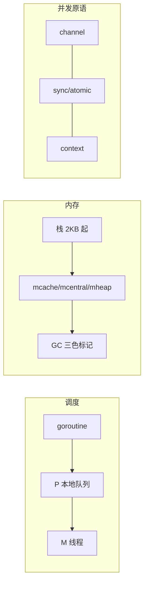
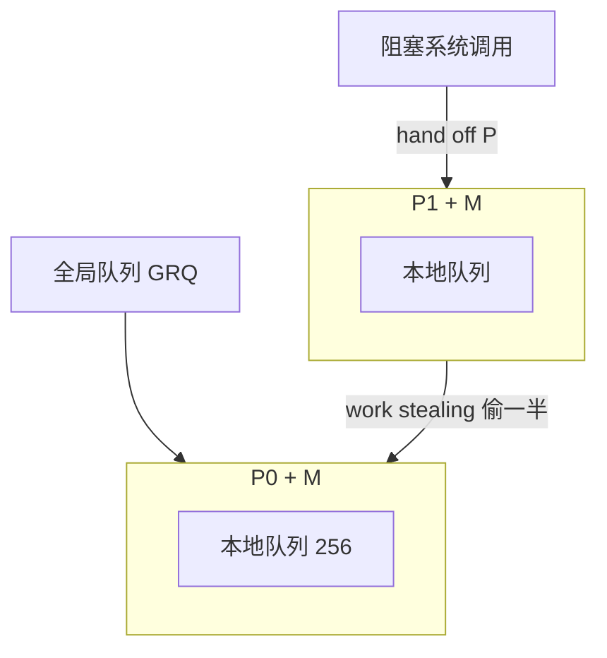
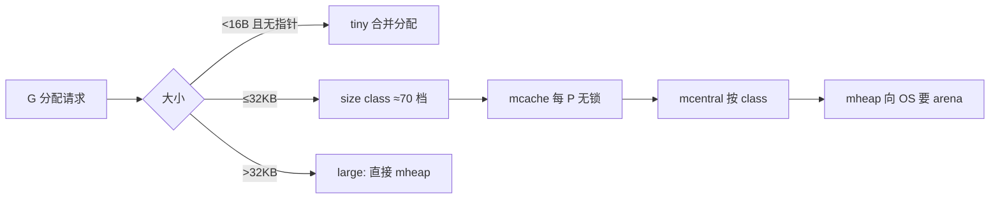

本篇是 Go 语言与运行时的带解答题库（68 题）。通用机制按标准 Go 运行时知识作答；凡标注「项目例证」的结论均来自实读源码：`$HOME/github/yukino.go`（HEAD `facf5d6`，`go.mod` 声明 **go 1.26.0**）与 `$HOME/github/wanproxy`（HEAD `07f7fb8`，`go.work` 声明 **go 1.26.5**），路径为仓库根相对路径。



## 一、GMP 调度模型

### Q1. goroutine 和线程的区别是什么？

| 维度     | goroutine                          | OS 线程                  |
| -------- | ---------------------------------- | ------------------------ |
| 初始栈   | 2 KB，可增长（复制式扩容）         | 通常 1–8 MB，固定        |
| 切换成本 | 用户态切换，保存少量寄存器，无陷入 | 内核态切换，TLB flush 等 |
| 调度者   | Go runtime（GMP）                  | 内核 CFS/EEVDF           |
| 数量级   | 单机数十万可行                     | 数千即显著劣化           |
| 阻塞代价 | 挂起 G，M 可继续跑其他 G           | 整个线程被内核挂起       |

**关键机制**：goroutine 阻塞在 channel/锁/网络时，runtime 把它挂到等待队列并让 M 继续执行别的 G；阻塞在**系统调用**时，P 会与 M 解绑（hand off）交给其他 M。网络 I/O 走 netpoller（epoll/kqueue），不占用线程。

### Q2. 讲清 GMP 三个角色与协作关系。

- **G**（goroutine）：执行单元，含栈、指令指针、channel 等待信息。
- **M**（machine）：OS 线程，真正执行代码的实体。
- **P**（processor）：调度上下文，数量 = `GOMAXPROCS`（默认 CPU 核数）。**M 必须绑定 P 才能执行 G**；P 携带本地运行队列（LRQ，容量 256）、mcache 等资源。

协作：M 从绑定 P 的 LRQ 取 G 执行；LRQ 空则去全局队列（GRQ）批量搬运或从其他 P **偷一半**；G 因系统调用阻塞时 P 被移交，保证并行度不降。



### Q3. 本地运行队列挂在 P 上还是 M 上？为什么这样设计？

挂在 **P** 上。设计动机：

1. **无锁快路径**：M 从自己 P 的 LRQ 取 G 只需一次 CAS/本地操作，不必抢全局锁。
2. **资源随 P 迁移**：M 陷入系统调用时，P（连同 LRQ 和 mcache）可以整体移交给别的 M，队列里待运行的 G 不受影响——这是「hand off」的前提。
3. **缓存亲和**：P 相对稳定，同一 P 上的 G 复用 mcache，减少跨核失效。

若队列挂 M，线程陷入系统调用时队列就被「锁死」在内核里，其他线程无法接管。

### Q4. work stealing 偷多少？什么时候触发？

M 找不到可运行的 G 时按序尝试：本地 LRQ → GRQ（每 61 次调度强制查一次，防饿死）→ netpoll → **从随机 victim P 的 LRQ 偷一半**（`runqsteal`）。偷一半而非一个，是为了让被偷方不至于马上又空转，摊薄偷取频率。

### Q5. goroutine 陷入系统调用时调度器做什么？

1. 进入系统调用前，M 与 P 解绑标记（`entersyscall`）；P 状态转 `_Psyscall`。
2. **sysmon** 巡检发现 P 处于 syscall 超过阈值（约 20µs 起尝试），或 syscall 返回后无空闲 P，则触发 **hand off**：P 交给其他（或新建）M，继续消费该 P 的 LRQ。
3. syscall 返回后，原 M 尝试重新获取一个空闲 P；拿不到则把 G 放回全局队列，自己休眠。

**项目例证**：`libs/yukino_rpc/internal/transport/tcp_connection.go` 的 `Read/Write` 是阻塞式 `net.Conn` I/O——但因为走 netpoller，实际不会把 M 拖进内核阻塞；真正的 syscall 阻塞场景是文件 I/O（如 `wanproxy/srv.go/internal/files` 的磁盘读写）。

### Q6. sysmon 是干什么的？它需要 P 吗？

sysmon 是一个**不绑定 P** 的特殊 M 上的死循环，职责：

- 回收长时间处于 syscall 的 P（hand off）；
- 抢占运行超过 **10ms** 的 G（`retake`）；
- 触发 netpoll（取回就绪的网络 G）；
- 强制 GC（超过 2 分钟未触发）与 scavenge 归还内存。

它不需要 P——正因为不依赖 P，才能在所有 P 都被占满时依然工作。

### Q7. Go 的抢占式调度是怎么演进的？

| 阶段        | 机制                                                                      | 缺陷                           |
| ----------- | ------------------------------------------------------------------------- | ------------------------------ |
| Go 1.2–1.13 | **协作式**：函数序言插入栈增长检查点，调度器在检查点抢占                  | 无函数调用的死循环无法被抢占   |
| Go 1.14+    | **异步抢占**：sysmon 对超时 G 所在线程发 `SIGURG`，信号处理函数里安全点停 | 解决 `for {}` 饿死调度器的问题 |

面试常考：`func main() { go func(){ for {} }(); time.Sleep(time.Second) }` 在 1.14 前会卡死 GC/调度，1.14 后正常。

### Q8. goroutine 栈是怎么增长的？为什么用复制而不是分段栈？

初始 2KB，函数序言检查 `stackguard0`，不足时触发 `morestack`：**分配更大的新栈（约 2 倍），整体复制旧栈内容，修正栈上指针，释放旧栈**。分段栈（segmented stack）有「hot split」问题：在段边界反复进出导致频繁分配/释放；复制式一次到位，代价是复制时要精确调整指针（依赖精确的栈图信息）。GC 时也会收缩过大的栈。

### Q9. G 有哪些状态？调度发生在哪些时机？

主要状态：`_Gidle/_Grunnable/_Grunning/_Gsyscall/_Gwaiting/_Gdead`。调度时机：

1. `go` 语句创建 G（优先放当前 P 的 LRQ，可能立即执行）；
2. G 正常返回（`goexit`）；
3. 阻塞：channel、锁、netpoll、`time.Sleep`、select；
4. 主动 `runtime.Gosched()`；
5. 被抢占（检查点或 SIGURG）；
6. syscall 返回后拿不到 P。

### Q10. GOMAXPROCS 设多少合适？容器里有什么坑？

默认等于**可见 CPU 数**。坑：Go 1.25 之前 runtime 读的是宿主机核数而非 cgroup 配额，容器 limit 2 核、宿主 64 核时会开 64 个 P，导致大量线程被 CFS 限流（throttling）、延迟毛刺。对策：显式 `GOMAXPROCS` 对齐配额，或引入 `automaxprocs`；**Go 1.25 起 runtime 已感知 cgroup CPU 配额**。CPU 密集型设核数，I/O 密集型不必调大（阻塞 G 不占 M）。

### Q11. 如何排查 goroutine 泄漏？项目里有哪些「不泄漏」的写法？

排查：`runtime.NumGoroutine()` 趋势、`/debug/pprof/goroutine` 全量栈、阻塞点聚合。泄漏根因几乎都是 **G 阻塞在永远无人收发的 channel / 无人取消的 ctx / 无超时的网络读**。

**项目例证**（三种标准收尾模式）：

1. `libs/yukino_http/sse.go` `Heartbeat`：goroutine `select` 三路——ticker、`ctx.Request.Context().Done()`、`stop` chan；返回的 stop 函数 `stopOnce.Do(close(stop))` 后 `<-done` **等待 goroutine 真正退出**，杜绝孤儿。
2. `libs/yukino_rpc/internal/transport/tcp_client.go` `readLoop`：读错误即 `c.fail(err)` → `shutdown` 关连接、失败所有 pending future，goroutine 自然退出。
3. `wanproxy.go/proxy/relay.go`：`context.AfterFunc(r.ctx, r.close)` 保证取消时关闭两端 socket，**用关连接来打断阻塞的网络 I/O**，等待 `workers.Wait()` 收敛。

### Q12. M 可以没有 P 吗？P 可以没有 M 吗？

都可以。M 无 P：执行系统调用期间、sysmon、`LockOSThread` 特殊场景、空闲休眠 M。P 无 M：P 的 M 陷入 syscall 后 P 等待被接管（短暂）；空闲 P 列表（`sched.pidle`）里的 P。只有 **M+P 绑定**时才能运行 G。`runtime.LockOSThread` 把 G 钉在 M 上（如 GUI/CGO 场景），但 G 仍需 P 才能被调度。

## 二、GC 与内存管理

### Q13. 描述 Go GC 的三色标记与整体流程。

三色抽象：**白**（未访问，待回收）、**灰**（自身可达、子引用未扫）、**黑**（自身与子引用都扫完）。流程四阶段：

1. **Sweep Termination + Mark Setup**（STW，亚毫秒级）：开启写屏障；
2. **Marking**（并发）：mutator 与 GC worker 并发扫描，分配新对象需「mark assist」按比例帮工；
3. **Mark Termination**（STW）：关闭写屏障、完成统计；
4. **Sweeping**（并发）：按 span 惰性清扫。

Go 的堆**不整理（non-moving）**，靠 size-class 分配器抑制碎片。

### Q14. 什么是混合写屏障？它解决了什么问题？

写屏障保证并发标记不漏对象。Go 1.8 引入**混合写屏障** = Dijkstra 插入屏障（新指向的白对象标灰）+ Yuasa 删除屏障（被覆盖的旧引用标灰）的组合，效果是：**栈上写不再需要屏障、标记结束无需 STW 重扫栈**（消除 rescan），把 STW 从几十毫秒级压到亚毫秒级。代价是删除屏障让部分已死对象本轮存活（浮动垃圾），下轮回收。

### Q15. GC 什么时候触发？GOGC 和 GOMEMLIMIT 各管什么？

触发：① 堆增长达到阈值（上次 GC 后存活堆 × (1+GOGC/100)，默认 GOGC=100 即翻倍触发）；② sysmon 发现 2 分钟未 GC；③ `runtime.GC()` 手动。

- **GOGC**：以「存活堆」为基数的相对增长率，控制 CPU/内存权衡；`GOGC=off` 关闭。
- **GOMEMLIMIT**（1.19+）：进程级**软内存上限**，接近上限时 GC 更激进（甚至连续 GC），用于容器防 OOM；软限制=尽力而为，栈/堆外内存不完全受控。

### Q16. 什么是 mark assist？为什么需要它？

并发标记期间 mutator 若疯狂分配，标记速度追不上分配速度，堆会爆。runtime 让**分配内存的 goroutine 按分配量比例承担标记工作**（assist），本质是把 GC 成本摊给制造压力的 goroutine，实现 pacing。`GODEBUG=gctrace=1` 可见 assist 比例。

### Q17. Go 内存分配器的层级结构？



每个 P 有 **mcache**（无锁快路径），按 size class 缓存 mspan；mcentral 全局按 class 管理；mheap 管理 arena 并向 OS 申请。小对象（<16B、不含指针）走 tiny 分配器合并进同一块，减少浪费。

### Q18. 逃逸分析是什么？怎么查看？给几个必然逃逸的例子。

编译期决定变量分配在栈还是堆：**生命周期超出函数作用域 → 堆**。查看：`go build -gcflags="-m -m"`。典型逃逸：

1. 返回局部变量指针 `return &x`；
2. 存入 interface/闭包捕获后逃逸（动态派发无法静态确定）；
3. 发送到 channel 的指针；
4. 大小不定/过大的 slice（如 `make([]byte, n)` n 非编译期常量）；
5. `append` 触发扩容后共享底层数组被外部引用。

**项目例证**：`libs/yukino_rpc/internal/transport/tcp_connection.go` `Read()` 中 `tmp := make([]byte, BufferSize)`（4096）每次调用分配——因大小固定且未逃逸出调用，编译器可栈分配；而 `packet := make([]byte, totalLen)` 长度来自网络数据，必然堆分配。

### Q19. map 的底层结构与扩容规则？

`hmap` + 桶数组 `bmap`：每桶 **8 个 slot**（tophash[8] 加速比较 + keys + values 分开存），溢出用 overflow 桶链。扩容两种：

- **装载因子 > 6.5**（元素数/桶数）→ 桶数翻倍（double）；
- overflow 桶过多但元素少 → 等量扩容（same-size，整理碎片）。

扩容是**渐进式**（evacuate）：每次写操作顺带搬 1–2 个桶，避免一次性 rehash 卡顿。

### Q20. map 为什么并发读写会直接 fatal 而不是返回错误？怎么解决？

runtime 在写入时检测 `hashWriting` 标志位，发现并发读写直接 `throw("concurrent map read and map write")`——**fatal 不可 recover**，因为数据竞争下 map 内部状态已不可信，继续运行是未定义行为。方案：`sync.RWMutex` 包一层、`sync.Map`（读多写少）、分片锁、或改用 atomic 指针整体替换（copy-on-write）。

**项目例证**：`libs/yukino_rpc/internal/registry/registry.go` 用 `sync.RWMutex` 保护 `services map[string]map[string]Instance`，读路径 `copyInstances` **持读锁拷贝一份再返回**，调用方拿到的切片与内部 map 解耦，避免锁外竞争。

### Q21. slice 扩容规则与 append 别名陷阱？

`slice = {array, len, cap}`。append 超过 cap 时重新分配：**小 slice（<256）约翻倍，之后按 ~1.25 倍加平滑**，并对齐到 size class（实际容量常大于理论值）。陷阱：

```go
a := []int{1, 2, 3, 4, 5}
b := a[:2]
b = append(b, 99) // 写进 a[2]！cap 足够，未复制
```

`b` 与 `a` 共享底层数组，append 未扩容时直接覆盖 `a[2]`。防御：三索引切片 `a[:2:2]` 限死 cap，或 `slices.Clone`。

**项目例证**：`wanproxy.go/proxy/flow.go` `push` 里 `q.items[last].data = append(...)` 前总是 `make([]byte, 0, limit)` 新建目标缓冲——**绝不直接持有调用方 `buf[:n]`**，因为 `relay.go` 的读缓冲 `buf` 是循环复用的，直接引用会被下一轮读覆盖。这是「复用缓冲 + 队列」组合的标准正确写法。

### Q22. string 和 []byte 互转的开销？strings.Builder 为什么快？

`string → []byte` 与反向都要**复制**（string 不可变，编译器无法证明只读时不能共享内存）。高频拼接用 `strings.Builder`：内部 `[]byte` 追加 + `unsafe.String` 零拷贝转 string，且禁止复制自身（copy 检测）。

**项目例证**：`libs/yukino_http/recovery.go` `trace()` 用 `strings.Builder` 拼栈帧；`wanproxy/srv.go/internal/server/server.go` `encodeURIComponent` 同样用 Builder 逐字节拼百分号编码。

## 三、channel 底层与并发模式

### Q23. channel 的底层数据结构？

`runtime.hchan`：

```go
// runtime/chan.go（标准库事实）
type hchan struct {
    qcount   uint           // 当前元素数
    dataqsiz uint           // 环形缓冲容量
    buf      unsafe.Pointer // 环形缓冲
    elemsize uint16
    closed   uint32
    sendx, recvx uint       // 收发索引
    recvq, sendq waitq      // 阻塞的 G 队列（sudog 链表）
    lock     mutex          // 一把大锁保护全部字段
}
```

**要点**：channel 自带互斥锁；阻塞的 G 被包成 `sudog` 挂到 sendq/recvq，`gopark` 让出 M。

### Q24. 无缓冲 channel 的「直接交付」优化？

无缓冲 channel 发送时若 recvq 已有等待的接收者，runtime **把数据从发送者栈直接复制到接收者栈**（`sendDirect`），不经过任何中间缓冲——一次拷贝完成同步+通信。这是「channel 通信优于共享内存」的性能底气。

### Q25. 归纳 channel 的 close 语义（面试必背表）。

| 操作  | nil channel | 已关闭 channel         | 正常 channel   |
| ----- | ----------- | ---------------------- | -------------- |
| 发送  | 永久阻塞    | **panic**              | 阻塞或成功     |
| 接收  | 永久阻塞    | 立即返回零值，ok=false | 阻塞或成功     |
| close | **panic**   | **panic**（重复关闭）  | 成功，广播唤醒 |

推论：**close 是广播**——所有等待的接收者同时被唤醒，这是「关闭即通知」模式的基础；发送方负责 close，接收方永不 close（多发送方时用额外 done channel 协调）。

### Q26. 「关闭 channel 做广播」在项目里怎么用的？

**项目例证**：`wanproxy.go/proxy/flow.go` `flowQueue` 的 `changed chan struct{}`：每次 push/pop 后 `close(q.changed); q.changed = make(chan struct{})`——**关闭旧 channel 唤醒所有等待者，再换新 channel 供下一轮等待**。这是无数据广播的标准手法（`chan struct{}` 零内存占用）。等待方 `pop` 先在锁内取走 `changed` 引用再解锁 select，避免丢失唤醒。

同类：`libs/yukino_rpc/internal/transport/tcp_client.go` `closed` 标志 + `WSConn.closed chan struct{}`（`libs/yukino_http/websocket.go`）用 `sync.Once` 保证只 close 一次。

### Q27. select 的实现要点？多 case 就绪时选哪个？

编译为 `selectgo`：所有 case 的 channel 按地址排序加锁（防死锁）→ 一轮扫描找就绪 case → 都未就绪则把当前 G 挂到**每个** channel 的等待队列 → 被唤醒后从其余队列摘除。**多个 case 同时就绪时伪随机选择**（轮询起点随机化），防止饥饿。`default` 分支使 select 变为非阻塞。空 `select{}` 永久阻塞（gopark，不烧 CPU）。

### Q28. 非阻塞收发的写法与项目应用？

`select` + `default`：

**项目例证**：`libs/yukino_rpc/internal/transport/stream.go` `ClientStreamConn.Recv` 的三段式：

```go
// libs/yukino_rpc/internal/transport/stream.go
select {
case frame := <-s.ch: // 1. 先无锁快速排空缓冲
    return s.codec.Unmarshal(frame.body, msg)
default:
}
select { // 2. 阻塞等待新帧/终止/取消
case frame := <-s.ch: ...
case <-s.termCh:
    select { // 3. 终止后仍要排空残留帧，保证 EOF 前数据不丢
    case frame := <-s.ch: ...
    default:
    }
    return s.termErr
case <-s.ctx.Done(): ...
}
```

第 3 步是关键细节：**收到 StreamEnd 后 channel 里可能还有已入队未消费的帧**，必须排空后才返回 `io.EOF`，否则丢数据。

### Q29. channel 和 mutex 怎么选？项目里两种都有吗？

原则：**传递数据所有权/编排生命周期用 channel，保护共享状态用 mutex**。channel 不是万能胶——用它保护一个计数器反而更慢更绕。

**项目例证**（同一仓库两种并存，各得其所）：

- mutex 保护状态：`libs/yukino_rpc/internal/transport/tcp_connection.go` `PacketBuffer{buf []byte, lock sync.Mutex}`——纯粹的共享缓冲区。
- channel 编排生命周期：`libs/yukino_http/sse.go` `Heartbeat` 的 `stop`/`done` 双 channel——停止信号 + 退出确认，mutex 无法表达「等待 goroutine 结束」。

### Q30. 有缓冲 channel 的容量怎么定？满了怎么办？

容量 = 允许的「在途未消费」量，本质是**吞吐与内存/延迟的权衡**：缓冲吸收突发，但掩盖消费能力不足，且缓冲越大端到端延迟越不可控。满了三种策略：阻塞（背压）、丢弃（select+default）、报错。

**项目例证**：`libs/yukino_rpc/internal/transport/stream.go` `NewClientStreamConn` 缓冲 **64** 帧；`Push` 用 `select { case s.ch <- ...: case <-s.ctx.Done(): case <-s.termCh: }`——满时**阻塞发送方（readLoop）形成背压**，但取消/终止时立即放行，不会卡死读循环。`wanproxy.go/proxy/flow.go` 更进一步：字节级配额 `relayQueueLimit = 16 << 20`（16 MiB），超限返回 `xcodec.ErrSessionLimit` 断流，防止内存爆炸。

### Q31. 为什么 flowQueue 要「合并小读」？这解决什么问题？

**项目例证**：`wanproxy.go/proxy/flow.go` `push`：`chunk=true` 的数据队列把小片 data **合并进最后一个未满的 delivery（上限 relayReadSize=32KB）**。注释写明动机：_Small reads coalesce so fragmentation cannot turn a bounded byte window into millions of queued objects_——若每个 1KB 读都独立入队，16MiB 配额会变成上万个队列对象，pop/写系统调用次数暴涨。而控制帧队列 `chunk=false`：**控制帧必须保持原子性，不能被拆分或与其他帧交错**（`limit = max(limit, len(msg.data))`）。这是「数据可合并、控制不可拆」的经典协议队列设计。

### Q32. 用 channel 实现一个信号量/工作池的骨架？

```go
sem := make(chan struct{}, n) // 容量 n 的信号量
var wg sync.WaitGroup
for _, task := range tasks {
    wg.Go(func() { // Go 1.25+ WaitGroup.Go 自动 Add/Done
        sem <- struct{}{}
        defer func() { <-sem }()
        do(task)
    })
}
wg.Wait()
```

**项目例证**：`libs/yukino_rpc/internal/server/server.go` `Serve` 用 `s.wg.Go(func(){ s.Handle(tcpConn); ... })`（Go 1.25 的 `WaitGroup.Go`），`GracefulStop` 里 `s.wg.Wait()` 等所有连接处理完；`wanproxy.go/proxy/relay.go` 用 `workers.Go` 并发跑 4–6 个泵送 goroutine 后 `workers.Wait()`。

## 四、sync 与 atomic 实战

### Q33. sync.Mutex 的饥饿模式是什么？

Mutex 有两种模式：**正常模式**下新到的 G 与刚被唤醒的 G 竞争（新 G 正在 CPU 上，大概率赢），可能造成队列中的 G 反复抢不到；某 G 等待超过 **1ms** 后切换**饥饿模式**——锁直接交给队首等待者，新来的 G 不竞争直接排队；当获得锁的 G 发现自己等待 <1ms 或是最后一个等待者时切回正常模式。目的：兼顾吞吐（正常模式）与尾延迟公平（饥饿模式）。

### Q34. RWMutex 的写者偏好体现在哪？项目哪里用了读写锁？

`RLock` 时若已有写者等待/持锁，读者**排队在写者之后**（`readerWait` 计数），防止写者被源源不断的读者饿死。代价：读多写极少时 RWMutex 反而比 Mutex 慢（原子操作更多、缓存行弹跳）。

**项目例证**：`libs/yukino_rpc/internal/codec/codec.go` 编解码器注册表 `factories map[Type]Factory` 用 `sync.RWMutex`——注册（写）极少、`New`（读）每请求发生；`libs/yukino_rpc/internal/registry/registry.go` 服务缓存同理。

### Q35. sync.WaitGroup 的计数语义？Go 1.25 的 `wg.Go` 好在哪？

`Add(n)` 加计数、`Done()` 减一、`Wait()` 阻塞到零。经典 bug：`Add` 放在 goroutine 内部（Wait 可能先跑到 0）、复用未归零的 WG、拷贝含计数器的 WG。

**`wg.Go(f)`（Go 1.25+）= `Add(1) + go func(){ defer Done(); f() }()`**，把「计数配对」变成不可能忘的原子操作。

**项目例证**：`libs/yukino_rpc/internal/server/server.go` 全量使用：`s.wg.Go(...)`（连接处理）、`streamWg.Go(...)`（handler.go 流式方法异步执行）、`s.serveWg.Add(1)/Done()`（accept 循环）。`GracefulStop` 顺序：关 listener → `serveWg.Wait()`（accept 退出）→ 对所有连接 `SetReadDeadline(time.Now())`（打断阻塞读）→ `s.wg.Wait()`（连接处理退出）→ 停限流器。**用「设过期 deadline」唤醒阻塞在 Read 的 goroutine** 是优雅关闭的关键技巧。

### Q36. sync.Once 的实现与典型误用？

`done atomic.Uint32 + Mutex`：快路径原子读 done，慢路径加锁双检执行 f。保证 f 恰好执行一次且**所有调用者都等到 f 完成**（happens-before）。误用：Once 实例被复制；用 Once 做「只许失败一次」的重试控制（Once 不因 panic 重置——f panic 也算执行过）。

**项目例证**：`libs/yukino_rpc/internal/transport/tcp_client.go` `shutdown` 用 `closed.CompareAndSwap(0, 1)` 达到同样效果（CAS 版 once）；`libs/yukino_http/websocket.go` `ws.once.Do(func(){ close(ws.closed) })` 保证 closed channel 只关一次；`sse.go` Heartbeat 的 `stopOnce` 保证 stop 幂等。

### Q37. sync.Pool 的结构与 GC 行为？适合放什么？

每 P 一个 `poolLocal`（private + shared 双端队列），Get 顺序：本地 private → 本地 shared → **victim cache** → 其他 P 的 shared（偷）。GC 时 Pool 内容移入 victim cache，**两轮 GC 后彻底清空**——所以 Pool 只是「降低分配压力的缓存」，不是持久存储。适合：高频、可重置、无状态依赖的临时对象（buffer、parser）。**不能放**：连接、带身份的资源（GC 清空不可控）；放入对象必须 Reset 防脏数据。

### Q38. sync.Map 的内部结构与适用场景？项目哪里在用？

两层：只读 `read`（atomic.Value，查找无锁）+ 脏 `dirty`（需加锁）。读 miss 累计到阈值后把 dirty 提升为 read。适用：**读多写少、key 集合基本稳定**（entry 指针复用）。不适用：写多、key 频繁增删（dirty 重建开销大，不如 RWMutex+map）。

**项目例证**：`libs/yukino_rpc/internal/transport/tcp_client.go` `pending sync.Map`（RequestID→Future）与 `streams sync.Map`（RequestID→ClientStreamConn）——每个响应只被 `LoadAndDelete` 一次、请求侧高频写入，是典型的「一次性交接」用法；`internal/client/client.go` `breaker sync.Map`（`service|addr`→熔断器）与 `pools sync.Map`（addr→连接池）配合 `LoadOrStore` 做**并发安全的懒初始化**（见 `resolver.go` `getPool/getBreaker`：先 Load，miss 则 new + LoadOrStore，**以 actual 为准丢弃竞态副本**）。

### Q39. atomic 类型（1.19+）相比 atomic 函数好在哪？

`atomic.Int32/Uint64/Pointer[T]` 等：① 方法调用不易误用（不会漏掉对齐问题——**32 位平台上裸 `atomic.AddInt64(&x)` 要求 8 字节对齐**，包在结构体第一个字段才安全，类型化后 runtime 保证）；② 不可复制（`noCopy` 语义由 vet 检查）；③ 可读性。

**项目例证**：`libs/yukino_rpc/internal/transport/tcp_client.go` `seq atomic.Uint64`（`nextSeq = seq.Add(1)` 生成单调 RequestID）、`closed atomic.Int32`；`internal/load_balance/round_robin.go` `idx atomic.Uint64`（无锁轮询游标）。

### Q40. 讲讲 tcp_client.go 里的「双重检查 closed」模式。

**项目例证**：`libs/yukino_rpc/internal/transport/tcp_client.go` `SendAsyncWithCodec`：

```go
if c.closed.Load() == 1 { return nil, errors.New("connection closed") }
seq := c.nextSeq()
future := NewFutureWithCodec(cc)
c.pending.Store(seq, future)
if c.closed.Load() == 1 { // 再查一次！
    if _, ok := c.pending.LoadAndDelete(seq); ok {
        return nil, errors.New("connection closed")
    }
}
```

问题：`shutdown` 会 `Range` 所有 pending 并置错。若「Store」发生在「shutdown 的 Range」之后，这个 future 永远没人完成 → 调用方永久阻塞。解法：**Store 之后重查 closed**；若已关闭且能删掉自己（说明 shutdown 没处理到它），就地失败返回。`LoadAndDelete` 的原子性保证与 shutdown 的 Range+Delete 不会双重处理。这是无全局锁下「注册-清理」竞态的教科书解法。

### Q41. CAS（CompareAndSwap）的典型用途？

无锁状态迁移：只允许一个执行者完成 0→1 转换。**项目例证**：`tcp_client.go` `shutdown`：`if !c.closed.CompareAndSwap(0, 1) { return }`——并发调用 Close/fail 时只有第一个真正执行清理，天然幂等，比 `sync.Once` 多了「读取当前状态」的能力。

### Q42. 死锁的四个必要条件？Go 里怎么检测和避免？

条件：互斥、持有并等待、不可剥夺、循环等待。Go runtime 能检测**全 goroutine 死锁**（fatal: all goroutines are asleep - deadlock!），但检测不了局部死锁。避免：

1. **固定加锁顺序**（select 对 channel 按地址排序加锁就是 runtime 自己的实践）；
2. 缩小临界区，锁内不做 I/O、不调用外部回调；
3. 用 `TryLock`（1.18+）/带超时的 channel 获取；
4. 分层锁：如 `registry.go` 读锁内只做拷贝，watch 回调写锁内只改 map。

**项目例证**：`libs/yukino_http/websocket.go` `WSConn` 拆 `readMu`/`writeMu` 两把锁——读写路径独立，`Listen` 循环里收到 Ping 要回 Pong（写），若读写共用一把锁，慢写会阻塞读循环导致心跳超时误判。

### Q43. 含锁结构体为什么不能被复制？怎么发现这类 bug？

Mutex/WaitGroup 复制后是**两把独立的锁**，保护语义被破坏（副本各自加锁）。`go vet` 的 copylocks 会报；结构体里嵌 `noCopy` 或用 `atomic` 类型也能触发检查。传含锁结构体永远用指针。**项目例证**：`yukino_http` 的 `Context`、`yukino_rpc` 的 `Server/Client/TCPConnection` 全部以指针流转。

### Q44. 读多写少的共享配置，除了 RWMutex 还有什么方案？

**atomic.Pointer 整体替换（copy-on-write）**：写者构造完整新副本后 `Store`，读者 `Load` 无锁读——读路径零竞争、天然一致（不会读到改一半的状态）。适合路由表、服务列表这类「低频全量更新」。对比：RWMutex 读仍有缓存行争用；sync.Map 适合增量 key。**项目例证**：`registry.go` 选择 RWMutex+拷贝读（`copyInstances`），因为 watch 事件是增量更新且实例数少；若是高频全量刷新的路由表，atomic.Pointer 更优——这是可以主动讲出的取舍。

## 五、context 与取消传播

### Q45. context 树的结构与四种实现？

`Background/TODO`（emptyCtx）为根；`WithCancel`→cancelCtx（children map + done chan 懒创建）；`WithTimeout/Deadline`→timerCtx（内嵌 cancelCtx + time.Timer）；`WithValue`→valueCtx（单键链表节点，查找沿父链 O(链长)）。**取消沿树向下传播**：父 cancel 会遍历 children 逐个 cancel。valueCtx 只放请求域元数据（trace ID、鉴权主体），不放依赖项。

### Q46. WithCancelCause 和 context.Cause 解决什么问题？

`WithCancel` 只能拿到 `context.Canceled`，丢失**为什么取消**。`WithCancelCause`（1.20+）允许 `cancel(err)` 记录根因，`context.Cause(ctx)` 取回。**项目例证**：`wanproxy.go/proxy/relay.go` `RunContext`：

```go
// wanproxy.go/proxy/relay.go
r.ctx, r.cancel = context.WithCancelCause(ctx)
defer r.cancel(nil)
stop := context.AfterFunc(r.ctx, r.close) // 取消 → 关两端 socket
...
r.abort(err) // = r.cancel(err) + r.close()
return context.Cause(r.ctx) // 返回第一个真实失败原因
```

任何一个泵送 goroutine 出错都 `abort(err)`，其余 goroutine 因 socket 关闭/ctx 取消而退出，最终 `Cause` 把**首个业务错误**（而非泛泛的 Canceled）返回给调用方——多 goroutine 汇聚错误的标准姿势。

### Q47. context.AfterFunc 是什么？和手动 go func 监听 Done 有何区别？

`AfterFunc(ctx, f)`（1.21+）：ctx 完成时在**新 goroutine** 里跑 f，返回 `stop()` 可解除注册。区别：① 不需要自己管理监听 goroutine 的退出（stop 后无泄漏）；② 语义清晰「取消时的副作用」。**项目例证**：`relay.go` 用它把「取消」映射为「关闭 socket」，`defer stop()` 防止正常结束后回调仍挂着。

### Q48. 超时控制的两种实现，项目里为什么同时存在？

**项目例证**：`libs/yukino_rpc/internal/client/invoke.go`：

- `Invoke`（同步）：`callCtx, cancel := context.WithTimeout(ctx, c.timeout)` + `future.GetResultWithContext(callCtx, reply)`——**ctx 驱动**，select 在 future.done 与 ctx.Done 之间。
- `InvokeAsync`（异步）：额外起 `timer := time.NewTimer(c.timeout)` 的 goroutine，超时则 `future.Done(nil, context.DeadlineExceeded)`——**主动完成 future**。

为什么异步版要主动 Done：调用方可能拿着 Future 到处传、在任意 select 里等 `DoneChan()`；若不主动置完成，Future 会悬挂到服务端响应或连接失败为止，超时语义就丢了。双保险：即使 timer goroutine 先到，`Future.Done` 的 `complete` 标志保证幂等（后到的真实响应被忽略）。

### Q49. ctx.Done() 在资源清理里的模式？

**项目例证**：`libs/yukino_http/sse.go`：`Heartbeat` goroutine 与 `Stream(ch)` 都 select `w.ctx.Request.Context().Done()`——HTTP 客户端断开时 net/http 取消请求 ctx，SSE 写循环立即退出，不向死连接写数据。`Closed()` 直接把 `Request.Context().Done()` 暴露给业务方做生命周期挂钩。**要点**：请求域 ctx 由框架保证取消，业务只需监听，不要自己再造取消源。

### Q50. context 使用的反模式有哪些？

1. 存进结构体字段（应作首参传递；`relay.go` 的 `r.ctx` 是**单次 Run 的局部状态**且注释明确「may only be run once」，属可接受例外）；
2. 传 nil（用 `context.TODO()` 占位）；
3. `WithValue` 传依赖/大对象；
4. cancel 不调用（`WithTimeout` 不 defer cancel 会泄漏 timer 与父子挂接——`invoke.go` 每处都 `defer cancel()` 或显式 `cancel()`）；
5. 在 ctx 已取消后继续用其派生值做新请求。

## 六、interface 与反射

### Q51. iface 和 eface 的区别？

空接口 `any` = `eface{_type *_type, data unsafe.Pointer}`；带方法接口 = `iface{tab *itab, data unsafe.Pointer}`。`itab` 缓存（接口类型，具体类型）对与方法表，首次断言时构建。接口值 = **16 字节双字**（类型指针 + 数据指针），赋值给接口通常装箱（数据复制到堆，逃逸）。

### Q52. 「nil 接口 ≠ 装了 nil 指针的接口」陷阱，怎么踩怎么防？

```go
func do() error {
    var e *MyErr = nil
    return e // 接口 = (类型 *MyErr, 值 nil) ≠ nil！
}
if do() != nil { /* 恒真 */ }
```

接口比较先看类型字。防御：**错误返回路径永远返回字面 `nil`**，不返回类型化 nil 指针；lint（nilness/nilerr）可查。**项目例证**：`libs/yukino_rpc/internal/transport/stream.go` `End()` 调 `terminate(io.EOF)`——错误值是包级 sentinel 变量而非局部类型化 nil，无此风险；`wanproxy.go/proxy/relay.go` `NewRelay` 失败路径统一 `return nil, err`。

### Q53. 类型断言与 type switch 的成本？

单类型断言 `v, ok := i.(T)`：比较 itab/类型字，O(1)。type switch：编译为类型哈希跳转表或线性比较。真正贵的是**装箱**（值→接口）与 itab 首次构建。热路径优化：接口只传指针、避免 `fmt`（大量反射+装箱）、用泛型替代 interface 分发（编译期单态化，可内联）。

### Q54. 方法集规则：值接收者 vs 指针接收者？

类型 `T` 的方法集 = 值接收者方法；`*T` 的方法集 = 值 + 指针接收者方法。因此**把值类型赋给接口时，指针接收者方法不在方法集里，编译失败**。团队规范：一个类型统一用指针接收者（避免复制含锁结构、语义一致）。**项目例证**：`libs/yukino_http` 的 `*Context/*Application/*SSEWriter`、`yukino_rpc` 的 `*Server/*Client` 全指针接收者；`codec.go` 的 `jSONCodec` 用指针接收者并以 `&jSONCodec{}` 注册工厂。

### Q55. 反射三定律？

1. 接口值 → 反射对象：`reflect.ValueOf/TypeOf`；
2. 反射对象 → 接口值：`v.Interface()`；
3. 修改反射对象的值，必须**可寻址**（`CanSet`），即从指针出发 `reflect.ValueOf(p).Elem()`。

### Q56. 项目里的反射派发是怎么做的？逐条解释 invoke 的签名匹配。

**项目例证**：`libs/yukino_rpc/internal/server/handler.go` `invoke` 用反射把网络请求路由到 Go 方法，支持三种签名：

1. **现代式**：`func(ctx context.Context, req *T) (*R, error)`——`numIn==2 && numOut==2`，`In(0).Implements(contextType)`、`In(1).Kind()==Pointer`、`Out(1).Implements(errorType)`；`reflect.New(In(1).Elem())` 造请求对象，codec 反序列化 body 进去。
2. **net/rpc 兼容式**：`func(req *T, reply *R) error`——`Out(0)` 是 error，第二参是指针则 `reflect.New` 出 reply。
3. **服务端流式**：`func(req *T, s S) error` 且 `S` 实现 `stream.ServerStream` 接口——用 `reflect.ValueOf(ss).Convert(secondParam)` 把内部 `*serverStream` **转换成用户声明的接口类型**（接口间 Convert 是反射的高级用法），再 `streamWg.Go` 异步执行，返回 `streaming=true` 告诉 Process 不要写普通响应。

预取 `reflect.TypeFor[T]()`（1.22+）为包级变量避免每次调用重复解析类型。

### Q57. 反射的性能代价与替代方案？

代价：`MethodByName` 字符串查找、参数装箱（`[]reflect.Value` 分配）、无法内联、类型检查推迟到运行时。替代：代码生成（go:generate 出静态派发）、泛型、`interface` 直接调用。yukino_rpc 选反射是为了 **零样板注册**（`Register(name, service)` 即完成），每请求一次 MethodByName 的开销相对网络与序列化可忽略——**取舍要讲场景**：内层热循环才值得上 codegen（gRPC 即 codegen 路线）。

## 七、错误处理、defer 与 panic

### Q58. errors.Is / errors.As / %w 的关系与选择？

`%w` 包装保留链；`Is(err, target)` 沿 `Unwrap` 链找**相等**（sentinel 比较，支持自定义 `Is` 方法）；`As(err, &target)` 找**类型匹配**并赋值（取结构化错误字段）。选择：判断「是不是某个已知错误」用 Is（`io.EOF`、`context.Canceled`）；要读错误详情用 As。

**项目例证**：`libs/yukino_rpc/internal/client/invoke.go` `observedStream.Recv` 的熔断归类——`errors.Is(err, io.EOF)` → RecordSuccess（流正常结束）；`errors.Is(err, context.Canceled)` → 不记录（主动取消不算服务失败）；其余 → RecordFailure。**用 Is 区分「协议性错误」与「服务性错误」**是熔断器正确性的前提。`wanproxy/srv.go/internal/server/server.go` 用 `errors.As(err, new(*benchsvc.ErrUnknownScenario))` 映射 404、`errors.Is(err, benchsvc.ErrAlreadyRunning)` 映射 409。

### Q59. sentinel error、错误类型、不透明包装三种风格怎么选？

| 风格                  | 例子                                               | 适用                       |
| --------------------- | -------------------------------------------------- | -------------------------- |
| sentinel（包级变量）  | `io.EOF`、`transport.ErrPoolClosed`、`ErrWSClosed` | 调用方需要精确分支         |
| 错误类型              | `*benchsvc.ErrUnknownScenario`                     | 需要携带字段（场景名等）   |
| 不透明包装（%w+文案） | `fmt.Errorf("proxy %q: ...", name, err)`           | 只加上下文、调用方不需分支 |

**项目例证**：`libs/yukino_rpc/internal/transport/tcp_connection_pool.go` `var ErrPoolClosed = errors.New("connection pool closed")`；`libs/yukino_http/websocket.go` `ErrWSClosed/ErrWSInvalidFrame`；`wanproxy.go/proxy/listener.go` `fmt.Errorf("proxy %q: interface endpoint is incomplete", l.Name)` 加定位上下文。原则：**库定义 sentinel/类型，应用层包装加语境**。

### Q60. defer 的执行顺序、求值时机与开销？

LIFO；**参数在 defer 语句执行时立即求值**（`defer fmt.Println(i)` 定格当前 i，闭包则取最终值）；`defer f.Close()` 中 f 为 nil 会 panic 在 defer 执行时。开销：1.14 起 open-coded defer（编译期展开，无堆分配）接近零成本，但**循环内 defer 仍逐个累积到函数结束**——循环里开文件应包成函数或显式 Close。

**项目例证**：`libs/yukino_rpc/internal/server/server.go` `Handle`：`defer conn.Close()` 与 `defer streamWg.Wait()`——LIFO 保证**先等流式方法全部结束，再关连接**（注册顺序 Wait 在后、执行在前）。顺序反了会在流还在写时关 socket。

### Q61. panic/recover 的正确边界？项目里 recover 用在哪几层？

原则：recover 只用于**进程级兜底**（把崩溃变成 500/断连），不用于控制流。三层实例：

1. **HTTP 中间件层**：`libs/yukino_http/recovery.go` `Recovery()`——recover 后记 `trace()`（`runtime.Callers(3, pcs[32])` + `CallersFrames` 还原文件行号），重置 `ctx.headers`（**清掉可能写了一半的缓冲头**），置 500 + `H{"message": "Internal Server Error"}`；**特判 `http.ErrAbortHandler` 重新 panic**——这是 net/http 约定的「静默断开」信号，吞掉它会让 Server 误以为响应正常。
2. **RPC 方法调用层**：`libs/yukino_rpc/internal/server/handler.go` `safeCall`——recover 转 `fmt.Errorf("handler panic: %v", r)`，作为错误响应回给客户端，**一个坏方法不拖垮连接**。
3. **compose 层主动 panic**：`libs/yukino_http/yukino.go` `dispatch` 检测 `i <= index` 时 `panic("yukino_http: next() called multiple times")`——中间件重复调 next 是编程错误，快速失败并由 Recovery 兜底。

### Q62. 为什么 Recovery 里要清空 ctx.headers 和 Type？

panic 可能发生在 handler 已经 `ctx.Set(...)` 若干响应头、甚至设置过 `ctx.Type` 之后。若不清空，500 响应会带上**业务成功路径的残留头**（如 `Content-Disposition`、`Location`），语义污染甚至安全问题（如残留 CORS 头组合错误状态）。`recovery.go` 里 `ctx.Type = ""; ctx.headers = make(map[string]string)` 后再写统一的 JSON 错误体，保证 500 响应干净一致。

## 八、现代 Go 特性与工程实践

### Q63. 项目用到了哪些「新 Go」特性？各举一处。

| 特性                         | 版本 | 项目例证                                                                       |
| ---------------------------- | ---- | ------------------------------------------------------------------------------ |
| `WaitGroup.Go`               | 1.25 | `libs/yukino_rpc/internal/server/server.go` `s.wg.Go(...)`                     |
| 迭代器 `strings.SplitSeq`    | 1.24 | `libs/yukino_http/sse.go` `writeData` 按行切分（零中间切片的 range-over-func） |
| `reflect.TypeFor[T]`         | 1.22 | `libs/yukino_rpc/internal/server/handler.go` 包级类型变量                      |
| range-over-int `for range 2` | 1.22 | `wanproxy.go/proxy/listener.go` `handshakeSSH` 收集两侧握手结果                |
| `context.AfterFunc`          | 1.21 | `wanproxy.go/proxy/relay.go` `RunContext`                                      |
| `min/max` 内建               | 1.21 | `wanproxy.go/proxy/flow.go` `push` 计算合并块大小                              |
| `WithCancelCause/Cause`      | 1.20 | `wanproxy.go/proxy/relay.go`                                                   |
| `atomic.Int32/Uint64` 类型   | 1.19 | `libs/yukino_rpc/internal/transport/tcp_client.go`                             |
| `errors.Join`/多 %w          | 1.20 | （通用能力，项目以单 %w 为主）                                                 |

`go.mod` 声明 `go 1.26.0`（yukino.go）、`go.work` 声明 `go 1.26.5`（wanproxy），语言版本足够新，以上特性均为**编译期事实**而非纸面推导。

### Q64. `SetLinger(0)` 意味着什么？项目为什么这样关连接？

**项目例证**：`libs/yukino_rpc/internal/transport/tcp_connection.go`：

```go
func (tc *TCPConnection) Close() error {
    if tcp, ok := tc.conn.(*net.TCPConn); ok {
        tcp.SetLinger(0)
    }
    return tc.conn.Close()
}
```

`SO_LINGER=0` 使 close 直接发 **RST** 而非 FIN：跳过四次挥手与 TIME_WAIT，**同时丢弃内核缓冲区里未读/未发的数据**。适用：协议已判定连接损坏（读到非法帧、shutdown 清理），不需要优雅排空；服务端大量短连接时避免 TIME_WAIT 堆积。不适用：还有响应数据在途的正常关闭（RST 会截断对端读取）——所以 `GracefulStop` 走的是 `SetReadDeadline(time.Now())` 让读循环报错退出、连接自然关闭，而不是全局 SetLinger(0)。

### Q65. io.Copy 为什么可能「零拷贝」？项目哪里刻意利用了它？

`io.Copy` 会探测两端是否实现 `ReaderFrom`（如 `*net.TCPConn` 的 splice/sendfile 支持）或 `WriterTo`，命中则走内核态直传，**绕过用户态缓冲**。

**项目例证**：`wanproxy.go/proxy/relay.go` `copyPlain` 的注释明确写着 _Let net.TCPConn and io.Copy use the platform's optimized copy path for ordinary forwarding_——无 codec 的纯转发路径**故意不套任何自定义 Reader/Writer 包装**，直接 `io.Copy(dst, src)`，让 runtime 选择 sendfile/splice；只有需要变换（解压/去重编码）的流才走 32KB 缓冲泵送。包装一层（如计数 reader）就会破坏优化路径——`relaySource` 只在 `TrackStatistics` 开启时才套 `countingReader`。

### Q66. bufio 的缓冲复用有什么讲究？websocket 升级里怎么处理？

**项目例证**：`libs/yukino_http/websocket.go` `Upgrade`：Hijack 拿到裸连接与 `*bufio.ReadWriter` 后——

```go
if brw.Reader.Buffered() > 0 { br = brw.Reader } // 缓冲里还有握手时预读的数据，必须沿用
else if brw.Reader.Size() >= readBufSize { br = brw.Reader } // 够大就复用，省一次分配
else { br = bufio.NewReaderSize(conn, readBufSize) } // 默认 4096
```

若直接丢弃 `brw.Reader` 新建 bufio，**握手阶段被 TCP 一起送达的首个 WebSocket 帧就丢了**（已在旧缓冲里）。这是协议升级（HTTP→WS、PROXY protocol 等）最容易踩的坑：升级点之前的一切预读数据必须接续消费。

### Q67. 泛型适合什么场景？项目为什么几乎没有泛型？

适合：容器/算法类库（slices、maps、set、堆、池化包装）、类型安全的建造者。不适合：接口能自然表达的多态、只有一两种实例化的场景（膨胀编译产物、降低可读性）。yukino_http/yukino_rpc 的核心多态是**行为多态**（Middleware、Codec、LoadBalancer 接口），不是类型多态，所以接口 + 反射足够；`pkg/rpc/rpc.go` 用**类型别名**（`type Future = transport.Future`）做 API 面收敛而非泛型包装。面试可主动讲：如果要做「泛型客户端 stub」（`Invoke[TReq, TResp]`）消除 reply 的 any，才是泛型的合理切入点。

### Q68. 从这两个仓库总结 Go 并发工程的 checklist。

1. **每个 goroutine 都有明确退出路径**：ctx.Done / stop chan / 连接关闭（sse.go Heartbeat、tcp_client readLoop、relay workers）。
2. **等待收敛再关资源**：`streamWg.Wait()` 在 `conn.Close()` 之前（server.go Handle 的 defer 顺序）。
3. **幂等关闭**：Once/CAS（shutdown、closeOnce、stopOnce）。
4. **背压有上限**：缓冲 64 帧、16MiB 字节配额、令牌桶 10000/s。
5. **错误有根因**：WithCancelCause + Cause 汇聚首个错误。
6. **panic 分层兜底**：中间件层 500、RPC 层错误响应、ErrAbortHandler 透传。
7. **锁的粒度与拷贝读**：读锁内拷贝返回（registry.copyInstances）、读写锁分离（WSConn readMu/writeMu）。
8. **快路径无锁**：atomic seq、sync.Map LoadOrStore、RoundRobin 原子游标。

## 速记卡

- **P 携带 LRQ（256）与 mcache**；偷一半、syscall hand off、sysmon 无 P 且管抢占（10ms）与 2 分钟强制 GC。
- **混合写屏障（1.8）= 插入 + 删除屏障**，消灭标记后 STW 重扫栈；GOGC=100 翻倍触发，GOMEMLIMIT 软上限（1.19+）。
- **close 是广播**；发送方 close；`chan struct{}` + close + 重建 = 无数据广播（flowQueue.changed）。
- **select 多就绪伪随机**；default 非阻塞；终止后先排空缓冲再返回 EOF（ClientStreamConn.Recv 三段式）。
- **Mutex 饥饿模式阈值 1ms**；RWMutex 写者偏好；WaitGroup.Go（1.25）杜绝 Add/Done 不配对。
- **sync.Map = read 无锁 + dirty 兜底**，适合一次性交接（pending futures）与 LoadOrStore 懒初始化（连接池/熔断器）。
- **Store 后重查 closed**：注册-清理竞态的双检模式（tcp_client.SendAsyncWithCodec）。
- **WithCancelCause + AfterFunc**：取消带根因、副作用自动清理（relay.RunContext）。
- **nil 接口陷阱**：错误路径返回字面 nil；recover 只在进程兜底层，`http.ErrAbortHandler` 必须重新 panic。
- **SetLinger(0) = RST 关闭**，丢在途数据；优雅关闭用 SetReadDeadline(now) 打断阻塞读。
- **io.Copy 探测 ReaderFrom/WriterTo 走 sendfile/splice**；纯转发路径不要乱包 Reader（relay.copyPlain）。
- **升级协议必须接续 bufio 预读数据**（websocket Upgrade 三分支）。

## 延伸阅读

[HTTP 框架与网关工程](/interview/qa/http-framework-gateway) · [RPC 与网络编程](/interview/qa/rpc-and-network) · [缓存、存储与 ORM](/interview/qa/cache-storage-orm) · [分布式组件与一致性](/interview/qa/distributed-components) · [Go 并发模型与 AI 网关工程](/interview/fundamentals/backend-go-gateway) · [全量题库](/interview/question-bank)
