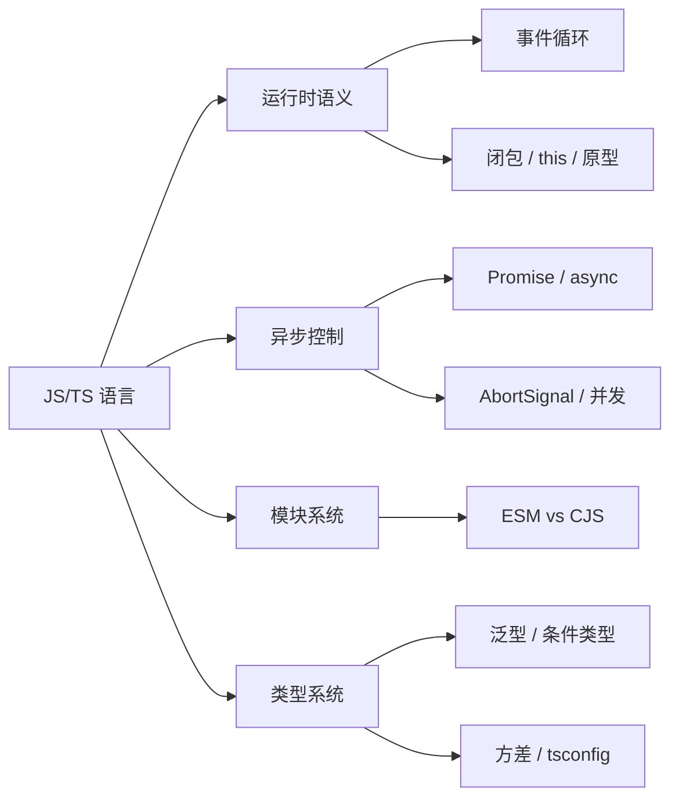

AI 全栈岗位对 JS/TS 的考察集中在两条线：**运行时语义**（事件循环、闭包、原型、Promise）与**类型系统**（泛型、条件类型、方差、工程配置）。本篇 66 题按机制 → 底层 → 工程取舍组织；项目例证来自本机 `yukino-chat`（HEAD `555f625`）与 `yukino-chatbot`（HEAD `13332f3`）两个 React 19 + Vite + TS 仓库的实读源码，路径均相对各自仓库根目录。



## 一、事件循环与异步模型

### Q1. 完整描述浏览器事件循环：宏任务、微任务、渲染的关系

**基础**。JS 单线程执行，宿主（浏览器）负责调度：

| 队列   | 典型来源                                                     | 清空时机                                   |
| ------ | ------------------------------------------------------------ | ------------------------------------------ |
| 宏任务 | `setTimeout` / `setInterval` / I/O / UI 事件 / `postMessage` | 每轮取**一个**执行                         |
| 微任务 | Promise 回调 / `queueMicrotask` / `MutationObserver`         | 当前宏任务结束后**全部清空**（含嵌套新增） |
| 渲染   | `requestAnimationFrame` → style/layout/paint                 | 约每 16.7ms 一次机会，非每轮宏任务都渲染   |

关键点：微任务队列在**每个宏任务之间**清空，且在渲染步骤前也会清空；`await` 之后的代码、`.then` 回调都进微任务队列。

### Q2. 经典输出顺序：`setTimeout` / `Promise` / `async-await` 混合

**基础**。判据只有一条：**同步代码 → 微任务全清 → 下一个宏任务**。

```js
console.log("1");
setTimeout(() => console.log("2"));
Promise.resolve().then(() => console.log("3"));
async function f() {
  console.log("4");
  await null;
  console.log("5");
}
f();
console.log("6"); // 输出 1 4 6 3 5 2
```

`async` 函数体在 `await` 前是**同步执行**的（输出 4）；`await` 后的续体进微任务队列。

### Q3. `await x` 到底等价于什么？消耗几个微任务 tick

**进阶**。`await x` ≈ `Promise.resolve(x).then(continuation)`。ES2019 优化后，对**已是 fulfilled 的原生 Promise** 只需 **1 个 tick**（此前实现要 3 个）；对 thenable 或原始值仍有额外的 resolve 作业。面试写出等价形式即可：

```js
async function f(x) {
  const v = await x;
  g(v);
}
// ≈
function f(x) {
  return Promise.resolve(x).then((v) => g(v));
}
```

**采分点**：能说出「tick 数取决于 x 是否原生 Promise」，而不是背固定数字。

### Q4. Node.js 事件循环有哪几个阶段？与浏览器有何差异

**进阶**。libuv 六阶段：`timers → pending callbacks → idle/prepare → poll → check(setImmediate) → close callbacks`。差异：

1. Node 每个**阶段回调批次**后清空微任务（Node 11 起与浏览器对齐：每个 timer/immediate 回调后都清）；
2. `process.nextTick` 队列**优先于** Promise 微任务队列，浏览器没有对应物；
3. 浏览器有渲染步骤与 rAF，Node 没有；Node 的 I/O 走线程池（默认 4 线程，`UV_THREADPOOL_SIZE` 可调），浏览器 I/O 由内核完成。

### Q5. `process.nextTick` / `setImmediate` / `Promise.then` 的执行顺序

**进阶**。同一轮内：`nextTick 队列 → 微任务（Promise）→ 下一阶段宏任务`。`setImmediate` 在 check 阶段，`setTimeout(fn, 0)` 在 timers 阶段——在主模块中两者顺序不确定（受进程启动耗时影响），但在 **I/O 回调内 `setImmediate` 恒先于 `setTimeout`**（poll 阶段结束后紧跟 check）。递归的 `nextTick` 会饿死 I/O，这是它被限制的原因。

### Q6. 为什么微任务可以「卡死」页面，宏任务不会

**进阶**。微任务队列清空前不会进入渲染步骤，`while(true) Promise.resolve().then(...)` 式自续微任务会无限推迟 paint；宏任务之间浏览器有机会渲染与响应输入。工程推论：**长计算要切片到宏任务**（`setTimeout` / `MessageChannel` / `scheduler.yield`）或丢进 Worker——`yukino-chat` 把文件 SHA-256 哈希放进 `client/src/workers/file-hash.worker.ts`，主线程只收 `progress/done/error` 消息，就是这个原则的应用。

### Q7. `queueMicrotask` 与 `Promise.resolve().then` 有区别吗

**基础**。调度语义相同（都进微任务队列）；区别在错误处理：`queueMicrotask` 回调抛错直接触发 `uncaughtException`/window `error`，而 Promise 回调抛错产生 rejected Promise，走 `unhandledrejection`。`queueMicrotask` 不分配 Promise 对象，开销略低。

### Q8. `requestAnimationFrame` 在事件循环中的位置？后台标签页会怎样

**进阶**。rAF 回调在**渲染步骤开始时**执行（微任务清空之后、style/layout 之前），每帧一次；回调内新增的 rAF 排到**下一帧**。后台标签页 rAF 完全暂停，`setTimeout` 被节流（Chrome 对隐藏页最低 1 次/分钟，冻结页更严）。工程推论：用 rAF 做「每帧对齐 UI 更新」天然省电且不会比帧率更频繁——`yukino-chatbot` 的流式 Markdown 就用 rAF 轮询把高频 chunk 合并为每帧至多一次 `setState`（`client/src/pages/ai-chat/components/streaming-markdown/index.tsx`）。

### Q9. `unhandledrejection` 何时触发？生产上如何治理

**进阶**。Promise 被 reject 且**当轮微任务结束时**仍无 handler，宿主标记；浏览器在该宏任务结束后触发 `unhandledrejection`，若之后补上 handler 还会触发 `rejectionhandled`。治理：全局监听上报（配 sourcemap 还原堆栈）、区分「预期业务失败」与「代码缺陷」、`event.preventDefault()` 阻止默认打印。注意 `void promise` 与 fire-and-forget 是主要泄漏源，规范写法是显式 `.catch` 或 `await`。

### Q10. `setTimeout(fn, 100)` 为什么不精确

**基础**。它只保证「**不早于** 100ms 后进入 timers 队列」，实际执行取决于：主线程是否被长任务占用、当前是否轮到 timers 阶段、嵌套层级（HTML 规范对 5 层以上嵌套强制最小 4ms）、后台节流。要精确调度用 rAF（对齐帧）或 Worker 内计时 + `postMessage`。

### Q11. 异步上下文如何跨 `await` 传播（AsyncLocalStorage / Zone）

**深挖**。JS 本身没有「当前执行上下文」对象；Node 用 `AsyncLocalStorage`（底层 `async_hooks`/AsyncContextFrame）在异步资源创建时快照 store，`await` 后续体能取回——这是请求级 traceId、事务上下文的标准实现。浏览器无对应 API（Zone.js 靠 patch 全部异步入口模拟，代价是性能与兼容负担）。**采分点**：说清「传播发生在异步资源创建点而非执行点」，以及 fiber/协程语言（Go 的 goroutine-local 缺失、Java 的 ScopedValue）对照。

### Q12. 项目例证：`useDebouncedValue` 为什么必须在 cleanup 里 `cancel`

**进阶**。`yukino-chat/client/src/lib/use-debounced-value.ts` 全文只有 14 行：

```ts
useEffect(() => {
  const update = debounce(setDebounced, delayMs);
  update(value);
  return () => update.cancel();
}, [value, delayMs]);
```

每次 `value` 变化都新建 debounce 定时器，effect cleanup 时 `cancel()` 掉上一轮挂起的调用。不 cancel 的后果：组件卸载后定时器仍触发 `setState`（React 18 起不再警告但属逻辑泄漏），且快速连续输入时**多个并存定时器**都会到期，防抖退化为节流。这是「闭包持有定时器 + 生命周期清理」的最小完整样例。

## 二、闭包、作用域与 this

### Q13. 闭包是什么？形成条件与本质

**基础**。闭包 = **函数 + 创建时的词法环境引用**。形成条件：内层函数引用外层函数作用域的变量，且内层函数被传出（返回/回调/存储）。本质是作用域链在堆上的延续——被引用变量从栈帧「晋升」到堆（V8 的 Context 对象），生命周期随闭包。

### Q14. `var` 与 `let` 在循环捕获上的差异及原理

**基础**。`var` 函数级作用域，循环共享**同一个绑定**，回调执行时读到最终值；`let` 在每轮迭代创建**新绑定**并拷贝上一轮值（规范称 per-iteration environment）。修复 `var` 问题的三种历史手段：IIFE 参数快照、`forEach` 回调形参、`let`——现代代码只用 `let/const`。

### Q15. 作用域链如何查找标识符？TDZ 是什么

**基础**。查找顺序：当前函数环境 → 逐层外层函数环境 → 全局环境；`with`/`eval` 会破坏静态可分析性（严格模式禁用其引入新绑定）。TDZ（暂时性死区）：`let/const/class` 声明在块内**提升但不初始化**，声明语句前访问抛 `ReferenceError`——这是「提升」与「可访问」的分离，`typeof` 也不能豁免。

### Q16. 闭包导致内存泄漏的典型场景与排查

**进阶**。场景：定时器/事件监听持有大对象闭包未清理；意外全局（未声明赋值、`this` 逃逸）；detached DOM 被 JS 引用；console 引用（开发环境）；`yukino-chat` 的 WebSocket store 用模块级 `let socket` + `intentionalClose` 显式管理连接生命周期（`client/src/store/ws.ts`），断开时置 `socket = null` 释放引用。排查：DevTools Memory 三次快照对比（分配 → 操作 → 回收），按 Retainers 找引用链；`performance.memory` 只做趋势监控。

### Q17. this 的四种绑定规则与优先级

**基础**。优先级从高到低：**new 绑定 → 显式绑定（call/apply/bind）→ 隐式绑定（obj.fn()）→ 默认绑定**（严格模式 `undefined`，否则全局对象）。隐式丢失：`const f = obj.fn; f()` 或把方法当回调传递时退化为默认绑定——这是 React 类组件时代 `this.handleClick.bind(this)` 的由来，函数组件 + 箭头函数后基本消失。

### Q18. 箭头函数的 this 有什么特殊？哪些场景不能用箭头函数

**基础**。箭头函数无自己的 `this`，词法捕获定义处外层 `this`，且 `call/apply/bind` **无法改变**（只能改参数）。不能用箭头的场景：对象方法（需要动态 this）、原型方法、构造函数（无 `[[Construct]]`、无 prototype）、DOM 事件处理器需要 `currentTarget` 时、`arguments` 需求。

### Q19. `bind` 的「一次生效」与偏函数应用

**进阶**。`bind` 返回的函数再 `bind` 无法改 this（只能继续追加参数）；对 bind 结果 `new` 时 this 绑定被忽略、参数保留（bind 函数被当作构造器包装）。偏应用：`const post = send.bind(null, "POST")` 固定前缀参数。现代替代：箭头函数包装或 `Function.prototype.apply` + 闭包，语义更直白。

### Q20. 从模块模式到现代私有状态：封装手段的演进

**进阶**。IIFE 模块模式（闭包私有）→ CJS/ESM 模块（文件级作用域天然私有，只 export 公共面）→ class `#private` 字段（引擎级私有，硬错误而非 undefined）→ WeakMap 关联私有数据（可跨实例、GC 友好）。`yukino-chat` 的 store 采用第四种思路的变体：模块级 `let socket/reconnectTimer` 变量 + zustand `create` 只暴露状态切片（`client/src/store/ws.ts`），组件永远拿不到裸 socket。

### Q21. React hooks 中的 stale closure 是什么？如何系统性修复

**深挖**。现象：回调/定时器捕获了**旧渲染帧**的 state/props。根因：每次渲染的函数组件是独立闭包，effect 依赖数组不含该值时回调不重建。修复阶梯：

1. 补全依赖（eslint `react-hooks/exhaustive-deps`）；
2. 值放 `ref`，回调内读 `ref.current`（永远最新）——`yukino-chatbot` 的 `StreamingMarkdown` 让网络层把 chunk 累积写进可变 `sourceRef`，rAF 回调只读 ref，**渲染闭包从不捕获流内容**（`client/src/pages/ai-chat/components/streaming-markdown/index.tsx`）；
3. `useEffectEvent`（React 实验 API）把「读最新值」封装成稳定引用。

**采分点**：能画出「渲染帧 = 闭包快照」模型，并说明 ref 方案为何不触发重渲染。

## 三、原型与对象模型

### Q22. `prototype` / `__proto__` / `constructor` 三者关系

**基础**。`F.prototype` 仅函数有，`new F()` 时成为实例的 `[[Prototype]]`（浏览器暴露为 `__proto__`，标准 API 是 `Object.getPrototypeOf`）；`F.prototype.constructor === F` 形成回指。查找属性沿 `[[Prototype]]` 链向上直到 `Object.prototype → null`。

### Q23. `instanceof` 原理与手写

**基础**。沿左操作数原型链查找右操作数的 `prototype` 是否出现：

```js
function myInstanceof(obj, Ctor) {
  let proto = Object.getPrototypeOf(obj);
  const target = Ctor.prototype;
  while (proto !== null) {
    if (proto === target) return true;
    proto = Object.getPrototypeOf(proto);
  }
  return false;
}
```

边界：`Symbol.hasInstance` 可自定义行为；跨 realm（iframe/worker）的 `Array instanceof Array` 为 false，要用 `Array.isArray`；类继承链、`Object.create(null)`（无原型，任何 instanceof 都 false）。

### Q24. `Object.create(null)` 有什么用

**进阶**。创建无原型对象：没有 `toString/hasOwnProperty` 等继承成员，`in` 与属性访问不受原型污染。用途：纯字典/映射（防「原型污染」攻击面）、手写 Map 前的时代产物。对照：普通字面量继承 `Object.prototype`，`obj["constructor"]` 有值，`JSON.parse` 攻击载荷 `{"__proto__": ...}` 才成为议题。

### Q25. `class` 是语法糖吗？与函数式继承的差异

**进阶**。语义上是原型继承的糖，但有硬差异：class 声明**不提升初始化**（TDZ）；类体自动严格模式；方法不可枚举、不可 `new`；必须 `[[Construct]]` 调用（漏 `new` 抛错而非静默）；`extends` 内建 `super` 绑定与派生类构造顺序约束（`super()` 前访问 this 抛错）；静态块、`#private`、装饰器只属于 class。

### Q26. `new` 操作符做了什么？手写 new

**基础**。四步：创建空对象 → `[[Prototype]]` 指向 `F.prototype` → 以该对象为 this 执行 F → F 返回对象则用之，否则返回新对象。

```js
function myNew(F, ...args) {
  const obj = Object.create(F.prototype);
  const ret = F.apply(obj, args);
  return ret !== null && (typeof ret === "object" || typeof ret === "function")
    ? ret
    : obj;
}
```

### Q27. 属性遍历 API 的区别

**基础**。`for...in`：可枚举属性**含原型链**；`Object.keys`：自身可枚举；`Object.getOwnPropertyNames`：自身全部（含不可枚举，不含 Symbol）；`Reflect.ownKeys`：自身全部含 Symbol。序列化（`JSON.stringify`）只看自身可枚举且非 undefined/函数。

### Q28. V8 隐藏类与内联缓存：为什么建议固定对象字面量属性顺序

**深挖**。V8 为对象维护隐藏类（Shape/Map）转移树：相同顺序添加属性 → 共享隐藏类 → 内联缓存（IC）命中，属性访问接近常量时间；顺序不同 → 隐藏类分叉 → IC 退化为 megamorphic 查表。推论：热点路径构造对象用固定顺序字面量、避免 `delete`（转 dictionary mode）、避免动态加属性。**边界**：这是优化提示不是语义约束，冷路径无所谓；面试讲到「IC 状态：uninitialized → pre-mono → mono → poly → mega」即为满分。

## 四、Promise 与异步控制

### Q29. Promise 状态机的三条硬规则

**基础**。`pending → fulfilled | rejected` 单向且**不可逆**；状态与值定型后 `then` 任意次调用都得到相同结果（可重放，这是它与事件流的本质区别）；`then` 回调至多执行一次且必在微任务中（即使 Promise 已 settled，`then` 也不同步执行）。

### Q30. `then` 回调返回值如何决定下游 Promise

**进阶**。回调返回普通值 → 下游 fulfilled(值)；返回 Promise/thenable → 下游**跟随**其状态（adopt，异步解析）；抛异常 → 下游 rejected(异常)；无返回 → fulfilled(undefined)。thenable 采纳时会再调一次其 `then`，因此「返回一个自己」会造成死锁（规范以 TypeError 拒绝）。

### Q31. `all` / `allSettled` / `race` / `any` 语义对比

**基础**。

| API          | 短路条件         | 结果形态                      | 空数组           |
| ------------ | ---------------- | ----------------------------- | ---------------- |
| `all`        | 首个 rejection   | 全 fulfilled 的值数组         | 立即 fulfilled   |
| `allSettled` | 不短路           | `{status, value/reason}` 数组 | 立即 fulfilled   |
| `race`       | 首个 settled     | 该结果原样                    | **永远 pending** |
| `any`        | 首个 fulfillment | 该值；全拒 → `AggregateError` | 立即 rejected    |

`race([])` 永久 pending 是高频陷阱；超时控制正是 `race([fetch, timeout])` 的应用。

### Q32. 手写 Promise/A+ 的最小实现要点

**进阶**。核心三件：状态字段 + 回调队列（pending 时收集，settle 时按序异步派发）；`resolvePromise` 递归解析 thenable（需 `called` 标志防多次调用，规范要求）；`then` 返回**新** Promise 以支持链式。派发用 `queueMicrotask`。测试用官方 `promises-aplus-tests`。面试写到「队列 + 异步派发 + 采纳 thenable」即达标，完整代码见 [Promise 并发池代码题](/interview/code/promise-concurrency)。

### Q33. async/await 的错误处理模式

**基础**。`try/catch` 捕获 await 的 rejection；`for` 循环内 try/catch 实现「单条失败不中断」；`Promise.allSettled` 处理并发批；工具函数式 `const [err, data] = await to(p)`（go 风格）。注意：catch 里 rethrow 保持堆栈；`Error.cause`（ES2022）做错误链包装优于字符串拼接。

### Q34. AbortController / AbortSignal 如何组合超时与外部取消

**进阶**。Signal 是「取消广播」，Controller 是发射器。组合原语（`yukino-chat/client/src/service/http.ts` 实装）：

```ts
function withTimeout(timeoutMs: number, signal?: AbortSignal): AbortSignal {
  const timeout = AbortSignal.timeout(timeoutMs);
  return signal ? AbortSignal.any([signal, timeout]) : timeout;
}
```

`AbortSignal.timeout(15_000)` 到期以 `TimeoutError`（DOMException）abort；`AbortSignal.any` 任一源 abort 即联动。区分「用户主动取消」与「超时」：catch 里查 `signal?.aborted` 与 `error.name === "TimeoutError"`——该项目正是这样把超时映射为 `ApiError(-1, "Request timed out")`，而用户取消原样上抛。

### Q35. `Promise.all` 是并发池吗？如何做真正的并发限制

**进阶**。不是。`Promise.all(tasks.map(f))` 会**立即启动全部**任务，all 只负责聚合；1 万个 URL 就是 1 万个并发请求。并发池 = 固定 N 个 worker 循环从共享队列取任务：

```ts
async function pool<T>(tasks: (() => Promise<T>)[], limit: number) {
  const results: T[] = [];
  let cursor = 0;
  const worker = async () => {
    while (cursor < tasks.length) {
      const i = cursor++;
      results[i] = await tasks[i]();
    }
  };
  await Promise.all(
    Array.from({ length: Math.min(limit, tasks.length) }, worker),
  );
  return results;
}
```

完整实现（含 AbortSignal、失败重试）见 [Promise 并发池代码题](/interview/code/promise-concurrency)。

### Q36. Promise 微任务与 React 状态批处理的时序关系

**深挖**。React 18 起自动批处理：同一微任务轮内多次 `setState` 合并为一次渲染（调度在微任务/宏任务边界 flush）。推论：`await` 前后各 setState 一次可能触发**两次**渲染（分属不同微任务轮）；`flushSync` 强制同步渲染打破批处理；React 19 的 `useOptimistic`/Actions 进一步把异步更新纳入 transition。面试能画「事件回调 → 微任务清空 → React flush → 渲染」时间线即满分。

### Q37. 异步迭代与 `for await`：流式数据怎么消费

**进阶**。`for await (const chunk of stream)` 要求对象实现 `Symbol.asyncIterator`；Web `ReadableStream` 在现代浏览器/Node 18+ 已内建。手写消费（`yukino-chatbot/client/src/hooks/queries/use-stream-message.ts` 实装）：

```ts
const reader = body.getReader();
const decoder = new TextDecoder();
while (true) {
  const { done, value } = await reader.read();
  if (done) break;
  buffer += decoder.decode(value, { stream: true });
  // 按行切分、保留残行、解析 data: 前缀
}
```

`{ stream: true }` 让多字节 UTF-8 字符跨 chunk 截断时不产生乱码——这是流式解码的第一考点。

### Q38. 「可取消的 Promise」如何设计

**深挖**。Promise 本身不可取消（无 cancel 语义），工程方案三层：**信号层**——传入 `AbortSignal`，执行体在检查点主动 reject（`AbortError`）；**竞态层**——`race([work, abortPromise])` 让调用方先返回，但底层工作仍在跑（资源未释放，只解耦等待）；**协作层**——生成器/异步迭代器由消费者 `return()` 终止生产。采分点：指出 race 方案的「假取消」本质与 fetch/子进程等真取消入口的区别。

## 五、模块系统与运行环境

### Q39. ESM 与 CJS 的核心差异

**基础**。

| 维度     | ESM                          | CJS                            |
| -------- | ---------------------------- | ------------------------------ |
| 解析时机 | 编译期静态（import 提升）    | 运行期动态（require 即时执行） |
| 绑定     | **live binding**（只读引用） | 值拷贝（exports 对象快照）     |
| this     | `undefined`                  | `module.exports`               |
| 异步     | 支持 top-level await         | 不支持                         |
| 加载     | 浏览器原生/文件 URL          | 文件系统同步读                 |

ESM 三阶段：Construction（下载/解析依赖图）→ Instantiation（建立绑定，未执行）→ Evaluation（深度优先执行）。

### Q40. 循环依赖在 ESM 与 CJS 下分别发生什么

**深挖**。CJS：require 返回**已执行部分的 exports 快照**，后加载方可能拿到不完整对象（`{}` 或缺字段），错误在运行期深处爆发。ESM：绑定在实例化阶段已建立，循环中先求值的模块若访问尚未初始化的 `let/class` 绑定 → **TDZ ReferenceError**；函数声明（提升且初始化）可幸免。结论：ESM 把循环依赖从「静默拿到残缺值」变为「尽早显式报错」，但两者都应通过依赖倒置（提取共享层）消除。

### Q41. ESM 静态结构带来什么工程收益

**进阶**。import/export 位置与名称编译期确定 → 打包器可做**可靠 tree shaking**（CJS 的 `require(变量)` 无法静态分析）→ 死代码消除；配合 `package.json` 的 `"sideEffects": false` 声明跳过有副作用模块的保守保留。Vite dev 模式直接利用浏览器原生 ESM 实现「按需编译单文件」，冷启动与 HMR 都快于全量打包——`yukino-chat`/`yukino-chatbot` 的 client 均为 Vite + `"type": "module"` 工程。

### Q42. ESM/CJS 互操作的坑

**进阶**。ESM `import pkg from "cjs"` 拿到 `module.exports` 整体作 default；named import 依赖 Node 的 cjs-module-lexer 静态探测，动态拼装的 exports 探测不到 → 只能 default 后解构。CJS `require("esm")` 在 Node 22 前直接抛错（`ERR_REQUIRE_ESM`），22+ 对无 TLA 的 ESM 支持同步 require。发布库的稳妥形态：双产物（exports map 的 `import`/`require` 条件）+ 类型声明分置。

### Q43. package.json `exports` 条件导出与 dual package hazard

**深挖**。`exports` 定义子路径与条件（`import`/`require`/`node`/`default`，自定义条件如 `browser` 用 `--conditions` 激活），**未列出的路径一律 404**（封装性）。dual package hazard：同一包被 ESM 与 CJS 各加载一份 → 两个模块实例，单例失效（全局注册表、`instanceof` 跨副本失败）。解法：只发一种格式、或让两格式 re-export 同一份状态载体、或用 peerDependency 收敛。

### Q44. top-level await 的影响与限制

**进阶**。仅 ESM 可用；含 TLA 的模块求值变为异步，**阻塞父模块但不阻塞兄弟分支**（V8 的 async evaluation 按依赖图调度）。代价：不能被同步 `require`；打包器需要支持（webpack5+/Vite 均可，target 需 es2022+）。适用：配置预载、wasm 初始化、资源 fallback 链。滥用会把「模块加载」变成不可见的异步瀑布。

### Q45. 浏览器原生 ESM 与打包器的取舍

**进阶**。原生 ESM 免构建、URL 即模块，但生产环境有请求瀑布（深依赖图 = 大量 RTT）、无 tree shaking 后处理、裸模块名（`import "react"`）浏览器不识别（需 import maps）。现实分工：开发期用原生 ESM（Vite），生产期打包合并（Rollup/Rspack）。HTTP/2 多路复用缓解了瀑布但未消除解析开销。

## 六、弱引用与内存管理

### Q46. WeakMap 的特性与典型用途

**基础**。键必须是对象（或 Symbol），**弱持有**：键无其他强引用时可被 GC，条目随之消失；不可迭代、无 size、无 clear（因为「有哪些键」本身不稳定）。用途：DOM 节点 → 关联数据（不阻止节点回收）、实例私有数据、记忆化缓存（缓存生命周期自动跟随键）。对照 `Map`：强引用、可迭代、需手动 delete。

### Q47. WeakRef 与 FinalizationRegistry 使用注意

**进阶**。`WeakRef.prototype.deref()` 可能返回 `undefined`（已回收），**每次使用都要判空**；GC 时机不确定，不能把 deref 成功当作逻辑保证。`FinalizationRegistry` 回调「可能调用、可能不调用、调用时机任意」，只能做**兜底清理**（如释放外部资源句柄），不能承载业务语义。两者组合可实现「值可回收的缓存」，但生产更常用带 TTL/LRU 的显式缓存——可预测性优先。

### Q48. JS 常见内存泄漏模式与定位手段

**进阶**。模式：未清理的监听器/定时器、闭包持有大对象、detached DOM、全局容器只增不减（`Map` 当缓存无淘汰）、console/断点持有（dev）。定位：Chrome Memory 面板 heap snapshot 三次对比法（Baseline → 操作 → GC 后），按 Retained Size 排序看 Retainers 链；Allocation instrumentation on timeline 找持续增长源；`queryObjects` 命令行辅助。前端监控侧用 `performance.memory.usedJSHeapSize` 采样上报做趋势告警（仅 Chromium、数值粗粒度）。

### Q49. V8 垃圾回收基础：分代与主要算法

**进阶**。分代假说 → 新生代（Scavenge：两个 semispace 复制存活对象，快但空间换时间）+ 老生代（Mark-Sweep 标记清除 + Mark-Compact 整理碎片）。优化：**增量标记**（拆片穿插 mutator）、**并发标记**（后台线程）、**懒清除**、写屏障维护跨代引用（remembered set）。大对象直接进老生代。工程含义：频繁创建短命小对象是 GC 友好模式；巨型长命容器（百万级 Map）会加重标记成本。

## 七、TypeScript 类型系统

### Q50. 结构类型系统意味着什么？如何做名义类型

**进阶**。TS 按**形状**判等（duck typing 的静态版）：`{a: string}` 可赋给任何同形状类型，与声明名无关。需要名义区分（UserId vs OrderId 不可互换）时用 **brand 模式**：

```ts
type UserId = string & { readonly __brand: "UserId" };
const asUserId = (s: string) => s as UserId;
```

交叉一个不存在的属性做「编译期指纹」，运行时零开销。zod 的 `z.string().brand<"UserId">()` 是同一思路的库化。

### Q51. `interface` 与 `type` 如何选择

**基础**。interface：可声明合并（同名自动 merge）、可被 class implements、错误信息常更可读；type：能表达联合/交叉/条件/映射/模板字面量等全部类型运算、可给原始值与元组命名。团队惯例：**对象与公共 API 用 interface，其余用 type**；库作者慎开 interface（用户可合并扩充，既是特性也是污染面）。

### Q52. 泛型约束与默认泛型

**基础**。`<T extends { id: string }>` 约束 T 的最小形状，函数体内只能访问约束成员；`<T = string>` 提供缺省。`extends` 在泛型位是「可赋值给」而非继承；配合 `keyof` 约束键：`<T, K extends keyof T>(o: T, k: K) => T[K]` 是类型安全取值的最小签名。

### Q53. `keyof` / `typeof` / 索引访问如何组合

**基础**。`typeof x` 从**值**反推类型；`keyof T` 取键联合；`T[K]` 索引访问。组合拳：`type Keys = keyof typeof config`（从常量对象取键联合）、`T[K][]`、函数重载收敛为泛型索引签名。配合 `as const` 可让字面量对象成为「单一事实来源」，类型与运行时值永不漂移。

### Q54. 条件类型与分布式条件类型

**进阶**。`T extends U ? X : Y` 在 T 为**裸类型参数**且是联合时自动分布：`Exclude<"a"|"b", "a">` = `("a" extends "a" ? never : "a") | ("b" extends "a" ? never : "b")` = `"b"`。阻止分布包一层元组：`[T] extends [U] ? ...`。`never` 在联合中是空集（分布结果为 never）。这是 `Exclude/Extract/NonNullable` 的实现基石。

### Q55. `infer` 的作用？手写 `ReturnType` 与 `Parameters`

**进阶**。`infer` 在条件类型的 extends 子句中声明**待推断的局部类型变量**：

```ts
type MyReturnType<T> = T extends (...args: never[]) => infer R ? R : never;
type MyParameters<T> = T extends (...args: infer P) => never ? P : never;
```

进阶用法：`infer U extends string`（推断 + 约束，TS 4.8+）、模板字面量中拆串 `S extends `${infer H}/${infer T}``。

### Q56. 内置工具类型的手写实现

**进阶**。面试常考「不用库类型现场实现」：

| 工具类型         | 实现                                           |
| ---------------- | ---------------------------------------------- |
| `Partial<T>`     | `{ [K in keyof T]?: T[K] }`                    |
| `Required<T>`    | `{ [K in keyof T]-?: T[K] }`                   |
| `Readonly<T>`    | `{ readonly [K in keyof T]: T[K] }`            |
| `Pick<T,K>`      | `{ [P in K]: T[P] }`（K extends keyof T）      |
| `Omit<T,K>`      | `Pick<T, Exclude<keyof T, K>>`                 |
| `Record<K,V>`    | `{ [P in K]: V }`                              |
| `NonNullable<T>` | `T extends null \| undefined ? never : T`      |
| `Awaited<T>`     | 递归解包 `PromiseLike`（含 thenable 的 infer） |

映射类型的修饰符增删（`?`/`readonly` 前缀 `-`）与键重映射（`as` 子句）是变体题的考点。

### Q57. `as const` 与 `satisfies` 各解决什么问题

**进阶**。`as const`：字面量深度只读化——数组变元组、字符串变字面量类型、属性 readonly；用于常量表与判别联合的源头。`satisfies`：**校验值满足类型但保留推断出的更窄类型**——`const cfg = {...} satisfies Record<string, Handler>` 既检查了形状，又让 `cfg.foo` 保持具体字面量类型（用 `: Record<...>` 注解则会丢失）。两者常连用：`as const satisfies readonly string[]`。

### Q58. 类型收窄的手段有哪些

**基础**。`typeof`（原始类型）、`instanceof`（类）、`in`（键存在）、真值/相等收窄（`=== null`、字面量比较）、**判别联合**（`item.kind === "tool"` 后自动窄化——`yukino-chat` 的 agent 事件 reducer 对 `AgentItem` 的 `kind` 判别处理 `thinking/stream/tool/permission/question` 分支，`client/src/store/agent.ts`）、类型谓词函数（`function isFish(p): p is Fish`）、断言函数（`function assert(c: unknown): asserts c`）、`never` 穷尽检查（switch default 赋值给 never，漏分支编译报错）。

### Q59. `unknown` / `any` / `never` 的区别与使用纪律

**基础**。`any` 关闭检查且**双向传染**；`unknown` 是类型安全的 any——任何值可赋入，但使用前必须收窄/断言；`never` 是底部类型：不可能出现的值位（穷尽后的 switch、必抛函数的返回）。纪律：外部边界（HTTP/WS/存储）一律 `unknown` + zod 解析——`yukino-chat` 的 WS 帧处理先 `JSON.parse` 成 unknown，再 `messageSchema.safeParse`，失败静默丢帧（`client/src/store/ws.ts` 的 `handleFrame`）。

### Q60. 协变、逆变与方法双变

**深挖**。函数类型在**返回值位协变**、**参数位逆变**（`strictFunctionTypes` 下，仅对函数类型语法生效）：`(d: Dog) => void` 不能赋给 `(a: Animal) => void`（参数逆变要求 Animal → Dog 方向）。**方法简写语法**（`interface { m(x: T) }`）保留双变（bivariant）以兼容数组等内建类型——这是 `strictFunctionTypes` 不检查方法参数的原因。数组 `T[]` 协变是不健全的历史包袱（`dogs.push(cat)` 漏洞），面试能写出这个反例即满分。

### Q61. 声明合并与模块扩充

**进阶**。同名 `interface` 自动合并（后声明覆盖同名成员会报错，重载签名并列）；`namespace` + class/function 合并是旧库模式。模块扩充：`declare module "pkg" { interface X {...} }` 给三方库类型加成员（如给 express Request 加 user）；全局扩充需 `declare global` 且文件本身是模块（含 import/export）。风险：合并是**全局隐式**的，库作者暴露 interface 即承诺可扩充。

### Q62. `strict` 家族都包含什么？项目 tsconfig 如何佐证

**基础**。`strict: true` 展开为：`noImplicitAny`、`strictNullChecks`、`strictFunctionTypes`、`strictBindCallApply`、`strictPropertyInitialization`、`noImplicitThis`、`useUnknownInCatchVariables`、`alwaysStrict`（+ TS5 的 `strictBuiltinIteratorReturn`）。真实项目基线（`yukino-chat/client/tsconfig.app.json`）：`target: es2023`、`noUnusedLocals/noUnusedParameters`、`noFallthroughCasesInSwitch`、`skipLibCheck`，另开 `verbatimModuleSyntax` 与 `erasableSyntaxOnly`——比 strict 更严的现代配置。

### Q63. `moduleResolution: bundler` 与 `node16` 的区别

**进阶**。`node16/nodenext`：完全模拟 Node ESM 解析——相对导入**必须写扩展名**、尊重 `exports` 条件、CJS/ESM 按文件类型切换。`bundler`：为打包器场景设计——允许省略扩展名、支持 `paths` 别名、尊重 exports 但不强制 ESM 规则；**不能**用于发布给 Node 直接运行的库。`yukino-chat` client 用 `bundler` + `allowImportingTsExtensions` + `noEmit`（Vite 负责产物，tsc 只做检查），是 SPA 的标准搭配。

### Q64. `verbatimModuleSyntax` 与 `erasableSyntaxOnly` 解决什么问题

**进阶**。前者：`import type` 必须显式标注，编译时**原样保留/擦除** import 语句（不再猜测 elision），配合 `isolatedModules`/单文件转译器（esbuild、swc、Babel）保证语义一致。后者（TS 5.8+）：禁止**需要运行时代码生成**的 TS 语法——`enum`、`namespace`（含代码）、参数属性（`constructor(private x)`）——保证「删掉类型注解即得合法 JS」，任何单文件转译器都能安全处理。`yukino-chat` client 两项全开，与其 Vite/esbuild 流水线严格自洽。

### Q65. 类型体操的边界在哪里

**深挖**。硬限制：实例化深度（约 500 层报 TS2589）、递归类型别名的条件嵌套、联合分布的组合爆炸（`Exclude` 大联合变慢）。工程判断：类型应服务**调用方错误信息可读性**与重构安全，当类型比实现难懂、报错信息不可读、编译时间可感知时就该停——退路是 `z.infer` + 运行时校验、或泛型收敛为具体重载。面试表态「我写过也拆过类型体操，判据是团队维护成本」比炫技更加分。

### Q66. 有了 TS 类型为什么还要 zod 做运行时校验

**进阶**。TS 类型**编译后擦除**，对运行期数据（HTTP 响应、WS 帧、localStorage、URL 参数）零约束；`as` 断言与三方 `any` 会让类型谎言进入系统。zod 提供单一 schema 同时产出运行时校验与静态类型（`z.infer`），把「边界处校验、内部信任类型」落地。项目实装：`yukino-chat` 用 `envelopeSchema` 校验响应信封、`messageSchema.safeParse` 校验 WS 帧、payload 再按业务 schema 二次 parse（`client/src/service/http.ts` 的 `parse()` 失败时抛 `ApiError(-1, "Unexpected payload ...")` 并附 `z.prettifyError`）——**类型是内部契约，schema 是边境海关**。

## 八、运行时 API 与宿主环境

### Q67. `structuredClone` 与 `JSON.parse(JSON.stringify())` 深拷贝的差异

**进阶**。structuredClone 支持 `Date/RegExp/Map/Set/ArrayBuffer/TypedArray`、循环引用、`undefined`；不支持函数、DOM 节点、Symbol、原型链（克隆后原型为 Object.prototype）。JSON 往返会丢 `undefined/函数/Date 变字符串`、循环引用直接抛错。性能上 structuredClone 对大对象通常更快（引擎内建序列化）。需要保留类实例时两者都不行，要手写 revive 或用 immer 的 `original`/`current`。

### Q68. Worker 与主线程通信有哪几种方式？Transferable 是什么

**进阶**。`postMessage` 默认**结构化克隆**（拷贝，大对象有成本）；`Transferable`（ArrayBuffer、MessagePort、ReadableStream 等）可**所有权转移**，零拷贝但原持有方立即失效；`SharedArrayBuffer` 真共享内存（需 COOP/COEP 头），配 `Atomics` 做同步。`yukino-chat` 的哈希 Worker 直接 postMessage 传 `File` 对象（Blob 属可克隆且惰性读取，不拷贝字节），Worker 内 `file.slice().arrayBuffer()` 分片消化，进度用 `{kind:"progress", hashed, total}` 消息回报（`client/src/workers/file-hash.worker.ts`）。

### Q69. `import.meta` 有哪些常用能力

**基础**。ESM 模块自身的元信息：`import.meta.url`（模块文件 URL，Node 里配 `fileURLToPath` 得路径）、Vite 的 `import.meta.env`（编译期静态替换的环境变量，`yukino-chat` 用 `@t3-oss/env-core` 在 `src/env` 里对其做 zod 校验后导出 `apiUrl/wsUrl`）、`import.meta.glob`（Vite 批量导入）。CJS 对应物是 `__dirname/__filename`，ESM 中不存在。

### Q70. 浏览器存储方案如何选择

**基础**。cookie（4KB、随请求自动携带、可 HttpOnly/Secure/SameSite，认证首选）；localStorage（5–10MB、同步 API、永久、仅字符串，XSS 可读——存 token 有被窃取风险）；sessionStorage（标签页级）；IndexedDB（大容量、异步、结构化数据、支持事务，文件/离线消息首选）；Cache Storage（SW 配套，静态资源）；OPFS（源私有文件系统，高吞吐读写）。两个真实对照：`yukino-chatbot` 把 JWT 存 localStorage 并由 axios 拦截器注入（`client/src/api/fetch-client.ts`）；`yukino-chat` 用 zustand persist 把认证态落 localStorage，但大文件走分片上传 + Worker 哈希，不进浏览器存储。

### Q71. `Intl` 与数字/日期格式化的工程注意点

**基础**。`Intl.NumberFormat/DateTimeFormat/RelativeTimeFormat` 是内建 i18n 基座，避免手写千分位/时区拼接。注意点：`DateTimeFormat` 默认用**运行时时区**，跨端一致要显式 `timeZone`；格式化结果因 ICU 版本有微差，快照测试要固定 locale 与实现；`formatToParts` 可拆段做富文本样式。`yukino-chat` 用 `date-fns` 做相对时间（会话列表时间戳），与 Intl 属同类选型，取舍在包体（date-fns 可 tree shake）与能力面（Intl 零依赖）。

## 速记卡

- **顺序题只有一条规则**：同步 → 微任务全清 → 宏任务；`await` 前同步、后续体进微任务（原生 Promise 1 tick）。
- **Node 特有**：nextTick 队列先于 Promise 微任务；I/O 回调内 `setImmediate` 恒先 `setTimeout`。
- **闭包 = 函数 + 词法环境**；React stale closure 的解法是 ref 读最新值（`StreamingMarkdown` 的 `sourceRef` 模式）。
- **this 优先级**：new > 显式 > 隐式 > 默认；箭头函数词法捕获且不可改。
- **ESM live binding + TDZ**，循环依赖早报错；CJS 值拷贝，循环依赖拿残缺快照。
- **`race([])` 永久 pending**；`any` 全拒才 reject；超时 = `AbortSignal.timeout` + `AbortSignal.any` 组合。
- **微任务里不能做长活**：长计算切宏任务或进 Worker（file-hash.worker 的分片 SHA-256）。
- **TS 三件套**：结构类型（brand 补名义）、分布式条件类型（`[T] extends [U]` 阻止分布）、边界 unknown + zod。
- **现代 tsconfig 基线**：strict + `moduleResolution: bundler` + `verbatimModuleSyntax` + `erasableSyntaxOnly`（enum/参数属性被禁）。

## 延伸阅读

[React 与浏览器](/interview/qa/react-and-browser) · [AI 流式前端专题](/interview/qa/ai-streaming-ui) · [前端工程化](/interview/qa/frontend-engineering) · [浏览器与 React 知识卡](/interview/fundamentals/frontend-browser) · [Promise 并发池代码题](/interview/code/promise-concurrency) · [全量题库](/interview/question-bank)
