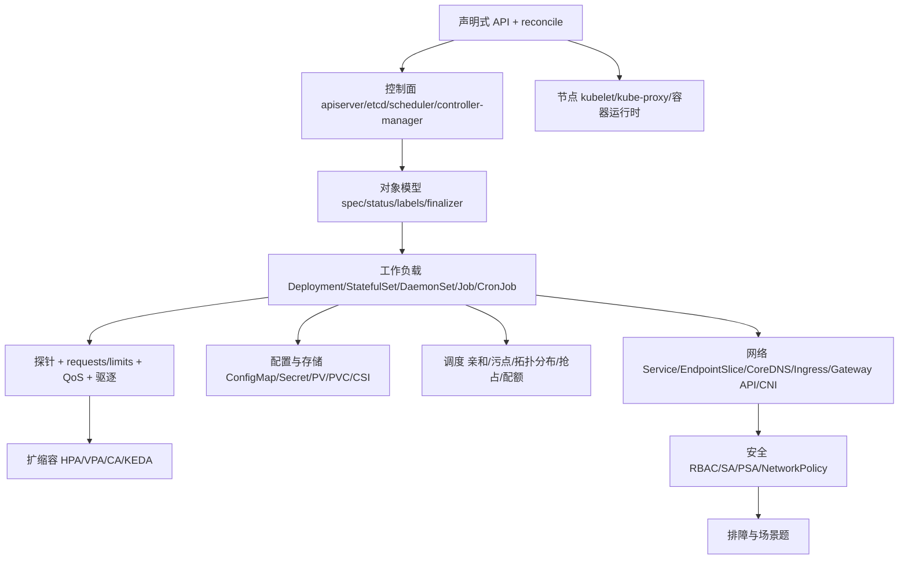

:::note 事实基线
本篇按 **Kubernetes v1.36 线**当前稳定口径撰写，事实来源为 `content/docs/docker-k8s-agent-sandbox.md` 第二至四部分；沙箱节点池相关的 YAML 与参数来自同文第五部分 §8（**目标架构设计方案**，非某仓库现有实现）。本机 `kubectl v1.36.1`、无集群 context。凡涉及具体默认值（探针周期、驱逐阈值、超时秒数）均按上游默认口径给出，落地时以目标集群版本的实际配置为准。
:::

本篇是「Kubernetes 架构与运维」带解答题库，共 **102 题**。K8s 的面试有一个特点：**几乎所有题都能回溯到「声明式 API + 控制器 reconcile 循环」这一个灵魂考点**。所以本篇的组织方式是：先把这个模型讲透（第一节），再按「对象模型 → 工作负载 → 网络 → 配置存储 → 调度 → 探针资源 → 扩缩容 → 安全 → 排障 → 扩展机制」逐层展开，最后用场景题串联。

**主线一览**



## 一、灵魂考点：声明式 API 与控制器模式

### Q1. 为什么需要 K8s？容器不是已经解决「一次构建到处运行」了吗？

容器解决的是**打包与运行环境一致性**，但生产环境要面对的是**多机维度的运维问题**：调度到哪台机器、挂了怎么自愈、怎么扩缩容、怎么滚动发布不打断服务、服务之间怎么发现、配置怎么下发、密钥怎么管、资源怎么隔离与配额。

K8s 是容器的「操作系统」，它用**声明式 API + 控制器 reconcile 循环**把「期望状态」持续变成「现实状态」。一句话：**Docker 管一个容器，K8s 管一个机群的容器生命周期**。

### Q2. 声明式与命令式的本质区别是什么？

**命令式**：「启动 3 个容器」——描述**动作**，执行一次就结束。系统漂移（容器挂了、节点宕了）之后**无人纠正**。

**声明式**：「副本数 = 3」——描述**期望态**，写进 etcd。控制器无限循环对比实际态与期望态，有差异就行动（reconcile）。节点宕机少了 1 个 Pod，不需要任何人下命令，ReplicaSet 控制器自动补齐。

**采分点（必背结论）**：**自愈不是一个「特性」，而是 reconcile 循环的自然结果**。两个推论：① 所有操作都应**幂等**（`apply` 同一个 YAML 一百次结果一致）；② 运维动作的对象是「**修改期望态**」而不是「操作进程」——`kubectl delete pod` 之所以能接受，是因为它触发的是「实际态偏离期望态 → 控制器补齐」，而不是「删掉就没了」。

### Q3. 什么是水平触发（level-triggered）vs 边缘触发（edge-triggered）？为什么这个区别重要？

**边缘触发**：依赖「收到了某个事件」才行动。事件丢了，状态就永久错了——这类系统必须保证消息可靠投递（重试、去重、顺序），复杂度全在消息层。

**水平触发**：只关心「**当前状态与期望状态是否有差**」，不依赖事件是否收到。即使 watch 事件丢失，下一次 **resync 全量对比**也能收敛。

K8s 控制器是水平触发的，这是**整个系统健壮性的根基**：apiserver 重启、网络抖动、watch 断连都不会导致状态永久错误，只会导致**收敛延迟**。

**采分点**：能说出「**水平触发把可靠性要求从消息层移到了状态层**」，并对比 Kafka 消费（边缘触发，所以需要 at-least-once + 幂等）——这个跨领域对比非常加分。

### Q4. `kubectl apply -f deploy.yaml` 之后完整发生了什么？

这是**架构题的必考串讲**，能完整口述就过关：

```text
1. kubectl 读 kubeconfig（cluster/user/context），向 apiserver 发 HTTPS 请求
2. apiserver 依次执行：
   认证 authn（你是谁：证书/token/OIDC）
   → 鉴权 authz（你能不能做：RBAC）
   → 准入控制 admission：
       mutating（改对象：注入 sidecar、填默认值、注入 SA token）
       → validating（校验：PSA、策略门禁、OPA/Kyverno）
3. 对象写入 etcd，返回成功 —— 此时一个 Pod 都还没跑
4. Deployment 控制器（watch 到）创建 ReplicaSet
   → ReplicaSet 控制器创建 Pod 对象（此时 pod.spec.nodeName 为空）
5. kube-scheduler（watch 未绑定 Pod）执行 过滤 Filter → 打分 Score → 绑定，
   把 nodeName 写回 apiserver
6. 目标节点 kubelet（watch 到绑定给自己的 Pod）：
   调 CRI（containerd）拉镜像、起容器
   调 CNI 配网络（分配 Pod IP、插 veth）
   调 CSI 挂卷
   执行探针，持续上报 status
7. EndpointSlice 控制器（watch Pod ready）把 Pod IP 加入 Service 后端
   → 各节点 kube-proxy 更新转发规则 → 流量可达
```

**采分点**：① **每一步都是「组件 watch apiserver + 各司其职」，没有任何组件之间的直接调用**——这是 K8s 架构最反直觉也最优雅的地方；② 第 3 步「写进 etcd 就返回成功，此时一个 Pod 都没跑」是最容易被忽略的细节，说出它证明你理解异步调谐；③ 准入控制的 **mutating 在 validating 之前**（先改再校验，否则校验的是未填默认值的对象）。

### Q5. 为什么所有组件只与 apiserver 通信？这样设计的好处与代价？

**好处**：① **apiserver 是唯一的读写收口**，认证/鉴权/准入/审计只需实现一次；② 组件之间**零直接依赖**，任何组件挂掉不会级联（scheduler 挂了，已运行的 Pod 不受影响，只是新 Pod 不调度）；③ apiserver **无状态**，前面挡 LB 就能水平扩展；④ watch 机制让所有组件用同一套「List + Watch」范式，客户端库（client-go informer）可复用。

**代价**：① apiserver 是**单点瓶颈与攻击面**（所以要多副本 + 限流 + 审计）；② etcd 只有 apiserver 直连，**etcd 的写入吞吐决定了集群规模上限**；③ 组件间通过 watch 异步协作，**收敛有延迟**（秒级），不适合需要强同步的场景。

### Q6. watch 机制与 Informer 是怎么工作的？

客户端（controller-manager、scheduler、kubelet、operator）不会每次 reconcile 都去 apiserver 查全量，而是用 **List + Watch**：

```text
1. List：拉全量对象 + resourceVersion（RV）
2. Watch：从该 RV 开始订阅增量事件（ADDED/MODIFIED/DELETED/BOOKMARK）
3. 本地维护 Indexer 缓存（thread-safe store，可按 label/字段索引）
4. 事件入工作队列（workqueue，带限速与去重）
5. reconcile worker 从队列取 key，读【本地缓存】做调谐
6. 断线重连：从上次 RV 续传；RV 被 etcd compact 掉 → 410 Gone → 重新 List
7. resync：定期把缓存里所有对象重新入队，兜住「事件丢了」的情况
   （水平触发的实现基础）
```

**采分点**：① **reconcile 读的是本地缓存，不打爆 apiserver**——这是 K8s 能支撑万级节点的关键；② `410 Gone` 后必须重新 List，写 operator 时如果没处理这个会导致 informer 永久卡死；③ **workqueue 的去重语义**：同一个 key 在队列里只保留一份，所以 reconcile 必须是幂等的（同一状态调谐多次结果一致）。

### Q7. 控制面组件自己是怎么跑起来的？（鸡生蛋问题）

kubeadm 集群里，apiserver / etcd / scheduler / controller-manager 都是 **static Pod**：kubelet 直接监视 `/etc/kubernetes/manifests` 目录，发现 YAML 就起容器，**不经过 apiserver**。

这解决了鸡生蛋问题：**先有 kubelet（systemd 服务）→ 起 static Pod 形式的控制面 → apiserver 就绪 → 其他组件（CoreDNS、kube-proxy、CNI）作为普通 Deployment/DaemonSet 由控制面管理**。

static Pod 的特点：① 由 kubelet 直接管理，`kubectl get pod` 能看到（名字带 `-<nodename>` 后缀），但 `kubectl delete` **删不掉**（kubelet 会立刻重建，因为期望态在本地文件里）；② 改配置就是改文件，kubelet 检测到变化自动重建；③ mirror pod 对象由 kubelet 创建到 apiserver，只用于可观测。

### Q8. 为什么 K8s 弃用 dockershim？对镜像有影响吗？

**dockershim** 是 kubelet 里为了对接 Docker（Docker 不实现 CRI）而写的适配层。弃用理由：① 维护成本高（K8s 团队要跟着 Docker 版本改）；② 链路多一跳（kubelet → dockershim → dockerd → containerd → runc），而 kubelet 真正需要的只是 containerd；③ Docker 的很多能力（构建、CLI、compose）在 K8s 场景下用不到。

1.24 正式移除后，kubelet 经 **CRI 标准**直连 containerd 或 CRI-O。

**对镜像零影响**：Docker 构建的镜像是 **OCI 镜像格式**，containerd/CRI-O 照常拉取运行。受影响的只有：① 节点上 `docker ps` 看不到 K8s 容器了（要用 `crictl ps`）；② 依赖 `docker.sock` 做构建的 CI 需要改造（kaniko/buildah/BuildKit rootless）；③ 用 Docker 的 `--log-opt`、自定义网络等 Docker 特有配置的需要迁移。

**采分点**：这题的标准答案是「**弃用的是运行时适配层，不是镜像格式**」——很多人误以为「K8s 不支持 Docker 镜像了」，能纠正这个误解就是采分点。

## 二、整体架构与组件职责

### Q9. 白板画出 K8s 架构，说清每个组件的职责。

```text
Control Plane（控制面）
├── kube-apiserver           唯一入口：REST API + 认证鉴权准入 + watch 分发；
│                            唯一直连 etcd 的组件；无状态可水平扩展
├── etcd                     分布式 KV（Raft 强一致），集群唯一持久化存储
├── kube-scheduler           为 nodeName 为空的 Pod 选节点：Filter → Score → Bind
├── kube-controller-manager  几十个控制器（Deployment/ReplicaSet/Node/Job/
│                            EndpointSlice/ServiceAccount/Namespace/GC...）
└── cloud-controller-manager 对接云厂商（LB/路由/节点生命周期），自建集群可无

Node（工作节点）
├── kubelet                  节点代理：保证本节点 Pod 按 spec 运行，
│                            执行探针，上报状态，管理卷与设备
├── kube-proxy               维护 Service 转发规则（iptables/ipvs/nftables）
└── 容器运行时               containerd / CRI-O，经 CRI 协议对接 kubelet

插件层（Addon）
├── CoreDNS                  集群 DNS（Service/Pod 记录）
├── CNI 插件                 Calico / Cilium / Flannel，实现 Pod 网络
├── Ingress Controller       nginx-ingress / traefik / envoy
└── metrics-server           资源指标（HPA / kubectl top 依赖）
```

**采分点**：能说出「**scheduler 与 controller-manager 是无状态的，可以跑多副本做 leader election**」和「**etcd 是唯一有状态的，必须奇数副本（3/5）+ 独立磁盘**」，这是架构题从「背图」到「理解」的分水岭。

### Q10. apiserver 承担哪些职责？为什么它是唯一的水平扩展点？

职责：① **REST API 服务**（所有对象的 CRUD + watch）；② **认证 authn**（证书、Bearer token、OIDC、ServiceAccount token、webhook）；③ **鉴权 authz**（RBAC、ABAC、Node、Webhook）；④ **准入控制**（mutating + validating webhook、内置插件如 PSA）；⑤ **schema 校验与默认值填充**；⑥ **聚合层**（aggregated API server，如 metrics-server 就是通过 APIService 注册进来的）；⑦ **唯一直连 etcd**。

为什么能水平扩展：**apiserver 自身无状态**——所有状态在 etcd 里，所有组件通过 watch 而非直接通信协作。所以前面挡一个 LB，跑 3-5 个 apiserver 副本即可。

**扩展的瓶颈在 etcd**：apiserver 副本再多，写入都要经 etcd 的 Raft 共识。所以大集群的优化重点是**减少 etcd 写入**（如 EndpointSlice 替代 Endpoints、`immutable` ConfigMap 不再 watch、事件单独存）。

### Q11. etcd 在 K8s 里的角色？运维要点有哪些？

角色：**集群唯一的持久化存储**，存所有对象的 spec/status。基于 **Raft** 做分布式一致性（强一致线性izable 读写）。

| 要点                  | 说明                                                                                                                                     |
| --------------------- | ---------------------------------------------------------------------------------------------------------------------------------------- |
| **奇数副本**          | 3 或 5。Raft 需要多数派（quorum），3 副本容忍 1 个挂，4 副本也只容忍 1 个（浪费）                                                        |
| **独立高速磁盘**      | etcd 对 **fsync 延迟**极敏感，必须用 SSD/NVMe，且 `--quota-backend-bytes` 设上限（默认 2GB，生产常设 8GB）                               |
| **定期备份**          | `etcdctl snapshot save`，**备份要能恢复才算备份**（定期演练）                                                                            |
| **compact 与 defrag** | 历史版本会累积，需要定期 compact（`--auto-compaction-retention`）+ defrag（会阻塞，逐节点做）                                            |
| **不要直连**          | 只有 apiserver 应该连 etcd。绕过 apiserver 直接写 etcd 会跳过准入控制，破坏一致性                                                        |
| **监控**              | `etcd_disk_wal_fsync_duration_seconds`、`etcd_network_peer_round_trip_time_seconds`、`etcd_mvcc_db_total_size_in_bytes`、leader 变更频率 |

**采分点**：能说出「**etcd 的写延迟决定了集群的控制面吞吐上限**」+「**defrag 会阻塞读写，必须逐节点滚动做**」，这是运维过真实集群的人才知道的细节。

### Q12. kubelet 的职责边界是什么？它不管什么？

**管**：① 本节点 Pod 的生命周期（经 CRI 起停容器）；② 执行三种探针并按结果动作（重启容器 / 摘流量）；③ 挂载卷（经 CSI）；④ 上报节点与 Pod status；⑤ 节点资源管理（cgroup 层级、驱逐、CPU manager、topology manager）；⑥ 管理 static Pod；⑦ 执行 Pod 的优雅终止（preStop → SIGTERM → grace period → SIGKILL）。

**不管**：① **调度**（不决定 Pod 来不来这个节点，只执行已绑定的）；② **Service 转发规则**（那是 kube-proxy 的事）；③ **集群级状态**（不写 etcd，只经 apiserver）；④ **跨节点协调**（每个 kubelet 只看自己的节点）。

**采分点**：kubelet 是**唯一有「本地期望态」概念的组件**（static Pod 的 manifests 目录），其他组件的期望态都在 etcd 里。

### Q13. kube-proxy 做什么？它有哪几种模式？

kube-proxy 在**每个节点**上维护 Service 的转发规则，把发往 ClusterIP 的流量转发到后端 Pod IP。四种模式：

| 模式                       | 实现                                                                              | 特点                                                                   |
| -------------------------- | --------------------------------------------------------------------------------- | ---------------------------------------------------------------------- |
| **iptables**（默认）       | 每个 Service/Endpoint 生成若干条 iptables 规则，用 `statistic` 模块做随机负载均衡 | 规则数 = O(Service × Endpoint)，**大规模下更新慢**（全量刷新可能秒级） |
| **IPVS**                   | 内核 LVS，哈希表存储                                                              | **O(1) 查找**，支持 rr/lc/dh/sh/sed/nq 等多种调度算法，大规模集群首选  |
| **nftables**（1.31+ 稳定） | nftables 集合与映射                                                               | 解决 iptables 模式的规模问题，是新一代默认方向                         |
| **userspace**              | 用户态代理                                                                        | 已废弃，性能差                                                         |

**采分点（高频陷阱）**：**kube-proxy 不做健康检查**——它只转发到 EndpointSlice 里列出的地址。Pod 是否 ready 由 **kubelet 探针 + EndpointSlice 控制器**决定。所以「readiness 探针失败 → 从 EndpointSlice 摘除 → kube-proxy 更新规则 → 流量不再打过去」是三个组件协作的结果，不是 kube-proxy 一个人的事。

### Q14. cloud-controller-manager 是什么？自建集群需要吗？

它把**与云厂商耦合的控制器**从 kube-controller-manager 里拆出来：Node 生命周期（云主机被删了同步删 Node 对象）、Route（云路由表）、Service 的 `type: LoadBalancer`（创建云 LB）。

自建集群（bare metal）**可以没有**，此时：① `type: LoadBalancer` 的 Service 会永远 `<pending>`（没有控制器去创建 LB），需要 **MetalLB** 或改用 NodePort/Ingress；② 节点生命周期要自己管（或用 Cluster API）。

## 三、对象模型通用机制

### Q15. spec 与 status 的分离为什么重要？

**spec** 是用户写的**期望态**（我要 3 个副本、用这个镜像、要 2 核 4G）；**status** 是控制器/kubelet 写的**实际态**（现在有 2 个 ready、1 个在拉镜像）。

分离的意义：① **reconcile 的定义就是「让 status 收敛到 spec」**，没有分离就没有调谐循环；② 权限可以分离（RBAC 里可以只给 `update status` 权限，不给 `update spec`）；③ 用户 `apply` 只改 spec，不会误覆盖 status；④ `kubectl get` 看到的「READY 2/3」就是 spec 与 status 的对比结果。

**采分点**：写 CRD/Operator 时，**status 要用独立的 subresource**（`subresources: {status: {}}`），这样更新 status 不会触发 spec 的 validating webhook，也不会增加 spec 的 resourceVersion（减少 watch 事件风暴）。

### Q16. labels 与 selectors 的机制？为什么说「label 打错是 Service 不通的头号原因」？

label 是键值对标识，selector 是查询语言，两种匹配：**等值匹配**（`env=prod`、`tier!=backend`）与**集合匹配**（`tier in (frontend, backend)`、`env notin (dev)`、`gpu` 即 Exists）。

K8s 里**所有对象之间的关联都是靠 label 松耦合**，没有硬引用：Service → Pod 靠 `service.spec.selector`；Deployment → ReplicaSet → Pod 靠 `spec.selector` 匹配 `template.metadata.labels`；NetworkPolicy → Pod 靠 `podSelector`。

所以 **Service 不通的排查第一步永远是**：

```bash
kubectl get endpointslices -l kubernetes.io/service-name=<svc>
# 空 → selector 与 Pod label 不匹配（或 Pod 没 ready）
```

**采分点**：能说出「**Deployment 的 selector 是不可变的**（改了要删了重建）」和「**RS 的 template label 必须包含 Deployment selector 要求的全部 label，否则 RS 创建的 Pod 不被自己认领，会无限创建**」——后者是经典的「Pod 疯狂重建」故障根因。

### Q17. annotations 与 labels 的区别？

| 维度     | labels                                       | annotations                                                                                                                         |
| -------- | -------------------------------------------- | ----------------------------------------------------------------------------------------------------------------------------------- |
| 用途     | **标识与选择**（被 selector 查询）           | **附加元数据**（不参与选择）                                                                                                        |
| 值限制   | 63 字符，字母数字与 `-_.`，必须能进 selector | 任意字符串（可存 JSON），上限 256KB                                                                                                 |
| 典型例子 | `app: nginx`、`env: prod`                    | `kubectl.kubernetes.io/last-applied-configuration`、`prometheus.io/scrape`、Ingress 的 `nginx.ingress.kubernetes.io/rewrite-target` |

**采分点**：annotation 是 K8s 的**扩展点**——很多控制器（Ingress controller、Prometheus operator、cert-manager）用 annotation 传递配置，避免为每个功能加 CRD 字段。这也是 Ingress 被批评「annotation 堆砌」的原因（Gateway API 用结构化字段替代，见 Q41）。

### Q18. resourceVersion / generation / uid 各是什么？

| 字段                       | 语义                                                                                         |
| -------------------------- | -------------------------------------------------------------------------------------------- |
| `metadata.uid`             | 全局唯一 ID，**对象删除后重建 uid 会变**（即使 name 相同）                                   |
| `metadata.resourceVersion` | 对象在 etcd 里的版本号（不透明字符串，**不要解析为数字做算术**），watch 与乐观并发控制都靠它 |
| `metadata.generation`      | **spec 的版本号**，只有 spec 变化才自增（status 变化不增）                                   |

**乐观并发**：`update` 时带上读到的 resourceVersion，如果服务端已经变了则返回 **409 Conflict**，客户端要重新读再改。这是 operator 处理并发写入的标准姿势。

**采分点**：`generation` 的用途是**判断「spec 改了但控制器还没处理完」**——很多 operator 会在 status 里写 `observedGeneration`，只有 `status.observedGeneration == metadata.generation` 时才说明 status 反映了最新的 spec。这是写 CRD 的必备模式。

### Q19. finalizer 是什么？为什么对象「删不掉」？

finalizer 是 `metadata.finalizers` 里的一个字符串列表，语义是「**删除前必须先完成的清理动作**」。

```text
kubectl delete pvc data
  → apiserver 不真的删对象，而是设置 metadata.deletionTimestamp
  → 相关控制器看到 deletionTimestamp，执行清理（卸载云盘、删外部资源）
  → 清理完成后从 finalizers 列表里移除自己的 finalizer
  → finalizers 为空 → apiserver 真正删除对象（从 etcd 移除）
```

**对象卡在 Terminating 的原因**：① 负责清理的控制器挂了/不存在（如 PV 的 CSI driver 被卸载了，finalizer 永远没人移除）；② 清理动作本身失败（云盘 detach 超时）；③ 手动加了 finalizer 忘了删。

解法是 `kubectl patch pvc data -p '{"metadata":{"finalizers":null}}' --type=merge`，但**采分点**：强行摘 finalizer 会导致**外部资源泄露**（云盘还在计费、DNS 记录还在、LB 还在）——答题时必须说出这个代价，而不是只给命令。

### Q20. owner reference 与垃圾回收是怎么工作的？

对象之间通过 `metadata.ownerReferences` 建立**父子关系**（Deployment → ReplicaSet → Pod）。GC 控制器据此做**级联删除**：**Foreground**（先标记父对象，再删子对象，最后真删父）、**Background**（默认，立刻删父，GC 异步删子）、**Orphan**（删父留子，摘掉 ownerReferences）。

```bash
kubectl delete deployment nginx --cascade=foreground   # 或 background / orphan
```

**采分点**：`kubectl scale deployment --replicas=0` 之后 ReplicaSet 还在（只是 Pod 被删），这是**为什么回滚能秒级完成**——历史 RS 都保留着（`revisionHistoryLimit`，默认 10），改回去就是把旧 RS scale up。

## 四、Pod 深入

### Q21. 为什么 Pod 是最小调度单位，而不是容器？

Pod 是「**一组共享 namespace 的容器**」，共享：① **Network namespace**（同一 IP、同一端口空间，容器间用 localhost 互访）；② **IPC namespace**（可用信号量/共享内存通信）；③ **Volume**（同一 Pod 的容器可以挂同一个 volume 交换文件）。

为什么需要这个抽象：有些应用**天然需要贴身协作**——主容器 + 日志采集 sidecar、主容器 + service mesh proxy、主容器 + 配置热加载器。这些容器需要共享网络栈与文件，**分开调度到不同节点就失去意义**。Pod 保证它们**同生共死、同节点、同网络**。

**采分点**：能说出「**Pod 是「逻辑主机」的抽象，而不是「进程组」**」——一个 Pod 对应用来说就像一台独立的小机器（有自己的 IP、hostname、端口空间、文件系统挂载点）。

### Q22. pause 容器（infra container）是什么？为什么需要它？

每个 Pod 启动时，kubelet 先起一个极小的 **pause 容器**（`registry.k8s.io/pause`，几百 KB，只做一件事：`pause()` 系统调用永久睡眠）。它**持有 Pod 的 network 与 IPC namespace**，其他业务容器 join 进来。

为什么需要：① **namespace 的生命周期要与 Pod 绑定，而不是与某个业务容器绑定**——如果让第一个业务容器持有 namespace，它崩溃重启时 namespace 会被销毁，其他容器的网络全断；② pause 容器几乎不消耗资源且永不退出，是稳定的 namespace 锚点；③ Pod IP 因此**在容器重启时保持不变**（只有 Pod 重建才变）。

**采分点**：这解释了「**为什么容器 restartCount 涨了但 Pod IP 没变**」——namespace 由 pause 持有，业务容器重启只是重新 join。

### Q23. Pod 的重启策略有哪些？restartCount 怎么算？

`restartPolicy`（Pod 级，对所有容器生效）：`Always`（容器退出就重启，默认，用于 Deployment/RS/StatefulSet/DaemonSet）、`OnFailure`（只有非 0 退出码才重启，用于 **Job**）、`Never`（从不重启，Job 配合 backoffLimit 重建 Pod）。

重启退避：**CrashLoopBackOff** 的等待时间从 10s 开始，每次翻倍，上限 5 分钟（10s → 20s → 40s → ... → 300s），容器成功运行 10 分钟后重置退避计数。

**采分点**：`restartCount` 是**容器级**计数，不是 Pod 级。Job 的 `backoffLimit` 计的是 **Pod 重建次数**（`restartPolicy: Never` 时）或**容器重启次数**（`OnFailure` 时），这个区别在排查「为什么 Job 提前 Failed」时很关键。

### Q24. Pod 的完整生命周期与状态有哪些？

```text
Pending → Running → Succeeded / Failed
           ↑
        Unknown（kubelet 失联）
```

**Pending**：已被 apiserver 接受，但**至少一个容器还没跑起来**。子原因：还没调度（nodeName 为空）、镜像还在拉、PVC 还没绑定、资源不足。**Running**：Pod 已绑定节点，所有容器已创建，**至少一个在运行/启动/重启中**。**Succeeded**：所有容器成功退出（0）且不再重启（Job 的正常终态）。**Failed**：所有容器终止且至少一个非 0 退出。**Unknown**：kubelet 无法上报状态。

**容器级状态**（`status.containerStatuses[].state`）：`Waiting`（带 reason，如 `ImagePullBackOff`、`CrashLoopBackOff`、`ContainerCreating`）、`Running`、`Terminated`（带 exitCode、reason、signal）。

**采分点**：排查时**看 `state.waiting.reason` 而不是 Pod phase**——phase 是 `Pending` 但 reason 是 `ImagePullBackOff`，方向完全不同。

### Q25. Pod 终止的完整流程？为什么需要 preStop sleep？

```text
1. Pod 被标记 deletionTimestamp（kubectl delete / 滚动更新 / 驱逐 / 抢占）
2. 【并行发生】
   a. EndpointSlice 控制器把 Pod 标记为 terminating，从后端摘除
      → kube-proxy 更新各节点转发规则（有传播延迟，几百 ms 到数秒）
   b. kubelet 执行 preStop hook（如果有）
3. preStop 结束后，向 PID 1 发 SIGTERM
4. 等待 terminationGracePeriodSeconds（默认 30s）
5. 超时后发 SIGKILL
6. kubelet 上报容器已终止 → apiserver 移除 Pod 对象（finalizers 为空时）
```

**为什么需要 preStop sleep**：步骤 2a 与 2b 是**并行**的。如果应用收到 SIGTERM 立刻关闭监听，而此时某些节点的 kube-proxy **还没更新规则**，那些节点仍会把新请求打过来 → **连接被拒/重置**，发布期出现 502。

```yaml
lifecycle:
  preStop:
    exec: { command: ["sh", "-c", "sleep 10"] } # 等 endpoint 传播
terminationGracePeriodSeconds: 40 # > preStop + 应用关闭时间
```

**采分点**：这是**零停机发布题的满分点**。能说出「摘流量与发 SIGTERM 是并行的，所以要人为制造一个延迟窗口」，比只说「加 preStop」高一档。更优雅的方案是应用自己实现「收到 SIGTERM 后先让 readiness 探针失败、等几秒再关监听」。

### Q26. Init Container 与原生 Sidecar 的区别？

**Init Container**：在主容器**之前**顺序执行，全部成功退出后主容器才启动。用途：等待依赖就绪、初始化数据、下载配置、执行迁移。特点：① 顺序执行，一个失败按 restartPolicy 重试；② **不能与主容器并行**；③ 可以有独立的镜像与权限（如用 root 做 chown，主容器用非 root）。

**原生 Sidecar**（1.28 alpha，1.29 beta，1.33 GA）：`initContainers` 里设 `restartPolicy: Always` 的容器。语义：① **在主容器之前启动**（保证顺序）；② **与主容器并行运行**（不像普通 init 那样退出）；③ **在主容器全部退出后才终止**（解决「sidecar 先死导致主容器无法上报日志」的经典问题）。

**采分点**：原生 sidecar 解决的是 **Job 场景的死锁**——传统 sidecar（如日志采集）不会退出，Job 的 Pod 永远不 Succeeded。原生 sidecar 会在主容器结束后被 kubelet 主动终止，Job 能正常完成。这是「为什么 K8s 要引入原生 sidecar」的标准答案。

### Q27. Pod 的 Downward API 是什么？怎么用？

把 **Pod/容器自身的元数据**注入到容器里，两种方式：环境变量 或 volume 文件。

```yaml
env:
  - name: POD_NAME
    valueFrom: { fieldRef: { fieldPath: metadata.name } }
  - name: POD_IP
    valueFrom: { fieldRef: { fieldPath: status.podIP } }
  - name: NODE_NAME
    valueFrom: { fieldRef: { fieldPath: spec.nodeName } }
  - name: CPU_LIMIT
    valueFrom: { resourceFieldRef: { resource: limits.cpu } }
volumes:
  - name: podinfo
    downwardAPI:
      items:
        - { path: "labels", fieldRef: { fieldPath: metadata.labels } }
```

典型用途：① 应用日志里带 Pod 名与节点名；② 分布式系统用 Pod 名做实例 ID；③ 沙箱场景用 `status.hostIP` 访问节点服务（但要注意这是安全风险）；④ 应用按 CPU limit 动态设线程池大小。

**采分点**：volume 方式的 Downward API **会自动更新**（label 改了文件内容跟着变），env 方式**永不更新**——与 ConfigMap 的热更新语义一致（Q44）。

## 五、工作负载控制器

### Q28. 五种工作负载控制器怎么选？

| 控制器          | 语义                                    | 典型场景                            | Pod 身份       |
| --------------- | --------------------------------------- | ----------------------------------- | -------------- |
| **Deployment**  | 无状态副本集 + 滚动更新 + 回滚          | Web 服务、API、无状态 worker        | 可互换（牲口） |
| **StatefulSet** | 稳定网络标识 + 稳定存储 + 有序部署/伸缩 | 数据库、Kafka、etcd、Milvus         | 唯一（宠物）   |
| **DaemonSet**   | 每节点（或匹配节点）恰好一个            | 日志采集、监控 agent、CNI、存储插件 | 按节点         |
| **Job**         | 跑完即止（一次性任务）                  | 批处理、数据迁移、**Agent 沙箱**    | 一次性         |
| **CronJob**     | 定时创建 Job                            | 定时报表、清理、备份                | 定时一次性     |

**采分点**：选型的判断依据是**「Pod 是否可互换」与「是否需要稳定身份」**：可互换 + 长期运行 → Deployment；需要稳定身份（名字/存储/顺序）→ StatefulSet；每节点一个 → DaemonSet；有明确终态 → Job。

### Q29. Deployment 的滚动更新是怎么工作的？maxSurge 与 maxUnavailable 是什么？

Deployment 不直接管 Pod，而是**管 ReplicaSet**：每次 spec.template 变化就创建一个新 RS，然后按策略把旧 RS scale down、新 RS scale up。

```yaml
strategy:
  type: RollingUpdate
  rollingUpdate:
    maxSurge: 25% # 超出期望副本数的最大 Pod 数（可以是绝对值）
    maxUnavailable: 25% # 不可用 Pod 的最大数量
```

以 `replicas: 4, maxSurge: 25%, maxUnavailable: 25%` 为例：最多 5 个 Pod 同时存在（4+1），最少 3 个 ready（4-1）。流程：起 1 个新 Pod → ready 后杀 1 个旧 Pod → 循环。

**取舍**：`maxSurge` 大 → 更新快但**峰值资源占用高**；`maxUnavailable` 大 → 更新快但**服务容量下降**。资源紧张：`maxSurge: 0, maxUnavailable: 1`（先杀后起）。高可用：`maxSurge: 1, maxUnavailable: 0`（先起后杀，需要额外资源）。

**采分点**：滚动更新卡住的常见原因是新 Pod 起不来（readiness 一直失败），此时 Deployment 会**停在中间状态**（部分新部分旧），**不会自动回滚**——需要 `kubectl rollout undo` 或修好新 Pod。「Deployment 会自动回滚」是常见误解。

### Q30. 怎么回滚？revisionHistoryLimit 是什么？

```bash
kubectl rollout history deployment/nginx          # 看历史 revision
kubectl rollout history deployment/nginx --revision=3
kubectl rollout undo deployment/nginx             # 回到上一个
kubectl rollout undo deployment/nginx --to-revision=3
kubectl rollout status deployment/nginx           # 看当前进度
kubectl rollout pause / resume                    # 暂停/恢复（用于批量改 spec）
```

机制：每个历史 ReplicaSet 都保留着（`spec.revisionHistoryLimit`，默认 **10**），回滚就是**把旧 RS 的 template 复制成新 RS**（回滚会产生一个新的 revision，不是「删除」中间的）。

**采分点**：① `revisionHistoryLimit: 0` 会导致**无法回滚**（历史 RS 立刻被 GC）；② 回滚只回滚 **Pod template**，不回滚 `replicas`；③ 用 Helm 的话回滚走 `helm rollback`，它管的是整个 release 的所有资源。

### Q31. StatefulSet 的「三要素」是什么？

1. **稳定的网络标识**：Pod 名是 `<statefulset-name>-<ordinal>`（`mysql-0`、`mysql-1`），**重建后名字不变**；配合 **Headless Service**（`clusterIP: None`），每个 Pod 有稳定的 DNS 记录 `<pod>.<svc>.<ns>.svc.cluster.local`。
2. **稳定的存储**：`volumeClaimTemplates` 为**每个序号**创建一个独立 PVC（`data-mysql-0`、`data-mysql-1`），Pod 重建后**按序号绑回同一个 PVC**，数据不丢。
3. **有序的部署与伸缩**：创建按 0→N-1 顺序（前一个 ready 才起下一个），删除按 N-1→0 逆序；更新默认也是逆序逐个（`podManagementPolicy: OrderedReady`，可改 `Parallel` 放弃顺序换速度）。

**采分点**：① StatefulSet 的 PVC **不会随 StatefulSet 删除而删除**（防止误删数据），需要手动清理——1.32+ 有 `persistentVolumeClaimRetentionPolicy` 可配置；② 有状态服务的**主从关系不是 K8s 管的**，K8s 只保证「mysql-0 永远是 mysql-0」，谁是主由应用自己选（或用 Operator）；③ **能用 Deployment + 外部数据库就不要用 StatefulSet**——在 K8s 里跑数据库的运维成本（备份、恢复、主从切换、版本升级）远高于云托管服务。

### Q32. DaemonSet 的调度有什么特殊？

DaemonSet 保证「**每个（匹配的）节点恰好一个 Pod**」。特殊之处：① 由 DaemonSet 控制器直接给 Pod 设 nodeName（经 NodeAffinity 实现），**不走常规调度决策**；② **自动容忍关键污点**（`not-ready`、`unreachable`、`disk-pressure`、`memory-pressure`、`pid-pressure`、`unschedulable`）——因为 DaemonSet 的职责（日志采集、监控、网络插件）**在节点有问题时更需要运行**；③ 新节点加入自动部署，节点移除自动清理；④ `updateStrategy: RollingUpdate`（默认 `maxUnavailable: 1`）或 `OnDelete`。

典型用途：CNI 插件（Calico/Cilium）、kube-proxy、日志采集（Fluent Bit/Promtail）、node-exporter、存储插件的 node component。

**采分点（沙箱场景）**：日志采集 DaemonSet 是「**沙箱 Pod 销毁后日志仍可查**」的前提——TTL 清理能成立，是因为采集先于销毁。

### Q33. Job 的语义：completions / parallelism / backoffLimit 怎么配？

```yaml
spec:
  completions: 10 # 需要成功完成的 Pod 数（不设则第一个成功即完成）
  parallelism: 3 # 同时运行的 Pod 数上限
  backoffLimit: 6 # 失败重试次数上限（默认 6），超过则 Job Failed
  activeDeadlineSeconds: 1800 # 硬超时（不设则无限等）
  ttlSecondsAfterFinished: 3600 # 结束后自动清理（Job + Pod 一起删）
  template:
    spec:
      restartPolicy: Never # 或 OnFailure；不能是 Always
```

三种模式：**单任务**（都不设，一个 Pod 成功即完成）、**固定完成数的并行任务**（`completions: N, parallelism: M`）、**工作队列模式**（`completions: null, parallelism: M`，任一 Pod 成功即完成，适合「M 个 worker 消费同一队列」）。

**采分点（沙箱设计）**：`backoffLimit: 0` + 编排器自己决策重试。理由：**重试要花钱（LLM token + 算力），需要按错误类型、重试次数、熔断状态综合判断，K8s 的盲目重试会静默烧钱**。`activeDeadlineSeconds` 是防 Pod 卡死（Chromium 挂起）的硬兜底。`ttlSecondsAfterFinished` 实现「用完即毁」，但**前提是日志已中心化采集**。

### Q34. CronJob 有哪些坑？

```yaml
spec:
  schedule: "*/5 * * * *" # 标准 cron 表达式（分时日月周）
  timeZone: "Asia/Shanghai" # 1.27+ 支持，不设则用控制器所在时区（通常 UTC）
  concurrencyPolicy: Forbid # Allow（默认）/ Forbid / Replace
  startingDeadlineSeconds: 200 # 错过调度窗口多久内还可以补跑
  successfulJobsHistoryLimit: 3
  failedJobsHistoryLimit: 1
```

坑：① **时区**——不设 `timeZone` 时用控制器所在时区，跨环境部署会漂移；② **concurrencyPolicy: Allow** 默认允许并发，如果上一次没跑完会同时跑两个（对「不能并发」的任务是灾难，必须设 `Forbid`）；③ **错过调度**——controller-manager 挂了一段时间，恢复后超过 `startingDeadlineSeconds` 的任务不会补跑；④ **Job 不会自动清理**，必须设 history limit 或 ttl，否则 etcd 里堆满完成的 Job 对象。

### Q35. 什么是 Pod Disruption Budget (PDB)？为什么 drain 节点前必须有它？

PDB 声明「**自愿中断（voluntary disruption）期间，必须保持的最小可用副本数**」：

```yaml
spec:
  minAvailable: 2 # 或 maxUnavailable: 1
  selector: { matchLabels: { app: web } }
```

`kubectl drain <node>` 用的是 **Eviction API**（不是 delete），apiserver 会检查 PDB：如果驱逐后会违反 PDB，返回 **429 Too Many Requests**，drain 阻塞等待。

**自愿 vs 非自愿中断**：PDB **只防自愿中断**（drain、升级、缩容）。节点真的宕机、内核 panic、OOM 驱逐属于**非自愿中断，PDB 不保护**。

**采分点**：① `minAvailable: 100%` 会让 drain **永久阻塞**，是经典误配；② 单副本的 Deployment 配 PDB 无意义——**先扩副本再配 PDB**；③ 集群升级、节点池轮换的前提是「业务有 PDB + 多副本反亲和打散 + readiness 探针」，否则 drain 会直接打断服务。

## 六、Service 与集群网络

### Q36. Service 的四种类型 + Headless 各是什么？

| 类型                              | 行为                                                        | 场景                                            |
| --------------------------------- | ----------------------------------------------------------- | ----------------------------------------------- |
| **ClusterIP**（默认）             | 分配一个虚拟 IP，只在集群内可达，负载均衡到后端 Pod         | 内部服务                                        |
| **NodePort**                      | 在 ClusterIP 基础上，每个节点开一个端口（默认 30000-32767） | 开发/测试、无 LB 环境                           |
| **LoadBalancer**                  | 在 NodePort 基础上，经 cloud-controller-manager 创建云 LB   | 生产对外暴露                                    |
| **ExternalName**                  | 不分配 ClusterIP，DNS 返回一个 CNAME                        | 引用集群外部服务                                |
| **Headless**（`clusterIP: None`） | DNS 直接返回**全部 Pod IP**，不做负载均衡                   | StatefulSet、客户端自己选实例（gRPC、主从分流） |

**采分点**：Headless 的价值是**把选择权交给客户端**——gRPC 用长连接，普通 Service 的 L4 负载均衡会导致「连接建立后所有请求都打到同一个 Pod」，Headless + 客户端侧负载均衡（每次调用重新解析 DNS）才能均匀分发。

### Q37. ClusterIP 是虚拟 IP，它到底怎么工作？

ClusterIP **不绑定任何网卡**，ping 不通。它是一个**纯转发规则的 key**：

```text
1. Service 创建 → apiserver 分配 ClusterIP（从 --service-cluster-ip-range 网段）
2. EndpointSlice 控制器 watch ready 的 Pod，生成后端列表（Pod IP:Port）
3. 每个节点的 kube-proxy watch EndpointSlice，生成本地转发规则：
   iptables: -A KUBE-SERVICES -d <ClusterIP>/32 -p tcp --dport 80 -j KUBE-SVC-XXX
             KUBE-SVC-XXX 里用 statistic 模块按概率 DNAT 到各 Pod IP
   ipvs:     创建虚拟接口 kube-ipvs0 绑定所有 ClusterIP，用 IPVS 虚拟服务转发
4. Pod 发往 ClusterIP 的包在本节点被 DNAT 成 Pod IP，经 CNI 网络送达
```

**采分点**：① **ClusterIP 的转发发生在数据包的源节点**，不经过任何中心节点（这是 K8s 网络无单点的关键）；② DNAT 之后回包会被 conntrack 自动反向 NAT，所以应用看到的源 IP 可能是 Pod IP（同节点）或节点 IP（SNAT 后）——这就是 `externalTrafficPolicy` 要解决的问题（Q39）；③ **Service 的端口映射有三层**：`port`（Service 暴露的）、`targetPort`（Pod 容器的）、`nodePort`（节点的），混淆这三个是「Service 不通」的第二大原因。

### Q38. EndpointSlice 是什么？为什么取代了 Endpoints？

**Endpoints** 对象把一个 Service 的**所有后端地址放在一个对象里**。问题：一个 5000 副本的 Service，Endpoints 对象会有几 MB，**任何一个 Pod 变化都要重写整个对象并广播给所有节点的 kube-proxy** → apiserver 与网络双重风暴。

**EndpointSlice** 把后端**切片**（默认每片 100 个端点），Pod 变化只影响它所在的那一片。额外收益：① 支持**拓扑感知路由**（`hints.forZones`，优先打同可用区的 Pod，省跨区流量费）；② 支持 `conditions.ready/serving/terminating` 三态；③ 支持双栈（IPv4/IPv6 分片）。

### Q39. `externalTrafficPolicy: Local` 与 `Cluster` 的区别？

| 策略              | 行为                                          | 源 IP                   | 代价                               |
| ----------------- | --------------------------------------------- | ----------------------- | ---------------------------------- |
| `Cluster`（默认） | 可以转发到**任意节点**上的 Pod（多一跳 SNAT） | **丢失**（变成节点 IP） | 多一跳延迟；无法做基于源 IP 的限流 |
| `Local`           | 只转发到**本节点**上的 Pod，没有则丢弃        | **保留**                | 负载可能不均；健康检查要配对       |

**采分点**：① 需要真实客户端 IP（限流、审计、地理路由）→ 用 `Local`，但**必须配合 LB 的健康检查**（只把流量发给有本地 Pod 的节点），否则丢包；② `internalTrafficPolicy` 是集群内流量的对应配置；③ 保留源 IP 的更现代方案是 **Proxy Protocol**（LB 层）或 L7 Ingress 的 X-Forwarded-For。

### Q40. CoreDNS 的记录形态是什么？ndots:5 陷阱是什么？

| 对象             | DNS 记录                                                     |
| ---------------- | ------------------------------------------------------------ |
| 普通 Service     | `<svc>.<ns>.svc.cluster.local` → ClusterIP                   |
| Headless Service | `<svc>.<ns>.svc.cluster.local` → **全部 Pod IP**（A 记录集） |
| StatefulSet Pod  | `<pod>.<headless-svc>.<ns>.svc.cluster.local` → Pod IP       |

**ndots:5 陷阱**：Pod 的 `/etc/resolv.conf` 默认是 `nameserver 10.96.0.10` + `search <ns>.svc.cluster.local svc.cluster.local cluster.local` + `options ndots:5`。语义是：**域名里的点少于 5 个时，先按 search 域逐个拼接查询，都失败才查原始域名**。所以访问 `api.github.com`（2 个点）会产生 4 次查询，前 3 次全是 NXDOMAIN 浪费。高 QPS 服务访问外部域名时会把 CoreDNS 打爆。

解法：① **域名末尾加点**（`api.github.com.`）→ FQDN，跳过 search；② 调低 ndots（`dnsConfig: {options: [{name: ndots, value: "2"}]}`）；③ **NodeLocal DNSCache**（节点级缓存 DaemonSet，同时解决 conntrack 竞态导致的偶发 5s 超时）；④ 应用层 DNS 缓存。

**采分点**：能说出「**5 秒 DNS 超时**」这个经典故障——UDP conntrack 表项竞争导致 DNS 包丢失，glibc 默认 5s 超时后重试，表现为「偶发的 5 秒延迟毛刺」。NodeLocal DNSCache 是标准解法。

### Q41. Ingress 与 Gateway API 的区别？

| 维度     | Ingress                                                                           | Gateway API                                                                                                    |
| -------- | --------------------------------------------------------------------------------- | -------------------------------------------------------------------------------------------------------------- |
| 表达力   | 弱：只有 host + path 路由，其他全靠 **annotation 堆砌**（各 controller 还不通用） | 强：流量切分、header 匹配、跨 namespace 引用、TCP/UDP/TLS 路由都是一等字段                                     |
| 角色分离 | 无（一个对象混了基础设施与应用配置）                                              | **三级分离**：GatewayClass（厂商实现）→ Gateway（平台团队，管监听器与证书）→ HTTPRoute（应用团队，管路由规则） |
| 可移植性 | 差（换 controller 要重写 annotation）                                             | 好（结构化字段，跨实现一致）                                                                                   |
| 状态     | 稳定但功能冻结                                                                    | 逐步 GA，是官方推荐方向                                                                                        |

**采分点**：Gateway API 的**角色分离**是核心进步——平台团队管 Gateway（证书、监听端口、TLS 策略），应用团队管 HTTPRoute（路由规则），**权限边界清晰**，这在多团队大集群里是刚需。

### Q42. CNI 是什么？Calico / Cilium / Flannel 怎么选？

CNI（Container Network Interface）是**规范 + 插件模型**：kubelet 创建 Pod 时调用 CNI 插件的二进制（`/opt/cni/bin/`），插件负责给 Pod 分配 IP、创建 veth pair 接入网络、配置路由。

K8s 网络模型的**三条硬性要求**：① 每个 Pod 有独立 IP；② **所有 Pod 之间不经 NAT 直接互通**（跨节点也是）；③ 节点上的 agent 可以与本节点所有 Pod 通信。

| 插件        | 数据面                  | 特点                                                                |
| ----------- | ----------------------- | ------------------------------------------------------------------- |
| **Flannel** | VXLAN overlay           | 最简单，只做网络，**不带 NetworkPolicy**                            |
| **Calico**  | BGP 路由 / VXLAN / eBPF | NetworkPolicy 完整、性能好、生态成熟                                |
| **Cilium**  | **eBPF**                | 可绕过 kube-proxy、L7 NetworkPolicy、内置可观测（Hubble）、性能最好 |

**采分点**：① **NetworkPolicy 需要 CNI 支持才生效**——Flannel 单独用时 NetworkPolicy 是**静默无效**的（对象能创建，规则不执行），这是「配了 NetworkPolicy 但流量照样通」的根因；② Cilium 的 eBPF 数据面可以**完全替代 kube-proxy**（`kubeProxyReplacement: true`）。

### Q43. NetworkPolicy 的默认语义是什么？为什么必须显式放行 DNS？

**默认全通**：没有任何 NetworkPolicy 选中某个 Pod 时，该 Pod 的 ingress/egress **不受任何限制**。**一旦被选中即默认拒绝**：只要有一个 NetworkPolicy 的 `podSelector` 匹配了某 Pod，该 Pod 在对应方向就变成**白名单模式**。

```yaml
# 第一步：namespace 级默认拒绝所有出站
spec:
  podSelector: {} # 空 selector = 选中所有 Pod
  policyTypes: [Egress] # 没有 egress 规则 = 全部拒绝
---
# 第二步：显式放行 DNS（否则 Pod 连域名都解析不了）
spec:
  podSelector: { matchLabels: { app: jserror-autofix } }
  policyTypes: [Egress]
  egress:
    - to:
        [
          {
            namespaceSelector:
              { matchLabels: { kubernetes.io/metadata.name: kube-system } },
            podSelector: { matchLabels: { k8s-app: kube-dns } },
          },
        ]
      ports: [{ protocol: UDP, port: 53 }, { protocol: TCP, port: 53 }]
```

**采分点**：① **忘记放行 DNS 是 NetworkPolicy 落地时的第一大坑**——表现为「应用连不上任何服务，报 unknown host」；② `namespaceSelector` 与 `podSelector` 在**同一个 `to` 元素里是 AND**，分成两个元素是 OR——这个语义极易写错；③ NetworkPolicy **不支持 deny 规则**，只能白名单。

## 七、配置与存储

### Q44. ConfigMap 与 Secret 的热更新语义是什么？

| 注入方式             | 是否自动更新                                         | 说明                                                    |
| -------------------- | ---------------------------------------------------- | ------------------------------------------------------- |
| **volume 挂载**      | ✅ 会（kubelet 同步周期 + 缓存 TTL，**分钟级延迟**） | 应用需自己 watch 文件变化或定期重读                     |
| **volume + subPath** | ❌ **不会**                                          | subPath 是单文件绑定挂载，绕过了 kubelet 的原子更新机制 |
| **环境变量**         | ❌ **永不**                                          | env 在容器启动时注入，进程生命周期内不变                |

改环境变量方式的配置，标准动作是 `kubectl rollout restart deployment/my-app`。

**`immutable: true`** 的 ConfigMap/Secret：内容锁定不可改，且 **kubelet 不再 watch 它**——大集群里成千上万个 ConfigMap 的 watch 是 apiserver 的显著负担，immutable 能大幅降压。

**采分点**：① volume 方式的更新是**原子的**（kubelet 用符号链接 `..data` 指向当前版本目录，更新时创建新目录再原子切换符号链接），应用不会读到半写的文件；② **Secret 是 base64 编码不是加密**（追问必答），生产要开 etcd 静态加密（KMS v2）或用外部密钥系统；③ ConfigMap/Secret 都有 **1MB 上限**（etcd 单对象限制）。

### Q45. Secret 的生产姿势有哪些？

按安全强度递增：① **RBAC 最小化**——`get`/`list` Secret 是**高危权限**，给应用 Pod 用专用 ServiceAccount 并用 `resourceNames` 限定；② **etcd 静态加密**——`EncryptionConfiguration` 配 aescbc 或 **KMS v2**（密钥在外部 KMS，支持轮换）；③ **外部密钥系统**——Vault / 云 KMS + external-secrets-operator 同步进集群；④ **完全消除 Secret**——用 workload identity / IAM Roles for Service Accounts，Pod 通过 SA token 向云厂商换临时凭证；⑤ **审计**——apiserver 审计日志记录所有 Secret 的 get/list。

**采分点（沙箱场景）**：沙箱 Pod 的 task token 用 Secret env 注入，但**它是任务级一次性的、分钟级过期**——即使被不可信代码读到，窗口也极小。而 registry 拉取凭证应该由**节点的 kubelet 持有**，**不进容器环境变量**，否则沙箱内的代码能读到它并推送恶意镜像。

### Q46. PV / PVC / StorageClass 的关系与生命周期？

```text
管理员/StorageClass  →  PV（集群级存储资源，描述一块真实的云盘/NFS/Ceph 卷）
用户                →  PVC（存储申请：要多大、什么访问模式）
绑定                →  PVC 与 PV 一对一绑定（按容量 + 访问模式 + storageClassName 匹配）
Pod                 →  volumes.persistentVolumeClaim.claimName 引用 PVC
```

生命周期四阶段：**供给**（静态：管理员预建 PV 池；动态：StorageClass 按需创建）→ **绑定** → **使用** → **回收**（`persistentVolumeReclaimPolicy`）：`Retain`（保留数据，PV 变 Released，需人工处理，生产默认）、`Delete`（连底层云盘一起删，动态供给的默认值，**危险**）、`Recycle`（已废弃）。

访问模式：`ReadWriteOnce`（RWO，单节点读写）/ `ReadOnlyMany`（ROX）/ `ReadWriteMany`（RWX，**只有 NFS/CephFS/云文件存储支持**）/ `ReadWriteOncePod`（RWOP，单 Pod 独占，1.27 GA）。

**采分点**：`volumeBindingMode: WaitForFirstConsumer` 是**云盘类 StorageClass 必配**——延迟到 Pod 调度后再开盘，否则 PV 可能开在与 Pod 调度结果**不同的可用区**，拓扑冲突导致 Pod 永远 Pending。这是「PVC 一直 Pending」的高频根因。

### Q47. CSI 是什么？两类插件各做什么？

CSI（Container Storage Interface）是**存储厂商按 gRPC 规范实现插件、K8s 侧通用对接**的标准，取代树内（in-tree）卷插件。好处：存储驱动的开发与发布**与 K8s 版本解耦**。

| 组件                  | 形态                                   | 职责                                                                                                               |
| --------------------- | -------------------------------------- | ------------------------------------------------------------------------------------------------------------------ |
| **controller plugin** | Deployment（多副本 + leader election） | `CreateVolume`/`DeleteVolume`/`ControllerPublishVolume`（attach 到节点）/`CreateSnapshot`/`ControllerExpandVolume` |
| **node plugin**       | DaemonSet（每节点一个）                | `NodeStageVolume`（格式化、挂到节点全局目录）/`NodePublishVolume`（bind mount 到 Pod 目录）/`NodeGetInfo`          |

**采分点**：能区分 **attach（把云盘挂到节点，controller 做）** 与 **mount（把设备挂到 Pod 目录，node plugin 做）**——「Pod 卡在 `ContainerCreating`，事件显示 `FailedAttachVolume`」是 attach 阶段的问题（云盘还挂在旧节点上没 detach），与 mount 阶段的权限问题是完全不同的排查方向。

### Q48. 常用 volume 类型速查与选型？

| 类型                    | 生命周期    | 用途                                        | 注意                                                                        |
| ----------------------- | ----------- | ------------------------------------------- | --------------------------------------------------------------------------- |
| `emptyDir`              | 随 Pod 生死 | 缓存、同 Pod 容器间交换文件、**沙箱工作区** | 可设 `sizeLimit`（超限驱逐）、`medium: Memory`（tmpfs，**计入内存 limit**） |
| `hostPath`              | 随节点      | DaemonSet 采集节点日志（`/var/log`）        | **业务 Pod 禁用**；PSA baseline 就禁止                                      |
| `configMap`/`secret`    | 随对象      | 配置注入                                    | 热更新语义见 Q44                                                            |
| `downwardAPI`           | 随 Pod      | 注入 Pod 元数据                             | 见 Q27                                                                      |
| `persistentVolumeClaim` | 独立于 Pod  | **生产持久化的唯一正解**                    | 见 Q46                                                                      |
| `projected`             | 组合        | 把多个源合并挂到一个目录                    | SA token 就是 projected volume                                              |

**采分点**：`emptyDir` 的 `medium: Memory` 会**计入容器的内存 limit**（因为它是 tmpfs），这是「用了内存盘结果 OOMKilled」的根因。

## 八、调度

### Q49. 四种调度约束怎么选？

| 手段                              | 语义                                                            | 典型场景                                                      |
| --------------------------------- | --------------------------------------------------------------- | ------------------------------------------------------------- |
| `nodeSelector`                    | 节点标签**硬匹配**，最简单                                      | GPU 节点、专属节点池                                          |
| `nodeAffinity`                    | 节点亲和，硬 `required` / 软 `preferred`，支持 In/NotIn/Exists  | 多可用区偏好、机型偏好                                        |
| `podAffinity` / `podAntiAffinity` | 让 Pod **靠近/远离**某些 Pod（按 `topologyKey` 划定「同一处」） | 缓存与应用同节点；**副本反亲和打散到不同节点/机架，避免单点** |
| `taints` + `tolerations`          | **节点主动排斥**，只有带容忍的 Pod 能进                         | 专用节点、故障节点隔离、控制面                                |
| `topologySpreadConstraints`       | 按拓扑域**均匀打散**（`maxSkew` 控制偏斜度）                    | 跨可用区高可用的现代写法                                      |

**采分点**：① **亲和是「Pod 挑节点」，污点是「节点挑 Pod」——方向相反**。专用节点要**两者同用**：taint 挡住别人 + nodeSelector/亲和让自己去对地方。只配 taint 的话 Pod 可能被调度到其他节点；只配 nodeSelector 的话别的 Pod 也可能被调度到这个节点。② `topologySpreadConstraints` 比 `podAntiAffinity` **表达力强且大规模下性能好**（后者在千级 Pod 时调度器要两两比较）。

### Q50. taint 的三种 effect 分别是什么？节点故障时的自动污点机制？

| effect             | 语义                                                               |
| ------------------ | ------------------------------------------------------------------ |
| `NoSchedule`       | 新 Pod 不调度进来，**已在跑的不受影响**                            |
| `PreferNoSchedule` | 尽量不调度进来（软约束）                                           |
| `NoExecute`        | 不调度进来 **且驱逐已在跑的**（配 `tolerationSeconds` 可延迟驱逐） |

**节点故障时的自动污点**（node lifecycle controller 打的）：`node.kubernetes.io/not-ready`（NotReady，NoExecute）、`unreachable`（kubelet 失联，NoExecute）、`memory-pressure`（NoSchedule）、`disk-pressure`（NoSchedule）、`pid-pressure`（NoSchedule）、`unschedulable`（`kubectl cordon`，NoSchedule）。

**所有 Pod 默认自动容忍 `not-ready` 与 `unreachable` 300 秒**（DefaultTolerationSeconds 准入插件注入），这就是「**节点失联 5 分钟后 Pod 才被驱逐重建**」的机制来源。

**采分点**：这 5 分钟对**有状态服务是灾难**（5 分钟不可用）。调优手段：① 缩短 `--default-not-ready-toleration-seconds`（全局生效，慎用）；② 应用侧用更激进的 readiness 探针 + 客户端重试；③ 有状态服务用更快的存储 detach。

### Q51. 优先级与抢占是怎么工作的？

```yaml
apiVersion: scheduling.k8s.io/v1
kind: PriorityClass
metadata: { name: batch-low }
value: 100 # 数值越大优先级越高（系统级是 10 亿量级）
preemptionPolicy: Never # Never = 只排队不抢占别人
```

机制：资源不足时，高优 Pod 可以**抢占（驱逐）**低优 Pod 腾出资源。抢占流程：① 找到能容纳高优 Pod 的节点；② 选出「驱逐后能满足要求且优先级最低」的一组 Pod；③ 给它们发优雅终止；④ 高优 Pod 调度进去。

**采分点（沙箱设计）**：沙箱 Pod 用 `priorityClassName: batch-low`，保证**修复任务永远给业务让路**——资源紧张时沙箱第一个被驱逐，业务无感。配合 `preemptionPolicy: Never` 确保沙箱自己不会抢占业务 Pod。这是「批处理负载与在线负载混部」的标准做法。

### Q52. ResourceQuota 与 LimitRange 的区别？

| 对象              | 作用域    | 语义                                                                                                         |
| ----------------- | --------- | ------------------------------------------------------------------------------------------------------------ |
| **ResourceQuota** | namespace | **总量封顶**：CPU/内存 requests 与 limits 总和、对象数量、存储总量。超了**直接拒绝创建**（403）              |
| **LimitRange**    | namespace | **单对象约束与默认值**：给没写 requests/limits 的容器**注入默认值**、约束单容器的 min/max、约束 PVC 大小范围 |

```yaml
# ResourceQuota（沙箱 namespace 封顶）
spec:
  hard:
    requests.cpu: "100"
    requests.memory: 200Gi
    limits.cpu: "200"
    limits.memory: 400Gi
    count/jobs.batch: "150"
    pods: "120"
```

**采分点**：① **ResourceQuota 一旦设置了 `limits.cpu`，该 namespace 里所有 Pod 就必须写 limits**（否则创建被拒）——这是「加了 quota 后所有 Deployment 都创建失败」的根因；② LimitRange 的价值是**防止 BestEffort Pod 混进生产**；③ 大集群性能：scheduler 的 `percentageOfNodesToScore` 找到足够可行节点即停止全量过滤。

## 九、探针、资源与 QoS

### Q53. 三种探针分别回答什么问题？失败后果是什么？

| 探针                    | 回答的问题                | 失败后果                             |
| ----------------------- | ------------------------- | ------------------------------------ |
| **livenessProbe** 存活  | 容器是否**卡死/不可恢复** | **重启容器**（计入 restartCount）    |
| **readinessProbe** 就绪 | 现在**能否接流量**        | 从 EndpointSlice **摘除**（不重启）  |
| **startupProbe** 启动   | 启动**完成了没**          | 启动期内**屏蔽另两个探针**，失败重启 |

探测方式：`httpGet`（**2xx/3xx 算成功**）/ `tcpSocket` / `exec`（退出码 0）/ `grpc`。参数：`initialDelaySeconds`、`periodSeconds`（默认 10）、`timeoutSeconds`（默认 **1**）、`failureThreshold`（默认 3）、`successThreshold`（就绪恢复需连续成功次数，liveness/startup 必须为 1）。

**采分点**：探针由 **kubelet 发起，目标是 Pod IP（不经 Service）**——所以 Service 配置错误不影响探针。

### Q54. startupProbe 解决什么问题？

慢启动应用（JVM 预热、大模型加载、数据库恢复）的困境：如果只靠调大 liveness 的 `initialDelaySeconds`，要么**保护不够**（延迟设短了，启动中被判死，无限重启）、要么**故障发现变慢**（延迟设长了，正常运行时的卡死要等很久才发现）。

startupProbe 的解法：用 `failureThreshold × periodSeconds` 给出**启动预算**（如 `30 × 10s = 5min`），启动期内**屏蔽 liveness 与 readiness**；一旦成功，交棒给另两个探针，此后 liveness 可以用激进的参数快速发现卡死。

```yaml
startupProbe:
  httpGet: { path: /healthz, port: 8080 }
  failureThreshold: 30
  periodSeconds: 10 # 最多给 5 分钟启动
livenessProbe:
  httpGet: { path: /healthz, port: 8080 }
  periodSeconds: 5
  failureThreshold: 2 # 启动后 10 秒内发现卡死
```

### Q55. 探针的经典误配有哪些？

三条必背：

1. **只配 liveness 不配 readiness** → 滚动更新时新 Pod **没就绪就接流量**，发布期报错。readiness 是零停机发布的必要条件。
2. **liveness 探依赖**（如探数据库连通性、探下游服务）→ 依赖抖动引发**全集群雪崩式重启**：DB 抖一下 → 所有 Pod liveness 失败 → 所有 Pod 重启 → 重启后同时打 DB → DB 更抖。**liveness 只探自身健康**，依赖不可用应该反映在 **readiness**（暂时摘流量，等依赖恢复）。
3. **readiness 失败不影响 Pod 存活，只影响流量** → 有人误以为 readiness 失败会重启，于是不配 liveness，结果死锁的 Pod 永远不重启（只是不接流量），资源白占。

**采分点**：第 2 条是**最高频的生产事故根因**，能主动说出「liveness 探依赖 = 把依赖的抖动放大成全集群重启风暴」就是满分。

### Q56. requests / limits 与三种 QoS 的关系？驱逐顺序是什么？

**requests** 是**调度依据**与资源承诺（scheduler 按 requests 找节点；kubelet 按 requests 设 cgroup 权重）；**limits** 是**运行上限**（CPU 超限被**限流**，内存超限被 **OOMKilled**）。

三种 QoS（由 requests/limits 配置**自动判定**，不能显式设置）：

| QoS            | 条件                                                | 节点压力下的命运         |
| -------------- | --------------------------------------------------- | ------------------------ |
| **Guaranteed** | 所有容器 requests == limits（CPU + 内存都设且相等） | **最后被驱逐**           |
| **Burstable**  | 至少设了部分 requests，但不满足 Guaranteed          | 居中，**超用越多越先死** |
| **BestEffort** | 什么都不设                                          | **最先被驱逐**           |

**节点压力驱逐**（kubelet eviction）监控的阈值：`memory.available`（100Mi，打 memory-pressure 污点）、`nodefs.available`（10%，disk-pressure）、`imagefs.available`（15%，disk-pressure）、`pid.available`（100，pid-pressure）。触线后按 **QoS + 超用量**排序驱逐 Pod，并给节点打污点阻止新 Pod 调入。

**采分点**：① **硬阈值立即驱逐，软阈值 + 优雅期先给 Pod 机会**；② 驱逐是**非自愿中断，PDB 不保护**（Q35）；③ 生产上常用「内存 Guaranteed（requests == limits）+ CPU Burstable」的混合策略——因为内存不可压缩（超了就死），CPU 可压缩（超了只是慢）。

### Q57. HPA / VPA / Cluster Autoscaler / KEDA 的分工与联动？

| 组件                   | 扩什么                      | 依据                                                       | 特点                                                            |
| ---------------------- | --------------------------- | ---------------------------------------------------------- | --------------------------------------------------------------- |
| **HPA**                | Pod 副本数                  | CPU/内存利用率、自定义指标（Prometheus Adapter）、外部指标 | 需要 metrics-server；默认 15s 同步；有 stabilizationWindow 防抖 |
| **VPA**                | Pod 的 requests/limits      | 历史用量推荐                                               | **需要重建 Pod**，与 HPA **在 CPU/内存维度冲突**                |
| **Cluster Autoscaler** | 节点数                      | 有 Pod 因资源不足 Pending                                  | 云厂商专用；缩容有冷却期与 PDB 检查                             |
| **KEDA**               | Pod 副本数（含 **缩到 0**） | **事件源**：队列长度、Kafka lag、Prometheus 查询、cron     | 基于 HPA 实现，扩了「缩到零」与「丰富的事件源」                 |

联动链路：队列积压 → KEDA 扩 Pod → 节点资源不足 → Pod Pending → CA 扩节点 → Pod 调度成功；队列清空 → KEDA 缩副本（可到 0）→ 节点空闲 → CA 缩节点。

**采分点（沙箱设计）**：沙箱用 **KEDA 按队列积压扩缩 + 缩到 0**（任务是异步的，空闲时零成本），配 **spot 节点池**。而 VPA 在沙箱场景不合适——它要重建 Pod，会打断正在跑的修复任务。

### Q58. HPA 的抖动（flapping）怎么防？

三个机制：① **stabilizationWindowSeconds**（默认 300s for scaleDown）——缩容时取**过去 5 分钟内的最大推荐副本数**，避免短暂低谷触发缩容；② **behavior 的 policies + selectPolicy**：

```yaml
behavior:
  scaleDown:
    stabilizationWindowSeconds: 300
    policies:
      - { type: Percent, value: 10, periodSeconds: 60 } # 每分钟最多缩 10%
      - { type: Pods, value: 4, periodSeconds: 60 } # 或最多缩 4 个
    selectPolicy: Min # 取最保守的
```

③ **指标本身要平滑**：用 `rate()` 而不是瞬时值。

**采分点**：能说出「**扩容要快、缩容要慢**」这个不对称原则，以及「`selectPolicy: Min` 让多条 policy 取最保守的那个」。

## 十、安全体系

### Q59. RBAC 的四个对象是什么？怎么写最小权限？

| 对象                   | 作用域    | 语义                                                    |
| ---------------------- | --------- | ------------------------------------------------------- |
| **Role**               | namespace | 一组权限（verbs + resources）                           |
| **ClusterRole**        | 集群      | 同上，但作用于集群级资源或所有 namespace                |
| **RoleBinding**        | namespace | 把 Role/ClusterRole 授予某主体（**在该 namespace 内**） |
| **ClusterRoleBinding** | 集群      | 把 ClusterRole 授予某主体（**全集群**）                 |

```yaml
# 最小权限示例：只能读某个 namespace 的 Pod 与日志
rules:
  - apiGroups: [""]
    resources: ["pods", "pods/log"]
    verbs: ["get", "list", "watch"]
    resourceNames: [] # 可限定具体对象名
```

**采分点**：① **ClusterRole + RoleBinding** 是常用组合——定义一次集群级权限模板，在各 namespace 里分别授予；② `verbs` 里 **`list`/`watch` 与 `get` 要分开考虑**——能 list 就能拿到该类型所有对象；③ **`secrets` 的 get/list 是最高危权限**；④ `escalate`/`bind`/`impersonate` 三个 verb 是**权限提升路径**，要严格管控。

### Q60. ServiceAccount 与 bound token 是什么？

每个 Pod 都关联一个 ServiceAccount（不指定则用 namespace 的 `default`）。SA 是**集群内的身份**（用于 RBAC），与用户身份（kubeconfig/OIDC）是两套体系。

**Bound Service Account Token**（1.20+ 默认）取代了旧的「永不过期的 JWT Secret」：

| 维度   | 旧 token（Secret）       | bound token（projected volume）                |
| ------ | ------------------------ | ---------------------------------------------- |
| 有效期 | **永不过期**             | 默认 1 小时，kubelet 自动轮换（80% 时刷新）    |
| 绑定   | 无                       | **绑定到 Pod 与对象**，Pod 删了 token 立即失效 |
| 存储   | Secret 对象（能被 list） | tmpfs projected volume，**不落 etcd**          |

**采分点**：① **`automountServiceAccountToken: false`** 是不需要访问 apiserver 的 Pod 的标准加固——否则容器被攻破后攻击者能用 SA token 调 apiserver；② bound token 的**audience 校验**是防「token 被偷去别的系统用」的关键；③ 沙箱 Pod 的 SA 应该**几乎零 RBAC 权限**（不绑任何 Role）。

### Q61. PSA / PSP / OPA Gatekeeper / Kyverno 的关系？

**PSP**（PodSecurityPolicy）：1.25 **已移除**。**PSA**（Pod Security Admission）：PSP 的替代，**内置的、namespace 级的、三档固定标准**（privileged / baseline / restricted），优点是简单无需额外组件，缺点是**只有三档，不能自定义规则**。**OPA Gatekeeper / Kyverno**：**通用策略引擎**，可以写任意规则（「所有镜像必须来自内部 registry」「必须有 resource limits」「禁止 latest tag」）。Kyverno 用 YAML 写策略，Gatekeeper 用 Rego。

**采分点**：三者是**互补不是替代**——PSA 管 Pod 的安全基线（三档），策略引擎管**组织级合规规则**。生产上通常「PSA restricted + Kyverno 若干策略」组合。

### Q62. 如何在 K8s 上安全运行不可信代码？

分层防御（**沙箱场景的总纲题**，要能一口气说完六层）：

1. **隔离运行时**：RuntimeClass 切 **gVisor**（用户态内核拦截 syscall）或 **Kata**（轻量 VM）。runc 共享宿主机内核，内核漏洞即逃逸面。
2. **最小权限**：PSA `restricted`、`runAsNonRoot`、`capabilities.drop: ["ALL"]`、`readOnlyRootFilesystem: true`、`allowPrivilegeEscalation: false`、`seccompProfile: RuntimeDefault`、**专用 ServiceAccount 几乎零 RBAC**、`automountServiceAccountToken: false`。
3. **网络围栏**：NetworkPolicy **默认拒绝**，egress 白名单只放依赖源、代码平台、编排器回调地址、DNS；**显式封云元数据 169.254.169.254**；独立节点池 + taint 隔离。
4. **资源围栏**：requests/limits、`emptyDir.sizeLimit`、ResourceQuota、`activeDeadlineSeconds`、PID limits（防 fork 炸弹）。
5. **生命周期**：**一次性 Job Pod 用完即毁**（`ttlSecondsAfterFinished`），无状态残留；`backoffLimit: 0` 防静默重跑烧钱。
6. **凭证**：短时一次性 token，沙箱内**无任何长期生产凭证**；clone 用只读 deploy key，push 用**分支前缀受限**的 fine-grained token，merge 权限完全在代码平台审批侧。

**采分点**：能说出「**即使沙箱被完全攻破，攻击者也拿不到主干写权限、拿不到其他任务的凭证、拿不到云账号**」这个**爆炸半径**结论，是这道题的满分收尾。

## 十一、排障速查

### Q63. Pod 一直 Pending 怎么排查？

`kubectl describe pod <pod>` 看 Events，这是唯一入口。按 reason 分类：`Insufficient cpu/memory`（资源不足，扩节点/降 requests）、`didn't match Pod's node affinity/selector`（标签不匹配）、`had untolerated taint`（污点未容忍）、`didn't match pod topology spread constraints`（拓扑约束太严）、`pod has unbound immediate PersistentVolumeClaims`（PVC 没绑定，查 Q64）、无 Events 则看 Deployment/RS 层。

**采分点**：`kubectl describe` 的 **Events 是排障的唯一入口**，90% 的 Pending 问题在 Events 里直接给出原因。

### Q64. PVC 一直 Pending 怎么排查？

`kubectl describe pvc` + `kubectl get pv,storageclass` + provisioner 日志。常见根因：`waiting for first consumer to be created before binding`（**正常**——WaitForFirstConsumer 在等 Pod 调度）、`no persistent volumes available`（静态供给没有匹配的 PV）、`storageclass not found`、provisioner 报错（云厂商配额/权限/可用区不支持）、访问模式不匹配（要 RWX 但 StorageClass 只支持 RWO）。

### Q65. CrashLoopBackOff 怎么排查？

```bash
kubectl logs <pod> --previous      # 关键！看上一次崩溃前的输出
kubectl describe pod <pod>         # 看 Last State: Terminated 的 exitCode 与 reason
```

按 exitCode 分类：137 + OOMKilled（内存 limit 太小/泄漏/JVM 堆没适配 cgroup）、137 非 OOM（被 SIGKILL，驱逐/抢占）、1（应用自身错误，看 `--previous` 日志）、0（**应用正常退出了**——前台进程结束，K8s 认为它该一直跑）、126/127（命令不可执行/找不到，CRLF/PATH/多阶段没 COPY）。

**采分点**：`kubectl logs --previous` 是**最关键的一步**——CrashLoopBackOff 时当前容器可能刚起还没输出，只有 `--previous` 能看到崩溃原因。

### Q66. ImagePullBackOff / ErrImagePull 怎么排查？

`kubectl describe pod` 看 Events。常见：`repository does not exist`（镜像名拼错）、`unauthorized`（imagePullSecrets 问题）、`x509: certificate signed by unknown authority`（私有 registry 证书不受信）、`manifest unknown`（tag 被清理）、`no matching manifest for linux/arm64`（**架构不匹配**）、`context deadline exceeded`（网络/镜像太大）。

**采分点**：`imagePullPolicy` 的默认值有坑——**tag 是 `latest` 时默认 `Always`，其他 tag 默认 `IfNotPresent`**。所以用固定 tag 时节点上已有旧的同名镜像会**不拉新的**，导致「明明推了新镜像但 Pod 跑的是旧的」。解法：用 digest，或显式 `imagePullPolicy: Always`。

### Q67. Pod 卡在 Terminating 怎么排查？

四个可能原因按顺序：① **finalizer 没人移除**（Q19）；② **优雅终止期还没到**（`terminationGracePeriodSeconds` 设得大）；③ **kubelet 失联**（节点 NotReady，无法执行终止）；④ **volume detach 卡住**（CSI driver 挂了或云盘 detach 超时）。

强制删除 `kubectl delete pod <pod> --force --grace-period=0` 是危险动作。**采分点**：强制删除对 **RWO 卷有双写风险**——apiserver 里对象没了，但节点上的容器可能还在跑，新 Pod 在别的节点挂了同一个云盘 → **两个进程同时写一个文件系统** → 数据损坏。正确做法是**等存储层确认隔离**再强删，或用 `ReadWriteOncePod` 从机制上禁止多 Pod 挂载。

### Q68. Service 不通怎么系统排查？

**五步法**（按顺序）：① Pod 本身健康吗（`kubectl get pods -l <selector>`，READY 必须 1/1，直接 curl Pod IP 绕过 Service）；② EndpointSlice 有后端吗（空 → selector 与 label 不匹配，头号原因）；③ Service 端口映射对吗（port/targetPort/nodePort 三层，第二大原因）；④ DNS 解析对吗（CoreDNS/ndots/NetworkPolicy 拦 53）；⑤ ClusterIP 通吗（Pod IP 通但 ClusterIP 不通 → kube-proxy/CNI 问题）。

**采分点**：能说出「**先绕过 Service 直接测 Pod IP**」这个关键分叉——Pod IP 通说明问题在 Service/kube-proxy/DNS 层，Pod IP 不通说明问题在应用/网络策略层。这一步把排查空间砍半。

### Q69. 节点 NotReady 怎么排查？

`kubectl describe node` 看 Conditions 与 Events；节点上 `systemctl status kubelet`、`journalctl -u kubelet`、`crictl ps -a`、`df -h; free -m`。Conditions 关键项：`MemoryPressure`（内存泄漏的 Pod/limit 没设）、`DiskPressure`（日志没轮转/镜像堆积/emptyDir 写爆）、`PIDPressure`（fork 炸弹/线程泄漏）、`NetworkUnavailable`（CNI Pod 挂了）。

**采分点**：kubelet 与容器运行时是**两个独立的 systemd 服务**。另外 `kubectl describe node` 的 `Allocatable` 与 `Allocated resources` 是判断「节点还能不能塞 Pod」的权威数据——**调度看 requests 不看 usage**，Allocated 接近 Allocatable 时新 Pod 就调度不进来（即使实际使用率很低）。

### Q70. kubectl 高频实操命令有哪些？

```bash
# 查看
kubectl get pods -A -o wide --show-labels
kubectl get pods -w                          # watch 模式
kubectl describe pod <pod>                   # Events 是排障入口
kubectl get events --sort-by=.lastTimestamp -A
kubectl top pods / nodes                     # 需要 metrics-server
# 日志
kubectl logs <pod> --previous                # 崩溃前的日志（CrashLoop 必用）
kubectl logs -l app=web --all-containers --prefix
# 调试
kubectl exec -it <pod> -- sh
kubectl debug -it <pod> --image=nicolaka/netshoot --target=<container>
kubectl port-forward svc/<svc> 8080:80
kubectl run -it --rm debug --image=busybox --restart=Never -- sh
# 变更
kubectl apply -f . --recursive               # 声明式（推荐）
kubectl diff -f deploy.yaml                  # 先看会改什么（apply 前必做）
kubectl rollout status/history/undo deployment/<d>
# 节点维护
kubectl cordon <node>
kubectl drain <node> --ignore-daemonsets --delete-emptydir-data --grace-period=120
kubectl uncordon <node>
# API 探索
kubectl api-resources --verbs=list -o wide
kubectl explain deployment.spec.strategy --recursive
```

**采分点**：`kubectl diff` 是**生产环境 apply 前的必做动作**——它显示服务端对象与本地 YAML 的差异。`kubectl explain` 是**离线查 API 字段**的最快方式。

## 十二、扩展机制与运维

### Q71. CRD 与 Operator 模式是什么？

**CRD**（CustomResourceDefinition）：向 apiserver **注册新的资源类型**，之后就能用 `kubectl get myresource`、能写 YAML、能 watch——**复用 K8s 的全部 API 机制**。**Operator** = **CRD + 自定义控制器**：把「运维某个有状态应用的专家知识」编码成 reconcile 循环（如 Prometheus Operator：写一个 `Prometheus` CR，operator 就负责创建 StatefulSet、生成配置、管理 ServiceMonitor）。

**采分点**：① **status subresource 必须开**（Q15）；② CRD 的 schema 校验是**结构性的**，复杂业务规则要靠 **validating webhook**；③ 写 operator 的三大纪律：**reconcile 幂等**、**处理 410 Gone 重新 List**、**用 `observedGeneration` 表达「status 是否反映了最新 spec」**；④ 框架选 **kubebuilder**（controller-runtime）或 **kopf**（Python）。

### Q72. 准入 Webhook（mutating / validating）怎么用？有什么坑？

```text
apiserver 收到请求 → 认证 → 鉴权
  → mutating webhooks（按序调用，可修改对象）
  → object schema validation
  → validating webhooks（并行调用，只能 allow/deny）
  → 写入 etcd
```

坑（必背）：① **webhook 服务挂了 + `failurePolicy: Fail` = 整个集群不能创建 Pod**——所以 webhook 自己必须高可用，且**必须排除 `kube-system` namespace**（否则 webhook 自己的 Pod 重建时依赖自己，死锁）；② **mutating webhook 有顺序依赖**；③ **webhook 不能调用 apiserver**（会递归触发自己）；④ **性能**：每个请求多一次网络往返，`timeoutSeconds` 要小。

**采分点**：能说出「**webhook 排除 kube-system 与自身 namespace 是防死锁的必要条件**」。

### Q73. Helm 与 Kustomize 的区别？怎么选？

| 维度 | Helm                                                     | Kustomize（`kubectl -k` 内置）                |
| ---- | -------------------------------------------------------- | --------------------------------------------- |
| 模型 | **模板 + 值**（Go template，`values.yaml`）              | **基础清单 + 补丁**（overlay，无模板语法）    |
| 能力 | 打包分发、**release 管理**（版本、回滚、hook）、依赖管理 | 环境差异化（dev/staging/prod 各一个 overlay） |
| 状态 | **有状态**（release 历史存在 Secret 里）                 | **无状态**（只是生成 YAML）                   |

**选型**：① 分发**给外部用户安装**的软件 → Helm；② **自己应用的多环境部署** → Kustomize（base + overlays，GitOps 友好）；③ 两者可组合。

**采分点**：GitOps（Argo CD / Flux）场景下 **Kustomize 更契合**——因为它无状态、输出确定性、diff 清晰；Helm 的 release 状态与 GitOps 的「Git 是唯一真相」有张力。

### Q74. 集群升级如何不影响业务？

```text
1. 前置检查：只能逐个小版本升；废弃 API 扫描（kubectl-convert/pluto）；
   备份 etcd；确认 PDB、多副本反亲和、readiness 探针都到位
2. 升控制面（先升，apiserver 向后兼容）：apiserver 多副本逐个升，
   controller-manager/scheduler 逐个升（leader election 自动切换），etcd 按指引
3. 升工作节点（分批）：cordon → drain（尊重 PDB，副本漂到已升节点）
   → 升 kubelet + 运行时 → restart → uncordon
4. 验证：kubectl get nodes、冒烟测试、看告警
```

**采分点**：① **版本偏差策略**：apiserver 可以比 kubelet 新最多 3 个小版本，反之不行——所以**必须先升控制面**；② `drain` 尊重 PDB，**没有 PDB 的服务会被直接打断**；③ 有状态负载的坑：云盘类 PV 需要**先 detach 再 attach** 到新节点（分钟级）。

### Q75. 一个节点突然宕机，上面的 Pod 会怎样？

完整时间线：t=0 节点失联 → t≈40s controller-manager 标记 NotReady + 打 `unreachable` 污点（NoExecute）→ Pod 默认容忍 300s → t≈340s 驱逐 → Deployment/RS 在健康节点重建 → EndpointSlice 更新 → 流量恢复。

**有状态负载的坑**：云盘类 PV（RWO）需要**先从旧节点 detach 再 attach 到新节点**，云厂商 detach 超时通常 **6 分钟**，所以 StatefulSet 的 Pod 恢复可能需要 **10 分钟以上**。强制删除 Pod 对 RWO 卷有双写风险（Q67）。本地盘数据**随节点丢失**。

**采分点**：能说出「**5 分钟驱逐 + 6 分钟 detach = 有状态服务最坏 11 分钟不可用**」这个量级估算，并给出优化方向（更快的节点健康检测、多副本跨区、应用层自动故障转移）。

### Q76. 一个请求从集群外到 Pod 的完整链路？

```text
用户浏览器 → DNS 解析 → 云 LB 公网 IP → 节点 NodePort
  → kube-proxy 规则 DNAT → Ingress Controller Pod IP
  → Ingress Controller 按 host + path 匹配 HTTPRoute/Ingress 规则
  → 转发到后端 Service 的 ClusterIP
  → kube-proxy 再次 DNAT → 目标 Pod IP:targetPort
  → CNI 网络（veth pair → 网桥/eBPF → 跨节点经 VXLAN/BGP）
  → Pod 内容器进程
```

**采分点**：① 这条链路里有**两次 DNAT**，所以业务 Pod 看到的源 IP 是 Ingress Pod 的 IP，真实客户端 IP 靠 **X-Forwarded-For** 头传递；② **L7 Ingress 会终结 TLS**，后端是 HTTP（除非配了 passthrough）；③ 现代优化是用 Cilium/eBPF 绕过 kube-proxy，或让 Ingress Controller 直接 watch EndpointSlice 做 Pod 直连。

### Q77. 如何实现零停机发布？（五件套）

1. **readiness 探针**：新 Pod 就绪后才接流量。
2. **preStop sleep + 足够的 grace period**：等 endpoint 摘除传播完再关监听（Q25）。
3. **多副本 + 反亲和打散** + **PDB**（`maxUnavailable: 1`）。
4. **滚动更新策略**：`maxSurge: 1, maxUnavailable: 0`（先起后杀）。
5. **应用优雅停机**：收到 SIGTERM 后停止接受新连接、等 in-flight 请求完成、释放连接池、冲刷日志与 metrics。

加分项：⑥ 金丝雀/蓝绿（Argo Rollouts + Gateway API 流量切分）；⑦ **数据库变更向后兼容**（扩展-收缩模式：先加列后用列、双写、迁移、切读、删旧列）；⑧ 发布后观测（SLO 燃烧率告警，异常自动回滚）。

**采分点**：第 7 条最容易被忽略——**代码可以秒级回滚，数据库 schema 不能**。所以「零停机发布」的完整含义包括「数据库变更的零停机」。

### Q78. 流量突增怎么办？

**已预期**（大促、发布）：提前调高 HPA minReplicas 或 `kubectl scale`、提前扩节点（CA 有分钟级延迟）、预热缓存、调限流阈值。

**未预期**（突发热点、被爬、攻击）：① **入口限流**（Ingress/Gateway 层，第一道，最便宜）；② **HPA 自动扩**（`behavior.scaleUp` 要激进）；③ **CA/KEDA 扩节点**；④ **降级**（关非核心功能、返回缓存）；⑤ **排队与背压**（同步转异步）；⑥ **熔断**。

**采分点**：能说出「**扩容是有延迟的（HPA 15s + 调度 + 拉镜像 + 启动 ≈ 1 分钟），所以限流与降级是即时的第一道防线，扩容是第二道**」——这个时序认知是容量设计的核心。

### Q79. CI/CD 全流程怎么串？

```text
push → CI（lint + 单测 → 构建镜像 → 扫描 + SBOM → 签名 → 推 registry）
  → CD 两种模式：
     【Push 模式】CI 直接 kubectl apply / helm upgrade
        优点简单；缺点 CI 需要集群凭证（高危）、集群状态与 Git 可能漂移
     【Pull 模式 / GitOps】Argo CD / Flux 在集群内 watch Git 仓库
        Git 是唯一真相；集群内 agent 自己拉取并调谐；无需外部凭证；
        天然有审计与 diff；支持自动同步与漂移检测
  → 发布策略：滚动 / 金丝雀 / 蓝绿
  → 发布后验证：Prometheus + SLO 燃烧率告警 → 异常自动回滚
```

**采分点**：GitOps 的核心价值不只是「用 Git 存配置」，而是**「集群状态的唯一真相在 Git，任何漂移都会被自动检测并纠正」**——这与 K8s 的声明式 reconcile 模型是同构的（Q2）。Push 模式的根本问题是**集群状态可能被 kubectl 手改而 Git 不知道**（drift）。

### Q80. Deployment vs StatefulSet 的本质区别？

一句话：**Deployment 把 Pod 当牲口（cattle），StatefulSet 把 Pod 当宠物（pets）**。

| 维度     | Deployment                    | StatefulSet                               |
| -------- | ----------------------------- | ----------------------------------------- |
| Pod 名   | 随机后缀                      | **稳定序号**（`mysql-0`）                 |
| 重建后   | 名字变、IP 变、**本地存储丢** | 名字不变、**PVC 按序号绑回，数据不丢**    |
| 存储     | 共享或无状态                  | `volumeClaimTemplates` 每序号一个独立 PVC |
| 启停顺序 | 并行，无保证                  | **有序**（0→N 创建，N→0 删除）            |
| 网络标识 | 只有 Service 的 VIP           | Headless Service + 每 Pod 稳定 DNS        |
| 适用     | 无状态 Web/API/worker         | 数据库、Kafka、etcd、Milvus               |

**采分点**：**「能不能用 Deployment」的判断标准是「Pod 之间是否可互换」**。有状态服务的核心难点不是 K8s 编排，而是**应用自己的分布式共识与数据一致性**（K8s 只保证「mysql-0 永远是 mysql-0」，不保证「mysql-0 永远是主」）。

### Q81. 为什么 Pod IP 不能直接暴露，必须有 Service？

三个原因：① **Pod IP 不稳定**（重建后变）；② **Pod 是易失的**（副本数会变，调用方无法知道当前有哪些）；③ **需要负载均衡与健康摘除**。Service 提供的是**稳定的虚拟 IP + 动态的后端列表 + 负载均衡**这三件事的封装。

**采分点**：Headless Service 是**故意不封装负载均衡**的形态——它只解决「稳定的 DNS 名」，把选择权交给客户端。所以「必须有 Service」的准确表述是「**必须有 Service 这个抽象层，但不一定要有 ClusterIP**」。

## 十三、沙箱节点池的完整落地

### Q82. 沙箱节点池为什么要独立？怎么配？

独立的三个理由：① **安全隔离**——跑不可信代码的节点与业务节点物理分离，即使容器逃逸，攻击者拿到的也是一台「只有沙箱」的节点；② **资源隔离**——沙箱是突发批处理负载，独立节点池 + `batch-low` 优先级保证不抢业务资源；③ **成本优化**——沙箱任务是异步可重试的，可以用 **spot/preemptible 实例**（便宜 60-90%）。

```yaml
spec:
  nodeSelector: { node-pool: sandbox }
  tolerations: [{ key: sandbox, operator: Exists, effect: NoSchedule }]
  priorityClassName: batch-low
  runtimeClassName: gvisor # 可选：更强隔离
```

节点池侧：打 taint `sandbox:NoSchedule` + label `node-pool=sandbox` + 独立子网/VPC + 独立 OS 镜像。

**采分点**：**taint 与 nodeSelector 必须同用**（Q49）——只打 taint 的话沙箱 Pod 可能被调度到业务节点；只配 nodeSelector 的话业务 Pod 也可能被调度到沙箱节点。

### Q83. 沙箱 Job 的完整 YAML 里每个字段对应哪个知识点？

```yaml
apiVersion: batch/v1
kind: Job
metadata:
  {
    name: jsfix-t-20261024-0001,
    namespace: jsfix-sandbox,
    labels: { app: jserror-autofix },
  }
spec:
  backoffLimit: 0 # 快速失败，重试由编排器决策（Q33）
  activeDeadlineSeconds: 1800 # 硬超时兜底（Q33）
  ttlSecondsAfterFinished: 3600 # 用完即毁，日志已中心化采集（Q33）
  template:
    metadata: { labels: { app: jserror-autofix } } # NetworkPolicy 的 podSelector（Q43）
    spec:
      restartPolicy: Never # Job 不能用 Always（Q23）
      serviceAccountName: jsfix-sandbox # 最小 RBAC（Q59/Q60）
      runtimeClassName: gvisor # 安全容器（Q62）
      priorityClassName: batch-low # 资源紧张时第一个被驱逐（Q51）
      nodeSelector: { node-pool: sandbox } # 专用节点池（Q82）
      tolerations: [{ key: sandbox, operator: Exists, effect: NoSchedule }]
      securityContext: # Pod 级 PSA restricted 要求
        runAsNonRoot: true
        runAsUser: 1000
        fsGroup: 1000 # volume 权限
        seccompProfile: { type: RuntimeDefault }
      containers:
        - name: agent
          image: registry.internal/jsfix-sandbox:node24-v3 # 版本化 + 签名
          securityContext:
            allowPrivilegeEscalation: false # no_new_privs
            readOnlyRootFilesystem: true # 只读根
            capabilities: { drop: ["ALL"] }
          env:
            - { name: TASK_ID, value: "t-20261024-0001" }
            - {
                name: ORCHESTRATOR_URL,
                value: "http://jsfix-orchestrator.jsfix.svc.cluster.local",
              }
            - name: TASK_TOKEN # 一次性短时 token
              valueFrom:
                {
                  secretKeyRef:
                    { name: jsfix-task-tokens, key: t-20261024-0001 },
                }
          resources:
            requests: { cpu: "2", memory: 4Gi } # 调度依据（Q56）
            limits: { cpu: "4", memory: 8Gi } # 内存超限 OOMKill → FAILED_INFRA 重试
          volumeMounts:
            - { name: workspace, mountPath: /workspace }
            - { name: tmp, mountPath: /tmp }
            - { name: npm-cache, mountPath: /home/agent/.npm }
      volumes:
        - name: workspace
          emptyDir: { sizeLimit: 10Gi } # 防写爆节点磁盘
        - name: tmp
          emptyDir: {}
        - name: npm-cache
          emptyDir: { sizeLimit: 5Gi }
```

**采分点**：这道题的价值在于**把前面所有知识点在一个真实 YAML 里对号入座**。面试里能逐字段说出「这个字段解决什么问题、不设会怎样」，比背十个概念更有说服力。

### Q84. 编排器怎么与 K8s 交互？为什么用 Watch 而不是轮询？

编排器是**长驻服务**，职责是任务状态机 + 并发控制 + 熔断 + 与 K8s 交互。

```text
派发任务：生成 task token 写入 Secret → 创建 Job → 任务状态 RUNNING
跟踪状态（Watch，不是轮询）：
  informer watch Job（labelSelector: app=jserror-autofix）
    → succeeded > 0 → 等回调，超时则查日志补偿
    → failed > 0 → 读 Pod 的 lastState.terminated
        OOMKilled → FAILED_INFRA，调大内存重试
        exitCode ∈ {10,20,30,40,50} → 按业务语义归类
回调（沙箱主动）：POST /api/tasks/:id/status，与 Watch 结果交叉验证
```

**为什么用 Watch**：① 轮询 100 个 Job 每秒一次 = 100 QPS 打 apiserver，Watch 是长连接推送；② Watch 有**事件语义**；③ client-go 的 informer 自带**本地缓存 + 重连 + resync**。

**采分点**：能说出「**回调与 Watch 是双通道，Watch 是权威**」——因为回调可能丢失，但 Job 状态一定在 etcd 里。这是「不依赖不可信通道做状态判定」的通用设计原则。

### Q85. 沙箱 namespace 的完整安全基线包含哪些对象？

① **Namespace + PSA**（`enforce: restricted`）；② **ResourceQuota**（CPU/内存/Job 数量/ephemeral-storage 封顶）；③ **LimitRange**（防漏写 requests/limits）；④ **NetworkPolicy**（默认拒绝所有出站，白名单放行 DNS + egress-proxy + orchestrator，显式 deny 169.254.169.254）；⑤ **ServiceAccount**（零 RBAC，`automountServiceAccountToken: false`）；⑥ **RuntimeClass**（集群级，gVisor）；⑦ **PriorityClass**（集群级，batch-low + `preemptionPolicy: Never`）；⑧ **策略引擎规则**（Kyverno：禁止 latest tag、必须非 root、必须来自内部 registry）。

**采分点**：这套基线的价值是**「安全配置全部是 YAML，可版本化、可 Review、可复制到其他集群」**——对比自研进程管理（安全逻辑散在代码里，难以审计），这是选择 K8s 的核心理由之一。

### Q86. 为什么用 K8s Job 而不是在 ECS/VM 上跑队列消费者？

五条理由：① **弹性密度**——一台节点能跑几十个沙箱容器，VM 一台一个环境；② **声明式清理**——`ttlSecondsAfterFinished` + `backoffLimit` + `activeDeadlineSeconds` 三个字段解决了清理/重试/超时，自研要写几百行且容易漏；③ **安全基线可复制**——PSA/NetworkPolicy/ResourceQuota **全是 YAML**，可版本化可审计；④ **spot 节点省钱**——异步可重试任务天然适合 spot；⑤ **编排器用标准 API**——client-go 的 informer/watch 是成熟的工业级实现。

**反面（什么时候不该用 K8s）**：① 团队没有 K8s 运维能力；② 任务量很小（每天几十个），一台 VM + systemd 就够；③ 需要 GPU 且没有 GPU 调度经验；④ 沙箱需要**完整的内核能力**（如自己跑 Docker、加载内核模块），gVisor/Kata 会挡路。

**采分点**：能主动说出**反面条件**，体现的是「技术选型是权衡而不是信仰」。

### Q87. 并发 100 个任务，集群怎么扛？

四层控制：① **ResourceQuota 封顶**（保证沙箱永远吃不满集群）；② **编排器排队**（队列是主要的削峰手段——K8s 的调度能力不是瓶颈，LLM API 的 rate limit 与成本才是）；③ **KEDA 按积压扩缩 + 缩到 0**；④ **独立节点池 + taint + spot**。

容量估算（面试里要能现场算）：单任务 requests 2 CPU / 4Gi，平均运行 5 分钟；并发 20 个任务 = 40 CPU / 80Gi；节点规格 8C32G 需要 5-6 台；100 个任务排队、20 并发 → 5 批 × 5 分钟 = 25 分钟跑完。

**采分点**：能说出「**真正的瓶颈通常不是集群资源，而是 LLM API 的 rate limit 与单任务的 token 成本**」。

### Q88. 沙箱节点池的镜像预热怎么做？为什么必要？

必要性：沙箱镜像（node + playwright + chromium + 工具链）通常 **2-4 GB**，冷拉取要 30-60 秒。100 个任务同时派发时所有节点同时拉同一个镜像会**打爆 registry 带宽**。

三种预热方式：① **DaemonSet 预热**（最常用）——一个只做 pull 的 DaemonSet 跑在沙箱节点池，节点加入时自动拉取；② **节点启动脚本**——user-data 里 `crictl pull <image>`；③ **P2P 镜像分发**——Dragonfly / Kraken，节点之间互相拉取，**千级节点规模的必选方案**。

配套优化：镜像瘦身（多阶段构建、`--no-install-recommends`）、用 digest 而非 tag、registry 与节点同区域、`imagePullPolicy: IfNotPresent`。

### Q89. 沙箱任务的日志与证据怎么在 Pod 销毁后仍可查？

**采集必须先于销毁**，这是 `ttlSecondsAfterFinished` 能成立的前提：

```text
沙箱容器 stdout/stderr
  → kubelet 写到节点 /var/log/pods/<ns>_<pod>_<uid>/<container>/*.log（自动轮转）
  → 日志采集 DaemonSet（Fluent Bit / Promtail）tail 这些文件
  → 打上 label（namespace、pod、task_id、job_name）
  → 推送到 Loki / ES
  → Pod 被 TTL 删除后，日志仍在中心存储可查
```

关键配置：DaemonSet 挂 `hostPath: /var/log/pods`（只读）；采集器要能处理**短命 Pod**（Pod 已删但文件还在，靠文件路径里的 uid 关联元数据，或用 K8s metadata 插件在删除前缓存）；**task_id 要作为日志 label**；大体积证据上传**对象存储**，回调里只带 URL。

**采分点**：能说出「**短命 Pod 的日志采集是 DaemonSet 的经典难题**——采集器必须在 Pod 删除前读到文件，所以要么 tail 足够快，要么 kubelet 的日志保留期给足缓冲」。

### Q90. 如果沙箱 Pod 被 spot 实例回收了，任务怎么办？

spot 回收的时序（云厂商提前 **2 分钟**通知）：t=0 回收通知 → Pod 被标记驱逐 → Pod 收到 SIGTERM（可以做 checkpoint：保存进度、上报状态）→ t=2m 节点关机，Pod 强制终止。

编排器的处理：① Watch 到 Job Failed 且原因是节点驱逐 → 归类 `FAILED_INFRA`；② **自动重试**（换节点）；③ **重试次数上限**（如 3 次），超过转人工；④ **幂等保证**——用 task_id 作为分支名的一部分（`fix/jserror-<task_id>`），push 前先查远端是否已存在。

**降低回收概率**：多可用区多实例类型的 spot 池、Capacity Rebalancing 信号、关键任务用 on-demand。

**采分点**：第 4 条「重试的幂等性」最容易被忽略——**基础设施重试必须配合业务幂等**，否则会出现「同一个 Issue 建了三个 MR」。这与 Kafka 的 at-least-once + 幂等消费是同一条纪律。

## 十四、进阶与开放题

### Q91. K8s 的规模上限由什么决定？

官方已验证规模：单集群最多 **5000 节点、15 万 Pod、30 万容器**。实际瓶颈按出现顺序：① **etcd**（数据库大小、fsync 延迟、watch 吞吐，**最硬的天花板**）；② apiserver（CPU/内存/连接数）；③ kube-proxy 规则规模（iptables 模式万级 Service 时全量刷新要秒级 → 换 IPVS/nftables/eBPF）；④ EndpointSlice 更新风暴；⑤ scheduler 吞吐；⑥ CoreDNS（ndots:5 查询放大）。

**优化手段**：事件单独存、`immutable` ConfigMap/Secret 减少 watch、大集群拆分成多个（按业务/环境/区域）用 Cluster API/Fleet 统一管理、APF 做 apiserver 限流分级。

**采分点**：能说出「**etcd 是唯一的强一致有状态组件，所以它是规模天花板**」+「**超过 5000 节点应该拆集群而不是优化单集群**」。

### Q92. 多集群怎么管？什么场景需要多集群？

**需要多集群的场景**：① 多区域/多云（延迟、合规、容灾）；② 规模超过单集群上限；③ 环境隔离（dev/staging/prod 物理分离）；④ 安全隔离（可信负载与不可信负载分集群，如沙箱）；⑤ 组织边界（不同 BU 独立运维）。

**管理方案**：Cluster API（用 K8s 的方式管理集群生命周期）、Karmada/Clusternet/OCM（多集群应用编排）、Argo CD ApplicationSet（GitOps 多集群部署）、云厂商托管多集群、Istio 多集群（跨集群服务网格）。

**采分点**：多集群的**核心难点不是编排，而是「一致性」**——配置漂移、版本不一致、证书轮换、网络互通、可观测性聚合。能说出「**多集群的成本主要在日常运维而非初始搭建**」体现真实经验。

### Q93. K8s 上跑 AI/LLM 负载有什么特殊考量？

| 维度           | 特殊考量                                                                                                                              |
| -------------- | ------------------------------------------------------------------------------------------------------------------------------------- |
| **GPU 调度**   | `nvidia.com/gpu` 是扩展资源，**只能 requests 不能 limits**（limits 自动等于 requests）；不支持超卖；需要 device plugin + GPU Operator |
| **拓扑感知**   | 多卡训练需要 NVLink/PCIe 亲和 → `topologyManager: single-numa-node`；跨节点需要 RDMA/InfiniBand                                       |
| **长任务**     | 训练任务跑几天，`activeDeadlineSeconds` 不能设短；checkpoint 写到共享存储（RWX）以便抢占后恢复                                        |
| **弹性**       | 推理用 HPA + 自定义指标；训练用 Kueue/Volcano 做队列与配额                                                                            |
| **镜像**       | CUDA 镜像 10-20 GB，**镜像预热与 P2P 分发是必须的**（Q88）                                                                            |
| **成本**       | GPU 极贵，**空闲检测与自动缩容**（KEDA scale-to-zero）是核心省钱手段                                                                  |
| **Agent 沙箱** | LLM 生成的代码不可信 → 本篇第十三节的完整安全基线                                                                                     |

**采分点**：能说出「**GPU 是扩展资源，不能超卖，所以 requests == limits，QoS 自动是 Guaranteed**」，以及「**批调度（gang scheduling）是分布式训练的刚需**——8 卡任务要么 8 个 Pod 同时起，要么都不起，K8s 默认调度器不支持，需要 Volcano/Kueue」。

### Q94. 如果让你设计一个「多租户的 Agent 执行平台」，K8s 层面怎么做隔离？

按隔离强度递增给出三档方案（**给分档方案比给单一答案得分高**）：

**档位 A：namespace 级隔离**（成本最低，适合内部多团队）——每租户一个 namespace + ResourceQuota + NetworkPolicy（namespace 间默认拒绝）+ 独立 ServiceAccount + PSA restricted。**不防容器逃逸**（共享内核与节点）。

**档位 B：节点池隔离**（中等成本，适合半可信负载）——A 的全部 + 每租户独立节点池（taint + nodeSelector），逃逸的影响面限于本租户节点。

**档位 C：安全运行时 + 独立集群**（最高成本，适合敌意负载）——B 的全部 + `runtimeClassName: gvisor`（或 Kata），每租户独立集群（Cluster API 自动化生命周期），独立 VPC/IAM/registry，网络出口经租户专属代理。

**跨档位的公共设计**：一次性凭证、全量审计、成本归因（namespace label + Prometheus 按 label 聚合）、配额与熔断。

**采分点**：能说出「**隔离强度要与威胁模型匹配，过度隔离的成本是真金白银**」——内部团队的 Agent 平台用档位 A 足够，公开的「跑任意用户代码」平台必须档位 C。

### Q95. K8s 的哪些设计对写分布式系统有普适启发？

这是**开放题**，考的是抽象能力。五条：① **声明式 + reconcile 优于命令式**——描述期望态让系统自己收敛，水平触发把可靠性要求从消息层移到状态层（Q3）；② **所有组件只与一个收口通信**——apiserver 模式，统一认证/鉴权/准入/审计，组件间零直接依赖（Q5）；③ **List + Watch + 本地缓存**——读本地缓存不打爆中心，watch 增量 + resync 兜底（Q6）；④ **spec/status 分离 + observedGeneration**——明确区分「我要什么」与「现在是什么」（Q15/Q18）；⑤ **finalizer 与级联 GC**——删除是**流程**不是**动作**（Q19/Q20）。

**采分点**：能补充第 6 条——**「幂等是声明式系统的前提」**：所有 reconcile 都必须幂等，这倒逼了「用业务唯一键做 upsert」「用状态机条件更新」这些模式，与消息队列的 at-least-once + 幂等消费是同一条纪律。

### Q96-Q102. 快速自检七连问

**Q96. 一句话解释 reconcile 循环。**
控制器无限循环地「读期望态（spec）→ 读实际态（status/真实世界）→ 计算差异 → 执行动作缩小差异」，动作必须幂等，触发是水平式的（不依赖事件是否收到）。

**Q97. 一句话解释为什么 Pod IP 会变而 Service IP 不变。**
Pod 是易失实例（重建即换 IP），Service 是稳定的抽象层（ClusterIP 与 Pod 生命周期无关，后端列表由 EndpointSlice 动态维护）。

**Q98. 一句话解释 requests 与 limits 的区别。**
requests 是**调度依据与资源承诺**，limits 是**运行上限**（CPU 超限被限流、内存超限被 OOMKilled）。

**Q99. 一句话解释 liveness 与 readiness 的区别。**
liveness 失败**重启容器**（回答「是否卡死」），readiness 失败**摘流量**（回答「能否接客」）；liveness 只探自身，探依赖会引发雪崩式重启。

**Q100. 一句话解释 taint 与 affinity 的方向差异。**
taint 是**节点排斥 Pod**（节点主动），affinity 是 **Pod 挑节点**（Pod 主动）；专用节点必须两者同用。

**Q101. 一句话解释为什么 Secret 不等于加密。**
Secret 只是 base64 编码，生产必须叠加 etcd 静态加密（KMS v2）或外部密钥系统（Vault / external-secrets-operator），最佳实践是用 workload identity 完全消除长期密钥。

**Q102. 一句话解释 K8s 上跑不可信代码的最小安全基线。**
PSA restricted + 非 root + drop ALL capabilities + 只读根文件系统 + seccomp RuntimeDefault + NetworkPolicy 默认拒绝（显式放行 DNS 与白名单出口）+ 零权限 ServiceAccount + 一次性短时凭证 + 一次性 Job Pod（TTL 清理）+ ResourceQuota 封顶，强隔离场景再叠 gVisor/Kata RuntimeClass。

---

**延伸阅读**

- [Docker 与容器运行时题库](/interview/qa/docker-container-runtime)：本篇的容器底层机制（namespace/cgroups/OverlayFS/安全加固）。
- [Agent 沙箱与 JSError 自动修复题库](/interview/qa/agent-sandbox-autofix)：本篇第十三节的端到端方案展开。
- [分布式组件与一致性题库](/interview/qa/distributed-components)：etcd/Raft、消息队列、分布式锁的通用机制。
- [服务架构与任务系统题库](/interview/qa/service-architecture)：任务编排、状态机、熔断限流的服务侧设计。
- [工作文档 · Docker & K8s 与云沙箱实战](/docs/docker-k8s-agent-sandbox)：本篇的事实来源，含完整知识体系与沙箱 YAML。
