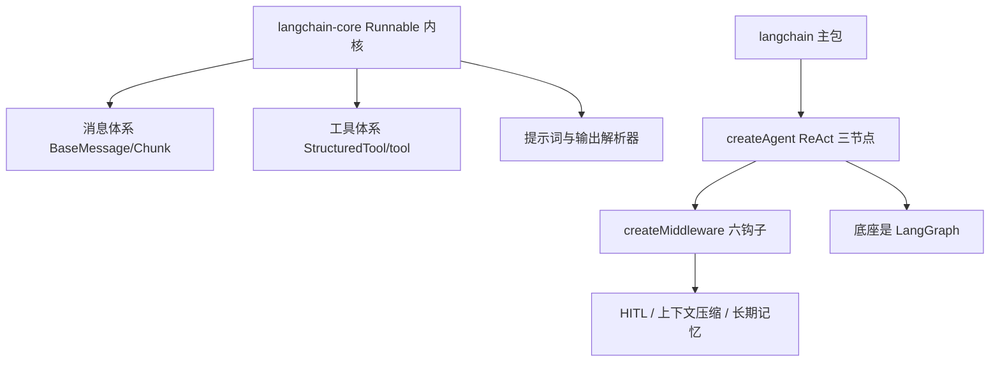

:::note 事实基线
本篇是「LangChain.js 内核机制」带解答题库，共 **86 题**，事实来源为 `content/docs/langchain.md`，对照本地仓库 `$HOME/Downloads/langchainjs` @ `fb617992` 核验。LangChain.js 1.x 把抽象收敛到一套可组合的 Runnable 接口，主包引入基于 LangGraph 的 agent 运行时与中间件体系。本篇与 [LangGraph.js 内核机制题库](/interview/qa/langgraph-internals) 互补——LangChain 负责集成与组件，LangGraph 负责拓扑与持久化。
:::

本篇是「LangChain.js 内核机制」题库。LangChain 的面试价值在于：**它是「模型/工具/提示词的可组合组件库 + 开箱 agent 运行时」的工业级实现**，理解 Runnable 内核、消息体系、createAgent 三节点模型、中间件体系，就理解了「Agent 框架的组件层」。本篇的组织顺序是：**先讲 monorepo 与 Runnable 内核 → 再讲消息体系与工具 → 再讲 createAgent 与中间件 → 再讲 HITL 与上下文压缩 → 再讲 Context/State 与长期记忆 → 最后讲工程设施与选型**。

**主线一览**



## 一、定位与 monorepo

### Q1. LangChain.js 与 LangGraph.js 的分工一句话是什么？

**LangChain 提供模型、工具与可组合组件，LangGraph 提供把这些组件组织成有状态、可暂停、可回放图的执行运行时**。需要「组件库加开箱 agent」时用 LangChain.js；需要「可控编排引擎」时用 LangGraph.js；两者可以组合——LangChain 负责集成与组件，LangGraph 负责拓扑与持久化，这也正是官方推荐的协作方式。

### Q2. 生态里四个项目的层次与边界？

| 项目         | 层次       | 职责                                                 |
| ------------ | ---------- | ---------------------------------------------------- |
| LangChain.js | 主框架     | 模型与工具的集成、可组合的运行抽象、agent 构建块     |
| LangGraph.js | 低层编排   | 有状态图、持久化、可控工作流、human-in-the-loop      |
| Deep Agents  | 高层封装   | 规划、子 agent、文件系统等成套能力，构建在前两者之上 |
| LangSmith    | 开发者平台 | 调试、评测与可观测性                                 |

**框架本身不负责编排拓扑**：它提供模型、工具、提示词、输出解析与回调这些组件，以及一个内建的 ReAct 风格 agent；需要更复杂的状态机、断点恢复或多 agent 拓扑时，交给 LangGraph。

### Q3. monorepo 包布局与 core 的依赖面？

仓库用 pnpm workspace + Turborepo 管理：`libs/langchain-core`（核心抽象，所有包的地基）、`libs/langchain`（主包，createAgent 与中间件所在）、`libs/langchain-classic`（旧式 chains、agents、memory）、`libs/langchain-textsplitters`、`libs/langchain-mcp-adapters`、`libs/providers`（一方集成包）。**主包只保留「agent 时代」的构建块；旧式 chains、旧式 agents、memory、retrievers 等抽象集中在 `@langchain/classic`**。

**core 的依赖面极窄，只有七个**：`@cfworker/json-schema`（浏览器可用的 JSON Schema 校验）、`@standard-schema/spec`、`js-tiktoken`（token 计数）、`langsmith`、`mustache`、`p-queue` 与 `zod`（`^3.25.76 || ^4` 双版本）。

**采分点**：能说出「**core 依赖只有七个，极窄**」+「**旧式抽象移到 @langchain/classic，主包只留 agent 时代构建块**」——这体现 1.x 的「收敛」设计。

## 二、Runnable 内核

### Q4. Runnable 核心抽象解决什么问题？

`Runnable` 统一了 prompt、模型、解析器、工具、检索器的调用接口——**`invoke` / `stream` / `batch` 三套入口加 `pipe()` 组合**。任何组件实现这一个接口，就能任意串联成管道（LCEL）。价值：**调用协议统一后，组合、重试、回退、回调、流式都变成可复用的装饰能力**，而不是每个组件各写一套。

### Q5. LCEL 管道里 pipe / batch / stream 的语义？

- **`pipe()`** 返回 `RunnableSequence`（前一步输出作为后一步输入）。
- **`batch()`** 支持并发度控制（`maxConcurrency`）与失败继续（`returnExceptions`）。
- **`stream()`** 产出增量块，让管道支持「模型逐 token 流 + 解析器增量解析」。

**采分点**：能说出「**LCEL 把同步批处理、单条调用、流式收敛到同一组件模型上，流式是一等公民而不是附加 API**」。

### Q6. RunnableLambda / Parallel / Branch / Passthrough 各用在什么场景？

| 类                    | 用途                                                  |
| --------------------- | ----------------------------------------------------- |
| `RunnableLambda`      | 把任意函数包成 Runnable（胶水逻辑、后处理）           |
| `RunnableParallel`    | 多分支并行执行，输出合并成对象（如同时跑改写 + 检索） |
| `RunnableBranch`      | 条件路由：`(condition, runnable)` 列表 + default      |
| `RunnablePassthrough` | 透传输入，常配合 `.assign()` 增量加字段               |

### Q7. withRetry 与 withFallbacks 的区别和组合方式？

`withRetry({ stopAfterAttempt, ... })` 对**同一 runnable** 重试（瞬时错误：429 / 超时）；`withFallbacks([...])` 换**备选 runnable**（模型降级：主模型挂了切备用模型/小模型/缓存答案）。**组合顺序：先 retry 穷尽再 fallback**。**失败要分级**——可重试错误与不可恢复错误走不同路径，fallback 链末端要有确定性兜底。

### Q8. callbacks 体系承担什么职责？

回调是贯穿 invoke/stream 生命周期的观察者钩子（`handleLLMStart` / `handleChainStart` / `handleToolStart` 等），tracer 就是回调的一种实现。回调处理器基类 `BaseCallbackHandler` 定义了一组事件方法与行为开关（`ignoreLLM`、`ignoreChain`、`ignoreAgent` 等）。

## 三、消息体系

### Q9. BaseMessage 与子类有哪些？

消息体系的基类 `BaseMessage`，内容是 `string | ContentBlock 数组`。子类按角色划分：

| 类              | 说明                                                            |
| --------------- | --------------------------------------------------------------- |
| HumanMessage    | 用户消息                                                        |
| AIMessage       | 模型消息，携带 tool_calls、invalid_tool_calls 与 usage_metadata |
| SystemMessage   | 系统提示                                                        |
| ToolMessage     | 工具结果                                                        |
| ChatMessage     | 任意自定义 role                                                 |
| FunctionMessage | function calling 结果消息                                       |

### Q10. Chunk 的 concat 与延迟折叠解决什么问题？

每个消息类都有对应的 Chunk 变体，继承 `BaseMessageChunk`。**Chunk 的唯一抽象方法是 `concat`，用于流式累加**：合并内容、`additional_kwargs` 与 `response_metadata`。这是流式输出能被拼回完整消息的机制。

**`AIMessageChunk` 有一个针对流式聚合性能的关键细节**：当构造输入带 `tool_call_chunks` 时，构造器**不再立即折叠**，而是为 `tool_calls` / `invalid_tool_calls` 定义 own-property getter，**首次读取时才执行折叠**。**此前每个 chunk 的 concat 都会重折叠全部累积 chunks，聚合是 O(n²) 的；延迟折叠把它降为增量**。相应地，concat 在任一侧存在 tool_call_chunks 时以合并 chunks 为准，不再重复合并 tool_calls，避免双重折叠。

**采分点**：能说出「**tool_calls 延迟折叠把流式聚合从 O(n²) 降到增量**」——这是流式消息性能的关键优化，很多人不知道。

### Q11. 为什么 BaseMessage 覆写 Symbol.hasInstance？

`BaseMessage` 与各子类都覆写了 `Symbol.hasInstance`，**沿原型链做结构化判定**（例如 `HumanMessage.isInstance` 额外检查 `type === "human"`）而不是严格的类同一性。原因很直接：**provider 包与 core 包可能各自持有一份类定义，跨包 `instanceof` 必须仍然可靠**。跨包判断统一使用各类的静态 `isInstance`。

**采分点**：能说出「**跨包 instanceof 不可靠（可能两份类定义），所以用 Symbol.hasInstance 结构化判定**」——这是 monorepo 多包场景的类型同一性问题。

### Q12. 内容块体系与 provider 翻译器是什么？

消息内容支持结构化块（text、image_url、tool_call、reasoning 等），由类型化的消息结构（`MessageStructure`）承载。两个机制：

- **v1 内容标记**：当构造消息时传入 `contentBlocks`（而非 `content`），构造器以这些块作为内容，并在 `response_metadata` 上标记 `output_version: "v1"`。`AIMessage` 的 getter 还会把 `tool_calls` 中尚未出现在内容块里的条目以 `tool_call` 块补齐，实现双向同步。
- **provider 内容翻译**：`src/messages/block_translators/` 下为 openai、anthropic、google、bedrock_converse、groq、deepseek、xai、ollama、openrouter 等 provider 各有一个翻译器。当 `response_metadata.model_provider` 命中时，`contentBlocks` getter 用对应翻译器把厂商原生格式转成标准块。

**这套机制是 1.x 支持多模态与推理模型输出的基础**。

## 四、工具体系

### Q13. StructuredTool 的两个设计点是什么？

工具基类 `StructuredTool` 要求实现名称、描述、schema 与 `_call`。两个设计点：

- **`_call` 可以返回 Promise 或异步生成器**；后者用于工具执行过程中发出中间事件，每个 yield 经 `runManager.handleToolEvent` 转成工具事件回调。
- **`returnDirect` 为 true 时，工具返回后 agent 应停止循环**，而不是把结果再喂回模型。

输入校验兼容 zod v3/v4 与 JSON Schema 两种形态：zod schema 走 `interopParseAsync`，其余走 `@cfworker/json-schema` 的 `validate`；校验失败抛出 `ToolInputParsingException` 并附带原始输入。

### Q14. tool() 工厂的分派逻辑是什么？

面向用户的推荐入口是 `tool()` 工厂，它有 12 个重载，覆盖 zod v3/v4 的字符串与对象 schema、JSON Schema，以及带运行时上下文的变体。**分派逻辑很直白：schema 缺省或退化为纯字符串时生成 DynamicTool，否则生成 DynamicStructuredTool**。两条路径都会把用户函数包进异步上下文配置，DynamicStructuredTool 路径还会注册中断信号监听。

core 保留的环境配置子集（`pickRunnableConfigKeys`）除 `configurable`、`recursionLimit`、`callbacks`、`tags`、`metadata`、`maxConcurrency`、`timeout`、`signal` 外还包含 `store` 与 `context`，**使工具内部调用的 LangGraph 助手（`getConfig()`、`getStore()` 等）依然能取到运行时字段**。

### Q15. ToolRuntime 自动注入什么？为什么让工具 schema 保持纯净？

`ToolRuntime` 类型交叉了 `RunnableConfig` 并附加：`state`（当前图状态，由 stateSchema 推断）、`toolCallId`、`toolCall`（可选）、`config`、`context`（运行时上下文，由 contextSchema 推断）、`store`（BaseStore，可为 null）与 `writer`（流式输出写入器，可为 null）。**当工具函数声明名为 `runtime` 的参数时由执行系统自动注入**，把「工具需要知道的运行时信息」从参数 schema 里剥离出来，**让工具的输入 schema 保持纯净**。

```ts
const greet = tool(
  async ({ name }, runtime) => {
    const userId = runtime.context?.userId;
    await runtime.store?.mset([["key", "value"]]);
    runtime.writer?.("Processing...");
    return `Hello, ${name}`;
  },
  {
    name: "greet",
    description: "Greet the user",
    schema: z.object({ name: z.string() }),
  },
);
```

**采分点**：能说出「**runtime 参数自动注入，把运行时信息从工具输入 schema 剥离**」——这让工具的 schema 只描述业务输入，运行时上下文（state/store/context/writer）走注入。

### Q16. ClientTool 与 ServerTool 的区别？

createAgent 侧把工具分为两类：**`ClientTool`**（StructuredToolInterface、DynamicTool 或 RunnableToolLike，即**可执行工具**，在客户端执行）与 **`ServerTool`**（**声明式的普通对象，工具由 provider 侧执行**，如 OpenAI 的 web_search）。

## 五、createAgent 与 ReAct 三节点模型

### Q17. createAgent 的 ReAct 三节点模型是什么？

`createAgent` 有 14 个重载，覆盖结构化输出格式的各种组合，实现体只有一句 `return new ReactAgent(params)`。ReactAgent 的 ReAct 三节点模型：

```text
model_request ──▶ 模型调用
tools         ──▶ 工具调用（每个工具调用可拆分为独立任务）
end           ──▶ 结束
```

这三者是图中仅有的可从其他节点跳转到的目标（用户侧 `JumpToTarget` 为 `"model" | "tools" | "end"`，经 `parseJumpToTarget` 映射为图节点名，其中 `"model"` 对应 `model_request`）。**前后还有四个钩子节点：beforeAgent、beforeModel、afterModel、afterAgent，它们就是中间件的挂载点**；图的边按「beforeAgent → beforeModel → model_request → afterModel → tools → …」连接，入口节点与尾节点按各钩子是否存在动态确定。

### Q18. createAgent 的运行时底座为什么是 LangGraph？

**ReactAgent 的运行时底座是 LangGraph**：从 LangGraph 引入 StateGraph、START、END、Send、Command 与编译图；从 checkpoint 包引入检查点保存器与 Store 基类。状态原语（Annotation、MessagesValue 等）也来自 LangGraph。图的节点在 `agents/nodes/` 下：AgentNode（模型请求）、ToolNode、BeforeAgentNode、BeforeModelNode、AfterModelNode、AfterAgentNode。

**状态模式上**：用户 stateSchema 与各中间件 stateSchema 会合并；`jumpTo` 字段用非追踪值承载内部跳转控制（执行后由节点重置，不向外传播）；下划线开头的字段是私有状态，留在图状态中但不暴露为输入输出通道；zod 的 reducer 元数据会被包成带 reducer 的通道；消息一律用 MessagesValue。

**采分点**：能说出「**createAgent 是 LangGraph 的封装——三节点 + 四个中间件钩子节点，底座是 StateGraph**」——这解释了「需要高度定制状态机时直接用 LangGraph 更贴合，主包的 agent 只是它的封装」。

### Q19. createAgent 的关键参数有哪些？

| 参数                        | 说明                                                     |
| --------------------------- | -------------------------------------------------------- |
| model                       | 字符串（走 initChatModel）或模型实例                     |
| tools                       | 工具数组（ClientTool 与 ServerTool 混排）                |
| systemPrompt                | 字符串或 SystemMessage                                   |
| stateSchema / contextSchema | 会话状态 schema（持久化）与只读上下文 schema（不持久化） |
| checkpointer                | 检查点保存器，或布尔开关                                 |
| store                       | 长期存储                                                 |
| responseFormat              | 结构化输出格式                                           |
| middleware                  | 中间件数组                                               |
| name / streamTransformers   | 代理名与流转换器工厂数组                                 |

流式 API 提供 v1/v2/v3 三个版本的重载，v3 返回 AgentRunStream 并支持调用点传入流转换器；还提供渲染图结构的 Mermaid 字符串与 PNG 方法。

### Q20. initChatModel 与 ConfigurableModel 是什么？

`initChatModel` 是统一模型工厂：传字符串（如 `"anthropic:claude-..."`）就能创建对应 provider 的模型实例，屏蔽各 provider SDK 的差异。**ConfigurableModel** 支持运行时通过 configurable 切换模型（如 A/B 测试不同模型）。这让「切换 provider 不改调用代码」成为可能。

## 六、createMiddleware 与内置中间件

### Q21. createMiddleware 的六个钩子是什么？

`createMiddleware` 是工厂函数，接受名称、状态 schema（跨调用持久化）、上下文 schema（只读且不持久化）、附加工具、流转换器，以及**六个钩子——两个包装钩子加四个生命周期钩子**：

- **`wrapModelCall`**：包装模型调用，可改请求、重试或返回 Command 控制流向。
- **`wrapToolCall`**：包装工具执行，用途包括改参数、错误处理与重试、结果后处理、缓存、日志、鉴权，以及返回 Command 做高级控制。
- **`beforeAgent` / `afterAgent`**：agent 调用开始与结束时各跑一次，可改状态；对应图里的代理前与代理后钩子节点。
- **`beforeModel` / `afterModel`**：每次模型调用前后运行；beforeModel 在 wrapModelCall 之前执行，afterModel 在模型调用之后、工具调用之前执行，二者都返回状态更新。

### Q22. 包装链怎么折叠？每层的状态解析与运行时对象有什么语义？

**包装链在 AgentNode 里从后向前折叠，数组里第一个中间件位于最外层**。每层的语义细节：

- **状态解析彼此独立**：每个包装层收到请求时，用自己的 `stateSchema` 对节点原始状态做 `interopParse`，上下文用 `contextSchema` 解析；**解析的对象是节点状态而非内层中间件改过的请求副本**，因此每个中间件看到的都是按自身 schema 稳定的状态视图。
- **运行时对象冻结**：每层拿到一个 `Object.freeze` 的 Runtime 投影，字段为 context、store、configurable、writer、interrupt、signal。
- **工具修改校验**：在 wrapModelCall 里新增客户端工具必须有某个中间件提供 wrapToolCall 来执行它，否则抛错；替换已注册工具（同名不同实例）恒被拒绝，以保住 ToolNode 的执行身份。
- **错误归属**：包装层内的异常统一经 `MiddlewareError.wrap` 打上当前中间件名，便于定位是哪一层失败。

**采分点**：能说出「**包装链从后向前折叠，第一个中间件在最外层**」+「**每层用自己的 schema 解析节点原始状态，看到的是稳定视图**」——这是中间件隔离性的关键。

### Q23. 内置中间件清单有哪些？

| 中间件                                        | 职责                                                                              |
| --------------------------------------------- | --------------------------------------------------------------------------------- |
| hitl                                          | 人工介入中断，支持 batched 与 per_call 两种模式                                   |
| summarization                                 | 上下文摘要压缩                                                                    |
| dynamicSystemPrompt                           | 动态系统提示                                                                      |
| pii / piiRedaction                            | PII 检测与脱敏，内建 email、credit_card（Luhn 校验）、ip、mac_address、url 检测器 |
| contextEditing                                | 上下文编辑，含清除工具调用结果的编辑                                              |
| toolCallLimit / modelCallLimit                | 工具调用与模型调用次数上限                                                        |
| todoList                                      | 待办清单工具与系统提示词                                                          |
| modelFallback / modelRetry                    | 模型降级与重试                                                                    |
| toolRetry / toolError                         | 工具重试与错误处理                                                                |
| toolEmulator                                  | 工具模拟执行                                                                      |
| providerToolSearch                            | provider 侧工具搜索                                                               |
| openAIModeration                              | OpenAI 内容审核                                                                   |
| anthropicPromptCaching / bedrockPromptCaching | 提示词缓存                                                                        |

provider 专属中间件集中在 `agents/middleware/provider/` 下的 openai、anthropic、aws 三个子目录。**toolRetry 在重试分类之前会把 LangGraph 控制流异常（isGraphBubbleUp，含人机中断）原样重新抛出**，保证 MCP elicitation 这类工具中断不会被当成普通工具错误吞掉。**这套中间件把「生产环境常见横切关注点」从用户代码里剥离出来，用户只需按需组合**。

**采分点**：能说出「**toolRetry 要先重抛控制流异常（含人机中断），否则 MCP elicitation 会被当成普通工具错误吞掉**」——这是中间件与中断交互的细节。

## 七、HITL 与上下文压缩

### Q24. HITL 的 batched 与 per_call 两种中断模式是什么？

`humanInTheLoopMiddleware({ interruptOn, interruptMode })` 的 `interruptMode` 取 `"batched"`（默认）或 `"per_call"`：

- **batched**：挂在 `afterModel` 钩子，**一个模型回合的所有待审工具调用合并成一次中断**，中断值是 `HITLRequest`（actionRequests 加每工具的 reviewConfigs），以 `{ decisions: [...] }` 按位应答。任一 reject（或全员 respond 且无剩余待执行调用）时经 jumpTo 跳回模型节点。
- **per_call**：钩子改挂 `wrapToolCall`，**每个待审调用各自抛一个中断**，中断值是 `ToolApprovalRequest`，并携带 zod v4 的 responseSchema——按该工具允许的决策类型生成 discriminatedUnion。

两种模式的决策类型都是 **approve / edit / reject / respond**；`interruptOn: { tool: true }` 表示允许全部决策。

### Q25. per_call 模式的应答与校验语义？

per_call 模式的应答按中断 ID 组键：`new Command({ resume: { [interrupt.id]: decision } })`。**LangGraph 会先把每个应答按对应中断的 responseSchema 校验再保存**：非法应答抛出 ZodError 且不会被保存，同一个中断可以重新应答；**若一起发送的多个应答中有一个非法，其他应答对应的工具可能已经执行，重新应答会导致重复执行**，因此应先按 responseSchema 校验再一起发送，或逐个发送。

per_call 的 edit 语义更严：`edited_action.name` 在 schema 层钉死为原工具，`args` 按工具的 zod v4 对象 schema 校验；`editNotice` 默认会在被编辑调用的结果前追加一段提示文本，告诉模型执行的是审阅者改过的版本。**约束：per_call 模式要求 createAgent 的 version 为 "v2"（默认值），"v1" 下所有工具调用跑在同一个任务里、中断会共享 ID，因此构建期直接抛错**。

**采分点**：能说出「**多个应答一起发送时一个非法会导致其他工具重复执行，应先校验再发送**」+「**per_call 要求 v2，v1 会共享中断 ID**」——这是 HITL 落地的两个关键约束。

### Q26. summarization 与 contextEditing 的区别？

agent 长对话里消息历史只增不减，迟早撞上模型上下文上限。主包把「压缩」做成中间件，走两条路线：

- **summarization（有损摘要）**：把旧历史摘成一段文字，**返回显式状态更新，经消息 reducer 持久化进图状态**——管「历史里到底留什么」。产出 `{ ..., messages: [...保留消息, RemoveMessage(REMOVE_ALL_MESSAGES), 摘要, ...保留消息] }`。送摘要前先按 trimTokensToSummarize 裁剪，失败回退到最后 15 条；用 getBufferString 把消息压成紧凑文本。
- **contextEditing（结构化编辑）**：挂在 wrapModelCall 钩子，**就地修改 request.messages 后直接调用 handler，不返回任何状态更新，改动只作用于本次模型调用看到的输入**——管「这次让模型看什么」。默认策略 ClearToolUsesEdit 对齐 Anthropic 的 clear_tool_uses 行为（trigger `{tokens: 100000}`、keep `{messages: 3}`、placeholder `"[cleared]"`）。

**关键边界**：一个管「这次让模型看什么」（contextEditing，不改图状态），一个管「历史里到底留什么」（summarization，持久化进图状态）。

**取舍与组合**：工具结果占大头、且后续很少回看时优先 contextEditing——无损于对话结构、几乎零成本；需要真正缩短历史、接受信息损失时用 summarization。两者可同时挂在一个 agent 上。

**采分点**：能说出「**contextEditing 只改本次请求（不持久化），summarization 改图状态（持久化）——一个管这次看什么，一个管历史留什么**」——这是两种压缩路线的本质区别。

## 八、Context/State 与长期记忆

### Q27. Context 与 State 的边界是什么？

官方示例的注释把这对概念定义得很清楚：

```text
Context: 静态运行时参数（用户 ID、数据库连接、配置）
  - 每个会话或请求设置一次
  - 会话期间不变
  - 用于查用户信息、配置行为
State: 动态会话数据（消息、记忆、会话变量）
  - 交互过程中被修改
  - 随会话持久化并演化
  - 由 agent 框架管理
```

对应 createAgent 的 `contextSchema`（只读、不持久化）与 `stateSchema`（持久化）。

**采分点**：能说出「**Context 是静态运行时参数（设置一次、会话期间不变），State 是动态会话数据（交互中修改、随会话持久化）**」——这是 createAgent 两个 schema 的语义边界。

### Q28. createAgent 的长期记忆（store）怎么工作？

createAgent 支持跨会话的长期记忆，载体是 **store 参数**，与只记录单次对话的短期消息历史分工明确。createAgent 的 store 类型是 `@langchain/langgraph-checkpoint` 的 **BaseStore**（与 checkpointer 的 BaseCheckpointSaver 同包）。ReactAgent 在编译 StateGraph 时把它原样传入 `compile({ checkpointer, store, ... })`。

**谁拿得到 store**：运行期有一个 Runtime 对象（LangGraph Runtime 的只读投影），字段包括 context、store、configurable、writer、interrupt、signal 等。中间件钩子都能读 runtime.store；工具侧由 ToolRuntime 注入 runtime.store。

**工具内读写**：典型路径是工具按命名空间经 runtime.store 存取：get(namespace, key)、put(namespace, key, value)、search(namespacePrefix, options)。命名空间常用 userId 这类可配置键区分租户。

**与短期记忆的分工**：**checkpointer 存「线程内」的消息历史（同一 thread_id 的多轮对话），store 存「跨线程/跨会话」的长期事实**。

### Q29. 程序性记忆与语义记忆的区别？

官方示例区分两类长期记忆：

- **程序性记忆**（固定偏好/指令）：用 store.get 确定性取出后经 dynamicSystemPrompt 注入系统提示，**始终生效**——适合用户偏好、行为约定。
- **语义记忆**（按相似度检索）：交给工具按需 search，**问到才查**——适合历史事实与过往交互。

**采分点**：能说出「**程序性记忆确定性取出注入系统提示（始终生效），语义记忆按相似度检索（问到才查）**」——这是长期记忆的两种访问模式。

## 九、classic、mcp-adapters 与工程设施

### Q30. langchain-classic 与 mcp-adapters 是什么？

- **`@langchain/classic`**：旧式 chains 与 agents（LCEL 之前的抽象、memory、retrievers）。**新代码应使用主包的 createAgent**；维护依赖旧式 chains 的代码才用 classic。
- **`@langchain/langchain-mcp-adapters`**：MCP 适配器，把 MCP 服务器的工具转成 LangChain 工具，**让现代与旧版 MCP 服务器能在同一进程内混用**。

### Q31. 构建测试发布设施有哪些亮点？

- **构建**：esbuild 编译 + 多个自定义插件（lcSecretsPlugin 扫描密钥、importMapPlugin 生成导入映射、cjsCompatPlugin 双格式兼容）。
- **测试矩阵**：单测走 Turbo + vitest；**导出兼容测试**用 Docker 验证 ESM/CommonJS/tsc/esbuild/Vite/Vercel/Cloudflare/Bun 等形态下的包导出；**zod 双版本兼容测试**（zod-v3、zod-v4、zod-mismatch 三种变体）；聊天模型标准测试（standard-tests）。
- **发布**：npm 可信发布通道（基于 OIDC），单一入口 workflow 分发到 publish.yml（Changesets）或 dev-release.yml（snapshot 版本）。
- **编码规范**：禁止 process.env（测试除外）、禁止显式 any、导入必须带文件扩展名（ESM）、zod 双版本以 `zod/v3` 与 `zod/v4` 子路径导入。

**采分点**：能说出「**导出兼容测试用 Docker 验证多种打包形态，zod 双版本兼容测试**」——这是「库的工程质量」的体现，比功能更能反映成熟度。

### Q32. LangChain.js 适合与不适合的场景？

**适合**：需要在同一套抽象下接入多家模型与工具，且希望切换 provider 不改调用代码；需要即时可用的 agent 运行时（ReAct 循环、结构化输出、人工介入、上下文压缩），又不想从零搭图；需要在流式、回调与追踪上与生态（LangSmith 等）对接；需要 MCP 工具接入。

**需要谨慎或不太适合**：需要高度定制的多步状态机、断点恢复或人机协作拓扑（直接用 LangGraph 更贴合，主包的 agent 只是它的封装）；只需要调用模型 API（直接用厂商 SDK 的体积与依赖更小，框架的抽象成本是净负担）；维护依赖旧式 chains 的代码（用 @langchain/classic）；对类型推断极其敏感（中间件与状态合并大量使用条件类型与 const 泛型，复杂组合下类型错误信息可能不易读）。

### Q33-Q86. 快速自检与深挖补充

**Q33. 一句话解释 Runnable 的三套入口。** invoke（单条）/ stream（流式）/ batch（批处理）+ pipe 组合——统一调用协议。

**Q34. 一句话解释 LCEL 的流式一等公民。** stream 产出增量块，管道支持模型逐 token 流 + 解析器增量解析——不是附加 API。

**Q35. 一句话解释 batch 的 returnExceptions。** 失败继续（返回异常而非抛出）——批量处理时单条失败不中断整批。

**Q36. 一句话解释 withRetry 与 withFallbacks 的组合。** 先 retry 穷尽（同一 runnable）再 fallback（换备选）——失败分级，末端要确定性兜底。

**Q37. 一句话解释 callbacks 与 tracer 的关系。** tracer 是回调的一种实现——回调是贯穿 invoke/stream 的观察者钩子。

**Q38. 一句话解释 AIMessage 携带什么。** tool_calls、invalid_tool_calls、usage_metadata——模型消息的完整元数据。

**Q39. 一句话解释 Chunk concat 的作用。** 流式累加：合并内容、additional_kwargs、response_metadata——拼回完整消息。

**Q40. 一句话解释延迟折叠为什么降 O(n²)。** 立即折叠每次 concat 都重折叠全部累积 chunks（O(n²)），延迟折叠首次读取才折叠（增量）。

**Q41. 一句话解释 concat 为什么避免双重折叠。** 任一侧有 tool_call_chunks 时以合并 chunks 为准，不再重复合并 tool_calls。

**Q42. 一句话解释 Symbol.hasInstance 的结构化判定。** 沿原型链判定 + 检查 type 字段——跨包 instanceof 可靠（provider 包与 core 包可能两份类定义）。

**Q43. 一句话解释 v1 内容标记。** contentBlocks 构造时标记 output_version: "v1"，AIMessage getter 补齐 tool_calls 块——双向同步。

**Q44. 一句话解释 provider 翻译器的触发。** response_metadata.model_provider 命中时用对应翻译器把厂商原生格式转标准块。

**Q45. 一句话解释 \_call 返回异步生成器的用途。** 工具执行中发中间事件，每个 yield 转工具事件回调——流式工具。

**Q46. 一句话解释 returnDirect。** true 时工具返回后 agent 停止循环，不再喂回模型——直接返回工具结果。

**Q47. 一句话解释 tool() 的分派。** schema 缺省/纯字符串生成 DynamicTool，否则 DynamicStructuredTool——12 个重载覆盖 zod v3/v4/JSON Schema。

**Q48. 一句话解释 pickRunnableConfigKeys 为什么含 store/context。** 让工具内部调用的 LangGraph 助手（getStore 等）能取到运行时字段。

**Q49. 一句话解释 ToolRuntime 的 state 与 context。** state 由 stateSchema 推断（当前图状态），context 由 contextSchema 推断（运行时上下文）——自动注入。

**Q50. 一句话解释工具 schema 为什么保持纯净。** runtime 参数自动注入运行时信息，工具输入 schema 只描述业务输入。

**Q51. 一句话解释 ClientTool 与 ServerTool。** ClientTool 可执行（客户端执行），ServerTool 声明式（provider 侧执行，如 web_search）。

**Q52. 一句话解释 ReAct 三节点的 JumpToTarget。** model/tools/end 是仅有的可跳转目标，model 对应 model_request 节点。

**Q53. 一句话解释四个钩子节点。** beforeAgent/beforeModel/afterModel/afterAgent 是中间件的挂载点——边按 beforeAgent→beforeModel→model_request→afterModel→tools 连接。

**Q54. 一句话解释 jumpTo 为什么用非追踪值。** 承载内部跳转控制，执行后由节点重置，不向外传播——私有控制流。

**Q55. 一句话解释下划线开头字段。** 私有状态，留在图状态中但不暴露为输入输出通道。

**Q56. 一句话解释 createAgent 14 个重载。** 覆盖结构化输出格式的各种组合，实现体只有一句 return new ReactAgent(params)。

**Q57. 一句话解释流式 v3 的 AgentRunStream。** v3 返回 AgentRunStream，支持调用点传入流转换器——最新的流式 API。

**Q58. 一句话解释 initChatModel 的价值。** 传字符串创建对应 provider 模型实例，屏蔽 SDK 差异——切换 provider 不改调用代码。

**Q59. 一句话解释 ConfigurableModel。** 运行时通过 configurable 切换模型——A/B 测试不同模型。

**Q60. 一句话解释 createMiddleware 的状态 schema 与上下文 schema。** 状态 schema 跨调用持久化，上下文 schema 只读且不持久化——对应 stateSchema/contextSchema。

**Q61. 一句话解释 wrapModelCall 能做什么。** 改请求、重试、返回 Command 控制流向——包装模型调用。

**Q62. 一句话解释 wrapToolCall 的用途。** 改参数、错误处理与重试、结果后处理、缓存、日志、鉴权、返回 Command——包装工具执行。

**Q63. 一句话解释 beforeModel 与 afterModel 的位置。** beforeModel 在 wrapModelCall 之前，afterModel 在模型调用之后、工具调用之前——都返回状态更新。

**Q64. 一句话解释包装链从后向前折叠。** 数组里第一个中间件在最外层——AgentNode 里从后向前折叠。

**Q65. 一句话解释每层状态解析为什么独立。** 每层用自己的 stateSchema 对节点原始状态 interopParse，看到的是稳定视图——不是内层改过的副本。

**Q66. 一句话解释运行时对象为什么冻结。** Object.freeze 的 Runtime 投影——防止中间件修改运行时对象。

**Q67. 一句话解释新增客户端工具为什么要配 wrapToolCall。** wrapModelCall 里新增的工具必须有中间件提供 wrapToolCall 执行它，否则抛错。

**Q68. 一句话解释替换已注册工具为什么被拒绝。** 同名不同实例恒被拒绝，保住 ToolNode 的执行身份。

**Q69. 一句话解释 MiddlewareError.wrap。** 包装层异常统一打上当前中间件名——便于定位哪层失败。

**Q70. 一句话解释 pii 中间件的检测器。** 内建 email、credit_card（Luhn 校验）、ip、mac_address、url 检测器——PII 检测与脱敏。

**Q71. 一句话解释 HITL 的四种决策。** approve / edit / reject / respond——interruptOn: { tool: true } 允许全部。

**Q72. 一句话解释 batched 挂哪个钩子。** afterModel——一个回合的所有待审工具调用合并成一次中断。

**Q73. 一句话解释 per_call 挂哪个钩子。** wrapToolCall——每个待审调用各自抛一个中断。

**Q74. 一句话解释 per_call 的 responseSchema。** 按工具允许的决策类型生成 discriminatedUnion，只允许一种决策时直接给该决策对象。

**Q75. 一句话解释 isToolApprovalInterrupt。** 从 result.**interrupt** 中筛出并收窄工具审批中断的类型。

**Q76. 一句话解释 edit 的 editNotice。** 默认在被编辑调用的结果前追加提示，告诉模型执行的是审阅者改过的版本——传 null 关闭。

**Q77. 一句话解释 respond 与 reject 的产物。** respond 不执行工具，把审阅者 message 作为成功结果；reject 产出 error 状态的 ToolMessage。

**Q78. 一句话解释 per_call 为什么要求 v2。** v1 下所有工具调用跑在同一任务里、中断共享 ID——构建期直接抛错。

**Q79. 一句话解释 when 谓词恢复时重跑。** 恢复时 when 重跑，若返回 false 工具直接执行、审阅应答被忽略。

**Q80. 一句话解释 HITL 为什么排在重试/错误处理之前。** 使它能包住这些中间件——HITL 在外层才能拦截重试中的工具调用。

**Q81. 一句话解释 summarization 的回退。** trimTokensToSummarize 裁剪失败回退到最后 15 条（DEFAULT_FALLBACK_MESSAGE_COUNT）。

**Q82. 一句话解释 contextEditing 的 ClearToolUsesEdit。** 对齐 Anthropic clear_tool_uses：trigger tokens 100000、keep 最近 3 个工具结果、placeholder "[cleared]"。

**Q83. 一句话解释 contextEditing 为什么先清孤儿 ToolMessage。** 无论是否触发，都先清掉没有对应 AIMessage 的孤儿 ToolMessage——保持消息结构完整。

**Q84. 一句话解释 tokenCountMethod 的 approx 与 model。** approx 近似计数（默认），model 调模型的 getNumTokensFromMessages——精度与成本的取舍。

**Q85. 一句话解释 store 的命名空间租户隔离。** 命名空间常用 userId 这类可配置键（config.configurable）区分租户——get/put/search 按命名空间。

**Q86. 一句话总结 LangChain 与 LangGraph 的协作。** LangChain 负责集成与组件（Runnable/消息/工具/createAgent/中间件），LangGraph 负责拓扑与持久化（StateGraph/checkpointer/interrupt）——createAgent 是 LangGraph 的封装，需要高度定制状态机时直接用 LangGraph。

---

**延伸阅读**

- [LangGraph.js 内核机制题库](/interview/qa/langgraph-internals)：createAgent 的运行时底座（Pregel 超步、checkpointer、interrupt）。
- [Agent 框架与架构对比题库](/interview/qa/agent-frameworks)：LangChain/LangGraph/CCB/Pi 的框架层对比。
- [Agent 执行循环与工具体系题库](/interview/qa/agent-loop-and-tools)：ReAct 循环、工具调用的通用机制。
- [Yukino Dev Agent 项目深挖题库](/interview/qa/yukino-dev-agent-project)：Vercel AI SDK 全栈应用（与 LangChain 不同的 Agent 运行时选型）。
- [工作文档 · LangChain.js](/docs/langchain)：本篇的事实来源。
