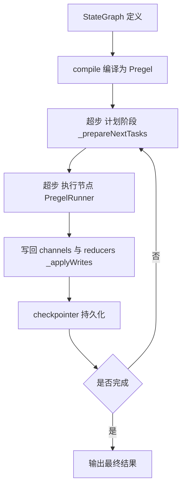

:::note 事实基线
本篇是「LangGraph.js 内核机制」带解答题库，共 **86 题**，事实来源为 `content/docs/langgraph.md`，对照本地仓库 `$HOME/Downloads/langgraphjs` @ `caa5c53a` 核验。LangGraph.js 是用 TypeScript 编写的**低层 agent 编排 runtime**，负责四件事：图执行（Pregel 超步循环）、检查点持久化（checkpointer）、流式输出（八种 stream mode 与协议事件流）、interrupt/resume 人机协同。与 `agent-frameworks` 篇的框架对比不同，本篇下钻到**内核实现层**。
:::

本篇是「LangGraph.js 内核机制」题库。LangGraph 的面试价值在于：**它是「有状态、可暂停、可回放的图执行运行时」的工业级实现**，理解它的 Pregel 超步模型、channel/reducer 状态语义、checkpointer 持久化、interrupt/resume，就理解了「Agent 编排运行时」的核心。本篇的组织顺序是：**先讲编译管线（StateGraph → Pregel）→ 再讲通道与 reducer → 再讲超步执行循环 → 再讲检查点与时间旅行 → 再讲 interrupt/resume → 再讲流式输出 → 最后讲 Functional API 与 Prebuilt**。

**主线一览**



## 一、编译管线：StateGraph → Pregel

### Q1. LangGraph 与 LangChain 的关系一句话是什么？

**LangChain 提供模型、工具与可组合组件，LangGraph 提供把这些组件组织成有状态、可暂停、可回放图的执行运行时**。LangGraph 仓库对自身方向的表述很直接：LangGraph 是 runtime，负责图执行、检查点持久化、流式输出、interrupt/resume 四件事；而「如何搭一个好用的 agent」属于上一层的关注点。

### Q2. 状态 schema 的两种写法是什么？

StateGraph 的状态 schema 有两种写法：① **Annotation**（`Annotation.Root({...})`，每个字段可指定 reducer）；② **Zod schema**（配合 `@standard-schema/spec` 互操作）。Annotation 是主流写法，因为它能精确控制每个字段的 reducer（合并语义）。

### Q3. addNode 的节点与执行策略有哪些？

`addNode(name, fn, options)` 注册节点，fn 是 `(state, config) => 部分状态 | Command`。执行策略选项：`retryPolicy`（重试）、`cachePolicy`（缓存）、`timeout`（超时）、`defer`（延迟到所有其他节点 finish 后执行，配合 `LastValueAfterFinish` 通道）。

### Q4. addEdge 与条件边的区别？

- **addEdge(a, b)**：静态边，a 完成后总是走 b。
- **addConditionalEdges(a, fn, mapping)**：条件边，a 完成后调 fn（纯函数，读状态返回下一个节点名或名字数组），按 mapping 路由。**扇出**（返回数组）让多个后继并行；**扇入**用 `NamedBarrierValue` 通道等待指定节点集合。

### Q5. 节点返回值的语义是什么？

节点返回**部分状态对象**（只含要更新的字段），引擎按各字段的 reducer 合并进通道；或返回 **`Command`**（同时更新状态 + 指定下一个节点，把「状态更新」与「路由」合一）。返回 `undefined`/空对象表示不更新状态。

### Q6. Command 与 Overwrite 是什么？

- **`Command({ update, goto, resume, graph })`**：节点返回 Command 可以同时更新状态（update）与指定跳转（goto），还能 resume 一个 interrupt。`graph: Command.PARENT` 让 Command 作用于父图（子图向父图发指令）。
- **`Overwrite` 哨兵**：写入 `Overwrite(value)` 时，`BinaryOperatorAggregate` 通道**整体替换**而不是用 reducer 聚合——用于「重置某个累计字段」。

### Q7. compile 做了什么？

`compile({ checkpointer, store, cache, interruptBefore, interruptAfter, durability })` 把 StateGraph 编译成 **Pregel** 实例：① 把节点转成 Pregel 的 task 规格；② 把边转成通道订阅关系；③ 为每个状态字段创建对应的 channel；④ 绑定 checkpointer/store/cache。编译后的 Pregel 是可执行的 Runnable（invoke/stream/batch）。

## 二、通道系统与 reducer 语义

### Q8. BaseChannel 契约定义了哪些生命周期方法？

`BaseChannel`（`src/channels/base.ts`）定义了状态单元格的完整生命周期：`fromCheckpoint`（从检查点值重建）、`update(values)`（消费一步内的全部写入，返回是否变化）、`get`/`checkpoint`（读当前值 / 产出可序列化快照，**空通道抛 `EmptyChannelError`**）、`consume`/`finish`（任务消费与超步收尾钩子）、`isAvailable`、`equals`。每个通道类必须提供 `lc_graph_name` 供序列化识别，实例带 `lg_is_channel` 标记。`createCheckpoint` 产出的检查点信封固定 `v: 4`，id 用单调递增的 uuid6。

### Q9. 九种内置通道的语义分别是什么？

| 通道                                                     | 语义                                                                                                   |
| -------------------------------------------------------- | ------------------------------------------------------------------------------------------------------ |
| `LastValue`                                              | 保存最近一次写入；**同一超步收到多个写入抛 `InvalidUpdateError`**（`INVALID_CONCURRENT_GRAPH_UPDATE`） |
| `LastValueAfterFinish`                                   | 同上，但只接受来源任务全部 finish 之后的值，服务于 `defer` 节点                                        |
| `BinaryOperatorAggregate`                                | 用二元 reducer 聚合所有写入；`Overwrite` 哨兵可整体替换                                                |
| `Topic`                                                  | 追加式写入；`accumulate: true` 时跨超步保留历史，false 时每步清空                                      |
| `EphemeralValue`                                         | 值只在写入后的下一个超步可见，之后自动消失，适合一次性信号                                             |
| `AnyValue`                                               | 一步内允许多个写入不报错，持续覆盖保留最后一个，假定并发写入等价                                       |
| `NamedBarrierValue` / `NamedBarrierValueAfterFinish`     | 等待指定节点集合的写入（或完成）才变为可用，**扇入边的底层**                                           |
| `DynamicBarrierValue` / `DynamicBarrierValueAfterFinish` | 同上，但期望的来源集合在运行期动态确定                                                                 |
| `UntrackedValueChannel`                                  | 内部使用的 LastValue 变体：**值不写入检查点，恢复时重置为初始值**，适合连接句柄一类瞬态状态            |

**采分点**：能说出「**LastValue 同一超步多写抛 InvalidUpdateError，AnyValue 允许多写保留最后一个**」——这是「并发写入冲突」的两种处理策略，选哪个取决于「并发写入是否等价」。

### Q10. messagesStateReducer 的语义要点是什么？

`messagesStateReducer`（`src/graph/messages_reducer.ts`）是消息状态的标准 reducer，也是 `MessagesAnnotation` 的默认聚合函数：

- 输入既可以是完整消息，也可以是**流式 chunk**（`AIMessageChunk` 等会被折算成对应消息），单个对象或数组皆可；
- **缺 id 的消息自动补 uuid4**，保证按 id upsert 的确定性；
- **已存在同 id 消息时做替换**（支持消息在后续步骤被改写），否则追加；
- `RemoveMessage` 按 id 删除；删除不存在的 id 会抛错；特殊常量 `REMOVE_ALL_MESSAGES`（值 `"__remove_all__"`）一次清空整个历史。

**采分点**：能说出「**按 id upsert（同 id 替换、新 id 追加）**」——这是消息状态能「被后续步骤改写」的关键，也是流式 chunk 能正确累加的基础。

### Q11. DeltaChannel 解决什么问题？

`DeltaChannel`（Beta）针对「**状态大、每步改动小**」的场景：检查点平时**只落增量写入**，每 `snapshotFrequency` 个超步（默认 100）落一次完整快照；恢复时从最近快照出发**回放增量**（ancestor-walk）。距上次快照超过 `DELTA_MAX_SUPERSTEPS_SINCE_SNAPSHOT`（默认 5000）个超步会**强制补一次快照**，防止回放链过长。

**采分点**：能说出「**平时落增量、定期落快照、恢复时回放**」——这是「大状态小改动」场景的检查点优化，与数据库的 WAL + checkpoint 是同一思想。

## 三、节点间状态与上下文传递

### Q12. 节点的两个参数是什么？Runtime 汇总了什么？

节点第一个参数是**通道投影出的状态对象**；第二个参数是 `LangGraphRunnableConfig`（`RunnableConfig & Partial<Runtime>`）。`Runtime` 汇总了运行期可取的一切：

| 字段           | 含义                                       |
| -------------- | ------------------------------------------ |
| `configurable` | thread_id、checkpoint 定位等配置键         |
| `context`      | compile 时声明 schema 的**只读**运行上下文 |
| `store`        | 跨线程长期记忆 Store                       |
| `writer`       | custom 流写入器                            |

### Q13. 写回管线与空值语义是什么？

节点返回的部分状态经**写回管线**合并进通道：每个字段按对应通道的 reducer 聚合。**空值语义**：返回 `undefined` 或空对象表示不更新；字段值为 `null` 是有效写入（会触发 reducer）。写回排序遵循确定性顺序（见 Q22）。

### Q14. 三种状态传递方式是什么？

① **通道状态**（state）：节点返回值经 reducer 合并，跨超步持久化；② **context**：compile 时声明的只读运行上下文，所有节点可读但不写；③ **store**：跨线程长期记忆（见 Q16）。三者的区别是「可写性」与「作用域」：state 可写、单线程；context 只读、单次运行；store 可写、跨线程。

### Q15. 子图与命名空间怎么工作？

子图（subgraph）是嵌套的 Pregel，父图把子图当一个节点。子图有自己的状态与检查点，通过**命名空间**（checkpoint namespace）与父图区分。子图流通过 `createDuplexStream` 多路复用进父图流，检查点信封无条件透传。`Command({ graph: Command.PARENT })` 让子图向父图发指令。

### Q16. Store 跨线程长期记忆是什么？

`Store`（`BaseStore`/`InMemoryStore`/`AsyncBatchedStore`）是**跨线程的长期记忆**：按 namespace + key 存取，支持向量检索（`PostgresStore` 带 pgvector）。与 checkpointer（单线程状态）不同，store 是跨会话共享的——用于「用户偏好」「学到的事实」这类长期记忆。`AsyncBatchedStore` 把一步内的多次读写合并成批。

### Q17. 上下文压缩在 LangGraph 里怎么做？

LangGraph 本身不内置压缩策略，但提供机制：节点可以读 state 里的消息、调摘要模型、用 `RemoveMessage`/`REMOVE_ALL_MESSAGES` 清空旧消息再写入摘要。压缩是**应用层在节点里实现的**，引擎提供状态读写原语。

## 四、Pregel 超步执行循环

### Q18. 什么是超步（superstep）？一次超步做什么？

Pregel 用 **BSP（Bulk Synchronous Parallel）超步模型**：一次超步分三阶段——① **计划**（`_prepareNextTasks`：根据通道版本差生成要执行的任务）；② **执行**（`PregelRunner` 并行跑本超步全部任务）；③ **写回**（`_applyWrites`：把任务写入按 reducer 合并进通道，生成新检查点）。超步之间是**同步屏障**——本超步所有任务完成、写入合并后，才进入下一超步。

**采分点**：能说出「**超步之间是同步屏障，本超步所有任务完成才进下一超步**」——这是 BSP 模型的核心，保证了「同一超步内节点并行、超步之间串行」的确定性。

### Q19. _runLoop 的主体逻辑是什么？

`_runLoop` 是超步循环的主体：反复调 `PregelLoop.tick()` 推进超步，直到 loop 状态变为完成（没有更多任务）或被中断（interrupt/drain/error）。每个 tick 内：准备任务 → 交给 runner 执行 → apply 写入 → 生成检查点 → 检查断点。

### Q20. PregelLoop.tick 的状态机关键路径是什么？

`PregelLoop`（`src/pregel/loop.ts`）的 `tick()` 每次推进一个超步，关键路径：

1. 状态必须为 `"pending"`；**首超步（`_first`）消费输入并落 `source: "input"` 的检查点**；
2. `_prepareNextTasks` 生成任务：**PULL 任务来自通道版本差**（某通道版本超前于节点的 `versions_seen`），**PUSH 任务来自 `__pregel_tasks` 通道里的 Send**；**`skipDoneTasks` 默认 `true`，resume 时已带完成写入的任务被跳过——这是断点续跑不重复执行的关键**；
3. 命中 `interruptBefore` 断点时抛 `GraphInterrupt`，本超步任务不执行；
4. 若所有任务都已带写入（缓存命中或恢复场景），直接 `_applyWrites` 进入下一超步；
5. 否则返回 true 交给 runner 执行；执行完的下一 tick 里 apply 写入、生成新检查点（`source: "loop"`），**且在发出 values 流事件之前先完成 `_putCheckpoint`**；
6. `durability: "sync"` 时同步等待检查点落盘；之后检查 `interruptAfter` 断点；
7. 断点检查之后轮到 drain 检查：若 `RunControl` 被请求排空，loop 进入 `"draining"` 状态，`_runLoop` 抛 `GraphDrained`；
8. DeltaChannel 收到 `Overwrite` 写入时强制在当步落快照。

**采分点**：能说出「**PULL 任务来自通道版本差，PUSH 任务来自 Send**」+「**skipDoneTasks 让 resume 不重复执行已完成任务**」——这是 Pregel 任务生成的两个来源与断点续跑的关键。

### Q21. 通道版本差怎么驱动 PULL 任务？

每个通道有 `channel_versions`（版本计数），每个节点有 `versions_seen`（已见过的通道版本）。**某通道版本超前于节点的 versions_seen，说明该节点依赖的输入变了，生成一个 PULL 任务**。这是「数据流驱动」的调度——节点不主动轮询，而是被通道版本差触发。

### Q22. _prepareNextTasks / _applyWrites 怎么保证确定性？

`_prepareNextTasks`/`_applyWrites`（`src/pregel/algo.ts`）的细节决定了确定性：

- **任务 id 用 uuid5 从检查点命名空间、节点名、路径等派生**，同一状态下重放得到同一批 id；
- **写入排序遵循 `(task_path, task_id, idx)` 序**，`_applyWrites` 按序列化后的 task path 排序，保证并行任务的写入以确定顺序进通道；
- 任务写入里的**保留键** `{NO_WRITES, PUSH, RESUME, INTERRUPT, RETURN, ERROR, ERROR_SOURCE_NODE}` 是引擎内部记账，apply 时被忽略（IGNORE 集合），不会污染用户通道；
- PUSH 写入转成新的 Send 塞回 `__pregel_tasks`；ERROR 写入记录失败；RESUME/INTERRUPT 服务于恢复机制；
- **节点缓存键由 `CachePolicy.keyFunc`（默认 `JSON.stringify`）产出再经 XXH3 哈希**，命中则整个节点执行被替换为缓存写入。

**采分点**：能说出「**任务 id 用 uuid5 派生（同状态重放同 id）+ 写入按 (task_path, task_id, idx) 排序**」——这是「并行执行但结果确定」的关键，也是时间旅行/重放能成立的基础。

### Q23. PregelRunner 的并发执行与错误处理有什么细节？

`PregelRunner.tick`（`src/pregel/runner.ts`）**并行跑本超步全部任务**，受 `maxConcurrency` 约束。每个任务的写入实时 push 到 `task.writes`；正常结束但没有产出的任务补一条 `[NO_WRITES, null]` 记账。

错误处理有一个容易忽略的细节：**任务抛错时通常 `exceptionSignalController.abort()` 取消同超步的兄弟任务，但 invalid resume 错误例外**——`if (!isInvalidResume(error))` 才 abort，因为**无效恢复只影响单个任务，不应连带取消其他并行分支**。错误会转成 ERROR 通道写入，交给 loop 决定重试或终止。

**采分点**：能说出「**invalid resume 不 abort 兄弟任务**」——这是「错误影响面要精确」的细节，无效恢复是单任务问题，不该连坐。

### Q24. RetryPolicy / TimeoutPolicy / CachePolicy 的默认值与语义？

- **RetryPolicy**（`src/pregel/retry.ts`）：`initialInterval` 500ms、`backoffFactor` 2、`maxInterval` 128000ms、`maxAttempts` 3、`jitter` true，重试时默认打 warning 日志。
- **TimeoutPolicy**：`runTimeout`（单次执行墙钟上限）与 `idleTimeout`（无进展上限），`refreshOn` 取 `"auto"` 或 `"heartbeat"`——后者要求任务主动调用 `config.heartbeat()` 刷新；超时抛 `NodeTimeoutError`，之后由 retryPolicy 决定是否重试。
- **CachePolicy**：`keyFunc` 默认 `JSON.stringify`，支持 `ttl`；compile 时传入 `cache`（BaseCache）才生效。

**采分点**：能说出「**idleTimeout 的 heartbeat 模式要求任务主动刷新**」——长任务（如 LLM 调用）用 heartbeat 防止被误判超时。

### Q25. durability 的三种取值与 invoke 折叠是什么？

检查点落盘时机由 `durability` 控制，取值 `"exit" | "async" | "sync"`，**默认 `"async"`**：`async` 在后台并发写，`sync` 每步等待写完再继续，`exit` 只在运行退出时写。

**`invoke` 不是独立实现，而是 `stream` 的折叠**：`streamMode` 缺省为 `"values"`，取最后一个 values 块作为返回值；**若运行以 interrupt 收场，中断载荷会随 `INTERRUPT` 标记合并进输出**，调用方无需 try/catch 就能拿到「停在哪、为什么停」。

**采分点**：能说出「**invoke 是 stream 的折叠，interrupt 载荷合并进输出**」——这解释了「为什么 invoke 遇到 interrupt 不抛异常而是返回中断信息」。

## 五、检查点与时间旅行

### Q26. Checkpoint 的数据结构是什么？

`Checkpoint`（`libs/checkpoint/src/base.ts`）固定 `v: 4`，字段为：`id`（uuid6，时间有序）、`channel_values`（各通道快照值）、`channel_versions`（版本计数，驱动 PULL 触发）、`versions_seen`（每个节点已见过的通道版本，与前者做差即得待执行任务）。

`CheckpointTuple` 把它与 `config`、`metadata`、`parentConfig`、**`pendingWrites`**（已完成但尚未合并进检查点的任务写入，**resume 时靠它跳过已完成任务**）打包。`CheckpointMetadata` 记录 `source`（`"input" | "loop" | "update" | "fork"`）、`step`、`parents` 映射。

**采分点**：能说出「**channel_versions 与 versions_seen 做差即得待执行任务**」+「**pendingWrites 让 resume 跳过已完成任务**」——这是 Pregel 调度与断点续跑的数据基础。

### Q27. BaseCheckpointSaver 契约与生产后端有哪些？

`BaseCheckpointSaver` 定义检查点的读写契约（put/get/list/putWrites）。生产后端：

| 包                                         | 关键事实                                                                                                      |
| ------------------------------------------ | ------------------------------------------------------------------------------------------------------------- |
| `@langchain/langgraph-checkpoint-sqlite`   | 静态工厂 `fromConnString`，连接启用 WAL                                                                       |
| `@langchain/langgraph-checkpoint-postgres` | **首次使用须显式 `setup()` 跑建表 migration**；同包提供 `PostgresStore`（pgvector）                           |
| `@langchain/langgraph-checkpoint-redis`    | `RedisSaver` 支持 TTL（分钟配置，内部换算秒）与 `refreshOnRead`；另有每线程只存最新状态的 `ShallowRedisSaver` |

`MemorySaver` 是内存实现（开发用）。序列化用 `JsonPlusSerializer`。

**采分点**：能说出「**Postgres checkpointer 首次须显式 setup() 跑 migration**」——这是生产落地的必备步骤，漏了会报表不存在。

### Q28. 线程、快照与时间旅行怎么工作？

**线程（thread）**：由 `thread_id` 标识，一个线程是一条会话的检查点序列。**快照（snapshot）**：`getState()` 返回当前检查点 + 下一步任务；`getStateHistory()` 返回历史检查点列表。**时间旅行**：用 `checkpoint_id` 定位历史检查点，从它 fork 出新分支（`updateState` 或带 checkpoint_id 的 invoke）——`source: "fork"` 标记分叉。

**采分点**：能说出「**时间旅行是从历史检查点 fork 新分支，不是回滚**」——原分支保留，新分支从历史点继续，这是「探索性对话」的基础（与 Pi 的 entry 树同源）。

## 六、interrupt / resume

### Q29. interrupt() 的控制流是什么？

`interrupt(value)` 在节点内调用时：① 抛 `GraphInterrupt`（携带 value 与 interrupt id）；② loop 捕获，把中断载荷写进检查点（`INTERRUPT` 标记）；③ 运行暂停，invoke/stream 返回中断信息；④ 用户用 `Command({ resume })` 恢复，引擎从检查点重放该节点，`interrupt()` 这次返回 resume 的值（而不是再抛）。

**采分点**：能说出「**恢复时从检查点重放该节点，interrupt() 返回 resume 值**」——这意味着**节点在 interrupt 前的代码会重新执行**，所以 interrupt 前的副作用要幂等（这是最容易踩的坑）。

### Q30. invalid resume 是什么？

**invalid resume**：恢复时提供的 resume 与暂停时的 interrupt 不匹配（如 interrupt id 对不上、resume 结构错误）。引擎抛 invalid resume 错误，**PregelRunner 不 abort 兄弟任务**（Q23），因为无效恢复只影响单个任务。

### Q31. 静态断点（interruptBefore/interruptAfter）与 interrupt() 的区别？

- **静态断点**：compile 时声明 `interruptBefore: ["node"]`/`interruptAfter: ["node"]`，在**指定节点前/后**无条件暂停——用于「人工审查某节点的输入/输出」。
- **interrupt()**：节点内**动态**调用，携带自定义 value，用于「需要用户提供输入才能继续」（human-in-the-loop）。

静态断点是「节点级、无条件」，interrupt() 是「代码级、有条件、带载荷」。

### Q32. HumanInterrupt 协议类型与严格恢复是什么？

`HumanInterrupt` 是 interrupt 载荷的协议类型（标准化「问什么、怎么答」）。**严格恢复**：恢复时校验 resume 与 interrupt 的匹配（id、结构），不匹配则 invalid resume。**逐次 interrupt id**：每次 interrupt 生成唯一 id，恢复要对应到正确的 id——防止「多个 interrupt 并发时 resume 张冠李戴」。

## 七、流式输出

### Q33. 八种 StreamMode 是什么？

| mode          | 输出内容                                     |
| ------------- | -------------------------------------------- |
| `values`      | 每个超步后的**完整状态**                     |
| `updates`     | 每个超步的**状态增量**（哪个节点更新了什么） |
| `messages`    | LLM token 流 + 节点输出消息（带 metadata）   |
| `custom`      | 节点内 `writer()` 主动写入的任意数据         |
| `checkpoints` | 检查点信封                                   |
| `tasks`       | 任务生命周期事件                             |
| `debug`       | 调试信息                                     |
| `tools`       | 工具调用生命周期事件                         |

`streamMode` 传数组时输出块带 mode 前缀；`subgraphs: true` 时再带命名空间前缀。

### Q34. messages 模式的双通道采集与 id 处理？

`messages` 模式由 `StreamMessagesHandler` 实现，**双通道采集**：chat model 的 token 回调（`handleLLMNewToken`）与节点输出（`handleChainEnd` 递归展开 Command/数组/对象里的消息）。发出的每条消息配 `[message, metadata]`，metadata 含 `langgraph_node` 与检查点命名空间。

**id 处理很细**：同一 run 的后续 chunk 没有 id 时映射到 `run-${runId}` 的稳定 id，**避免客户端把一条消息看成两条**；工具消息按 `run-${runId}-tool-${tool_call_id}` 区分；节点输出按 `run-${runId}-out-${idx}` 区分。打标 `TAG_NOSTREAM` 的模型调用与 `TAG_HIDDEN` 的链路不进入该流。

**采分点**：能说出「**后续 chunk 映射到稳定 id，避免客户端把一条消息看成两条**」——这是流式消息聚合的关键细节。

### Q35. tools 模式为什么被 interrupt 的工具不发 on_tool_error？

`tools` 模式由 `StreamToolsHandler` 实现，`awaitHandlers = true` 保证回调先于 `tool.invoke` 返回执行，事件为 `on_tool_start`/`on_tool_event`/`on_tool_end`/`on_tool_error`。**一个重要的语义决定：被 interrupt 或 drain 的工具不发 `on_tool_error`——暂停不是失败，恢复后它会重新上报自己的 start 与 end**。

**采分点**：能说出「**暂停不是失败**」——interrupt 是正常控制流，不该被当作错误上报，否则客户端会误判。

### Q36. SSE 编码与 streamEvents v3 是什么？

**SSE 编码**：`stream(input, { encoding: "text/event-stream" })` 把流转为 SSE 字节流，每块编码为 `event: ${mode}`（或带命名空间），data 为 JSON；checkpoints/debug 块先抽取定位信息并剔除 `__` 开头的内部配置键；**流内异常编码成 `event: error` 后正常关闭**。

**streamEvents v3**：走独立管线，以 `STREAM_EVENTS_V3_MODES` + `subgraphs: true` 采集底层流，交给 `createGraphRunStream` 生成 `GraphRunStream`——一个**结构化的协议事件流**（`convertToProtocolEvent` 把内部块转成 `@langchain/protocol` 事件）。`values` 事件可携带伴生检查点信封，让客户端不订阅完整 checkpoints 流也能构建分支/时间旅行 UI。

## 八、Functional API 与 Prebuilt

### Q37. Functional API 的 entrypoint 与 task 是什么？

不想显式建图时，`src/func/index.ts` 提供函数式等价物。**`task(nameOrOptions, func)`** 把函数包成可调度的 Pregel 任务，返回的代理函数调用即产生 Promise，因此 **`Promise.all` 就是并行任务**；生成器函数被明确拒绝（流式响应用 `config.write`）；启用 checkpointer 时任务入参出参必须可序列化。

**`entrypoint(nameOrOptions, func)`** 包装整个工作流，返回一个真正的 Pregel 实例，**内部只有三个通道**：`START`（EphemeralValue，接收输入）、`END`（LastValue，承接返回值）、`PREVIOUS`（LastValue，保存上次运行留下的状态），默认 `streamMode` 为 `"updates"`。两个配套原语：`getPreviousState<T>()`（读上次状态）、`entrypoint.final({ value, save })`（返回值与持久化状态分离）。

```ts
const addOne = task("add", async (a: number) => a + 1);
const workflow = entrypoint("example", async (numbers: number[]) => {
  return await Promise.all(numbers.map((n) => addOne(n)));
});
await workflow.invoke([1, 2, 3]); // [2, 3, 4]
```

**采分点**：能说出「**两种 API 底层是同一台 Pregel：图 API 把控制流画在边上，函数式 API 把控制流写在代码里**」——这是「声明式 vs 命令式」在 Agent 编排里的体现。

### Q38. interrupt() 在 Functional API 里怎么用？

`interrupt()` 在 entrypoint/task 里同样可用，恢复方式与图 API 完全一致（`Command({ resume })`）。这体现「两种 API 共享同一台 Pregel」——interrupt/resume 是引擎级能力，不是图 API 专属。

### Q39. Prebuilt 的 ToolNode 与 toolsCondition 是什么？

- **`ToolNode`**：预制的工具执行节点，读状态里的 `AIMessage.tool_calls`，并行执行工具，把结果作为 `ToolMessage` 写回。
- **`toolsCondition`**：预制的条件函数，判断「最新消息有没有 tool_calls」，有则路由到 ToolNode，无则 END——这是 ReAct 循环的标准条件边。

两者组合就是「createReactAgent」的底层：`agent → toolsCondition → ToolNode → agent` 的循环。

### Q40. 多 agent 套件（prebuilt）提供什么？

`libs/langgraph` 的 prebuilt 提供多 agent 套件：supervisor（主管调度子 agent）、handoff（agent 间移交）、swarm（去中心化协作）等模式。这些是构建在 StateGraph 之上的高层封装。

## 九、包分层与工程

### Q41. LangGraph.js 的 monorepo 包分层是什么？

| 包                                                      | 职责                                                                                                                           |
| ------------------------------------------------------- | ------------------------------------------------------------------------------------------------------------------------------ |
| `@langchain/langgraph`                                  | StateGraph/Annotation、Pregel 引擎、channels、interrupt、functional API、prebuilt、stream 协议层                               |
| `langgraph`                                             | 规范名包装，仅 re-export 上一行                                                                                                |
| `@langchain/langgraph-checkpoint`                       | `BaseCheckpointSaver`、`MemorySaver`、Checkpoint 类型、`JsonPlusSerializer`、`BaseStore`、`InMemoryStore`、`AsyncBatchedStore` |
| `@langchain/langgraph-checkpoint-sqlite/postgres/redis` | 持久化后端                                                                                                                     |
| `@langchain/langgraph-sdk`                              | 客户端 SDK（RemoteGraph、ThreadStream）                                                                                        |

核心库把 `@langchain/core` 与 zod 声明为 **peerDependency**，使版本冲突暴露在安装期而非运行期。子路径导出划分为 `"."`（Node 全量）、`"./web"`（浏览器安全，不含 `node:async_hooks`）、`"./channels"`、`"./pregel"` 等。

**采分点**：能说出「**core 与 zod 是 peerDependency，版本冲突暴露在安装期**」+「**./web 子路径不含 node:async_hooks**」——这是「库的依赖与导出设计」的工程细节。

### Q42. RemoteGraph 与 ThreadStream 是什么？

`RemoteGraph`（SDK）把远程部署的 LangGraph 服务包装成本地 Runnable 形态——`invoke`/`stream` 调用走 HTTP/SSE 到远端。`ThreadStream` 是远端线程的流式消费，`RemoteGraphRunStream` 把 SDK 远端 ThreadStream 适配成本地 `GraphRunStream` 形态（协议事件流），`encoding: "text/event-stream"` 时转 SSE。

**采分点**：能说出「**RemoteGraph 让远程图与本地图有相同的 Runnable 接口**」——这是「本地开发、远程部署」的无缝切换。

### Q43-Q86. 快速自检与深挖补充

**Q43. 一句话解释 Pregel 超步模型。** BSP 式：计划（通道版本差生成任务）→ 执行（并行跑本超步任务）→ 写回（reducer 合并 + 检查点），超步之间同步屏障。

**Q44. 一句话解释 PULL 与 PUSH 任务的来源。** PULL 来自通道版本差（节点依赖的输入变了），PUSH 来自 __pregel_tasks 通道里的 Send（显式派发）。

**Q45. 一句话解释 skipDoneTasks 为什么是断点续跑的关键。** resume 时已带完成写入的任务被跳过，不重复执行——配合 pendingWrites 实现「从断点继续」。

**Q46. 一句话解释 LastValue 与 AnyValue 的并发写入差异。** LastValue 同一超步多写抛 InvalidUpdateError，AnyValue 允许多写保留最后一个——取决于并发写入是否等价。

**Q47. 一句话解释 BinaryOperatorAggregate 的 Overwrite 哨兵。** 写入 Overwrite(value) 时整体替换而不是 reducer 聚合——用于重置累计字段。

**Q48. 一句话解释 EphemeralValue 的用途。** 值只在写入后的下一个超步可见，之后自动消失——适合一次性信号（如「本轮触发」标记）。

**Q49. 一句话解释 NamedBarrierValue 是什么的底层。** 扇入边的底层——等待指定节点集合的写入（或完成）才变为可用，实现「多个前驱都完成才触发」。

**Q50. 一句话解释 UntrackedValueChannel 的用途。** 值不写入检查点、恢复时重置为初始值——适合连接句柄一类瞬态状态（不该持久化）。

**Q51. 一句话解释 messagesStateReducer 的 upsert 语义。** 按 id upsert（同 id 替换、新 id 追加），缺 id 自动补 uuid4——支持消息被后续步骤改写，也是流式 chunk 累加的基础。

**Q52. 一句话解释 REMOVE_ALL_MESSAGES。** 特殊常量（值 "**remove_all**"），一次清空整个消息历史——上下文压缩时先清空再写摘要。

**Q53. 一句话解释 DeltaChannel 的增量 + 快照。** 平时只落增量写入，每 snapshotFrequency（默认 100）超步落完整快照，恢复时从最近快照回放增量——大状态小改动的检查点优化。

**Q54. 一句话解释 DELTA_MAX_SUPERSTEPS_SINCE_SNAPSHOT。** 距上次快照超过 5000 超步强制补快照，防止回放链过长——增量回放的长度上限。

**Q55. 一句话解释 context 与 state 的区别。** context 是 compile 时声明的只读运行上下文（所有节点可读不写），state 是通道状态（可写、跨超步持久化）。

**Q56. 一句话解释 store 与 checkpointer 的区别。** checkpointer 是单线程状态（按 thread_id），store 是跨线程长期记忆（按 namespace + key，支持向量检索）。

**Q57. 一句话解释 AsyncBatchedStore 的价值。** 把一步内的多次读写合并成批——减少 store 后端的往返。

**Q58. 一句话解释子图的 Command.PARENT。** 子图向父图发指令（更新父图状态/路由到父图节点）——跨图层级的控制流。

**Q59. 一句话解释任务 id 为什么用 uuid5 派生。** 从检查点命名空间、节点名、路径派生，同一状态下重放得到同一批 id——确定性的基础（时间旅行/重放能成立）。

**Q60. 一句话解释写入排序 (task_path, task_id, idx) 的意义。** 并行任务的写入以确定顺序进通道——保证「并行执行但结果确定」，与执行顺序无关。

**Q61. 一句话解释保留键为什么 apply 时被忽略。** NO_WRITES/PUSH/RESUME/INTERRUPT/RETURN/ERROR 是引擎内部记账，IGNORE 集合让它们不污染用户通道。

**Q62. 一句话解释节点缓存键的 XXH3 哈希。** CachePolicy.keyFunc（默认 JSON.stringify）产出键再经 XXH3 哈希——命中则整个节点执行被替换为缓存写入。

**Q63. 一句话解释 invalid resume 为什么不 abort 兄弟任务。** 无效恢复只影响单个任务，不应连带取消其他并行分支——错误影响面要精确。

**Q64. 一句话解释 NO_WRITES 记账的用途。** 正常结束但没有产出的任务补一条 [NO_WRITES, null]——让引擎知道任务完成了（即使没写入），不重复调度。

**Q65. 一句话解释 RetryPolicy 的默认值。** initialInterval 500ms、backoffFactor 2、maxInterval 128s、maxAttempts 3、jitter true——指数退避 + 抖动。

Q66. 一句话解释 idleTimeout 的 heartbeat 模式。** 要求任务主动调 config.heartbeat() 刷新——长任务（LLM 调用）用 heartbeat 防止被误判「无进展」超时。

**Q67. 一句话解释 durability 默认 async 的含义。** 检查点在后台并发写，不阻塞超步推进——sync 每步等写完（强持久），exit 只在退出时写（弱持久）。

**Q68. 一句话解释 invoke 为什么是 stream 的折叠。** invoke 取 stream 的最后一个 values 块作为返回值——不是独立实现，interrupt 载荷随 INTERRUPT 标记合并进输出。

**Q69. 一句话解释 Checkpoint v4 的四个核心字段。** id（uuid6 时间有序）、channel_values（通道快照）、channel_versions（版本计数）、versions_seen（节点已见版本）——后两者做差得待执行任务。

**Q70. 一句话解释 pendingWrites 的作用。** 已完成但尚未合并进检查点的任务写入，resume 时靠它跳过已完成任务——断点续跑的数据基础。

**Q71. 一句话解释 CheckpointMetadata 的 source 四值。** input（首超步消费输入）、loop（超步推进）、update（手动更新状态）、fork（时间旅行分叉）。

**Q72. 一句话解释 Postgres checkpointer 为什么要 setup()。** 首次使用须显式跑建表 migration——漏了会报表不存在，这是生产落地的必备步骤。

**Q73. 一句话解释 RedisSaver 的 ShallowRedisSaver 变体。** 每线程只存最新状态（不存历史）——省内存，但失去时间旅行能力。

**Q74. 一句话解释时间旅行为什么是 fork 不是回滚。** 从历史检查点 fork 出新分支，原分支保留——支持「探索性对话」（尝试不同方向），与 Pi 的 entry 树同源。

**Q75. 一句话解释 interrupt() 恢复时为什么节点前代码会重执行。** 恢复是从检查点重放该节点，interrupt() 这次返回 resume 值——所以 interrupt 前的副作用要幂等（最容易踩的坑）。

**Q76. 一句话解释静态断点与 interrupt() 的区别。** 静态断点是节点级无条件暂停（人工审查），interrupt() 是代码级有条件带载荷暂停（human-in-the-loop 要用户输入）。

**Q77. 一句话解释逐次 interrupt id 防什么。** 每次 interrupt 生成唯一 id，恢复要对应正确 id——防止多个 interrupt 并发时 resume 张冠李戴。

**Q78. 一句话解释八种 StreamMode 的分工。** values（完整状态）、updates（增量）、messages（token 流）、custom（writer 主动写）、checkpoints、tasks、debug、tools——按「要观察什么」选 mode。

**Q79. 一句话解释 messages 模式为什么后续 chunk 映射稳定 id。** 避免客户端把一条消息看成两条——同一 run 的 chunk 没有 id 时映射到 run-${runId}。

**Q80. 一句话解释 TAG_NOSTREAM 与 TAG_HIDDEN。** 打标 TAG_NOSTREAM 的模型调用、TAG_HIDDEN 的链路不进入 messages 流——控制哪些内容对流可见。

**Q81. 一句话解释 tools 模式为什么被 interrupt 的工具不发 on_tool_error。** 暂停不是失败，恢复后重新上报 start 与 end——interrupt 是正常控制流，不该被当错误。

**Q82. 一句话解释 SSE 流内异常怎么处理。** 编码成 event: error 后正常关闭——流开始后无法改状态码，错误带内下发（与前端监控篇同一纪律）。

**Q83. 一句话解释 streamEvents v3 的协议事件流。** convertToProtocolEvent 把内部块转成 @langchain/protocol 事件（messages/tools/updates/lifecycle/checkpoints）——结构化的协议事件，values 事件可携带伴生检查点信封。

**Q84. 一句话解释 Functional API 的三个内部通道。** START（EphemeralValue 接收输入）、END（LastValue 承接返回值）、PREVIOUS（LastValue 保存上次状态）——entrypoint 返回真正的 Pregel 实例。

**Q85. 一句话解释 entrypoint.final 的 value/save 分离。** value 给调用方（返回值），save 进 PREVIOUS 通道（持久化状态）——返回值与持久化状态分离。

**Q86. 一句话解释 ToolNode + toolsCondition 怎么组成 ReAct。** agent → toolsCondition（有 tool_calls 则路由 ToolNode，无则 END）→ ToolNode（并行执行工具写回 ToolMessage）→ agent——createReactAgent 的底层循环。

---

**延伸阅读**

- [Agent 框架与架构对比题库](/interview/qa/agent-frameworks)：LangChain/LangGraph/CCB/Pi 的框架层对比（本篇下钻到内核实现）。
- [Yukino Ecomm Agent 项目深挖题库](/interview/qa/yukino-ecomm-agent-project)：LangGraph 会话图在真实客服 Agent 里的落地（12 节点、九意图五出口、interrupt 动作闭环）。
- [Yukino Dev Agent 项目深挖题库](/interview/qa/yukino-dev-agent-project)：Plan-Execute-Replan 图拓扑、双护栏、concat reducer 的应用层实现。
- [工作文档 · LangGraph.js](/docs/langgraph)：本篇的事实来源，含 Pregel 超步、通道、检查点、interrupt、流式的完整源码解析。
