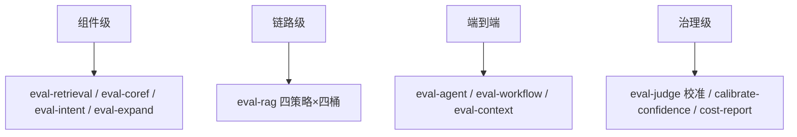

面向 **AI 全栈 / Agent 工程** 岗位的评测与可观测专题题库。证据来源（均实读本机源码）：`yukino-ecomm-agent`（HEAD `c90c843`，评测脚本 `server/scripts/`、观测层 `server/src/core/observability.ts`、报告 API `server/src/api/rageval.ts`）与 `yukino-dev-agent`（HEAD `ea0fd19`，`prometheus.yml` / `prometheus.rules.yml` / `lib/metrics.ts`）。所有数字与规则名均可回源码核对；通用方法论按标准工程知识作答并标注**事实基线 / 方案推导**。

| 证据锚点              | 路径                                                                |
| --------------------- | ------------------------------------------------------------------- |
| RAG 评测 harness      | `server/scripts/eval-rag.ts`（764 行）                              |
| judge 校准            | `server/scripts/eval-judge.ts`                                      |
| 置信度校准            | `server/scripts/calibrate-confidence.ts`                            |
| 成本报表              | `server/scripts/cost-report.ts`                                     |
| 报告 API 与幻觉台账   | `server/src/api/rageval.ts`                                         |
| Langfuse / OTel 接入  | `server/src/core/observability.ts`                                  |
| Prometheus 抓取与告警 | `yukino-dev-agent/prometheus.yml`、`prometheus.rules.yml`（320 行） |
| 指标注册              | `yukino-dev-agent/lib/metrics.ts`、`app/api/metrics/route.ts`       |

## 一、评测体系与评测集

### Q1. 一套完整的 LLM 应用评测体系分几层？

以 ecomm-agent 的脚本矩阵为参照（`server/scripts/` 下 15 个 eval-* 脚本）：

**采分点**：组件级定位「哪一环坏了」，链路级验证「组合后还成立吗」，端到端验证「用户视角好不好」，治理级验证「评测工具本身可信吗」。只有 B/C 没有 A 会归因不能，只有 A 没有 C 会局部最优。

### Q2. 评测集怎么构建？项目的样本长什么样？

**事实基线**：`server/tests/data/eval_rag.jsonl` 共 **300 行**，每行 schema：`{id, bucket, query, expect_section?, expect_sections_all?, expect_points?, should_refuse?}`。构建来源：① 业务真实问法（口语桶 C_colloquial）；② 高危事实（型号桶 B_model）；③ 政策条款（A_policy）；④ 跨文档多跳（E_multi）；⑤ **不可答样本**（`should_refuse: true`）——评测集必须包含「该拒答」的负样本，否则拒答能力无从度量。

### Q3. 为什么评测要分桶而不是只看整体指标？

整体 Recall@5 = 0.9 可能掩盖「型号桶只有 0.6」——而型号错误是电商域最贵的失败。分桶让**每个优化动作可归因到具体能力**：BM25 权重调整看 B_model，embedding 换模型看 C_colloquial，召回宽度看 E_multi。项目报告按 `A_policy / B_model / C_colloquial / E_multi + overall` 五行输出（`eval-rag.ts` 的 `BUCKET_LABEL`）。

### Q4. 标注（expect_section / expect_points）怎么设计才既准又省？

**事实基线**：项目用**弱标注**——`expect_section` 标「正确证据所在小节路径别名」（`hitRank` 用 `section_path.includes(alias)` 判定），`expect_sections_all` 支持多组（组内任一命中即可，覆盖「多个小节都算对」）；`expect_points` 标答案要点列表（供覆盖率计算）。**不标完整答案文本**：弱标注维护成本低、对表述变化鲁棒；强标注（golden answer）留给高价值样本。

### Q5. Recall@K 和 MRR 的口径是什么？为什么两个都要？

**事实基线**（`eval-rag.ts`）：`hitRank` 在 Top-K（K=10）里找命中别名的小节最高名次（1-based，未中为 0）；`Recall@5 = mean(rank ∈ [1,5])`，`MRR = mean(rank>0 ? 1/rank : 0)`。Recall@5 回答「证据进没进模型能看到的窗口」（进不了 Top5 基本等于没有），MRR 回答「排得靠不靠前」（影响模型注意力分配）。**一个管存在性，一个管位置质量**，单看任何一个都会误判。

### Q6. NDCG 什么时候需要？项目为什么没用？

NDCG 需要**多级相关性标注**（0–3 分档）。项目标注是二值的（命中/未命中小节），二值标注下 NDCG 退化为位置加权的 Recall，信息增量有限，所以用 Recall@K + MRR。**答题要点**：指标选择跟着标注粒度走——先问「我标了什么」，再选「能算什么」。

### Q7. 证据覆盖率（evidence coverage）怎么算？为什么用机械匹配？

**事实基线**：`coverageMech` 把 Top10 证据拼成文本、去除所有空白（`normText`），对每个标准要点做**子串包含**判定，覆盖率 = 命中要点数 / 总要点数。机械匹配的价值：**确定性、零成本、可复现**——评测链路里凡是能不用模型判的就不用模型判，把 judge 的噪声隔离在必须语义理解的环节（答案覆盖率）。

### Q8. 评测 harness 自身的工程要求有哪些？

**事实基线**（`eval-rag.ts`）：① 并发限流——检索与生成各 `Semaphore(5)`，防止评测把上游打挂；② 超时——每次调用 `CALL_TIMEOUT = 45s`；③ 重试——失败 2s 后重试一次（`tryCall`），错误计入 `errors[]` 而不是中断全场；④ 幂等产物——`rag_eval.json`（结构化）+ `rag_eval.txt`（人读）双写；⑤ 可分段——`--skip-gen` 只跑检索段。**评测脚本挂了比业务挂了更难排查**（跑一次几分钟到几十分钟），超时/限流/重试/断点一个都不能少。

### Q9. 评测报告应该包含哪些元信息？

**方案推导**（结合 `rageval.ts` 的 overview 结构）：`meta`（时间、模型、commit、样本数、参数快照）、`retrieval`（策略 × 桶 × 指标矩阵）、`evidence_coverage`、`generation`（覆盖率/忠实度/拒答）、`best`（按 MRR 选出的最优策略）。**没有 meta 的报告等于没有报告**——三个月后没人记得这组数字是哪个模型哪个 commit 跑的。

### Q10. 评测集本身怎么防泄漏、防过拟合？

**方案推导**：① 评测集与 flywheel 入库知识隔离（评测问题不能直接变成 KB 条目，否则 Recall 虚高）；② 定期轮换/新增样本（线上低置信台账是天然的新样本来源，但要人工评审后入集）；③ 报告按 commit 归档，跨版本对比时检查评测集是否同一版本；④ 警惕「对着评测集调 prompt」——那是过拟合，参数变更要在**未参与调参的留出集**上复核。

## 二、LLM-as-Judge

### Q11. 项目里哪些环节用了 LLM judge？哪些刻意没用？

**事实基线**：用了——① 答案要点覆盖率 judge（`COVERAGE_PROMPT` + `covSchema.covered_count`，temperature 0，独立于生成模型调用）；② 忠实度 judge（`FAITHFULNESS_PROMPT` + `{faithful, reason}`，**只对 hybrid_rerank 策略跑**，控制成本）。没用——检索指标（Recall/MRR）、证据覆盖率全部机械计算。**原则：能确定性度量的绝不上 judge；judge 只处理必须语义理解的判断**。

### Q12. LLM-as-judge 有哪些系统性偏差？怎么治理？

| 偏差     | 表现                     | 治理                                                 |
| -------- | ------------------------ | ---------------------------------------------------- |
| 位置偏差 | 偏好先出现的候选         | 交换顺序重测取一致结果                               |
| 长度偏差 | 偏好长答案               | 评分维度拆开（覆盖/忠实分离），prompt 明示长度不计分 |
| 自偏好   | 偏爱与自己同源模型的输出 | judge 与生成模型异源；temperature 0                  |
| 格式偏差 | 偏好 markdown 排版好的   | 评分前剥离格式                                       |
| 宽严漂移 | 不同批次尺度不一         | 锚定样本（few-shot 校准）+ 定期人工抽检              |

**事实锚点**：项目的 coverage judge 用 `temperature: 0` 且输出被 zod 约束为整数（`covered_count`，且 `Math.min(covered_count, points.length)` 防越界）——**把 judge 的输出空间压到最小，是治偏差的第一手段**。

### Q13. judge 本身怎么校准？（项目的 eval-judge 是亮点）

**事实基线**（`scripts/eval-judge.ts`）：用**人工处置过的 faith case 台账**做 judge 的测试集——`resolved`（人工确认是幻觉）期望 judge 判 `faithful=false`，`dismissed`（人工确认没问题）期望 `faithful=true`；对最多 200 条带引用原文的案例重跑 judge，统计 `agree` 率。**这是「judge 的 judge」**：人工标注是金标准，judge 一致率低于阈值时，先修 judge（prompt/模型）再谈评测结论。

### Q14. 忠实度（faithfulness）判定的输入应该是什么？

**事实基线**：`FAITHFULNESS_PROMPT` 的输入是 `evidence`（编号引用列表）+ `answer`，判「答案是否忠实于证据」——**不是判答案对不对，是判答案有没有超出证据**。证据外的正确内容也算不忠实（可能是背出来的，换个场景就幻觉）。`eval-judge.ts` 里 `evidenceFromCitations` 从落库的引用快照重建证据文本，保证 judge 看到的是**当时**的证据而不是现在的 KB。

### Q15. 拒答（refusal）怎么评？漏拒为什么比误拒严重？

**事实基线**：样本带 `should_refuse`；报告统计 `refusal.total / refusal.correct`，`refusal_missed = total − correct` 并入幻觉口径（`rageval.ts` 的 `hallucination()`：`judged = cases_judged + missed`，`confirmed = confirmed + missed`）。**漏拒 = 对不可答问题编造答案**，直接产生错误承诺（退款时限说错就是资损）；误拒只是体验损失，且有 fallback 话术 + 转人工兜底。所以幻觉率分子把两者合并——**宁可把误拒的代价算轻，也不能把漏拒算轻**。

### Q16. judge 结果与人工结果冲突时的流程是什么？

**事实基线**（`rageval.ts` faith-cases API）：judge 判不忠实的案例进台账，状态机 `unresolved → resolved / dismissed`；**标记 resolved 必须写「怎么解决的」，标记 dismissed 必须写「为什么不用改」**（API 层强制：无 note 返回 400）；同一问题重复出现累计 `seen_count`，已 resolved 的案例再犯自动 `reopened`。流程本质：**judge 提出怀疑 → 人工裁决 → 裁决必须留痕 → 复发自动升级**。

### Q17. 覆盖率 judge 的 prompt 怎么写才可靠？

**事实基线**（`COVERAGE_SYS` 原文要点）：① 角色限定（answer-coverage reviewer）；② 判定标准显式化——「要点只有在答案中被**正确**反映才计数；遗漏、编造、答错都不计」；③ 输出约束——「只返回覆盖的要点数（整数），不得超过要点总数」；④ 输入结构化——问题 / 编号要点列表 / 答案三段分明。**采分点**：judge prompt 的三要素是「判定标准、反例枚举、输出约束」，缺一个都会漂。

### Q18. 什么时候该用规则/模型混合评审？

**事实基线**：项目的 model-guard 就是混合评审的样本——型号用正则 `/MH-[A-Za-z]{1,4}\d{1,4}/g` 机械校验（规则），语义忠实度用 judge（模型），机械覆盖率用子串匹配（规则）。**分工原则**：可枚举的高危事实（型号/金额/时限数字）走规则，开放式语义判断走模型；规则先行（便宜、确定），模型兜底（贵、覆盖广）。

## 三、离线 / 在线评测与实验

### Q19. 离线评测与在线评测分别回答什么问题？

离线（eval-rag 四策略对照）回答「**哪个配置更好**」——受控、可复现、无用户风险；在线（Langfuse trace + 低置信台账 + 反馈）回答「**真实分布下表现如何**」——覆盖离线集想不到的问法。闭环：线上低置信问题 → flywheel 归一化 → 人工评审 → 补充 KB 或**补充评测集**。只有离线会过拟合评测集，只有在线无法做受控对比。

### Q20. 四策略消融（vector/bm25/hybrid/hybrid_rerank）为什么是「天然对照实验」？

**事实基线**：`searchKnowledge` 的 strategy 参数一路透传到评测（同一评测集、同一 K、同一 judge），四个策略的差值直接分解出各组件净增量：`hybrid − vector` = BM25 贡献，`hybrid − bm25` = 向量贡献，`hybrid_rerank − hybrid` = rerank 贡献。**消融实验的前提是只动一个变量**——策略开关是代码里现成的单变量旋钮，这比事后设计实验干净得多。

### Q21. RERANK_API_KEY 缺失的降级路径为什么是「开关式对照」？

**事实基线**：rerank key 未配置时走 `scoreAsConfidence`（RRF 分归一化）直接返回——功能不断但精排关闭。这意味着**同一套部署，配/不配 key 就是 A/B 两组**；评测时故意不配 key 跑一轮，即得 rerank 消融组。工程启示：降级路径不仅是可用性设计，还是免费的实验基础设施。

### Q22. A/B 实验在 LLM 应用里有什么特殊难点？

① 方差大——同输入不同输出，需要更大样本量或配对比较（同 query 双策略）；② 指标滞后——「用户是否满意」要等反馈/复购，短期只能用代理指标（覆盖率/忠实度/转人工率）；③ 成本不对称——实验组可能更贵，预算要封顶；④ 污染——prompt cache、会话历史跨组泄漏。**方案推导**：项目形态下更实际的是「离线配对消融（Q20）+ 线上全量灰度 + 台账监控」，而不是流量分桶 A/B——先说清为什么不做，再说做什么。

### Q23. 置信度阈值 0.26 是怎么定出来的？

**事实基线**（`scripts/calibrate-confidence.ts`）：对评测集分「可答桶」（A/B/C/E）与「不可答桶」（`should_refuse` 样本），各跑检索算置信度，输出两组分布的 `n/min/p25/p50/p75/max`（`SEM = 8` 并发），产物 `data/observability/reports/confidence_calibration.{txt,json}`。阈值取在**两组分布的分界处**（不可答组的 p75 与可答组的 p25 之间权衡误拒/漏拒代价）。**「阈值不是拍的，是校准出来的」**——能讲出校准脚本与分位数口径，这题就是满分。

### Q24. 阈值调整上线前还要做什么？

**方案推导**：① 用校准脚本重跑分布（KB 变了分布就变了——`knowledgeRevision` 变更后阈值要复核）；② 在评测集上算新阈值下的误拒率/漏拒率变化；③ 灰度期监控 `fallback_reply` 触发率与低置信台账增量（触发率突增 = 阈值过严或 KB 回归）；④ 台账里 `[]`（零命中）与低分命中的比例变化能区分「知识缺失」与「阈值问题」。**阈值是有生命周期的参数，绑定语料版本管理**。

### Q25. 在线指标里哪些能反映 RAG 质量？

**事实基线 + 推导**：项目可直接观测的——低置信 fallback 触发率（`insertLowConfidence` 增量）、flywheel 台账积压（unresolved 数）、faith case 复发率（`seen_count`/`reopened`）、转人工动作触发率、按意图的 token 成本（Q38）。推导补充——用户反馈（点赞点踩进 `feedback` API）、追问率（同会话连续改写提问暗示首答不佳）。**在线指标要能下钻到 trace**（每个数字背后是哪些会话），否则只是仪表盘装饰。

### Q26. 回归测试怎么组织？改一行 prompt 要跑什么？

**方案推导**（按项目脚本矩阵）：① 单测必过（`tests/prompts.test.ts`、`graph-nodes.test.ts` 等 40+ 测试文件）；② 受影响链路的组件评测（改 RAG_ANSWER_PROMPT → `eval-rag --skip-gen` 不够，要跑生成段）；③ 全量 eval-rag 对照上一份 `rag_eval.json`（同评测集同口径 diff）；④ judge 校准抽查（eval-judge 一致率不降）。**分级回归**：改动范围决定评测范围，但「对照上一份报告」这一步永远不能省。

## 四、Tracing 与可观测接入

### Q27. 项目的 Langfuse 接入是怎么分层的？

**事实基线**（`core/observability.ts`）：

| 层     | 机制                                                                                  | 抓什么                                                       |
| ------ | ------------------------------------------------------------------------------------- | ------------------------------------------------------------ |
| 框架层 | `CallbackHandler`（@langfuse/langchain）注入图执行 callbacks                          | 节点/LLM 调用 span 树，带 `sessionId`、`tags: ["chat-turn"]` |
| SDK 层 | `NodeSDK` + `LangfuseSpanProcessor`（@langfuse/otel）                                 | OTel 标准 span 出口                                          |
| 业务层 | `recordTurn`（generation 类型 observation，带 input/output/model/usageDetails.total） | 每轮语义记录                                                 |
| 标签层 | `tagIntent`（event 类型，metadata 带 intent + confidence）                            | 意图维度切片                                                 |

**采分点**：结构（span 树）靠框架回调，语义（意图/成本/输入输出）靠业务埋点——两层缺一不可。

### Q28. Langfuse 未配置时系统行为是什么？为什么这样设计？

**事实基线**：`langfuseEnabled()` 要求三个环境变量齐备（public/secret key + baseUrl）；未配置时 `graphCallbacks` 返回空数组、`recordTurn/tagIntent` 直接 return、`initObservability` 不启动 SDK；启动失败也只 warn「continuing without it」。**观测是旁路，绝不能成为主链路的故障点**——这是可观测接入的第一设计原则（对照：检索降级会改变答案质量，观测降级只丢数据）。

### Q29. trace 的 session / user / tag 维度怎么规划？

**事实基线**：`CallbackHandler({ sessionId: String(conversationId), userId, tags: ["chat-turn"] })`；`tagIntent` 追加 `intent:${intent}` 标签。规划原则：**sessionId 对齐业务会话**（一个会话一棵 trace 树）、userId 支持按用户下钻、tags 支持低成本切片（成本报表就靠 `intent:` tag 聚合，见 Q38）。标签在写入时就要想好查询场景——事后补标要重跑数据。

### Q30. 每轮 trace 里应该记录哪些字段才能事后归因？

**事实基线**（`graph/nodes.ts` 的 trace 累积 + `logModelContext`）：意图与置信度、路由决策、coref 改写前后、检索 queries 与命中数、置信度四信号（`confidence_signals`）、selfcheck 原因、fallback 来源、检索快照（Top3 证据 + rerank 分）、每步 token（input/cache_read/total，`agent_step` 日志）。**归因的最小完备集 = 决策点 + 决策依据 + 决策结果**，每个分叉都要留下「为什么走了这边」。

### Q31. prompt cache 命中怎么观测？为什么重要？

**事实基线**：`mainAgent` 从 `AIMessage.usage_metadata` 解析 `input_token_details.cache_read` 并逐步记录（`agent_step` 日志含 `input/cache_read/total`）。重要性：① 成本——cache read 通常按 1/10 计价；② 延迟——命中缓存跳过 prefill，TTFT 显著下降；③ **架构验证**——cache_read 持续为 0 说明 system 前缀不稳定（比如把证据误放进了 system），观测数据直接验证「证据放 turn-ctx」的设计是否生效。

### Q32. OTel 与 Langfuse 是什么关系？要不要都上？

**事实基线**：项目用 `@langfuse/otel` 的 `LangfuseSpanProcessor` 挂在标准 `NodeSDK` 上——**OTel 是采集与传输标准，Langfuse 是 LLM 语义后端**（理解 generation/usage/session 概念）。都上的形态：OTel SDK 统一出口，LLM span 发 Langfuse，基础设施 span（HTTP/DB）发 Tempo/Jaeger。避免双 SDK 各自埋点——**一套采集管道，多个后端**。

### Q33. 前端 / 全栈应用的指标怎么进 Prometheus？（dev-agent 案例）

**事实基线**（`yukino-dev-agent`）：`lib/metrics.ts` 用 prom-client 注册 `collectDefaultMetrics()` + 业务指标（Counter/Histogram 全部带 `project_id` 标签：`eventsTotal / errorsTotal / resourceErrorsTotal / httpRequestsTotal / httpRequestDurationMs / webVitalSamplesTotal / navigationTimingMs / longTasksTotal / whiteScreensTotal` 等）；`app/api/metrics/route.ts` 以 CORS GET 暴露 registry；`prometheus.yml` 每 15s 抓 `host.docker.internal:3000/api/metrics`。**链路**：浏览器 SDK 上报 → Next.js 服务端转成 Prometheus 指标 → 抓取 → 告警。前端可观测的难点不在采集在**聚合口径**（按 project_id 分租户）。

### Q34. 观测数据的采样与成本怎么权衡？

**方案推导**：① trace 全量 vs 采样——LLM 应用单轮成本高、量相对小，倾向全量（项目即全量）；高 QPS 服务按错误/慢请求优先采样；② 指标（Prometheus）天然聚合，成本在标签基数——`project_id` 这类高基数标签要控上限；③ 日志分级（项目用 pino childLogger 按模块分）；④ 保留期分级：trace 30 天、指标 1 年、台账永久（审计）。**先问数据用来回答什么问题，再定采多少**。

## 五、指标口径与成本

### Q35. TTFT 怎么定义、怎么拆？

**口径**：TTFT = 用户请求发出 → 第一个内容 token 到达前端。拆解（项目链路）：网络 + 前置串行节点（coref → intent → rewrite → 检索 → rerank → selfcheck，每步都是 LLM/API 调用）+ 生成模型 prefill。**事实基线**：这些节点在 trace 里各有 span，瓶颈定位靠 span 耗时而不是猜。优化顺序：并行化可并行的（改写与召回）、稳定 system 前缀命中 cache（Q31）、状态事件掩盖感知延迟。**SSE 只让已生成的字尽早出现，不减少 TTFT 本身**。

### Q36. 「任务成功率」这种业务指标怎么定义口径？

**方案推导**（示范答题）：分子分母先说清——分母 = 进入知识/业务路由的会话轮次（排除闲聊与脚本路由），分子 = 未触发 fallback 且未转人工且（有反馈时）非负反馈的轮次；采集点 = 图 trace 的路由与 fallback 字段（项目已有）；样本量与时间窗随报告给出；**争议处理**：用户中途放弃算失败还是删失？——先定义再统计，口径写进报告 meta。任何「成功率 X%」的表述都要能答出这一段。

### Q37. token 成本怎么归因到业务维度？

**事实基线**（`scripts/cost-report.ts`）：查 Langfuse metrics API（`/api/public/metrics`，view=observations，measure=`sum(totalTokens)`，dimensions=`tags+traceId`），按 `intent:` 标签聚合出**每意图的 tokens / 会话数 / avg_tokens / share**，默认 7 天窗口（`--days` 可调），产物 `data/observability/reports/cost_by_intent.{txt,json}`。**归因链**：写入时打意图标签（Q29）→ 查询时按标签聚合 → 报表按 share 排序找成本大头。没有标签的成本监控只能看总量涨跌。

### Q38. 发现某意图成本占比异常高，怎么排查？

**方案推导**（沿 cost-report 的维度下钻）：① `avg_tokens` 高还是 `count` 高？——前者是单轮贵（上下文膨胀/步数打满），后者是量大（路由把别的意图误分进来）；② 单轮贵：抽 trace 看 `agent_step` 的 input/cache_read——cache 命中低查前缀稳定性，步数满查工具循环是否空转；③ 量大：查意图分类的混淆（`tagIntent` 的 confidence 分布）；④ 对照 `MAX_AGENT_STEPS=6` 与 `TOOL_RESULT_MAX_TOKENS=3000` 是否被特定意图系统性打满。**成本问题的答案永远在具体 trace 里**。

### Q39. 指标口径治理的制度怎么建？

结合 [指标口径与基线定义](/interview/metrics-baseline) 与项目实践：① 每个量化结论绑定「baseline、分子分母、采集位置、样本量、验证方式」五要素；② 报告带 meta（Q9）；③ 运行时产物（`data/rag/reports/`、`data/observability/reports/`）**不入仓库**——被问数字时如实说「报告是运行时产物，现场跑 `node main.js eval-rag` 复现」；④ 台账类数据（faith case、低置信）入库可审计。**「不能复现的数字不许说」**是底线纪律。

### Q40. 延迟指标为什么看分位数而不是均值？P99 恶化先查什么？

均值被长尾稀释：100 请求里 99 个 100ms、1 个 10s，均值 199ms「看起来还行」，P99 = 10s 已经事故。**事实基线**：dev-agent 告警全部用分位数/速率表达（`nodejs_eventloop_lag_p99_seconds > 0.1`）。LLM 应用 P99 恶化排查序：上游模型排队（trace 里 LLM span 耗时占比）→ 重试风暴（`tryCall`/rerank 退避被触发）→ 上下文膨胀（input tokens 分布右移）→ 事件循环阻塞（Node 侧 `eventloop_utilization`）。

## 六、Prometheus 告警与 SRE

### Q41. dev-agent 的告警规则覆盖了哪几层？

**事实基线**（`prometheus.rules.yml`，320 行，按 group 分层）：

| group           | 代表规则                                                                                                                                                                                                                                         | 表达式要点                                                                                                                                        |
| --------------- | ------------------------------------------------------------------------------------------------------------------------------------------------------------------------------------------------------------------------------------------------ | ------------------------------------------------------------------------------------------------------------------------------------------------- |
| targets         | ServiceOffline                                                                                                                                                                                                                                   | `up == 0` for 1m                                                                                                                                  |
| node-runtime    | NodeHeapNearLimit / NodeHeapLeakSuspected / NodeDetachedContextLeak / NodeEventLoopSaturated / HighEventLoopLag / NodeGcPressure / NodeCpuSaturated / NodeMajorPageFaults                                                                        | heap ratio > 0.9；`predict_linear(...[30m], 3600) > 0.95`；detached contexts > 10；eventloop utilization > 0.9；lag p99 > 0.1s；GC 时间占比 > 10% |
| go-runtime      | GoGoroutineLeak / GoSchedulerLatencyHigh / GoStopTheWorldHigh / GoGcCpuPressure / GoHeapNearLimit / GoMutexContention / GoThreadGrowth                                                                                                           | `go_goroutines > 500 and deriv(...[30m]) > 0`；threads > 100                                                                                      |
| sentry-pipeline | SentryReportPipelineRejecting / SentryTelemetryStalled                                                                                                                                                                                           | `rate(...{outcome="invalid"}[10m]) > 0`；`time() - max(...last_seen...) > 1800`                                                                   |
| frontend        | FrontendReactCrash / FrontendErrorSpike / FrontendWhiteScreen / FrontendResourceLoadFailure / HighInterfaceFailureRate / FrontendHttpLatencyHigh / WebVitalsDegradation / FrontendNavigationSlow / FrontendLongTaskPressure / FrontendMemoryHigh | React 崩溃 5m 增量 > 0；错误率 > 0.2/s；白屏 10m 增量 > 0；浏览器内存 > 1.5e9                                                                     |

**采分点**：一套规则同时管 Node 服务、Go 服务、上报管道自身、前端体验四层——**监控系统的监控**（pipeline rejecting / telemetry stalled）最容易被忽略。

### Q42. predict_linear 做泄漏预警的原理与误报源？

**事实基线**：`NodeHeapLeakSuspected: predict_linear(yukino_node_v8_heap_used_ratio[30m], 3600) > 0.95 for 15m`——对最近 30 分钟做线性外推，预测 1 小时后是否超 95%。原理：**泄漏是趋势，OOM 是结果**，趋势告警比结果告警早一小时。误报源：周期性负载（每天定点批处理）被当成趋势、外推窗口太短放大噪声——所以配 `for: 15m` 要求趋势持续，且严重级只是 warning（对照 NodeHeapNearLimit 的 critical）。

### Q43. 告警的 severity 分级与 for 时长怎么定？

**事实基线**（规则里的模式）：`up == 0` → critical + 1m（服务没了立即要人）；heap > 0.9 → critical + 5m（OOM 前兆，短窗口）；泄漏预测/detached contexts → warning + 15m（趋势类，长窗口防抖）；GC 压力 → warning + 10m。**方法论**：severity 按「是否需要立即人工介入」定，for 按「信号的信噪比」定——瞬时硬故障短窗口，趋势软信号长窗口。告警疲劳的根源是 warning 当 critical 发。

### Q44. 前端白屏（white screen）怎么变成可告警指标？

**事实基线**：dev-agent 的 `whiteScreensTotal`（Counter，带 project_id）由前端 SDK 检测上报，告警 `increase(yukino_sentry_white_screens_total[10m]) > 0`——**白屏零容忍**（增量 > 0 即告警）。检测原理（SDK 侧通用做法）：首屏采样点 elementFromPoint 全空 / 根节点无有效子树 / 关键组件错误边界触发（对照 `FrontendReactCrash: increase(yukino_sentry_errors_total{type="React"}[5m]) > 0`）。前端体验指标的核心是**把主观感受翻译成客观事件**。

### Q45. Web Vitals 劣化告警怎么设计？

**事实基线**：`WebVitalsDegradation` 基于 `webVitalSamplesTotal`（Counter，带 `name`（LCP/CLS/INP...）与 `rating`（good/needs-poor/poor）标签）——用**评级分布**而不是原始毫秒数告警（阈值随指标名不同，rating 是 Google 已定义好的分档口径）。配套 `navigationTimingMs`（Histogram，按 phase 标签）下钻到具体阶段（DNS/TTFB/domContentLoaded...）。**用行业标准分档做告警、用自建 Histogram 做归因**。

### Q46. 告警归属率怎么治理？（每条告警有人管）

**方案推导**（结合规则里的 `service: "{{ $labels.job }}"` 标签）：① 每条规则带 severity + service 标签，路由到对应值班组；② 告警评审例会按「触发次数 × 处置动作」盘点——长期不处置的规则要么修阈值要么删；③ 归属率 = 有明确 owner 且近 90 天有处置记录的告警占比；④ 新增告警必须同时提交「处置 runbook 链接」（对照规则 annotations 里已经写了排查线索，如 detached contexts 的解释文案）。**告警不是越多越好，每条都要能回答「响了之后谁做什么」**。

### Q47. up == 0 之外，怎么发现「服务活着但不干活」？

**事实基线**：dev-agent 用**活性 + 语义双层**——`SentryTelemetryStalled: time() - max by (project_id)(yukino_sentry_event_last_seen_timestamp_seconds) > 1800`：30 分钟没有任何事件时间戳推进即告警，抓的正是「进程在、数据流断」的假活。**通用模式**：为关键数据流维护 last_seen 时间戳指标，`time() - last_seen > 阈值` 是比心跳更语义化的存活检测（心跳只证明进程在，last_seen 证明业务在）。

### Q48. LLM 上游故障在告警体系里怎么体现？

**方案推导**（项目现有积木的组合）：① 错误率——structured/rerank 的重试与失败已有 warn 日志（`llm.ts`「did not return tool_calls after two attempts」、`rerank.ts` 状态码重试），聚合成 `llm_upstream_errors_total{slot, status}` 指标；② 延迟——LLM span 耗时分位数（trace 侧）+ 请求级 Histogram（`httpRequestDurationMs` 模式）；③ 降级触发率——`scoreAsConfidence` 兜底路径与 fallback_reply 触发率突增即上游异常的业务信号；④ 配额——429 速率单独告警。**上游故障的最终判据是业务降级率，不是 HTTP 错误数**。

## 七、回归、回放与报告纪律

### Q49. 评测产物为什么不入 git？被面试官问「效果提升多少」怎么答？

**事实基线**：`data/rag/reports/` 与 `data/observability/reports/` 是运行时产物（`rageval.ts` 的 overview 会返回 `present: false` + 提示「按 Re-run 现场跑一轮，四策略 × 四桶，需要向量库 + 已建 KB + chat 上游，耗时分钟级」）。**标准答法**：① 如实说明报告未归档、数字不现场编；② 给出可复现路径（`node main.js eval-rag`，产物双格式）；③ 讲清口径（300 样本、四桶、Recall@5/MRR/覆盖率/忠实度、judge 校准机制）；④ 若跑过，报数字同时报 commit 与模型版本。**「口径 + 复现路径」比背一个数字可信十倍**。

### Q50. EvalRun 这类评测运行记录应该存什么？

**事实基线**：项目 Prisma schema 有 `EvalRun` 模型（评测运行入库），配合文件产物（json/txt）与 job 状态（`jobs.ts` 的 `eval-rag` job，`rageval.ts` overview 返回 `job.specs`）。**应存**：运行时间、触发方式、代码版本、模型与参数快照、样本集版本、指标摘要、产物路径、错误列表（`errors[]`）。**评测运行本身也是被评测对象**——可追溯、可对比、可重跑。

### Q51. 确定性回放与评测的关系？

评测的可比性依赖「除被测变量外一切固定」：样本集固定（jsonl 入库）、检索参数固定（config 快照进 meta）、judge 固定（temperature 0 + 同模型）、随机源登记。回放（checkpoint + 录制响应，见 [Agent 框架与架构对比题库](/interview/qa/agent-frameworks) Q63）用于**故障复盘**，评测用于**版本对比**——同一套「固定输入」基础设施，两个用途。

### Q52. 上线一个新模型版本的完整检查单？

**方案推导**（综合本篇机制）：① 离线——eval-rag 全量对照上一版报告（四桶指标 + 忠实度 + 拒答）；② judge 校准——eval-judge 一致率不降；③ 阈值复核——calibrate-confidence 重跑（置信度分布随模型变）；④ 兼容性——结构化输出方法、流式 tool call（`needsNonStreamingTools`）、窗口表（`KNOWN_WINDOWS`）；⑤ 成本——cost-report 对比 avg_tokens；⑥ 灰度——fallback 触发率与台账增量监控；⑦ 回滚预案——slot 配置一键切回。**七步里五步是本项目已有脚本**——检查单要长在现有工具上。

### Q53. 观测体系自身怎么被观测？

**事实基线**：dev-agent 的 `SentryReportPipelineRejecting`（上报管道拒收率 > 0 告警）与 `SentryTelemetryStalled`（数据流停摆告警）就是「监控的监控」；ecomm-agent 侧 Langfuse 失败全部 warn 不阻断（Q28），意味着**观测静默失败要靠 last_seen 类指标兜底**。**答题要点**：每个观测组件问三个问题——它挂了谁知道？它的数据断了谁知道？它的时钟漂了谁知道？

### Q54. 给你从零搭 LLM 应用的可观测体系，第一周做什么？（综合题）

示范回答（全部回扣本篇事实）：

1. **D1–2 结构化日志**：pino childLogger 按模块分（项目模式），每轮请求带 conversationId 贯穿；
2. **D2–3 trace 接入**：Langfuse callbacks + OTel SDK（Q27 分层），sessionId/tags 维度先定好；
3. **D3–4 业务埋点**：意图标签、token 用量（含 cache_read）、路由与 fallback 决策进 trace（Q30/Q31）；
4. **D4–5 指标与告警**：prom-client 暴露 /api/metrics，先上「服务活、数据流活、错误率、延迟分位」四类告警（Q41/Q47），LLM 上游降级率随后；
5. **D5 评测最小集**：50 条分桶样本 + 机械指标（Recall/覆盖率）先跑起来，judge 与校准第二周再上（Q7/Q13）。

**采分点**：顺序体现优先级——先能看见（日志/trace），再能报警（指标），最后能评价（评测）；每一步都选可增量的最小实现。

### Q55. 结构化日志怎么设计才能支撑 LLM 应用排障？

**事实基线**：项目用 pino `childLogger(module)` 按模块分命名空间（retrieval/selfcheck/graph.nodes/summarizer...），每条日志带结构化字段（conv/step/intent/trace/tokens/cost_ms），关键决策点都有专属事件名（`agent_step`、`model_ctx`、`summary triggered`、`flywheel item processed`）。**设计原则**：① 字段化而非拼接字符串（可查询可聚合）；② 会话 id 贯穿所有模块；③ 每个「降级/兜底/重试」分支都有 warn 级日志（如 rerank 缺 key、selfcheck 失败）；④ 大 payload 截断（`model_ctx` 每条消息只留 40 字符预览）。

### Q56. trace 里的 PII / 敏感数据怎么处理？

**方案推导**（项目把用户对话原文进 Langfuse，自建部署可接受；托管后端则必须治理）：① 字段分级——订单号/手机号/地址属敏感，进 trace 前脱敏或哈希；② 采样隔离——敏感会话只进自建存储；③ 保留期——trace 短保留（30 天），脱敏后的聚合指标长保留；④ 访问控制——Langfuse 项目级 API key 分环境（评测/生产分离）。**口径**：观测数据的合规等级 = 它包含的最敏感字段，不是它的用途。

### Q57. LLM 应用的 SLO 怎么定？错误预算怎么用？

**方案推导**：① 可用性 SLO——聊天接口成功率（非 5xx 且非超时兜底话术）99.5%，注意**降级成功≠成功**（fallback_reply 返回 200 但业务上是失败，要单独计量）；② 质量 SLO——fallback 触发率 < X%、faith case 新增速率 < Y/周（台账增量就是质量错误预算的消耗表）；③ 延迟 SLO——TTFT P95；④ 预算烧完的动作——冻结 prompt/模型变更、只允许修复性发布。**LLM 应用的特殊点：质量退化是渐进的，SLO 要建在台账/反馈流上而不是 HTTP 状态码上**。

### Q58. Langfuse datasets / experiments 与自建评测脚本怎么取舍？

**事实基线**：项目选择自建脚本（eval-rag 直接读 jsonl、写本地报告），未用平台 datasets；CCB 的 README 则强调「trace 一键转数据集」的平台路线。**取舍**：自建——可进 CI、可版本化、无平台依赖，适合口径稳定的回归；平台——样本从线上 trace 沉淀更顺、多人协作标注方便，适合探索期。成熟形态是两者打通：**线上 trace → 人工标注 → 导出进 jsonl 回归集**（项目的 flywheel 台账就是标注入口的雏形）。

### Q59. LLM 应用的事故响应（incident response）有什么特殊性？

**方案推导**：① 故障形态多一层——除宕机/超时外还有「质量事故」（模型版本漂移、prompt 被误改、KB 被污染），监控信号是 fallback 率/台账增量突变而非 5xx；② 止血手段不同——切 slot 配置回退旧模型、关 rerank/改写等增强环节（项目每个增强都有独立开关与降级路径）、必要时路由层全部转人工话术；③ 复盘材料——trace 可回放具体会话，faith case 台账留存了人工裁决记录；④ **变更即嫌疑**——质量事故第一排查项是最近的 prompt/模型/KB 变更（对照 EvalRun 的 meta 快照）。

### Q60. 前端 RUM 与后端 APM 在 AI 应用里怎么关联？

**事实基线**：dev-agent 同时采两侧——前端 SDK 上报（webVitalSamples/navigationTiming/longTasks/whiteScreens，带 project_id）进 Prometheus，后端 httpRequestDurationMs 同标签体系；ecomm-agent 后端另有 Langfuse trace（sessionId 维度）。**关联键设计**：前端请求带 traceparent/会话 id → 后端日志与 trace 同 id → 告警触发后从「用户看到白屏」一路下钻到「哪轮 LLM 调用超时」。**没有贯穿 id 的前后端监控是两套孤岛**。

## 速记卡

- **评测分层**：组件级（eval-retrieval/coref/intent）→ 链路级（eval-rag 四策略×四桶）→ 端到端（eval-agent）→ 治理级（eval-judge/calibrate/cost-report）。
- **口径**：300 样本、K=10、Recall@5 + MRR、机械覆盖率（去空白子串匹配）、judge 只判语义（temperature 0 + zod 约束输出）。
- **judge 校准**：人工台账（resolved=不忠实/dismissed=忠实）当金标准，重跑 judge 算一致率——「judge 的 judge」。
- **拒答**：漏拒并入幻觉分子；三态快照区分「没检索」与「检索了但零命中」。
- **阈值**：0.26 来自可答/不可答两组置信度分布的分位数校准，绑定语料版本复核。
- **tracing**：框架回调管结构、业务埋点管语义；Langfuse 未配置全链路静默降级；cache_read 验证前缀稳定性。
- **成本**：`intent:` 标签 → Langfuse metrics API 聚合 → cost_by_intent 报表；下钻看 avg_tokens vs count。
- **告警**：severity 按「是否立即要人」、for 按信噪比；`predict_linear` 抓泄漏趋势；`time() - last_seen` 抓假活；白屏/React 崩溃零容忍。
- **纪律**：报告是运行时产物不入库；数字必须带口径与复现路径；评测运行本身入库（EvalRun）。

## 延伸阅读

[RAG 与检索深挖题库](/interview/qa/rag-and-retrieval) · [Agent 框架与架构对比题库](/interview/qa/agent-frameworks) · [指标口径与基线定义](/interview/metrics-baseline) · [Web 安全与可观测性](/interview/fundamentals/security-observability) · [电商 RAG 项目深挖](/interview/answers/ecomm-rag-project) · [全量题库](/interview/question-bank)
