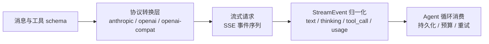
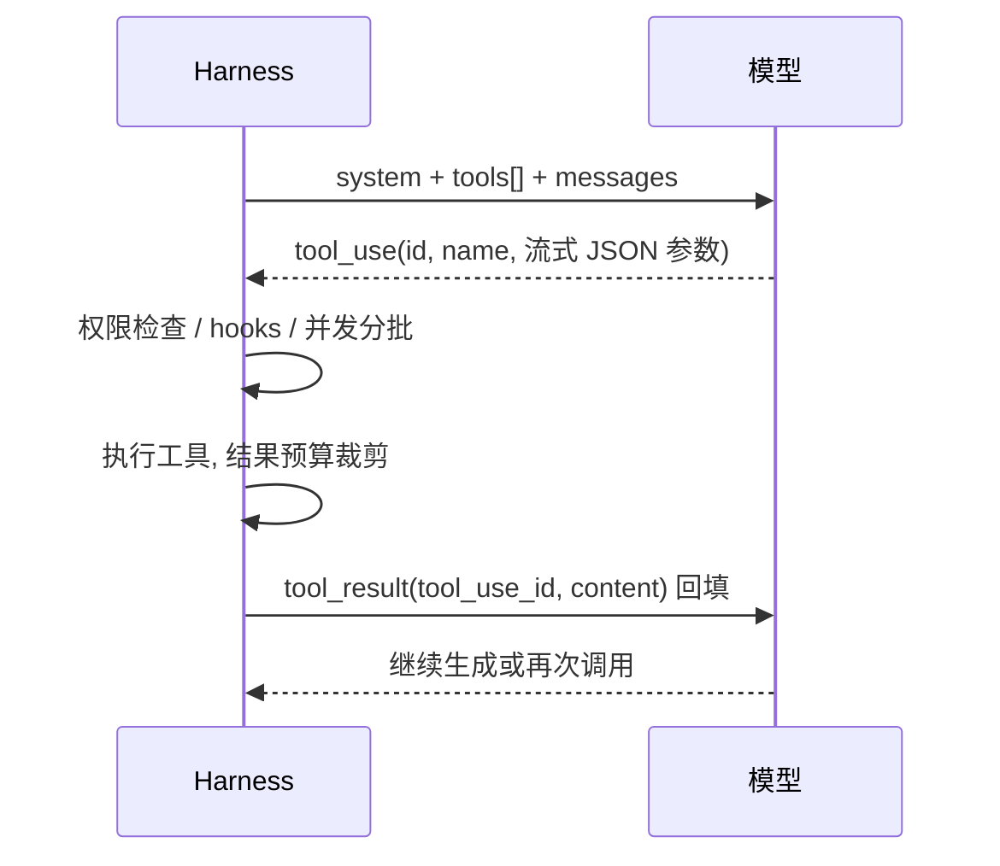

本篇是「LLM 与推理基础」题库精讲：85 题，覆盖从 tokenization 到上下文工程、再到遥测与运行时控制的完整知识链。项目事实全部来自 `yukino-code`（HEAD `7b9add5`）的 `apps/yukino/src/llm/`、`config/`、`compact/`、`mcp/`、`telemetry/`、`conversation/` 等模块实读，引用路径均相对该仓库根目录；通用原理按标准工程知识表述。



## 一、Tokenization 与 token 计数

### Q1. 什么是 token？BPE 分词的原理是什么？

token 是模型处理文本的最小单位，既不是字符也不是单词。主流 LLM 用 **BPE（Byte-Pair Encoding）**：从字节表出发，反复把语料中最高频的相邻符号对合并为新符号，训练出固定词表（数万到数十万条目）。推理时按同一合并规则贪心切分。工程后果：常见英文单词往往是 1 个 token，长单词/中文/代码符号被拆成多个；`str.split(" ")` 得到的「词数」与 token 数没有稳定换算关系。

### Q2. 为什么不能用「字符数 ÷ 固定系数」精确算 token？项目里怎么估算？

精确计数必须跑 tokenizer（如 tiktoken），但 harness 在**发请求前**就要判断「上下文是否快满」，此时没有服务端 usage 可用。项目采用分场景系数估算：

| 场景                    | 常量                       | 值             | 来源                                   |
| ----------------------- | -------------------------- | -------------- | -------------------------------------- |
| 自然语言消息            | `CHARS_PER_TOKEN`          | 3.5 字符/token | `apps/yukino/src/compact/constants.ts` |
| MCP 工具 schema（JSON） | `CHARS_PER_TOKEN`          | 2.5 字符/token | `apps/yukino/src/mcp/constants.ts`     |
| 压缩恢复附件            | `RECOVERY_CHARS_PER_TOKEN` | 3.5            | `apps/yukino/src/compact/constants.ts` |

JSON 符号密度高（引号、括号、驼峰命名各自成 token），所以 schema 用更小的每 token 字符数——**同一套「字符估 token」逻辑，系数必须按内容类型区分**，这是估算类代码最常见的翻车点。

### Q3. 图片怎么计 token？

图片不走文本 tokenizer，按分辨率折算。项目在压缩预算里给每个 image block 记固定字符当量 `IMAGE_CHAR_EQUIV = 7000`（`compact/constants.ts`），按 3.5 字符/token 约合 2000 token——注释明确说这是 Anthropic 单图 token 成本的量级。没有这条规则，图片密集的会话会被系统性低估、压缩触发过晚。**采分点**：估算体系里「非文本内容」必须有显式当量，否则预算模型对多模态会话失效。

### Q4. 工具 schema 也占上下文吗？项目怎么量化？

占。tools 数组序列化后随每次请求发送，位于 system 之后、messages 之前。项目用 `measureSchemaChars()`（`apps/yukino/src/mcp/strategy.ts`）把所有 `mcp__` 前缀工具的 `JSON.stringify(schema)` 长度求和，再按 2.5 字符/token 折算，与 `contextWindow × DEFAULT_EAGER_THRESHOLD_PERCENT / 100`（默认 10%）比较，决定 MCP 工具是全部进 tools[]（eager）还是延迟加载（native/dispatch）。**这道题的本质**：工具数量是有上下文价格的资源，不是免费的。

### Q5. 多轮会话的「当前上下文 token 数」怎么算才便宜又准？

纯估算会随轮数累积误差；纯 usage 又只有上一次请求的快照。项目用 **usage 锚点 + 增量估算**：每次 `stream_end` 后调用 `conversation.recordUsageAnchor(input, output, cacheRead, cacheCreation)` 记录服务端真实计数；`currentContextTokens()`（`compact/compact.ts`）= 锚点值 + 锚点之后新消息的字符估算。`UsageInfo` 的注释（`llm/events.ts`）写明四字段口径：**inputTokens 在所有协议上都已剔除缓存前缀**，`input + cache_read + cache_creation + output` 之和才是真实 token 基线。

### Q6. 为什么中英文的 token 密度不同？对工程有什么影响？

BPE 词表以英文语料为主，常见中文词往往 1 字 = 1~2 token，英文 1 词 ≈ 1~1.3 token。工程影响：① 同一 `max_tokens` 下中文可输出的字数更少；② 字符估算系数对中文偏差更大（3.5 字符/token 是按英文量级定的，中文实际约 1.5~2）；③ 计费与窗口预算要按 token 而非字数谈。面试中能主动说出「估算系数是语言相关的」就是加分项。

### Q7. 流式响应下 token 用量什么时候才拿得到？

各家都在**流末尾**给 usage：Anthropic 在 `message_start` 给 input 初值、`message_delta` 持续更新 output 与 cache 字段；OpenAI Responses 在 `response.completed/incomplete` 的 `usage` 里给全量；Chat Completions 必须显式传 `stream_options: { include_usage: true }`，usage 可能落在一个 `choices` 为空的尾 chunk（`llm/openai.ts` 因此把 usage 检查放在 delta 守卫之前）。**采分点**：说得出「usage 是尾事件、中途取消拿不到完整计数」，就能解释为什么取消的轮次要靠估算兜底。

## 二、上下文窗口与 KV cache

### Q8. 上下文窗口是什么？项目的默认值是多少？

上下文窗口是单次请求「输入 + 输出」的 token 上限。项目默认 `DEFAULT_CONTEXT_WINDOW = 1_000_000`、`DEFAULT_MAX_OUTPUT_TOKENS = 128_000`（`config/constants.ts`），可被 provider 配置覆盖。`getContextWindow()` 只在配置为正安全整数时采用配置值，否则回落默认——**配置校验失败时回落默认而不是报错**，是 harness 对「手改配置文件」的容错。

### Q9. KV cache 是什么？它和上下文窗口有什么关系？

Transformer 自回归解码时，每生成一个 token 都要对全部前缀做 attention；把前缀各层的 Key/Value 张量缓存下来，新 token 就只需计算自己的 QKV，复杂度从每步 O(n²) 降到 O(n)。代价是显存随「层数 × 头数 × 序列长」线性增长——**上下文窗口的物理上限本质是 KV cache 的显存上限**。这也解释了长上下文为什么贵：prefill 要算完整 attention，KV 要驻留显存。

### Q10. 为什么长上下文既慢又贵？优化手段有哪些？

慢在 prefill（attention 对输入长度超线性）与显存压力；贵在按 token 计费且缓存未命中时全量重算。手段分层：① 少放——检索/裁剪/压缩，只带必要证据；② 缓存——稳定前缀命中 prompt cache（见第三节）；③ 架构——KV cache 量化、PagedAttention、prefix 共享是推理侧方案。应用层能做的是前两条，项目里对应 compaction 体系与前缀稳定性纪律。

### Q11. 输出上限和窗口是什么关系？

输出是窗口的一部分，不是额外配额。`getMaxOutputTokens()`（`config/provider-config.ts`）= `min(配置值或 128k 默认, contextWindow)`，注释点名这是 PI 的 `clampMaxTokensToContext` 同款逻辑：防止给小输出模型发超大 `max_tokens`，同时允许用户调低。推理模型的 thinking 与答案**共享**这个上限（`thinkingTokens = min(budget, maxOutput − answerReserve)`，见 Q59）。

### Q12. 窗口快满时项目怎么处理？阈值公式是什么？

自动压缩（auto-compact）用 token 预算公式而非固定比例（`compact/constants.ts` 与 `computeCompactThreshold`）：

```text
effectiveWindow = contextWindow − min(maxOutput, SUMMARY_OUTPUT_RESERVE=20000)
auto 阈值       = effectiveWindow − min(13000, effectiveWindow × 0.25)
硬阻断线        = effectiveWindow − min(3000,  effectiveWindow × 0.1)
```

预留 20000 是给「下一轮压缩摘要本身」的输出空间；固定 margin 在小窗口下会把阈值压到 0 以下导致每轮都压缩，所以再用比例封顶（`AUTO_MARGIN_RATIO=0.25`、`MANUAL_MARGIN_RATIO=0.1`）。越过硬阻断线则强制压缩。**采分点**：能讲出「margin 取 min(固定值, 比例)」这个双保险，说明真读过实现。

### Q13. 请求已经超窗报错（prompt too long）怎么办？

两级处理。识别层：`containsContextLengthError()`（`llm/errors.ts`）用三个正则跨协议识别——Anthropic 是 400 `invalid_request_error` 带 "prompt is too long: N tokens > M maximum"（注意**不是 413**，413 是请求体过大），OpenAI 系是 `context_length_exceeded` 或 "maximum context length"。恢复层：agent 循环捕获 `ContextTooLongError` 后调用 `forceCompact()` 自愈，成功则 `clearUsageAnchor()`、重注入长期上下文、`continue` 重试本轮；压缩失败才把错误抛给用户（`agent/index.ts`）。压缩自身还有 `MAX_PTL_RETRIES = 3` 次重试，每次按 `PTL_TRUNCATE_DIVISOR = 5` 丢弃约 1/5 的最旧 API 轮次。

### Q14. 什么是 lost in the middle？工程上怎么缓解？

长上下文中间位置的信息召回率显著低于首尾（attention 分布与训练数据的位置偏置所致）。缓解：① 关键约束放 system 或最近消息；② 证据紧跟当前用户消息（项目把检索证据放 turn-ctx 而非 system，见 Q65）；③ 压缩时保留**逐字近期尾部**——项目 `KEEP_RECENT_TOKENS=10000 / MIN_KEEP_MESSAGES=5 / KEEP_MAX_TOKENS=40000` 三个常量保证尾部原文不被摘要替代；④ 定期全量重注入关键指令（`REMINDER_INTERVAL=5`）。

## 三、Prompt cache 与前缀稳定性

### Q15. prompt cache（前缀缓存）是什么？怎么计费？

服务端把请求前缀的 KV cache 按「完全一致的前缀」复用：命中时该段输入按折扣价计费、且免去 prefill。Anthropic 用 `cache_control: {type: "ephemeral"}` 显式打断点，usage 里回报 `cache_creation_input_tokens`（写入缓存）与 `cache_read_input_tokens`（命中读取）；OpenAI 自动缓存，usage 里只有 `input_tokens_details.cached_tokens` / `prompt_tokens_details.cached_tokens`，没有 creation 概念（`llm/openai.ts` 中 `cacheCreationInputTokens` 恒为 0）。

### Q16. 项目的 cache 断点打在哪几个位置？为什么？

三个断点，全部在 `llm/anthropic.ts`：

| 位置                   | 函数                         | 理由                                                         |
| ---------------------- | ---------------------------- | ------------------------------------------------------------ |
| system prompt          | `stream()` 内联              | 单 text block 直接带 `cache_control`，整个系统提示是稳定前缀 |
| tools 数组尾部         | `markToolsForCache()`        | 工具 schema 跨轮稳定，标记尾部等于把整个 tool block 免费缓存 |
| 最后一条 user 消息尾部 | `markLastUserTailForCache()` | 把「到当前为止的全部历史」纳入缓存，下一轮只增量计算         |

**采分点**：断点是「缓存到我这里为止」的语义，所以打在稳定段的末尾收益最大；打在中间会把后面的动态内容排除在缓存外。

### Q17. 为什么 cache 断点不能打在 defer_loading 工具上？

`markToolsForCache()` 的注释写明：一个工具同时携带 `defer_loading` 和 `cache_control` 会导致 **API 拒绝整个请求**。而 MCP 工具注册在内置工具之后，数组尾部经常恰好是 deferred 工具——所以实现是**从尾向前扫描**，跳过所有 `defer_loading === true` 的项，落在第一个非 deferred 工具上；内置工具永不 deferred，保证合法槽位一定存在。这是一道典型的「协议约束 → 扫描方向」实现题。

### Q18. 为什么断点要避开 image block？

`markLastUserTailForCache()` 优先选最后一个**非 image** 的 content block，注释：部分网关拒绝 image block 上的 `cache_control`；全图消息才回退到真实尾部。空 content（空串/空数组）直接返回不打断点。同一个函数还处理了 string content → 单 text block 的归一化，并用 `Reflect.set` 加字段避免类型断言。

### Q19. tools 数组变动对缓存的破坏有多大？项目有实测吗？

有。`mcp/strategy.ts` 头注释：tools 渲染在 system 之后、messages 之前，**数组任何变化都会让其后整个会话历史的缓存失效**；用 20k token 历史实测，仅在 tools 末尾追加一个工具，缓存命中率从 **99.4% 跌到 9.5%**——约等于全量重算。由此推出项目的三条纪律：① MCP 加载模式在会话开始一次性决定（`applyMode`），不按轮重算；② `McpCall` 必须在 MCP 连接**之前**就注册进 tools[]；③ 运行中发现新工具用 native defer_loading（服务端隐藏）或 dispatch（不进 tools[]），都不改数组。

### Q20. 为什么动态内容走 system-reminder 而不是改 system prompt？

`agent/index.ts` 注释给出双重理由：长会话里初始约束会被淹没，需要每轮提醒拉回模型；更关键的是 **system prompt 是缓存前缀，改它等于整段缓存作废**。所以工具指引、工作目录、goal、协调者提醒、新 skill 通知全部通过 `conversation.addSystemReminder*()` 以消息形式追加在尾部——只增量、不改前缀。`addSystemReminderIfChanged` 还按 marker 去重，内容没变就不重复注入。

### Q21. 不同协议的 usage 口径怎么归一？

`UsageInfo`（`llm/events.ts`）四字段：`inputTokens / outputTokens / cacheReadInputTokens / cacheCreationInputTokens`，约定 **inputTokens 一律剔除缓存前缀**。Anthropic 直接给两个 cache 字段；OpenAI 两个 API 都只给 cached_tokens，客户端做 `inputTokens = max(0, input_tokens − cached)` 减法（`llm/openai.ts`），避免 usage 锚点重复计数。归一后四字段之和在所有协议上都是同一含义的真实 token 基线——压缩判断、goal 预算、telemetry 全部消费这一个口径。

### Q22. 怎么判断缓存策略是否生效？

看 `stream_end` 的 usage：`cacheReadInputTokens` 占输入的比例就是命中率。Anthropic 的 `message_delta` 可能对每个字段分别更新（output 为 0 但带 cache 字段的 delta 也必须应用），项目对四个字段逐一做 `typeof === "number"` 守卫（`llm/anthropic.ts`）——**流式 usage 是增量语义，不能只读最后一个 delta**。

### Q23. prompt cache 的命中条件和 TTL 是什么？

命中要求前缀**逐字节一致**（system、tools、messages 直到断点），任何一处变动即从该处失效；ephemeral 缓存有分钟级 TTL（Anthropic 约 5 分钟，命中会续期），超时后重建并再付 creation 成本。工程推论：低频会话可能「永远在付 creation 费」；高频 agent 循环（每轮几秒到几十秒）是缓存收益最大的场景。这解释了为什么项目宁可加 reminder 消息也不动前缀。

### Q24. 为多轮 agent 设计缓存策略，你的完整方案是什么？

**方案推导**（结合项目事实）：① 前缀分区——system（身份/规则）→ tools（会话内冻结）→ 历史消息（append-only）→ 尾部断点；② 所有易变内容（时间、目录、任务状态）放尾部消息或 reminder，绝不进 system；③ 工具池变化用「注册期决定 + 服务端隐藏/单入口 dispatch」消化，不做 mid-session 数组变更；④ 压缩是缓存的天敌——压缩重写历史必然全量失效，所以阈值要留足 margin（项目的 13k/3k 双 margin），让压缩低频发生；⑤ 用 usage 四字段持续监控命中率，命中率异常下跌时排查「谁动了前缀」。

## 四、采样参数与解码

### Q25. temperature / top_p / top_k 分别控制什么？

三者都作用于「下一个 token 的 logits → 概率」这一步：**temperature** 先对 logits 除以 T（T→0 趋近 argmax，T>1 拉平分布）；**top_k** 只保留概率最高的 k 个候选再归一化；**top_p**（nucleus）按累积概率截到 p 的最小候选集。顺序是先温度后截断。T=0 时 top_p/top_k 失去意义。

### Q26. coding agent 为什么倾向低温甚至贪心解码？

工具调用的参数是**机器消费的 JSON**，采样噪声直接变成语法错误或幻觉参数；代码补全也要求可复现与可 diff。低温降低「创造性错拼」的概率。但纯贪心在开放式对话里容易复读，所以通用助手常留 0.2~0.7 的温度。项目走的是另一条确定性路线：不依赖采样参数，而靠**流式解析层的容错**（Q31）与**执行层的机械校验**兜底。

### Q27. repetition / frequency / presence penalty 是什么？什么时候有害？

按 token 已出现次数（frequency）或是否出现过（presence）对其 logits 减分，抑制复读。有害场景：代码与结构化输出里合法重复极多（缩进、括号、字段名、`return`），惩罚过重会把正确 token 压下去，诱发奇怪的同义替换甚至语法崩坏。**采分点**：agent harness 通常不动这些参数，而是靠 stop 序列与长度上限控制输出。

### Q28. temperature=0 就能完全复现输出吗？

不能保证。除采样外还有：连续 batch 下浮点归约顺序不同（batch invariance 问题）、MoE 路由与并行切分的非确定性、服务端模型静默更新、以及长上下文下 KV 量化差异。T=0 只是「贪心选择」，logits 本身仍可能有微小数值抖动，在两个候选接近时翻转结果。所以**确定性回放**必须固定输入 + 固定工具结果 + 记录随机性来源，而不是指望解码参数（项目 goal/telemetry 记录完整 usage 与事件流用于事后归因）。

### Q29. seed 参数能解决复现问题吗？

只能缓解。seed 固定的是采样器的随机数流，配合 T>0 可大幅提高重复率（provider 通常回报 `system_fingerprint` 供核对），但覆盖不了 Q28 里的数值与部署层非确定性。工程上把 seed 当「尽力而为」，把校验与重试当「保证」。

### Q30. 结构化输出（JSON mode / constrained decoding）的原理是什么？

约束解码在每一步把「不符合语法的 token」logits 置 −inf：JSON mode 用 JSON 文法做掩码，structured output 进一步用具体 JSON Schema 编译成状态机（每步只允许合法转移的 token）。优点是格式 100% 合法；代价是①首 token 延迟增加（schema 编译）、②强约束下模型可能「格式对了内容硬凑」、③递归/开放 schema 支持有限。function calling 的 strict 模式就是这套机制的应用。

### Q31. 有了 strict / JSON mode，工具参数还需要校验吗？项目怎么做？

需要，两道防线。第一道在解析层：`parseToolArguments()`（`llm/events.ts`）——空串返回 `{}`（合法的无参调用）；解析结果不是对象（数组/标量）或 JSON 语法错误时返回 `parseError` 标记，**executor 据此配对一个 error result 而不是拿编造的空对象去执行工具**（`llm/openai.ts` 注释原话）。第二道在执行层：工具自身用 zod schema 校验参数（如 `ComputerActionSchema` 的 discriminatedUnion）。strict 只保证「是合法 JSON」，不保证「语义正确、字段齐全」。

## 五、Function calling 与工具 schema

### Q32. function calling 的完整链路是什么？



关键点：模型不执行任何函数，只**产出调用意图**；执行、鉴权、结果裁剪全在宿主。stop reason 为 `tool_use`/`tool_calls` 时循环继续，`end_turn` 时结束——这就是 agent loop 与单轮 chat 的本质区别。

### Q33. 三种协议的 tool schema 形状有什么差异？

项目 registry 按协议序列化（`tools/registry.ts` `getAllSchemas`）：

| 协议                 | 形状                                                                    | 备注                                                                                                             |
| -------------------- | ----------------------------------------------------------------------- | ---------------------------------------------------------------------------------------------------------------- |
| anthropic            | `{name, description, input_schema, type: "custom"}`                     | deferred 工具追加 `defer_loading: true`；官方端点才带显式 `type: "custom"`（`isOfficialAnthropicEndpoint` 判定） |
| openai (Responses)   | `{type: "function", name, description, parameters, strict}`             | 顶层平铺                                                                                                         |
| openai-compat (Chat) | `{type: "function", function: {name, description, parameters, strict}}` | 多一层 `function` 包装                                                                                           |

`toAnthropicToolSchema` / `toOpenAIResponsesTool` 收到错误协议的 schema 直接 throw——**协议错配是编码期 bug，宁可崩也不静默降级**。

### Q34. 工具 description 与参数 schema 怎么设计才「模型友好」？

**采分点清单**：① description 写「何时用/何时不用」，不只写「是什么」（项目内置工具描述含大量触发条件与反例）；② 参数名自解释、枚举收敛取值空间（如 `THINKING_LEVELS` 式的字面量联合）；③ 用 zod/JSON Schema 表达必填与默认值，让约束解码生效；④ 错误信息写给模型看——项目的工具错误全部是「Error: 原因 + 下一步怎么办」句式（`tools/constants.ts` 的 `FILE_MODIFIED_ERROR` 等），模型能据此自我修正；⑤ 一个工具做一件事，巨型多态工具（一个 name 干十件事）会显著抬高误用率。

### Q35. 流式返回的工具调用参数是怎么拼出来的？

参数 JSON 分片到达，客户端按调用累积：Anthropic 在 `content_block_start(tool_use)` 拿 id/name，`input_json_delta.partial_json` 逐片拼进 `jsonAccumulate`，`content_block_stop` 时整体 parse（`llm/anthropic.ts`）；Chat Completions 用 `delta.tool_calls[].index` 作 key 在 Map 里累积 id/name/arguments（`llm/openai.ts`）。**id 和 name 齐了才发 `tool_call_start`**——兼容网关有时把 id 拖到后续 delta，消费者绝不能看到一个「从未 start」的调用发 delta/complete（started 守卫）。

### Q36. 工具调用参数流到一半被截断（max_tokens）怎么办？

stop reason 为 `max_tokens` 时，本轮所有 tool call 的参数可能不完整。项目不猜测、不执行：给每个 call 打 `parseError = MAX_TOKENS_TRUNCATED_ARGS_NOTICE`（"tool arguments may be truncated. Re-issue the call with complete arguments"，`agent/prompts.ts`），executor 将其转为 error result 配对回填，模型下一轮重发完整调用。**每个 tool_use 必须有配对 tool_result** 是两家 API 的硬约束，截断也不能破坏配对。

### Q37. tool_use / tool_result 配对是怎么保证的？

发送前统一走 `ensureToolPairing()`（`conversation/pairing.ts`）：中断、会话恢复、并发写入都可能留下悬空 tool_use；该函数把结果组归并到紧跟 assistant 轮的位置，缺失的结果用 `INTERRUPTED_TOOL_RESULT` 补齐（isError: true），孤儿/重复结果丢弃，空壳消息删除以维持角色交替。**修补结果不回写历史**——历史忠实记录实际发生的事，修补只为让本次请求合法。这个「存储真实、发送合法」的分离是高频采分点。

### Q38. 并行工具调用怎么调度？哪些能并行？

`partitionToolCalls()`（`agent/index.ts`）把一轮的调用切成批次：安全性由**本次调用的实际参数**决定——`tool.isConcurrencySafe?.(args) ?? tool.category === "read"`；连续 safe 的调用并入一个并发批，unsafe 的单独成批串行。注释举例：`ls` 和 `rm` 都是 Bash，前者可与 ReadFile 并发，后者必须独占。并发批内 `StreamingExecutor.runPending()` 同时启动全部调用，但**按提交顺序 yield 结果**（完成乱序、产出有序），保证回填顺序与模型所见一致。

### Q39. 工具结果以什么消息形态回填？

Anthropic：`role: "user"` 消息里的 `tool_result` block（带 `tool_use_id`、`is_error`、content 或富内容 blocks）。OpenAI Responses：独立的 `function_call_output` item（`call_id` + output）。Chat Completions：`role: "tool"` + `tool_call_id`；富内容（图片/文档）无法放进 tool 消息，项目把文本留在 tool 消息、富块拆成紧随的 user 消息并加 `[Rich content returned by tool call ...]` 说明（`collectRichParts`）。三套形态由 `buildAnthropicMessages` / `buildOpenAIInput` / `buildChatCompletionMessages` 各自转换。

### Q40. ComputerUse 这类「非函数」工具怎么跨协议适配？

Anthropic 侧工具名是 `computer`，项目内部统一叫 `ComputerUse`，进出时双向映射（`llm/anthropic.ts` 的 name 转换）。OpenAI 侧是 `computer_call` / `computer_call_output` item：动作是**批量数组**（`actions[]`，zod discriminatedUnion 校验 click/drag/keypress/scroll 等 9 类，`MAX_BATCH_ACTIONS=100`），还带 `pending_safety_checks` 确认簿记；截图作为 `computer_screenshot` 输出回填。Anthropic 风格则是单动作 `action`。两种形态同时出现时报 `COMPUTER_USE_BOTH_ACTIONS_ERROR`（`tools/constants.ts`）。

## 六、流式输出与协议

### Q41. SSE 的线格式是什么？为什么 LLM API 选它？

`text/event-stream`，每条事件是 `event: <type>\ndata: <json>\n\n`，`id:` 可选（配合 `Last-Event-ID` 续传），注释行以 `:` 开头。选它因为：单向推送恰好匹配生成场景、基于 HTTP 无需协议升级、代理穿透性好、浏览器原生 `EventSource` 支持自动重连。缺点：单向（取消要走独立请求或 AbortController）、HTTP/1.1 下受同域连接数限制。

### Q42. Anthropic 流式事件的完整序列是什么？

`message_start`（含 input usage 初值）→ 若干 `content_block_start / content_block_delta / content_block_stop`（block 类型：thinking、redacted_thinking、text、tool_use）→ `message_delta`（stop_reason 与 usage 增量）→ `message_stop`。delta 子类型：`thinking_delta`、`signature_delta`、`text_delta`、`input_json_delta`。项目在 `content_block_stop` 时结算 thinking（带签名）或 tool call（parse 累积 JSON），把提供商事件归一化成自己的 `StreamEvent` 联合类型（`llm/events.ts`）。

### Q43. OpenAI 两个 API 的流式事件有什么不同？

Responses API 是**语义化事件**：`response.output_item.added/done`（item 级生命周期：reasoning、function_call、computer_call）、`response.output_text.delta`、`response.reasoning_summary_text.delta/done`、`response.function_call_arguments.delta`，终态 `response.completed / incomplete / failed`。Chat Completions 是**裸 chunk**：`choices[0].delta` 里混着 content/tool_calls，终态只有 `finish_reason` 字段。项目对两者分别写了状态机，`incomplete_details.reason === "max_output_tokens"` 映射到 `max_tokens`，其余 incomplete 原因直接 throw（`llm/openai.ts`）。

### Q44. 为什么需要「终态事件守卫」？

流可能在任意点被掐断（网关超时、连接重置），此时已收到的 delta 看起来像正常输出。若无守卫，半截响应会被当成完整轮次提交并持久化。项目双保险：Anthropic 侧 `sawMessageStop` 为 false 时 throw `NetworkError`（"stream ended without message_stop; response was truncated"）；OpenAI 侧 `sawTerminalResponse` 同理。**宁可报错重试，不可把截断当完成**——注释还点明场景：网关在 message_start 与 message_stop 之间丢弃 SSE，usage 近乎为零。

### Q45. 部分 JSON（partial JSON）怎么增量解析？

工具参数以碎片流式到达（`{"file_` + `path": "src/...`），任何中间态都不是合法 JSON。两种策略：① 累积到 block 结束再整体 parse——项目选这条（`jsonAccumulate`），简单且错误语义清晰；② 真增量解析（best-effort partial JSON parser），用于 UI 想实时展示参数流的场景。选 ① 的代价是参数在流中不可见结构化内容，项目用 `tool_call_delta` 把原始碎片透传给 UI 自行处理。

### Q46. 流式请求的取消怎么传播？

`AbortSignal` 一路下传：agent 循环持有 `abortSignal` → `client.stream(..., abortSignal)` → SDK 请求选项 `{ signal }` → fetch 层中断连接。取消后的清理各有讲究：重试等待用 `waitForLlmRetry(ms, signal)` 可中断睡眠（`llm/retry.ts`）；模型发现（`model-discovery.ts`）把外部 signal 与 5s 超时 signal 合并到同一个 controller；循环里每个事件消费点都检查 `abortSignal?.aborted`，已产生的部分文本仍会持久化（`addAssistantFull`）再退出——**取消不丢已生成内容**。

### Q47. 流中途失败，什么情况下可以安全重试？

仅当**尚无任何可见输出**时。`agent/index.ts` 的条件：`waitMs !== undefined && !fullText && !receivedThinking && thinkingBlocks.length === 0 && toolUses.length === 0`，注释原话是「某些传输无法撤回已流出的 chunk，只在可见输出之前重放」。已有输出时重试会导致用户看到重复内容、历史里出现双份轮次。可重试的错误类型由 `llmRetryDelay` 判定：RateLimit / Server(5xx、408) / Network 三类，其余（认证、超窗、4xx）立即失败。

### Q48. thinking / reasoning 流是怎么处理与回放的？

Anthropic：`thinking_delta` 累积正文、`signature_delta` 累积签名，`content_block_stop` 时合成 `thinking_complete{thinking, signature}`；`redacted_thinking` 是**不透明加密块**，整体到达、原样保存、下轮原样回放，注释明令「never decode it / never surface to UI or logs」。OpenAI Responses：reasoning item 只回放 `signature` 以 `rs_` 开头的（即 provider 侧真实 item id），以 `summary_text` 形式携带摘要（`buildOpenAIInput`）。Chat Completions 用非标准 `reasoning_content` 字段透传。回放签名是为了让 provider 校验 thinking 未被篡改——**改一个字符都会导致请求被拒**。

## 七、延迟、重试与成本

### Q49. TTFT / TPOT / E2E 延迟分别指什么？

**TTFT**（time to first token）：请求发出到第一个内容 token，主要由排队 + prefill 决定；**TPOT**（time per output token）：解码阶段每 token 间隔，即「吐字速度」；**E2E** ≈ TTFT + TPOT × 输出长度。agent 场景还要加「工具执行时间 × 轮数」——一次任务十几轮 LLM 调用，单轮 TTFT 优化 200ms，全程能省数秒。

### Q50. 降 TTFT 的手段按什么优先级排？

① 命中 prompt cache（免 prefill，收益最大，见第三节）；② 缩短前缀——压缩历史、裁剪工具 schema（项目 eager 阈值 10% 就是为此）；③ 减少前置串行调用（先改写再检索再生成的链路能并行就并行）；④ 输出侧无解——SSE 只让已生成的字尽早到达，**不减少 TTFT 本身**。面试常见陷阱：把「流式让体验变快」说成「流式降低 TTFT」。

### Q51. 项目的 LLM 重试退避参数是什么？

`llm/constants.ts` + `llm/retry.ts`：`MAX_RETRIES = 3`；普通退避 `BACKOFF_BASE_DELAY_MS = 1000`，即 `min(1000 × 2^attempt, MAX_DELAY_MS=60_000)`；限流退避基数 `RATE_LIMIT_BASE_DELAY_MS = 5000`，即 `5000 × 2^attempt`；两类都优先服从服务端 `retry-after`。`attempt >= MAX_RETRIES` 返回 undefined（放弃）。没有抖动（jitter）——单用户 CLI 场景重试主体唯一，加抖动收益有限；多租户服务端则必须加。

### Q52. retry-after 头有哪两种格式？怎么解析？

秒数（`Retry-After: 30`）与 HTTP 日期（`Retry-After: Wed, 21 Oct 2026 07:28:00 GMT`）。`retryAfterDelay()`（`llm/retry.ts`）先用 `/^\d+(?:\.\d+)?$/` 匹配秒数（×1000 并封顶 60s），再对 `/^[A-Za-z]{3},/` 开头的做 `Date.parse` 求差值（`max(0, date − now)` 同样封顶），都解析不了才回落指数退避值。**采分点**：日期格式解析失败要回落而不是 NaN 传染。

### Q53. 一次 agent 任务的成本怎么核算？

成本 = Σ每轮（input × 单价 + cache_creation × 写入价 + cache_read × 折扣价 + output × 单价）。项目的口径基础是 Q21 的四字段 usage；goal 系统把每轮四字段之和累进 token 预算（`goalManager.addTokens`，`agent/index.ts`），预算耗尽进入 `budget_limited` 收尾流程。缓存折扣通常是一个数量级（read 约为 input 的 1/10），所以 Q19 的 99.4%→9.5% 命中率跌落直接等于成本翻倍级事故。

### Q54. 多 provider 配置怎么设计？能力怎么声明？

`ProviderConfigSchema`（`config/provider-config.ts`，zod looseObject）：`name / protocol(anthropic|openai|openai-compat) / base_url / model / api_key? / thinking? / reasoning? / thinking_level_map? / thinking_mode?(budget|adaptive) / context_window? / max_output_tokens?`。关键设计：**能力元数据显式声明，绝不从模型名猜测**（`reasoning` 字段注释原话 "never inferred from model names"）；`thinking_level_map` 允许把逻辑档位部分重映射（null 表示禁用该档）；`createClient` 按 protocol 动态 import 对应 SDK——懒加载，未配置的 provider 代码不进内存（`llm/client.ts`）。

### Q55. 模型列表自动发现怎么做得安全？

`model-discovery.ts` 的防御清单：URL 归一化（剥掉 `/chat/completions|/responses|/messages` 等尾缀、补 `/v1/models`）；**拒绝内嵌凭据的 URL**（`url.username || url.password` 直接 undefined）；`redirect: "error"` 禁止重定向（防 SSRF 式跳转）；5s 超时（`DISCOVERY_TIMEOUT_MS`）+ 外部 signal 合并；分页最多 `MAX_MODEL_PAGES = 10` 页，Anthropic 用 `after_id` 游标且**检测游标环**（重复 cursor 立即失败）；响应体过 zod schema 才使用。这套组合是「调用外部不可信端点」的标准答案。

## 八、推理模型与 thinking budget

### Q56. 推理模型（reasoning model）和普通模型的区别？

推理模型在给出答案前先生成一段（通常不展示原文的）思维链，用更多解码 token 换更高质量。API 形态差异：Anthropic 是 `thinking` 块（带签名、可加密 redacted），OpenAI 是 reasoning item（只回摘要 summary）。工程影响：输出预算被 thinking 分走、延迟上升、回放协议更复杂（Q48）、以及「thinking 与答案共享 max_tokens」的预算问题（Q59）。

### Q57. 项目的 thinking 档位与预算表是什么？

`config/constants.ts`：七档 `THINKING_LEVELS = off/minimal/low/medium/high/xhigh/max`，默认 `high`。budget 模式（Anthropic）的 token 预算表 `THINKING_BUDGETS`：

| 档位   | minimal | low  | medium | high  | xhigh | max   |
| ------ | ------- | ---- | ------ | ----- | ----- | ----- |
| tokens | 1024    | 2048 | 8192   | 16384 | 32768 | 65536 |

openai/openai-compat 及 Anthropic adaptive 模式则把档位映射为 effort 字符串（`toReasoningEffort`）。注释点明预算必须低于 `DEFAULT_MAX_OUTPUT_TOKENS`，给答案留空间。

### Q58. budget 模式和 adaptive 模式有什么区别？

`thinking_mode: "budget"` 发 `thinking: {type: "enabled", budget_tokens: N}`——宿主精确控制思考量；`"adaptive"` 发 `thinking: {type: "adaptive"}` + `output_config: {effort}`——把「想多深」交给模型按题难度自适应。adaptive 的合法 effort 集更窄（`AnthropicEffortSchema` 无 minimal/none，`toAnthropicThinkingEffort` 用 safeParse 收窄），且映射时 minimal→low、xhigh→high（`toReasoningEffort`）。`reasoning: false` 的 provider 发 `thinking: {type: "disabled"}`；off 档**必须显式禁用**——省略字段可能让服务端默认值悄悄开启推理（`llm/openai.ts` 注释原话）。

### Q59. thinking 预算和答案空间怎么协调？

`llm/anthropic.ts` 的公式：

```ts
answerReserve = max(MIN_THINKING_ANSWER_TOKENS /* 1024 */, options.answerReserveTokens ?? 0)
thinkingTokens = min(thinkingBudgetForProvider(config, level), maxOutputTokens − answerReserve)
params.thinking = thinkingTokens >= MIN_THINKING_BUDGET_TOKENS /* 1024 */
  ? { type: "enabled", budget_tokens: thinkingTokens }
  : { type: "disabled" }
```

三层含义：① 答案至少留 1024 token；② 预算不能超过「输出上限 − 答案保留」；③ 挤剩不足 1024 时干脆禁用（低于 API 最小预算）。压缩流程还会传更大的 `SUMMARY_ANSWER_RESERVE_TOKENS = 16_000`（`compact/constants.ts`），防止固定 thinking 预算把摘要压到 1024 的答案下限里。

### Q60. 为什么 clampThinkingLevel「只降不升」？

`config/provider-config.ts`：请求档位不在 provider 支持集时，向下取最近可用档，**绝不向上**。向上意味着悄悄多花钱、多耗时，且用户明确表达的「少想一点」被违背；向下最多是能力略降。支持集本身也由能力元数据推导：`reasoning: false` 或（Anthropic budget 模式且 `maxOutput < 1024 + 1024`）时只剩 `["off"]`。

### Q61. thinking 签名（signature）是干什么的？丢了会怎样？

签名是 provider 对 thinking 块的完整性凭证：多轮对话回放历史时，Anthropic 要求 thinking 块携带原签名，服务端据此验证内容未被宿主篡改或伪造；`redacted_thinking` 则是加密的思考内容，宿主只能原样保存回放。丢签名/改内容 → API 拒绝请求。所以项目的消息转换层把 `thinkingBlocks` 原样映射进请求（`buildAnthropicMessages`），UI 与日志永不接触 redacted 数据。

### Q62. 输出被 max_tokens 截断后，项目怎么恢复？

三段式（`agent/index.ts` + `agent/constants.ts`）：① **升档一次**——`maxOutput` 提到 `min(MAX_TOKENS_CEILING=64000, contextWindow)`，已有输出持久化后注入 `MAX_TOKENS_RESUME_PROMPT`（"Resume directly from where you stopped. Do not apologize or repeat"）；② **多轮恢复**——升档后仍截断，最多 `MAX_TOKENS_RECOVERIES = 3` 次，换用 `MAX_TOKENS_RECOVERY_PROMPT`（"Break remaining work into smaller pieces"）；③ 零输出时不落空轮次，直接原样重放（空 assistant 消息会破坏角色交替）。run 结束的 finally 里把升档的 ceiling 还原。

### Q63. reasoning effort 和 thinking budget 在 OpenAI 协议上怎么发？

Responses API：`reasoning: {effort, summary: "auto"}`，effort 为 "none" 时不带 summary（off 档不需要摘要）；`reasoning: false` 配置的 provider 整个字段省略。Chat Completions：非标准 `reasoning_effort` 顶层字段，同样「off 显式发 none、非推理 provider 省略」——两处的注释都强调**不能让服务端默认值悄悄开启推理**，这是成本失控的隐蔽来源。

## 九、上下文工程

### Q64. 上下文工程和 prompt 工程的区别？

prompt 工程优化「一段指令怎么写」；上下文工程优化「整个窗口里放什么、按什么顺序、什么时候换」——是预算分配问题：system 规则、工具 schema、长期记忆、历史消息、检索证据、当前请求在有限窗口里竞争，且顺序直接影响缓存命中与注意力分布。项目里对应四套机制：prompt builder（静态分区）、injectLongTermMemory（记忆/指令/skills 注入）、compaction（历史压缩）、reminder（每轮增量提醒）。

### Q65. 消息组装的顺序为什么重要？证据应该放哪？

顺序决定两件事：缓存前缀的边界（越靠前越要稳定）与注意力的位置偏置（首尾强、中间弱，Q14）。项目的分层：system prompt 只放产品定义 + 小环境段（cwd/平台/git/日期，`prompt/builder.ts` 注释）；项目指令、记忆、skill 列表是**项目作用域**内容，经 `injectLongTermMemory` 以 system-reminder 消息注入而非进 system；检索类证据应紧跟当前用户消息（turn-ctx），既吃到尾部注意力又不动缓存前缀。

### Q66. 为什么 Anthropic 要求角色交替？连续 user 消息怎么处理？

Anthropic Messages API 要求 user/assistant 严格交替，而 harness 的历史里连续 user 很常见（tool result 之后紧跟 steering 或 reminder）。`buildAnthropicMessages` 的处理：前一条已是 user 就把当前内容**合并**进去（string content 先升格为 block 数组再 push），否则新开一条。OpenAI 协议无此约束，转换器就不做合并——**协议差异消化在转换层，历史存储保持协议无关**。

### Q67. system-reminder 机制是什么？怎么防伪造？

reminder 是包在 `<system-reminder>...</system-reminder>` 里的 user 侧消息（`conversation/constants.ts`），用于每轮注入动态指引。防伪造：`SYSTEM_REMINDER_ESCAPE_RE` 把内容里形如 `<system-reminder` 的片段转义，工具输出/外部文本无法伪造闭合标签来「冒充系统指令」。`addSystemReminderIfChanged(marker, text)` 按 marker（如 `# Active tool guidance`）去重更新，避免同一指引每轮堆积。

### Q68. 为什么关键指令要周期性全量重注入？

长会话中早期指令的注意力权重衰减，模型会「漂」。`prompt/constants.ts`：`REMINDER_INTERVAL = 5`——每 5 轮把全文重注入一次防止完全漂移；协调者模式下每轮注入 `coordinatorReminder(iteration)`（`agent/index.ts`），因为工具集收窄的约束一旦忘记，模型就会尝试调用已不可用的工具。这是「用重复对抗遗忘」的显式工程化。

### Q69. 用户消息里的 @file 引用怎么控制预算？

`conversation/constants.ts`：单文件内联上限 `MAX_INLINE_BYTES = 100_000`、单条消息全部引用总量 `MAX_INLINE_TOTAL_BYTES = 300_000`、引用个数 `MAX_AT_REFS = 32`、带行号范围引用的文件上限 `MAX_RANGE_FILE_BYTES = 10MB`。三层限额（单文件/总量/个数）缺一不可：只限单文件会被 32 个 99KB 文件绕过。

### Q70. 大工具结果的裁剪策略是什么？

双层预算（`agent/index.ts` + `tool-result/constants.ts`）：**单结果**超过 `MAX_OUTPUT_CHARS = 50000` 字符 → 全文写入会话工件目录（`tool-results/*.txt`），历史里只留 2000 字符预览（`TOOL_RESULT_PREVIEW_CHARS`）+ 文件路径，模型需要时可 ReadFile 读回；**读回豁免**——`isSpillReadback` 识别「模型正在读 spill 文件」的调用，其结果不再二次 spill，否则模型永远看不到全文、在「读回↔溢出」间死循环（注释原话）；**批量聚合**——并行批的多个结果各自达标但总和爆炸，`applyBudget` 按 `MESSAGE_AGGREGATE_LIMIT = 200_000` 在入历史前统一裁剪。50000 这个值本身有讲究：足够模型单轮看到有效内容，省一次 ReadFile 往返。

## 十、多模态、幻觉与安全

### Q71. 图片怎么进入模型请求？

内容块 `{type: "image", source: {type: "base64"|"url", media_type, data}}`。项目限定 `IMAGE_MEDIA_TYPES = jpeg/png/gif/webp`（`tools/constants.ts`），MCP 侧另有 `MCP_IMAGE_MEDIA_TYPES` 同集合（`mcp/constants.ts`）；MCP 图片格式 `{type:"image", data, mimeType}` 与 provider 格式不同，客户端做转换并 `maybeResizeAndDownsampleImage` 控制体积，不支持的 mime 降级为文本占位。OpenAI 协议转 data URL（`imageDataUrl()`）。

### Q72. 文档（PDF 等）块在不同协议下怎么表示？能力缺口怎么处理？

Responses API：`input_file`（url → `file_url`；base64 → `file_data` + 文件名；text → 转 base64 存 `.txt`）。Chat Completions：只支持内联 base64 file part；**url 源无法表示且客户端绝不代抓**，生成诊断文本 `[Document source "url" (...) is not supported by Chat Completions and was not fetched.]`（`documentForChat`，注释强调「不静默丢弃」）。原则：协议表达不了的能力要**显式降级为可见的诊断**，而不是无声吞掉。

### Q73. 幻觉的成因有哪些？

分层归因：① 训练层——知识截止、长尾事实稀疏、语料本身含错误；② 解码层——采样随机性、低温下的「自信复读」；③ 上下文层——证据缺失或被淹没（lost in the middle）、指令与证据冲突时模型偏向先验；④ 任务层——问题不可答时模型倾向「编一个」而非拒答。工程对策必须按层下药：检索补证据、prompt 给拒答出口、解码降温度、输出侧机械校验。

### Q74. agent 系统里怎么治理幻觉？给一条责任链。

以 coding agent 为例（项目事实）：**证据优先**——模型不靠记忆回答代码问题，ReadFile/Grep 把真实源码带进上下文，工具结果就是可核查的证据；**机械校验**——EditFile 要求先读后写、old_string 精确匹配（`FILE_NOT_READ_ERROR / FILE_MODIFIED_ERROR`），幻觉出的代码位置直接匹配失败；**错误回灌**——校验失败信息作为 tool result 回填，模型基于真实报错自我修正；**权限闸门**——危险操作 ask/deny（幻觉指令无法直接落地）；**可观测**——telemetry 记录每轮 generation/tool span 供事后归因。答案框架：让「编造」在每个环节都撞墙，而不是指望模型不编。

### Q75. content_filter 拦截怎么处理？为什么不能当正常结束？

Chat Completions 的 `finish_reason: "content_filter"` 表示响应被安全系统拦截。项目直接 throw `LLMError`（`llm/openai.ts`），注释写明：这是**被拦截的响应而非正常完成**，即使已经收到部分 tool delta 也必须失败——「绝不能从无效停止状态执行 pending 工具」。若映射成 end_turn，半截被审查的输出会被持久化、未完成的工具调用会被执行，两个都是事故。Responses API 的 `incomplete_details.reason: "content_filter"` 同理走 throw 分支。

### Q76. 输出长度与停止条件怎么设计才不会失控？

三层闸门：① `max_tokens`/`max_output_tokens` 硬上限（项目默认 128k 且被窗口 clamp，Q11）；② stop 序列——遇到特定串即停，适合固定格式收尾；③ 应用层轮次上限——agent 循环的 `maxIterations`（`agent/index.ts`，0 为不限）防止工具调用死循环。注意 stop 序列**不计费豁免**（已生成的 token 照算），且截断后的恢复要走 Q62/Q36 的配对纪律。面试追问「max_tokens 到了但 JSON 写一半」时，答 constrained decoding 或「截断检测 + 续写」两条路。

### Q77. 模型升级/切换为什么会行为漂移？怎么做回归？

同一 prompt 换模型后，工具调用风格、话术长度、指令服从度都可能变——模型是黑盒函数，版本号背后是权重与训练数据的双重变化，连「同版本」也可能被服务端静默更新（Q28）。对策：① 能力元数据显式配置而非按名字假设（项目 `reasoning` 字段的设计动机，Q54）；② 关键链路建评测集，切换前后跑 pass rate 对比；③ 灰度 + 可回滚——provider 配置是多条目数组，`default_provider` 越界时回落第一项（`resolveDefaultProvider`），切换成本只是改配置；④ 记录模型版本进 telemetry（`registerLlmClient` 带 model/protocol 注册），事故能回溯到具体模型。

### Q78. 流式输出到前端渲染之间，harness 要交付什么？

harness 的职责是把提供商事件归一化成**稳定的应用层事件流**，前端不感知协议差异。项目的 `StreamEvent`（`llm/events.ts`）与 `AgentEvent`（`agent/events.ts`）两级：前者归一 text/thinking/tool_call/usage，后者再叠加 turn_complete、retry（带 reason 与 delay）、compact、permission_request、steering_delivered 等控制事件。要点：① 重试事件先于重放发出，UI 能显示「rate limited, 重试中」而不是静默卡住；② 取消后已生成文本照常交付；③ usage 事件让 UI 实时展示 token 消耗。前端侧的增量 Markdown 渲染、滚动锚定见 [AI 流式前端专题](/interview/qa/ai-streaming-ui)。

## 十一、遥测、隐私与运行时控制

### Q79. 项目的 telemetry 导出器体系怎么设计？

`telemetry/constants.ts`：四种导出器 `none / console / otlp / prometheus`（`parseExporterTypes` 支持多选）；OTLP 协议三选 `grpc / http/json / http/protobuf`，默认 `http/protobuf`；批量导出间隔 `DEFAULT_EXPORT_INTERVAL_MS = 60s`，关停超时 `SHUTDOWN_TIMEOUT_MS = 2s`（超时就丢——遥测绝不能阻塞退出）；服务名 `SERVICE_NAME = "yukino"`。关键工程决策：`@langfuse/*` 与 `@opentelemetry/*` 是 **optionalDependencies 懒加载**（`telemetry/index.ts` 注释：静态 re-export 会把可选依赖变成硬依赖）——未配置遥测的用户零成本。

### Q80. 观测对象模型分几层？

三种 observation kind（`telemetry/constants.ts`）：`agent`（一次 run）、`generation`（一次 LLM 调用）、`tool`（一次工具执行），层级嵌套成 trace。`instrumentation.ts` 的接线：`startAgentTelemetry` 开 agent observation + `METRIC_AGENT_RUNS` 计数；`observeLlmStream` 包裹流（agent/index.ts 里套在 `client.stream()` 外）记 generation；`observeToolExecution` 包裹每次工具执行；`endAgentTelemetry(outcome)` 收尾，outcome 三态 `completed / interrupted / error`（abort 优先判 interrupted）。耗时统一用 `performance.now()` 毫秒精度。这套 agent/generation/tool 三层模型与 Langfuse 的 observation 语义对齐，迁移到其他后端也只是 exporter 替换。

### Q81. token 指标怎么记？会话 ID 为什么不能直接上报？

`recordUsage`（`telemetry/instrumentation.ts`）把 usage 四字段拆成四个 `METRIC_LLM_TOKENS` counter，用 `token.type` 属性区分 `input / output / cache_read / cache_creation`——**缓存维度单独计量**，否则成本分析无法区分全价与折扣 token。会话标识用 `sessionHash = sha256(sessionId).slice(0, 16)`：原始 sessionId 含时间戳与工作目录信息，直接上报是隐私泄漏；哈希后仍可关联同一会话的 spans，但不可逆推。模型元数据经 `registerLlmClient` 的 WeakMap 挂载（client 实例被回收则元数据自动释放）。

### Q82. 遥测负载的隐私脱敏怎么做？

`scrubTelemetryPayload`（`telemetry/privacy.ts`）递归遍历任意 JSON 负载，三层脱敏：① **值层**——环境变量里的秘密（`environmentSecrets()`）与通用凭据模式替换为 `REDACTED_PLACEHOLDER`；② **路径层**——home 目录及其 URI 编码形式替换为 `~`（遥测里的绝对路径会泄漏用户名）；③ **键层**——键名命中 `SENSITIVE_KEY_PATTERN`（如 api_key/token）时整个值直接替换。WeakSet 防循环引用，原地修改（mutate）避免副本开销。**采分点**：脱敏必须在导出前、在内存里完成——落盘后再洗就晚了。

### Q83. thinking 档位能在会话中途调吗？接口怎么设计？

能。`ThinkingLevelControl`（`llm/client.ts`）是 LLMClient 的可选混入：`setThinkingLevel(level)` 应用并**返回生效档位**（可能被 provider clamp，见 Q60）、`getThinkingLevel()`、`getSupportedThinkingLevels?()`。返回生效值而非 void 的设计让 UI 能立即展示「你要的 xhigh 实际只能给 high」。`MaxTokensSetter` 同理支持中途改输出上限（`setMaxOutputTokens` 后 Anthropic 客户端重算 thinking 预算）。运行时控制接口是 Partial 混入——不支持的 provider 不实现，调用方用可选链探测。

### Q84. usage 锚点的完整生命周期？

锚点（anchor）是「服务端真实计数」与「本地估算」的缝合点：① **记录**——每轮 `stream_end` 后 `recordUsageAnchor(input, output, cacheRead, cacheCreation)`（agent/index.ts 两处：正常轮与 max_tokens 恢复轮）；② **消费**——`currentContextTokens()` = 锚点 + 锚点后新消息估算，驱动压缩阈值判断；③ **清除**——`forceCompact` 自愈成功后 `clearUsageAnchor()`：压缩重写了历史，旧锚点对应的上下文已不存在，继续用会严重高估。锚点失效场景要主动识别：**任何重写历史的操作（压缩/回退）都必须作废旧锚点**。

### Q85. @file 内联展开怎么工作？行号范围引用是什么？

`conversation/at-expand.ts`：用户输入里的 `@path` 引用在发送前展开为内联内容。支持行号范围语法 `path#L10-L20`（`AT_REF_LINE_RANGE_RE`，单行 `#L10` 等价 L10-L10），按行切片后内联——**精确引用比整文件内联省一个量级的 token**。预算三层（Q69）：单文件 100KB、单消息总量 300KB、引用数 32 个；带行号范围的文件准入上限 10MB（`MAX_RANGE_FILE_BYTES`，只读目标行段所以允许更大文件）。图片路径自动转图片附件（`loadImageAttachment`，受 `MAX_IMAGES_PER_MESSAGE` 限制）——@ 引用是文本与图片的统一入口。

## 速记卡

- **估算系数分内容类型**：自然语言 3.5 字符/token、JSON schema 2.5、图片 7000 字符当量 ≈ 2000 token。
- **usage 四字段口径**：input 已剔除缓存前缀，四字段之和才是真实基线；流式 usage 是增量语义，逐字段守卫。
- **缓存三断点**：system、tools 尾部（跳过 defer_loading，从后向前扫）、最后 user 尾部（避开 image）。
- **tools[] 会话内冻结**：20k 历史实测追加一个工具命中率 99.4% → 9.5%；动态内容一律走 system-reminder。
- **压缩阈值公式**：`effective = window − min(maxOutput, 20000)`；auto 线减 `min(13000, 25%)`，硬阻断减 `min(3000, 10%)`。
- **重试三要素**：只重试 RateLimit/Server/Network；只在零可见输出时重放；`retry-after`（秒或 HTTP 日期）优先于 `1s/5s × 2^n`（封顶 60s，最多 3 次）。
- **截断三连**：`message_stop`/terminal 事件守卫防半截提交；max_tokens 升档一次到 64000 再 3 次恢复；截断的工具参数打 parseError 不执行。
- **thinking 预算**：七档默认 high；`min(档位预算, maxOutput − 1024)`，不足 1024 禁用；clamp 只降不升；redacted_thinking 原样回放不解码。
- **配对纪律**：每个 tool_use 必有 tool_result；`ensureToolPairing` 发送前修补、不回写历史。
- **content_filter 是错误不是结束**：throw，且不执行任何 pending 工具。
- **遥测**：agent/generation/tool 三层 observation；token 四类型分开计数；sessionId 上报前 sha256/16；脱敏在导出前原地完成（秘密/home 路径/敏感键三层）。
- **锚点生命周期**：每轮 stream_end 记录 → 压缩判断消费 → 压缩/回退后必须清除。
- **@file 展开**：支持 `#L10-L20` 行号范围；单文件 100KB/总量 300KB/32 个引用；图片路径自动转附件。

## 延伸阅读

[Agent 执行循环与工具体系](/interview/qa/agent-loop-and-tools) · [MCP 协议与 Agent 安全](/interview/qa/mcp-and-agent-security) · [RAG 与检索深挖](/interview/qa/rag-and-retrieval) · [LLM 评测与可观测性](/interview/qa/llm-eval-observability) · [Agent 执行链路与 MCP 知识卡](/interview/fundamentals/agent-and-mcp) · [全量题库](/interview/question-bank)
