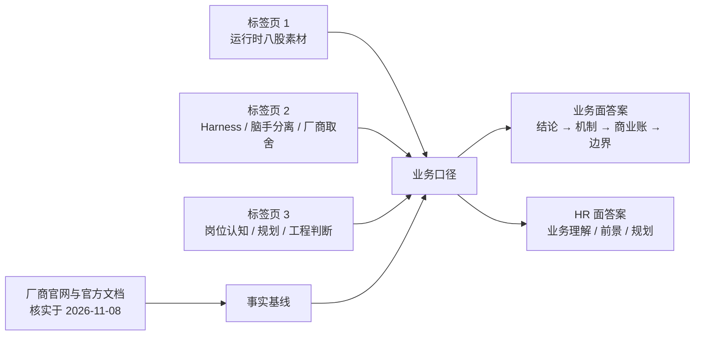

本篇面向 **业务面 / 部门面（懂技术的业务面试官）**，不考八股，考的是：<u>你能不能把「Agent 运行时」这件技术的事，讲成一门生意</u>。素材沉淀自本机 Chrome 的三个豆包对话标签页（见「证据口径」），厂商事实全部回溯到官网/官方文档/权威报道并标注日期；**观点与推导单独标注，面试中不可当事实讲**。已有技术细节回 [Agent 执行循环与工具体系](/interview/qa/agent-loop-and-tools)、[AI 全栈应用架构](/interview/qa/fullstack-ai-app)；HR 侧的同一套材料怎么讲，见 [HR 面业务前景与个人规划](/interview/hr/business-outlook-qa)。



## 〇、证据口径（**先读，避免面试翻车**）

| 标记         | 含义                                                                                  | 面试中的允许表述             |
| ------------ | ------------------------------------------------------------------------------------- | ---------------------------- |
| **【素材】** | 三个豆包对话里的问答，是复习记录，**不是权威信源**（页面自带「AI 生成可能有误」提示） | 「我复习时是这么理解的」     |
| **【事实】** | 厂商官网、官方文档、权威媒体报道，附链接与日期，核实于 **2026-11-08**                 | 「公开信息显示，某年某月……」 |
| **【观点】** | 我基于事实做的行业判断与方案推导                                                      | 「我的判断是……，依据是……」   |
| **【项目】** | 本仓库 `content/` 源码笔记与实习复盘，口径见 [证据纪律](/interview/)                  | 「项目里是这么做的」         |

**三个标签页（沉淀来源）：**

| 日期       | URL                                   | 沉淀出的主题                                                                                                             |
| ---------- | ------------------------------------- | ------------------------------------------------------------------------------------------------------------------------ |
| 2026-10-27 | `doubao.com/thread/xYdr6LYmsFaU7XH7U` | JS 事件循环、RPC 连接池、线程池、Redis 锁与热 key、MySQL 线程池 → 本篇 Q17 的运行时佐证                                  |
| 2026-11-07 | `doubao.com/thread/xPIcPEhesZBZVhVvq` | 云端 Agent vs 单体 CLI、分布式 Harness、脑手分离、厂商退出、技术与商业账、用户为何买单、进程/线程/协程 → 本篇 Q1–Q9 主干 |
| 2026-11-07 | `doubao.com/thread/xIeVajQIU2cFblMma` | 岗位认知、Code Agent 质量、Kafka 积压、Redis 死锁排查、Go/Java 并发、HTTP/2、未来规划 → 本篇 Q17–Q20 与 HR 篇            |

:::danger 素材里必须纠正的三处口径（面试说错会直接失分）

1. **「OpenAI 退出托管 Agent、转向 SDK」不准确。** 【事实】下线的是**可视化低代码**的 Agent Builder / Evals（官方 2026-06-03 公告，2026-11-30 停服），而**托管运行时 Agents API 在同期加码**：2026-09-10 进入 public beta，2026-09-29 DevDay 增加 computer use、多 agent、tool search、context compaction，并宣布与 AWS 合作的 Bedrock Managed Agents（见 Q11）。准确说法是「**退低代码画布，进代码优先的托管运行时**」。
2. **「腾讯元器停服 = 腾讯退出 Agent」不成立。** 【事实】元器是偏 C 端/轻量开发者的零代码创作分发平台（官方公告 2026-11-09 停服），替代产品是面向 B 端的腾讯云智能体开发平台 ADP；同期腾讯云反而升级 Agent Runtime 并开放 OpenAPI（见 Q12）。准确说法是「**C 端零代码收缩，B 端托管运行时加码**」。
3. **「国内美团妙手等平台」「$0.08/session-hour 定价」未在官方来源核实**，本篇只作为【观点】背景，不写成事实。数字类结论一律先给口径（谁披露、什么时候、什么样本）。
   :::

## 一、业务理解：这门生意到底在卖什么

### Q1. Managed Agent / Agent API 和模型 API 有什么本质区别？

**结论：** 模型 API 卖 **智能**（按 token 计费、无状态、短请求）；Managed Agent 卖 **能安全稳定跑长任务 Agent 的运行环境**——会话持久化、任务调度、沙箱、工具网关、权限、审计、断点续跑、可观测。【素材：标签页 2「用户为什么会用这种」「从商业、技术角度聊一下」】

**一张账看清差别：**

| 维度     | 模型 API                 | Managed Agent API                          |
| -------- | ------------------------ | ------------------------------------------ |
| 契约     | request → response，一轮 | session → 事件流，可持续数分钟到数小时     |
| 状态     | 调用方自己维护           | 平台托管事件日志，可暂停/恢复/回放         |
| 执行     | 不执行代码               | 沙箱里跑 bash / Python / 浏览器 / 文件读写 |
| 成本     | token 可预测             | 沙箱时长、存储、闲置会话**都计费**，波动大 |
| 责任     | 内容责任为主             | 代码逃逸、数据泄露、租户隔离**平台要兜底** |
| 毛利结构 | 接近无状态转发，易规模化 | 有状态长生命周期对象，边际成本降不下来     |

**业务翻译（面试必说）：** 用户买的不是「更聪明的模型」，是「**不用自己养一套分布式 Harness**」。这也是为什么这个品类叫 **Managed**——被托管的是运行时，不是智能。

### Q2. 为什么说「云端 Agent 和单体 CLI Agent 不适配」？

**结论：** 两者不是同一设计范式，硬搬会在五个维度同时出问题。【素材：标签页 2 原题】

| 维度     | 单体 CLI                      | 云端 / 托管                        | 硬搬的后果             |
| -------- | ----------------------------- | ---------------------------------- | ---------------------- |
| 生命周期 | 进程 = 任务，跑完退出         | HTTP 短请求 + 长任务，需队列解耦   | 接口超时、请求堆积     |
| 安全边界 | 本地可信，直接 shell / 读文件 | 用户 prompt 不可信、多租户         | 命令注入、横向渗透     |
| 状态     | 内存 / 本地文件               | DB / 事件日志 + 租户隔离           | 实例漂移丢状态、串户   |
| 资源     | 独占 CPU 内存                 | 多任务混跑，需配额与隔离           | 一个重任务打挂整个服务 |
| 可观测   | stdout 打印报错               | 全链路 trace、回放、审计、人工介入 | 线上问题无法定位       |

**可复用的是内核，不是运行时：** prompt 模板、规划器、工具 schema、LLM 调用、输出解析可以共用；调度器、沙箱工具网关、状态持久化、权限校验、SSE 推送必须重写。**分层口径**：核心推理层（复用）／运行时层（分开）／接入层（CLI 参数 vs API 网关）。

### Q3. 分布式 Harness 是什么？为什么它成了这一轮产品的共同底座？

**结论：** `Agent = 模型 + Harness`。Harness 是「支架」，负责 Agent 循环、状态机、工具路由、会话管理；**分布式 Harness** 把这套支架从进程里抽出来，做成控制面 + worker 集群，对外提供调度、状态持久化、沙箱隔离、子 Agent 编排、可观测、权限配额。【素材：标签页 2 原题】

**它兜的正是 Q2 那五个坑：** 任务与 HTTP 解耦（队列 + worker + 状态库）、统一 Workspace 抽象（本地盘 / 远端存储 / 沙箱对 Agent 代码透明）、工具调用统一过沙箱网关、多租户配额与隔离、事件日志留痕。

**采分点：** 能说清「Harness 不写 Agent 的思考逻辑」——它把「模型怎么想」和「代码在哪跑」解耦。**雷区：** 把 Harness 说成框架（LangGraph 是编排框架，Harness 是运行底座）。

### Q4. 脑手分离具体切了哪三刀？为什么说是「元 Harness」？

**结论：** Anthropic 把 Agent 虚拟化成三个可独立替换的接口：**Session（追加式事件日志）／ Harness（Agent 循环与工具路由，即「脑」）／ Sandbox（执行代码和改文件，即「手」）**。【事实：Anthropic 工程博客《Scaling Managed Agents: Decoupling the brain from the hands》，anthropic.com/engineering/managed-agents】

```mermaid
flowchart TB
  subgraph Brain[脑 · 控制面]
    H[Harness / Agent Loop<br/>调用模型、路由工具]
  end
  subgraph Session[会话 · 独立持久化]
    S[(append-only Event Log<br/>getSession / emitEvent / wake)]
  end
  subgraph Hands[手 · 可替换资源池]
    SB1[Sandbox / MicroVM]
    SB2[MCP Server]
    SB3[Browser / 自定义工具]
  end
  H -->|execute(name, input) → string| Hands
  H -->|emitEvent / getSession| S
  S -->|wake(sessionId) 恢复| H
  V[(Vault 凭证<br/>沙箱不可达)] -. 代理按需注入 .-> H
```

**三刀各自解决什么：**

1. **手离开容器**：Harness 不再住在容器里，容器变成 **cattle**（无状态、可随时重建）；容器挂了只是一次工具调用失败，按 `provision({resources})` 拉新的，会话不丢。对比早期的 **pet** 模式——session/harness/sandbox 同容器，容器一挂整局皆失，且工程师只能靠 WebSocket 事件流调试，分不清是 harness bug、丢包还是容器离线。
2. **脑也变成 cattle**：事件日志在 Harness 之外，Harness 崩溃后 `wake(sessionId)` + `getSession(id)` 从最后一条事件续跑。
3. **凭证搬出沙箱**：早期「模型生成的代码」和凭证同容器，prompt injection 只要说服模型读自己的环境变量就能拿 token。结构性修法是 token 永不进入沙箱——Git token 在沙箱初始化时注入 remote，MCP/OAuth token 放 Vault，由代理按需取用并验签。

**为什么叫「元 Harness」：** Anthropic 明确说接口要对「尚未被想出来的程序」保持通用（类比 OS 把硬件虚拟成 process / file，让 `read()` 跨几十年不变）。理由是 **harness 会随模型进步而过时**——官方举例：Sonnet 4.5 有「context anxiety」（快到上下文上限就草草收尾），harness 里加了 context reset；换到 Opus 4.5 该行为消失，reset 反而成了死重量。**所以平台只对接口形状有主张，不对背后实现有主张。**

**采分点：** 记住 `execute(name, input) → string` 这个极窄契约——它让「手」可以是容器、手机、MCP server，也让多个「脑」可以互相传递「手」。

### Q5. 从技术角度，托管 Agent 平台难在哪？脑手分离是不是银弹？

**结论：** 难在平台要兜底「长任务、资源不可预测、代码执行安全、异构运行时、可观测」五件事；脑手分离是当前最优解，但用分布式复杂度换隔离，不是免费午餐。【素材：标签页 2「从商业，技术角度聊一下」+【观点】】

| 收益                               | 对应的代价                                             |
| ---------------------------------- | ------------------------------------------------------ |
| 故障隔离：沙箱崩不拖垮会话         | 多节点事件一致性、断点恢复、任务重试                   |
| 安全边界清晰：高危动作统一过网关   | 每次工具调用变成远程 RPC，多轮循环延迟累积             |
| 推理算力 / 执行算力独立扩缩        | 抽象泄露：开发者仍会依赖沙箱预装包、文件路径、网络策略 |
| 同一套 Agent 代码本地 / 云端双形态 | 逃逸防御是持续军备竞赛，需长期安全团队投入             |

**技术取舍一句话：** 有成熟容器 / 沙箱 / 安全底座的厂商适合做（AWS、Anthropic、腾讯云）；没有底座却强行全托管的，稳定性和事故风险不可控。**趋势【观点】：从「全链路托管循环」转向「薄托管」——平台卖标准化 Hands（沙箱 + 会话 + 工具网关），Brain 交还开发者。**

### Q6. 从商业角度，为什么一批厂商收缩或下线？

**结论：** 这是 **高成本、高风险、窄客户池** 的生意，不是技术做不出来。【素材：标签页 2 +【观点】】

1. **算力成本不可控**：token 可预测，沙箱按时长和资源占用烧钱；用户写个死循环、长期编译，成本持续跑。定价高吓跑用户，补贴则越用越亏。
2. **边际成本降不下来**：模型 API 近似无状态转发；托管 Agent 每个会话是有状态长生命周期对象，占存储、队列、连接，规模摊薄效应弱。
3. **责任边界**：托管执行环境意味着平台替用户承担逃逸、内网渗透、违规内容、数据泄露的**第一责任**；SDK 模式责任清晰得多。
4. **付费客户池被两头挤**：大客户有云原生团队，自建脑手分离；小客户只用 SDK + 轻量执行，不愿付溢价；中间层很窄。
5. **锁定悖论**：深度依赖平台 Workspace / 沙箱 API 才形成锁定，但锁定强了开发者怕被绑；做成 MCP 这类标准协议锁定又变弱，收不到溢价。

**两种路线：** A 全托管（高 SLA + 安全审计 + 合规背书，卖企业大客户，规模天花板低）；B 只卖 SDK + 独立沙箱 API（成本可控、责任清晰、规模化好，但把运行时负担还给开发者）。

### Q7. 既然账这么难算，用户为什么还会用？

**结论：** 用户买的是 **「Agent 生产环境的运维、安全、合规兜底」**，不是便宜。【素材：标签页 2 原题】

| 用户类型                | 真实诉求                                                                            |
| ----------------------- | ----------------------------------------------------------------------------------- |
| 早期验证团队 / 初创     | 没有平台与安全人力，自建 Harness 常要 1–3 个月；接 SDK 几天就能跑带代码执行的 Agent |
| 金融 / 法务 / 政企      | 全链路留痕不可篡改、执行环境隔离、数据不出域，把高危执行风险转移给厂商 SLA          |
| 负载波动大的试点        | 任务从几秒到几小时，自建要么预留资源空转、要么高峰排队，托管按需弹性更划算          |
| 需要快速调 Agent 的团队 | 开箱即用的会话回放、全链路 trace、沙箱快照、标准化工具集，降低评估成本              |

**反过来，谁不会用【观点】：** 有稳定云原生团队且长期大规模跑（嫌溢价与抽象泄露）、延迟极敏感（远程 Hands 累积延迟）、强私有化数据不出内网、以及「只调 LLM + 简单 API 工具、根本不执行代码」的轻量 Agent。

**采分点：** 说出「**用户不是买 Agent 能力，是买运行环境**」这一句，比列举五个功能更像懂业务。

### Q8. 结合我做过的项目，平台该自建还是托管？给一个能落地的决策矩阵

**【项目】** 阿里妈妈经营托管 Agent 走的是 **workflow + agent + 置信度门控 + 评测**：必经步骤（查订单 / 查政策）放 workflow，证据充分后才让 agent 判断，生成前门控、不够就追问或转人工；指标看误放率 0%、误拦率 17%（口径见 [行为面 Q1](/interview/hr/behavioral)）。这类 **确定性高、不需要任意代码执行、强审计** 的业务，本质不需要重型沙箱运行时。

**【观点】决策矩阵：**

| 判据                         | 选托管                 | 选自建                           |
| ---------------------------- | ---------------------- | -------------------------------- |
| Agent 是否跑任意代码 / shell | 是，且缺安全团队       | 否，或已有沙箱底座               |
| 任务时长                     | 分钟到小时、需暂停恢复 | 秒级、可无状态重试               |
| 合规与审计                   | 需厂商 SLA / 背书      | 自建已能满足等保与留痕           |
| 流量曲线                     | 波动大、试点期         | 稳定且规模大，自建更省           |
| 差异化来源                   | 在业务知识与上下文     | 在运行时本身（调度、隔离、成本） |
| 迁移容忍度                   | 可接受厂商抽象         | 必须多厂商可迁（MCP 化工具）     |

**风险对冲（面试加分）：** 工具层一律走 MCP 等开放协议，把「平台特有抽象」压到最薄；会话与事件日志按可导出格式落地。理由见 Q11——OpenAI 的 Agent Builder 从发布到停服只有约八个月，**平台层的抽象是最不该押注的资产**。

## 二、前沿进展：Anthropic / OpenAI / 腾讯 / 其他（**核实于 2026-11-08**）

### Q9. 一句话给四家厂商定位

| 厂商                         | 2026 年动作                                                                                                                                    | 我的读法【观点】                               |
| ---------------------------- | ---------------------------------------------------------------------------------------------------------------------------------------------- | ---------------------------------------------- |
| **Anthropic**                | Claude Managed Agents 公测，主推脑手分离与「元 Harness」                                                                                       | 全托管执行面，赌接口稳定性而非某个 harness     |
| **OpenAI**                   | 下线 Agent Builder / Evals；上线并强化 Agents API 托管运行时                                                                                   | 退低代码画布，进代码优先托管 + 生态分发        |
| **腾讯**                     | 元器（C 端）停服；ADP 4.0 与 Agent Runtime（B 端）加码并开放 API                                                                               | 资源从 C 端智能体广场收拢到企业级 Agent Infra  |
| **AWS / Google / Microsoft** | Bedrock AgentCore（Runtime / Memory / Gateway / Identity / Policy…）、Gemini Enterprise Agent Platform 的 Agent Runtime、Foundry Agent Service | 云厂商把 Agent 当一等云资源，卖控制面 + 执行面 |

### Q10. Anthropic Claude Managed Agents 具体做到哪一步？

**【事实】时间线：** 2026-04-08 公测（第三方报道，官方博客与文档已上线）；官方文档现已提供 quickstart 与多语言 SDK（Python / TS / Java / Go / C# / Ruby / PHP）及 `ant` CLI。

**四个一等原语（官方文档 Core concepts）：**

| 原语          | 定义                                                                | 类比                |
| ------------- | ------------------------------------------------------------------- | ------------------- |
| `Agent`       | 模型 + system prompt + 工具 + MCP servers + skills，可复用配置      | 镜像定义            |
| `Environment` | 会话在哪跑：Anthropic 托管云沙箱 **或自托管沙箱**、网络策略、预装包 | 运行环境模板        |
| `Session`     | 某 Agent 在某 Environment 里的一次运行，产出物与状态持久化          | 容器实例 / 工作单元 |
| `Events`      | 应用与 Agent 之间流动的消息（用户输入、工具结果、状态）             | 事件流 / 日志       |

**API 形状（【事实】依官方文档 quickstart，Python 示意）：**

```python
agent = client.beta.agents.create(
    name="Coding Assistant",
    model="claude-opus-5-5",
    system="Write clean, well-documented code.",
    tools=[{"type": "agent_toolset_20260401"}],
)
env = client.beta.environments.create(
    name="quickstart-env",
    config={"type": "cloud", "networking": {"type": "limited"}},
)
session = client.beta.sessions.create(agent=agent.id, environment_id=env.id)

with client.beta.sessions.events.stream(session.id) as stream:
    client.beta.sessions.events.send(
        session.id,
        events=[{"type": "user.message", "content": [{"type": "text", "text": "..."}]}],
    )
    for event in stream:                    # agent.message / agent.tool_use / session.status_idle
        ...
```

:::note 两个容易被追问的工程细节
**先开流、再发消息**——事件流只推送打开之后发生的事件；**不是 while 循环**——应用只负责 send events / read events，循环、恢复、上下文管理都在平台侧。这正是 Q4「元 Harness」在 API 层的兑现。
:::

**能力面（【事实】官方博客）：** Vaults 凭证隔离（信封加密 + 签名请求校验）、自托管沙箱 + MCP tunnels（代码、文件系统、网络出口不出客户边界）、Console 会话时间线回放、Memory 与 Dreaming（周期性复盘会话、提炼记忆）、outcomes（按 rubric 自评）、多 Agent 编排、权限策略、webhooks；多 Agent 与自评在部分资料中仍标 research preview，**面试中按「预览能力」说，别打包成 GA**。

**量化口径（【事实】厂商自测，非第三方基准）：** 官方博客称因「Claude 可先开始推理、沙箱并行拉起，不跑工具的会话干脆不建容器」，TTFT 中位数降低约 **60%**、p95 降低 **90%+**；客户案例提到 Notion、Rakuten、Sentry、Asana、Atlassian。**数字一律加「官方自述」，不要说成行业基准。**

### Q11. OpenAI 到底是退出还是加码？把两条线分开讲

**【事实】线 A：低代码托管层退场。**

- 2026-06-03 OpenAI 在 AgentKit 页面公告 **winding down Agent Builder 与 Evals**，2026-11-30 起不可用；Evals 2026-10-31 先转只读。
- 官方迁移指引：**需要保留确定性的流程 → Agents SDK（代码优先）；适合自然语言描述的 → ChatGPT Workspace Agents**。导出工具**不保证**工作流图、控制流分支、触发器、外部凭证与知识库配置完整迁移。
- Assistants API 是另一条独立下线（2026-08-26，第三方汇总，未在本次核实中查到官方原文，口述建议只说「旧版 Assistants API 已退役」）。

**【事实】线 B：托管运行时加码。**

| 时间              | 动作                                                                                                                                                                   |
| ----------------- | ---------------------------------------------------------------------------------------------------------------------------------------------------------------------- |
| 2026-09-10        | **Agents API** 进入 public beta（第三方报道，官方 DevDay recap 与 Agents 指南已上线）                                                                                  |
| 2026-09-29 DevDay | Agents API 增加 **computer use**（OpenAI 托管浏览器）、Codex 的多 Agent 能力、tool search、tool calling、context compaction；OpenAI runs the underlying infrastructure |
| 2026-09-29 DevDay | **Bedrock Managed Agents, powered by OpenAI**：与 AWS 合作，把 Agents API 能力原生跑在 AWS 内                                                                          |
| 同期              | **Decisions API**（有限选项的实时分类/路由）、MCP Events 支持                                                                                                          |

**三档并存（选型的采分点）：**

| 形态           | 循环在哪跑                  | 状态谁管                                                          |
| -------------- | --------------------------- | ----------------------------------------------------------------- |
| Responses API  | 你的代码调模型              | 自己管历史 / Conversations                                        |
| Agents SDK     | 你的应用内                  | 自己管部署、存储、审批、运行时集成                                |
| **Agents API** | OpenAI 托管的 Codex harness | OpenAI 保存会话设置与轮次历史，提供 context compaction 与失败恢复 |

:::warning 面试最忌讳的结论
「OpenAI 证明了托管 Agent 没市场」——**恰恰相反**：它砍的是八个月寿命的可视化画布，同时把资源压到托管运行时和生态分发上。真正被验证的是：**开发者不接受被平台托管的低代码循环，但愿意为托管的执行、会话与恢复买单**。另注意 Agents API session ≠ SDK session ≠ Responses conversation，**迁移状态要自己做**。
:::

### Q12. 腾讯的路线怎么读？元器停服是不是坏消息？

**【事实】C 端收缩：** 腾讯元器官方《关于元器平台停止服务通知》——因业务调整 **2026-11-09 停服**；2026-10-29 起停止创建新智能体与 API key 分发；停服后关闭应用访问、数据读写、API 调用与控制台，发布到公众号/服务号/微信客服的智能体不再响应；数据导出过渡期至 2027-01-09；官方推荐迁移至 **腾讯云智能体开发平台（ADP）** 或公众号智能回复。权威报道补充：元器 2024-05 发布、偏 C 端与元宝结合；ADP 2025-05 上线、面向 B 端，强调数据接入、安全隔离、跨角色协作。

**【事实】B 端加码（这才是 Managed Agent API 的主线）：**

| 时间       | 产品动作                                                                                                                                                                                                                                     | 与托管运行时的关系                     |
| ---------- | -------------------------------------------------------------------------------------------------------------------------------------------------------------------------------------------------------------------------------------------- | -------------------------------------- |
| 2025-09-16 | 腾讯云发布 **Agent Runtime**（执行引擎、云沙箱、上下文服务、网关、安全可观测五大组件）                                                                                                                                                       | Agent 成为一等云资源                   |
| 2026-06-05 | **ADP 4.0** 升级企业级 AgentOps，新增 **Claw 模式**（Agentic Loop、云端沙箱自主编码、长时任务、可经 API/Web 集成到业务系统）；Agent 与 Workflow 双向互调                                                                                     | 低代码平台向「可编程长任务 Agent」演进 |
| 2026-06    | 腾讯云把 ADP 4.0 的 AgentOps 底座通过 **OpenAPI** 开放：客户在自己系统里通过 API **发起 Agent 任务、接入会话、读写文件、获取流式输出**                                                                                                       | 典型的 Managed Agent API 形态          |
| 2026-10-29 | 全球数字生态大会升级 Agent Runtime 矩阵：Agent 沙箱 / AgentCBS / AgentCFS / Agent Bucket / 可观测，开源 **CubeSandbox**，训练场景把执行环境与 Harness 解耦，服务场景提供 **Managed Harness**、Agent Cluster（兼容 K8s / BYOC）、Agent Engine | 与 Anthropic 脑手分离同构              |

**【事实】披露指标（厂商通过媒体披露，非第三方实测）：** 沙箱最快 **60ms** 启动、同构镜像每分钟交付 60 万沙箱 / 异构 16 万、单地域百万级同时在线；Agent 记忆在 1500 项任务测试中任务完成率 +30%、Token -60%；会话可运行 7 天、暂停保留 30 天；Agent 网关零凭证 / 零信任，敏感凭证托管在沙箱外按任务授权。

**【观点】一句话读法：** 腾讯不是退出，是**把 C 端智能体广场的资源，收拢到「云基础设施 + 企业级 AgentOps」这条更能收费、也更能形成壁垒的线上**——元器是 B 类零代码平台，ADP/Agent Runtime 才是 A 类托管 Harness，两者不能混为一谈（这正是素材里最容易讲错的地方）。

:::note 云业务视角的补充
本篇讲的是**厂商路线**。若被问到「云业务怎么赚钱」「Agent 为什么天然长在云上」「Managed Agent API 在云产品栈里处于哪一层」，见 [云业务与 Agent](/interview/qa/cloud-business-agent)：基于 ADP 官方产品页与文档，含四种范式、10 大模块 100+ OpenAPI、Agent Harness、三种部署与套餐分层。
:::

### Q13. 横向对比：四套托管运行时的抽象层差在哪？

| 维度               | Anthropic Managed Agents               | OpenAI Agents API                                 | 腾讯云 ADP / Agent Runtime                  | AWS Bedrock AgentCore                           |
| ------------------ | -------------------------------------- | ------------------------------------------------- | ------------------------------------------- | ----------------------------------------------- |
| 核心资源           | Agent / Environment / Session / Events | Session（托管 Codex harness）                     | Agent 应用 / 会话 / 沙箱 / Workspace        | Runtime / Memory / Gateway / Identity / Policy… |
| 状态模型           | append-only 事件日志，可回放恢复       | 平台保存会话设置与轮次历史                        | 会话持久化 + 快照/暂停/恢复/克隆            | 会话级隔离 + 短期/长期记忆                      |
| 执行隔离           | 云沙箱或自托管沙箱 + Vault             | OpenAI 托管沙箱与浏览器                           | Cube 内核级强隔离 + 零凭证网关              | 每会话独立 microVM                              |
| 模型绑定           | Claude 系                              | OpenAI 系                                         | 多模型（TokenHub 接入混元/DeepSeek/GLM 等） | 任意框架、任意模型                              |
| 私有化抓手         | 自托管 Sandbox + MCP tunnels           | Bedrock Managed Agents（跑在 AWS 内）             | BYOC / 数据不出域 / 专有云                  | VPC 原生                                        |
| 差异化落点【观点】 | 接口长寿（元 Harness）                 | 生态与分发（ChatGPT 12 亿周活口径来自官方 recap） | 云基础设施成本与弹性                        | 企业治理、策略与审计                            |

### Q14. 从这些动向里能读出什么趋势？（**观点题，最考业务理解**）

1. **会话（Session）正在取代请求（Request）成为一等抽象**：资源、计费、观测、恢复都围绕会话展开；「session-hour」这类计价的出现，意味着成本模型从 token 单点转向「token + 沙箱时长 + 存储 + 闲置」。
2. **控制面与执行面分层**：Anthropic / OpenAI 偏执行面，云厂商与企业平台偏身份、策略、审计的控制面；平台价值从「跑起来」转向「管得住」。
3. **薄托管成为共识**：全托管循环太重，平台更愿意卖沙箱、会话、网关、可观测，Brain 还给开发者（对应 Q5）。
4. **Harness 随模型漂移，接口必须比实现长寿**：Q4 的 context anxiety 例子是最好的论据，也是「为什么 API 要设计成事件流 + 声明式配置」的商业解释。
5. **冷启动与闲置成本成为新竞争指标**：60ms 沙箱、会话休眠/快照唤醒、按会话暂停释放算力——比的已经不是模型，是云基础设施效率。
6. **开放协议是逃生舱**：MCP / A2A 等标准让工具层跨平台复用，对冲平台下线风险（Agent Builder 八个月生命周期是现成教材）。

**口述收尾：** 「所以我不把最近的产品关停理解成赛道退潮，而是**形态洗牌**：能被标准化、能被云规模化的运行时在往 B 端收，靠低代码画布做 C 端智能体广场的形态在退。」

### Q15. 如果面试官说「这些都是厂商宣传稿」，怎么回应？

**先分化，再给可验证口径**【观点 + 证据纪律】：

- 承认边界：「TTFT -60%、60ms 冷启动、任务完成率 +30%，都是厂商自测或媒体转述，样本与 baseline 未公开，我不会当行业基准引用。」
- 给可自己验的指标：会话恢复成功率、p95 首 token、沙箱冷启动 p50/p99、单次工具调用 RTT、失败后重放一致性、单位 DAU 的沙箱 + 存储成本、迁移出平台所需人日。
- 给可自己验的动作：跑一个「跑到一半杀沙箱 / 断网 / 客户断连」的故障注入，看会话能否从事件日志续跑；把同一工具层分别在两家平台接一次，量迁移成本。
- 落到工程纪律：**不把推导讲成已落地**（见 [证据纪律](/interview/)），量化结论先给 baseline、分子分母、采集位置。

## 三、把八股串成运行时判断（Q16–Q20）

### Q16. 长任务为什么必须「HTTP 请求」与「任务」解耦？链路里哪些地方会阻塞？

**【素材】标签页 1「从一次请求到 js 到 rpc 请求到连接池，有哪些地方会阻塞」+ 标签页 3「http/2 与 tcp」**

Agent 任务跨分钟/小时，HTTP 短请求扛不住：必须 **提交任务 → 队列 + worker → 状态库 → SSE/事件流回推**。阻塞点分五类：

| 层        | 典型阻塞                                                                    | 托管平台的对应设计                                |
| --------- | --------------------------------------------------------------------------- | ------------------------------------------------- |
| JS / Node | 同步 CPU 计算、大 JSON 序列化占死 Event Loop；DNS 走 libuv 线程池，池满排队 | 重计算下沉沙箱，宿主只做事件泵                    |
| 连接池    | 无空闲连接排队、新建 TCP/TLS 握手、探活、锁竞争                             | 沙箱池化 + 预创建 + 获取超时必设                  |
| 协议层    | 序列化、send buffer 满、gRPC/HTTP2 流控窗口                                 | 事件流增量推送，避免大 payload                    |
| 传输层    | HTTP/2 解决了 HTTP 层队头阻塞，**TCP 丢包仍阻塞整条连接所有 stream**        | 断线重放（session event log）而非依赖长连接不中断 |
| 远端      | 服务端慢查询、队列积压反向传导                                              | 任务级超时、熔断、可重试工具调用                  |

**采分点：** 能区分 **主线程阻塞（坏阻塞，影响所有请求）** 与 **IO / 资源等待（正常阻塞，只卡当前调用）**。

### Q17. 沙箱池化会踩哪些熟悉的坑？用三个中间件的类比说清

**【素材】标签页 1 MySQL 线程池 / Redis 热 key / 分布式锁；标签页 3 Kafka 积压、Redis 死锁排查**

- **池上限类比 MySQL `thread_pool_max_transactions_limit`**：全局并发打满后新任务排队；`thread_pool_stall_limit` 把慢查询标记 stalled、释放组内并发名额——对应沙箱里「长任务不能占死整个配额」，需要任务级配额与抢占。
- **热点类比 Redis 热 key**：某个热门 Agent / 工具被突发打爆，本地二级缓存、key 分片、限流熔断同样适用；**超时 ≠ miss**——沙箱拉起失败不能「缓存空结果」，否则把故障写进状态、拉长故障时间。
- **状态归属类比分布式锁**：加锁 `SET key uuid NX EX`、释放走 Lua 原子校验归属，否则误删别人的锁；对应会话租约 / 沙箱归属必须有唯一标识 + 过期 + 原子释放，配合看门狗续期。
- **消费积压类比 Kafka lag**：lag 持续涨＝消费跟不上；lag 不动＝worker 挂了；lag 震荡＝频繁 rebalance。对应沙箱任务队列要先看指标再调参，别一上来扩 worker（分区/配额不够时扩了没用）。
- **排查链路**：锁等待队列 / 持锁时长告警 → 事件日志看有没有释放记录 → 直查 TTL 是否在被续期 → 区分「卡住」与「锁失效」，后者往往靠业务对账才发现。

**一句话收口：** 分布式 Harness 不是新东西，**是把连接池、队列、锁、可观测这些老问题，在「长任务 + 不可信代码 + 多租户」的新约束下重做一遍**——这也是我准备面试时把八股和 Agent 运行时串起来复习的原因。

### Q18. 如果让我们设计一个最小 Managed Agent API，接口怎么定？

**【观点】方案推导，不是项目已实现。** 只保留四个资源与一个事件流，工具层走 MCP：

```ts
// 1) 声明式配置：模型 / prompt / 工具 / 权限，可复用
type AgentConfig = {
  model: string;
  system: string;
  tools: MCPToolRef[];
  guardrails: { network: AllowList; approval: "none" | "tool" | "all" };
};
type EnvironmentConfig = {
  sandbox: "managed" | "byoc";
  image: string;
  resources: { cpu: number; memMb: number; ttlSec: number };
  credentials: "vault-only"; // 凭证永不进入沙箱
};

// 2) 会话：提交任务与 HTTP 请求解耦，事件流是唯一真相
type Event =
  | { type: "user.message"; content: ContentBlock[] }
  | { type: "agent.message"; content: ContentBlock[] }
  | { type: "agent.tool_use"; name: string; input: unknown; result?: string }
  | {
      type: "session.status";
      status: "running" | "idle" | "failed" | "awaiting_approval";
    };

interface ManagedAgents {
  agents: { create(c: AgentConfig): Promise<{ id: string }> };
  environments: { create(c: EnvironmentConfig): Promise<{ id: string }> };
  sessions: { create(agentId: string, envId: string): Promise<{ id: string }> };
  events: {
    stream(sessionId: string): AsyncIterable<Event>; // 先开流，再发消息
    send(sessionId: string, events: Event[]): Promise<void>;
    since(sessionId: string, cursor: string): Promise<Event[]>; // 断线重放 / 崩溃恢复
  };
  hands: { execute(name: string, input: unknown): Promise<string> }; // 极窄契约
}
```

**设计理由（逐条对上前面）：** 配置与运行分离 → 接口比 harness 长寿（Q4）；事件流外置 → Brain 可无状态重启（Q4）；`vault-only` + 白名单网络 → 凭证不可达（Q4/Q12）；`since(cursor)` → 断连与漂移恢复（Q16）；`hands.execute` 只传 name/input → 沙箱实现可换（Q4）。**边界：** 没做多租户配额、审计不可篡改、跨区域调度、成本归因，生产补齐前不要说成「可用平台」。

### Q19. 一个托管 Agent 平台，你会看哪些指标？

| 类   | 指标                                                    | 为什么是业务指标         |
| ---- | ------------------------------------------------------- | ------------------------ |
| 体验 | 首 token p50/p95、单次工具调用 RTT                      | 直接决定用户等不等       |
| 可靠 | 会话恢复成功率、沙箱崩溃后任务续跑率、事件重放一致性    | 长任务能不能真上生产     |
| 效率 | 冷启动 p50/p99、闲置会话算力释放比、单会话沙箱/存储成本 | 决定毛利，不只是技术炫技 |
| 安全 | 凭证是否沙箱不可达、网络白名单粒度、审计可回溯时长      | 决定企业客户能不能采购   |
| 成本 | 单位 DAU 运行时成本、单位任务 token + 沙箱 + 存储       | 定价能不能覆盖成本       |
| 迁移 | 换平台所需人日、工具层 MCP 化比例                       | 对冲平台下线风险（Q11）  |

### Q20. 「对业务的理解」在这一题里到底怎么体现？

**【观点】** 不是背厂商产品名，是能连成一条因果链：

> **模型变强 → 任务变长、执行变多 → 单体 CLI 的运行时假设失效 → 需要分布式 Harness → 脑手分离把状态/执行/推理解耦 → 平台因此要承担成本与安全责任 → 商业上只有高客单价企业客户与规模化云基础设施能扛住 → 于是低代码 C 端平台收缩、B 端托管运行时加码。**

能讲出这条链，再落到「**所以我做 Agent 时会把工具层做成开放协议、把状态做成可导出的事件日志、把确定性步骤放进 workflow**」（【项目】阿里经营托管 Agent 的工程选择），业务面就不再是背新闻。

## 四、速背卡

**3 分钟口述版：**

> Managed Agent 卖的不是模型，是「能安全稳定跑长任务 Agent 的运行环境」。单体 CLI 的状态在内存、工具直接跑 shell、进程即任务，上云会同时踩生命周期、安全、状态、并发、可观测五个坑，所以要把运行时抽成分布式 Harness。Anthropic 的做法是脑手分离：Session 是外置的追加式事件日志，Harness 是负责推理和工具路由的脑，Sandbox 是可以随时重建的手，接口压到 `execute(name, input) → string`；凭证放 Vault，沙箱里永远拿不到。这样容器从 pet 变 cattle，脑挂了也能靠 `wake(sessionId)` 从事件日志续跑。
>
> 商业上这门生意不好做：沙箱和长会话的边际成本降不下来，平台还要替客户承担逃逸和泄露责任，付费客户池又夹在「大客户自建」和「小客户只用 SDK」之间。所以 2026 年的动向不是简单的「退出」：OpenAI 下线的是低代码 Agent Builder，同时把 Agents API 这个托管运行时加码到 computer use 和多 Agent；腾讯元器这类 C 端零代码平台停服，资源收拢到 ADP 4.0 和 Agent Runtime 这类 B 端托管底座；Anthropic、AWS 继续做全托管执行面。**我的判断是形态洗牌而不是赛道退潮**——云规模化的运行时在往 B 端收，靠画布搭 bot 的形态在退。
>
> 落到我自己做过的项目：我在阿里妈妈做经营托管 Agent 时，把查订单、查政策这些必经步骤放进 workflow，agent 只在证据充分后判断，生成前加置信度门控。这套「确定性步骤 + 可审计 + 可回滚」的思路，和托管平台把高危执行收口到沙箱网关是同一个逻辑：**不确定的模型，要放进确定的业务约束里。**

**雷区清单：**

- ❌ 说「OpenAI 退出托管 Agent」「腾讯不做 Agent 了」——把低代码层与运行时层混为一谈。
- ❌ 把厂商自测数字（TTFT -60%、60ms、1500 项任务 +30%）当行业基准，不给口径。
- ❌ 把 research preview 的多 Agent / 自评说成 GA；把第三方报价当官方定价。
- ❌ 只讲架构不讲账：业务面一定要出现**成本、责任边界、付费客户池、迁移成本**这几个词。
- ❌ 把「方案推导」讲成「项目里已经做了」；Q18 的接口设计必须声明是推导。

## 五、来源清单（核实于 2026-11-08）

**官方 / 一手**

| 来源                                                                                                                                        | 用于                                                                    |
| ------------------------------------------------------------------------------------------------------------------------------------------- | ----------------------------------------------------------------------- |
| Anthropic《Scaling Managed Agents: Decoupling the brain from the hands》 `anthropic.com/engineering/managed-agents`                         | Q3–Q5 脑手分离、pets/cattle、context anxiety                            |
| Claude Blog《The evolution of agentic surfaces: building with Claude Managed Agents》 `claude.com/blog/building-with-claude-managed-agents` | Q4/Q10 Vaults、TTFT、自托管沙箱、MCP tunnels、Memory/Dreaming、客户案例 |
| Claude Platform Docs《Get started with Claude Managed Agents》 `platform.claude.com/docs/en/managed-agents/quickstart`                      | Q10 四原语、API 形状、先开流再发消息                                    |
| Claude Academy《Building your first managed agent》 `academy.claude.com/courses/claude-platform-101/building-your-first-managed-agent`      | Q10 四原语与最小示例                                                    |
| OpenAI《Introducing AgentKit》页面 2026-06-03 更新 `openai.com/index/introducing-agentkit`                                                  | Q11 停服公告与迁移指引                                                  |
| OpenAI《DevDay 2026 Recap》 `openai.com/index/devday-2026-recap`                                                                            | Q11 Agents API / computer use / Bedrock Managed Agents / Decisions API  |
| 腾讯元器《关于元器平台停止服务通知》 `yuanqi.tencent.com/cl/service-discontinuation`                                                        | Q12 停服时间、数据导出、替代产品                                        |
| 腾讯元器《用户数据导出指南》 `yuanqi.tencent.com/cl/data-export-guide`                                                                      | Q12 迁移窗口                                                            |

**权威媒体 / 行业报道（用于日期与产品动作，数字均为厂商披露）**

- 中国经济网 / 腾讯网《突发公告：11月9日停止服务》 `m.ce.cn/bwzg/202610/t20261020_3265591.shtml` — 元器与 ADP 定位差异、吴运声口径。
- 中国日报网《Agent 进入"生产级"时代！腾讯云 ADP4.0 发布》 `cn.chinadaily.com.cn/a/202606/08/...` — Claw 模式、Agent 与 Workflow 双向互调。
- 中国日报网《腾讯云吴永坚：Agent 竞争力不再只是模型》 `cn.chinadaily.com.cn/a/202606/12/...` — AgentOps OpenAPI、Agent Runtime 五大件、披露指标。
- 消费日报网《腾讯云 Agent Runtime 产品矩阵全新升级》 `xfrb.com.cn/content/202611/03/...` — CubeSandbox、60ms、快照/暂停/恢复。
- 腾讯网《Token 暴涨 5000 倍之后，企业 Agent 落地还卡在哪里？》 `new.qq.com/rain/a/20261104A0EC1D00` — Managed Harness、BYOC、闲置成本。
- Managed Agent Platforms 汇总 `compilenrun.com/docs/ai/agents/agents-frameworks/agents-managed-agent-platforms` — AWS / Google / Microsoft 组件对照。
- 第三方关于 2026-04-08 公测、Agents API public beta 日期、DevDay 2026-09-29 的报道 —— **日期类结论已在正文标「第三方报道」**，面试口述若不确定，用「2026 年上半年 / 9 月 DevDay」这类更稳的口径。

:::note 维护提示
这个品类按月变化（元器停服日 2026-11-09、OpenAI 停服日 2026-11-30 都在本周之后）。**面试前一天按上表重查一次官方状态页与 deprecations 页**，不要拿本篇的时间线当永久事实。
:::
