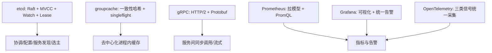

:::note 事实基线
本篇是「中间件与分布式基础设施」带解答题库，共 **95 题**，事实来源为 `content/be/middleware.md`，默认值与行为以各组件当前主版本为准：**etcd 3.6**、**gRPC**（HTTP/2 + Protobuf）、**Prometheus 3.x**、**OpenTelemetry 1.x**（参数默认值核对对应官方配置文档，实例化结论需以本机配置与指标实测为准）。本篇是「知识点」型题库（非单一项目）。**Kafka 的机制深挖见 [ClickHouse 与 Kafka 技术深挖题库](/interview/qa/clickhouse-kafka)**（本篇只在「消息机制选型」处对比 Kafka/etcd Watch/Redis Pub-Sub）；与 [分布式组件与一致性题库](/interview/qa/distributed-components)、[RPC 与网络编程题库](/interview/qa/rpc-and-network) 互补——本篇讲这些中间件的机制本身与选型。
:::

本篇是「中间件与分布式基础设施」题库。它的面试价值在于：**etcd（强一致协调）、groupcache（去中心化进程内缓存）、gRPC（HTTP/2 RPC）、Prometheus/Grafana/OpenTelemetry（可观测性三支柱）是后端分布式系统的标准基础设施**，面试常以「讲讲 Raft / 一致性哈希 / singleflight / HTTP/2 多路复用 / Protobuf 编码 / 拉模型监控 / 链路追踪采样」的形式出现。本篇的组织顺序是：**先讲 etcd → 再讲 groupcache → 再讲 gRPC → 再讲 Prometheus → 再讲 Grafana → 再讲 OpenTelemetry → 最后讲综合可观测性体系与中间件选型**。

**主线一览**



## 一、etcd：强一致的分布式键值存储

### Q1. etcd 的定位是什么？理解它要抓住哪三条主线？

etcd 的定位是「**小而可靠**」：数据量不大，但要求线性一致、支持 Watch 与租约，是 Kubernetes 等系统的元数据底座。理解它要抓住三条主线——**Raft 共识决定写入是否提交、MVCC 决定历史版本如何保存与查询、Lease/Watch 决定它如何被用作协调与发现组件**。

### Q2. etcd 的数据模型与普通 KV 的差别是什么？

etcd 对外是一个**扁平的键空间，所有键按字典序排列，天然支持前缀查询**。与普通 KV 的差别在于每个键都携带版本信息：**revision**（全局单调递增的逻辑时钟，由 Raft 提案序列决定其顺序，一次事务内多个操作共享同一个 main revision、用 sub revision 区分先后）、**create_revision / mod_revision / version**（分别表示该键创建、最后一次修改、被修改的次数）、**lease**（键可绑定租约，租约到期后键自动删除）、**tombstone**（删除并非立即抹掉，而是写入一条删除标记，历史版本仍可查询）。

由于所有键有序，range 查询（`WithPrefix`、`WithRange`）是 O(log N + M) 的树遍历加顺序扫描，而不是全表扫描。这个模型直接决定了 etcd 擅长「按前缀组织的配置、服务实例、元数据」，而不适合存放大对象。

### Q3. Raft 把一致性问题拆成哪三个子问题？选主的两条工程关键点？

Raft 把一致性问题拆成**选主、日志复制、安全性**三个子问题。节点在 Follower、Candidate、Leader 三个状态间迁移：Follower 在 election timeout 内没有收到 Leader 心跳就转为 Candidate，递增任期并请求投票，获得多数票（N/2+1）者成为 Leader。

选主的两条工程关键点：① **日志较新的节点优先当选**——投票时先比较最后一条日志的任期，再比较索引，保证新 Leader 一定包含所有已提交日志；② **选举超时随机化**——在 [electionTimeout, 2×electionTimeout) 内取值，避免多个节点同时发起选举导致选票被反复瓜分（活锁）。

### Q4. Raft 的日志复制流程是什么？为什么跨机房会放大写延迟？

客户端写入只能发给 Leader；Leader 把条目追加到本地日志（此时尚未提交），并行向所有 Follower 发 AppendEntries；**当多数节点复制成功后，Leader 推进自己的 commit index 并把日志应用到状态机**，随后通过下一次心跳把 commit index 告知 Follower。因此「**多数派确认**」是一次写延迟的组成部分，跨机房部署会直接放大写延迟（多数派里至少一个节点在远端机房，RTT 进入写路径）。

### Q5. Raft 的五条安全性不变量是什么？

| 不变量               | 含义                                                   |
| -------------------- | ------------------------------------------------------ |
| Election Safety      | 同一任期内最多一个 Leader                              |
| Leader Append-Only   | Leader 从不覆盖或删除自己的日志                        |
| Log Matching         | 两条日志在相同 index/term 上一致，则此前所有条目都一致 |
| Leader Completeness  | 已提交的条目一定存在于所有后续 Leader 的日志中         |
| State Machine Safety | 同一 index 上所有节点应用相同命令                      |

### Q6. etcd 在标准 Raft 上补充了哪几项工程优化？

① **PreVote**——节点在真正递增任期前先试探能否拿到多数票，避免网络分区恢复后把健康的 Leader 逼下台；② **CheckQuorum**——Leader 周期性确认自己仍与多数节点连通，否则主动退位，减少「僵尸 Leader」读；③ **Learner**——只复制日志、不参与投票的角色，用于新节点先追平数据再晋升，避免扩容期间多数派被拖慢；④ **成员变更**——通过 ConfChange 执行，且同一时刻只允许一个变更在进行，涉及多节点的复合变更会先进入**联合配置（joint consensus）**再退出，避免出现两个互不相交的多数派。

**采分点**：能说出「**PreVote 防分区恢复逼下台健康 Leader + CheckQuorum 防僵尸 Leader + Learner 防扩容拖慢多数派 + 联合配置防两个不相交多数派**」——这四项是「标准 Raft 到生产级 Raft」的关键补强。

### Q7. etcd 的 MVCC 如何实现？历史读的开销与什么有关？

etcd 的 MVCC 由**内存索引加本地存储引擎**组成：内存中为每个键维护一个 keyIndex，记录该键在各代（generation）中出现过的所有修改版本（一次删除后再写入会产生新的一代）；存储层把 revision 映射到实际的键值对。

读请求的处理路径：先确定要读的 revision（0 表示读最新，正数表示读历史，小于 compact revision 则返回 ErrCompacted），在 keyIndex 中二分查到不晚于目标 revision 的修改版本，再用该版本从存储引擎取出键值；如果命中的是删除标记，则键不存在。**这条路径意味着历史读的开销与当前数据量无关，只与目标键的修改次数有关**。

### Q8. Compact 与 Defrag 有什么区别？如何配合？

**Compact 只做逻辑删除**——丢弃指定 revision 之前的历史版本，键空间的最新值不受影响，好处是控制内存索引与存储增长；**Defrag 才真正重建底层文件、把空洞释放回文件系统**——它需要逐节点执行，并会短暂阻塞该节点的读写。

两者配合的方式：开启自动压缩，把 compact 控制在合理范围；当文件碎片率升高时择机 defrag。碎片率用 `etcd_mvcc_db_total_size_in_bytes`（总量）与 `etcd_mvcc_db_total_size_in_use_in_bytes`（在用）的差距衡量。

### Q9. Watch 为什么不是轮询？使用 Watch 要建立哪些正确认识？

Watch 不是轮询，而是**建立在 gRPC 双向流与 MVCC revision 之上的增量推送**：客户端指定键或前缀、可选指定起始 revision，服务端为每个 watcher 记录监听范围，并按是否落后于当前 revision 分成「需要追赶历史的待同步组」和「只等实时事件的已同步组」，一次写入提交后事件按 revision 顺序投递给匹配的 watcher。

正确认识：① **事件按 revision 全局有序**，跨键顺序可直接依赖 revision，无需业务侧自行排序；② **断线重连后可以从上次处理到的 revision+1 继续**，不必全量重拉（前提是那段历史尚未被压缩），因此客户端必须处理 ErrCompacted（收到后走一次全量读取再重新 Watch）；③ 支持**进度通知（progress notify）**——服务端定期推送一个只带当前 revision 的空事件，用于让客户端感知「连接还活着但暂时没有数据」，也是检测静默断连的手段；④ 支持过滤（只收 PUT 或只收 DELETE）与 PrevKV（事件携带变更前旧值）；⑤ 监听范围过大会增加服务端遍历与匹配成本，要避免「每请求一个 Watch 流」的用法。

### Q10. Lease 如何支撑服务发现？完整生命周期是什么？

Lease 是一个带 TTL 的租约，键绑定租约后生命周期与之绑定：租约到期或被撤销，键自动删除——这正好描述「实例存活期间注册、实例消失后自动摘除」的语义。

**注册方**：① 申请租约（TTL = 10s 量级）；② `Put /services/{svc}/{instance} = 地址与元数据`，绑定租约；③ 后台按约 TTL/3 的节奏续租；④ 优雅退出时撤销租约，实例立即下线。**发现方**：① 首次 Get 前缀，拿到全部实例与该次读取的 revision；② 从 revision+1 开始 Watch 前缀；③ PUT 事件加入实例列表，DELETE 事件移除；④ 定期全量读取兜底，防止长时间断连带来的漂移。

### Q11. 服务发现的可靠性来自什么？TTL 取值如何权衡？

可靠性来自租约的「**超时即失效**」语义：进程崩溃后无法续租，租约到期键被删除；网络分区期间续租失败，但只要 TTL 窗口内恢复就不会误删。两个生产要点：① **TTL 的取值是「故障发现速度」与「误判风险」的权衡**——过短会因偶发网络抖动频繁摘除实例，过长则故障收敛慢；② **续租必须是后台持续行为，并且要把续租失败当作告警信号，而不是静默重试**。

### Q12. Linearizable 读与 Serializable 读的区别？如何选择？

| 模式                 | 一致性                     | 延迟                 | 实现                                                                   |
| -------------------- | -------------------------- | -------------------- | ---------------------------------------------------------------------- |
| Linearizable（默认） | 最强，能读到已提交的最新值 | 最高，需要多数派确认 | Leader 记录 readIndex，发心跳确认自身仍是 Leader，等状态机应用到该索引 |
| Serializable         | 最终一致                   | 最低                 | 直接读本地状态机，可能读到陈旧数据                                     |

选择依据：配置读取、选主、分布式锁等不能读旧值，用默认模式；只做展示、容忍秒级陈旧的大盘类查询可以用 Serializable 读来降低对 Leader 的压力。

### Q13. etcd 的性能瓶颈为什么几乎总是磁盘？集群规模如何取？

etcd 的性能瓶颈几乎总是磁盘：**每次提案要写 WAL 并 fsync，每次提交要写后端存储**。因此首要原则是使用低延迟本地盘（NVMe SSD），避免与其它高 IO 负载共享磁盘，文件系统优先选择对 fsync 友好的类型。

集群规模通常取 **3 或 5 个节点**：3 节点容忍 1 台故障，5 节点容忍 2 台；7 节点及以上写延迟随多数派规模上升、收益递减。成员应跨故障域部署，但要意识到跨机房会直接抬高写延迟。

### Q14. etcd 的关键参数与推荐方向？

| 参数                               | 默认    | 说明与调整方向                                                                                    |
| ---------------------------------- | ------- | ------------------------------------------------------------------------------------------------- |
| `--quota-backend-bytes`            | 2 GiB   | 后端存储配额；超过会触发 NOSPACE 告警并只读，需监控文件增长并及时压缩                             |
| `--snapshot-count`                 | 10000   | 触发一次快照的已提交事务数（3.6 默认 10000，3.5 为 100000）；调小可加快重启恢复，代价是更多磁盘写 |
| `--max-request-bytes`              | 1.5 MiB | 单请求上限，放大要同步评估内存与复制开销                                                          |
| `--heartbeat-interval`             | 100 ms  | 同机房保持默认；仅在高延迟跨机房时适度放宽                                                        |
| `--election-timeout`               | 1000 ms | 必须显著大于心跳间隔，通常为心跳的 5~10 倍                                                        |
| `--auto-compaction-mode/retention` | 未启用  | 按 revision 或周期自动压缩，避免历史无限增长                                                      |

### Q15. etcd 要重点盯住哪些指标？

`etcd_disk_wal_fsync_duration_seconds`（WAL 落盘延迟，P99 升高说明磁盘成为瓶颈）、`etcd_disk_backend_commit_duration_seconds`（后端提交延迟，反映存储引擎压力）、`etcd_server_proposals_failed_total`（提案失败计数，正常应长期为零）、`etcd_server_leader_changes_seen_total`（Leader 切换次数，频繁切换说明网络或负载异常）、`etcd_mvcc_db_total_size_in_bytes` / `etcd_mvcc_db_total_size_in_use_in_bytes`（数据库总量与在用大小，两者差距即碎片）、`etcd_server_slow_apply_total`（应用缓慢计数，提示状态机追赶不上提交）。

### Q16. etcd 的适用边界是什么？为什么「别当通用数据库/消息队列」？

etcd 适合：配置中心、服务注册发现、分布式锁与选主、需要强一致的少量元数据、需要变更通知的协调场景。它不适合：大 value（超过请求上限）、高写入吞吐的数据面（写入受多数派共识限制）、需要复杂查询或聚合的数据。**把 etcd 当通用数据库或消息队列使用是常见的架构误用**——遇到大 value、高写吞吐、复杂查询或聚合需求，应转向专门的存储或消息系统，而不是硬塞进 etcd。

## 二、groupcache：去中心化的进程内缓存

### Q17. groupcache 是什么？它的设计哲学是什么？

groupcache 不是一个独立部署的缓存服务，而是一个**进程内库**：它以只读缓存 + 自动回源的方式，把缓存逻辑嵌入应用，并通过节点间的一致性哈希与请求合并，避免集中式缓存的单点与网络热点。

设计哲学是**无中心、不可变、只读**：因为缓存值不允许依赖「当前时间」或使用过期机制，键必须唯一描述数据，这也意味着**数据更新靠换新键或重建缓存组，而不是原地更新**。

### Q18. groupcache 的请求路径是什么？

```text
Get(key)
  -> 查主缓存 (本节点负责的键)
  -> 查热缓存 (从其它节点镜像来的热点键)
  -> 未命中则进入请求合并, 同键并发只执行一次加载
        -> 一致性哈希选节点
             -> 命中本节点: 调用回源函数
             -> 命中远端: 通过 RPC 取回
             -> 远端失败: 降级为本地回源
  -> 本地回源结果写入主缓存; 远端结果只有一定概率写入热缓存
```

### Q19. 一致性哈希相比取模 hash%N 的优势？虚拟副本的作用？

节点选择使用**带虚拟副本的一致性哈希环**：每个真实节点通过哈希函数映射成多个虚拟副本点，这些点排序后构成环；查询时对键取哈希，在环上二分找到第一个不小于该哈希的点，其归属节点即目标节点。

| 方案        | 节点增减时的影响范围           | 负载均衡度         |
| ----------- | ------------------------------ | ------------------ |
| 取模 hash%N | 几乎全部键重新映射             | 依赖哈希均匀性     |
| 一致性哈希  | 仅相邻节点区间的键迁移，约 1/N | 虚拟副本越多越均匀 |

**虚拟副本数量是精确度与内存的权衡**：副本越多，环上分布越均匀、迁移越平滑，但环的元数据越大、查找常数越高。默认副本数在数十的量级，节点规模不大时无需调整。

### Q20. singleflight 如何解决缓存击穿？为什么合并函数内部要再查一次缓存？

缓存击穿指某个热点键失效瞬间，大量并发请求同时回源把后端压垮。groupcache 用 **singleflight** 解决：对同一个键，第一个到达的调用执行回源，其余调用挂起等待同一个结果，回源完成后一次性分享给所有等待者。

**容易被忽略的细节：singleflight 只能合并时间上重叠的调用**。两个请求若一前一后错过缓存（第一个回源完成前的检查时序错开），可能顺序触发两次加载。因此**在合并函数内部会再查一次缓存**，避免同一键被重复写入、重复计算占用字节预算。

**采分点**：能说出「**singleflight 只合并时间重叠的调用，所以合并函数内部要二次检查缓存**」——这是 singleflight 最容易被答漏的细节。

### Q21. 主缓存与热缓存的分工是什么？字节预算如何约束？

每个缓存组把容量预算**同时约束在主缓存和热缓存上，而不是各分一半**：**主缓存**保存「本节点是哈希归属者」的键，是绝大多数命中来源；**热缓存**保存「不属于本节点、但在本地很热」的键，用来避免热门键把某个节点的网卡打成瓶颈。

回源策略决定了二者的写入概率：**本地回源结果一定进主缓存；从远端取回的结果只以低概率写入热缓存——`rand.Intn(10) == 0`，即 1/10 概率**（防止镜像数据无序膨胀）。

### Q22. 容量超限时的驱逐策略是什么？为什么热缓存被压制在次要地位？

容量超限时的驱逐策略：**默认从主缓存淘汰最旧的数据；当热缓存占用超过主缓存的 1/8（`hotBytes > mainBytes/8`）时，改为优先淘汰热缓存**。这样热缓存始终被压制在次要地位，不会挤占主缓存空间。

需要注意「字节预算」是**按键与值的实际长度累计的，而不是按条目数**，并且键本身的长度也计入——这使得大 value 会更快触发驱逐，符合内存缓存的直觉。

### Q23. groupcache 节点变更与故障如何处理？

groupcache 自身不提供服务发现，节点集合通常由外部系统（如 etcd、Consul）在启动时注入或运行时更新，节点上线后加入哈希环、下线后移除，随之发生键归属的迁移与缓存预热。**远程请求失败时的降级路径是本地回源**，这保证了正确性但会在节点故障瞬间把流量打到后端存储，因此**故障期间的容量评估必须考虑「缓存失效放大」**——节点故障时该节点负责的键全部回源，后端要扛得住。

### Q24. groupcache 与集中式缓存（Redis）如何对比选型？

groupcache 是进程内库（无独立部署、无网络跳数、去中心化），适合**只读、不可变、抗热点**的场景（如静态资源、配置快照）；集中式缓存（Redis）是独立服务（有网络跳数、有单点/集群运维），适合**需要写、需要 TTL、需要多语言共享**的场景。groupcache 的代价是「数据更新靠换新键或重建缓存组」（不支持原地更新与过期），收益是「无中心、抗热点、singleflight 合并回源」。

## 三、gRPC：基于 HTTP/2 的远程过程调用

### Q25. gRPC 的调用分层是什么？

gRPC 的调用分层：应用代码调用生成的 stub（客户端）/ 实现 service 接口（服务端）→ gRPC 库处理序列化、HTTP/2 帧、流控、错误码 → HTTP/2 传输。客户端把「目标地址」抽象成**名字解析器、负载均衡策略、子连接**三层（见 Q31）。

### Q26. HTTP/2 为 gRPC 提供哪四项关键能力？

| 能力     | 机制                                              | 对 gRPC 的意义                           |
| -------- | ------------------------------------------------- | ---------------------------------------- |
| 多路复用 | 单连接上并行多个 stream，每个 stream 有独立 id    | 一个连接承载大量并发调用，避免连接数爆炸 |
| 双向流   | 同一 stream 上双向传输 DATA 帧                    | 支撑四种通信模式，尤其是服务端与双向流   |
| 头部压缩 | HPACK 对头部做静态表加动态表编码                  | 元数据与状态码可低成本频繁传输           |
| 流控     | 连接级与 stream 级两套窗口，用 WINDOW_UPDATE 更新 | 防止接收方被快发方压垮                   |

### Q27. HTTP/2 的流控为什么是双层结构？大消息场景如何调优？

流控是双层结构：**接收方分别维护连接窗口和每个 stream 的窗口，发送方只能发送不超过两者剩余额度的数据**。对高吞吐的大消息场景，默认初始窗口可能偏小，可以在两端调大初始窗口以提升吞吐，代价是潜在的缓冲内存。

### Q28. Protobuf 的编码格式是什么？varint 与 ZigZag 的作用？

Protobuf 是二进制、带字段编号的编码格式，每个字段写成「标签 + 值」。标签由一个 varint 编码的整数构成，**低三位是线类型（wire type），高位是字段编号**（`字段编号 << 3 | 线类型`）。线类型：0 = varint（整型、bool、枚举）、1 = 64 位定长（fixed64、double）、2 = 长度前缀（string、bytes、嵌套消息）、5 = 32 位定长（fixed32、float）。

整数用 **varint 变长编码**，小数值占用更少字节；`sint32`/`sint64` 用 **ZigZag 映射**把负数转成小正数后再编码，避免负数补码把 varint 撑到 10 字节，而普通 `int32`/`int64` 的负数仍按补码编码为 10 字节。

### Q29. Protobuf 的向后兼容规则有哪些？

**字段编号是向后兼容的核心**：只要不复用编号、不改变已有字段的类型，就可以在两端先后升级而不破坏通信；新增字段对旧端是未知字段，会被保留或跳过。

| 变更                 | 是否兼容 | 说明                                               |
| -------------------- | -------- | -------------------------------------------------- |
| 新增字段             | 兼容     | 旧端忽略未知字段，新端读到默认值                   |
| 删除字段             | 兼容     | 必须保留编号不被复用，否则新旧端会误解数据         |
| 改字段名             | 兼容     | 编码只依赖编号，不依赖名字                         |
| 改同线类型的整数宽度 | 谨慎     | 如 32 位与 64 位整数线类型相同但语义不同，可能截断 |
| 切换线类型           | 不兼容   | 解析失败或得到无意义结果                           |
| 改字段编号           | 不兼容   | 等同于删除旧字段再新增，破坏语义                   |

相对 JSON 的优势：没有字段名只有编号、体积更小；解析无需文本扫描与浮点格式化、编解码更快；有编译期类型检查与跨语言一致的规范。代价是可读性差、必须维护 `.proto` 契约、二进制协议在浏览器与人工调试时不友好。

### Q30. gRPC 的四种通信模式分别适用什么场景？

| 模式          | 语义                   | 典型场景                              |
| ------------- | ---------------------- | ------------------------------------- |
| 一元（Unary） | 一请求一响应           | 常规 CRUD、查询                       |
| 服务端流      | 一请求多响应           | 日志/事件推送、大结果集分页、实时行情 |
| 客户端流      | 多请求一响应           | 文件分片上传、批量写入、指标汇聚      |
| 双向流        | 多请求多响应，两侧独立 | 聊天、实时协作、双向订阅              |

流式调用把「分页/轮询」变成协议内建的连续传输，减少请求开销并能及时推送；但它也意味着更长的连接生命周期、更难的重试（部分消息已消费时重试语义需要业务定义）和更复杂的背压处理。

### Q31. gRPC 的名字解析与负载均衡三层是什么？与 etcd 如何集成？

客户端把「目标地址」抽象成三层：**名字解析器**（把逻辑名如 etcd 中的服务前缀、DNS 名、xDS 资源解析成一组实际地址及属性）、**负载均衡策略**（从地址列表中选出目标，常见 pick_first 依次尝试直到可用、round_robin 轮询可用地址，也支持自定义）、**子连接**（每个地址对应一个子连接，连接状态影响选择结果）。

与 etcd 集成时，解析器 Watch 服务前缀，实例上下线会实时更新地址列表，配合轮询策略即可实现客户端负载均衡。要区分两类失败：**连接建立失败（可换地址重试）与请求失败（只有幂等请求才应重试）**。

### Q32. 拦截器的洋葱模型是什么？生产上常见的拦截器职责？

拦截器是 gRPC 的横切扩展点，分为客户端与服务端两类，各自又分一元与流式。一元拦截器接收「方法信息、请求、连接信息、处理器」，返回响应，**层层包装形成洋葱模型：请求按注册顺序进入，响应按相反顺序返回**。

生产上常见的拦截器职责：日志与访问指标、认证与鉴权（从元数据取令牌）、panic 恢复（把崩溃转成错误状态码而不是进程退出）、限流、链路追踪注入与提取、重试与超时兜底。设计时要避免在拦截器里做阻塞的慢操作（例如同步写日志到慢设备），因为它在每个请求的关键路径上。**拦截器链要短而稳定，按「追踪、认证、恢复、限流、日志」的顺序组织**——恢复（panic → 错误码）应靠前，日志应靠后，这样异常也能被完整记录。

### Q33. gRPC 的 deadline 传播为什么「逐跳递减是天然正确的」？

截止时间（deadline）通过 context 传播，**gRPC 会随请求携带剩余超时，下游据此裁剪自己的处理预算**，避免上游已超时而下游还在空转。**传播的是剩余时间而非原始超时，因此逐跳递减是天然正确的**——每一跳拿到的都是「上游还愿意等多久」，而不是「最初的总超时」。

### Q34. gRPC 的重试、KeepAlive、GracefulStop 各要注意什么？

**重试**需要显式配置：指定可重试的状态码集合、最大尝试次数、指数退避与抖动，并且**只应对幂等操作启用**（否则可能放大副作用）；对于非幂等操作，更稳妥的思路是在业务层用幂等键或去重表。**KeepAlive** 通过 HTTP/2 PING 帧探测连接活性，能在对端静默断开（如中间设备丢包但未发 FIN）时及时发现，但心跳过密会带来额外流量与服务端压力，需要与服务器的最小 ping 间隔约束配合。**服务端优雅关闭使用 GracefulStop 语义**：停止接受新调用，等待在途调用完成，再关闭连接，避免发布时把正在进行的请求打断。

### Q35. gRPC 的适用边界是什么？

gRPC 适合内部服务间的高性能同步调用、需要流式传输的场景、多语言团队共享强类型契约。它不适合：需要浏览器直接访问且无法引入代理、对外公开的简单 API（HTTP/JSON 更通用）、消息量小且团队不愿引入代码生成与契约维护成本的场景。生产注意：大消息要评估流控窗口与内存（必要时分片或改用流式，而不是简单调大上限）；错误处理要基于 gRPC 状态码与错误详情（而不是把业务错误塞进响应体的字符串里，这直接影响重试、熔断与可观测性）。

## 四、Prometheus：拉模型监控与告警

### Q36. Prometheus 的核心是什么？拉模型与「注册中心推送」有何本质区别？

Prometheus 的核心是「**多维时间序列 + 拉取采集 + 强大查询语言**」：把指标作为一等公民，用标签做维度，用 PromQL 做聚合与速率计算，配合 Alertmanager 完成告警闭环。三条主线：抓取由服务端主动发起（拉模型），服务发现负责「该抓谁」，规则评估既产生告警也产生预聚合的 recording 规则。

**服务本身不感知被监控**，这与「注册中心推送」的模型有本质区别：目标消失后它的序列随之出现陈旧标记并最终停止，因此「目标整体不见了」可以用 `absent()` 类查询来告警。

### Q37. Prometheus 的四种指标类型分别适用什么？为什么延迟监控优先选 Histogram？

| 类型      | 语义                             | 适用                       | 注意                                                |
| --------- | -------------------------------- | -------------------------- | --------------------------------------------------- |
| Counter   | 单调递增，只在重启时归零         | 请求数、错误数、处理字节数 | 必须用 rate/increase 转换为速率，不能直接比较原始值 |
| Gauge     | 可增可减的瞬时值                 | 内存、连接数、队列长度     | 可直接做算术与阈值判断                              |
| Histogram | 分桶计数 + 总和 + 计数           | 延迟、大小分布             | 可聚合、可分位数近似；分桶边界要按业务延迟范围设计  |
| Summary   | 客户端计算的分位数 + 总和 + 计数 | 单实例精确分位数           | 分位数不可跨实例聚合，且计算成本在客户端            |

**延迟监控优先选择 Histogram**：它的桶可以跨实例求和后再求分位数，适合「全局 P99」；Summary 的分位数在客户端计算，跨实例求平均没有意义。代价是 Histogram 需要预先设计桶边界，边界不合理会导致分位数失真。

**采分点**：能说出「**Histogram 桶可跨实例求和再求分位数（全局 P99），Summary 分位数在客户端算、跨实例求平均无意义**」——这是「延迟监控选 Histogram 还是 Summary」的核心判据。

### Q38. `up` 序列是什么？为什么「实例下线后 up 也跟着消失」？

每个被抓取的目标都有一个自动生成的 `up` 序列，取值 1 表示本次抓取成功、0 表示失败。**抓取失败时 `up=0` 仍会持续写入**；只有当目标从服务发现中移除（真正下线）后，Prometheus 才会给它的序列打上陈旧标记，使其不再出现在查询结果中——这就是「实例下线后 up 也跟着消失」的原因，也是用 `absent()` 判断「整个目标不见了」的依据。`up` 本身既是可用性指标，也是最常用的抓取健康度信号。

### Q39. PromQL 的高频查询模式有哪些？rate 与 histogram_quantile 的关键点？

```text
rate(http_requests_total[5m])                          # 每秒请求速率
histogram_quantile(0.99,                                # 从桶近似 P99
  sum by (le, service) (rate(http_request_duration_bucket[5m])))
sum(rate(http_requests_total{status=~"5.."}[5m]))       # 错误率分子
  / sum(rate(http_requests_total[5m]))
predict_linear(node_filesystem_avail_bytes[1h], 4*3600) < 0   # 磁盘耗尽预测
absent(up{job="svc"} == 1)                              # 整个目标消失
```

关键点：① **`rate` 需要至少两个样本才能工作，窗口长度应远大于抓取间隔（经验上是 4 倍以上）**，否则会因样本不足产生空洞；② 直方图的 `_bucket` 序列带一个 `le` 标签，**求分位数前必须先按 `le` 与其它维度聚合，缺了 `by (le)` 会得到无意义的结果**。

### Q40. 服务发现与 relabel 的工作流程是什么？

抓取目标不写死在配置里，而是由服务发现机制动态生成候选目标，每个候选带一组元数据标签（以 `__meta_` 开头）。候选经过 **relabel 过滤与重写**得到最终目标，抓取后还可以用 **metric relabel** 丢弃不需要的指标。常见 relabel action：`keep`（只保留匹配的目标，如带抓取注解的 Pod）、`replace`（用注解覆盖抓取端口/地址）、`labelmap`（把 Pod 标签映射成业务标签）、`drop`（丢弃高基数指标）。

### Q41. Prometheus TSDB 的写入路径与压缩编码是什么？

TSDB 的写入路径：样本先追加到**预写日志（WAL）**保证崩溃可恢复，同时写入内存中的 **head 块**；head 块覆盖最近约三小时的样本，每两小时切分并落盘为一个不可变的持久块；持久块之间再按倍数合并成更大的块，直到达到单块时长上限（取「31 天」与「保留时间的十分之一」中的较小值，因此保留越短单块越小）。

压缩编码：**时间戳序列用 delta-of-delta 编码**（相邻间隔的变化量大多为零或很小），**值与浮点数用 XOR 编码**，两者配合把每个样本压缩到很小的字节数。容量估算：`容量 ≈ 活跃序列数 × 每秒样本数 × 保留秒数 × 每样本字节数 × 冗余系数`。

### Q42. Prometheus 的高可用与长期存储如何做？

两个方向：① **本地多副本加远端写入**——把数据复制到长期后端（Thanos、Mimir、VictoriaMetrics 等）并支持全局查询；② **用 Prometheus 做采集与短保留，长期查询完全交给远端**。**单机 Prometheus 不做副本间一致性保证**，跨实例查询的重复与冲突要靠长期后端解决。

### Q43. 告警规则的状态机是什么？Alertmanager 的五个环节？

告警规则在 Prometheus 中定义（表达式 + for 持续时间 + 标签与注解），状态机为：**不活跃 → 待定（满足条件但未到 for 时长）→ 触发**；条件恢复后进入已解决。`for` 是抑制抖动的重要手段，但没有 `for` 的规则会因瞬时尖刺频繁告警。

Alertmanager 负责去重、分组、抑制、静默与路由：

| 环节   | 作用                                                       |
| ------ | ---------------------------------------------------------- |
| 路由   | 按标签匹配路由树，决定通知发给哪个接收者                   |
| 分组   | 把同一故障相关的多条告警合并成一条通知，避免告警风暴       |
| 抑制   | 高级别告警抑制低级别告警（如整机宕机抑制其上所有服务告警） |
| 静默   | 按标签与时间窗临时屏蔽通知，用于维护窗口                   |
| 接收者 | 邮件、即时通讯、电话、Webhook 等通道                       |

### Q44. recording 规则的作用是什么？告警与预聚合为什么用同一套语法？

告警与预聚合使用同一套规则语法，区别只在是否带告警注解：`record` 定义 recording 规则（把表达式结果存为新序列），`alert` 定义告警规则。**recording 规则把高频查询变成低基数序列，既加速大盘也降低查询成本**；告警规则通常建立在 recording 结果之上，避免在告警表达式里重复复杂计算。生产经验：告警要面向「需要人采取行动的故障」，而不是所有异常；每条告警都应有明确的处置手册；同一根因的告警要做分组与抑制。

### Q45. 高基数为什么是 Prometheus 头号稳定性杀手？如何治理？

基数爆炸是 Prometheus 最常见的成本与稳定性问题（标签值的基数直接决定序列数量与存储成本）。治理手段按优先级：① **在设计阶段就避免无界标签**——用户 ID、请求 ID、订单号、完整 URL 路径都不能做标签值；② 用 relabel 与 metric relabel 在入库前丢弃或改写高基数标签，把路径参数归一化（如把 `/users/123` 归成 `/users/:id`）；③ 用 recording 规则做预聚合，把细粒度序列定期聚合成低基数序列；④ 对确实需要的高基数分析，改用支持列式存储与采样追踪的系统；⑤ **监控自身**——关注活跃序列数、每秒样本数、抓取时长与目标数量，把「指标系统的指标」作为一等公民。

### Q46. Prometheus 的适用边界是什么？

Prometheus 适合：指标监控与告警、容器与微服务的动态发现、需要灵活多维聚合的场景、作为 SLO 计算的数据源。它不适合：事件与日志的全文检索（用日志系统）、高基数明细分析（用列式存储）、账单级精确计数（采样与抓取丢失会造成误差）、作为长期归档的唯一副本（应配合远端长期存储）。

## 五、Grafana：可视化与统一告警

### Q47. Grafana 的定位与三类插件是什么？

Grafana 是**查询与展示层**：它不存储业务指标，而是把各类数据源的查询结果组织成面板、大盘与告警，并提供统一的访问控制与协作能力。元数据（大盘、用户、告警规则、数据源）存储在关系型数据库或嵌入式数据库中。三类插件：**数据源**（把统一查询接口翻译成具体后端查询，如 Prometheus、SQL、日志与追踪系统）、**面板**（把数据渲染成图表、表格、状态等）、**应用**（打包数据源、面板、页面与后端逻辑）。后端插件作为独立子进程运行，主进程基于 HashiCorp go-plugin 通过 gRPC 与其通信，数据以列式格式在前后端之间流动。

### Q48. 模板变量的四种类型是什么？「全部」选项要注意什么？

模板变量是把大盘从「一张图」变成「可复用工具」的关键：可以在指标标签、查询语句、面板标题与链接中使用变量，从而在同一张大盘上切换服务、实例、环境。

| 类型     | 取值来源                   | 典型用法             |
| -------- | -------------------------- | -------------------- |
| 查询型   | 从数据源查询标签值         | 服务名、实例地址     |
| 自定义型 | 手工枚举或用逗号分隔的列表 | 环境、区域           |
| 常量型   | 隐藏的固定值               | 数据源名、固定阈值   |
| 级联型   | 取值依赖另一个变量的当前值 | 选定服务后再选其实例 |

变量配合「全部」选项可以实现「默认看全局、下钻看单个实例」的体验，但要注意**「全部」会在查询中展开为多值，若指标基数高会显著提高查询成本**。

### Q49. Grafana 统一告警的表达式流水线是什么？

Grafana 的统一告警把告警规则、评估与通知统一到一处，支持跨数据源查询，并用表达式流水线加工结果：`查询节点（Query）→ 归约（Reduce）→ 数学运算（Math）→ 阈值判断（Threshold）`。查询节点从数据源取原始数据；归约把区间数据压成单值（如取最大值、平均值、最后一个值）；数学节点做多查询间的算术（例如错误率）；阈值节点判定是否满足条件，配合「持续时间」（类似 for）避免抖动。告警进入统一状态机后由通知策略路由到联系点，支持分组、静默与静默时段（mute timings），语义与 Alertmanager 类似。

### Q50. 生产级大盘的分层设计原则是什么？

大盘的组织原则是**分层与可下钻**，而不是把所有图堆在一页：

| 层级   | 内容                                 | 目的                 |
| ------ | ------------------------------------ | -------------------- |
| 概览层 | 流量、延迟、错误、饱和度（黄金指标） | 一眼判断「是否正常」 |
| 服务层 | 单服务的依赖、实例、关键业务指标     | 定位到具体服务       |
| 组件层 | 数据库、缓存、消息队列、主机资源     | 继续下钻到根因       |

实践要点：图表标题写清指标含义与单位；用阈值标注 SLA 线；用注解（annotation）标记发布、扩容、故障事件，把指标变化与变更关联起来；**大盘即代码**（通过配置文件声明数据源与大盘，纳入版本管理与发布流程）；控制单页图的密度，把高频排查路径放在最上方。

## 六、OpenTelemetry：统一的可观测性采集层

### Q51. OpenTelemetry 解决什么问题？API 与 SDK 分离的意义？

OpenTelemetry 解决的是「**信号分散、厂商锁定、埋点重复**」的问题：它定义统一的 API、SDK 与传输协议，把追踪、指标、日志三类信号用同一套资源与上下文模型采集并导出到任意后端。

**API 与 SDK 分离是它的关键设计**：库作者只依赖 API，应用在启动时装配 SDK，因此「换后端」「关采样」「本地不上报」都不需要改业务代码。Collector 独立进程则把「如何接收、如何加工、发往哪里」从应用中剥离，便于统一治理。SDK 层面由几类对象组成：追踪用 TracerProvider 管理 Tracer 与 span 处理器，指标用 MeterProvider 管理 Meter 与读取器，日志用 LoggerProvider 管理日志处理器；**三类 Provider 共享同一个 Resource**，因此同一进程产出的信号天然带相同的服务标识。进程退出前要正确关闭 Provider、flush 尚未导出的数据，否则最后一批遥测可能丢失。

### Q52. Trace 的数据模型是什么？上下文如何传播？

一次追踪由 trace_id 标识，包含若干 span。**trace_id 是 128 位、span_id 是 64 位**，在一条追踪内唯一。每个 span 至少记录：操作名、起止时间、父 span、属性（键值对）、事件与状态。span 之间的关系构成有向无环树，根 span 表示整个请求。

上下文传播依赖标准化的头部，最常用的是 **W3C Trace Context**：`traceparent` 携带 trace_id、span_id、采样标志与版本，`tracestate` 携带厂商扩展。跨进程调用时由客户端注入、服务端提取，从而把不同服务的 span 串成一条链。除了 HTTP，消息队列（在消息头里注入上下文）与 RPC 也有对应的传播方式，否则异步链路的追踪会断裂。**资源（resource）描述「哪台进程、哪个服务、哪个版本」**，所有信号共享同一资源，这是把指标、日志、追踪关联起来的基础。

### Q53. OpenTelemetry 的五种采样策略分别是什么？

| 策略               | 决策时机              | 特点                                                               |
| ------------------ | --------------------- | ------------------------------------------------------------------ |
| 头部采样           | 追踪开始时            | 实现简单、开销低；无法基于整条链的结果决策                         |
| 基于比率的头部采样 | 开始时按比例          | 如 1/1000，适合高流量降噪                                          |
| 基于父级的头部采样 | 开始时继承父决策      | 保证同一条追踪在各服务采样一致                                     |
| 尾部采样           | 追踪结束后            | 可基于错误、延迟、业务标签决策；需要缓冲完整追踪，成本高、实现复杂 |
| 组合               | 头部降量 + 尾部精细化 | 生产常用：头部按比例，尾部保留错误与慢请求                         |

常见取向：低流量全采；中等流量按比例头部采样并让错误与慢请求强制保留；高流量用尾部采样按策略取舍。**采样决策随上下文传播有一个重要含义**：头部采样一旦在链路的第一个服务做出决定，后续服务应继承而不是重新决定（基于父级的策略），否则同一条追踪可能在部分服务被记录、在另一部分被丢弃，形成残缺的链路。指标信号通常不采样（它们本身就是聚合值），日志一般全量采集、靠采集端的过滤与丢弃策略控制量。

### Q54. Collector 的 pipeline 与两种部署模式是什么？

Collector 的配置围绕 **pipeline** 组织：**接收器（receiver）读取数据，处理器（processor）加工数据，导出器（exporter）写出数据**，三者通过 pipeline 串起来，不同信号有各自的 pipeline。典型处理器包括批处理（把多个请求合并以提升导出效率）、内存限流（防止积压导致 OOM）、属性增删改、采样、过滤。

部署模式有两类，常见的是二者组合：**边车/主机级（agent）**——每个节点或 Pod 部署，负责本机数据的就近收集与初步处理；**网关（gateway）**——独立集群部署，承担需要全局视角的处理（如尾部采样需要看到完整追踪）。但 gateway 会引入一跳网络与单点，需要做多副本与背压设计。

### Q55. 三类信号如何关联？为什么「日志注入 trace 上下文」是第一优先级？

关联是可观测性真正产生价值的地方：**指标到追踪**（在直方图的样本里记录 exemplar，把延迟分位数上的具体请求与 trace_id 关联，从大盘点开某个尖刺即可跳转到那条追踪）、**日志到追踪**（日志结构中注入 trace_id 与 span_id，日志系统据此提供「查看该请求的日志」）、**追踪到日志/指标**（从 span 的属性出发，查询同一时间窗内相关服务的日志与指标）、**统一资源**（所有信号带相同的服务名与实例标识，这是自动关联的前提）。

实现关联要求埋点规范统一：同一个 trace_id 必须能在日志、指标 exemplar 与追踪中一致出现，因此**「日志注入 trace 上下文」通常是落地时的第一优先级任务**。

### Q56. OpenTelemetry 的务实落地顺序与常见问题？

务实的落地顺序：**先统一资源属性并把日志与追踪关联起来，再接入自动埋点覆盖 HTTP、RPC、数据库调用，最后才是自定义业务指标与告警**。自动埋点应覆盖尽可能多的框架边界，手动埋点只补充框架看不到的业务阶段。

常见问题：采样策略与后端查询能力不匹配（应按「错误与慢请求全保留」设计）；属性基数失控（把用户 ID、URL 参数写进指标或 span 属性）；传播断链（异步任务、消息队列、后台作业没有传递上下文）；Collector 成为瓶颈（缺少限流与批处理配置，突发流量下 OOM）；只上追踪不做关联（有了追踪却无法从指标或日志跳转过去）。

### Q57. OpenTelemetry 与 Prometheus 是互斥的吗？

**并不互斥**：可以用 OTel 指标 SDK 产生指标并通过导出器暴露或推送到 Prometheus 兼容后端，也可以用 Collector 同时导出到指标、追踪、日志三类后端。选择的关键在于团队是否愿意用一套 SDK 统一三类信号。**如果已经深度使用 Prometheus 生态，通常的做法是「追踪走 OTel，指标继续用 Prometheus 客户端库」**，并靠统一资源标签与服务发现把两者关联。

## 七、综合：可观测性体系与中间件选型

### Q58. 可观测性三支柱各自回答什么问题？统一体系的关键是什么？

**指标回答「有没有问题、问题多大」，追踪回答「问题发生在哪一跳」，日志回答「这一跳具体发生了什么」**。统一体系的关键是三者可互相跳转。落地分四步：先统一资源标签与日志的追踪上下文；再接入自动埋点覆盖框架边界；然后搭建分层大盘与黄金指标告警；最后持续做采样调优与基数治理。**跳过第一步会导致后面所有关联都做不起来，是最常见的返工点**。

### Q59. Kafka、etcd Watch、Redis Pub/Sub 与 Streams 如何选型？

| 维度     | Kafka              | etcd Watch                      | Redis Pub/Sub 与 Streams             |
| -------- | ------------------ | ------------------------------- | ------------------------------------ |
| 定位     | 分布式消息日志     | 配置与元数据变更通知            | 轻量发布订阅与内存流                 |
| 持久化   | 磁盘持久化，可回放 | 依托 MVCC，可回放（未压缩部分） | Pub/Sub 不持久；Streams 可持久       |
| 消费模型 | 消费组与位移管理   | 每个订阅者独立                  | Pub/Sub 广播；Streams 有消费组与确认 |
| 吞吐     | 很高，水平扩展     | 中等，受共识限制                | 高（内存内）                         |
| 顺序     | 分区内有序         | 同键按 revision 有序            | Pub/Sub 无保证；Streams 按流有序     |

选择判据：需要持久化、回放、多消费者与高吞吐用 Kafka；需要强一致的少量元数据变更通知用 etcd Watch；只要实时通知且允许丢失用 Pub/Sub；需要消费组与确认但又想复用 Redis 用 Streams。**用 Kafka 承载配置变更或选主会引入不必要的复杂度与延迟，用 Pub/Sub 承载不能丢的订单事件则必然出事**。（Kafka 机制深挖见 [ClickHouse 与 Kafka 技术深挖题库](/interview/qa/clickhouse-kafka)。）

### Q60. 生产级服务注册与发现要处理哪三件事？

基于租约与 Watch 的方案（见 etcd 章节）做成生产级组件还需要处理三件事：① **客户端容错**——本地缓存最后一次成功的实例列表，在注册中心不可用时仍能工作，避免注册中心故障引发全站不可用；② **双通道健康检查**——主动续租感知进程存活，被动健康检查感知「进程活着但依赖不可用」，两者结合才能正确摘除实例；③ **收敛速度与抖动控制**——租约 TTL、心跳间隔、摘除阈值要一起设计，避免网络抖动造成实例反复上下线。

### Q61. 容量规划的方法论是什么？几类中间件的容量口径？

容量规划的方法论：**先压测得到单节点/单集群的吞吐与延迟曲线，确定瓶颈资源；再按业务增长与峰值系数估算目标流量；然后按分片/分区拆分到单节点并留出冗余；最后用真实流量验证**。

| 组件       | 主要资源口径                                             | 关键约束                         |
| ---------- | -------------------------------------------------------- | -------------------------------- |
| Kafka      | 磁盘 = 日消息量 × 消息大小 × 副本数 × 保留天数           | 分区数与文件句柄、恢复时间       |
| etcd       | 内存 ≈ 键数 × 平均键值大小 × 索引系数；磁盘受配额约束    | 写吞吐受共识限制，配额超限转只读 |
| Redis      | 内存 = 数据量 × 冗余系数，向量场景另加图结构             | 单机内存上限与主从同步开销       |
| Prometheus | 磁盘 ≈ 活跃序列数 × 每秒样本数 × 保留秒数 × 每样本字节数 | 基数与抓取目标数                 |

### Q62. 故障演练如何按层级递进？

故障演练按层级递进：**单点故障**（杀一个节点，验证自动转移与数据不丢）→ **网络故障**（分区、延迟、丢包，验证超时重试与降级）→ **集群级故障**（同故障域同时失效，验证恢复与降级）→ **依赖故障**（DNS、下游超时，验证熔断与兜底）。演练要先提出可验证的假设，再在测试环境小范围验证、生产低峰灰度、定期全量演练，并保证每次都有复盘与修复闭环。

### Q63. 中间件选型速查表是什么？

| 需求                     | 首选          | 备选           | 何时不选首选             |
| ------------------------ | ------------- | -------------- | ------------------------ |
| 强一致元数据、配置、选主 | etcd          | 专用协调服务   | 需要高写吞吐或大 value   |
| 事件流、日志、异步任务   | Kafka         | 云托管消息服务 | 团队无法承担集群运维     |
| 进程内只读缓存、抗热点   | groupcache    | 本地缓存库     | 需要写、需要 TTL         |
| 服务间同步调用、流式     | gRPC          | HTTP/JSON      | 浏览器直连、对外通用 API |
| 指标与告警               | Prometheus    | 托管监控       | 高基数明细分析           |
| 多源可视化与大盘         | Grafana       | 托管可视化     | 仅需极简图表             |
| 三类信号统一采集         | OpenTelemetry | 厂商 SDK       | 已深度绑定单一后端       |

### Q64. 贯穿全文的几条实践原则是什么？

① **先明确语义再选组件**——需要「至少一次」还是「精确一次」、需要强一致还是最终一致、需要回放还是即发即弃，这些决定了组件，而不是反过来；② **把可观测性当作功能的一部分**——没有指标、追踪与日志的服务上线即是盲区，采集本身也要治理基数与成本；③ **用超时、重试、熔断、降级作为标准配置**——默认无超时、无上限重试是分布式系统故障扩散的主要来源；④ **容量与故障要提前演练**——分布式系统的正确性往往在部分失效时才暴露，演练是唯一可靠的验证方式；⑤ **优先复用已有基础设施，但不要把「已经有一个 Redis」当作所有问题的答案**——选型要看语义匹配度，而不是部署成本。

## 八、一句话速答

**Q65. 一句话解释 etcd 为什么「小而可靠」。** 数据量不大但要求线性一致、支持 Watch 与租约，写入受多数派共识限制——定位是元数据底座（Kubernetes），不是通用数据库/消息队列。

**Q66. 一句话解释 revision 为什么是「全局单调递增的逻辑时钟」。** 由 Raft 提案序列决定其顺序，一次事务内多个操作共享同一 main revision、用 sub revision 区分先后——Watch 与历史读都基于 revision。

**Q67. 一句话解释 tombstone 的意义。** 删除并非立即抹掉，而是写入删除标记，历史版本仍可查询——MVCC 历史读的基础，Compact 才真正丢弃历史。

**Q68. 一句话解释为什么「多数派确认」进入写延迟。** Leader 要等多数节点复制成功才推进 commit index，跨机房时多数派里至少一个远端节点的 RTT 进入写路径——所以 etcd 跨机房写延迟高。

**Q69. 一句话解释联合配置（joint consensus）防什么。** 成员变更时避免出现两个互不相交的多数派——复合变更先进入联合配置再退出，保证任一时刻只有一个有效多数派。

**Q70. 一句话解释 ErrCompacted 的处理。** Watch 断线重连想从 revision+1 继续，但那段历史已被 Compact，返回 ErrCompacted——客户端必须走一次全量读取再重新 Watch。

**Q71. 一句话解释进度通知（progress notify）的作用。** 服务端定期推送只带当前 revision 的空事件，让客户端感知「连接还活着但暂时没有数据」，也是检测静默断连的手段。

**Q72. 一句话解释租约 TTL 的权衡。** TTL 过短会因偶发网络抖动频繁摘除实例（误判），过长则故障收敛慢——是「故障发现速度」与「误判风险」的权衡，续租按约 TTL/3 节奏。

**Q73. 一句话解释为什么续租失败要当告警而非静默重试。** 续租失败意味着实例可能被误摘除（租约到期键被删），静默重试会掩盖「实例已不在服务列表」的事实——必须告警让人介入。

**Q74. 一句话解释 Linearizable 读的 readIndex 机制。** Leader 记录 readIndex、发心跳确认自身仍是 Leader、等状态机应用到该索引——保证读到已提交的最新值，代价是多数派确认。

**Q75. 一句话解释 etcd 配额超限为什么转只读。** `--quota-backend-bytes`（默认 2 GiB）超过会触发 NOSPACE 告警并只读，防止磁盘被撑爆——必须通过压缩加 defrag 恢复。

**Q76. 一句话解释 groupcache 为什么「不可变、只读」。** 缓存值不允许依赖「当前时间」或使用过期机制，键必须唯一描述数据——数据更新靠换新键或重建缓存组，而不是原地更新。

**Q77. 一句话解释热缓存为什么只以 1/10 概率写入。** 从远端取回的结果只以 `rand.Intn(10) == 0`（1/10）概率写入热缓存，防止镜像数据无序膨胀——热缓存是「锦上添花」不是「主命中来源」。

**Q78. 一句话解释热缓存为什么在超过主缓存 1/8 时优先淘汰。** `hotBytes > mainBytes/8` 时改为优先淘汰热缓存，把热缓存压制在次要地位，不挤占主缓存（主缓存是绝大多数命中来源）。

**Q79. 一句话解释 groupcache 故障为什么「缓存失效放大」。** 远程请求失败降级为本地回源，节点故障瞬间该节点负责的键全部回源、流量打到后端存储——故障期间容量评估必须考虑这个放大。

**Q80. 一句话解释 HTTP/2 多路复用对 gRPC 的意义。** 单连接上并行多个 stream（每个 stream 独立 id），一个连接承载大量并发调用、避免连接数爆炸——这是 gRPC 高性能的基础。

**Q81. 一句话解释 HPACK 头部压缩。** 对头部做静态表加动态表编码，元数据与状态码可低成本频繁传输——减少 HTTP/2 每帧的头部开销。

**Q82. 一句话解释 Protobuf 为什么比 JSON 小且快。** 没有字段名只有编号（体积更小），解析无需文本扫描与浮点格式化（编解码更快），有编译期类型检查与跨语言一致规范——代价是可读性差、要维护 .proto 契约。

**Q83. 一句话解释 ZigZag 映射解决什么。** 把负数转成小正数后再 varint 编码，避免负数补码把 varint 撑到 10 字节——sint32/sint64 用 ZigZag，普通 int32/int64 的负数仍是 10 字节。

**Q84. 一句话解释为什么「改字段编号」不兼容而「改字段名」兼容。** 编码只依赖编号不依赖名字，改名字兼容；改编号等同于删除旧字段再新增，破坏语义、不兼容。

**Q85. 一句话解释 gRPC 为什么「只对幂等操作启用重试」。** 重试会放大副作用（非幂等操作重复执行），所以只对幂等操作启用重试，非幂等操作在业务层用幂等键或去重表。

**Q86. 一句话解释 GracefulStop 的语义。** 停止接受新调用、等待在途调用完成、再关闭连接——避免发布时把正在进行的请求打断。

**Q87. 一句话解释 Counter 为什么必须用 rate/increase。** Counter 单调递增、只在重启时归零，直接比较原始值无意义（受重启与起始时间影响）——必须用 rate/increase 转换为速率。

**Q88. 一句话解释 rate 窗口为什么要远大于抓取间隔。** rate 需要至少两个样本才能工作，窗口长度应远大于抓取间隔（经验上 4 倍以上），否则会因样本不足产生空洞。

**Q89. 一句话解释 histogram_quantile 为什么必须 by (le)。** 直方图 _bucket 序列带 le 标签，求分位数前必须先按 le 与其它维度聚合，缺了 by (le) 会得到无意义的结果。

**Q90. 一句话解释 absent() 的用途。** 判断「整个目标不见了」——目标从服务发现移除后序列被打陈旧标记、不再出现在查询结果，absent(up{job}==1) 据此告警。

**Q91. 一句话解释 delta-of-delta 与 XOR 编码。** 时间戳用 delta-of-delta（相邻间隔的变化量大多为零或很小），值用 XOR 编码——两者配合把每个样本压缩到很小的字节数。

**Q92. 一句话解释告警规则 for 的作用。** for 是抑制抖动的重要手段（满足条件但未到 for 时长是「待定」，到了才「触发」），没有 for 的规则会因瞬时尖刺频繁告警。

**Q93. 一句话解释 Alertmanager 抑制与分组的区别。** 分组把同一故障相关的多条告警合并成一条通知（避免告警风暴），抑制是高级别告警抑制低级别告警（如整机宕机抑制其上所有服务告警）——两者都为了「同一根因只通知一次」。

**Q94. 一句话解释尾部采样为什么成本高。** 尾部采样在追踪结束后基于错误/延迟/业务标签决策，需要缓冲完整追踪（等所有 span 到齐），成本高、实现复杂——所以生产常用「头部降量 + 尾部精细化」组合。

**Q95. 一句话总结中间件选型的核心原则。** 先明确语义再选组件（至少一次/精确一次、强一致/最终一致、回放/即发即弃决定组件）、把可观测性当功能的一部分、用超时/重试/熔断/降级作标准配置、容量与故障提前演练、优先复用已有基础设施但不把「已经有一个 Redis」当所有问题的答案——选型看语义匹配度而非部署成本。

---

**延伸阅读**

- [ClickHouse 与 Kafka 技术深挖题库](/interview/qa/clickhouse-kafka)：Kafka 的架构、ISR、幂等/事务、Rebalance、exactly-once 的机制深挖（本篇只在选型处对比）。
- [分布式组件与一致性题库](/interview/qa/distributed-components)：Raft、一致性哈希、分布式锁、CAP 的通用原理（与本篇 etcd/groupcache 呼应）。
- [RPC 与网络编程题库](/interview/qa/rpc-and-network)：RPC 框架、HTTP/2、序列化、负载均衡的通用机制（与本篇 gRPC 呼应）。
- [Redis 技术深挖题库](/interview/qa/redis-internals)：Redis Pub/Sub 与 Streams 的语义边界（与本篇消息机制选型呼应）。
- [前端监控 SDK 题库](/interview/qa/frontend-monitoring-sdk)：浏览器侧可观测性采集（与本篇 OpenTelemetry 三支柱呼应）。
- [Yukino HTTP 框架与 RPC 题库](/interview/qa/yukino-http-rpc)：服务注册发现、负载均衡、超时重试在 Go 工程框架中的封装。
- [工作文档 · 后端中间件与基础设施](/be/middleware)：本篇的事实来源（etcd 3.6 / Prometheus 3.x / OpenTelemetry 1.x 基线）。
