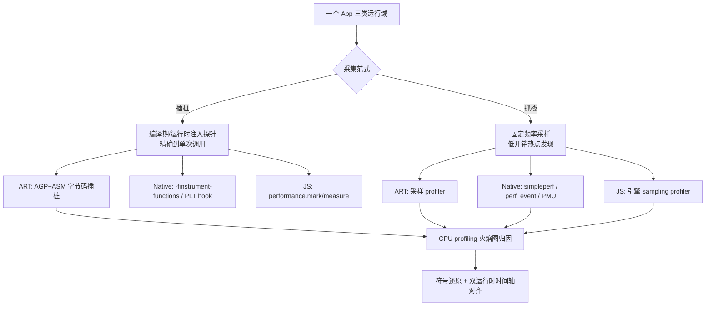

:::note 事实基线
本篇是「移动端性能采集与 Profiling」带解答题库，共 **84 题**，事实来源为 `content/docs/tiktok.md`（TikTok Android 性能采集与数据链路）。场景设定：Android 客户端（Java/Kotlin + ART、React Native + Hermes、小程序容器 V8/JavaScriptCore），后端 Go + Kitex，数据链路 Kafka/ClickHouse/Hive/MySQL/Redis。文中的采样频率、批量大小等均为**设计取值或示例**，落地时需按目标环境实测标定。
:::

本篇是「移动端性能采集与 Profiling」带解答题库。这块内容在面试里的价值在于：**它同时考察「底层原理（编译期插桩、内核采样、引擎内部）」与「工程判断（口径、规模、隐私、成本）」**，能讲清楚的人很少。本篇的组织顺序是：**先讲两种采集范式的本质区别 → 再按运行域（ART/Native/JS）展开实现 → 再讲 CPU profiling 与火焰图归因 → 再讲符号还原与双运行时对齐 → 最后讲坑点复盘与工程纪律**。

**主线一览**



## 一、业务场景与采集范式

### Q1. 为什么一个 App 需要「统一采集」三类运行域？

TikTok Android 不是单一技术栈：同一个进程里跑着**三类代码运行域**——① **Java/Kotlin（JVM 系）**：主工程与业务模块，运行在 ART 上；② **React Native**：JS 引擎为 Hermes，通过 bridge/JSI 与 native 通信；③ **小程序容器**：每个小程序独立 JS 上下文，引擎为 V8 或 JavaScriptCore，游戏类还有引擎渲染循环。

三类运行域意味着**三类「慢」的位置**：JVM 系方法慢、native 库慢、JS 业务逻辑慢，以及**跨边界（bridge/JSI/JNI）的相互等待**。如果只采集 Java 侧，JS 线程的耗时就是盲区；只采集 JS 侧，native 渲染就是盲区。

统一采集的三个要求：① **一套 SDK 覆盖三个运行域**，开关/采样率/白名单由云端统一下发；② **数据模型同构**——插桩产出 slice（名称、起止时间、线程归属），抓栈产出 sample（时间戳、调用栈），三个运行域的两类数据都能按**同一条时间轴合并**；③ **采集与上报对业务透明**，数据在设备侧完成聚合与脱敏后经上报网关送出。

**采分点**：能说出「**跨边界的相互等待是最难归因的**——JS 卡顿可能是 JS 线程在等 native 同步调用，两边 profiler 都抓不到真相」，这是双运行时采集的核心难点。

### Q2. 插桩与抓栈的本质区别是什么？

| 维度       | 插桩（Instrumentation）                        | 抓栈（Sampling / Profiling）                               |
| ---------- | ---------------------------------------------- | ---------------------------------------------------------- |
| 原理       | 在目标函数出入口**注入探针**，记录真实起止时间 | 采集线程按**固定频率采样**，记录「这一瞬间栈上有哪些函数」 |
| 数据       | 每次调用一条 slice（精确）                     | 每次采样一条 sample（统计近似）                            |
| 精度       | **精确到单次调用**                             | 统计近似，样本数估算占比                                   |
| 开销       | 与被插桩函数**调用次数成正比**                 | 只与**采样频率**有关，与调用次数无关                       |
| 覆盖面     | 只能看到**被插桩的函数**，其余是盲区           | 覆盖面广，**不需要预先知道哪个函数慢**                     |
| 观察者效应 | 显著（探针本身改变被测程序行为）               | 较小（但采样粒度会漏短函数）                               |
| 适用       | 已知瓶颈路径上的关键函数                       | 未知瓶颈的全局摸底、海量设备常态化采集                     |

**采分点（必背结论）**：**需要精确到单次调用的耗时、且目标函数已知，用插桩；需要在海量设备上常态化摸底、目标未知，用抓栈。两者配合——抓栈发现热点、插桩定位单点。**

### Q3. 插桩的「观察者效应」具体指什么？

探针本身有开销（时间戳读取、记录写入），**被插桩函数调用越频繁开销越大**，会改变被测程序的行为——这就是观察者效应（observer effect / Heisenbug 的一种）。

具体表现：① 高频小函数（渲染函数、每帧回调）插桩后，探针开销可能超过函数本身耗时，测出来的「热点」是探针造成的；② 插桩改变了代码的内存布局与内联决策，可能让原本的内联失效；③ JS 是单线程的，探针开销**直接阻塞业务执行**。

规避：① **收敛插桩范围**——海量设备长期采集时只对重点函数开启（白名单）；② 高频小函数谨慎插桩；③ 用抓栈做常态化摸底，插桩只做定向精测。

### Q4. 抓栈的「采样偏差」有哪些？

① **短函数漏采**：执行时间小于采样间隔的函数容易完全采不到；② **归因口径差异**：同一样本按 inclusive 与 exclusive 不同口径归因，结论不同（见 Q40）；③ **JIT 内联**：被内联的函数在栈上消失，耗时归因落到调用者身上；④ **采样节拍的影响**：基于 PMU 计数的采样正比于 CPU 消耗（天然偏向热点），基于定时器的采样按墙上时间均匀分布（会采到阻塞/等待）——两者结论不同（见 Q14）。

**采分点**：能说出「**抓栈是统计近似，不是精确测量**」+「**采样间隔决定了能分辨的最小函数粒度**」，这是理解 profiling 数据的前提。

## 二、ART（Java/Kotlin）侧采集

### Q5. ART 侧的插桩与抓栈手段分别是什么？

| 手段                  | 类型 | 说明                                                              |
| --------------------- | ---- | ----------------------------------------------------------------- |
| **AGP 字节码插桩**    | 插桩 | 编译期（编译后、dex 化前）用 ASM 改写字节码，在方法出入口注入探针 |
| **ART 方法追踪**      | 插桩 | 运行时开启 ART 的方法进入/退出追踪（`Debug.startMethodTracing`）  |
| **ART 采样 profiler** | 抓栈 | 周期性挂起目标线程、抓取 Java 调用栈                              |
| **simpleperf**        | 抓栈 | 基于 perf_event，Java 与 native 都能覆盖                          |

### Q6. AGP 与 ASM 在插桩里各扮演什么角色？

| 维度         | AGP                                                                          | ASM                                                               |
| ------------ | ---------------------------------------------------------------------------- | ----------------------------------------------------------------- |
| 是什么       | Android 官方的 Gradle 构建插件                                               | JVM 字节码（.class）读写库                                        |
| 插桩里的角色 | **钩子位置与管线托管**：编译后、dex 化前把每个类交给 visitor，负责增量与缓存 | **改写能力**：解析 class 结构，在方法出入口注入 invokestatic 探针 |

**两者的分工**：没有 AGP，有库但没有工程化集成（何时改、改哪些、增量、与 R8 的先后都要自己解决）；没有 ASM，有钩子但不会改字节码。`AsmClassVisitorFactory` 这个接口名本身就是两者的合体——**AGP 的 Instrumentation API 直接以 ASM 的 ClassVisitor 作为交付形态**。

### Q7. ASM 的工作原理是什么？两种 API 的区别？

ASM 是 JVM 字节码读写库，两种 API：

- **Core API（事件流，主流）**：基于访问者模式，`ClassReader` 读取 .class 文件，把结构以**事件**形式吐给 `ClassVisitor`，方法体再往下吐给 `MethodVisitor`（每条指令一个事件），`ClassWriter` 把事件重新组装成字节。**单遍扫描、内存开销小**，是插桩的主流用法。
- **Tree API（DOM 风格）**：把整个类加载成对象树（`ClassNode`/`MethodNode`）再随机修改，适合复杂重排，**代价是内存**。

插桩的典型写法是用 ASM util 包里的 `AdviceAdapter` 在方法出入口注入探针指令，它的 `onMethodExit` 回调**区分正常 return 与 athrow 两类出口**：

```java
class TraceMethodVisitor extends AdviceAdapter {
  protected void onMethodEnter() {
    mv.visitLdcInsn(methodId);
    mv.visitMethodInsn(INVOKESTATIC, "TraceCollector", "enter", "(I)V", false);
  }
  // opcode 参数区分正常 return 与 athrow，两类出口都会回调，不会漏结算
  protected void onMethodExit(int opcode) {
    mv.visitLdcInsn(methodId);
    mv.visitMethodInsn(INVOKESTATIC, "TraceCollector", "exit", "(I)V", false);
  }
}
```

**采分点**：`onMethodExit(int opcode)` 的 opcode 参数区分正常 return 与 athrow，**两类出口都会回调，不会漏结算**——这是「所有 return 路径与异常抛出路径都要插 exit」这条纪律的实现保证。

### Q8. 字节码插桩后，方法在字节码层面等价于什么？

```java
void foo() {
  TraceCollector.enter(42);
  try {
    /* 原方法体 */
    TraceCollector.exit(42);   // 每个 return 前
  } catch (Throwable t) {
    TraceCollector.exit(42);   // athrow 前
    throw t;
  }
}
```

**关键纪律**：**所有 return 路径与异常抛出路径都要插 exit**，否则方法提前返回或抛异常时，探针只记录了 enter 没有 exit，耗时结算会错乱（栈不平衡）。`AdviceAdapter` 的 `onMethodExit` 正好覆盖这两类出口。

很多知名工具底层都是 ASM：**JaCoCo** 覆盖率探针、**Spring 的 CGLIB** 动态代理、**Hibernate** 字节码增强，以及各家 APM 框架（腾讯 Matrix、字节 btrace 等早期版本走的就是 Transform API 加 ASM）。

### Q9. ART 方法追踪与 AGP 字节码插桩的区别？

| 维度 | AGP 字节码插桩               | ART 方法追踪                          |
| ---- | ---------------------------- | ------------------------------------- |
| 时机 | **编译期**（构建时改字节码） | **运行时**（ART 虚拟机开关）          |
| 范围 | 由插桩规则决定（可白名单）   | ART 追踪所有 Java 方法                |
| 开销 | 探针开销（可控）             | **极高**（每个方法进出都经 ART 回调） |
| 数据 | 自定义格式                   | ART 标准 trace 格式（.trace）         |
| 适用 | 线上常态化（收敛范围后）     | 本地/测试环境精细分析                 |

**采分点**：ART 方法追踪开销极高，**不能用于线上海量设备**，只适合本地复现分析。线上常态化采集要么用收敛范围的字节码插桩，要么用抓栈。

### Q10. ART 采样 profiler 与 simpleperf 的区别？

两条路线的差别在「**谁触发采样、需要谁配合**」：

- **ART 的方式**：依赖**运行时配合**——采集线程先**挂起目标线程**，再通过 ART 内部接口遍历托管栈。**只能看到 Java 帧**。
- **simpleperf**：走内核的 **perf_event** 机制——通过 `perf_event_open` 系统调用为目标进程/线程注册事件，由**内核**负责计数与触发中断，样本写入 mmap 共享的环形缓冲区，用户态的 simpleperf 再读出。**全程不需要目标线程或运行时配合**，Java 与 native 代码都能覆盖。

**采分点**：能说出「**ART 采样要挂起线程（需要运行时配合），simpleperf 走内核中断（不需要配合）**」这个本质区别，以及「**simpleperf 能覆盖 Java + native，ART 只能覆盖 Java**」。

## 三、Native（C/C++）侧采集

### Q11. Native 侧的插桩手段有哪些？

| 手段            | 原理                                                                                                                           | 适用           | 代价                                                                                |
| --------------- | ------------------------------------------------------------------------------------------------------------------------------ | -------------- | ----------------------------------------------------------------------------------- |
| **编译期回调**  | 目标 so 加 `-finstrument-functions` 编译，编译器在每个函数出入口插入 `__cyg_profile_func_enter`/`__cyg_profile_func_exit` 回调 | 有源码的 so    | 需要重新编译；探针开销                                                              |
| **PLT hook**    | 替换目标函数在 PLT/GOT 表里的入口（bhook、shadowhook 等成熟库）                                                                | **跨 so 调用** | 对不经 PLT 的模块内部调用无效                                                       |
| **inline hook** | 改写目标函数开头几条指令跳转到探针                                                                                             | 任意内部函数   | 指令重入、多线程竞态、指令集兼容问题，**崩溃率显著高于 PLT hook**，线上海量场景慎用 |

每次调用产出一条带起止时间的记录，聚合后就是 **perfetto trace 里的 slice**（时间片段），可以精确看到每个函数每一次调用花了多久、调用栈关系如何。

**采分点**：① 编译期回调配合 `addr2line` 按地址离线还原符号；② **PLT hook 稳定性好但只能拦截跨 so 调用**，inline hook 能 hook 任意内部函数但崩溃率高——线上首选 PLT hook；③ 三种手段的产物都是 slice，与 ART 插桩、JS 插桩的数据模型同构，可以合并到同一时间轴。

### Q12. PLT/GOT 是什么？为什么 PLT hook 只能拦截跨 so 调用？

**PLT（Procedure Linkage Table）** 与 **GOT（Global Offset Table）** 是 ELF 动态链接的机制：调用外部 so 的函数时，编译器生成的是「查 GOT 表拿函数地址再跳转」的间接调用（为了支持延迟绑定与位置无关代码）。PLT hook 就是**改写 GOT 表里的函数地址**，让它指向探针。

为什么只能拦截跨 so 调用：**模块内部调用**（同一个 so 里函数 A 调函数 B）通常被编译器**直接内联或用相对跳转**，不经过 PLT/GOT，所以改 GOT 表拦不到。要拦内部调用只能用 inline hook（改函数开头指令）。

**采分点**：能说出「**PLT hook 改的是 GOT 表的地址，所以只对『经过动态链接的间接调用』有效**」，这是理解两种 hook 边界的底层原理。

### Q13. simpleperf / perf_event 的采样是怎么触发的？

「基于硬件 PMU 计数或定时器中断」指的是采样节拍的两种中断来源：

- **硬件 PMU 计数溢出**：PMU（Performance Monitoring Unit）是 CPU 内置的性能计数器，能统计 cpu-cycles、instructions、cache-misses、branch-misses 等硬件事件。配置时给定采样周期（例如每 10000 个 cycle 溢出一次），计数器溢出时 CPU 硬件产生中断（x86 称 PMI，ARM 上即 PMU 溢出中断），内核在这个中断上下文里读取被打断线程当时的 PC/SP 寄存器，沿栈帧回溯，得到一条调用栈样本。**样本密度正比于 CPU 消耗**：越耗 CPU 的代码被采到得越频繁，天然形成热点分布。
- **定时器中断**：PMU 不可用时（虚拟机、部分低端 SoC、内核未开放硬件计数器），退化为软件定时采样——内核高精度定时器（hrtimer）按固定频率触发中断（例如每 1ms 一次），同样在中断处理里抓取当前线程的栈。**样本按墙上时间均匀分布**，与硬件事件无关。

| 触发源            | 采样节拍                                | 样本分布                      | 依赖条件                      |
| ----------------- | --------------------------------------- | ----------------------------- | ----------------------------- |
| 硬件 PMU 计数溢出 | 每累计 N 个硬件事件（如 cycle）一次中断 | 正比于 CPU 消耗，天然偏向热点 | 需要 CPU 与内核支持性能计数器 |
| 定时器中断        | 每固定时间片（如 1ms）一次中断          | 按墙上时间均匀分布            | 只需内核 hrtimer，通用兜底    |

simpleperf 两种配置口径都支持：**周期模式**（`-c`，每累计固定计数采一次）与**频率模式**（`-f`，内核动态调整计数周期以命中目标采样频率）。

**采分点**：中断驱动采样的关键是**异步打断**——中断发生的那一刻，CPU 寄存器里就是该线程正在执行的真实指令位置，内核就地抓栈即可。因此不管线程当时跑的是 ART 编译出的机器码还是 C/C++ so 里的代码，都能采到——**在 CPU 看来都只是指令**，这就是「Java 与 native 都能覆盖」的来源。

### Q14. PMU 采样与定时器采样的结论有什么不同？

**PMU 计数溢出采样**：样本正比于 CPU 消耗，**天然偏向 CPU 热点**——阻塞/等待（IO、锁、sleep）的线程不消耗 cycle，采不到。适合回答「CPU 时间花在哪」。**定时器中断采样**：样本按墙上时间均匀分布，**会采到阻塞/等待的线程**——适合回答「墙上时间花在哪」（含等待）。

**采分点**：同一个程序用两种采样得到的火焰图**不一样**——PMU 采样看不到 IO 等待，定时器采样会把等待也画进去。解读火焰图前必须先知道**采样节拍是什么**，否则会把「等待」误读成「计算热点」。

## 四、JS 运行时侧采集

### Q15. 为什么 JS 运行时需要独立的采集手段？

App 内嵌 React Native 与小程序容器时，相当一部分业务逻辑运行在 JS 引擎（Hermes/V8/JSC）的 **JS 线程**上。前述两种方法对 JS 都不直接适用：

- **ART 的方法追踪只能看到 Java 方法**——ART 对 JS 盲。
- **simpleperf 虽然能采到 JS 引擎的 native 帧，但看到的是引擎内部实现，看不到业务 JS 的函数名**。

所以含 JS 运行时的 App **必须在 Java/native 通道之外单独采集 JS 侧**，否则 JS 线程的耗时是盲区。

### Q16. 为什么 ART 对 JS 线程「盲」？

根源在**抓栈能力的边界**。ART 的栈遍历器只认识**托管栈**自己的表示：解释器帧（shadow frame）与编译帧（quick frame）都依赖 ART 内部元数据还原方法信息。而 JS 引擎对 ART 只是一个**普通 native 库**，JS 线程由引擎自建，通常**没有 attach 到 ART 虚拟机**，不在 ART 线程列表（ThreadList）的管理范围内——挂起机制够不到它，栈遍历器也无法解释它的栈帧。

即便 JS 线程因桥接回调经 JNI attach 到了 ART，ART 能看到的也只是栈上的 **Java 帧和标记为 native 的帧**，JS 层面的调用关系依然藏在引擎的数据结构里。

**采分点**：能说出「**ART 的栈遍历器只认识托管栈的表示，JS 线程不在 ART 的 ThreadList 里**」这个底层原因，而不是只说「ART 看不到 JS」。

### Q17. 为什么 simpleperf 能采到 JS 线程，但采到的是「引擎视角」而非「业务视角」？

perf_event 的中断作用于 **CPU 上任何正在运行的线程**，不区分代码属于哪个运行时，因此 JS 线程照样会被采样。问题在于采样结果是**机器级的 native 栈**，JS 业务栈对 native 展开器不可见：

- **解释器模式**：所有 JS 函数调用都发生在引擎的 C++ 派发循环内部（如 Hermes 的 `interpretFunction`），native 栈上**只有一个解释器帧**，JS 层面的调用关系全部坍缩。
- **JIT 模式**：JS 函数被运行时编译成机器码，**地址不在任何 ELF 符号表里**，simpleperf 看到的是无符号的匿名地址。

**采分点**：这解释了「**为什么 simpleperf 的火焰图里 JS 部分是一根『interpretFunction』的宽柱子**」——所有 JS 调用坍缩到一个引擎帧里。要看 JS 业务栈，必须用引擎自带的 sampling profiler（Q18）。

### Q18. 各 JS 引擎的采样 profiler 怎么开启？

- **V8**：`CpuProfiler` 按固定间隔采栈，默认间隔约 **1ms**，由 **CDP（Chrome DevTools Protocol）的 Profiler 域**控制：`Profiler.enable`/`Profiler.start`/`Profiler.stop` 管理会话，`Profiler.setSamplingInterval` 以**微秒**为单位调整间隔。stop 返回的 profile 是一棵节点树（每个节点带 callFrame：函数名、scriptId、行列号），加 `samples` 与 `timeDeltas` 两个平行数组。
- **Node.js（服务端同构）**：`node --cpu-prof` 启动即采、进程退出落盘 `.cpuprofile`，输出目录/采样间隔/文件名分别用 `--cpu-prof-dir`/`--cpu-prof-interval`/`--cpu-prof-name` 指定；也可以运行时接入 inspector 会话按需开关 Profiler 域。`node --prof` 是另一条路：输出 V8 日志再交给 tick processor 处理，看的是**引擎级热点**而非业务调用树。
- **Hermes（React Native 默认引擎）**：内置 sampling profiler，开启后按引擎设定的间隔周期性抓取 JS 栈，产出的样本用 `hermes-profile-transformer` 转成 **Chrome trace 格式**（React Native CLI 的 `profile-hermes` 命令即这条链路），与 native 侧的 perfetto trace 合并分析。
- **小程序运行时（V8/JSC）**：通过 **Inspector 调试协议**开启 CPU profiling（`Profiler.start`/`Profiler.stop`），引擎在执行过程中周期性采栈。

### Q19. JS 侧的插桩怎么做？

用 **`performance.mark` 打点、`performance.measure` 测量两点间隔**——这是浏览器标准能力，React Native 有对应实现，埋点数据不再自造格式。产物是**标准 performance entry**，在 Chrome trace / DevTools 的 user timing 轨道上直接可视化，**Web 与 RN 通用**。

数据模型上，每次调用产出一条 **slice**（名称、起止时间、线程归属），与 native 侧 perfetto 的 slice 同构，因此 JS 插桩数据可以按时间轴与 native trace 合并成一张图。

两个注意点：① **JS 是单线程的，探针开销会直接阻塞业务执行**，对渲染函数、每帧回调这类高频小函数要谨慎插桩；② 线上 bundle 通常经过压缩混淆，**函数名与源码对不上，需要配合 source map 还原**。

### Q20. JS 抓栈的边界是什么？

① **只能看到 JS 栈**，看不到耗时花在 native 模块里的部分（JSI 调用、bridge 通信、原生渲染），跨 JS/native 边界的瓶颈要结合 native 侧数据一起看；② 同样**依赖 source map 还原**压缩后的函数名；③ **采样粒度问题**与 native 侧一致，执行时间小于采样间隔的短函数容易漏采；④ **JIT 内联**会让被内联函数在栈上消失，耗时归因可能落到调用者身上，解释热点时要留意。

**采分点**：第 ① 条最重要——**JS profiler 看到的「等待」可能是 native 在干活**，必须两边数据合并才能归因。这是双运行时采集的核心价值。

## 五、CPU Profiling 与火焰图

### Q21. CPU profiling 的完整工作流是什么？

抓栈回答「数据从哪来」，CPU profiling 是把它变成结论的完整工作流：**采样抓栈 → 聚合成调用树 → 渲染成火焰图与调用树视图**。

数据获取有三种形态：

| 形态       | 做法                                                                                       | 适用                       |
| ---------- | ------------------------------------------------------------------------------------------ | -------------------------- |
| 常态化采样 | Hermes sampling profiler、常驻的 V8 CpuProfiler 随应用长期开启，低频采样                   | 海量设备摸底、大盘热点趋势 |
| 按需捕获   | CDP `Profiler.start`/`Profiler.stop` 圈定一次会话，或 `--cpu-prof`、inspector 会话按需开关 | 定向排查某个操作、某段场景 |
| 离线复现   | 本地用 `node --cpu-prof` 启动复现问题，退出落盘 `.cpuprofile` 后分析                       | 可复现问题的精细分析       |

### Q22. profile 的数据结构是什么？怎么还原火焰图？

以 V8/CDP 的产物为例：

- **nodes**：一棵**压缩的调用树**——每个节点带 id、callFrame（函数名、scriptId、行列号）与子节点列表，**相同的调用路径共享节点，不重复展开**。
- **samples**：记录每次采样时**栈顶节点的 id**。
- **timeDeltas**：记录距上次采样的时间差（微秒），与 samples **一一对应**。

还原火焰图就是**按样本聚合**：沿每个样本的调用链向上累计，得到每个栈帧的 **inclusive 样本数**；只算栈顶停在自身的情况则是 **self 样本数**。样本数除以总样本数即耗时占比。

**采分点**：能说出「**nodes 是压缩调用树（共享路径），samples + timeDeltas 是平行数组**」这个数据结构，以及「**火焰图是按样本聚合还原的，不是直接画调用树**」。

### Q23. 火焰图怎么读？

- **横轴宽度是样本占比而不是时间轴**：同层栈帧通常按**字母序**排列，**左右顺序没有时间含义**，宽度才代表耗时占比。
- **纵轴是调用深度**：下层是调用者，上层是被调用者，**栈顶（叶子）在最上方**。
- **顶层的宽平台是 self time 热点**：时间真正花在这个函数自己身上，是**最直接的优化目标**。
- **中下层的宽塔是 inclusive 热点**：函数本身可能不耗时，但它调用的子树耗时——优化要往下钻。

**采分点（高频陷阱）**：**横轴不是时间轴**——很多人误以为「左边的先执行」，实际上同层是字母序。能纠正这个误解就是采分点。另外「**找优化目标看顶层宽平台（self），找瓶颈路径看中下层宽塔（inclusive）**」是读图的两个动作。

### Q24. inclusive 与 exclusive（self）口径的区别？为什么必须固定口径？

- **exclusive / self**：只算**栈顶停在自己身上**的样本——「这个函数自己消耗了多少 CPU」。
- **inclusive / total**：算**出现在栈上的所有样本**（含它调用的子函数）——「这个函数及其子树消耗了多少 CPU」。

同一个函数，self 可能很小（它只是个调度者）但 inclusive 很大（它的子树很耗时）；反之亦然。**两种口径回答的是不同问题**：self 找「真正干活的热点」，inclusive 找「哪条路径整体慢」。

**为什么必须固定口径**：报表里如果混用口径，「函数 A 占 30%」这句话就没有意义——30% 是 self 还是 inclusive？不同人用不同口径，数据无法对比、趋势无法追踪。所以**报表定义必须固定口径**（这是三条工程纪律之一，见 Q34）。

### Q25. 火焰图里看到一根「宽柱子」但不知道是什么，怎么排查？

按可能性排序：① **符号未还原**——native 地址没有对应的符号表（so 被 strip 了），显示为十六进制地址；用 `addr2line` 或未 strip 的产物还原。② **JS 坍缩**——simpleperf 采 JS 线程时所有调用坍缩到 `interpretFunction`（Q17），要换引擎自带 profiler。③ **JIT 内联**——被内联的函数消失了，耗时归到调用者；看反汇编或关闭内联复测。④ **系统/内核帧**——`[unknown]`、`__memcpy`、内核态函数，这些是真实的系统开销。

**采分点**：能说出「**宽柱子首先是符号还原问题，其次才是归因问题**」——排查顺序是先确认「这个地址对应什么代码」，再分析「为什么它耗时」。

## 六、符号还原与双运行时对齐

### Q26. 符号还原链路包含什么？为什么是「采集数据可信度」的第一决定因素？

三个运行域各有自己的符号文件：

| 运行域      | 符号文件                                | 还原工具              |
| ----------- | --------------------------------------- | --------------------- |
| Java/Kotlin | **mapping.txt**（R8/ProGuard 混淆映射） | retrace               |
| Native      | **未 strip 的 so**（含符号表）          | addr2line / ndk-stack |
| JS          | **source map**                          | 各引擎工具 / 监控平台 |

**为什么是第一决定因素**：采集到的原始数据是**地址/混淆名/压缩名**，没有符号文件就还原不回源码位置——火焰图全是十六进制地址与 `a.b.c`，完全不可读。**符号文件必须随版本归档**（每个 release 的 mapping/so/source map 都要存），否则线上问题回来后无法还原。

**采分点**：坑点复盘里绝大多数问题的根因之一就是「**符号还原链路断裂**」（mapping/source map/未 strip 产物没有随版本归档）——这是三条工程纪律的第一条（Q34）。

### Q27. 双运行时的时间轴怎么对齐？

问题：Java、native、JS 三个运行域各自采集，**时钟原点可能不同**（有的用 `System.nanoTime`，有的用 `CLOCK_MONOTONIC`，有的用引擎自己的时钟），直接合并时间轴会错位。

解法：① **统一时基**——所有运行域用同一个单调时钟（如 `CLOCK_MONOTONIC`）；② **记录偏移量**——启动时记录各运行时相对该时基的偏移量，服务端合并 trace 时校准；③ **异步结算点要统一**——异步操作的「结束时间」定义要一致（是回调触发时，还是回调执行完时）。

**采分点**：能说出「**时钟原点与异步结算点是两个独立的对齐问题**」——时钟原点对齐了，但异步结算点不一致，合并出来的 trace 还是会错乱。这是「测量口径不统一」纪律的具体体现。

### Q28. 跨 JS/native 边界的瓶颈怎么归因？

典型场景：一次「JS 卡顿」实际是 **JS 线程在等 native 同步调用**（JSI/bridge）。JS profiler 看到「等待」，native profiler 看到「正常」，**两边都抓不到真相**。

解法：**边界两侧都插桩**——JS 侧包住 JSI/bridge 调用点记录边界耗时，native 侧记录 JNI 入口，**合并时间轴后才能看出谁在等谁**。

**采分点**：这题的考点是「**单运行域的 profiler 有结构性盲区，跨边界问题必须双插桩 + 合并时间轴**」——这是统一采集体系存在的核心理由。

## 七、设备侧数据工程与坑点复盘

### Q29. trace 体积爆炸怎么解决？

一次卡顿的 Java + JS + native 全量 trace 合并后体积可能很大，设备上传与服务端存储都难以承受。三层解法：① **设备侧裁剪**——只报卡顿点前后时间窗（不是全量 trace）；② **样本预聚合**——按函数聚合计数而非上报原始栈（设备侧就聚合，上报的是「函数 X 出现 N 次」而不是 N 条原始栈）；③ **采样率分级**——大盘低频、定向高频。

**采分点**：能说出「**预聚合在设备侧做，上报的是聚合结果而不是原始栈**」——这是「规模失控」纪律的核心，把数据量在源头就压下来。

### Q30. 弱网重试造成重复上报怎么解决？

上报失败重试、进程被杀后重启重发，服务端收到多份。解法：**每条数据带设备端生成的全局唯一 `event_id`，服务端按 event_id 幂等收敛**——设备端就是全链路「**至少一次加幂等**」模式的第一环。

**采分点**：能说出「**幂等键必须在数据产生的源头（设备端）生成，而不是在服务端分配**」——因为重试发生在服务端看到数据之前，服务端无法区分「新数据」与「重发的旧数据」，只有设备端的 event_id 能。这与 Kafka 消费侧的幂等（数据链路篇）是同一条纪律的两端。

### Q31. 采集影响电量与流量怎么治理？

长期高频采样导致耗电与流量明显上升，触发用户卸载或系统后台限制。解法：① **云控采样率与开关**——服务端下发配置，可随时降级；② **充电 + Wi-Fi 时才全量采集**——避免消耗用户流量与电量；③ **设备高温、低电量时熔断降级**——保护用户体验。

**采分点**：能说出「**采集策略必须有云控与熔断**」——这是三条工程纪律的第三条（规模失控）。采集不是「越全越好」，而是要在「数据价值」与「用户成本（电量/流量/性能）」之间平衡，且这个平衡要能**远程动态调整**。

### Q32. 栈数据的隐私合规怎么处理？

调用栈与参数可能带用户敏感信息（URL、用户标识），原始 trace 不能直接上传。解法：① **符号白名单内才上报**——只上报白名单内的符号，其余丢弃；② **服务端脱敏管线**——对上报数据做脱敏；③ **数据留存与出境遵循属地法规**。

**采分点**：能说出「**隐私合规要在采集侧就做（白名单），而不是只在服务端脱敏**」——原始敏感数据一旦离开设备就有泄露风险，源头过滤最安全。

### Q33. 坑点复盘的根因集中在哪三件事？

复盘下来，绝大多数坑的根因集中在三件事：

1. **符号还原链路断裂**：mapping / source map / 未 strip 产物没有随版本归档。
2. **测量口径不统一**：inclusive / exclusive、时钟原点、异步结算点。
3. **规模失控**：全量插桩、原始栈上传、高频采样。

### Q34. 三条工程纪律是什么？

三者分别对应三条工程纪律：

1. **构建产物必须归档符号文件**（对应符号还原链路断裂）——每个 release 的 mapping/so/source map 都要随版本归档，否则线上问题无法还原。
2. **报表定义必须固定口径**（对应测量口径不统一）——inclusive/exclusive、时钟原点、异步结算点都要在报表定义里写死，否则数据无法对比。
3. **采集策略必须有云控与熔断**（对应规模失控）——采样率、插桩范围、上报量都要能远程调整与熔断，否则采集本身会拖垮应用或耗尽用户资源。

**采分点**：这三条纪律是**整个采集体系可信度的保证**——面试里能说出「采集数据的可信度由符号还原、测量口径、规模控制三件事决定」，比讲十个采集技术更有说服力。

## 八、适用场景与结论

### Q35. 采集侧的选型结论是什么？

- 需要**精确到单次调用的耗时、且目标函数已知**，用**插桩**；需要**在海量设备上常态化摸底、目标未知**，用**抓栈**。两者配合——**抓栈发现热点、插桩定位单点**。
- 含 JS 运行时的 App **必须在 Java/native 通道之外单独采集 JS 侧**，否则 JS 线程的耗时是盲区；跨 JS/native 边界的瓶颈要**合并两边的数据**一起看。
- 采集数据的可信度由三件事决定：**符号还原链路**（mapping、source map、未 strip 产物随版本归档）、**测量口径**（inclusive/exclusive、时钟原点、异步结算点）、**规模控制**（白名单插桩、采样率、设备侧预聚合）。

### Q36. 如果让你设计一套移动端性能采集 SDK，你会怎么分层？

按「**采集 → 聚合 → 上报 → 还原 → 分析**」五层：

1. **采集层**：三个运行域各自的插桩与抓栈探针（ART 字节码插桩 + simpleperf、JS performance.mark + 引擎 profiler、native PLT hook + perf_event），统一数据模型（slice + sample）。
2. **聚合层**：设备侧预聚合（按函数聚合计数）、裁剪（只报卡顿窗口）、脱敏（符号白名单）。
3. **上报层**：event_id 幂等、批量上报、弱网重试、云控采样率与熔断。
4. **还原层**：服务端按版本匹配符号文件（mapping/so/source map），地址 → 源码位置。
5. **分析层**：火焰图、调用树、双运行时时间轴合并、热点趋势、卡顿归因。

**采分点**：能说出「**聚合与脱敏在设备侧做，还原与分析在服务端做**」这个分工——设备侧负责「把数据量压下来、把敏感信息滤掉」，服务端负责「把地址还原成源码、把样本聚合成结论」。

### Q37-Q84. 快速自检与深挖补充

**Q37. 一句话区分插桩与抓栈。**
插桩在函数出入口注入探针记录真实起止时间（精确、开销与调用次数成正比、只看被插桩的）；抓栈按固定频率采样记录瞬时调用栈（统计近似、开销只与采样频率有关、覆盖面广）。

**Q38. 一句话解释观察者效应。**
探针本身有开销，被插桩函数调用越频繁开销越大，会改变被测程序的行为——所以海量设备采集必须收敛插桩范围（白名单）。

**Q39. 一句话解释为什么 simpleperf 能同时采 Java 与 native。**
perf_event 的中断作用于 CPU 上任何正在运行的线程，不区分代码属于哪个运行时，在 CPU 看来都只是指令——但 Java 帧的符号还原依赖 ART 导出的 JIT 代码映射与 AOT 产物（oat 文件）的符号信息。

**Q40. 一句话区分 inclusive 与 exclusive。**
exclusive（self）只算栈顶停在自己身上的样本（函数自己消耗多少），inclusive 算出现在栈上的所有样本（函数及其子树消耗多少）——报表必须固定口径。

**Q41. 一句话解释火焰图横轴。**
横轴宽度是样本占比不是时间轴，同层栈帧按字母序排列，左右顺序没有时间含义——找优化目标看顶层宽平台（self），找瓶颈路径看中下层宽塔（inclusive）。

**Q42. 一句话解释为什么 ART 对 JS 盲。**
ART 的栈遍历器只认识托管栈的表示，JS 线程由引擎自建、不在 ART 的 ThreadList 里，挂起机制够不到它，栈遍历器也无法解释它的栈帧。

**Q43. 一句话解释 JS 坍缩。**
simpleperf 采 JS 线程时，解释器模式下所有 JS 调用坍缩到引擎的 C++ 派发循环（如 interpretFunction）一个帧里，JIT 模式下地址不在 ELF 符号表里——所以看 JS 业务栈必须用引擎自带 profiler。

**Q44. AGP 的 Instrumentation API 为什么以 ASM 的 ClassVisitor 作为交付形态？**
因为 AGP 负责「钩子位置与管线托管」（编译后、dex 化前把每个类交出来，管增量与缓存），ASM 负责「改写能力」（解析 class 结构、注入探针）——`AsmClassVisitorFactory` 这个接口名就是两者的合体，AGP 不需要重新发明字节码读写。

**Q45. 为什么 `onMethodExit` 要区分 opcode？**
因为方法有两类出口——正常 return 与异常 athrow，两类都要插 exit 探针，否则提前返回或抛异常时只记录了 enter 没有 exit，耗时结算会栈不平衡。`AdviceAdapter.onMethodExit(int opcode)` 的 opcode 参数正好区分这两类，保证不漏结算。

**Q46. 为什么 inline hook 线上慎用？**
inline hook 改写目标函数开头几条指令跳转到探针，要面对指令重入、多线程竞态与指令集兼容问题，崩溃率显著高于 PLT hook——线上海量场景下崩溃率是不可接受的，所以首选 PLT hook（虽然只能拦跨 so 调用）。

**Q47. PMU 不可用时怎么办？**
退化为软件定时采样——内核 hrtimer 按固定频率（如 1ms）触发中断，在中断处理里抓栈。样本按墙上时间均匀分布（会采到阻塞/等待），与 PMU 采样（正比于 CPU 消耗）的结论不同，解读时要先知道采样节拍。

**Q48. simpleperf 的周期模式与频率模式有什么区别？**
周期模式（`-c`）每累计固定计数采一次（采样间隔固定，CPU 忙时样本密）；频率模式（`-f`）内核动态调整计数周期以命中目标采样频率（采样频率固定，内核自动调周期）。前者适合精确的 cycle 归因，后者适合稳定的采样率控制。

**Q49. Hermes 的 profile 怎么与 native trace 合并？**
Hermes sampling profiler 产出的样本用 `hermes-profile-transformer` 转成 Chrome trace 格式（RN CLI 的 `profile-hermes` 命令即这条链路），与 native 侧的 perfetto trace 按统一时基合并分析——前提是时钟原点对齐（Q27）。

**Q50. `node --cpu-prof` 与 `node --prof` 的区别？**
`--cpu-prof` 输出 `.cpuprofile`（V8 的采样 profile，业务调用树，可用 Chrome DevTools 打开）；`--prof` 输出 V8 日志再交给 tick processor 处理，看的是**引擎级热点**（含 GC、JIT、内置函数）而非业务调用树。前者用于业务性能分析，后者用于引擎行为分析。

**Q51. 为什么 JS 插桩用 performance.mark/measure 而不是自造格式？**
因为它是浏览器标准能力（RN 有对应实现），产物是标准 performance entry，在 Chrome trace / DevTools 的 user timing 轨道上直接可视化，Web 与 RN 通用——自造格式要自己写可视化工具，且无法与标准 trace 合并。

**Q52. JS 单线程对插桩意味着什么？**
探针开销会**直接阻塞业务执行**（不像 native 多线程可以分摊），所以对渲染函数、每帧回调这类高频小函数要谨慎插桩——这也是 JS 侧更依赖抓栈（引擎 sampling profiler）而非插桩的原因。

**Q53. profile 的 nodes 为什么是「压缩调用树」？**
因为相同的调用路径共享节点、不重复展开——如果每个样本都展开一条完整调用链，数据量会爆炸。压缩树 + samples（栈顶节点 id）+ timeDeltas 的组合，用最小的存储表达了全部采样信息，还原时按样本沿树向上累计即可。

**Q54. timeDeltas 有什么用？**
记录距上次采样的时间差（微秒），与 samples 一一对应。用途：① 计算总时长（求和）；② 处理采样间隔不均匀的情况（PMU 模式下间隔随 CPU 消耗变化）；③ 加权聚合（时间差大的样本代表更长的执行区间）。

**Q55. 为什么符号文件必须随版本归档？**
因为线上问题回来时，需要的是**出错那个版本**的符号文件——mapping/source map/未 strip 的 so 都是版本相关的，用错版本还原结果全错（源码小改动会造成偏移量剧变）。所以每个 release 的符号文件都要归档，与版本号严格关联。

**Q56. retrace 与 addr2line 分别还原什么？**
retrace 用 mapping.txt 还原 Java/Kotlin 的混淆名与行号（R8/ProGuard 把 `com.foo.Bar.baz` 混淆成 `a.b.c`，retrace 反查）；addr2line 用未 strip 的 so 把 native 地址还原为源文件：行号。两者是不同运行域的符号还原工具。

**Q57. 为什么「异步结算点」要统一？**
异步操作的「结束时间」有多种定义——回调触发时、回调执行完时、下一个宏任务开始时。如果不同运行域用不同定义，合并时间轴时同一个异步操作的起止会对不上，导致「谁在等谁」的归因错误。所以报表定义里要写死异步结算点。

**Q58. 设备侧预聚合具体聚合什么？**
按函数聚合计数——上报「函数 X 出现 N 次、累计耗时 T」而不是 N 条原始栈样本。这样把数据量从「样本数」压到「函数数」，降低上报流量与服务端存储，代价是丢失了调用路径信息（所以定向排查时仍需要原始栈）。

**Q59. 云控采样率怎么分级？**
大盘低频（海量设备常态化摸底，低采样率）、定向高频（特定机型/版本/场景，高采样率）、问题复现（特定设备，全量）。分级依据是「数据价值 / 用户成本」——大盘要趋势（低采样够），定向要细节（高采样），复现要全量。

**Q60. 为什么「充电 + Wi-Fi 才全量采集」？**
因为全量采集消耗电量与流量，会触发用户卸载或系统后台限制（Android 的 Doze/App Standby 会杀后台采集）。充电 + Wi-Fi 时用户对资源消耗不敏感，是「拿全量数据」的最佳窗口——这是「采集成本转嫁给用户」的规避策略。

**Q61. 符号白名单上报怎么平衡「数据价值」与「隐私」？**
白名单内是业务关心的符号（自己的代码），白名单外是系统/第三方符号（可能含敏感 URL/标识）。只上报白名单内符号，既拿到了业务热点，又过滤了敏感信息——代价是看不到系统调用的开销（但系统调用通常不是优化目标）。

**Q62. 如果火焰图显示某个系统函数（如 memcpy）是热点，怎么优化？**
系统函数热点通常意味着「调用方式」有问题而非「系统函数」有问题：① memcpy 热点 → 检查是否有不必要的大对象拷贝（用移动语义、引用、零拷贝）；② malloc/free 热点 → 检查是否频繁小对象分配（用对象池、arena）；③ 锁相关热点 → 检查竞争。优化方向是**减少调用次数或改变调用模式**，而不是优化系统函数本身。

**Q63. 怎么验证一次性能优化的效果？**
用**同一套采集手段、同一口径、同一场景**复测：① 优化前后用相同的采样配置（频率、口径、时基）；② 相同的操作路径（脚本化复现，避免人工差异）；③ 对比 self/inclusive 占比的变化，而不是绝对值（设备性能有差异）；④ 多次采样取分布，而不是单次（采样有噪声）。**修复后必须用同一套观测手段复测，否则无法确认优化已生效**——这与内存泄漏排查的纪律一致。

**Q64. 为什么「抓栈发现热点、插桩定位单点」要配合？**
因为两者互补：抓栈覆盖面广、开销低，适合在海量设备上**发现**「哪个函数是热点」（但精度是统计近似）；插桩精确到单次调用，适合对已发现的热点**定位**「具体哪次调用、什么参数下慢」（但开销大、只看被插桩的）。先用抓栈缩小范围，再用插桩精测，是成本与精度的最优组合。

**Q65. 小程序容器的采集有什么特殊性？**
每个小程序运行在**独立的 JS 上下文**里（引擎为 V8 或 JSC），逻辑层与渲染层分离，游戏类还有引擎渲染循环（Cocos/Laya）。特殊性：① 多个小程序并存，要按 appid 区分（scene 字段）；② 逻辑层与渲染层分离，卡顿可能在任一层；③ 游戏渲染循环是高频的，插桩要谨慎。采集手段与 RN 一致（Inspector 协议开启 CPU profiling），但要按小程序上下文隔离。

**Q66. runtime 与 scene 字段在上报模型里起什么作用？**
`runtime` 标记数据属于哪个运行域（java/native/js），服务端据此**路由符号还原**（不同运行域用不同的符号文件与还原工具）；`scene` 标记业务场景（RN 页面或某个小程序的 appid），服务端据此做**维度聚合**（按场景看热点）。两个字段是「一份上报数据，多运行域多场景」的路由键。

**Q67. 为什么 event_id 要设备端生成？**
因为重试发生在服务端看到数据之前——弱网重试、进程被杀重启重发，服务端会收到多份相同数据，但无法区分「新数据」与「重发的旧数据」。只有设备端生成的全局唯一 event_id 能让服务端按 id 幂等收敛。这是「至少一次 + 幂等」模式在设备侧的第一环。

**Q68. 采集 SDK 怎么做到「对业务透明」？**
① 插桩在编译期（AGP）或引擎层（profiler），业务代码不感知探针；② 开关/采样率/白名单由云端下发，业务不需要改代码；③ 数据在设备侧完成聚合与脱敏后经上报网关送出，业务不参与上报；④ 采集异常不影响业务（探针包在错误处理里）。透明的代价是「业务无法定制采集」，所以关键路径仍允许手动 performance.mark 补充。

**Q69. 如果 ART 采样 profiler 与 simpleperf 同时开，会冲突吗？**
会有干扰但通常不冲突：ART 采样要**挂起目标线程**，simpleperf 走**内核中断**——挂起期间 simpleperf 采到的是「线程被挂起」的状态（栈顶在 ART 的挂起点），会污染 simpleperf 的样本。所以两者**不要同时开**，或错开时间窗。这也是「测量口径要统一」的一个体现——两个采集器互相干扰会破坏各自的数据。

**Q70. 怎么判断一次卡顿是 JS 侧还是 native 侧？**
合并时间轴后看「谁在等谁」：① JS 侧插桩显示 JS 函数耗时长 → JS 侧问题；② JS 侧显示「等待」（JSI/bridge 调用点耗时长）且 native 侧同时有对应的 JNI 入口耗时 → native 侧问题（JS 在等 native）；③ 两边都显示等待 → 可能是 IO/锁。单看一侧无法判断，必须双插桩 + 合并时间轴（Q28）。

**Q71-Q84. 口径与纪律速答**

**Q71. 采样间隔怎么定？** 权衡「分辨率」与「开销」——间隔越小分辨率越高（能采到短函数）但开销越大。V8 默认约 1ms，海量设备常态化采集要调大（如 10ms）降开销，定向排查调小。

**Q72. 为什么海量设备不能用 ART 方法追踪？** 开销极高（每个方法进出都经 ART 回调），会显著拖慢应用、耗电——只能用于本地/测试环境精细分析。

**Q73. 插桩的白名单怎么定？** 按「重点函数」——渲染、布局、反序列化、网络、已知瓶颈路径。白名单由云端下发，可动态调整（发现新热点就加进白名单）。

**Q74. 为什么 native 插桩产物是 slice？** 因为要与 ART 插桩、JS 插桩的数据模型同构（slice = 名称 + 起止时间 + 线程归属），才能按同一条时间轴合并成一张 perfetto trace。

**Q75. source map 还原 JS 栈的边界？** 能还原文件路径与行号，但**无法可靠还原被 mangle 掉的函数名**（source map 的 names 字段是位置相关的符号映射，不等同于语义名称）——所以函数名仅作辅助，文件：行号是主定位依据。

**Q76. 为什么「报表定义必须固定口径」？** 因为 inclusive/exclusive、时钟原点、异步结算点任一不固定，「函数 A 占 30%」就没有意义，不同人/不同时间的数据无法对比、趋势无法追踪——口径是数据可比性的前提。

**Q77. 设备侧熔断降级的触发条件？** 设备高温、低电量、系统后台限制（Doze）、采集自身开销超阈值（CPU/内存）——任一触发就降级（降采样率、停插桩、只保留抓栈）。

**Q78. 为什么「原始 trace 不能直接上传」？** 因为调用栈与参数可能带用户敏感信息（URL、用户标识），隐私合规要求在采集侧就做符号白名单过滤，而不是只在服务端脱敏——原始敏感数据一旦离开设备就有泄露风险。

**Q79. 三个运行域的采集手段矩阵？** ART：AGP+ASM 插桩 / ART 采样 profiler + simpleperf 抓栈；Native：-finstrument-functions + PLT hook 插桩 / simpleperf + perf_event 抓栈；JS：performance.mark/measure 插桩 / 引擎 sampling profiler 抓栈。

**Q80. 为什么数据模型要同构（slice + sample）？** 因为三个运行域的两类数据要能按同一条时间轴合并——插桩产出 slice、抓栈产出 sample，同构才能合并成一张图，否则每个运行域各看各的，跨边界归因无从谈起。

**Q81. 一句话总结采集侧的核心结论。** 插桩定位单点、抓栈发现热点，两者配合；含 JS 的 App 必须单独采 JS 侧；数据可信度由符号还原、测量口径、规模控制三件事决定。

**Q82. 一句话解释为什么 simpleperf 不需要运行时配合。** 它走内核的 perf_event 机制，由内核负责计数与触发中断、在中断上下文里读寄存器抓栈，全程不需要目标线程或运行时配合——所以 Java 与 native 都能覆盖。

**Q83. 一句话解释 PLT hook 的边界。** PLT hook 改的是 GOT 表里的函数地址，所以只对「经过动态链接的间接调用」（跨 so 调用）有效，模块内部调用（内联或相对跳转）拦不到——要拦内部调用只能用 inline hook。

**Q84. 一句话解释三条工程纪律。** 构建产物必须归档符号文件（否则还原不了）、报表定义必须固定口径（否则不可比）、采集策略必须有云控与熔断（否则规模失控）——这三条决定了采集数据的可信度。

---

**延伸阅读**

- [数据链路与 OLAP 题库](/interview/qa/data-pipeline-olap)：本篇采集数据的下游——Kafka/ClickHouse/Hive/MySQL/Redis 链路分工与虚拟滚动渲染。
- [前端监控 SDK 题库](/interview/qa/frontend-monitoring-sdk)：Web 侧的错误/性能采集、sourcemap 反解与现场还原，与本篇的设备侧采集对照。
- [前端监控与可观测性题库](/interview/qa/frontend-observability)：Web Vitals、长任务、资源计时的浏览器侧口径。
- [工作文档 · TikTok 性能采集与数据链路](/docs/tiktok)：本篇的事实来源，含完整采集矩阵与坑点复盘。
