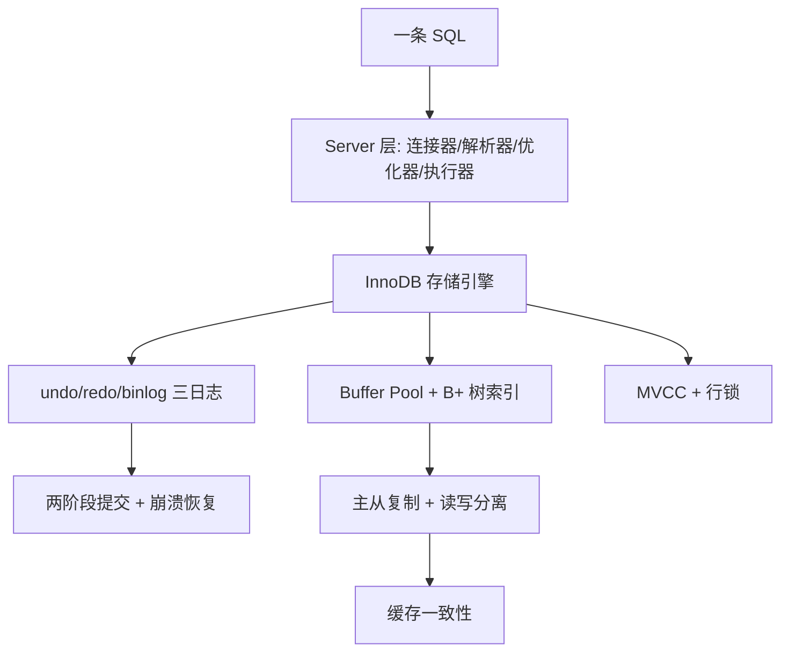

:::note 事实基线
本篇是「MySQL 与 InnoDB 技术深挖」带解答题库，共 **96 题**，事实来源为 `content/be/mysql.md`，行为与默认值以 **MySQL 8.4 LTS** 为基线（参数默认值与机制描述核对 MySQL 8.4 Reference Manual；实例化结论需以本机 `show variables` / `show status` 实测为准）。本篇是「知识点」型题库（非单一项目），与 [缓存、存储与 ORM 题库](/interview/qa/cache-storage-orm)（项目侧的存储选型与 ORM）互补——本篇讲 MySQL/InnoDB 的机制本身。MySQL 是后端面试出现密度最高的主题之一，B+ 树、MVCC、锁、两阶段提交、主从复制、缓存一致性都是高频连问点。
:::

本篇是「MySQL 与 InnoDB」技术深挖题库。它的面试价值在于：**MySQL/InnoDB 是 OLTP 存储的事实标准，其机制（B+ 树索引、MVCC、行锁、redo/undo/binlog 三日志、两阶段提交、主从复制）是后端面试的核心考点**，且这些机制彼此关联（如「不可变 part」之于 ClickHouse、「B+ 树矮胖」之于磁盘 I/O、「两阶段提交」之于崩溃恢复）。本篇的组织顺序是：**先讲连接与 SQL 执行流程 → 再讲 InnoDB 物理与内存结构 → 再讲索引体系 → 再讲事务/MVCC/隔离级别 → 再讲锁 → 再讲日志/崩溃恢复/复制 → 再讲分库分表与在线 DDL → 再讲读写分离与缓存一致性 → 最后讲慢查询调优方法论**。

**主线一览**

## 一、连接与 SQL 执行流程

### Q1. MySQL 的 Server 层与存储引擎层各负责什么？

MySQL 在逻辑上分为 Server 层与存储引擎层：**Server 层**（连接器、解析器、预处理器、优化器、执行器，以及所有内置函数）负责建立连接、解析与优化 SQL、权限校验、跨引擎能力（存储过程、触发器、视图、binlog）；**存储引擎层**（InnoDB、MyISAM、Memory 等插件式引擎）负责数据的实际存储与检索、事务、索引、锁、redo/undo。InnoDB 是默认引擎，支持事务、行级锁、MVCC 与崩溃恢复；MyISAM 不支持事务与崩溃恢复，只维护精确行数，现在基本只存在于历史系统。

### Q2. 一条 select 的完整路径经过哪些组件？

依次经过：① **连接器**——TCP 握手、校验用户名密码、把权限装载到会话上下文，空闲连接超过 `wait_timeout`（默认 28800 秒）被主动断开；② **结果级缓存**——Server 层不提供查询结果缓存，交给 Redis 等外部缓存（注意 Buffer Pool 缓存的是数据页而非查询结果）；③ **解析器**——词法分析切 token、语法分析构建 AST，语法错误在这步抛出；④ **预处理器**——检查表与列是否存在、解析名称歧义、把 `select *` 展开为具体列；⑤ **优化器**——基于成本生成执行计划，决定用哪个索引、连接顺序、是否索引下推或覆盖索引（`explain` 输出的就是优化器产物）；⑥ **执行器**——按执行计划循环调用存储引擎接口读取记录。

### Q3. 执行器与引擎交互的三种典型形态？

**主键等值查询**：执行计划 `type = const`，引擎沿聚簇索引一次定位，最多返回一行；**全表扫描**：`type = ALL`，逐行读取并判断，是优化红线；**索引下推**：联合索引中未参与定位的列被下推到引擎层过滤，减少回表次数。

### Q4. 权限校验发生在哪一步？GRANT 后需要 FLUSH PRIVILEGES 吗？

认证与权限装载发生在连接建立时；语句执行前后还会按内存中的授权表检查库、表、列级权限。**通过 `GRANT`/`REVOKE` 修改权限会立即更新内存中的授权表，无需执行 `FLUSH PRIVILEGES`**；只有在用 DML 直接改 `mysql` 库的授权表时，才需要 `FLUSH PRIVILEGES` 让服务端重新加载。

### Q5. 一条 update 的路径与三种日志如何协作？

update 走与 select 相同的 Server 层流程，差异集中在执行阶段：① 执行器调用 InnoDB 读取目标行（在 Buffer Pool 中直接返回，否则从磁盘读入）；② InnoDB **先写 undo log** 记录旧值（用于回滚与 MVCC）；③ 修改 Buffer Pool 中的记录，把该页标记为脏页（数据页不立即落盘，后台异步刷脏）；④ **写 redo log**（记录「某页某偏移量做了什么修改」），事务进入 prepare 状态；⑤ 执行器**写 binlog**（Server 层逻辑日志，用于复制与备份恢复）；⑥ 提交事务，在 redo log 中写入 commit 标记。**这正是两阶段提交，目的是让 redo log 与 binlog 对同一个事务给出相同的「是否生效」结论**。InnoDB 以页（默认 16KB）为读写单位，即使只更新一行也会把整页读入 Buffer Pool 并在页上修改。

### Q6. 长连接与短连接的取舍？长连接内存增长如何处理？

建立连接需要 TCP 握手与权限校验，成本不低，因此生产环境普遍使用长连接加连接池。**长连接的代价是：MySQL 执行期间临时使用的内存挂在连接对象上，只有连接断开才释放**，长期不断开可能导致内存持续增长甚至被 OOM killer 终止。处理方式：① 周期性断开长连接（使用一段时间或执行过大内存查询后主动断连，由连接池重建）；② 调用驱动的连接重置接口（如 C API 的 `mysql_reset_connection()`，回滚未提交事务、释放锁与临时表、重置会话变量与游标，无需重新鉴权）；③ 合理设置连接池大小与 `max_connections`（默认 151）。

## 二、InnoDB 物理与内存结构

### Q7. InnoDB 的表空间、段、区、页、行是什么关系？

InnoDB 的物理存储层次：**表空间**（tablespace，存储的容器）→ **段**（segment，如索引段、数据段、回滚段）→ **区**（extent，默认 1MB = 64 个连续页，保证大表顺序 I/O）→ **页**（page，默认 16KB，是磁盘读写的最小单位）→ **行**（row，数据记录）。页是 InnoDB 磁盘 I/O 的最小单位，即使只读一行也要把整页读入 Buffer Pool。

### Q8. compact/dynamic 行格式与隐藏列？varchar 上限与行溢出？

行格式决定一行数据如何物理存储。**compact** 格式：变长字段长度列表（逆序存放）+ NULL 值列表 + 记录头信息 + 真实数据；**dynamic**（默认）：对长变长列更倾向整列溢出到 off-page，只在行内存 20 字节指针。隐藏列：`DB_TRX_ID`（最后修改该记录的事务 ID，6 字节）、`DB_ROLL_PTR`（指向 undo log 上一版本，7 字节）、无主键时的 `DB_ROW_ID`（6 字节）。

varchar 上限受行大小限制（一行所有列不超过 65535 字节，且单页 16KB 要能放下至少两行）；超过阈值的长列会**行溢出**——把超出部分存到 off-page 的溢出页，行内只留指针（dynamic 格式更激进地整列溢出）。

### Q9. 数据页内部结构与页目录的作用？

数据页（16KB）内部结构：File Header（页头，含前后页指针形成双向链表）、Page Header（页状态）、Infimum + Supremum（最小/最大虚拟记录）、User Records（实际行记录）、Free Space、Page Directory（**页目录，存若干「槽」，每个槽指向组内最大主键值的记录**）、File Trailer（校验和）。

页目录的作用：页内查找不是逐行遍历，而是**先在页目录的二分查找定位到「组」，再在组内顺序遍历**——把页内查找从 O(行数) 降到 O(log 组数 + 组内行数)。

### Q10. 为什么用 B+ 树而不是 B 树/哈希/红黑树/跳表？

数据库索引受一条核心约束：**数据在磁盘上，磁盘 I/O 次数决定查询性能，因此要让树尽可能矮胖**。B+ 树相对其他结构的优势：

| 结构   | 等值查询 | 范围查询               | 是否适合磁盘索引                         |
| ------ | -------- | ---------------------- | ---------------------------------------- |
| B+ 树  | O(log n) | 叶子链表顺序扫描，优秀 | 是，节点天然对应磁盘页                   |
| 哈希   | O(1)     | 不支持                 | InnoDB 不提供显式哈希索引                |
| 红黑树 | O(log n) | 可行                   | 否，二叉树过高，千万级数据树高超过 20 层 |
| 跳表   | O(log n) | 优秀                   | 否，节点分散，不适合按页组织             |

B+ 树只有叶子节点存数据、非叶节点只存索引（主键加页号），相同数据量下非叶节点能放更多索引项、树更矮、磁盘 I/O 更少；叶子节点用双向链表串联，范围查询定位起点后可顺序扫描。

### Q11. 三层 B+ 树能存多少行？「单表 2000 万行」经验值怎么来的？

以 bigint 主键（8 字节）加页号（6 字节）约 14 字节估算，一个 16KB 非叶页约可容纳 16×1024/14 ≈ 1170 个索引项；若一行记录约 1KB，一个 16KB 叶子页约存 16 行：两层约 1170×16 ≈ 1.87 万行，**三层约 1170×1170×16 ≈ 2000 万行**。千万级表通常只需三层，点查最多三次磁盘 I/O（根节点常驻内存时更少）。这就是「单表 2000 万行」经验值的来源，**但它是估算：行越大、主键越长，容纳行数越少**——这也是主键不宜过长的原因之一。

### Q12. Buffer Pool 的改进 LRU 解决了哪两个问题？

InnoDB 启动时申请一块连续内存作为 Buffer Pool（默认 128MB，生产通常设为物理内存的 60%~80%），按 16KB 划分缓存页，内部用三条链表管理（Free List 空闲页、Flush List 脏页按修改时间有序、LRU List 冷热淘汰）。朴素 LRU 有两个问题，InnoDB 各做了改进：

① **预读失效**——相邻页被预读进来却从未被访问，污染 LRU 头部。改进：把 LRU 链表分为 young 区（热数据，默认 5/8）与 old 区（冷数据，默认 3/8），新读入的页先插入 old 区头部，真正被访问后再晋升。

② **全表扫描导致缓存污染**——一次大扫描可能把热点页全部挤出。改进：晋升门槛交给 `innodb_old_blocks_time`（默认 1000 毫秒），页在 old 区停留超过该时间后再次被访问才进入 young 区，全表扫描的页通常在一次快速访问后被弃、无法晋升。

**采分点**：能说出「**young/old 分区 + innodb_old_blocks_time 时间门槛**」两个改进分别防预读污染与全表扫描污染。

### Q13. 刷脏的时机有哪些？innodb_io_capacity 的作用？

脏页不会立即落盘，由后台线程按四个时机刷写：① **redo log 空间不足**——checkpoint 推进需要腾出 redo 空间，强制刷掉对应脏页（这是写入周期性抖动的主因）；② **Buffer Pool 空间不足**——淘汰页时若被淘汰的是脏页则先刷盘；③ **后台线程定期刷**——page cleaner 线程按 `innodb_io_capacity` 与 `innodb_io_capacity_max` 设定的 I/O 能力，持续把脏页比例压回 `innodb_max_dirty_pages_pct`（默认 90）以下；④ **MySQL 正常关闭时**把所有脏页刷盘。

刷脏速度由 `innodb_io_capacity` 决定上限（**8.4 默认 10000**，8.0 为 200，机械盘应按实测 IOPS 调低），突发刷脏可达 `innodb_io_capacity_max`（8.4 默认取其 2 倍）。调优核心是让刷脏速率跟上脏页产生速率，避免 redo 写满触发的强制刷脏把前台写入拖慢。

### Q14. Change Buffer 是什么？为什么唯一索引无法使用它？

Change Buffer 是 Buffer Pool 中的一块区域：当被更新的**二级索引页不在内存中**时，InnoDB 不立即从磁盘读入，而是把变更缓存在 Change Buffer 中，该页之后被读取时再合并（merge），后台线程也定期合并——把随机的「读页加修改」变成「先记账后合并」，显著减少随机 I/O。

**关键限制是唯一索引无法使用 Change Buffer**：插入前必须把页读入内存判断是否违反唯一性，页既然已在内存，直接修改即可。因此：写多读少（日志、账单）且用普通索引的表收益最大；业务能保证唯一性时，从性能角度普通索引优于唯一索引；读多写少的表收益小（刚记账就要合并，反而增加维护成本）。

## 三、索引体系

### Q15. 索引有哪些分类？聚簇索引键如何确定？

按数据结构：B+ 树索引、哈希索引、全文索引（InnoDB 支持 B+ 树与全文，不提供显式哈希索引；内部自适应哈希索引 AHI 由 `innodb_adaptive_hash_index` 控制，**MySQL 8.4 默认关闭**）。按存储形式：聚簇索引（叶子存整行数据）与二级索引（叶子存索引列值加主键值）。按字段特性：主键、唯一、普通、前缀索引。按字段数量：单列与联合索引。

建表时聚簇索引键按顺序确定：① 有主键则用主键；② 无主键则选第一个所有列均为非空的唯一索引；③ 都没有则由 InnoDB 生成隐藏的自增 `DB_ROW_ID`。

### Q16. 聚簇索引、二级索引、回表、覆盖索引分别是什么？

**聚簇索引**：B+ 树叶子节点存完整行数据，索引即数据，一张表只能有一个；**二级索引**：叶子节点存索引列值与主键值，可以有多个。**回表**：通过二级索引查询时，先在二级索引 B+ 树找到主键值，再拿主键值到聚簇索引查完整行（两棵树各查一次）。**覆盖索引**：查询所需的全部列都能从二级索引叶子节点得到（索引列加主键），无需回表，`explain` 的 Extra 显示 `Using index`。高频查询可把 select 的列纳入联合索引减少回表 I/O。

### Q17. 联合索引的最左前缀原则？哪些查询会失效？

联合索引 `(a, b, c)` 的排序规则是先按 a、a 相同按 b、b 相同按 c，因此 a 全局有序、b 只在 a 相同分组内有序、c 只在 (a,b) 相同分组内有序。索引能被利用的前提是索引键有序，所以查询必须从最左列开始且不能跳列：

| 查询条件                          | 索引使用情况                                 |
| --------------------------------- | -------------------------------------------- |
| `where a = 1`                     | 生效，使用 a                                 |
| `where a = 1 and b = 2 and c = 3` | 全部生效                                     |
| `where b = 2` 或 `where c = 3`    | 失效，缺最左列                               |
| `where a = 1 and c = 3`           | a 用于定位，c 不能参与定位但可经索引下推过滤 |
| `where a > 1 and b = 2`           | 只有 a 决定遍历范围，b 不能继续用于定位      |

**范围查询会终止后续列的匹配**（`where a > 1` 中满足条件的记录内部 b 无序）；`between` 与 `like 'xxx%'` 本质也是范围条件；`where a = 1 and b >= 2` 中 a 是等值、b 仍可继续缩小范围。`order by` 同样遵循最左前缀。

### Q18. 索引下推（ICP）是什么？解决什么问题？

索引下推（Index Condition Pushdown）把本应在 Server 层做的过滤下推到存储引擎层，在遍历二级索引时直接用索引列过滤，减少回表次数，`explain` 的 Extra 显示 `Using index condition`。以联合索引 `(a,b)` 上的 `select * from t where a > 1 and b = 2` 为例：没有下推时引擎按 a 的范围每找到一个主键就回表再由 Server 层判断 b；有下推时引擎遍历二级索引时索引里就有 b 的值，不满足 b=2 的记录直接跳过，只对满足的记录回表。

### Q19. 索引失效的典型情形有哪些？

① 违反最左前缀（缺最左列或跳列）；② 左模糊或左右模糊（`like '%xxx'`、`like '%xxx%'` 失效，`like 'xxx%'` 有效）；③ 对索引列使用函数（如 `where length(name) = 5`，解决：函数索引或生成列）；④ 对索引列做表达式计算（`where id + 1 = 7` 失效，`where id = 7 - 1` 有效，优化器不主动做代数变换）；⑤ 隐式类型转换（`phone` 是 varchar 时 `where phone = 13800000000` 等价于对索引列套 cast 失效；`id` 是 int 时 `where id = '1'` 转换作用在输入参数上有效）；⑥ `or` 前后类型不一致（一侧索引列另一侧不是时整体失效）；⑦ 优化器基于成本判断走索引不如全表扫描（返回行数占比过大或统计信息过期，可 `analyze table` 更新统计或 `force index` 干预）。

### Q20. 前缀索引与区分度？为什么推荐自增主键？

**前缀索引**：对长字符串列只索引前 N 个字符（`index idx_name_prefix (name(10))`），节省索引空间但降低区分度。区分度用 `count(distinct left(name, N)) / count(*)` 衡量，N 取到区分度接近完整列即可。前缀索引的代价是无法用于覆盖索引与 order by（因为索引里只有前缀，仍需回表确认完整值）。

**为什么推荐自增主键**：聚簇索引按主键物理有序存储，自增主键保证新记录总是追加到 B+ 树末尾，页分裂少、写入顺序；而 UUID 等无序主键会让新记录插入到 B+ 树中间，频繁页分裂、随机 I/O 多、空间碎片化。

### Q21. explain 执行计划重点看哪些字段？

**type**（访问类型，从好到差：const > eq_ref > ref > range > index > ALL，ALL 是全表扫描红线）；**key**（实际使用的索引，null 表示没走索引）；**rows**（预估扫描行数）；**Extra**（`Using index` 覆盖索引、`Using index condition` 索引下推、`Using filesort` 额外排序、`Using temporary` 临时表、`Using where` Server 层过滤）；**key_len**（使用的索引长度，判断联合索引用了几列）。`explain analyze` 可看真实执行耗时分布。

### Q22. count 的语义与优化？limit 深分页如何优化？

**count**：`count(*)` 统计行数（InnoDB 优化为取最小的二级索引树遍历，不取值）、`count(1)` 等价于 count(_)、`count(列)` 统计该列非 NULL 的行数、`count(distinct 列)` 去重计数。InnoDB 不像 MyISAM 维护精确行数，count(_) 需要遍历（MVCC 下不同事务看到的行数可能不同）。优化：用缓存计数、用 `show table status` 的估算值、维护单独的计数表。

**limit 深分页**：`limit 1000000, 10` 要扫描并丢弃前 100 万行，代价随偏移量线性增长。优化：① **游标分页**（记住上一页最后一条的 id，`where id > last_id limit 10`）；② **延迟关联**（先用覆盖索引取出主键，再 join 回表：`select * from t join (select id from t order by x limit 1000000,10) tmp on t.id = tmp.id`）。

### Q23. order by 的 filesort 两种排序算法？join 的算法与驱动表选择？

**order by filesort** 两种算法：① **全字段排序**——把排序键与所有 select 字段一起放 sort_buffer 排序，排序后直接返回（sort_buffer 不够时用磁盘临时文件）；② **rowid 排序**——只把排序键与主键放 sort_buffer，排序后再回表取其余字段（`max_length_for_sort_data` 控制阈值，字段总长超过则用 rowid 排序）。理想是用覆盖索引避免 filesort。

**join 算法**：① **Index Nested-Loop Join**——驱动表逐行取关联键，在被驱动表索引上等值查找（被驱动表关联列有索引时最优）；② **Block Nested-Loop Join / hash join**——被驱动表无索引时，把驱动表读入 join buffer，被驱动表逐行与 buffer 内数据匹配（MySQL 8.0.18+ 用 hash join 替代 BNL）。**驱动表选择**：优化器选「小结果集」做驱动表（小表驱动大表），减少被驱动表的扫描次数。

## 四、事务、MVCC 与隔离级别

### Q24. ACID 分别由 InnoDB 的什么机制保证？

**原子性（Atomicity）**——undo log（回滚时反向执行）；**一致性（Consistency）**——由 AID 共同保证 + 业务约束；**隔离性（Isolation）**——锁（行锁/表锁）+ MVCC（Read View）；**持久性（Durability）**——redo log（WAL，崩溃后重放）。

### Q25. 并发事务会引发哪三类问题？四种隔离级别分别解决什么？

并发问题：**脏读**（读到其他事务未提交的数据）、**不可重复读**（同一事务内两次读同一行结果不同，因其他事务 update 并提交）、**幻读**（同一事务内两次范围查询行数不同，因其他事务 insert/delete 并提交）。

| 隔离级别         | 脏读   | 不可重复读 | 幻读       | Read View 生成时机               |
| ---------------- | ------ | ---------- | ---------- | -------------------------------- |
| 读未提交         | 可能   | 可能       | 可能       | 无，直接读最新数据               |
| 读已提交         | 不可能 | 可能       | 可能       | 每条 select 前生成               |
| 可重复读（默认） | 不可能 | 不可能     | 基本不可能 | 事务第一条快照读时生成，全程复用 |
| 串行化           | 不可能 | 不可能     | 不可能     | 读写都加锁，串行执行             |

**读已提交与可重复读的本质区别就是 Read View 的生成时机**：前者每次读都新建（能看到其他事务已提交的最新值），后者只在事务首次快照读时建立（全程看到同一份快照）。

### Q26. 为什么有些互联网业务把隔离级别改为读已提交？

因为读已提交下**不加间隙锁**（外键与重复键检查除外），只有记录锁，锁冲突与死锁概率更低、并发写入吞吐更高。代价是必须搭配 **row 格式 binlog**——statement 格式在读已提交下存在不安全语句，会被拒绝或导致主从不一致。

### Q27. MVCC 的 Read View 可见性判断规则是什么？

MVCC 通过 undo log 版本链加 Read View 让读写互不阻塞，快照读不加锁、读的是历史版本。两块基础数据：① 记录的隐藏列 `DB_TRX_ID`（最后修改该记录的事务 ID）与 `DB_ROLL_PTR`（指向上一版本，把版本串成链）；② Read View 的四个字段——`m_ids`（创建时活跃事务的 ID 列表）、`min_trx_id`（其中最小 ID）、`max_trx_id`（下一个将分配的事务 ID）、`creator_trx_id`（创建该 Read View 的事务自身 ID）。

对版本链上每个版本取其 `trx_id` 依次判断：

| 条件                       | 结论                           |
| -------------------------- | ------------------------------ |
| `trx_id == creator_trx_id` | 可见，是自己修改的             |
| `trx_id < min_trx_id`      | 可见，Read View 创建前已提交   |
| `trx_id >= max_trx_id`     | 不可见，Read View 创建后才启动 |
| `trx_id` 在 `m_ids` 中     | 不可见，该事务仍活跃未提交     |
| 其余                       | 可见，已提交                   |

不可见时沿 `DB_ROLL_PTR` 找上一个版本重复判断，直到找到可见版本或到达版本链尽头。

### Q28. 可重复读下幻读是否完全解决？两个例外是什么？

InnoDB 在可重复读下**很大程度避免了幻读，但并非完全**：快照读（普通 select）依靠 MVCC（整个事务用同一个 Read View，其他事务插入的新记录 trx_id 必然不可见）；当前读（`select ... for update`、insert、update、delete）依靠临键锁（锁住扫描范围及其间隙，阻塞其他事务插入）。

仍会出现幻读的两个例外：① **先快照读后当前读**——事务 A 先普通 select（看不到 B 插入的行），B 插入并提交，A 再执行 `select ... for update`（当前读读最新版本），结果集突然多出一行；② **快照读之后 update 到了看不见的行**——A 普通 select 看不到 B 新插入的行，但 A 执行 update（当前读）恰好更新了该行，该行 trx_id 变为 A 自己，之后 A 的 select 就能看到它。规避方式是在事务开始时就对目标范围执行 `select ... for update` 加临键锁。

### Q29. begin 与 start transaction with consistent snapshot 的差异？

`begin` 或 `start transaction` 只是开启事务，并不立即启动——**事务真正启动（分配事务 ID、可重复读下创建 Read View）发生在之后第一条操作 InnoDB 表的语句执行时**。`start transaction with consistent snapshot` 执行后立即启动事务并创建 Read View。

易错点：「可重复读下事务启动时创建 Read View」严格说是「执行第一条快照读语句时」。用 `begin` 开启事务后到第一条 select 之间，其他事务提交的修改是能被看到的。

### Q30. 长事务有哪些危害？如何治理？

危害：① **undo log 无法清理**——只要长事务的 Read View 存在，它可能访问的所有旧版本都必须保留，回滚段持续膨胀、磁盘占用上涨；② **MDL 锁阻塞 DDL**——长事务持有元数据读锁，DDL 申请写锁被阻塞且写优先，连带阻塞后续所有查询；③ 长时间占用连接与行锁，放大锁等待与死锁概率；④ 复制场景下造成从库大事务回放延迟。

治理：查询 `information_schema.innodb_trx` 中执行时间过长的事务；应用侧缩短事务、不在事务中做 RPC 或 IO、避免 `set autocommit = 0` 导致的隐式长事务；数据库侧可设 `max_execution_time` 限制单条只读 select 的执行时长。

## 五、锁

### Q31. 锁按范围如何分类？S/X 锁的兼容矩阵？

按范围从大到小：**全局锁**（`flush tables with read lock`，整库只读，用于逻辑备份）、**表级锁**（表锁、元数据锁 MDL、意向锁、AUTO-INC 锁）、**行级锁**（InnoDB 特有，加在索引记录上：记录锁、间隙锁、临键锁、插入意向锁）。共享锁 S 与排他锁 X 的兼容矩阵：**读读共享，读写互斥，写写互斥**。

### Q32. 全局锁与一致性备份？mysqldump --single-transaction 的原理？

`flush tables with read lock` 让整库只读，保证备份出的所有表处于同一逻辑时间点，期间增删改与 DDL 全部阻塞。**InnoDB 可以利用 MVCC 避免全局锁**：备份时开启一个可重复读事务拿到一致性快照，备份过程不阻塞业务写，即 `mysqldump` 的 `--single-transaction` 选项。前提是所有表都是支持事务的 InnoDB——MyISAM 表没有 MVCC，仍需全局锁。

### Q33. MDL 元数据锁的经典事故链是什么？如何防范？

MDL 保护表结构，无需显式申请，**事务提交时才释放**：对表做 CRUD 时自动加 MDL 读锁（读锁之间不互斥），修改表结构时加 MDL 写锁（与读写锁都互斥）。

经典事故链：线程 A 开启长事务执行 select 持有 MDL 读锁不放 → 线程 C 执行 alter table 申请 MDL 写锁被 A 阻塞 → **MDL 申请队列是 FIFO 且写锁优先**，C 排队后，后续所有新的 select 与 insert 都排在 C 后面被阻塞 → 一条 DDL 导致全表请求挂起、连接池打满。

防范：DDL 前检查并 kill 长事务；先把会话的 `lock_wait_timeout` 调小（默认约一年），让 alter table 申请写锁时快速失败退出而非长期排队；大表变更用 gh-ost 或 pt-online-schema-change 等在线工具。

### Q34. 意向锁存在的意义是什么？

意向锁是表级锁，用于快速声明「本事务将在表内某些行上加行锁」：加行级共享锁前先给表加意向共享锁 IS，加行级排他锁前先加意向排他锁 IX。**存在的意义**：另一个事务要加表级 S 或 X 锁时，只需检查表上是否有 IX 或 IS 就能知道表内是否存在行锁，没有意向锁就得遍历全表检查每一行。意向锁之间互不冲突，只与表级 S/X 锁冲突。普通 select 是快照读，不加行锁也不加意向锁。

### Q35. AUTO-INC 锁与 innodb_autoinc_lock_mode 的三种模式？

自增主键的值由 AUTO-INC 锁保证：插入时对表加锁，**语句执行完立即释放（不等事务提交）**。大批量插入时锁持有时间长、并发插入吞吐差。`innodb_autoinc_lock_mode` 控制分配方式：

| 取值      | 行为                                                     | 特点                                                           |
| --------- | -------------------------------------------------------- | -------------------------------------------------------------- |
| 0         | 全部使用 AUTO-INC 锁                                     | 传统模式，并发最差                                             |
| 1         | 可预知行数的插入用轻量级互斥量，批量插入仍用 AUTO-INC 锁 | 折中                                                           |
| 2（默认） | 全部使用轻量级互斥量                                     | 并发最好，但批量插入的自增值可能不连续，需搭配 row 格式 binlog |

### Q36. 记录锁、间隙锁、临键锁、插入意向锁分别是什么？

设表中已有 id 为 1、5、10 三条记录：**记录锁（Record Lock）**锁单条索引记录，分 S 与 X；**间隙锁（Gap Lock）**锁一个开区间（如 (5,10)），只阻止其他事务往间隙里插入，**间隙锁之间即使区间重叠也互相兼容**（这是死锁的常见来源），只在可重复读级别存在（目的就是防幻读）；**临键锁（Next-Key Lock）**是记录锁加其前面间隙的间隙锁，左开右闭（如 (5,10]），**可重复读下加锁的基本单位就是临键锁**，特定条件下退化为记录锁或间隙锁；**插入意向锁（Insert Intention Lock）**是特殊的间隙锁，事务插入时若目标位置被其他事务的间隙锁/临键锁覆盖，会生成等待状态的插入意向锁并阻塞，两个事务往同一间隙的不同位置插入互不冲突。

### Q37. 行级锁的加锁规则（唯一索引/非唯一索引等值与范围）？

可重复读下加锁基本单位是临键锁，加在扫描过的索引记录上，满足条件时退化。设记录为 1、5、10、15：

**唯一索引等值查询**：记录存在（`where id = 5`）临键锁退化为记录锁（唯一索引保证等值只有一条，锁间隙没意义）；记录不存在（`where id = 7`）定位到第一条大于 7 的记录（id=10），其临键锁退化为间隙锁 (5,10)。

**唯一索引范围查询**：`id >= 10` 时 id=10 的等值部分退化为记录锁、之后 (10,15] 与 (15,+∞] 为临键锁；`id < 10` 扫描终止于 10，其临键锁退化为间隙锁 (5,10)；`id <= 10` 时 id=10 处不退化、保持临键锁 (5,10]（因为 10 本身也要被锁）。

**非唯一索引等值查询**（`where age = 22`，记录存在）：满足条件的二级索引记录加临键锁，第一个不满足条件的二级索引记录退化为间隙锁，满足条件记录对应的聚簇索引加记录锁。**无索引时全表扫描，每条聚簇索引记录都加临键锁**。排查加锁可查 `performance_schema.data_locks`（`lock_mode` 为 X 是临键锁、`X,REC_NOT_GAP` 是记录锁、`X,GAP` 是间隙锁）。

### Q38. 更新没有命中索引会怎样？如何防范？

**效果上等价于锁全表，但机制上不是表锁**：where 条件没有索引或索引失效时只能全表扫描，InnoDB 对扫描到的每条聚簇索引记录都加 X 型临键锁，其他事务的任何插入与更新都被阻塞。防范：update/delete 的 where 必须走索引并在上线前用 explain 确认；开启 `sql_safe_updates` 拒绝不带索引条件的更新；大范围更新分批执行缩短锁持有时间。

### Q39. 间隙锁 + 插入意向锁的经典死锁案例？InnoDB 如何应对？

经典案例：可重复读下两个事务并发执行「不存在则插入」。事务 A `select * from t where id = 7 for update` 获得间隙锁 (5,10)；事务 B `select ... where id = 8 for update` 也获得间隙锁 (5,10)（**间隙锁互相兼容**）；A `insert values(7)` 的插入意向锁被 B 的间隙锁阻塞，B `insert values(8)` 的插入意向锁被 A 的间隙锁阻塞——互相等待，死锁。四个必要条件齐备（互斥、持有并等待、不可剥夺、循环等待）。

InnoDB 的应对有两层：① **死锁检测**（`innodb_deadlock_detect` 默认开启）——检测到等待环后回滚代价最小的事务，代价是每个新等待都要扫描等待图，热点行高并发下检测本身消耗 CPU；② **锁等待超时**（`innodb_lock_wait_timeout` 默认 50 秒）——等不到就报错回滚。

业务层规避：多行/多表操作按固定顺序（如主键升序）访问；事务尽量小并尽快提交；「不存在则插入」改用 `insert ... on duplicate key update` 或唯一索引加捕获冲突；隔离级别降为读已提交以去掉间隙锁；为查询条件建合适索引缩小锁范围。

### Q40. 乐观锁与悲观锁分别如何落地？

**悲观锁**：假设冲突必发生，先加锁再操作，落地为 `select ... for update` 与 `select ... for share`，适合写冲突激烈的场景，代价是锁等待与死锁风险。**乐观锁**：假设冲突少，不加锁，提交时校验，落地为版本号或 CAS。版本号方案：`update account set balance = balance - 100, version = version + 1 where id = 1 and version = #{oldVersion}`，受影响行数为 0 说明被并发修改、由业务层重试，适合读多写少（高冲突下重试风暴反而更差）。扣库存等场景也可直接用条件更新的原子性：`update stock set num = num - 1 where id = 1 and num >= 1`。

## 六、日志、崩溃恢复与复制

### Q41. undo log、redo log、binlog 三种日志的对比？

| 维度     | undo log                 | redo log                         | binlog                        |
| -------- | ------------------------ | -------------------------------- | ----------------------------- |
| 产生层   | InnoDB                   | InnoDB                           | Server 层，所有引擎通用       |
| 内容     | 逻辑日志，旧值或反向操作 | 物理日志，某页某偏移做了什么修改 | 逻辑日志，statement/row/mixed |
| 作用     | 事务回滚与 MVCC 版本链   | 崩溃恢复，持久性                 | 备份恢复与主从复制            |
| 写入方式 | 随事务修改产生           | 循环写，固定容量，边写边擦除     | 追加写，全量保留              |

### Q42. redo log 与 WAL 是什么？刷盘时机与参数？

**WAL（Write-Ahead Logging）**：先写日志再写数据页——修改先写 redo log（顺序写，快），数据页延迟异步刷盘（把随机写转为顺序写）。redo log 是 InnoDB 特有的物理日志，循环写（固定容量，write pos 追 checkpoint，边写边擦除）。

刷盘由 `innodb_flush_log_at_trx_commit` 控制：**0**——事务提交时只把 redo log buffer 写入 page cache，每秒由后台 fsync（崩溃可能丢 1 秒事务）；**1**（默认）——每次提交都 fsync，最安全；**2**——每次提交写到 page cache，每秒 fsync（MySQL 进程崩溃不丢，操作系统崩溃可能丢）。

### Q43. binlog 的三种格式？刷盘与组提交？

binlog 格式：**statement**（记录 SQL 原文，日志量小但 `now()`/`uuid()` 等非确定性函数可能导致主从不一致）、**row**（默认，记录每行数据变更前后的镜像，绝对确定、主从一致，但批量更新时日志量大）、**mixed**（默认 statement，检测到非确定性语句切 row）。

刷盘：事务执行中先写线程私有的 binlog cache（保证一个事务的 binlog 原子写入），提交时 write 到文件系统，再由 `sync_binlog` 控制 fsync（0 只 write 不 fsync、1 每次提交都 fsync 最安全、N 攒 N 个事务 fsync 一次）。**`innodb_flush_log_at_trx_commit = 1` 加 `sync_binlog = 1` 即「双 1」，是不丢数据的标准配置**。

**组提交（Group Commit）**：双 1 下每个事务提交需两次 fsync，高并发下 fsync 成瓶颈。组提交把多个并发提交的事务合并成一组，由组内 leader 执行一次 fsync、其余 follower 搭车，把 N 次 fsync 摊薄为一次。commit 细分三阶段：flush（把组内各事务 binlog cache 写入文件）、sync（一次 fsync 刷组内所有 binlog，可用 `binlog_group_commit_sync_delay` 与 `binlog_group_commit_sync_no_delay_count` 控制攒批）、commit（按顺序完成引擎层提交）。

### Q44. 两阶段提交是什么？崩溃恢复如何保证 redo 与 binlog 一致？

redo log（引擎层）与 binlog（Server 层）是两个独立的写入动作，中间宕机可能导致两份日志不一致。解决办法是把 redo log 的写入拆成 **prepare 与 commit 两个阶段，binlog 夹在中间，以 binlog 是否完整作为事务是否提交的统一判据**，两份日志通过 XID 关联。

崩溃恢复时扫描 redo log：**已 commit 的直接提交；处于 prepare 的拿 XID 去 binlog 查，找得到完整事件则提交（binlog 可能已被从库消费，必须保留），否则回滚**。这样无论在哪一点崩溃，redo log 与 binlog 对该事务是否生效的结论都一致。

**采分点**：能说出「**以 binlog 是否完整作为统一判据 + prepare 态拿 XID 去 binlog 查**」——这是两阶段提交崩溃恢复的核心。

### Q45. Doublewrite Buffer 解决什么问题？

**部分页写问题**：InnoDB 页是 16KB，而磁盘原子写单位通常是 4KB，刷脏刷到一半宕机，页就半新半旧地损坏了；redo log 记录的是基于完好页的增量修改，页本身损坏时无法重放。

Doublewrite Buffer 的做法：刷脏页时先把页顺序写到 doublewrite 区域，fsync 后再写到真正的表空间位置（存储在独立的 `#ib_*.dblwr` 文件中，与用户表空间分离避免 I/O 争抢）。崩溃恢复时若发现某页校验失败，就用 doublewrite 中的完整副本还原该页再重放 redo log。代价是每页写两次，但第一次是大块顺序写加单次 fsync，额外开销约 5%~10%。

### Q46. 误删数据后如何恢复？为什么 redo log 不能用来恢复？

**redo log 是固定容量循环写、边写边擦除，只保证未刷盘的脏页不丢，已刷盘数据对应的 redo 会被覆盖，因此它不是历史归档，无法用来恢复被删的数据**。

恢复依赖 binlog：先找到最近一次全量备份（mysqldump 或 xtrabackup）恢复到临时实例，再从备份时间点开始重放 binlog 到误删语句之前，跳过误删语句后继续重放；row 格式下单条误删也可直接解析 binlog 反向生成回滚 SQL。预防：定时全量备份加 binlog 归档、开启 `sql_safe_updates`、高危操作走审批平台、配置延迟从库兜底。

### Q47. 主从复制的原理是什么？

① 主库执行事务，两阶段提交时写入 binlog；② 从库执行 `change replication source to ...; start replica;` 后，I/O 线程与主库建立长连接，主库为该连接创建 binlog dump 线程持续推送 binlog 事件；③ 从库 I/O 线程把收到的 binlog 写入本地中继日志（relay log）；④ 从库 SQL 线程读取 relay log 回放事件更新数据，并写自己的 binlog（`log_replica_updates` 默认开启，以支撑级联复制）。复制的作用是扩展读能力、数据热备、故障切换、把大查询分流到从库。

### Q48. 异步、半同步、组复制的区别？

| 模式             | 行为                                                             | 可靠性                                     | 代价                     |
| ---------------- | ---------------------------------------------------------------- | ------------------------------------------ | ------------------------ |
| 异步复制（默认） | 主库提交后立即返回，不等从库                                     | 主库宕机可能丢未同步的 binlog              | 性能最好                 |
| 半同步复制       | 主库提交时至少等 N 个从库写入 relay log 并 ACK                   | 降低丢数据概率，但从库只是收到而非回放完成 | 增加提交延迟             |
| 组复制（MGR）    | 基于多数派协议，事务提交需组内多数节点认证通过，支持自动故障切换 | 强一致                                     | 性能低于异步，网络要求高 |

半同步由 `rpl_semi_sync_source_enabled` 开启，超时（默认 10 秒）后退化为异步；等待点 `rpl_semi_sync_source_wait_point` 默认 AFTER_SYNC（写 binlog 之后、引擎 commit 之前等 ACK），AFTER_COMMIT 则存在「主库已提交但 ACK 未达即宕机」的窗口。组复制是 InnoDB Cluster 的基础。

### Q49. 主从延迟的原因与治理？

延迟定义为从库回放完成时间减主库提交时间（`Seconds_Behind_Source`）。常见原因：从库回放能力不足而主库多线程并发写；从库机器规格差或承担大量读查询挤占资源；大事务（一次删除百万行或大表 DDL）在从库至少要回放同样长时间；主库写入洪峰与网络延迟。

治理：① **并行复制**——主库在 binlog 中标记事务间依赖关系（基于 writeset 判断哪些事务修改了相同的行），从库多个 worker 线程并行回放互不冲突的事务（`replica_parallel_workers` 默认 4，配合 `replica_preserve_commit_order` 保证提交顺序）；② **拆大事务**——大删除改分批 limit 循环，DDL 用 gh-ost；③ 从库升配、控制单主库挂载的从库数量、分散读流量；④ 业务侧容忍或规避（写后读主）。

### Q50. 读写分离下「写后立即读」如何读到最新数据？GTID 的优势？

方案按成本从低到高：① **强制走主库**（对一致性敏感的读路由到主库，最常用可靠）；② 会话内写后读主；③ 半同步复制（降低但不消除概率）；④ **等待 GTID**（写请求返回主库 GTID，读请求在从库执行 `wait_for_executed_gtid_set(gtid, timeout)`，等从库回放到该事务再读，超时退回主库）；⑤ 缓存兜底。

**GTID**（形如 `server_uuid:transaction_id` 的全局事务标识）相比传统位点复制的优势：从库自动声明已执行的 GTID 集合、新主库自动发送缺失事务、主从切换无需人工找 binlog 文件名与偏移量；已执行过的 GTID 会被跳过（天然幂等）；便于校验一致性与变更级联拓扑。GTID 默认关闭，启用时须先把 `enforce_gtid_consistency` 置 ON，再把 `gtid_mode` 沿 OFF → OFF_PERMISSIVE → ON_PERMISSIVE → ON 逐级切换。

## 七、分库分表与在线 DDL

### Q51. 何时需要分库分表？应先穷尽哪些低成本手段？

触发信号（经验值）：单表行数上亿或 B+ 树层高变为四层导致查询变慢；单库 QPS/TPS 触及实例瓶颈（连接数、CPU、磁盘 IOPS）；单库容量过大导致备份恢复与 DDL 时间不可接受。**应先穷尽低成本手段**：索引与 SQL 优化、读写分离、缓存、归档历史数据、分区表，最后才考虑分库分表（复杂度会陡增）。

垂直拆分按业务或列拆（垂直分库把不同业务域的表拆到不同库；垂直分表把宽表按访问频率拆成主表与详情表）；水平拆分按行拆（水平分表解决单表过大但不解决单库瓶颈；水平分库分表同时解决存储与并发瓶颈）。

### Q52. 分片键选择的三原则？多维度查询冲突如何解决？

分片键三原则：① **查询维度覆盖**——绝大多数查询都携带该键（如订单表用 user_id），带不了分片键的查询会广播全分片；② **分布均匀**——避免数据倾斜与热点（以商家 id 分片时大商家会把单分片打爆）；③ **不可变**——分片键更新意味着跨分片迁移数据。

多维度查询冲突的解法：**基因法**（在 id 末几位嵌入 user_id 的哈希基因，两个维度都能路由）、**异构索引表**（按另一维度冗余一份映射）、把复杂查询同步到搜索引擎。

### Q53. 常见分片算法的优缺点？

| 算法     | 优点                             | 缺点                                                  |
| -------- | -------------------------------- | ----------------------------------------------------- |
| 哈希取模 | 分布均匀                         | 扩容时 N 变化导致全量重排，需一致性哈希或成倍扩容缓解 |
| 范围分片 | 支持范围查询，扩容只加新分片     | 写热点集中在最新分片                                  |
| 查表路由 | 分片关系存配置表，灵活可调       | 多一次查询，可缓存                                    |
| 组合     | 先按时间范围分库，库内按哈希分表 | 路由规则复杂                                          |

中间件分为客户端 SDK（如 ShardingSphere-JDBC，无代理开销）与代理层（如 ShardingSphere-Proxy，对应用透明、跨语言）。

### Q54. 分布式 ID 有哪些方案？雪花算法的风险是什么？

| 方案                  | 特点                                                                                          | 主要风险                                                        |
| --------------------- | --------------------------------------------------------------------------------------------- | --------------------------------------------------------------- |
| 雪花算法（Snowflake） | 64 位 = 1 位符号 + 41 位毫秒时间戳 + 10 位机器 id + 12 位序列号，本地生成无网络开销、趋势递增 | **时钟回拨会产生重复 id**，需记录上次时间戳并在回拨时等待或报错 |
| 号段模式              | 中央数据库批量发放一段 id，应用内存消费，双 buffer 预取                                       | 依赖数据库可用性                                                |
| UUID                  | 全局唯一                                                                                      | 无序，作为聚簇索引主键会频繁页分裂                              |
| Redis incr            | 简单                                                                                          | 依赖 Redis 可用性与持久化                                       |

### Q55. 跨分片有哪些问题？分布式事务的主流方案？

① **跨分片查询**——不带分片键的查询需广播所有分片再归并，排序/聚合/分页在中间件内存合并，深分页代价极高（每个分片都要返回前 N 行），解法是强制带分片键、异构索引、搜索引擎、游标分页；② **跨分片 join**——尽量避免，解法有字段冗余、广播表（小字典表每分片全量一份）、绑定表（订单与明细用同一分片键使 join 不跨片）、应用层两次查询内存组装；③ **分布式事务**——本地事务失效，强一致可用 XA/2PC（性能差且阻塞长），主流是最终一致（本地消息表、事务消息、TCC、Saga、Seata AT）；④ 全局唯一 ID；⑤ 运维复杂度上升。

### Q56. 在线 DDL 有哪些方案？为什么直接 alter table 有风险？

直接 `alter table` 的风险：MDL 写锁排队引发雪崩、拷贝表期间磁盘翻倍、主从延迟巨大。方案：① **MySQL 原生 Online DDL**（`algorithm=inplace, lock=none`）——多数加索引、加列操作不锁 DML，但仍在主库本机执行、大表耗时长、无法暂停，从库回放该 DDL 时单线程容易造成延迟；`algorithm=instant` 对加列等操作只改元数据、秒级完成，应优先使用；② **pt-online-schema-change**——建影子表 + 触发器同步增量 + 分批拷贝 + rename 切换；③ **gh-ost**——建影子表 + **binlog 订阅**同步增量（不用触发器）+ 分批拷贝 + 原子 rename，可暂停、可限流、对主库压力小。

## 八、读写分离与缓存一致性

### Q57. 缓存与数据库的一致性目标应该定成什么？为什么做不到强一致？

Redis 里存的是 MySQL 热数据的副本，结构与主从复制同构（事实源先写、副本后收敛）。**只要存在两份拷贝就必然有滞后窗口，不放弃副本就做不到「任意时刻强一致」**。想要强一致只能把两者纳入同一个分布式事务（2PC/XA），但这条路基本走不通：Redis 没有实现 XA 协议、事务运行时错误也不回滚，无法承担 2PC 参与者语义；即便可行，每次写的提交延迟也会被较慢的一方拉齐，缓存失去低延迟意义。

因此工程共识是**放弃强一致、追求最终一致**：接受有界窗口内的短暂不一致，用 TTL 兜底、失败重试、对账巡检保证收敛。方案设计的核心只有三件事：不一致窗口如何尽量短、窗口卡住时如何补偿、不一致如何被看见。

### Q58. 缓存写策略的四种组合各有什么问题？为什么 Cache Aside 胜出？

设某行数据在数据库中的当前值为 v0：

| 组合                                  | 问题                                                                   |
| ------------------------------------- | ---------------------------------------------------------------------- |
| 先删缓存再更新数据库                  | 删缓存后、更新完成前，并发读未命中会读到旧值 v0 并回填，造成持续不一致 |
| 先更新数据库再删除缓存（Cache Aside） | 理论上仍有一致性窗口，但成立条件苛刻、概率极低                         |
| 先更新缓存再更新数据库                | 更新数据库失败时缓存里是数据库从未有过的新值，且无回滚手段             |
| 先更新数据库再更新缓存                | 两个并发写回填乱序，慢的写会覆盖缓存                                   |

**Cache Aside 胜出的原因**：删除操作幂等、无顺序要求，不一致窗口最窄，且不做无用功。它理论上也有不一致窗口（需要读线程在写线程更新数据库之前缓存未命中并读到旧值，然后写线程完成更新与删缓存，最后读线程才把旧值回填），但这要求「读数据库加写缓存」比「更新数据库加删缓存」还慢，而写内存比写磁盘快一个量级以上，时序窗口极窄。

### Q59. 为什么删除缓存而不是更新缓存？

① **惰性计算**——缓存值常是多表聚合的计算结果，写后可能根本没人再读，立即重算纯属浪费；② **复杂度与正确性**——更新缓存必须知道如何重新计算这个值，逻辑与业务深度耦合、多处维护容易出错，删除只需清掉副本下次读自然重算；③ **并发安全**——DEL 幂等且无顺序要求，更新不幂等、并发下有乱序问题；④ **与缓存定位一致**——缓存层是 LRU 管理的易失副本，不应承担数据所有权。

### Q60. 延迟双删的原理与实现要点？

延迟双删用于补救「先删缓存再更新数据库」的竞态：删除缓存 → 更新数据库 → 延迟一段时间后再次删除缓存，清掉更新窗口内并发读回填的旧值。要点：**第二次删除是核心**（精确清掉窗口内被回填的脏值）；延迟 N 必须大于「读一次数据库加写一次缓存」的耗时（若读流量走从库还要叠加主从复制延迟，经验值 500ms~1s）；**实现上绝不能用业务线程 sleep**（会占用连接池与线程、放大写接口响应时间，进程重启还会丢失第二次删除），正确做法是用 MQ 延迟消息或本地延迟队列加持久化补偿表由后台线程扫描执行。它是并发读写激烈、脏值窗口敏感场景的增强手段，不是 Cache Aside 的必配项。

### Q61. 删除缓存失败的重试分哪三层？

「更新数据库成功、删除缓存失败」是 Cache Aside 下长期不一致的最常见来源（网络抖动、Redis 主从切换、连接池耗尽）。重试分三层：① **同步重试**——失败后立即重试一到三次带短超时，消化瞬时抖动（不可无限重试，否则拖垮写接口响应时间）；② **消息队列异步重试**——同步重试用尽后发送删除消息，消费者重试到成功为止（需保证 MQ 自身可靠：生产者确认加消费者手动提交 offset）；③ **顺序与幂等**——同一 key 的删除消息应哈希进同一分区并串行消费（否则两次删除与中间的回填可能乱序），DEL 天然幂等、重试任意次都安全。

### Q62. binlog 订阅兜底缓存失效解决什么盲区？与应用层删除如何配合？

应用层删除有三个盲区：代码漏写删除、其他服务或脚本绕过应用直连数据库、重试消息丢失。**binlog 订阅兜底的正是「数据库层实际发生的一切写入」**（Canal 伪装成从库订阅 binlog，解析出变更后发 MQ，消费者删除对应缓存）。它同主键单分区串行、天然有序，对业务代码透明，但时延较长（百毫秒到秒级）、需部署维护 Canal 与 MQ，且链路自身必须被监控（Canal 断连/位点跳变、MQ 积压、消费失败率——静默失效时缓存会悄悄不再更新）。实践中两者常组合：**应用层做第一时间的删除，binlog 订阅兜底漏删与多路写入**。

### Q63. 多级缓存与热点 key 重建的一致性难点？

多级缓存（进程内 L1 加 Redis L2）的难点：**L1 是各进程私有的副本，删除 Redis 对它无效**，需要失效广播（删除 Redis 后经发布订阅发布失效事件，各实例订阅并清理本地 L1）或给 L1 设极短 TTL 自然收敛；回填方向也有竞态（L1 过期后回源可能读到尚未删除的旧 L2 值，不一致窗口是两级叠加）。

**热点 key 重建**：重建必须串行（用 singleflight 或互斥锁保证并发读只触发一次回源）。还有一个隐蔽的时序竞态：写请求 A 删除缓存后，读请求 B 未命中开始重建，但 A 的数据库更新此时尚未提交，B 用旧值重建了缓存，A 随后提交，缓存长期持有旧值。解法：重建与同 key 写入串行化（代价高，仅用于极热 key）；重建时把数据库行的 `update_time` 一并写入缓存、删除/重建消息携带版本号、写前比较旧则丢弃；重建改由 binlog 事件驱动（把触发源从「读」变为「事件」，避开读写时序竞态）。**该竞态本质是缓存版的「读未提交」**——MySQL 用 MVCC 与锁解决，缓存层只能靠版本号或串行化。

### Q64. 任何缓存一致性方案都必须有的三道兜底是什么？

① **TTL**——所有缓存 key 都必须设过期时间，它是不一致窗口的上界与最终自愈手段（没有 TTL 的设计，一次删除失败就是永久脏数据）；② **对账**——定时任务按主键比对 MySQL 与 Redis 的抽样或全量（比较 `update_time` 或行校验和），输出不一致报告并自动修复（binlog 链路上线后，对账是验证链路真实有效的唯一手段）；③ **监控告警**——缓存删除失败率、重试队列积压、binlog 链路延迟、缓存命中率、对账不一致率（不一致必须先可见，才谈得上可控）。**一句话总结：缓存与数据库之间没有强一致，只有更短的窗口、收敛的兜底与可观测的验证**。

## 九、慢查询与调优方法论（一句话速答）

**Q65. 一句话解释慢查询日志的关键配置。** `slow_query_log=on`、`long_query_time`（默认 10 秒，生产常调到 1 秒甚至更低）、`log_queries_not_using_indexes`（未走索引也记录）、`min_examined_row_limit`（过滤扫描行数过少的语句）；用 pt-query-digest 按指纹聚合，关注扫描/返回比（越高越有优化空间）。

**Q66. 一句话解释一条 SQL 突然变慢的五步排查法。** ① 确认现场（`show processlist` 看线程状态：`Waiting for table metadata lock` 指向 MDL 阻塞、`Waiting for lock` 指向行锁冲突）；② 定位慢 SQL（慢查询日志 + pt-query-digest，或 `performance_schema.events_statements_summary_by_digest`）；③ 分析单条 SQL（`explain` 看 type/key/rows/Extra，对照索引失效情形，`explain analyze` 看真实耗时）；④ 分层归因（数据/实例/系统/复制层面）；⑤ 修复（加改索引、改写 SQL、参数调优、缓存或分表）。

**Q67. 一句话解释「单表 2000 万行」为什么不是硬性上限。** 它来自 B+ 树层高估算（行约 1KB、bigint 主键时三层约 2000 万行，超过则四层多一次磁盘 I/O），实际阈值取决于行大小、主键大小、内存大小（Buffer Pool 装得下热数据时层高影响被抹平）与访问模式（只按主键点查上亿行依然快）。

**Q68. 一句话解释 SQL 注入的防御优先级。** ① 预编译/参数化查询是根本手段（SQL 结构先编译固定，参数只作为数据传入无法改变语义）；② 最小权限原则（应用账号只授必要 DML，禁 drop/file）；③ 输入校验与白名单（尤其 order by 列名、表名这类无法参数化的位置必须白名单枚举）；④ WAF、SQL 审计、错误信息不回显数据库细节。

**Q69. 一句话解释 InnoDB 与 MyISAM 的核心差异。** InnoDB 支持事务、行级锁、MVCC、崩溃恢复（redo/undo）、外键，聚簇索引；MyISAM 不支持事务与崩溃恢复、只有表锁、只维护精确行数（count(*) 快）、非聚簇索引——MyISAM 现在基本只存在于历史系统。

**Q70. 一句话解释为什么 InnoDB 以页（16KB）为读写单位。** 磁盘 I/O 按块进行，页是磁盘读写的最小单位，即使只更新一行也要把整页读入 Buffer Pool 并在页上修改——这是「随机 I/O 转顺序 I/O + 缓存整页」的基础。

**Q71. 一句话解释区（extent）为什么是 64 个连续页。** 区默认 1MB = 64 个连续页，保证大表扫描时磁盘顺序 I/O（连续页物理相邻），避免随机寻道。

**Q72. 一句话解释页目录如何加速页内查找。** 页目录存若干「槽」，每个槽指向组内最大主键值的记录，页内查找先在页目录二分定位到「组」再在组内顺序遍历——把 O(行数) 降到 O(log 组数 + 组内行数)。

**Q73. 一句话解释 AHI（自适应哈希索引）为什么 8.4 默认关闭。** AHI 把热点等值查询的 B+ 树查找加速为哈希 O(1)，但维护有开销且只对热点等值查询集中场景有收益，8.4 默认关闭（8.0 默认开启），需评估后再开。

**Q74. 一句话解释为什么唯一索引插入前必须读页。** 要判断是否违反唯一性，必须把页读入内存比对——所以唯一索引无法用 Change Buffer（页已在内存直接改即可），这也是「业务能保证唯一性时普通索引性能更优」的原因。

**Q75. 一句话解释覆盖索引为什么能避免回表。** 查询所需的全部列都能从二级索引叶子节点得到（索引列加主键），无需拿主键回聚簇索引查完整行——`explain` Extra 显示 `Using index`。

**Q76. 一句话解释为什么 `where id = 7 - 1` 走索引而 `where id + 1 = 7` 不走。** 优化器不会主动做代数变换，`id + 1 = 7` 是对索引列做表达式计算（失效），`id = 7 - 1` 的计算作用在常量侧（有效）。

**Q77. 一句话解释隐式类型转换为什么有时失效有时有效。** varchar 列 `where phone = 13800000000`（数字）等价于对索引列套 cast（失效）；int 列 `where id = '1'`（字符串）的转换作用在输入参数上（有效）——转换发生在哪一侧决定是否失效。

**Q78. 一句话解释 index merge。** `or` 前后两侧都有索引时，优化器可能分别用两个索引再合并结果（intersection/union），避免全表扫描——但 `or` 一侧无索引时整体失效。

**Q79. 一句话解释为什么自增主键比 UUID 好。** 自增主键保证新记录追加到 B+ 树末尾（页分裂少、顺序写），UUID 无序会让新记录插入 B+ 树中间（频繁页分裂、随机 I/O、空间碎片）。

**Q80. 一句话解释 count(\*) 为什么比 count(列) 快。** count(_) 统计行数（InnoDB 优化为取最小的二级索引树遍历、不取值），count(列) 要判断该列是否非 NULL（需取列值）——count(_) 不取值所以更快。

**Q81. 一句话解释延迟关联为什么能优化深分页。** 先用覆盖索引只取主键（避免回表取大量无用行），再用主键 join 回表取完整行——把「扫描并丢弃 100 万行的回表」变成「扫描 100 万个主键 + 回表 10 行」。

**Q82. 一句话解释 rowid 排序与全字段排序的切换。** `max_length_for_sort_data` 控制阈值：select 字段总长小于阈值用全字段排序（排序后直接返回），超过则用 rowid 排序（只排排序键+主键，排序后回表）——避免 sort_buffer 装不下大字段。

**Q83. 一句话解释小表驱动大表的原则。** 优化器选「小结果集」做驱动表，减少被驱动表的扫描次数——Nested-Loop Join 的总代价 ≈ 驱动表行数 × 被驱动表单次查找代价。

**Q84. 一句话解释 hash join 替代 BNL。** MySQL 8.0.18+ 用 hash join 替代 Block Nested-Loop Join：把驱动表建哈希表，被驱动表逐行探测，避免 BNL 的多次全表扫描——被驱动表无索引时性能大幅提升。

**Q85. 一句话解释 undo log 为什么是逻辑日志。** undo log 记录的是「反向操作」（insert 记 delete、update 记旧值），用于回滚（反向执行）与 MVCC（版本链）——它是逻辑的「如何撤销」，不是物理的「哪页哪偏移」。

**Q86. 一句话解释 redo log 为什么是物理日志且循环写。** redo log 记录「某页某偏移做了什么修改」（物理），用于崩溃恢复（重放未刷盘的修改）；循环写（固定容量、write pos 追 checkpoint、边写边擦除）因为它只保证「未刷盘脏页不丢」，已刷盘数据对应的 redo 可被覆盖。

**Q87. 一句话解释 binlog 为什么追加写且全量保留。** binlog 用于备份恢复与主从复制，需要完整的历史（从备份点重放到任意时刻），所以追加写、全量保留，靠 `binlog_expire_logs_seconds`（默认 30 天）或 `purge binary logs` 主动清理。

**Q88. 一句话解释 binlog_row_image 的 full 与 minimal。** full（默认）记录每行全部列的前后镜像（日志量大但信息完整、便于反向生成回滚 SQL），minimal 只记录主键与被修改列（日志小但无法还原完整行）——主从复制与 Canal 类订阅通常依赖 full。

**Q89. 一句话解释为什么「双 1」是不丢数据的标准配置。** `innodb_flush_log_at_trx_commit=1`（每次提交 redo log fsync）+ `sync_binlog=1`（每次提交 binlog fsync），保证两份日志都落盘——任一为 0/N 都可能在崩溃时丢事务。

**Q90. 一句话解释组提交如何摊薄 fsync。** 把多个并发提交的事务合并成一组，由组内 leader 执行一次 fsync、其余 follower 搭车，把 N 次 fsync 摊薄为一次——`binlog_group_commit_sync_delay` 与 `no_delay_count` 控制攒批以增加组员。

**Q91. 一句话解释半同步复制的 AFTER_SYNC 与 AFTER_COMMIT。** AFTER_SYNC（默认）在写 binlog 之后、引擎 commit 之前等 ACK（避免「主库已提交但 ACK 未达即宕机」的窗口），AFTER_COMMIT 在引擎提交后等 ACK（存在该窗口）。

**Q92. 一句话解释并行复制的 writeset 依赖。** 主库在 binlog 中标记事务间依赖关系（基于 writeset 判断哪些事务修改了相同的行），从库多个 worker 并行回放互不冲突的事务——`replica_parallel_workers` 默认 4，配合 `replica_preserve_commit_order` 保证提交顺序。

**Q93. 一句话解释 gh-ost 为什么比 pt-osc 对主库压力小。** gh-ost 用 binlog 订阅同步增量（不用触发器），可暂停、可限流；pt-osc 用触发器同步增量，触发器与业务写同事务、增加主库写延迟。

**Q94. 一句话解释分库分表后为什么「跨分片深分页代价极高」。** 每个分片都要返回前 N 行（offset+limit）给中间件归并，再丢弃前 offset 行——分片越多、offset 越大，归并的数据量越大；解法是游标分页（记住上一页最后一条的排序键）。

**Q95. 一句话解释广播表与绑定表。** 广播表是小字典表每分片全量一份（join 不跨片），绑定表是订单与明细用同一分片键使关联数据落同一分片（join 不跨片）——两者都是「让 join 在分片内完成」的手段。

**Q96. 一句话总结 MySQL/InnoDB 的机制主线。** 磁盘 I/O 决定性能 → B+ 树矮胖（三层 2000 万行）+ Buffer Pool 改进 LRU + Change Buffer 把随机 I/O 转顺序/延迟；不可变页 + WAL → redo log 崩溃恢复 + Doublewrite 防部分页写；两份日志独立 → 两阶段提交以 binlog 完整性为统一判据；MVCC（Read View + undo 版本链）让读写不阻塞 + 行锁（临键锁）防幻读；主从复制扩读 + 缓存副本最终一致（TTL/对账/监控三道兜底）——一条「用日志换随机 I/O、用快照换锁竞争、用副本换读扩展、用兜底换最终一致」的工程主线。

---

**延伸阅读**

- [缓存、存储与 ORM 题库](/interview/qa/cache-storage-orm)：项目侧的存储选型、Redis/MySQL 一致性与 ORM（与本篇「MySQL 机制本身」互补）。
- [ClickHouse 与 Kafka 技术深挖题库](/interview/qa/clickhouse-kafka)：OLAP 列存与消息管道（与本篇 OLTP 行存形成对照，如「不可变 part」vs「不可变页」）。
- [分布式组件与一致性题库](/interview/qa/distributed-components)：副本、一致性、分布式事务的通用原理（与主从复制/两阶段提交呼应）。
- [存储一致性专题卡](/interview/fundamentals/storage-consistency)：缓存与数据库一致性的专题知识卡。
- [工作文档 · MySQL 与 InnoDB 技术手册](/be/mysql)：本篇的事实来源（MySQL 8.4 LTS 基线）。
