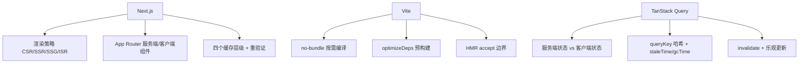

:::note 事实基线
本篇是「Next.js / Vite / TanStack Query」带解答题库，共 **88 题**，事实来源为 `content/fe/next.md`、`content/fe/vite.md`、`content/fe/tanstack.md`。Next.js 按 **16 线**（App Router、Cache Components、`use cache`）、Vite 按 **8 线**（Rolldown 工具链）、TanStack Query 按 **v5** 口径撰写。
:::

本篇是「Next.js / Vite / TanStack Query」题库。这三个是现代前端工程的主流选型，面试里以「**Next.js 的渲染策略/缓存**」「**Vite 为什么快**」「**TanStack Query 的缓存模型**」的形式高频出现。本篇分三部分：Next.js（渲染策略、App Router、缓存）、Vite（开发态、预构建、HMR、生产构建）、TanStack Query（对象模型、缓存语义、失效与乐观更新）。

**主线一览**



## 一、Next.js：渲染策略

### Q1. 四种渲染策略的定位与选择维度？

| 策略 | 何时生成 HTML            | 数据新鲜度 | 典型场景                             | 在 App Router 中的表达                         |
| ---- | ------------------------ | ---------- | ------------------------------------ | ---------------------------------------------- |
| CSR  | 浏览器运行时             | 实时       | 登录后后台、强交互面板               | 客户端组件 + 数据获取库                        |
| SSR  | 每次请求                 | 实时       | 个性化内容、依赖请求头/Cookie 的页面 | 使用请求期 API，或 `dynamic = "force-dynamic"` |
| SSG  | 构建时                   | 构建时快照 | 文档、营销页、不常变的博客           | 默认行为，路由不访问请求期数据即预渲染         |
| ISR  | 构建时 + 按需/定时重验证 | 秒到天级   | 商品列表、新闻首页                   | 缓存指令 + `cacheLife` 或 `revalidate`         |

**选择这三个维度就够了**：内容是否因人/因请求而变（决定 SSR 还是预渲染），更新频率是分钟/小时/天级还是几乎不变（决定 ISR 的时长），是否需要 SEO 与社交预览（决定能否纯 CSR）。

### Q2. CSR 与 SSR 的请求时间线差别在哪？

```text
CSR:  HTML(空壳) → 下载 JS → 执行 JS → 发起数据请求 → 渲染内容   (^ 首屏内容在最后)
SSR:  服务端取数+生成 HTML → 下载 JS → 水合   (^ 首屏内容在最前, ^ 可交互在水合后)
流式: 服务端发 shell → 立即显示骨架 → 数据就绪后补发片段   (^ 首屏在 shell, 部分可交互)
```

**CSR 的问题不止是慢**：空壳 HTML 对不执行 JavaScript 的爬虫和社交平台抓取器等于不存在，首屏内容完全依赖 JS 下载与执行。**SSR 把「能生成内容」的部分前移到服务端，代价是服务器要承担渲染成本、TTFB 可能上升，并且必须处理水合一致性**。

**采分点**：能说出「**CSR 的首屏内容在最后（依赖 JS），SSR 的首屏内容在最前（HTML 直出），可交互在水合后**」——「看到内容」与「可交互」是两个不同的时间点。

### Q3. 流式渲染与 Suspense 边界怎么工作？有什么使用边界？

流式渲染把「整页就绪才发送」改为「边生成边发送」：先发送能立刻确定的 shell，遇到尚未就绪的片段时先发送 fallback，数据到达后再把该片段补发到同一个响应流中。在 App Router 中，**边界由 `<Suspense>` 表达**。

使用边界：① **影响布局的关键数据放入 Suspense 会引起布局偏移**；② **首屏 SEO 关键内容放进 fallback 会让爬虫只看到骨架**；③ 非常快的查询加 Suspense 的调度开销可能超过收益。另外 **Suspense 本身只是「承诺边界」，它不会自动让组件变成动态渲染**，只做同步工作的组件即使被包住也会在预渲染阶段完成。

**采分点**：能说出「**Suspense 不会自动让组件变动态，只做同步工作的组件仍会预渲染**」——这是对流式渲染最常见的误解。

## 二、Next.js：App Router 组件模型

### Q4. 服务端组件与客户端组件的分工？

App Router **默认所有组件都是 Server Component**，只有显式标注 `'use client'` 的模块及其导入图才进入客户端包。

| 维度                 | Server Component                            | Client Component                            |
| -------------------- | ------------------------------------------- | ------------------------------------------- |
| 运行位置             | 仅服务端                                    | 服务端预渲染 + 客户端水合                   |
| 代码是否进入客户端包 | 否                                          | 是                                          |
| 可用能力             | 直接访问数据库、文件系统、环境变量、密钥    | 浏览器 API、事件处理器、生命周期与状态 Hook |
| 不能用               | `useState`、`useEffect`、事件处理器、类组件 | 直接在模块顶层读数据库、访问密钥            |
| 输出                 | 序列化后的组件树（RSC Payload）+ 首屏 HTML  | 首屏 HTML + 模块引用，由客户端执行          |

**关键区别在于 Server Component 的代码永远不会发到浏览器**——在页面里直接查询数据库，不需要额外搭一层 API 把数据「搬」给前端；对应的库和查询逻辑也不会出现在客户端包里。

### Q5. 'use client' 的语义是什么？边界为什么要下压？

**`'use client'` 标记的是模块边界，不是单个组件**。它声明「这个文件的导出需要在客户端运行」，并且**该文件导入的所有模块都会被拉进客户端图**。因此边界要尽量下压：把交互部分单独抽成一个文件，而不是在页面顶部加指令。

`'use client'` 的传播方向是**向下**的：客户端组件可以包含其他客户端组件，也可以接收服务端组件作为 `children`。但**服务端组件不能导入客户端组件再把它当函数调用，只能作为元素渲染**。

**采分点**：能说出「**'use client' 是模块边界，导入图全进客户端包，所以边界要下压**」——在页面顶部加 'use client' 会把整个页面（含数据库查询）拉进客户端包。

### Q6. 序列化边界与引用去重的性能约束是什么？

从服务端组件传给客户端组件的 props **必须可序列化**。函数（事件处理器、服务端函数除外）、类实例、Symbol、可变的模块级单例都不能直接跨越这条边界。

**性能约束**：传递的数据会被序列化进 RSC Payload，而**序列化按对象引用去重**。同一个对象引用只发一次，但任何会破坏引用相等的操作都会让它被重复发送：

| 操作                                                | 是否破坏去重 | 建议                                 |
| --------------------------------------------------- | ------------ | ------------------------------------ |
| 直接透传原数组                                      | 否           | 优先                                 |
| `.filter()` / `.map()` / `.slice()` / `.toSorted()` | 是           | 把原始数据传给客户端，在客户端做转换 |
| 对象展开 `{...obj}`                                 | 是           | 只传需要的字段                       |
| `structuredClone()`                                 | 是           | 避免在传给客户端之前克隆             |

**更根本的原则是只传客户端真正需要的字段**——服务端取到 50 个字段的对象却只用一个 `name`，就应该只传 `name`，这既减少传输量，也避免把不该暴露的字段带进客户端。

**采分点**：能说出「**序列化按引用去重，.map/.filter/展开会破坏去重导致重复发送**」——这是 RSC 性能优化的关键细节。

### Q7. 为什么不能在服务端组件里放模块级可变状态？

服务端组件在**服务端共享的运行时**里执行，模块级可变状态（如 `let cache = {}`）会被**所有请求共享**，导致：① 请求间数据串扰（A 请求的数据被 B 请求看到）；② 并发竞态；③ 内存泄漏（状态永不释放）。服务端组件应该是**纯函数**——相同输入产生相同输出，状态放在请求作用域（如 React `cache()`、`cookies()`）或外部存储。

## 三、Next.js：缓存与重验证

### Q8. Next 的四个缓存层级是什么？

| 层级           | 缓存内容                                        | 作用域       | 失效方式                                          |
| -------------- | ----------------------------------------------- | ------------ | ------------------------------------------------- |
| 请求内记忆     | 同一渲染过程内 URL 与选项相同的 GET 请求去重    | 单次渲染     | 渲染结束自动释放                                  |
| 数据缓存       | `fetch` 或 `use cache` 显式声明的服务端持久缓存 | 跨请求       | `revalidateTag`/`updateTag`/`revalidatePath`/到期 |
| 预渲染产物     | 构建期生成的 HTML 与 RSC Payload                | 跨请求       | 重验证或改为动态渲染                              |
| 客户端路由缓存 | 浏览器内存中的 RSC Payload                      | 单个浏览会话 | `router.refresh()`/相关重验证 API/导航            |

**请求内去重只在组件树渲染期间生效，Route Handler 不属于 React 组件树，因此不参与这种去重**。

### Q9. fetch 的默认行为与显式缓存声明？

在未启用 Cache Components 的默认模型下，**`fetch` 请求默认不缓存**。一个没有设置 `cache` 选项的请求，如果位于路由被预渲染的范围内，会在构建时执行一次并固化进产物；如果位于请求期 API 之后，则每次请求都重新执行。需要跨请求复用时要显式声明：

```ts
fetch(url, { cache: "force-cache" }); // 尽量复用
fetch(url, { cache: "no-store" }); // 每次重新拉取
fetch(url, { next: { revalidate: 3600 } }); // 一小时后过期
fetch(url, { next: { tags: ["posts"] } }); // 打标签以便按需失效
```

不依赖 fetch 的数据源（数据库查询、第三方 SDK）在 Cache Components 模型下直接用 **`'use cache'`** 标注该函数，配合 `cacheLife` 档位与 `cacheTag` 标签进入持久缓存。

### Q10. cacheLife 的档位与 stale/revalidate/expire 三参数？

| 档位      | stale  | revalidate | expire |
| --------- | ------ | ---------- | ------ |
| `default` | 5 分钟 | 15 分钟    | 不过期 |
| `seconds` | 30 秒  | 1 秒       | 60 秒  |
| `minutes` | 5 分钟 | 1 分钟     | 1 小时 |
| `hours`   | 5 分钟 | 1 小时     | 1 天   |
| `days`    | 5 分钟 | 1 天       | 1 周   |
| `max`     | 5 分钟 | 30 天      | 1 年   |

**`stale` 是「可以继续提供旧数据」的窗口，`revalidate` 是后台刷新的间隔，`expire` 是超过多久必须丢弃并等待新数据**。

**采分点**：能说出「**stale（可提供旧数据）/ revalidate（后台刷新间隔）/ expire（必须丢弃）三个窗口的语义**」——这是 SWR 缓存在 Next 里的参数化。

### Q11. revalidateTag / updateTag / revalidatePath 的语义差异？

| API                           | 调用位置                     | 下次请求的行为                                   | 适用                                       |
| ----------------------------- | ---------------------------- | ------------------------------------------------ | ------------------------------------------ |
| `revalidateTag(tag, profile)` | Server Action、Route Handler | 先返回旧数据，后台刷新（stale-while-revalidate） | 更新延迟可以接受，例如商品目录、文档       |
| `updateTag(tag)`              | 仅 Server Action             | 立即过期，下次请求等待新数据                     | 写后立即读到自己的变更（read-your-writes） |
| `revalidatePath(path)`        | Server Action、Route Handler | 按路径失效                                       | 失效范围是页面而非数据                     |

**一个容易误解的点：重验证由请求触发，而不是由 `revalidateTag` 调用触发**——打了标签的页面在下次被访问时才刷新，不会在调用的一瞬间全部更新。客户端侧还有 `router.refresh()` 用于清除当前路由的客户端缓存并重新请求，**它不失效服务端缓存**；服务端失效统一走 revalidateTag/updateTag/revalidatePath，**客户端刷新与服务端失效是两套互补的机制**。

**采分点**：能说出「**revalidateTag 是 SWR（先旧后刷新），updateTag 是 read-your-writes（立即等新数据）**」+「**重验证由请求触发不是调用触发**」——这两个是 Next 缓存失效最易错的点。

### Q12. params 与 searchParams 为什么必须异步访问？

Next 15+ 把 `params` 与 `searchParams` 改成 **Promise**，必须 `await`：

```tsx
export default async function Page({ params }: PageProps<"/post/[id]">) {
  const { id } = await params; // 必须 await
}
```

原因：为了让动态参数在**预渲染时也能被推迟到请求期**（静态渲染时 params 可能还不确定），Next 把它们统一成异步——这样同一个组件在静态与动态渲染下行为一致。

### Q13. Server Actions 的安全要点有哪些？

Server Action 是「在服务端执行的函数，客户端可直接调用」。安全要点：① **必须做鉴权与输入校验**——Server Action 是公开的 HTTP 端点，任何人都能调用，不能假设「只有我的前端会调」；② **不要信任客户端传入的 ID/权限**——要在服务端重新校验当前用户是否有权操作该资源；③ **用 `zod` 等校验输入**；④ 敏感操作要**幂等 + 限流**。

### Q14. next/image 与 next/font 解决什么问题？

- **next/image**：自动尺寸优化（按设备 DPR 与视口生成多尺寸）、现代格式转换（WebP/AVIF）、懒加载、防止布局偏移（要求 width/height 或 fill）、`priority` 预加载首屏图。
- **next/font**：构建时下载字体并自托管（无外部请求、无隐私泄露）、自动 `font-display` 优化、零布局偏移（用 size-adjust 等度量回退字体）。

## 四、Vite：开发态与预构建

### Q15. Vite 开发态为什么快？no-bundle 是什么？

Vite 开发态快的核心是 **no-bundle + 按需编译**：① **不打包**——利用浏览器原生 ESM，源码按模块直接服务，不需要 webpack 那样先打 bundle；② **按需编译**——只编译当前页面请求到的模块，而不是全量编译；③ **依赖预构建**——把 CJS/UMD 依赖转成 ESM 并合并（见 Q16）。

**打包时机的差异**：webpack 是「先打包再服务」（启动慢，HMR 要重新打包受影响 chunk），Vite 是「先服务再按需编译」（启动快，HMR 只重新请求单个模块）。

**采分点**：能说出「**webpack 先打包再服务，Vite 先服务再按需编译**」+「**HMR 耗时与项目规模基本无关（只重新请求单个模块）**」——这是 Vite 快的本质。

### Q16. optimizeDeps 预构建解决什么问题？缓存怎么失效？

**目的**：① 把 CommonJS/UMD 依赖转成 ESM（浏览器原生 ESM 不认 CJS）；② 把「一个包几百个内部模块」合并成一个（如 lodash-es 有 600+ 内部模块，不合并会产生几百个 HTTP 请求）。预构建产物缓存在 `node_modules/.vite`。

**缓存失效**：依赖的 lockfile 哈希、vite 配置、NODE_ENV 变化时失效。**运行时才发现的新依赖是最影响体验的一类**：首次扫描没发现的依赖，会在页面运行到某处才触发预构建，**随之而来的是一次代价高昂的整页刷新**。根因几乎都是动态 `import()` 或运行时拼接的导入路径。**解法：把这些依赖显式写进 `optimizeDeps.include`**。

**采分点**：能说出「**运行时才发现依赖 = 整页刷新，解法是写进 optimizeDeps.include**」——这是 Vite 开发态最高频的坑。

### Q17. CJS/ESM 互操作的 default 导入规则是什么？

某些包对 `default` 导出的处理与打包时代不同，症状是 `xxx.default is not a function`。规则：**对 CJS 模块做 `default` 导入时，当导入方是 `.mjs`/`.mts`、或最近的 package.json 声明 `type: "module"`、或被导入模块的 `__esModule` 标记不为真时，`default` 就是模块导出对象本身；否则取导出对象的 `default` 字段**。不一致时用 `needsInterop`，或改写导入方式，或推动上游修复 `exports`。

### Q18. Vite HMR 的流程与 accept 边界是什么？

```text
1. 服务端维护模块依赖图，文件变更后只把受影响的模块节点标记为失效
2. 通过 WebSocket 通知浏览器哪些模块需要更新
3. 浏览器用带时间戳的 URL 重新发起 import()，天然绕过 HTTP 缓存
4. 更新沿着导入链向上传播，直到某个模块声明自己接受这次更新（accept 边界）
```

**边界通常由框架插件注入**：React 项目由 React Refresh 提供组件级热替换并在可能时保留组件状态，Vue SFC 同理。**没有声明边界的模块会一路传播到入口，最终退化为整页刷新**。

**排查 HMR 失效的三类原因**：① 变更模块到边界之间缺失 accept 声明；② 循环依赖导致边界查找失败；③ **导出不符合框架刷新约束——React Refresh 要求文件只导出组件，混入普通函数或常量会让边界失效**（这是 HMR 莫名整页刷新的常见原因）。

**采分点**：能说出「**React 文件应只导出组件，混入普通函数/常量会让 React Refresh 边界失效**」——这是「HMR 莫名整页刷新」的高频根因。

### Q19. Vite HMR 与 Webpack HMR 的本质差异？

| 维度           | Webpack HMR                      | Vite HMR                   |
| -------------- | -------------------------------- | -------------------------- |
| 更新单位       | chunk 的增量产物                 | 单个 ESM 模块              |
| 变更后动作     | 增量编译并生成更新清单与新 chunk | 直接让浏览器重新请求该模块 |
| 依赖图         | 构建期产物                       | dev server 内存中的模块图  |
| 耗时随项目规模 | 明显增长                         | 基本无关                   |
| 缓存绕过       | 依赖 runtime 的模块替换          | URL 上的时间戳查询参数     |

**本质差异是「重新打包受影响的部分」与「重新请求单个模块」**。

## 五、Vite：生产构建与工具链

### Q20. Vite 8 的工具链分工是什么？

Vite 8 的构建管线由一套 **Rust 工具**接管：开发态依赖预构建与生产打包共用一个打包引擎（**Rolldown**，Rust 实现的 Rollup 兼容打包器），转译用 **oxc**（或 esbuild）。这解决了「开发态用 esbuild、生产态用 Rollup，两者行为不一致」的历史问题——**开发与生产用同一个打包器，减少「开发正常生产报错」的差异**。

### Q21. Tree Shaking 的前提与失效场景？

Tree Shaking 依赖 **ESM 的静态结构**（import/export 在编译期可分析），死代码消除把未引用的导出摇掉。**失效场景**：① CJS 模块（require 是动态的，无法静态分析）；② **有副作用的模块**（导入即执行代码，如 polyfill、全局样式）——要用 `sideEffects: false` 或 `/*#__PURE__*/` 标注；③ 重导出（barrel file `index.ts` 导出一切）会让打包器难以摇掉；④ 类的方法、对象属性访问难以摇掉（不确定是否有副作用）。

### Q22. 代码分割怎么控制？

Vite/Rollup 的代码分割：① **动态 import**（`import()`）自动分割成独立 chunk；② `manualChunks` 手动分组（把 vendor、大库单独分块）；③ 入口 chunk 与共享 chunk。目标是**按路由/按需加载，避免单个巨大 bundle**，同时**避免过度分割导致请求瀑布**。

## 六、TanStack Query：对象模型与缓存

### Q23. 服务端状态与客户端状态的边界为什么重要？

| 维度     | 服务端状态                           | 客户端状态                   |
| -------- | ------------------------------------ | ---------------------------- |
| 所有权   | 存在远端，可能被其他客户端修改       | 存在浏览器内，由本地交互产生 |
| 一致性   | 需要「获取、缓存、失效、再同步」机制 | 写入即最新                   |
| 生命周期 | 与组件挂载解耦，可被多处共享         | 通常随组件或页面生命周期销毁 |
| 典型内容 | 用户资料、列表分页、消息记录         | 主题、选中项、表单草稿、令牌 |

**结论**：服务端状态用查询缓存管理，客户端状态用原子化或订阅式 store（Jotai、Zustand）管理。**把远端数据塞进全局 store 再手写失效，等价于重新实现一个更弱的查询缓存**；反过来把纯本地交互状态放进查询缓存，则会引入毫无必要的过期与重取语义。

**采分点**：能说出「**把远端数据塞进全局 store 再手写失效 = 重新实现一个更弱的查询缓存**」——这是「为什么需要 TanStack Query」的核心论据。

### Q24. QueryClient / QueryCache / Query 的对象模型？

```text
QueryClient (门面, 使用方唯一入口)
  QueryCache     查询实例注册表
    Query        单个查询: queryKey -> queryHash -> state
  MutationCache  变更实例注册表
    Mutation     单次写操作: idle -> pending -> success/error
```

`QueryClient` 提供 `getQueryData`、`setQueryData`、`invalidateQueries`、`query`、`infiniteQuery` 等命令式 API，并通过 Provider 注入组件树。它同时承载全局默认配置（retry、staleTime、refetchOnWindowFocus）。**在测试或 SSR 等多环境场景下，建议用工厂函数返回独立的 QueryClient，避免多个环境共享同一份缓存**。

### Q25. queryKey 的确定性哈希规则是什么？

查询缓存以 `queryHash` 为键保存 Query 实例，queryHash 由 queryKey 经哈希函数计算。**默认哈希对普通对象的键先排序再序列化，对数组保持元素顺序**：

| 写法                                                           | 是否同一缓存               |
| -------------------------------------------------------------- | -------------------------- |
| `['todos', { status, page }]` 与 `['todos', { page, status }]` | 相同（对象键顺序无关）     |
| `['todos', { a: 1, b: undefined }]` 与 `['todos', { a: 1 }]`   | 相同（undefined 键被忽略） |
| `['todos', status, page]` 与 `['todos', page, status]`         | 不同（数组顺序即语义）     |

**queryKey 里绝不能放「每次都变」的值**（随机值、时间戳、Date 实例、每次渲染新建且内容会变的对象），否则每次渲染命中全新缓存——数据永远不共享、请求永远不去重。**约束手段是集中的 key 工厂**：所有 key 由同一份工厂生成，既防漂移又让失效范围可控。

**采分点**：能说出「**对象键顺序无关（自动排序），数组顺序即语义**」+「**key 工厂集中生成防漂移**」——这是 queryKey 设计的两条铁律。

### Q26. staleTime 与 gcTime 的区别？为什么常被混淆？

- **`staleTime`** 决定「数据多久算过期」。过期不代表立即请求，只是在合适的时机（挂载、窗口聚焦、网络重连）**允许后台重取**。默认 `0`（拿到即过期）。
- **`gcTime`** 决定「数据没人观察后多久被删除」。它**只影响内存回收，不影响是否过期**。默认浏览器 5 分钟，服务端 `Infinity`。

**一条数据可以同时「已过期」和「仍在缓存中」**：此时组件挂载会先用旧数据渲染，同时在后台重取，重取完成后原地替换——这是 TanStack Query 默认的「缓存优先、后台刷新」策略。

**采分点**：能说出「**调大 gcTime 不会减少任何请求，只会多占内存；想要『切回标签页不刷屏』得关 refetchOnWindowFocus，而不是改 gcTime**」——这是 staleTime/gcTime 混淆的纠正。

### Q27. staleTime 的 Infinity 与 'static' 有什么区别？

| 值         | 行为                                                                                      |
| ---------- | ----------------------------------------------------------------------------------------- |
| `Infinity` | 不因过期而重取，但 `invalidateQueries` 仍能使它失效                                       |
| `'static'` | 永不重取，连 `invalidateQueries` 也对其无效，且会屏蔽 `"always"` 形式的聚焦/挂载/重连重取 |

**`'static'` 适合「应用运行期间不会变化」的数据**（启动时拉取的特性开关、登录后加载的权限、静态参照表）；如果仍希望手动失效生效，用 `Infinity`。

### Q28. invalidateQueries 的匹配语义是什么？

失效分两步：先把匹配的 Query 标记为 stale（该标记会覆盖 staleTime），再对默认 `type: 'active'` 的匹配项发起后台重取——**只有当前被组件观察的查询会立即重取，未挂载的查询仅被标记，等下次挂载再拉**。

**匹配规则是关键**：默认走**前缀式部分匹配**——过滤 key 中的每一位都必须与目标 key 的对应位置相等，因此**过滤 key 越短命中范围越大**。

```ts
queryClient.invalidateQueries({ queryKey: ["todos"] }); // 命中所有以 todos 开头的
queryClient.invalidateQueries({ queryKey: ["todos"], exact: true }); // 只精确命中 ['todos']
queryClient.invalidateQueries({ queryKey: ["todos"], refetchType: "none" }); // 只标记过期不重取
```

**采分点**：能说出「**前缀式部分匹配，过滤 key 越短命中范围越大**」+「**这套匹配语义与 queryKey 的分层设计是一体两面**」——key 组织成从粗到细的层级树后，「按资源根失效整个域」与「按参数精确失效一条」都只是选择匹配范围。

### Q29. structuralSharing 解决什么问题？

每次成功获取后，新数据会与旧数据做**深度比对，未变化的子树保留旧引用，只有变化的部分换新引用**。收益在配合 `select` 或 `React.memo` 时最明显：**列表中没有变化的行引用稳定，不会因一次后台刷新而整树重渲染**。

**结构性共享只适用于 JSON 兼容的值**。若 queryFn 返回 Map、Set 或含循环引用的对象，会打印明确警告，此时应关闭 structuralSharing 或改造返回值。

## 七、TanStack Query：变更与进阶

### Q30. useMutation 的三种写后策略是什么？

① **invalidateQueries**（最常用）——写后失效相关查询，触发后台重取（简单、保证最终一致，但多一次请求）；② **setQueryData**（写后直写）——直接用 mutation 结果更新缓存（乐观、无额外请求，但要保证结果与服务端一致）；③ **乐观更新**——mutation 前先 setQueryData 更新 UI，失败时回滚（最快，但要处理回滚）。

### Q31. 乐观更新与回滚怎么做？

```ts
onMutate: async (newTodo) => {
  await queryClient.cancelQueries({ queryKey: ["todos"] });  // 取消在途重取，避免覆盖乐观值
  const previous = queryClient.getQueryData(["todos"]);       // 快照旧值
  queryClient.setQueryData(["todos"], (old) => [...old, newTodo]);  // 乐观更新
  return { previous };                                         // 返回快照供回滚
},
onError: (err, newTodo, context) => {
  queryClient.setQueryData(["todos"], context.previous);       // 失败回滚
},
onSettled: () => {
  queryClient.invalidateQueries({ queryKey: ["todos"] });      // 无论成败都重取校准
},
```

**采分点**：能说出「**onMutate 先 cancelQueries 避免在途重取覆盖乐观值，快照旧值供 onError 回滚，onSettled 总是 invalidate 校准**」——这是乐观更新的完整闭环。

### Q32. 预取与 SSR 水合怎么做？

- **预取**：`queryClient.prefetchQuery`（或 `usePrefetchQuery`）在数据需要前提前拉取，运行在 bundle 内。
- **SSR 水合**：服务端用 `prefetchQuery` 预取 + `dehydrate` 把缓存序列化进 HTML，客户端 `HydrationBoundary` 水合——首屏直接用服务端数据，不重复请求。
- **缓存持久化**：`persistQueryClient` 把缓存存到 localStorage/sessionStorage，刷新页面后恢复。

### Q33. status 与 fetchStatus 两个状态轴是什么？

`status`：`pending`（无数据）/ `success`（有数据）/ `error`（出错）——**数据的状态**。`fetchStatus`：`fetching`（请求中）/ `paused`（离线暂停）/ `idle`（空闲）——**请求的状态**。两者正交：可以有「success + fetching」（有旧数据，后台重取中），这是 SWR 的状态体现。

**采分点**：能说出「**status 与 fetchStatus 正交，success + fetching 就是 SWR 的状态**」——这是理解「有数据但还在加载」的关键。

### Q34-Q88. 快速自检与深挖补充

**Q34. 一句话解释 ISR 的本质。** 构建时生成 + 按需/定时重验证——SSG 的静态 + SSR 的新鲜度的折中。

**Q35. 一句话解释为什么 SSR 要处理水合一致性。** 服务端 HTML 与客户端首次渲染必须一致，否则水合报错/闪烁——不能依赖 Date.now()/random() 等非确定值。

**Q36. 一句话解释 dynamic = "force-dynamic" 的作用。** 强制路由每次请求都动态渲染（不预渲染）——依赖请求头/Cookie 的个性化页面用。

**Q37. 一句话解释 RSC Payload。** 服务端组件输出的序列化组件树 + 首屏 HTML——客户端组件收到的是「渲染好的服务端组件结果 + 模块引用」。

**Q38. 一句话解释为什么服务端组件代码不进客户端包。** 在服务端执行，输出序列化结果——数据库查询逻辑与密钥永远不到浏览器。

**Q39. 一句话解释客户端组件为什么能接收服务端组件作 children。** 'use client' 边界向下传播，children 作为已渲染的元素传入——服务端组件在边界外渲染好再传进来。

**Q40. 一句话解释服务端组件为什么不能调用客户端组件。** 只能作为元素渲染（<ClientComp />），不能当函数调用（ClientComp()）——调用会在服务端执行客户端代码。

**Q41. 一句话解释请求内去重为什么 Route Handler 不参与。** 请求内记忆只在组件树渲染期间生效，Route Handler 不属于 React 组件树。

**Q42. 一句话解释 use cache 与 fetch cache 的关系。** use cache 标注任意函数（含数据库查询）进持久缓存，fetch 的 next.revalidate/tags 是 fetch 专属——Cache Components 模型统一用 use cache + cacheLife + cacheTag。

**Q43. 一句话解释重验证为什么由请求触发。** revalidateTag 只是标记失效，打了标签的页面在下次被访问时才刷新——不是调用瞬间全部更新。

**Q44. 一句话解释 router.refresh 与 revalidateTag 的区别。** router.refresh 清当前路由的客户端缓存并重新请求（不失效服务端缓存），revalidateTag 失效服务端缓存——两套互补机制。

**Q45. 一句话解释 params 为什么改 Promise。** 让动态参数在预渲染时也能推迟到请求期，同一组件在静态与动态渲染下行为一致。

**Q46. 一句话解释 Server Action 为什么必须鉴权。** 它是公开 HTTP 端点，任何人都能调用——不能假设只有自己的前端会调，要服务端重新校验权限。

**Q47. 一句话解释 next/image 防布局偏移。** 要求 width/height 或 fill，预留空间——避免图片加载后页面跳动（CLS）。

**Q48. 一句话解释 next/font 为什么零布局偏移。** 构建时下载自托管 + size-adjust 度量回退字体——回退字体与目标字体度量一致，切换不跳动。

**Q49. 一句话解释 Vite no-bundle 的前提。** 浏览器原生 ESM——源码按模块直接服务，不需要先打 bundle。

**Q50. 一句话解释依赖预构建为什么合并模块。** lodash-es 有 600+ 内部模块，不合并会产生几百个 HTTP 请求——预构建合并成一个。

**Q51. 一句话解释预构建缓存失效的条件。** lockfile 哈希、vite 配置、NODE_ENV 变化——缓存在 node_modules/.vite。

**Q52. 一句话解释 workspace 内部包为什么默认跳过预构建。** 视为源码（可直接 ESM 服务），但如果是 CJS 产物会报错，需加 include。

**Q53. 一句话解释 needsInterop 的用途。** 强制对指定依赖做 ESM 互操作——包自称 ESM 但内部用 require，或 exports 配置不规范。

**Q54. 一句话解释 HMR 的时间戳 URL。** 浏览器用带时间戳的 URL 重新 import，天然绕过 HTTP 缓存——不需要手动清缓存。

**Q55. 一句话解释 accept 边界由谁注入。** 框架插件（React Refresh、Vue SFC）——没有边界的模块一路传播到入口退化整页刷新。

**Q56. 一句话解释循环依赖为什么让 HMR 失效。** 边界查找失败，更新无法停在循环内，退化整页刷新。

**Q57. 一句话解释 Rolldown 解决什么。** 开发与生产用同一个 Rust 打包器，减少「开发正常生产报错」的 esbuild/Rollup 行为差异。

**Q58. 一句话解释 Tree Shaking 为什么依赖 ESM。** import/export 编译期可静态分析，CJS 的 require 是动态的无法分析。

**Q59. 一句话解释 sideEffects: false 的作用。** 告诉打包器「导入这个包不执行副作用」，未引用的导出可以安全摇掉——否则有副作用的模块不敢摇。

**Q60. 一句话解释 barrel file 为什么不利 Tree Shaking。** index.ts 重导出一切，打包器难以判断哪些没用——直接 import 具体模块更利于摇树。

**Q61. 一句话解释 manualChunks 的目标。** 按路由/按需加载避免巨大 bundle，同时避免过度分割导致请求瀑布——vendor/大库单独分块。

**Q62. 一句话解释为什么多环境要用工厂函数建 QueryClient。** 测试/SSR 多环境共享同一份缓存会串数据——工厂函数返回独立实例。

**Q63. 一句话解释 queryHash 的对象键排序。** 默认哈希对普通对象键先排序再序列化——{a,b} 与 {b,a} 是同一缓存。

**Q64. 一句话解释为什么数组顺序即语义。** ['todos', status, page] 与 ['todos', page, status] 是不同缓存——数组顺序表达层级语义。

**Q65. 一句话解释 key 工厂的价值。** 所有 key 由同一份工厂生成，防漂移、让失效范围可控——避免手写 key 字符串散落各处。

**Q66. 一句话解释 QueryCache 怎么实现请求去重。** 相同 queryHash 复用同一 Query 实例，多组件挂同一 key 共享数据与在途请求。

**Q67. 一句话解释 refetchOnWindowFocus 为什么常关。** 交互密集应用不希望焦点切换产生静默重取——关掉减少无谓请求。

**Q68. 一句话解释 retry 默认客户端 3 服务端 0。** 客户端失败静默重试，服务端每请求新建缓存无需重试——环境不同默认不同。

**Q69. 一句话解释 gcTime 服务端为什么 Infinity。** 服务端每个请求本就新建缓存，无需回收——请求结束缓存随进程释放。

**Q70. 一句话解释「已过期但仍在缓存」的渲染。** 先用旧数据渲染，后台重取，完成后原地替换——缓存优先、后台刷新（SWR）。

**Q71. 一句话解释 invalidateQueries 的 type: active。** 默认只重取当前被组件观察的查询，未挂载的仅标记 stale 等下次挂载再拉。

**Q72. 一句话解释 exact: true 的作用。** 只精确命中 ['todos'] 本身，不前缀匹配子 key——细粒度失效用。

**Q73. 一句话解释 predicate 的用途。** 谓词函数做复杂匹配（如 queryKey[1]?.version >= 10）——超出前缀匹配的细粒度失效。

**Q74. 一句话解释 MutationCache 为什么不参与 invalidateQueries。** invalidateQueries 只作用于查询缓存，变更实例按 gcTime 回收。

**Q75. 一句话解释 structuralSharing 为什么对 Map/Set 警告。** 只适用 JSON 兼容值，Map/Set/循环引用无法深度比对——要关闭或改造返回值。

**Q76. 一句话解释 select 与 structuralSharing 的配合。** select 投影出子集，structuralSharing 让未变化部分引用稳定——配合 React.memo 避免整树重渲染。

**Q77. 一句话解释写后 invalidate 与 setQueryData 的取舍。** invalidate 简单保证最终一致但多一次请求，setQueryData 乐观无额外请求但要保证结果与服务端一致。

**Q78. 一句话解释乐观更新为什么先 cancelQueries。** 取消在途重取，避免重取结果覆盖乐观值——onMutate 的第一步。

**Q79. 一句话解释 onSettled 为什么总是 invalidate。** 无论成败都重取校准——乐观值可能与服务端不一致，invalidate 拉回真实状态。

**Q80. 一句话解释 prefetchQuery 与 useQuery 的区别。** prefetch 提前拉取填充缓存（命令式），useQuery 组件订阅（声明式）——prefetch 在数据需要前调用。

**Q81. 一句话解释 SSR dehydrate/hydrate。** 服务端 prefetch + dehydrate 序列化缓存进 HTML，客户端 HydrationBoundary 水合——首屏用服务端数据不重复请求。

**Q82. 一句话解释 persistQueryClient。** 把缓存存 localStorage/sessionStorage，刷新页面后恢复——减少刷新后的重新请求。

**Q83. 一句话解释 status 与 fetchStatus 正交。** success + fetching = 有旧数据后台重取中（SWR），pending + fetching = 首次加载。

**Q84. 一句话解释条件查询的 enabled。** enabled: false 时查询不执行（status pending, fetchStatus idle）——依赖参数就绪后才 enabled。

**Q85. 一句话解释无限查询 useInfiniteQuery。** 维护 pages 数组与 getNextPageParam，分页/无限滚动——pageParam 驱动下一页。

**Q86. 一句话解释 TanStack Query 与手写 SWR 的关系。** 手写 SWR 只做预加载/去重/缓存三件事（早于 bundle），TanStack 是完整服务端状态库（失效/乐观/分页/SSR）——存量多页项目手写，新项目用 TanStack。

**Q87. 一句话解释 Next 缓存与 TanStack 缓存的层次。** Next 缓存是服务端/构建期（数据缓存、预渲染产物），TanStack 是客户端运行时（查询缓存）——两者互补不冲突。

**Q88. 一句话总结三者的定位。** Next.js 管渲染策略与服务端缓存（在哪渲染、怎么缓存），Vite 管开发态与构建（怎么快、怎么打包），TanStack Query 管客户端服务端状态（怎么获取、缓存、失效、同步）——三者各司一层，组合成现代前端全栈。

---

**延伸阅读**

- [CSS 与布局工程题库](/interview/qa/css-layout-engineering)：样式与布局的机制。
- [前端工程化题库](/interview/qa/frontend-engineering)：构建工具、Monorepo、CI 的工程化。
- [React 与浏览器题库](/interview/qa/react-and-browser)：React 渲染、Hooks、浏览器机制。
- [AI 流式前端题库](/interview/qa/ai-streaming-ui)：流式渲染与 SSE 消费。
- [Yukino Dev Agent 项目深挖题库](/interview/qa/yukino-dev-agent-project)：Next.js 16 全栈 AI 应用的真实落地。
- [工作文档 · Next.js](/fe/next)、[Vite](/fe/vite)、[TanStack](/fe/tanstack)：本篇的事实来源。
