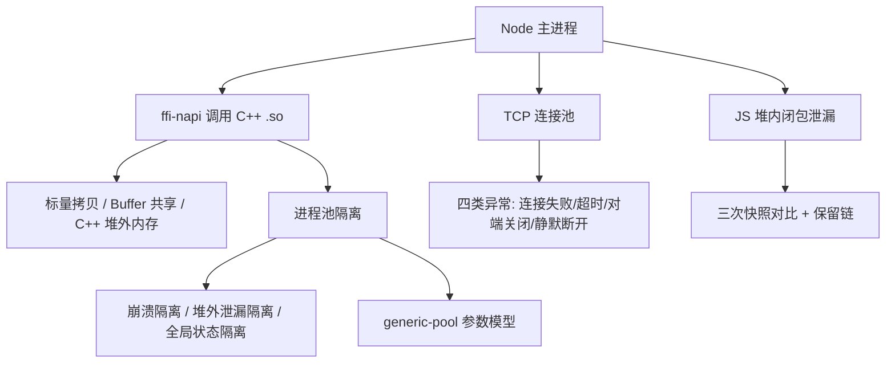

:::note 事实基线
本篇是「Node 原生绑定与池化资源治理」带解答题库，共 **82 题**，事实来源为 `content/docs/ieg.md`（NoSQL 管理端工程实践）。场景：Node.js 服务通过 ffi-napi 调用第三方 C++ `.so` 动态库（XML 表文件解密与解析），进程池/连接池基于 generic-pool。技术栈不绑定单一仓库，包名与 API 按当前主流版本口径撰写。
:::

本篇是「Node 原生绑定与池化资源治理」带解答题库。这块内容在面试里的价值在于：**它考察「跨语言内存模型」「故障隔离的工程论证」「池化资源的状态治理」三个硬核能力**，能讲清楚的人很少。本篇的组织顺序是：**先讲 ffi 调用的内存模型（标量/Buffer/堆外）→ 再讲 RSS 与 V8 堆两个口径 → 再讲进程池 vs 线程池的三层论证 → 再讲 TCP 连接池的四类异常 → 最后讲闭包内存泄漏的排查方法论**。

**主线一览**

## 一、ffi 调用的内存模型

### Q1. ffi-napi 的调用机制是什么？

ffi-napi 底层基于 **libffi**。JS 侧声明 C 函数签名（参数类型、返回类型），ffi-napi 通过 `dlopen` 加载 .so、`dlsym` 找到符号，调用时**按 ABI 把参数组装成 C 能理解的布局**再跳转执行。

**采分点**：能说出「**ffi-napi 每次调用都要经 libffi 做运行时参数组装（JS 值到 C ABI 布局），类型转换全靠运行时描述**」——这是它比 N-API Addon 慢的根本原因（Addon 直接通过 N-API 读写 JS 值，没有这层中间转换）。

### Q2. ffi 调用的内存模型，结论是什么？

**结论先行：分情况。**

- **标量参数是拷贝，不共享**：int、double 等按值拷贝进寄存器或栈，C++ 侧拿到的是副本，两边互不影响。
- **Buffer 与指针参数是共享内存**：JS 把 Buffer 传给 C++ 时，传的是这块内存的地址，C++ 侧直接在这块内存上读写，**零拷贝**；C++ 写入的内容 JS 侧立刻可见。
- **JS GC 只能管理 JS 侧分配的内存，C++ 侧分配的内存不受 JS GC 控制**。

**采分点**：这三条是「跨语言内存模型」的核心——能分清「哪些是拷贝、哪些是共享、哪些 GC 管不到」，就掌握了 ffi 互操作的全部风险点。

### Q3. Buffer 共享内存带来哪两个必须注意的问题？

解密、解析这类场景正是这样用的：JS 分配 buffer，C++ 原地写入解析结果。共享带来两个问题：

1. **生命周期（悬垂指针）**：C++ 侧只在**同步调用期间**使用这块内存是安全的；如果 C++ 把指针存下来**异步使用**，而 JS 侧已经没人引用这个 Buffer，**GC 可能回收它，C++ 侧就拿到悬垂指针**。规避方式是 JS 侧保持引用直到 C++ 用完，或者 C++ 侧同步拷贝走。
2. **小 Buffer 的池化陷阱**：Node 对小于 `Buffer.poolSize >>> 1` 的 Buffer 会从**共享内存池切片分配**（当前 Node 默认 poolSize 为 8KB，阈值即 4KB）。把这种切片的地址交给 C++ 有**越界读写相邻数据**的风险——传给 native 的 buffer 应用 `Buffer.allocUnsafeSlow` 或确保独立分配。

**采分点**：第 2 条是**极隐蔽的坑**——小 Buffer 是池化切片的，多个 Buffer 共享同一块底层内存，C++ 侧越界会读写到相邻 Buffer 的数据。能说出「**传给 native 的 buffer 要用 `Buffer.allocUnsafeSlow` 确保独立分配**」，是踩过这个坑的人。

### Q4. C++ 侧分配的内存怎么释放？忘了释放会怎样？

.so 内部用 malloc/new 分配内存（例如解析出的 message），把指针返回给 JS 后，**这块内存完全在 V8 堆外，JS GC 看不见它、不会回收它**。

唯一的释放途径是 **JS 侧显式再调一次 .so 提供的释放函数**（例如 `destroy_message`），用 ffi 声明这个函数并在用完后调用。实践中：① 用 **try/finally** 保证释放一定执行；② 也可以用 **FinalizationRegistry** 在 JS 包装对象被 GC 时触发释放，但 **GC 时机不可控，只能作为兜底**。

**忘了释放的表现**：Node 进程 **RSS 持续增长但 V8 堆内存正常**。这类泄漏要用 **valgrind 或 ASan 在 native 侧排查，用 heap snapshot 查不到**（heap snapshot 只看 V8 堆）。

**采分点**：能说出「**RSS 涨但 heapUsed 平稳 = 堆外泄漏，用 valgrind；heapUsed 涨 = 堆内泄漏，用 heap snapshot**」这个判断分叉，是内存排查的第一性方法。

### Q5. 为什么进程池是合适的隔离层（从内存模型角度）？

因为**堆外泄漏与崩溃都发生在子进程里**：C++ 侧分配的内存泄漏圈在子进程的 native 堆，最坏情况下**重启子进程就能全部归还**，主服务的内存曲线保持稳定。如果用线程池，泄漏块落在进程共享的 native 堆，回收线程也无法归还，只能重启整个主服务。

**采分点**：这解释了「**为什么即使崩溃风险为零、所有异常都能 catch，单凭堆外泄漏这一条就足以否定线程池**」——内存隔离是进程池的第二层独立论据。

## 二、RSS 与 V8 堆：两个口径的内存

### Q6. RSS 与 V8 堆统计的是同一块内存吗？

**不是**。「RSS 持续增长但 V8 堆内存正常」之所以成立，是因为这两个词统计的根本不是同一块内存。

**RSS（Resident Set Size）** 是**操作系统口径的进程级指标**：进程当前实际驻留在物理内存中的页总量，涵盖进程地址空间里所有常驻部分——**V8 堆、native 堆（C++ 侧 malloc/new 分配的块）、Buffer 与 ArrayBuffer 的后备存储、可执行文件与共享库的代码段、各线程的栈、显式 mmap 的映射**。**OOM killer 与容器内存限制针对的也是这个口径**，所以 RSS 才是「这个进程到底吃了多少内存」的最终答案。

**V8 堆**是 **V8 垃圾回收器管理的对象存储区**，按空间（space）组织：new_space（新生代）、old_space（老生代）、code_space（JIT 代码）、large_object_space（大对象）等。里面**只存放 JS 对象**，且只有从 GC root 可达的对象才会留下。`heapTotal` 是 V8 已向操作系统申请到的堆容量，`heapUsed` 是其中被存活对象占用的部分——它是「托管区」口径，**天然不包含任何 native 分配**。

### Q7. RSS 与 V8 堆的关系是什么？

**包含关系：V8 堆只是 RSS 的组成部分之一**。

| 维度     | RSS                                                                 | V8 堆 (heapTotal/heapUsed)    |
| -------- | ------------------------------------------------------------------- | ----------------------------- |
| 统计主体 | 操作系统 (进程页表)                                                 | V8 引擎 (GC 托管区)           |
| 覆盖范围 | 全部驻留物理内存: V8 堆、native 堆、Buffer 后备、代码段、栈、共享库 | 仅 JS 对象所在的各 heap space |
| 回收机制 | OS 不主动回收, 进程退出或显式 free/munmap 才释放                    | V8 GC 按可达性自动回收        |

### Q8. `process.memoryUsage()` 的五个字段各是什么口径？

| 字段         | 含义                                                |
| ------------ | --------------------------------------------------- |
| rss          | 进程驻留的物理内存总量，即 OS 口径                  |
| heapTotal    | V8 已申请的堆容量                                   |
| heapUsed     | V8 堆中存活对象的占用量                             |
| external     | 绑定到 JS 对象的 C++ 对象内存（含 Buffer 后备存储） |
| arrayBuffers | ArrayBuffer 的后备存储（external 的子集）           |

**采分点**：① **external 包含 Buffer 后备存储**——所以「Buffer 用多了」会体现在 external 而不是 heapUsed；② **arrayBuffers 是 external 的子集**；③ 判断堆外泄漏看 **rss 涨但 heapUsed 平稳**，此时 external 可能也涨（如果是 Buffer），但如果 external 也平稳而 rss 涨，就是**纯 native 堆泄漏**（C++ malloc，JS 侧完全看不见）。

### Q9. 为什么容器里 Node 进程会被 OOM kill，但 heapUsed 看起来正常？

因为**容器内存限制针对的是 RSS（cgroup memory.current），不是 V8 堆**。如果 native 堆（C++ 泄漏）、Buffer 后备、代码段、栈加起来让 RSS 超过 limit，即使 heapUsed 远低于 `--max-old-space-size`，也会被 OOM kill。

另一个相关坑：**Node 老版本按宿主机总内存算默认堆上限**，导致 V8 堆上限远超 cgroup limit——堆还没触发 GC 就被 OOM kill。解法是显式设 `--max-old-space-size` 与 cgroup limit 匹配（如 limit 的 70-80%），或用新版本 Node 的 cgroup 感知。

**采分点**：能说出「**OOM kill 看 RSS，V8 GC 看 heapUsed，两个口径不一致是容器里 Node 内存问题的根因**」+「**堆上限要与 cgroup limit 匹配**」。

### Q10. 怎么区分「堆内泄漏」与「堆外泄漏」？

用 `process.memoryUsage()` 观察 **heapUsed 与 rss 的相对走势**：

- **heapUsed 持续涨** → V8 堆内问题（闭包泄漏、缓存只进不出、全局引用）→ 用 **heap snapshot** 排查。
- **rss 涨而 heapUsed 平稳** → native 侧问题（C++ 泄漏、Buffer 后备、mmap）→ 用 **valgrind 或 ASan** 排查。
- **external 也涨** → Buffer/ArrayBuffer 后备存储泄漏（JS 侧持有大量 Buffer 引用）。

**采分点**：**判断泄漏先分清在哪个堆**——这是内存排查的第一步，分错了方向后面全白费（用 heap snapshot 查 native 泄漏是查不到的）。

## 三、进程池 vs 线程池

### Q11. 进程池与线程池的参数模型一致，关键差异在哪？

两者参数模型基本一致（max/min/超时/驱逐），**关键差异在故障隔离**：

| 维度       | 线程池 (worker_threads)                                            | 进程池                                        |
| ---------- | ------------------------------------------------------------------ | --------------------------------------------- |
| 地址空间   | 共享进程地址空间                                                   | 每个 worker 独立地址空间                      |
| 通信开销   | 小，可直接共享内存                                                 | 大，需要序列化或 IPC                          |
| 崩溃影响   | 任一线程内 native 崩溃（segfault、abort）带走整个进程              | 子进程崩溃只影响自己，主进程重建新进程即可    |
| 线程安全性 | 多线程并发调用同一份 .so 全局状态，要求库可证明线程安全            | 每个进程持有全局/静态状态的独立副本，天然隔离 |
| 堆外泄漏   | 泄漏块落在进程共享的 native 堆，回收线程无法归还，只能重启整个进程 | 泄漏圈在子进程内，定期回收子进程即可全部归还  |
| 资源成本   | 低                                                                 | 高（fork、加载 .so、初始化运行时）            |
| 适用场景   | native 代码可信、追求低延迟                                        | native 代码不可信、需要崩溃与堆外泄漏隔离     |

### Q12. 选进程池的三层递进论证是什么？

本场景选进程池。**这个结论不依赖单一的崩溃风险，而是三层递进的理由**：

**第一层：错误的可兜性取决于隔离模型。** 「错误能被兜住」必须先分类才成立：

| 错误类型                                                         | 线程池 (worker_threads)                                                                   | 进程池                                           |
| ---------------------------------------------------------------- | ----------------------------------------------------------------------------------------- | ------------------------------------------------ |
| .so 返回错误码、C++ 异常转错误返回                               | 可兜                                                                                      | 可兜                                             |
| worker 内 JS 异常                                                | 可兜（worker 的 `error` 事件 / Promise reject）                                           | 可兜                                             |
| native 崩溃（SIGSEGV、SIGABRT、C++ 未捕获异常走 std::terminate） | **兜不住**：信号是进程级的，try/catch 拦不了，任一线程崩溃带走全部线程与主进程            | 可兜：转化为子进程的 `exit` 事件，池销毁重建即可 |
| 堆损坏（越界写破坏共享堆元数据）                                 | **最糟**：损坏点与崩溃点解耦，可能很久之后在主线程的无关分配里爆发，JS 层错误处理完全无效 | 损坏圈在子进程内，崩溃即重启，主服务无感         |

worker 的 `error` 事件**只覆盖 JS 异常，native 崩溃不经过它**。「错误能被兜住」这个前提，恰恰是**进程池把不可兜的进程级故障转化成可兜的 JS 事件之后才成立的**——它是选进程池的论据，而不是反驳它的论据。

**第二层：堆外泄漏在线程模型下无法隔离。** valgrind 排查实锤了 .so 存在 definitely lost，且没有源码、无法修复。泄漏块落在 glibc 共享堆（进程级 arena），`worker.terminate()` 只能回收该线程的 V8 isolate 与 JS 堆，**对 native 泄漏块零作用**，RSS 单调增长，唯一的回收手段是重启整个主服务，连带 TCP 连接池与在途请求一起陪葬；进程池把泄漏圈在子进程，按 RSS 阈值或累计使用次数定期回收子进程就能全部归还。**即使崩溃风险为零、所有异常都能 catch，单这一条就足以否定线程池**。

**第三层：全局/静态状态的线程安全无法证明。** 第三方 .so 没有源码，无法证明它的全局/静态状态是线程安全的。多线程并发调用同一份 .so，全局状态会互相踩踏（数据竞争、状态错乱），且这类 bug 难以复现与定位。进程池让每个进程持有全局状态的独立副本，**天然隔离**。

**采分点**：这三层论证是**面试里最有说服力的部分**——它不是「进程池更安全」这种泛泛之谈，而是「**try/catch 兜不住信号级崩溃、worker.terminate 归还不了共享堆上的泄漏、无源码无法证明线程安全**」三个具体的、可验证的技术论据。能完整说出这三层，就是真正理解隔离模型的人。

### Q13. 为什么「native 错误能被 try/catch 兜住」是误判？

因为 **try/catch 只能兜住 JS 异常与 C++ 转成的错误返回，兜不住信号级崩溃**：

- **SIGSEGV/SIGABRT 是进程级信号**，不经过 JS 的异常机制，try/catch 拦不了。
- **C++ 未捕获异常走 std::terminate**，直接 abort 进程。
- **堆损坏**最糟：损坏点与崩溃点解耦，可能很久之后在主线程的无关分配里爆发，JS 层错误处理完全无效。

worker 的 `error` 事件只覆盖 JS 异常，native 崩溃不经过它。所以「错误能被兜住」这个前提，**恰恰是进程池把不可兜的进程级故障转化成可兜的 JS 事件（子进程 exit）之后才成立的**。

**采分点**：能说出「**它是选进程池的论据，而不是反驳它的论据**」这个逻辑反转——很多人用「错误能 catch」来反驳进程池，实际上「能 catch」正是进程池创造的条件。

### Q14. 进程池的回收策略怎么设计？

两种触发：① **按 RSS 阈值**——子进程 RSS 超过阈值（如 500MB）就回收重建，把堆外泄漏定期归还；② **按累计使用次数**——子进程处理 N 次请求后回收（即使没泄漏，也定期重置状态）。

回收时机：① **空闲时回收**（没有在处理请求时）；② **优雅回收**（等在途请求完成再销毁，或标记为 draining 不再接新请求）。

**采分点**：能说出「**回收是『把堆外泄漏定期归还』的手段，所以阈值要低于 OOM 线**」——如果等到子进程 OOM 才回收，就已经崩溃了；主动按阈值回收是「在崩溃前重置」。

## 四、generic-pool 参数模型

### Q15. generic-pool 的核心参数有哪些？

| 参数                        | 含义                      | 取值依据                           |
| --------------------------- | ------------------------- | ---------------------------------- |
| `max`                       | 池内资源最大数量          | 被池化资源的成本与对端限制         |
| `min`                       | 池内资源最小数量（预热）  | 常态并发，避免冷启动               |
| `acquireTimeoutMillis`      | 借用等待超时              | 上层请求超时预算                   |
| `maxWaitingClients`         | 最大排队客户端数          | 背压，池满时快速报错               |
| `idleTimeoutMillis`         | 空闲资源回收时间          | **要比对端空闲超时更短**（连接池） |
| `evictionRunIntervalMillis` | 驱逐检查周期              | 后台清理频率                       |
| `testOnBorrow`              | 借出前校验（调 validate） | 连接池建议开，进程池可不开         |

**采分点**：能说出「**参数（max、min、超时、驱逐）的取值必须结合被池化资源的成本与故障特征，通用默认值不足以覆盖生产场景**」——这是池化治理的核心认知。

### Q16. factory 模型的三个函数各做什么？

池围绕一个 **factory** 定义资源的生命周期：

- **create**：创建并初始化资源。连接池里完成建连、认证握手，并**挂上 error 与 close 事件监听**（Node 的 socket 没有 error 监听器时，一次错误会抛未捕获异常打崩进程）。**create 内部必须带连接超时**，因为 TCP 连接可能长时间挂起（被防火墙丢包时既不通也不拒），超时要主动销毁并抛错。
- **destroy**：彻底关闭资源、释放文件描述符。
- **validate**：借出前校验资源是否可用（testOnBorrow 开启时调用），通常检查存活标记并做协议层 ping。

**采分点**：① **不要在 create 里做无限重试**——重试应由池的按需重建加上层有限次重试组成，create 内部死循环重试会把池卡死；② **socket 必须挂 error 监听**，否则一次错误就打崩进程（Node 的未捕获异常语义）。

## 五、TCP 连接池与四类异常

### Q17. 连接池的价值是什么？核心难点在哪？

价值：① **省建连成本**——TCP 三次握手加上对端的认证握手，每次现建连都是毫秒级开销，高频请求下累积明显；② **控制连接数量**——对端对单个来源的连接数有限制，连接池把并发连接数收敛到 max 以内，不会把对端打满；③ **复用与预热**——常驻连接让请求直接命中热连接，延迟稳定。

**核心难点正是异常处理**：TCP 长连接不是「建好就永远可用」，连接失败、超时、对端主动关闭、静默断开，**每一种都要有明确策略**。

### Q18. 异常一：连接失败怎么处理？

场景：对端不可达（网络故障、对端宕机、端口未监听），或认证握手被拒绝，此时 create 抛错。处理要点：

- **区分错误类型**：认证失败是**配置错误，重试没有意义**，应该快速失败并告警；网络类错误（ECONNREFUSED、超时）可以交给池的重建机制。
- **池层面**：create 失败后，排队方在 `acquireTimeoutMillis` 内拿不到连接就抛错，上层捕获后**返回降级响应**（例如「管理服务暂时不可用」），而不是让请求挂死。
- **背压**：`acquireTimeout` 与 `maxWaitingClients` 共同限制排队规模，池满时快速报错。

### Q19. 异常二：请求超时怎么处理？为什么超时后要销毁连接？

场景：连接本身是通的，但某次请求发出去后对端迟迟不响应（对端负载高、请求卡住、中间链路丢包）。处理要点：

- **请求级超时**：每次在连接上发请求都带超时计时，超过阈值判定失败。**超时与连接失败要分开统计**——前者说明对端处理能力问题，后者说明连通性问题。
- **超时后的连接处置是关键**：请求超时意味着**这条连接上的协议状态已经不可信**，对端可能稍后把迟到的响应发回来，**污染下一个借用者的请求**。正确做法是**销毁这条连接，让池补一条新的，而不是归还复用**。
- **归纳成一条原则**：**任何让连接状态变得不确定的错误，一律销毁，绝不归还**。只有明确「连接还干净」的场景（业务层返回错误码、连接本身正常）才归还。
- **是否重试**：读类请求可以换一条连接重试一次；写类请求要看对端操作是否幂等，不幂等就不能盲目重试。

**采分点**：「**超时后销毁而不是归还**」是连接池治理的核心纪律——能说出「**迟到的响应会污染下一个借用者**」这个具体后果，就是理解协议状态机的人。

### Q20. 异常三：对端主动关闭连接怎么处理？

场景：对端有自己的空闲连接回收策略、例行重启、发布维护，会主动关闭连接，JS 侧收到 socket 的 close 或 FIN。处理要点：

- **连接上必须挂 error 与 close 事件监听**，监听后把连接标记为不可用，并从池中驱逐。
- **池内感知**：要么通过事件回调主动驱逐（`pool.destroy`），要么依赖 testOnBorrow 在下次借出时用 ping 探活发现失效再销毁重建。**两种机制并存时，事件驱动是主路径，探活是兜底**。
- **规避对端空闲回收**：如果对端的空闲超时是已知的（例如 5 分钟），**池的 `idleTimeoutMillis` 应设置得比对端更短**，让己方先回收空闲连接，减少「借到一条对端已关闭的连接」的概率；也可以发应用层心跳保活。
- **半关闭的细节**：对端发 FIN 只表示它不再发数据。Node 的 `net.Socket` 默认 `allowHalfOpen=false`，收到 FIN 会自动 end 并触发 close，半关闭只在显式开启 allowHalfOpen 时成立。因此**判断连接可用性不能只看「socket 没报错」，要结合协议层 ping 的结果**。

**采分点**：能说出「**池的 idleTimeout 要比对端更短，让己方先回收**」这个具体配置纪律——这是「借到死连接」问题的根治手段。

### Q21. 异常四：静默断开为什么最隐蔽？三层防御是什么？

这是**最隐蔽的一类**：中间网络设备重启、NAT 映射过期、链路丢包，连接两端都没有收到 FIN/RST，从 JS 侧看这条连接「一切正常」，直到下次写数据才发现不通，或者请求发出去石沉大海。

三层防御缺一不可：

1. **TCP keepalive**：开启 socket 的 keepalive 并设置较短的探测间隔，让操作系统尽早发现死连接。**默认的两小时探测间隔在生产环境基本没有意义，必须调短**。
2. **应用层心跳**：比 keepalive 更可靠，定期在协议层发 ping 并期待 pong，连续 N 次无响应就判定连接死亡并驱逐。**keepalive 探测包由对端内核的 TCP 协议栈直接应答，不经过业务代码，只能证明链路与对端协议栈活着；心跳走业务协议，能证明对端应用层还活着**。
3. **请求超时兜底**：即使前两者都漏了，请求超时能保证不会永久挂起。

**采分点**：能说出「**keepalive 证明链路活着，心跳证明应用活着**」这个区别——keepalive 由内核应答，对端应用卡死（但内核还在）时 keepalive 仍然成功，只有应用层心跳能发现。这是「为什么有了 keepalive 还要心跳」的标准答案。

### Q22. 连接池的可观测性要采集什么？

- **池状态**：当前连接数、空闲数、等待队列长度、借用耗时。
- **异常分类**：连接失败、请求超时、对端关闭、静默断开各自的计数（**分开统计**，因为它们指向不同的根因）。
- **连接生命周期**：创建数、销毁数、驱逐数、平均存活时间。
- **文件描述符**：`process_open_fds`——连接池泄漏（连接没销毁）在这里有直接信号。

**采分点**：能说出「**超时与连接失败要分开统计**」——前者是对端处理能力问题，后者是连通性问题，混在一起就无法定位根因。

### Q23. 连接池与进程池的对照是什么？

| 维度       | 进程池                         | 连接池                       |
| ---------- | ------------------------------ | ---------------------------- |
| 池化对象   | 子进程（执行环境）             | TCP 连接（通信通道）         |
| 解决的问题 | 崩溃隔离 + 堆外泄漏隔离        | 连接复用 + 状态治理          |
| 核心难点   | 回收策略（何时重启子进程）     | 异常处理（四类连接异常）     |
| 状态治理   | 子进程是无状态的（重启即重置） | 连接是有状态的（协议状态机） |

**采分点**：能说出「**进程池解决崩溃与堆外泄漏的隔离，连接池解决连接复用与状态治理**」——两者池化的是不同性质的资源，难点也不同。进程池的难点是「何时回收」，连接池的难点是「连接状态是否可信」。

## 六、valgrind 与 native 泄漏排查

### Q24. valgrind 的原理是什么？

valgrind（memcheck 工具）的原理是**指令级模拟 + 影子内存**：它在自己的虚拟 CPU 上逐条执行目标程序的指令，同时用「影子内存」记录每个内存字节的有效性（是否已初始化、是否已释放）与每个内存块的分配/释放状态。当程序访问无效内存（未初始化读、释放后使用、越界）时，memcheck 报告错误。

**代价**：指令级模拟让程序**慢 10-50 倍**，所以只适合测试环境复现，不适合生产。

### Q25. valgrind 报告的泄漏分类有哪些？

| 分类                | 含义                                     | 严重性       |
| ------------------- | ---------------------------------------- | ------------ |
| **definitely lost** | 没有任何指针指向这块内存，**确定泄漏**   | 最严重       |
| **indirectly lost** | 被 definitely lost 的块间接引用          | 随主块修复   |
| **possibly lost**   | 指针指向块内部而非起始（可能是数组偏移） | 需人工判断   |
| **still reachable** | 程序退出时仍有指针指向（如全局缓存）     | 通常不是泄漏 |

**采分点**：能说出「**definitely lost 是确定泄漏，still reachable 通常不是**」——很多人看到 still reachable 的大数字就慌，实际上那是全局缓存/运行时持有的，不是泄漏。真正要修的是 definitely lost。

### Q26. valgrind 排查 native 泄漏的流程是什么？

1. **确认现象**：RSS 涨但 heapUsed 平稳（堆外泄漏，Q10）。
2. **复现**：在测试环境用 valgrind 跑 Node + .so，执行可疑操作 N 次（如反复触发解析请求）。
3. **看报告**：`valgrind --leak-check=full --show-leak-kinds=definite`，找 definitely lost 的块与它们的分配栈。
4. **定位分配点**：报告里的分配栈指向 .so 内部的 malloc/new 位置——即使没有源码，也能知道是哪个函数分配的。
5. **修复或隔离**：有源码就修；没源码（第三方 .so）就用**进程池隔离 + 定期回收**（Q14）。

**采分点**：能说出「**没有源码的第三方 .so 泄漏，修复手段是进程池隔离 + 定期回收，而不是改代码**」——这是「无法修复时就隔离」的工程务实态度。

### Q27. ASan 与 valgrind 的区别？

| 维度     | valgrind (memcheck)      | ASan (AddressSanitizer)                     |
| -------- | ------------------------ | ------------------------------------------- |
| 方式     | 指令级模拟（不需要重编） | 编译期插桩（需要 -fsanitize=address 重编）  |
| 速度     | 慢 10-50 倍              | 慢 2-3 倍                                   |
| 检测能力 | 未初始化读、泄漏、越界   | 越界、use-after-free、double-free（更精确） |
| 适用     | 没有源码、不能重编的场景 | 有源码、能重编的场景                        |

**采分点**：**有源码用 ASan（快、精确），没源码用 valgrind（不需要重编）**——本场景的第三方 .so 没有源码，所以用 valgrind。

## 七、N-API Addon 迁移

### Q28. 从 ffi-napi 迁移到 N-API Addon 的收益是什么？

当调用频率与数据体积上升、需要堆外内存与 GC 联动时，评估迁移到 C++ Addon（基于 N-API / node-addon-api）：

- **调用开销更低**：ffi-napi 每次调用都要经 libffi 做运行时参数组装，Addon 直接通过 N-API 读写 JS 值，没有这层中间转换，高频调用场景差距明显。
- **大数据零拷贝更自然**：Addon 可以直接接收 ArrayBuffer 并在 C++ 侧原地处理，解析结果也可以包成 external buffer 返回，不需要像 ffi 那样围绕裸指针手工管理。
- **内存管理可与 GC 联动**：N-API 支持给 external 内存挂 **finalize 回调**，JS 侧包装对象被 GC 回收时自动触发 C++ 侧释放，堆外内存泄漏的敞口变小。
- **异步能力完整**：CPU 密集的解析可以用 **AsyncWorker** 丢进 libuv 线程池执行，不阻塞事件循环；跨线程回传结果有 **ThreadSafeFunction** 兜底。ffi-napi 的异步支持弱。
- **类型表达更强**：可以直接在 C++ 侧构造 JS 对象、数组返回，不用把解析结果序列化成 buffer 再在 JS 侧二次解析。
- **ABI 稳定**：N-API 保证跨 Node 版本 ABI 兼容，Addon 不需要跟随 Node 小版本反复重编。

### Q29. 迁移到 N-API Addon 的代价是什么？

- **编译与分发成本**：ffi-napi 自带预编译的 native 产物，安装即用；Addon 要走 node-gyp 构建，CI 需要维护编译工具链，多平台多 Node 版本要产出对应的 prebuild 产物，发布链路明显变重。
- **迭代耦合**：.so 更新只需替换二进制，JS 侧无感；Addon 的接口变更要同时改 C++ 与 JS 两侧并重新编译发布，迭代节奏被绑在一起。
- **崩溃隔离并未解决**：这是**最容易误判的一点**。Addon 运行在 Node 主进程地址空间内，**C++ 侧崩溃依然会带走整个进程**。因此迁移到 Addon 之后**进程池的隔离层仍然保留**，Addon 跑在池内的子进程里。**Addon 解决性能与内存管理问题，进程池解决故障隔离问题，两者是叠加关系而不是替代关系**。
- **开发与调试门槛**：需要掌握 N-API 的引用计数、handle scope、ThreadSafeFunction 等概念，native 崩溃的排查依然要靠 valgrind 或 ASan。

**采分点**：第三条「**Addon 不解决崩溃隔离，进程池仍要保留**」是最容易误判的——很多人以为「迁移到 Addon 就不需要进程池了」，实际上 Addon 与进程池解决的是不同问题（性能 vs 隔离），是叠加关系。

### Q30. ffi-napi 与 N-API Addon 怎么选？

- **ffi-napi**：现成 .so、调用量不大、没有源码、要快速接入——成本最低。
- **N-API Addon**：调用频率与数据体积上升、需要堆外内存与 GC 联动、需要异步能力——性能与内存管理更好。
- **无论哪种绑定，只要 native 代码不可信，进程池的隔离层都不能省**：try/catch 兜不住信号级崩溃，回收线程也归还不了共享堆上的泄漏，只有子进程重启能同时兜住这两类故障。

### Q31. 除了 ffi-napi 与 N-API Addon，还有哪些绑定形态？

| 形态                   | 前提                                  | 收益                                                         | 代价                                                     |
| ---------------------- | ------------------------------------- | ------------------------------------------------------------ | -------------------------------------------------------- |
| napi-rs 等现代工具链   | 团队具备 Rust 工程能力                | 跨平台预编译产物由框架托管，Rust 内存安全减少一类 native bug | 仍不解决崩溃隔离，进程池要保留                           |
| 独立解析服务（服务化） | 解析量大到需要独立伸缩，或多方复用    | 崩溃与内存泄漏圈在服务内，可独立扩容、发布、重启             | 多一跳网络与序列化（大 buffer 传输成本高），运维成本增加 |
| WASM 编译              | 能拿到 C++ 源码并通过 Emscripten      | 线性内存边界受控，越界是 trap 而非崩溃，省去多平台编译产物   | 现成 .so 无法直接转 wasm，性能通常低于原生               |
| 纯 JS 重写             | 解析量不大，或压测证明瓶颈不在 native | 消灭绑定成本、崩溃风险与堆外内存问题，类型直接对齐 TS        | CPU 密集场景性能可能不够，解密逻辑要逐位兼容，验证成本高 |
| 命令行子进程封装       | 低频、粗粒度调用                      | 实现最简单，崩溃隔离天然成立                                 | 每次调用都有进程创建开销，大 buffer 走管道传输成本高     |

**选型看三个维度**：① **有没有源码**（没有源码就排除 WASM 与纯 JS 重写，只能在绑定方式与服务化之间选）；② **调用量与数据量**（决定对调用开销与序列化开销的敏感度）；③ **对崩溃与内存风险的容忍度**（决定隔离层级：进程内 → 子进程 → 独立服务）。

**采分点**：能说出「**隔离层级是递进的：进程内（Addon）→ 子进程（进程池）→ 独立服务（服务化），风险容忍度决定选哪层**」——这是 native 互操作选型的完整框架。

## 八、闭包内存泄漏排查

### Q32. JS 闭包泄漏成立的两个条件是什么？

V8 的 GC 是**标记-清除**：从 GC roots（全局对象、执行栈、活跃的内部结构）出发标记所有可达对象，不可达的才回收。闭包只要被引用，它捕获的变量就保持可达。所以问题不是「对象被闭包引用」，而是「**闭包被长生命周期的东西引用，且闭包捕获了不该长期持有的大对象**」。

泄漏成立需要**两个条件同时满足**：

1. **闭包捕获了大对象**（或会持续增长的结构）；
2. **闭包被长生命周期载体持有**——例如未清理的 setInterval/setTimeout、未移除的事件监听器、挂到全局或模块级变量上的回调、没有淘汰策略的缓存。

**只满足其一不会泄漏**：闭包捕获大对象但自身很快不可达，GC 正常回收；闭包长期存活但只捕获小标量，没有实际影响。

**采分点**：能说出「**两个条件必须同时满足**」——这是闭包泄漏的第一性原理，很多人只记得「闭包会泄漏」但说不清条件。

### Q33. 典型的闭包泄漏模式有哪些？

- **定时器持有闭包**：setInterval 没有清理，闭包一直活着，它捕获的数据永远可达。修复：保存句柄，在明确的生命周期点 clearInterval/clearTimeout，服务类对象要有 dispose 语义。
- **事件监听器未移除**：每次请求都注册监听、从不 removeListener，监听回调的闭包累积，每个都捕获了当次请求上下文。修复：注册与移除成对出现；EventTarget 类 API 可以用 `{ once: true }` 或 AbortController 的 signal 统一管理移除。
- **闭包意外捕获大作用域**：同一作用域创建的所有闭包**共享同一个 context**，只要有一个闭包捕获了大对象，另一个只用了小变量、却被长生命周期持有的闭包也会让大对象一起常驻。修复：缩小闭包捕获面——把大对象的使用收敛到局部，注册回调前把需要的字段提取成小变量，必要时把注册逻辑拆到独立函数，切断与大作用域的联系。
- **缓存只进不出**：缓存 Map 挂在全局，闭包写入后没有任何淘汰路径。修复：加淘汰策略，容量上限用 LRU，或键是对象时改用 **WeakMap**，让条目随键的回收自动消失。
- **被遗忘的全局引用**：调试时把大对象挂到 global 或模块顶层变量，上线后没有移除。修复：代码审查中禁止随手挂全局，调试代码不进主干。

**采分点**：第三条「**闭包共享 context**」是最隐蔽的——V8 只把被内层函数引用的变量放进作用域的 context，但**共享 context 意味着捕获面是「整个 context」而不是「单个闭包实际用到的变量」**。能说出这个机制细节，就是读过 V8 实现的人。

### Q34. heap snapshot 三次快照对比法是什么？

这是**核心排查手段**：

1. 在服务稳定后拍**第一次快照**；
2. 执行可疑操作 **N 次**（例如反复触发解析请求）；
3. 再拍**第二次**；
4. **手动触发 GC 后**拍**第三次**。

用 **Comparison 视图**对比第一次与第三次，**只看新增且未被回收的对象**，泄漏对象会成批出现。

**采分点**：① **第三次快照前必须手动触发 GC**——否则「新增但未回收」里混入了「本应被回收但 GC 还没跑」的对象，假阳性；② **对比第一次与第三次**（不是第二次），因为第二次是「操作后未 GC」，第三次是「操作后已 GC」，只有第三次能区分「泄漏」与「待回收」。

### Q35. 保留链（retainers）怎么看？

选中可疑对象查看**保留链**，保留链会一路指到 GC root。闭包泄漏的典型形态是：**对象 → 闭包 → 函数 → 某个全局的定时器/监听器/Map**。**保留链的终点就是修复的入口**。

进一步：在快照里**函数节点可以看到它关联的 context 对象**，展开能看到闭包实际捕获了哪些变量，确认是否意外捕获了大对象。

**采分点**：能说出「**保留链的终点是修复入口**」——排查泄漏不是找到「泄漏的对象」，而是找到「谁在持有它」（保留链终点），那才是修复点。

### Q36. 修复后怎么验证泄漏已收敛？

用**同样的三次快照法复测**：执行 N 次操作后，Comparison 视图里**不应再有该类型的新增对象残留**，heapUsed 曲线恢复**锯齿形**（涨后被 GC 拉回）。

**采分点**：能说出「**修复后必须用同一套观测手段复测，否则无法确认泄漏已收敛**」——这与性能优化、native 泄漏的验证纪律一致：用同一套手段、同一口径、同一场景复测。

### Q37. React 侧的闭包泄漏与 Node 侧有什么关系？

React 侧的闭包泄漏同样常见：**useEffect 里注册的监听、定时器如果不在清理函数里释放，组件卸载后闭包依然存活**。这也是组件迁移规范里要求**严格检查清理函数**的原因。

**采分点**：能说出「**Node 侧的闭包泄漏与 React 侧的 useEffect 泄漏是同一个机制**」——都是「闭包被长生命周期载体持有 + 捕获了大对象」，只是载体不同（Node 是定时器/监听器/全局，React 是未清理的 effect）。

## 九、类组件迁移函数组件

### Q38. 类组件迁移到函数组件的动机是什么？

- **生命周期逻辑分散**：一段副作用逻辑常散落在 componentDidMount、componentDidUpdate、componentWillUnmount 三个方法里；函数组件用 useEffect 把「执行副作用加清理副作用」收敛到一处。
- **this 与绑定问题**：类组件的事件处理要么手动 bind，要么写箭头函数属性；函数组件全是普通闭包，没有这类问题。
- **逻辑复用能力**：选择器之间有大量共性逻辑，类组件只能靠继承或高阶组件复用，函数组件可以抽成自定义 hook。
- **性能优化手段更细**：React.memo、useMemo、useCallback 可以精确控制重渲染与重复请求。
- **生态与维护**：现代 React 生态都以 hooks 为中心；TypeScript 下函数组件加 hooks 的类型推导也比类的 this 类型更顺。
- **面向未来**：并发特性（useTransition、useDeferredValue）以 hook 形式提供，只对函数组件友好。

### Q39. 生命周期与 hooks 的语义映射有哪些注意点？

| 类组件                               | hooks 等价物                                  | 注意点                                                             |
| ------------------------------------ | --------------------------------------------- | ------------------------------------------------------------------ |
| componentDidMount                    | useEffect(fn, [])                             | effect 在浏览器**绘制后异步执行**，与 componentDidMount 时机有差异 |
| 需要在绘制前同步读 DOM               | useLayoutEffect                               | 用于避免闪烁或依赖布局尺寸的计算                                   |
| componentDidUpdate                   | 带依赖数组的 useEffect                        | **依赖必须列全**，漏列会拿到过期值                                 |
| componentWillUnmount                 | effect 返回的清理函数                         | 监听、定时器、在途请求的取消都放这里                               |
| shouldComponentUpdate                | React.memo 包裹组件，配合 useMemo/useCallback | **引用不稳定会让 memo 失效**                                       |
| getDerivedStateFromProps             | 渲染期直接计算或 useMemo                      | 优先不存第二份 state                                               |
| 错误边界（getDerivedStateFromError） | **无 hook 等价物**                            | 错误边界组件必须保留类组件                                         |

**采分点**：① **错误边界无 hook 等价物，必须保留类组件**——这是迁移的硬边界；② **useEffect 在绘制后异步执行**，与 componentDidMount（绘制后同步）时机有差异，依赖布局尺寸的计算要用 useLayoutEffect；③ **依赖漏列会拿到过期值**（闭包陷阱）。

### Q40. 迁移的核心风险在哪？

**核心风险不在语法翻译，而在 effect 依赖完整性、setState 合并语义、异步闭包过期值与请求竞态**。

- **setState 合并语义**：类组件的 `this.setState` 是**浅合并**，函数组件的 `useState` setter 是**替换**——机械翻译会丢字段。
- **异步闭包过期值**：函数组件每次渲染创建新闭包，异步回调里捕获的是**创建时的值**，不是最新值——要用 useRef 或函数式更新。
- **请求竞态**：快速切换筛选条件时，多个请求并发返回，**后发的请求可能先返回**，导致旧数据覆盖新数据——要用 AbortController 取消在途请求，或用序号/时间戳丢弃过期响应。

**采分点**：能说出「**请求竞态是迁移里最容易漏的 bug**」——类组件里可能在 componentDidUpdate 里做了取消，迁移到 useEffect 时如果忘了在清理函数里取消，就会出现「切换筛选后显示旧数据」。

### Q41-Q82. 快速自检与深挖补充

**Q41. 一句话区分标量与 Buffer 的传递语义。** 标量按值拷贝（C++ 拿到副本，两边互不影响），Buffer 传地址（共享内存，零拷贝，C++ 原地读写 JS 立刻可见）。

**Q42. 一句话解释悬垂指针怎么产生。** C++ 把 Buffer 指针存下来异步使用，而 JS 侧已没人引用该 Buffer，GC 回收后 C++ 拿到悬垂指针——规避是 JS 侧保持引用直到 C++ 用完，或 C++ 同步拷贝走。

**Q43. 一句话解释 Buffer 池化陷阱。** 小于 4KB 的 Buffer 从共享内存池切片分配，多个 Buffer 共享底层内存，把切片地址交给 C++ 有越界读写相邻数据的风险——传给 native 要用 allocUnsafeSlow 独立分配。

**Q44. 一句话解释 C++ 侧内存为什么 GC 管不到。** .so 内部 malloc/new 的内存完全在 V8 堆外，JS GC 看不见——唯一释放途径是显式调 .so 的释放函数，忘了释放表现为 RSS 涨但 heapUsed 平稳。

**Q45. 一句话解释 FinalizationRegistry 为什么只能兜底。** 它在 JS 包装对象被 GC 时触发释放，但 GC 时机不可控（可能很久不触发）——所以主路径要用 try/finally 显式释放，FinalizationRegistry 只是忘记释放时的兜底。

**Q46. 一句话解释 RSS 与 heapUsed 的包含关系。** V8 堆只是 RSS 的组成部分之一，RSS 还包含 native 堆、Buffer 后备、代码段、栈、共享库——OOM killer 与容器限制针对 RSS，V8 GC 针对 heapUsed。

**Q47. 一句话解释 external 字段。** external 是绑定到 JS 对象的 C++ 对象内存（含 Buffer 后备存储），arrayBuffers 是它的子集——Buffer 用多了体现在 external 而不是 heapUsed。

**Q48. 一句话解释为什么 worker 的 error 事件兜不住 native 崩溃。** error 事件只覆盖 JS 异常，native 崩溃（SIGSEGV/SIGABRT）是进程级信号，不经过 JS 异常机制——任一线程崩溃带走全部线程与主进程。

**Q49. 一句话解释堆损坏为什么最糟。** 损坏点与崩溃点解耦，可能很久之后在主线程的无关分配里爆发，JS 层错误处理完全无效——进程池把损坏圈在子进程内，崩溃即重启。

**Q50. 一句话解释为什么 worker.terminate 归还不了 native 泄漏。** terminate 只回收该线程的 V8 isolate 与 JS 堆，native 泄漏块落在进程共享的 glibc 堆（进程级 arena），只能重启整个进程归还。

Q51. 一句话解释进程池怎么隔离全局状态。** 每个进程持有 .so 全局/静态状态的独立副本，天然隔离——多线程并发调用同一份 .so 会互相踩踏全局状态，且无源码无法证明线程安全。

**Q52. 一句话解释进程池回收的两种触发。** 按 RSS 阈值（超过就回收重建，把堆外泄漏定期归还）或按累计使用次数（处理 N 次后重置）——阈值要低于 OOM 线，在崩溃前主动重置。

**Q53. 一句话解释为什么 create 里不能无限重试。** create 内部死循环重试会把池卡死（所有借用方都在等一个永远 create 不出来的资源）——重试应由池的按需重建加上层有限次重试组成。

**Q54. 一句话解释为什么 socket 必须挂 error 监听。** Node 的 socket 没有 error 监听器时，一次错误会抛未捕获异常打崩进程——所以 create 里建连后立刻挂 error 与 close 监听。

**Q55. 一句话解释 create 为什么必须带连接超时。** TCP 连接可能长时间挂起（被防火墙丢包时既不通也不拒），没有超时会永久等待——超时要主动销毁并抛错。

**Q56. 一句话解释连接失败时认证错误与网络错误的区别处理。** 认证失败是配置错误，重试没意义，快速失败并告警；网络错误（ECONNREFUSED/超时）交给池的重建机制。

**Q57. 一句话解释为什么超时后要销毁连接而不是归还。** 超时意味着连接上的协议状态已不可信，对端可能稍后把迟到的响应发回来污染下一个借用者——任何让连接状态不确定的错误一律销毁。

**Q58. 一句话解释「连接还干净」才归还的含义。** 只有业务层返回错误码（连接本身正常、协议状态确定）才归还复用；连接级错误（超时、关闭、断开）一律销毁。

**Q59. 一句话解释为什么池的 idleTimeout 要比对端更短。** 让己方先回收空闲连接，减少「借到一条对端已关闭的连接」的概率——对端空闲超时已知（如 5 分钟）时，池设更短（如 4 分钟）。

**Q60. 一句话解释 keepalive 与心跳的区别。** keepalive 探测包由对端内核 TCP 协议栈直接应答，只证明链路与协议栈活着；心跳走业务协议，能证明对端应用层还活着——对端应用卡死时 keepalive 仍成功，只有心跳能发现。

**Q61. 一句话解释静默断开为什么最隐蔽。** 中间设备重启/NAT 过期/链路丢包，两端都没收到 FIN/RST，JS 侧看连接「一切正常」，直到下次写数据才发现——所以要 keepalive + 心跳 + 请求超时三层防御。

**Q62. 一句话解释 testOnBorrow 的取舍。** 借出前 validate（ping）能发现失效连接，但每次借用多一次往返——连接池建议开（连接可能静默失效），进程池可不开（进程状态更稳定）。

**Q63. 一句话解释事件驱动驱逐与探活兜底的关系。** 事件驱动（close/error 回调主动 pool.destroy）是主路径，探活（testOnBorrow）是兜底——两者并存，事件驱动更快，探活覆盖事件漏掉的情况。

**Q64. 一句话解释 valgrind 为什么慢。** 指令级模拟 + 影子内存，在自己的虚拟 CPU 上逐条执行指令并记录每个字节的有效性——慢 10-50 倍，只适合测试环境复现。

**Q65. 一句话解释 definitely lost 与 still reachable 的区别。** definitely lost 是没有任何指针指向的块（确定泄漏，要修）；still reachable 是退出时仍有指针指向（如全局缓存，通常不是泄漏）。

**Q66. 一句话解释没源码的 .so 泄漏怎么修。** 修不了代码就用进程池隔离 + 定期回收——把泄漏圈在子进程，按 RSS 阈值重启子进程归还，主服务内存曲线保持稳定。

**Q67. 一句话解释 ASan 与 valgrind 怎么选。** 有源码用 ASan（编译期插桩，慢 2-3 倍，更精确）；没源码用 valgrind（指令级模拟，不需要重编，慢 10-50 倍）。

**Q68. 一句话解释 N-API 的 finalize 回调。** 给 external 内存挂 finalize 回调，JS 侧包装对象被 GC 回收时自动触发 C++ 侧释放——让堆外内存与 GC 联动，减小泄漏敞口（ffi 做不到）。

**Q69. 一句话解释 AsyncWorker 与 ThreadSafeFunction。** AsyncWorker 把 CPU 密集解析丢进 libuv 线程池执行不阻塞事件循环；ThreadSafeFunction 让工作线程安全地把结果回传到主线程（跨线程 V8 访问必须经它）。

**Q70. 一句话解释为什么 Addon 不解决崩溃隔离。** Addon 运行在 Node 主进程地址空间内，C++ 崩溃依然带走整个进程——所以迁移到 Addon 后进程池仍要保留，Addon 解决性能，进程池解决隔离，是叠加不是替代。

**Q71. 一句话解释 N-API 的 ABI 稳定性。** N-API 保证跨 Node 版本 ABI 兼容，Addon 不需要跟随 Node 小版本反复重编——这是它相对 NAN（旧方案）的核心优势。

**Q72. 一句话解释绑定选型的三个维度。** 有没有源码（没源码排除 WASM 与纯 JS 重写）、调用量与数据量（决定对开销的敏感度）、对崩溃与内存风险的容忍度（决定隔离层级：进程内 → 子进程 → 独立服务）。

**Q73. 一句话解释 WASM 的隔离优势。** 线性内存边界受控，越界是 trap 而非崩溃——但现成 .so 无法直接转 wasm（需要源码 + Emscripten），性能通常低于原生。

**Q74. 一句话解释服务化的取舍。** 崩溃与泄漏圈在独立服务内、可独立扩容，但多一跳网络与序列化（大 buffer 传输成本高）——解析量大到需要独立伸缩或多方复用时才值得。

**Q75. 一句话解释闭包泄漏的两个条件。** 闭包捕获了大对象 + 闭包被长生命周期载体持有（定时器/监听器/全局/无淘汰缓存）——只满足其一不会泄漏。

**Q76. 一句话解释闭包共享 context 的隐蔽泄漏。** 同一作用域的所有闭包共享同一个 context，只要有一个捕获了大对象，另一个被长期持有的闭包也会让大对象常驻——捕获面是「整个 context」而非「单个闭包用到的变量」。

**Q77. 一句话解释 WeakMap 为什么能防缓存泄漏。** 键是弱引用，键对象被 GC 回收后条目自动消失——适合「以对象为键的缓存」，避免缓存只进不出。

**Q78. 一句话解释三次快照法为什么第三次前要手动 GC。** 否则「新增但未回收」里混入了「本应被回收但 GC 还没跑」的对象，假阳性——手动 GC 后仍残留的才是真泄漏。

**Q79. 一句话解释保留链的终点为什么是修复入口。** 排查泄漏不是找到「泄漏的对象」，而是找到「谁在持有它」——保留链一路指到 GC root，终点（定时器/监听器/全局 Map）才是修复点。

**Q80. 一句话解释 heapUsed 锯齿形为什么是健康信号。** 涨后被 GC 拉回形成锯齿——如果只涨不落（单调上升），就是泄漏；修复后曲线应恢复锯齿形。

**Q81. 一句话解释 React useEffect 泄漏与 Node 闭包泄漏的同源性。** 都是「闭包被长生命周期载体持有 + 捕获大对象」——React 的载体是未清理的 effect（监听/定时器），Node 的载体是定时器/监听器/全局，机制相同。

**Q82. 一句话总结本篇的方法论。** 先界定问题的约束（内存归属、连接状态、可达性），再对比可选方案，最后给出实现要点与边界——内存问题先分清堆内堆外，池化资源先分清池化对象的性质，泄漏先分清两个成立条件。

---

**延伸阅读**

- [Node 服务可观测性题库](/interview/qa/node-service-observability)：本篇排查手段的常态化——prom-client 指标、OTel 插桩、Sentry、Grafana 告警。
- [前端监控 SDK 题库](/interview/qa/frontend-monitoring-sdk)：浏览器侧的错误采集与内存观测，与本篇的服务端内存排查对照。
- [React 与浏览器题库](/interview/qa/react-and-browser)：useEffect 清理、闭包过期值、请求竞态的前端侧机制。
- [工作文档 · NoSQL 管理端工程实践](/docs/ieg)：本篇的事实来源，含 ffi 内存模型、进程池论证与可观测性体系。
