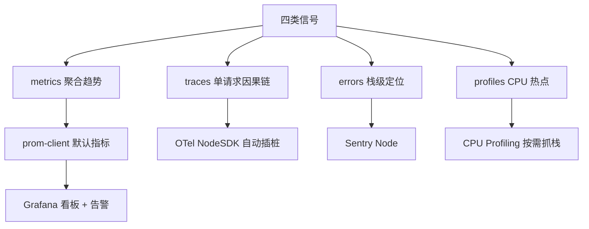

:::note 事实基线
本篇是「Node 服务可观测性」带解答题库，共 **76 题**，事实来源为 `content/docs/ieg.md`（NoSQL 管理端工程实践）的可观测性章节。可观测性栈为 prom-client + Prometheus + Grafana、OpenTelemetry（OTLP/Prometheus 导出）、Sentry Node。指标名按 prom-client 当前默认指标集口径撰写。
:::

本篇是「Node 服务可观测性」带解答题库。前一篇（node-native-pooling）的内存排查依赖 heap snapshot、process.memoryUsage() 这类**手动、按需**的观测手段；要让同样的判断在生产环境**持续成立**，需要把它们常态化：持续产出**指标、链路、错误与 profile** 四类数据，在其上建立看板与告警。本篇的组织顺序是：**先讲四类信号的分工 → 再讲运行时指标（prom-client）→ 再讲 OTel 插桩 → 再讲 Sentry 错误与 profiling → 再讲生产 CPU profiling → 最后讲 Grafana 看板与告警设计**。

**主线一览**



## 一、三支柱与四类信号

### Q1. 可观测性的四类信号各回答什么问题？

| 信号         | 回答的问题                       | 粒度                  | 成本 |
| ------------ | -------------------------------- | --------------------- | ---- |
| **metrics**  | 「什么时候出了问题」（聚合趋势） | 实例级聚合            | 极低 |
| **traces**   | 「这个请求慢在哪一环」（因果链） | 单请求因果链          | 中   |
| **errors**   | 「这个错误的成因是什么」（栈）   | 单次错误事件          | 低   |
| **profiles** | 「当时 CPU 在干什么」（热点）    | 单会话/单请求时间切片 | 较高 |

**采分点**：能说出「**指标回答什么时候，traces 回答哪一环，errors 回答成因，profiles 回答 CPU 在干什么**」——四类信号粒度与成本不同，**互补而不是替代**。

### Q2. 内存问题、性能问题、CPU 热点分别用哪类信号？

- **内存问题**：先分清堆内堆外（rss 与 heapUsed 的相对走势，metrics），再决定用 metrics 看趋势还是 heap snapshot 抓对象（errors/profiles 之外的手动手段）。
- **性能问题**：先分清聚合还是单请求——聚合看 metrics 看板（延迟分位、QPS），单请求看 traces 链路（哪一环慢）。
- **CPU 热点**：由**指标发现**（CPU 使用率高、事件循环延迟高）、由 **profile 定位**（具体哪个函数）。

**采分点**：能说出「**可观测性不是工具堆叠，而是让每一类问题都有『看得见、报得出来、定位得下去』的数据源**」——这是可观测性体系设计的第一性原则。

### Q3. metrics 的拉取模型是什么？

两条路线（prom-client 与 OTel）都是**拉取模型**：Prometheus 按固定周期主动抓取每个实例的 `/metrics`，**服务端不推送、不维护上报状态，只负责备好一份当前快照**。

**采分点**：能说出「**拉取模型让服务端无状态**」——服务端不需要知道 Prometheus 在哪、不需要维护连接、不需要重试，只要 `/metrics` 能响应即可。这与日志/trace 的推送模型（需要缓冲、重试、背压）形成对比。

## 二、运行时指标（prom-client）

### Q4. prom-client 的 `collectDefaultMetrics` 采集哪些指标？

**内存类**：

| 指标                                                                   | 含义                                                                        |
| ---------------------------------------------------------------------- | --------------------------------------------------------------------------- |
| process_resident_memory_bytes                                          | RSS（进程驻留物理内存，OS 口径）                                            |
| process_heap_bytes / process_virtual_memory_bytes                      | 进程堆与虚拟内存                                                            |
| nodejs_heap_size_total_bytes / nodejs_heap_size_used_bytes             | V8 已申请的堆容量 / 存活对象占用                                            |
| nodejs_external_memory_bytes                                           | 绑定到 JS 对象的 C++ 对象内存（含 Buffer 后备存储）                         |
| nodejs_heap_space_size_total_bytes / nodejs_heap_space_size_used_bytes | 按 space 细分的容量与占用，带 space 标签（new、old、code、large_object 等） |

**CPU 类**：process_cpu_seconds_total、process_cpu_user_seconds_total、process_cpu_system_seconds_total 均为累计秒数的 Counter，用 rate() 折算使用率；**用户态与系统态分开**，便于区分「业务代码忙」与「内核调用忙」。

**事件循环类**：nodejs_eventloop_lag_seconds 及 min/max/mean/stddev 与 p50/p90/p99 分位数变体。底层是 `perf_hooks.monitorEventLoopDelay({resolution})` 的统计值，采样精度由 eventLoopMonitoringPrecision 控制，默认 10ms。

**GC 类**：nodejs_gc_duration_seconds 是 Histogram，带 kind 标签区分 GC 类型（major、minor、incremental、weakcb）；底层用 perf_hooks.PerformanceObserver 观察 entryTypes ['gc']。

**句柄、文件描述符与其他**：nodejs_active_handles / nodejs_active_requests / nodejs_active_resources 反映 libuv 侧活跃的句柄、请求与资源；process_open_fds 与 process_max_fds 是文件描述符用量与上限（**连接池泄漏在这里有直接信号**）；process_start_time_seconds 与 nodejs_version_info 提供启动时间与版本元数据。

### Q5. `collectDefaultMetrics` 支持哪些配置？

五个配置：**register**（自定义 Registry）、**prefix**（指标名前缀）、**labels**（附加公共标签）、**eventLoopMonitoringPrecision**（事件循环采样精度）、**gcDurationBuckets**（GC 耗时直方图分桶）。包内另有 Counter、Gauge、Histogram、Summary 四类自定义指标，以及 Registry 与 Pushgateway（供短生命周期任务推送）。

### Q6. 自定义业务指标怎么写？标签基数纪律是什么？

以请求延迟 Histogram 为例：

```js
const httpDuration = new client.Histogram({
  name: "http_request_duration_seconds",
  help: "HTTP request latency in seconds",
  labelNames: ["method", "route", "status_class"],
  buckets: [0.01, 0.05, 0.1, 0.3, 1, 3],
});
```

**标签基数纪律是自定义指标的第一约束**：标签值必须是**有限可枚举集合**（路由模板、状态码段、操作类型），**不要把 userId、原始 URL、traceId 放进标签**——标签组合数就是时间序列数，基数失控会直接压垮存储与查询。

**采分点**：能说出「**标签组合数 = 时间序列数**」——一个 userId 标签就能把序列数炸到百万级，这是 Prometheus 运维的头号事故来源。路由要用**模板**（`/user/:id`）而不是原始 URL。

### Q7. OTel 路线与 prom-client 路线的关系？

项目已接入 OpenTelemetry 时，指标可并入同一体系。**PrometheusExporter**（继承 MetricReader）以 `{port, endpoint}` 配置启动内置 HTTP server 暴露 /metrics，Prometheus 照常抓取。semantic-conventions 定义的一组进程与事件循环指标名（`nodejs.eventloop.delay.{min,max,mean,stddev}`、nodejs.eventloop.time、process.cpu.time、process.memory.usage 等）语义与 prom-client 默认指标一一对应，只是命名风格不同。

**采分点**：**两条路线选一条，不要重复采集**——同时用 prom-client 与 OTel 采集同一批指标会产生重复序列与混淆。

## 三、OpenTelemetry 插桩

### Q8. OTel NodeSDK 的关键装配选项有哪些？

| 选项                         | 用途                                   |
| ---------------------------- | -------------------------------------- |
| instrumentations             | 自动插桩库数组                         |
| serviceName                  | 服务名，全部遥测数据的归属坐标         |
| resource / resourceDetectors | 资源属性与自动探测（主机、容器、环境） |
| spanProcessors               | span 处理器数组，负责导出              |

### Q9. 企业落地的「NodeSDK + spanProcessors + 优雅降级」模式是什么？

一个真实的企业落地实例（agent 服务的 observability 模块）：用 NodeSDK 装配自定义 SpanProcessor（Langfuse 导出器）把 trace 导出到 Langfuse；**未配置密钥时整个模块降级为 no-op，业务路径完全不受影响，初始化失败也只记日志不抛错**；initObservability 与 shutdownObservability 成对，退出时 sdk.shutdown() 冲刷残余 span。

**采分点**：这个模式值得照抄——**可观测性是增强项而非依赖项，自身故障必须被吞掉**。能说出「**可观测性挂了不能影响业务**」这个原则，是可观测性设计的第一纪律。

### Q10. OTel 自动插桩库覆盖哪些类别？

| 类别           | 库                                                                        |
| -------------- | ------------------------------------------------------------------------- |
| HTTP 框架      | http、express、koa、connect、hapi                                         |
| 数据库与缓存   | ioredis、mongodb、mongoose、mysql、mysql2、knex、generic-pool、dataloader |
| 消息与 RPC     | kafkajs、amqplib、grpc、aws-sdk、aws-lambda                               |
| 日志           | pino、bunyan                                                              |
| 网络与文件系统 | net、fs、dns                                                              |
| 其他           | graphql                                                                   |

开启后，框架请求出入口、数据库调用、消息收发**自动生成带耗时与属性的 span，不改一行业务代码**。这是企业语境下 JS 插桩的主路径：**标准层（HTTP、DB、消息）交给自动插桩全覆盖，不手写探针**。

### Q11. 手动 span 什么时候用？

手动 span 是补充：用 `tracer.startActiveSpan` 在中间件层包 span、在关键业务路径埋 span（事务核心步骤、大文件解析、模型调用），用 attributes 记录业务坐标（租户、操作类型、数据规模）。

**自动插桩保证链路连续不断，手动 span 保证关键业务节点可见**。

### Q12. 跨服务上下文怎么传播？

靠 **traceparent 请求头**：出口请求自动注入当前 trace 上下文，下游入口自动还原，多个服务的 span 因此串成同一条 trace。

**采分点**：这与前端监控篇的「traceparent 注入」是同一条纪律——前端、Node、下游服务都靠 traceparent 串成端到端链路。

### Q13. OTel 的导出侧有哪些协议？

OTLP 全家桶齐备：trace 有 exporter-trace-otlp-http、exporter-trace-otlp-grpc、exporter-trace-otlp-proto 三种协议，metrics 与 logs 各有对应的 exporter。**后端是 Prometheus 时也可改用 PrometheusExporter 直接暴露 /metrics**。

## 四、Sentry Node

### Q14. Sentry Node 与 OTel 的关系是什么？

@sentry/node **整体构建在 OpenTelemetry 之上**：依赖 @opentelemetry/api、instrumentation、sdk-trace-base，并内置 http、express、koa、ioredis、mongodb、mysql2、knex、graphql、kafkajs 等 instrumentation 库——**性能数据的采集路径直接复用 OTel 自动插桩，Sentry 提供的是上报、聚合、检索与告警平台**。

**采分点**：能说出「**Sentry Node 的性能采集复用 OTel 自动插桩，Sentry 的价值在平台侧（聚合、检索、告警）**」——这澄清了「Sentry 与 OTel 是竞争关系」的误解，实际上 Sentry 构建在 OTel 之上。

### Q15. Sentry 的错误上报携带什么？

错误上报就是**错误场景下的抓栈**，一条错误事件携带：

- **完整异常堆栈**：抛出时刻的调用栈帧，定位代码位置与调用路径的直接材料。
- **includeLocalVariables 选项**：开启 LocalVariables 集成后，报告在堆栈上附带**每一帧的局部变量值**，大量错误不必本地复现就能从现场值判断成因。
- **source map 还原**：上传 source map 后，平台把编译压缩过的栈帧映射回源文件与行号，栈直接呈源码视角。

**采分点**：能说出「**includeLocalVariables 让大量错误不必本地复现就能判断成因**」——这是 Sentry 相对「只报堆栈」的核心增值。

### Q16. Sentry 的性能监控与持续 profiling 怎么控制？

性能监控由 **tracesSampleRate / tracesSampler** 控制 trace 采样率。

持续 profiling 对应新的 continuous profiling API（旧的 profilesSampleRate/profilesSampler 已在大版本迭代中移除），相关选项：

| 选项                       | 语义                                                             |
| -------------------------- | ---------------------------------------------------------------- |
| profileSessionSampleRate   | profile 会话采样率，默认 0（关闭），按会话采样                   |
| profileLifecycle: 'manual' | 默认值，手动控制 profiling 的启停                                |
| profileLifecycle: 'trace'  | profiler 随根 span 自动启停，被采样的 trace 自动附带一段 profile |

**trace 模式把 profiling 挂进 trace 生命周期**：请求被采样就顺带采集 CPU profile，问题发生时调用链与同一时刻的栈样本同时可得，**免去「去生产复现一次」的环节**。

**采分点**：能说出「**trace 模式的 profiling 让『调用链』与『同一时刻的栈样本』同时可得**」——这是「性能问题定位」从「复现」到「直接看现场」的关键。

### Q17. ESM 项目用 Sentry 要注意什么？

**registerEsmLoaderHooks（默认 true）**：ESM 没有 require hook，自动插桩依赖 **loader hooks** 生效；包的导入方式（ESM vs CJS）会影响 instrumentation 是否生效。

**采分点**：能说出「**ESM 的自动插桩靠 loader hooks，不是 require hook**」——这是 ESM 项目接入 APM 的常见坑（插桩不生效，因为 loader hooks 没启用）。

## 五、生产环境 CPU Profiling

### Q18. 生产环境的 CPU profiling 怎么做？

三种按需抓栈手段：

- **`--cpu-prof`**：启动即采、进程退出落盘 `.cpuprofile`——适合「能重启一次」的场景。
- **inspector Profiler**：运行时接入 inspector 会话，按需开关 Profiler 域——适合「不能重启」的场景。
- **Sentry 持续 profiling**：trace 模式自动附带 profile（Q16）——适合「常态化」的场景。

**采分点**：能说出「**生产 profiling 是按需抓栈，不是常态全量**」——栈采样有开销，靠采样率控制成本；指标先发现「CPU 异常」，再触发 profiling 定位「具体热点」。

### Q19. 告警触发 profiling 的联动怎么做？

**指标发现、profile 定位**：CPU 使用率高、事件循环延迟高的告警触发时，**自动或手动拉一份 CPU profile**，把「什么时候 CPU 异常」与「当时 CPU 在干什么」关联起来。

配套：用 `process.report.getReport()` 落一份诊断报告（内存汇总与 libuv 句柄列表）保留现场。**指标回答「什么时候出了问题」，profiling 回答「当时 CPU 在干什么」**。

**采分点**：能说出「**告警触发 profiling 是『指标发现、profile 定位』的自动化**」——把两类信号联动起来，而不是各看各的。

## 六、Grafana 看板与告警

### Q20. Grafana 看板怎么分区？

按观测对象分区，每区一行：

| 分区     | 面板内容                                            | 主要指标                                                                                                                    |
| -------- | --------------------------------------------------- | --------------------------------------------------------------------------------------------------------------------------- |
| 内存     | rss、heapUsed、external 三线叠加；按 space 的堆占用 | process_resident_memory_bytes、nodejs_heap_size_used_bytes、nodejs_external_memory_bytes、nodejs_heap_space_size_used_bytes |
| 事件循环 | lag 的均值与最大值                                  | nodejs_eventloop_lag_mean_seconds、nodejs_eventloop_lag_max_seconds                                                         |
| GC       | 单位时间 GC 耗时占比，按 kind 拆分                  | rate(nodejs_gc_duration_seconds_sum[5m])                                                                                    |
| 请求     | QPS、延迟分位、错误率                               | 自定义业务 Histogram 与 Counter                                                                                             |

**内存面板直接服务分诊法**：rss 与 heapUsed 同图叠加，**两条曲线的相对走势一眼可辨堆内还是堆外问题**。

### Q21. 内存泄漏告警为什么用 predict_linear 而不是固定阈值？

```yaml
- alert: NodeMemoryLeakTrend
  expr: predict_linear(process_resident_memory_bytes[1h], 6 * 3600) > 1.5 * 1024 * 1024 * 1024
  for: 30m
```

**RSS 绝对值受实例规格与流量影响**，固定阈值要么误报（大规格实例正常就高）要么漏报（小规格实例泄漏到一半就 OOM）。**「按当前斜率 6 小时后越过红线」才是泄漏的强信号**——对应「长期单调增长才算泄漏」的判断标准。

**采分点**：能说出「**泄漏是趋势问题，不是阈值问题**」——predict_linear 按斜率外推，捕捉的是「持续增长」而不是「当前值高」，这正是内存泄漏的本质特征。

### Q22. SLO 告警为什么用多窗口燃烧率？

**SLO 告警推荐多窗口燃烧率**：短窗口高燃烧率（快速发现）与长窗口低燃烧率（抑制误报）两条规则配合定级，兼顾灵敏度与噪音。

- **高燃烧率短窗口**：错误预算消耗快，立即响应（如「5 分钟内烧掉 1% 的错误预算」）。
- **低燃烧率长窗口**：错误预算缓慢消耗，降级为工作时间通知（如「1 小时内烧掉 1%」）。

**采分点**：能说出「**燃烧率 = 错误预算的消耗速度**」——短窗口抓突发，长窗口抓慢性，两者配合才能既不漏报又不告警疲劳。

### Q23. 堆压力与 GC 告警为什么要联看？

```yaml
- alert: NodeHeapPressure
  expr: nodejs_heap_size_used_bytes / nodejs_heap_size_total_bytes > 0.9
  for: 10m
- alert: NodeGcPressure
  expr: rate(nodejs_gc_duration_seconds_sum[5m]) > 0.3
  for: 10m
```

**联看**：nodejs_heap_size_used_bytes/nodejs_heap_size_total_bytes 持续高位**且** rate(nodejs_gc_duration_seconds_sum[5m]) 同步上升，说明**堆逼近上限、GC 在做无用功**，随后通常伴随事件循环延迟上升。

**采分点**：能说出「**堆占用高 + GC 耗时占比高 = GC 在做无用功（回收不出内存）**」——这是「内存泄漏导致 GC 风暴」的典型信号，单看任一指标都不够。

### Q24. 事件循环延迟告警用什么口径？

```yaml
- alert: NodeEventLoopLag
  expr: nodejs_eventloop_lag_max_seconds > 0.1
  for: 5m
```

**事件循环延迟可先用 `avg_over_time(nodejs_eventloop_lag_mean_seconds[5m])` 看平滑趋势，告警则用 max 口径抓尖峰**——均值会掩盖偶发的大延迟，max 才能抓住「某次事件循环卡了 100ms」。

**采分点**：能说出「**看趋势用均值，告警用 max**」——均值平滑适合观察，max 抓尖峰适合告警，两个口径服务不同目的。

### Q25. 告警设计的四个原则是什么？

- **症状优先于原因**：告警指向**用户可感知的症状**（错误率、延迟、内存水位、事件循环延迟），原因级异常（单次 GC 变慢、某个句柄增多）放看板辅助排查，**不做半夜叫醒人的触发器**。
- **SLO 燃烧率分级**：高燃烧率短窗口立即响应，低燃烧率长窗口降级为工作时间通知。
- **按严重度路由**：Alertmanager 按 severity 路由，相关告警分组去重，维护窗口静默，配合抑制规则避免级联风暴。
- **抑制告警疲劳**：每条告警必须有对应的处理动作，**长期无人响应的告警要么降级要么删除**。

**采分点**：能说出「**症状优先于原因**」+「**每条告警必须有处理动作，无人响应的告警要删除**」——前者避免「半夜被 GC 变慢叫醒」，后者避免「告警疲劳导致真告警被忽略」。这是告警治理的两条铁律。

### Q26. Grafana unified alerting 与 Alertmanager 的分工？

**Grafana unified alerting** 负责规则定义与可视化（可直接以 Prometheus 为数据源）；**Alertmanager** 负责告警的**分组、路由、静默、抑制与通知渠道**。纯 Prometheus 体系中规则写在 Prometheus rules 文件，Alertmanager 承接通知。

## 七、分工与选型

### Q27. metrics / traces / errors / profiles 的选型矩阵？

| 维度     | metrics                                    | traces               | errors             | profiles                                              |
| -------- | ------------------------------------------ | -------------------- | ------------------ | ----------------------------------------------------- |
| 成本     | 极低，聚合数值                             | 中，按请求采样       | 低，出错才上报     | 较高，栈采样，靠采样率控制                            |
| 粒度     | 实例级聚合                                 | 单请求因果链         | 单次错误事件       | 单会话/单请求的时间切片                               |
| 典型问题 | 内存泄漏趋势、堆压、GC 压力、容量          | 跨服务慢请求定位     | 异常堆栈与错误成因 | CPU 热点、事件循环阻塞点                              |
| 工具     | prom-client 或 OTel + Prometheus + Grafana | OpenTelemetry + OTLP | Sentry             | --cpu-prof、inspector Profiler、Sentry 持续 profiling |

### Q28. 一句话总结可观测性的方法论。

**先界定问题，再选工具**：内存问题先分清堆内堆外（rss 与 heapUsed 的相对走势），再决定用 metrics 看趋势还是 heap snapshot 抓对象；性能问题先分清聚合还是单请求，再决定看 metrics 看板还是拉 traces 链路；CPU 热点由指标发现、由 profile 定位。**可观测性不是工具堆叠，而是让每一类问题都有「看得见、报得出来、定位得下去」的数据源**。

### Q29-Q76. 快速自检与深挖补充

**Q29. 一句话解释为什么 metrics 是拉取模型。** Prometheus 按周期主动抓 /metrics，服务端不推送、不维护状态、只备好快照——服务端无状态，这是拉取模型的核心优势。

**Q30. 一句话解释 RSS 与 heapUsed 同图叠加的价值。** 两条曲线的相对走势一眼可辨堆内还是堆外问题——rss 涨 heapUsed 平稳是堆外泄漏，两者同涨是堆内泄漏。

**Q31. 一句话解释 external 指标。** 绑定到 JS 对象的 C++ 对象内存（含 Buffer 后备存储）——Buffer 用多了体现在 external 而不是 heapUsed。

**Q32. 一句话解释为什么 CPU 指标要分用户态与系统态。** 区分「业务代码忙」（user）与「内核调用忙」（system）——system 高可能是频繁系统调用/IO，优化方向不同。

**Q33. 一句话解释事件循环 lag 的底层。** perf_hooks.monitorEventLoopDelay 统计值，采样精度默认 10ms——它测量的是「事件循环两次处理之间的延迟」，反映主线程被阻塞的程度。

**Q34. 一句话解释 GC 指标为什么要带 kind 标签。** 区分 major/minor/incremental/weakcb——major GC 频繁且耗时长是堆压力的强信号，minor GC 频繁可能是新生代分配过快。

**Q35. 一句话解释 process_open_fds 的用途。** 文件描述符用量与上限——连接池泄漏（连接没销毁）在这里有直接信号，fd 持续增长不回落就是泄漏。

**Q36. 一句话解释标签基数失控的后果。** 标签组合数 = 时间序列数，userId/原始 URL/traceId 进标签会把序列数炸到百万级，压垮 Prometheus 存储与查询。

**Q37. 一句话解释路由标签为什么要用模板。** /user/:id 是有限枚举，/user/12345 是无限基数——用模板（route 标签）而不是原始 URL。

**Q38. 一句话解释 prom-client 与 OTel 指标路线怎么选。** 两条路线选一条不要重复采集——已接入 OTel 就用 PrometheusExporter，否则用 prom-client collectDefaultMetrics。

**Q39. 一句话解释 OTel 自动插桩的价值。** 标准层（HTTP/DB/消息）自动生成带耗时与属性的 span，不改一行业务代码——企业语境下 JS 插桩的主路径。

**Q40. 一句话解释手动 span 的定位。** 自动插桩保证链路连续不断，手动 span 保证关键业务节点可见——在事务核心步骤、大文件解析、模型调用埋 span。

**Q41. 一句话解释 traceparent 的作用。** 出口请求注入当前 trace 上下文，下游入口还原，多服务 span 串成同一条 trace——跨服务上下文传播的标准机制。

**Q42. 一句话解释可观测性「自身故障必须被吞掉」。** 可观测性是增强项不是依赖项——未配置时降级 no-op、初始化失败只记日志不抛错，业务路径完全不受影响。

**Q43. 一句话解释 Sentry Node 与 OTel 的关系。** Sentry Node 构建在 OTel 之上，性能采集复用 OTel 自动插桩，Sentry 提供上报/聚合/检索/告警平台——不是竞争关系。

**Q44. 一句话解释 includeLocalVariables 的价值。** 错误报告附带每帧局部变量值，大量错误不必本地复现就能从现场值判断成因。

**Q45. 一句话解释 Sentry trace 模式 profiling。** profiler 随根 span 自动启停，被采样的 trace 自动附带一段 profile——调用链与同一时刻的栈样本同时可得，免去复现。

**Q46. 一句话解释 ESM 自动插桩的坑。** ESM 没有 require hook，自动插桩依赖 loader hooks（registerEsmLoaderHooks）——没启用就插桩不生效。

**Q47. 一句话解释生产 CPU profiling 的三种手段。** --cpu-prof（能重启）、inspector Profiler（不能重启）、Sentry 持续 profiling（常态化）——都是按需抓栈，靠采样率控制成本。

**Q48. 一句话解释「指标发现、profile 定位」。** CPU 使用率高/事件循环延迟高的告警触发拉一份 profile——指标回答什么时候，profile 回答 CPU 在干什么。

**Q49. 一句话解释 process.report.getReport() 的用途。** 落一份诊断报告（内存汇总 + libuv 句柄列表）保留现场——告警触发时抓现场，事后分析。

**Q50. 一句话解释 predict_linear 抓泄漏的原理。** 按最近 1 小时斜率外推 6 小时后的 RSS，越过红线才告警——泄漏是趋势问题不是阈值问题，RSS 绝对值受规格与流量影响。

**Q51. 一句话解释 SLO 燃烧率。** 错误预算的消耗速度——短窗口高燃烧率抓突发（立即响应），长窗口低燃烧率抓慢性（工作时间通知），两者配合兼顾灵敏度与噪音。

**Q52. 一句话解释「堆压 + GC 压力联看」的信号。** 堆占用持续高位且 GC 耗时占比同步上升 = GC 在做无用功（回收不出内存），随后通常伴随事件循环延迟上升——内存泄漏导致 GC 风暴的典型信号。

**Q53. 一句话解释事件循环延迟「看趋势用均值、告警用 max」。** 均值平滑适合观察，max 抓尖峰适合告警——均值会掩盖偶发的大延迟。

**Q54. 一句话解释「症状优先于原因」。** 告警指向用户可感知的症状（错误率/延迟/内存水位），原因级异常（单次 GC 变慢）放看板辅助排查——避免半夜被非症状告警叫醒。

**Q55. 一句话解释「告警疲劳」的治理。** 每条告警必须有处理动作，长期无人响应的告警要么降级要么删除——否则真告警会被忽略。

**Q56. 一句话解释 Alertmanager 的四个职责。** 分组、路由、静默、抑制——相关告警分组去重、按 severity 路由、维护窗口静默、抑制规则避免级联风暴。

**Q57. 一句话解释为什么 traces 按请求采样。** trace 成本高（每个 span 都要上报），全量采集不现实——按请求采样（tracesSampleRate）在成本与覆盖之间平衡。

**Q58. 一句话解释为什么 errors 成本低。** 出错才上报，不是常态采集——所以错误可以全量上报（不采样），trace 要采样。

**Q59. 一句话解释为什么 profiles 成本最高。** 栈采样开销大，要靠采样率控制——所以 profile 是按需/低采样率，不像 metrics 可以全量。

**Q60. 一句话解释四类信号的成本排序。** metrics（极低）< errors（低）< traces（中）< profiles（较高）——成本决定采样策略，metrics 全量、errors 全量、traces 采样、profiles 低采样。

**Q61. 一句话解释「内存问题先分清堆内堆外」。** rss 与 heapUsed 的相对走势决定排查方向——heapUsed 涨用 heap snapshot，rss 涨 heapUsed 平稳用 valgrind/ASan，分错方向后面全白费。

**Q62. 一句话解释「性能问题先分清聚合还是单请求」。** 聚合问题（整体延迟高）看 metrics 看板，单请求问题（某个请求慢）看 traces 链路——粒度不同工具不同。

**Q63. 一句话解释 Grafana 内存面板三线叠加。** rss、heapUsed、external 三线叠加——一眼看出是堆内（heapUsed 涨）、Buffer（external 涨）还是纯 native（rss 涨其他平稳）。

**Q64. 一句话解释为什么 GC 指标用 rate()。** nodejs_gc_duration_seconds 是累计 Counter，rate() 折算成「单位时间 GC 耗时」——才能看出 GC 压力的变化趋势。

**Q65. 一句话解释 histogram_quantile 怎么算 P99。** histogram_quantile(0.99, sum(rate(x_bucket[5m])) by (le))——从 bucket 累计计数反推分位数，by (le) 保留分桶维度。

**Q66. 一句话解释为什么延迟用 Histogram 而不是 Gauge。** Histogram 记录分布（可算分位数），Gauge 只记录当前值——延迟要看 P50/P95/P99 分布，必须用 Histogram。

**Q67. 一句话解释 buckets 怎么定。** 按业务的延迟分布定（如 [0.01, 0.05, 0.1, 0.3, 1, 3] 秒）——bucket 边界决定分位数精度，要覆盖关心的延迟范围。

**Q68. 一句话解释 Pushgateway 的适用场景。** 短生命周期任务（批处理、CronJob）——它们活不到 Prometheus 抓取，主动 push 指标到 Pushgateway。

**Q69. 一句话解释为什么长驻服务不用 Pushgateway。** 长驻服务用拉取模型（/metrics）即可，Pushgateway 是为「活不到抓取」的短命任务设计的——长驻服务用 Pushgateway 反而引入单点。

**Q70. 一句话解释 resource/resourceDetectors 的作用。** 资源属性与自动探测（主机、容器、环境）——给所有遥测数据打上「来自哪个服务/主机/环境」的归属坐标。

**Q71. 一句话解释 serviceName 为什么重要。** 全部遥测数据的归属坐标——没有 serviceName，trace/error 无法归属到服务，多服务环境下无法区分。

**Q72. 一句话解释 spanProcessors 的职责。** span 处理器数组，负责导出——决定 trace 数据发到哪里（OTLP exporter、Langfuse、控制台）。

**Q73. 一句话解释「标准层自动插桩、关键路径手动 span」的分工。** 自动插桩覆盖 HTTP/DB/消息（链路连续不断），手动 span 覆盖业务关键节点（事务核心、大文件解析、模型调用）——两者互补。

**Q74. 一句话解释 Sentry 的 source map 还原。** 上传 source map 后平台把压缩栈帧映射回源文件与行号，栈直接呈源码视角——与前端监控篇的 sourcemap 反解是同一机制。

**Q75. 一句话解释「可观测性不是工具堆叠」。** 让每一类问题都有「看得见、报得出来、定位得下去」的数据源——堆叠工具但没有数据源覆盖的问题，依然无法排查。

**Q76. 一句话总结本篇的落地姿势。** prom-client 默认指标 + 自定义业务 Histogram（标签基数纪律）→ OTel 自动插桩 + 手动 span → Sentry 错误与持续 profiling → Grafana 看板分区 + predict_linear/SLO 燃烧率/症状优先的告警——四类信号各司其职，覆盖内存、性能、错误、CPU 四类问题。

---

**延伸阅读**

- [Node 原生绑定与池化资源治理题库](/interview/qa/node-native-pooling)：本篇观测对象的来源——ffi 内存模型、进程池、连接池、闭包泄漏。
- [LLM 评测与可观测性题库](/interview/qa/llm-eval-observability)：Langfuse、trace 评测的 LLM 侧可观测性。
- [前端监控与可观测性题库](/interview/qa/frontend-observability)：浏览器侧的指标采集与 Web Vitals。
- [工作文档 · NoSQL 管理端工程实践](/docs/ieg)：本篇的事实来源，含完整的可观测性体系与告警规则。
