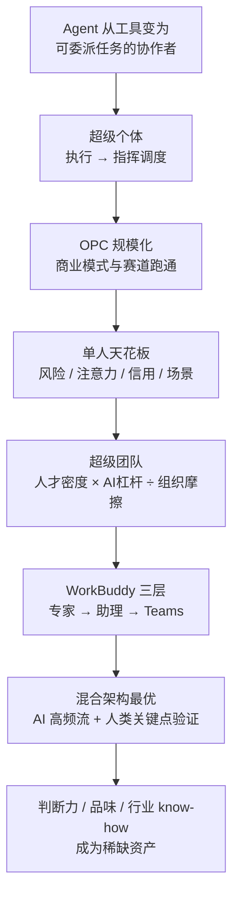

本篇把 Chrome 里打开的 [《WorkBuddy OPC 白皮书》](https://www.workbuddy.link/p/FVCdAodl3HBHMMPypCogBi) 沉淀成面试可用的题库。白皮书副标题「**AI 时代一人公司的商业与技术重构 · 从超级个体到超级团队**」，出品方腾讯云 WorkBuddy 团队，日期 **2026 年 6 月**，共六章。

它和本仓库已有的两份文档是同一条线：[业务面 QA：Managed Agent 运行时与赛道判断](/interview/qa/managed-agents-business) 讲的是**底座**（沙箱、会话、脑手分离），[HR 面 QA：业务理解、行业前景与个人规划](/interview/hr/business-outlook-qa) 讲的是**怎么把技术讲成价值**；**这本白皮书讲的是底座之上长出来的应用形态与组织形态**。三篇串起来，面试里「技术 → 产品 → 业务 → 人」这条链就完整了。

## 〇、证据口径（**先读，这篇的数字有坑**）

**来源**：白皮书以在线 Page 形式发布，页面主体在 iframe 中，内容源为 `workbuddy-space-static.codebuddy.work/page/.../opc-whitepaper-mobile.html`；本次读取并核实于 **2026-11-08**。

:::warning 这是一份厂商立场文件，不是中立行业报告
它由**产品方**出品，第六章明确写着「一封公开的合作邀约」，目的是论证 OPC 赛道成立 + 说明 WorkBuddy 在生态中的定位。所以：

- **框架、概念、产品架构**可以放心引用（这是官方对自己产品的表述）；
- **市场规模、效率倍数、政策金额、案例业绩**一律标「**白皮书引述**」，不要说成「行业数据显示」；
- 面试里更稳的句式是「**我看到腾讯云 WorkBuddy 的白皮书里提出……**」，而不是「数据显示……」。
  :::

**外部引用核实结论（本次联网核对，2026-11-08）：**

| 白皮书引用                                                                                                                                                 | 核实结果                                                             | 面试口径                                                                                           |
| ---------------------------------------------------------------------------------------------------------------------------------------------------------- | -------------------------------------------------------------------- | -------------------------------------------------------------------------------------------------- |
| 腾讯研究院《超级个体时代》3 万字报告（2026-06-03）、组织竞争力公式、5%/10%/70%/15% 分层                                                                    | ✅ **真实**，腾讯新闻有全文，公式与定义逐字一致                      | 可引用，标「腾讯研究院 2026 年 6 月报告」                                                          |
| Anthropic《Estimating AI Productivity Gains》（2025-11-05）、10 万条对话、任务时间平均减少约 80%                                                           | ✅ **真实**，官方研究页与 PDF 可查                                   | 可引用，**但必须补官方自述的局限**：时间由 Claude 自己估算、未计入人类校验时间，官方称「可能高估」 |
| 北京朝阳《关于支持人工智能 OPC 创新发展的若干措施》                                                                                                        | ✅ **真实**，朝阳区政府官网有原文；OPC = **One Person Company**      | 可引用政策存在与方向；**具体金额不要背**（见下）                                                   |
| 深圳《打造人工智能 OPC 创业生态引领地行动计划（2026—2027 年）》、2027 年底 10 家万㎡社区 / 千企 / 万人                                                     | ✅ **真实**，中国经济网、中证网报道                                  | 可引用量化目标                                                                                     |
| 一人公司存量 1600 万家 / 27.4% / 新增 +47%、Carta 36.3%、HACR 1:72、smartcity.team 8–10 倍、Harvard DS Review 2–10 倍、Polsia 融资与 ARR、六条赛道收入中值 | ⚠️ **本次未独立核实**，均为白皮书转引的二手来源                      | 只在「白皮书提到」的前提下引用，不给精确数字                                                       |
| 三个用户案例的效率倍数、60 个工作流、3.3 亿项目、1.8 万阅读                                                                                                | ⚠️ 白皮书自己声明「**由受访者本人提供，经 WorkBuddy 团队访谈核实**」 | 属自报数据，可作故事、不可作统计                                                                   |

:::danger 两个必须记住的「不能背」

1. **政策金额口径不一致**：白皮书 3.1 表格写「生产工具平台每年最高 500 万」，而朝阳区政府原文/新闻稿里有「每年最高不超过 1000 万元运营服务资金支持」与「每年最高 500 万」两种表述，政策解读又有「8 项支持内容」而白皮书写「7 大维度 10 项措施」。**方向可讲，金额与条数一律不报**。
2. **白皮书内部数字自相矛盾**：4.4.1 写 OPC 一人专区是「**20 个专家团** + 31 位单体专家 + 35 个精选 Skill」，5.1 写「**13 个核心专家团** + 31 位单体专家 + 35 个精选 Skill」；4.4.1 整体规模「235 位 AI 专家 + 250 个 Skill」。被问到「有多少专家」时答「**按 OPC 全生涯流程组织的一批专家团、单体专家和 Skill，具体数量会随版本变化**」——**背数字反而暴露没细读**。
   :::

## 一、一页速览：六章论证链

| 章  | 主题           | 它回答的问题           | 记住的一句话                                                                         |
| --- | -------------- | ---------------------- | ------------------------------------------------------------------------------------ |
| 一  | 时代浪潮       | OPC 为什么现在规模化？ | 存量与增速是结构性的；**当建造成本趋近于零，判断力而非执行力成为稀缺资源**           |
| 二  | 范式转移       | 引擎换成了什么？       | 从「雇人」到「**调度算力**」；创始人的日常从亲手干活变成编排系统、做关键判断         |
| 三  | 中国机遇       | 外部环境支持吗？       | 20+ 省市密集出台政策，但**缺的是「生产基础设施」而不是空间和资金**                   |
| 四  | WorkBuddy 解法 | 一个人做大之后怎么办？ | 超级个体放大分子，**超级团队解决分母（组织摩擦）**；三层架构承接成长路径             |
| 五  | 实战图鉴       | 具体怎么用？           | 按「立项→产品→内容→变现→数据→财税法务→IP」排好的能力矩阵 + 三个跨行业案例            |
| 六  | 共建生态       | 这事谁来做？           | 政策给土壤、工具给生产力、认证给标准、传播给可见性；WorkBuddy 只做**工具层与标准层** |

**核心论点链（背这一条就够）**：Agent 从工具进化为可委派任务的协作者 → 个体产能发生量级跃迁（超级个体） → 一人公司规模化并跑通商业模式 → 但风险、注意力、信用、价值场景四重需要把人重新聚合 → 组织竞争力取决于「人才密度 × AI 杠杆 / 组织摩擦」 → 因此产品要从「给一个人工具」升级到「让一群人 + 一群 Agent 协作」 → 而全自动化已被证伪，**混合架构（AI 高频流 + 人类关键点验证）才是最优解** → 最终稀缺的是判断力、品味和行业 know-how。

## 二、核心概念事实卡

| 概念                  | 白皮书定义 / 内容                                                                                                                                                                                                 |
| --------------------- | ----------------------------------------------------------------------------------------------------------------------------------------------------------------------------------------------------------------- |
| **OPC**               | One Person Company，一人公司；朝阳政策原文定义为「以人工智能技术为支撑、个人独立完成业务全链路闭环的新型组织形态」                                                                                                |
| **超级个体**          | 借助 AI，一个人达到过去需要一个小团队才能达到的产出规模和影响半径。**四个结构性特征**：AI First 工作动线、能力边界量级跃迁、主动性极强、**影响力溢出**（高效个体只让自己变快，超级个体让团队变快）                |
| 核心转变              | 工作方式从「**执行**」跃迁到「**指挥调度**」；竞争力从「我能做什么」迁移到「我能判断什么值得做、怎么做是对的、做到什么程度算好」                                                                                  |
| **硅基员工**          | 由 AI 驱动、可承接具体业务任务的数字化执行单元；与传统工具的区别：**工具需要人操作，硅基员工可以被「委派」**——给定目标和约束后自主规划路径并交付结果                                                              |
| 技术演进              | 2024 单点对话（一问一答） → 2025 多步骤工作流 → 2026 自动化系统（自主规划、调用工具、监控）                                                                                                                       |
| **L1/L2/L3**          | L1 单点放大（发指令、审结果）→ L2 流程编排（设计流程、处理异常）→ L3 系统自治（设目标、监控指标）；白皮书判断多数 OPC 处在 **L1–L2**，L3 仍是前沿实验                                                             |
| **80% AI + 20% 品味** | Polsia 创始人 Ben Cera：80% 执行由 AI 自动化层承担，20% 方向、审美、战略、情感共鸣由人类品味层负责；**是分工，不是替代**                                                                                          |
| 六大商业模式          | 专业服务型 / 高端服务型 / 知识产品型 / 数字产品型 / 创意内容型 / 平台整合型；成熟 OPC 常混合 2–3 种                                                                                                               |
| **组织竞争力公式**    | **人才密度 × AI 杠杆 / 组织摩擦**。人才密度＝具备独立闭环能力的人占比；AI 杠杆＝AI 嵌入工作流的深度与覆盖面；组织摩擦＝想法到可交付成果之间的等待、审批、对齐与信息衰减。**乘除而非加减：分母减半等价于分子翻倍** |
| 四重结构性需要        | 共同承担风险、共同稳定注意力、共同形成信用、进入更大价值场景——解释「超级个体为什么还需要团队」                                                                                                                    |
| **三层产品架构**      | 起步期（一人承担所有职能）→ **专家/专家团/Skill**（按需召唤）；扩张期（高频重复任务）→ **助理/数字员工**（7×24 云端持续干）；联合期（大订单超出单人）→ **Teams**（多 OPC + 多 Agent 柔性协作）                    |
| 专家四大基石          | **Skills（定义执行方法）+ MCP（连接外部工具）+ 连接器（接入知识库）+ Harness（运行底座）**                                                                                                                        |
| Teams 五机制          | 柔性组队、上下文共享、自动流转、AI 主动性、**零组织债**（项目结束即解散，不留合同/社保/管理成本）；附「上下文飞轮」——协作产物沉淀为团队 AI 资产                                                                   |
| **混合架构**          | Polsia 早期数据：平台上仅 **10%** 自动化公司产生收入、首月流失率 **50%**；结论不是 AI 失败，是**全自动化**失败。最优路径是「AI 处理高频流 + 人类做关键点验证」                                                    |
| 三个新陷阱            | ① 把「可运行的原型」当成「被验证的需求」；② 需求未验证就过度扩张执行规模；③ 让 AI **论证**假设而非**压力测试**假设（有效做法：主动要求 AI 扮演反对者）                                                            |
| 能力洗牌              | 不是人人平权，而是重新定价：约 5% 引领者 / 10% 拓展者 / 70% 效率提升者 / 15% 被淘汰者；AI 替代的是「**被雇佣的理由**」                                                                                            |
| 生态四层              | 政策与空间（政府/园区）、工具与算力（平台/云厂商）、人才与标准（认证机构）、连接与传播（媒体/KOL）；WorkBuddy 定位**只做工具层与标准层**                                                                          |

## 三、业务面 / 技术面 QA

### Q1. 用三分钟讲清这本白皮书的论证链

> 它想回答的是「AI 让一个人能干一个团队的活之后，组织和产品该怎么变」。链条是：Agent 从工具变成可委派任务的协作者，产生「超级个体」；一人公司因此规模化，跑通六种商业模式；但单个人在**风险、注意力、信用、价值场景**上都有结构性上限，所以超级个体会重新聚合成「超级团队」；腾讯研究院给了个公式——组织竞争力 = 人才密度 × AI 杠杆 / 组织摩擦，超级个体放大的是分子，超级团队解决的是分母。落到产品上，WorkBuddy 按成长路径做了三层：起步期给专家，扩张期给 7×24 的助理，联合期给 Teams 让多 OPC 和多 Agent 柔性组队。最后它自己给了个克制的结论：**全自动化被 Polsia 的数据证伪了，混合架构才是当前最优解**——AI 跑高频流，人在关键点做验证。

**采分点：** 有链条、有公式、有产品、有反例。**雷区：** 按六章流水账复述；只讲「一人公司很火」。

### Q2. OPC 为什么是「现在」成立，而不是十年前？

> 三个前提同时到位：① **技术前提**——AI Agent 从需要人拆解的一问一答，进化到能自主规划、调用工具、监控的自动化系统，也就是白皮书说的「硅基员工可以被委派」；② **经济前提**——执行成本被压缩到接近零，能力门槛被消解，不懂设计也能出视觉方案、不懂财务也能做申报；③ **制度前提**——20 多个省市把 OPC 写进专项政策甚至「十五五」规划，算力券、词元券、场景开放把启动成本再降一层。**但真正的因果是：执行变便宜之后，瓶颈从「能招到什么人」位移到「选择造什么」**——这才是十年前不成立的理由。

**采分点：** 三层前提 + 瓶颈位移。**雷区：** 「因为大模型变聪明了」一句话带过。

### Q3. 「超级个体」和「会用 AI 的人」差在哪？

> 差在四个结构性特征，尤其是**影响力溢出**：高效个体只是自己变快，超级个体让团队变快。还有 AI First 工作动线（AI 是默认起点，先让 AI 跑再做判断）、能力边界量级跃迁（量的维度 10 倍以上、域的维度能独立跑通多角色链路）、主动性极强。核心是**工作方式从执行跃迁到指挥调度**——竞争力不再是「我能做什么」，而是「我能判断什么值得做、怎么做是对的、做到什么程度算好」。

**衔接：** 这和 [HR 面 Q12](/interview/hr/business-outlook-qa) 「AI 会取代工程师吗」是同一个答案的两面：我给自己的定位是「能判断产出对不对、能对结果负责的人」。

### Q4. 「硅基员工」和传统工具软件的本质区别是什么？用 Agent 工程的话说

> 一句话：**工具需要人操作，硅基员工可以被委派**——给定目标和约束后自主规划执行路径并交付结果。换成工程语言，就是「一次调用」变成「一个有状态、能恢复、能调工具的长任务会话」。这正好对上 [Managed Agent 运行时](/interview/qa/managed-agents-business)：要让它上生产，必须有外置的会话事件日志、可重建的沙箱、工具网关和凭证隔离——Anthropic 叫**脑手分离**，腾讯云叫 **Agent Runtime / Managed Harness**。白皮书讲的是**应用层形态**，那套底座讲的是**基础设施层**，两者是同一件事的上下两层。

**采分点：** 能把白皮书概念和已知的运行时架构对上。**雷区：** 把「硅基员工」说成「更智能的聊天机器人」。

### Q5. 专家矩阵的四大基石里，为什么 Harness 是底座？

> Skills 定义执行方法、MCP 连接外部工具、连接器接入知识库——这三者都是「**能力从哪来**」；Harness 决定「**能力怎么被可靠地跑起来**」：Agent 循环、工具路由、会话状态、失败恢复、权限与可观测。没有 Harness，专家就只是一次性的 prompt 模板，做不到白皮书说的「助理 7×24 云端持续干」和「Teams 自动流转」。这也解释了一个产品判断：从「问就答」的专家升级到「持续干」的助理，**难点不在模型，在运行时**——长任务、状态持久化、资源隔离、凭证不进沙箱，全是 [分布式 Harness 的老问题](/interview/qa/managed-agents-business)。

**采分点：** 用「能力从哪来 vs 怎么跑起来」切分，再落到运行时难点。

### Q6. L1/L2/L3 和 WorkBuddy 三层架构是什么关系？

> 不是一一对应，是**两个不同视角**：L1–L3 描述的是「AI 嵌入业务的深度」（单点放大 / 流程编排 / 系统自治），专家→助理→Teams 描述的是「OPC 成长阶段的瓶颈」（一人多职能 / 高频重复 / 大订单接不下）。但方向一致：都在把人从「发指令、审结果」推向「设目标、监控指标」。白皮书自己也很克制——**多数 OPC 仍在 L1–L2，L3 是前沿实验**；这句话很重要，说明它没有把「零员工公司」当成普遍现实。

**采分点：** 能区分两个分类维度 + 引用白皮书的克制判断。**雷区：** 说「现在大家都到 L3 了」。

### Q7. 既然 AI 这么强，为什么「混合架构」才是最优解？

> 白皮书给了最硬的反向证据：Polsia 平台上**只有 10% 的自动化公司产生收入，首月流失率 50%**。它明确说这不是 AI 的失败，是**全自动化**的失败；高营收的 AI Native 团队（Cursor / Lovable / Bolt.new）都是「超级个体 + AI 工作流」的混合模式。我的理解是，AI 抹平的是**执行**，没抹平**判断**：需求是否真实、结果够不够好、风险能不能接受，这些仍然要人拍板。这和我自己做的事完全同构——阿里经营托管 Agent 里，必经步骤放 workflow、证据足够后才让 agent 判断、生成前加置信度门控，误放率 0%、误拦率 17%；**误拦 17% 就是我们为「人在关键点验证」主动付的成本**，而且我认为这笔成本该付。

**采分点：** 引反例 + 给机制解释 + 用自己项目的数字落地。**雷区：** 把 10%/50% 说成行业统计（是白皮书引述的 Polsia 早期数据）。

### Q8. 组织竞争力公式为什么用乘除而不是加减？

> 因为三项是**相互放大/相互抵消**的关系：人才密度和 AI 杠杆是乘法，任一项接近零，另一项再大也没用；组织摩擦在分母，等待、审批、对齐、信息衰减会把前面的收益整体打折。所以「分子翻倍但分母不动，净效果打折；**分母减半等价于分子翻倍**」。白皮书由此推出一个反直觉的结论：超级个体放大的是分子，而**超级团队真正解决的是分母**——团队的价值不是多几个人干活，是把协作摩擦降下来。Teams 的「零组织债」「上下文共享」「自动流转」三个机制，其实都是在压分母。

**采分点：** 解释数学关系 + 落到产品机制。这题适合业务面，也适合 HR 面问「你怎么看团队协作」。

### Q9. Teams 的五个机制里，哪个工程上最难？

> 我认为是**上下文共享 + 自动流转**这一对，难点不在「把文件放在一起」，而在三件事：① **共享与隔离的边界**——多个 OPC、多个助理、多个 Agent 共享 Skills/MCP/连接器/知识库，但租户之间、凭证之间必须隔离，否则一个 prompt injection 就能横向拿到别人的数据；② **状态的唯一真相**——AI 自动拆解、分发、跟进任务时，需要一个外置的、可回放的事件日志，进程漂移或沙箱崩溃后才能续跑；③ **成本与归属**——每轮协作的产物要沉淀为「团队 AI 资产」，就得有版本、权限和审计，不然「上下文飞轮」会变成「上下文垃圾场」。这三件事和 [Managed Agent 运行时](/interview/qa/managed-agents-business) 里 Session/Harness/Sandbox 三抽象、Vault 凭证隔离、事件日志恢复是同一套问题。

**采分点：** 给出具体工程难点而非泛泛而谈「协作很难」；能与已知运行时知识互证。

### Q10. 三个「AI 原生创业陷阱」，怎么落到我做 Agent 的工程纪律上？

| 陷阱                                     | 工程上的对应动作                                                                      |
| ---------------------------------------- | ------------------------------------------------------------------------------------- |
| 把「可运行的原型」等同于「被验证的需求」 | 先定义评测集与验收口径再动手；Demo 能跑 ≠ 效果达标。我在阿里用的是 500 题五桶评估集   |
| 需求未验证就过度扩张执行规模             | 灰度、限流、配额；**AI 会用同等效率把一个错误前提打磨到高完成度**，所以要先设停止条件 |
| 让 AI 论证假设而非压力测试假设           | 主动让模型扮演反对者；做对抗用例、边界用例、失败注入；不把「模型说没问题」当验证通过  |

> 收口一句：这三个陷阱的共同点是「**无摩擦**」。AI 把「做」变便宜了，于是「验证」成了唯一还需要人认真花钱的环节——这和我一直说的「**把不确定的模型，放进确定的业务约束里**」是同一句话。

### Q11. 白皮书里的数字，哪些你会在面试里引用？

> 我只会引用三类：**① 官方可查的原始研究**——Anthropic 那份 10 万条对话、任务时间平均减少约 80% 的研究，但会补一句官方自己承认的局限（时间由 Claude 估算、未计入人类校验时间，可能高估）；**② 政府公开文件**——朝阳区 OPC 措施、深圳 2027 年底 10 家万㎡社区 / 千企 / 万人这类方向性目标；**③ 腾讯研究院报告的框架**——组织竞争力公式本身。**不引用**市场规模、效率倍数、赛道收入中值、案例业绩这些白皮书转引的二手数字，因为它们要么是自报数据、要么我没法核对原始来源；更不会背「235 位专家 / 20 个专家团」这种**白皮书自己前后都不一致**的数字。

**采分点：** 主动做数据分级 + 说出官方局限 + 点出内部矛盾。这题是「诚信与一致性」的送分题。

### Q12. 如果让你给这本白皮书补一章 or 挑一个毛病，你说什么？

> 【观点】我会补一章「**运行时与成本**」。六章把趋势、政策、产品形态、生态讲全了，但几乎没讲：一个 7×24 云端运行的助理，长任务怎么恢复、沙箱怎么隔离、凭证怎么不进执行环境、失败怎么重试、token 与沙箱时长怎么计费、闲置会话怎么释放。而这些恰好是「助理」和「Teams」能不能真上生产的决定性变量——腾讯云自己的 Agent Runtime 在讲沙箱冷启动、会话快照/暂停/恢复，Anthropic 在讲脑手分离与凭证 Vault，说明**行业已经在这一层竞争了**。白皮书作为面向生态合作的文件不展开可以理解，但作为工程师，我会认为「生产基础设施」那一节（3.4）提到的缺口，其实比政策和空间更该展开。

**采分点：** 有观点但不否定全书；能接上已有知识。**雷区：** 「写得太营销了」「数据都是编的」——评价姿态要克制。

### Q13. 这本白皮书和 Anthropic / OpenAI / 腾讯的 Managed Agent 路线怎么对上？

> 我理解为**上下两层**。下层是运行时：Anthropic Claude Managed Agents 把 Session / Harness / Sandbox 虚拟化，OpenAI Agents API 托管 Codex harness，腾讯云 Agent Runtime 提供沙箱、会话、记忆、网关与 Managed Harness——它们卖的是「能安全稳定跑长任务的环境」。上层是白皮书讲的应用与组织形态：专家、助理、Teams，本质是把这些运行时能力按 OPC 的经营环节包装成可复用的角色与协作单元。**下层趋同（会话、沙箱、事件日志、工具协议标准化），上层才差异化（行业 know-how、上下文资产、协作方式）**。所以白皮书第六章说 WorkBuddy 只做工具层和标准层，是有边界感的定位，不是随便划的。

## 四、HR 面 QA

### Q14. 你怎么看「AI 不是人人平权，而是重新定价」？

> 【观点 + 白皮书框架】我认同「重新定价」这个说法。白皮书引腾讯研究院的分层：约 5% 把 AI 杠杆和不可替代的人类能力结合、10% 突破原有边界、70% 得到线性提升、15% 的工作恰好最容易被替代。核心判断是「**AI 替代的是被雇佣的理由**」——当知识和标准化执行都变得廉价，一个人被需要的原因要从「我知道什么、我能做什么」转到「我能判断什么、我能创造什么」。对我自己，这意味着不能把目标定成「写得更快」，而要定成「**能定义问题、能判断产出对不对、能对结果负责**」。具体到动作：先自己想方案再让 AI 生成、严格评审并发与资源问题、核心逻辑自己写、把压测和故障演练这些 AI 弱项补上（展开见 [HR 面 Q15](/interview/hr/business-outlook-qa)）。

**采分点：** 引用框架但标是「白皮书/研究院观点」+ 落到自己的可检查动作。**雷区：** 「AI 会让大部分人失业」这种没有边界的断言。

### Q15. 读了这本白皮书，对你的职业规划有什么影响？

> 它让我更确定「**先在有真实复杂度的业务里练判断力**」这条路。白皮书说 OPC 的瓶颈从「能招到什么人」变成「选择造什么」，也说超级个体最稀缺的是判断力、品味和行业 know-how——这些东西读文档读不来，得在真实链路里被问题锤过。所以我的规划不变但更具体：**第一年**独立跑通一个 RAG/Agent 功能的完整闭环、补线上排查；**一到三年**从做模块到做可复用的平台能力，把效果、成本、稳定性一起扛；**长期**在 Agent 工程方向形成方法论。框架会变，但分布式基础、可观测、故障定位这些不变的部分我会一直打扎实（与 [Q13 职业规划](/interview/hr/behavioral#q13-你的职业规划是什么) 完全一致）。

**雷区：** 临时改口说「我想先去创业做 OPC」；把规划讲成「三年当管理」。

### Q16. 既然这么看好 OPC，你为什么不自己做一人公司？

> 【诚实版】我确实觉得这个形态很有意思，但我现阶段更想在**真实业务复杂度**里练工程能力。白皮书里三个案例最有说服力的不是「一个人干了团队的活」，而是韦优那句「**技术只是入场券，真正决定 OPC 生死的是品牌、服务和信任网络**」——这些恰恰是我现在还没有、需要在一个有真实客户、有稳定性要求、有跨团队协作的地方积累的东西。业余项目能验证想法，替代不了大规模业务的约束。所以我把 OPC 当成理解行业的一面镜子，不是当下的职业选择。

**采分点：** 真诚 + 引白皮书里的具体反思 + 与既有动机一致。**雷区：** 贬低创业；编「我其实做过 OPC」；说「以后有机会一定会去创业」（稳定性红旗）。

### Q17. 三个用户案例里，你读到什么？

> 三个都指向同一件事：**壁垒不在工具，在 know-how 的资产化**。韦优（9 年独立开发者）说技术只是入场券，最后是品牌、服务、信任网络决定生死；蔡琛律师 46 岁、非技术背景，用「**师徒制训练 AI**」——投喂高质量文书反复纠错、花 3 个月把个人经验沉淀成 60 个工作流；智觉是「产品 AI × 经营 AI」叠加，1 人 + AI 管 38 个渠道伙伴。对我最有启发的是蔡琛那个「师徒制」：**把判断标准喂给 AI，把经验变成可复用的 Skill**，这和我说的「沉淀项目规范、把踩过的坑变成团队资产」是同一件事，也和腾讯文化里导师带人的逻辑对上了（见 [腾讯企业文化与价值观](/interview/hr/tencent-culture-values)）。

**注意：** 案例的量化成果是受访者自报、经团队访谈核实，**讲故事可以，别当行业统计引用**。

### Q18. 「从雇人到调度算力」，你担心自己被 AI 取代吗？

> 不担心被取代，但很警惕被稀释。白皮书讲得很清楚：执行层被 AI 接管，人专注判断和品味；如果我的价值只剩「把需求翻译成代码」，那确实会被压缩。所以我的应对不是比手速，是**换角色**——给 Agent 定规范、审方案、识别幻觉和并发漏洞、做验证与故障复盘、参与把项目规范沉淀成可复用资产。**AI 把执行成本降到趋近于零之后，判断力第一次成了最贵的东西**，这对我这种刚入行的人其实是好消息：只要愿意在「判断」上下功夫，就不必和工具比谁写得多。

**采分点：** 与 [HR 面 Q15/Q16](/interview/hr/business-outlook-qa) 同一口径，别在两场面试里说成两套。

### Q19. 如果面试官就是腾讯云 / WorkBuddy 的人，你怎么讲这份白皮书？

> 我会先说明来路「我看到你们 6 月发的 OPC 白皮书，读了两遍」，然后**只讲一个我真正有判断的点**，比如：「三层架构里我最认可的是扩张期从『问就答』的专家升级到『持续干』的助理，因为这实际上把难点从模型转到了运行时——长任务恢复、凭证隔离、闲置成本、可观测，恰好是现在各家 Managed Agent 在竞争的地方。我很好奇团队在这一层是自研还是复用云上的 Agent Runtime？」最后**留一个真诚的问题**给对方，而不是把六章夸一遍。

**雷区：** 背「235 位专家、13 个专家团」这类连白皮书都不一致的数字；把宣传语当自己的结论；夸产品「颠覆行业」；对产品指指点点。

### Q20. 用一句话说说，这本白皮书和你面的岗位有什么关系？

> 它描述的是「Agent 能力之上会长出什么样的产品与组织」，而我面的岗位做的是「让 Agent 在真实业务里稳定、可控、可审计地跑起来」——**白皮书是上层建筑，我的方向是地基**。我看重腾讯，正是因为这里既有云和运行时的底座，也有白皮书这类把技术变成产品和业务判断的团队，两头我都想近距离学。

## 五、与已有材料的映射

| 白皮书概念                    | 仓库里已有的对应材料                                                                                                           |
| ----------------------------- | ------------------------------------------------------------------------------------------------------------------------------ |
| 硅基员工 / 助理 7×24 / 长任务 | [Managed Agent 运行时与赛道判断](/interview/qa/managed-agents-business)：Session / Harness / Sandbox、脑手分离、Vault 凭证隔离 |
| Harness 是专家四大基石之一    | 同上 Q3/Q4；[Agent 执行循环与工具体系](/interview/qa/agent-loop-and-tools)                                                     |
| 混合架构、关键点人工验证      | 阿里经营托管 Agent 的置信度门控（误放 0% / 误拦 17%），见 [行为面 Q1](/interview/hr/behavioral)                                |
| 三个陷阱 / 验证比执行更贵     | [证据纪律与指标口径](/interview/)、[LLM 评测与可观测性](/interview/qa/llm-eval-observability)                                  |
| 能力洗牌、判断力稀缺          | [HR 面业务前景与个人规划](/interview/hr/business-outlook-qa) Q12/Q15/Q16                                                       |
| 组织竞争力公式 / 超级团队     | [腾讯企业文化与价值观](/interview/hr/tencent-culture-values) 的「协作 · 开放协同，持续进化」                                   |
| 师徒制训练 AI / 经验资产化    | 同上「导师制与师生情谊」                                                                                                       |
| OPC 政策与腾讯云              | [动机与岗位匹配](/interview/hr/motivation#为什么腾讯) 的「从行业角度最看重云业务」                                             |

## 六、速背卡

**90 秒「我读过你们这份白皮书」：**

> 我看的是腾讯云 WorkBuddy 团队 6 月发的《OPC 白皮书》，副标题「从超级个体到超级团队」。它的论证我理解成一条链：Agent 从工具变成可委派任务的协作者，于是有了超级个体和规模化的一人公司；但风险、注意力、信用和价值场景这四重需要，又把超级个体聚合成超级团队，腾讯研究院给了个公式「组织竞争力 = 人才密度 × AI 杠杆 / 组织摩擦」，超级团队真正解决的是分母。产品上对应三层：起步期专家、扩张期 7×24 的助理、联合期 Teams。
>
> 我最认同的是它够克制：用 Polsia 只有 10% 自动化公司产生收入这个反例，明确说**全自动化被证伪，混合架构才是最优解**；还列了三个 AI 原生陷阱，核心都是「当建造成本趋近于零，验证反而成了最该花钱的环节」。这和我做经营托管 Agent 时的选择一致——必经步骤放 workflow、生成前加置信度门控，宁可多问一句也不乱承诺。
>
> 作为工程师我会补一章「运行时与成本」：长任务怎么恢复、凭证怎么不进沙箱、闲置会话怎么算钱——这恰好是现在各家 Managed Agent 在竞争的地方，也是我想做的方向。

**30 秒「为什么混合架构」：** AI 抹平的是执行，没抹平判断；Polsia 只有 10% 的自动化公司产生收入、首月流失 50%，说明失败的是「零人类」不是 AI；所以是「AI 跑高频流 + 人在关键点验证」。

**雷区清单：**

- ❌ 把厂商白皮书当中立行业报告；把「白皮书引述」说成「行业数据显示」。
- ❌ 背市场规模、HACR 1:72、赛道收入中值、案例业绩等未核实数字；引用 Anthropic 80% 时不提官方自述的局限。
- ❌ 背「235 位专家 / 20 个专家团 / 13 个专家团」——白皮书 4.4.1 与 5.1 自相矛盾；政策金额与措施条数各官方页面也不一致。
- ❌ 把「OPC」说成「人人都能开公司」；把 L3 系统自治说成普遍现实（白皮书明说 L3 是前沿实验）。
- ❌ 在 HR 面说「我以后想去做 OPC 创业」；在业务面夸产品「颠覆行业」或对产品指指点点。
- ❌ 和 [业务面 QA](/interview/qa/managed-agents-business)、[HR 面 QA](/interview/hr/business-outlook-qa)、[行为面 Q13](/interview/hr/behavioral#q13-你的职业规划是什么) 的既有口径不一致。

## 七、来源与核实清单（2026-11-08）

**主来源**：腾讯云 WorkBuddy 团队《WorkBuddy OPC 白皮书：AI 时代一人公司的商业与技术重构 · 从超级个体到超级团队》，2026-06，`workbuddy.link/p/FVCdAodl3HBHMMPypCogBi`（正文托管于 `workbuddy-space-static.codebuddy.work/page/.../opc-whitepaper-mobile.html`）。**厂商立场文件，第六章自述为公开合作邀约。**

**已独立核实的外部引用**：

| 来源                                                                                | 核实地址                                                                                                                                         |
| ----------------------------------------------------------------------------------- | ------------------------------------------------------------------------------------------------------------------------------------------------ |
| 腾讯研究院《超级个体时代》3 万字报告，2026-06-03                                    | `news.qq.com/rain/a/20260603A07TIY00`（组织竞争力公式、四重需要、分层、可见性表述一致）                                                          |
| Anthropic《Estimating AI productivity gains from Claude conversations》，2025-11-05 | `anthropic.com/research/estimating-productivity-gains`；官方 PDF `www-cdn.anthropic.com/e5645986...pdf`（10 万条对话、约 80%、以及**方法局限**） |
| 《朝阳区关于支持人工智能 OPC 创新发展的若干措施》                                   | `bjchy.gov.cn/slh/gsgg/4028805a9d486e5c019d6ae5e6fd19e7.html`（原文）/ `bjchy.gov.cn/dynamic/zwhd/...`（发布稿）；OPC = One Person Company       |
| 《深圳市打造人工智能 OPC 创业生态引领地行动计划（2026—2027 年）》                   | 中国经济网 `ce.cn/xwzx/gnsz/gdxw/202604/t20260406_2883020.shtml`；中证网训力券/模型券/语料券报道                                                 |

**未独立核实（仅作白皮书引述）**：一人公司存量与增速、Carta Solo Founders Report 2025、Harvard Data Science Review《The Agent-Centric Enterprise》、鸿鹄汇 HACR、smartcity.team / 拓端数据报告、Polsia 融资与 ARR、六条 C 端赛道收入中值、三个用户案例的量化成果。

:::note 维护提示
白皮书的产品数量、政策金额与案例数据均标注「截至 2026 年 6 月」。**面试前一天重查一次发布页**；若版本更新，以新版为准，且仍按本篇〇节的数据分级口径引用。
:::
