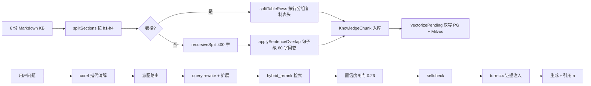
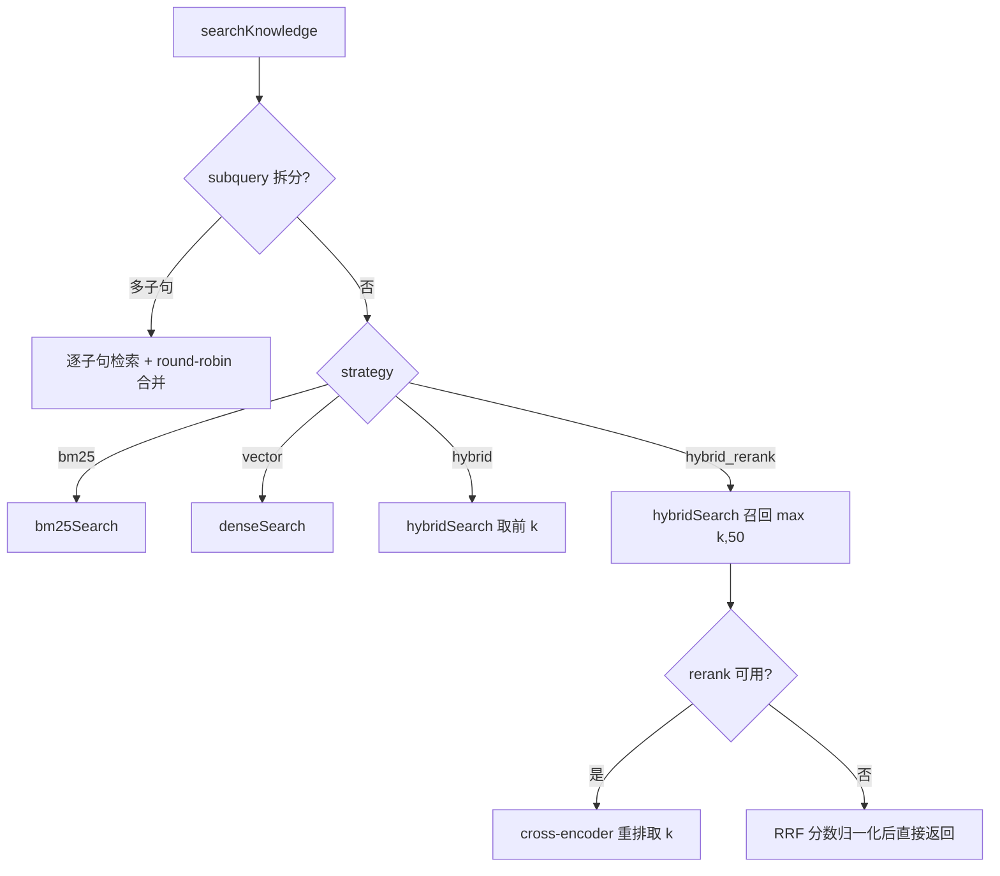
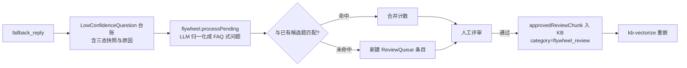

:::note 事实基线
所有「项目里 / 源码里」的陈述均实读自 `$HOME/github/yukino-ecomm-agent/server`（HEAD `c90c8433796f`，TypeScript 服务）；通用机制按标准工程知识作答。区分**事实基线**（源码可核对）与**方案推导**（如果要做，我会这样设计）。
:::

面向 **AI 全栈 / Agent 工程** 岗位的 RAG 与检索专题题库，每题给出可直接复述的权威解答。所有「项目里 / 源码里」的陈述均实读自 `yukino-ecomm-agent`（本机 `$HOME/github/yukino-ecomm-agent`，HEAD `c90c8433796f`，`server/` TypeScript 服务）；通用机制按标准工程知识作答。区分**事实基线**（源码可核对）与**方案推导**（如果要做，我会这样设计）。

**主线一览**

| 证据锚点             | 路径                                                                                              |
| -------------------- | ------------------------------------------------------------------------------------------------- |
| 全局常量             | `server/src/config.ts`                                                                            |
| 切分                 | `server/src/kb/chunking.ts`、`server/src/kb/documents.ts`                                         |
| 检索                 | `server/src/core/retrieval.ts`、`server/src/kb/store.ts`、`server/src/kb/milvus.ts`               |
| rerank / embedding   | `server/src/core/rerank.ts`、`server/src/core/embeddings.ts`                                      |
| 置信度 / 自检 / 守卫 | `server/src/core/confidence.ts`、`server/src/core/selfcheck.ts`、`server/src/core/model-guard.ts` |
| 图节点与上下文组装   | `server/src/graph/nodes.ts`、`server/src/core/memory.ts`、`server/src/core/budget.ts`             |
| 评测                 | `server/scripts/eval-rag.ts`、`server/src/api/rageval.ts`、`server/tests/data/eval_rag.jsonl`     |



## 一、文档解析与切分

### Q1. 项目知识库是什么形态，为什么选这种形态而不是任意文档？

**事实基线**:KB 是 6 份 Markdown（`server/data/kb/`:`product-faq.md`、`returns-policy.md`、`after-sales-manual.md`、`product-specs.md`、`member-benefits.md`、`billing-shipping.md`），`server/src/kb/sources.ts` 把文件名映射到四种 `contentType`:`faq` / `policy` / `manual` / `spec`，并写明各自语义——FAQ 的 question 存真实用户问法，policy/manual 的 question 存小节标题，spec 含具体型号、精确词召回依赖它。

**为什么**:电商客服域知识天然是「条款 + FAQ + 规格表」，Markdown 标题层级就是现成的语义边界；结构化切分（见 Q2）零模型成本、可解释、可增量。任意文档（PDF/扫描件）需要解析器与版面还原，属于方案推导层的工作。

### Q2. 结构优先切分具体怎么实现？

`server/src/kb/chunking.ts` 的 `splitSections`:

- 用 `HEADER_RE = /^(#{1,4})(?:\s+(.*))?$/` 识别 h1–h4；维护一个标题栈 `stack`，遇到 `level` 级标题时删除 `level..4` 层再写入当前标题，保证 `sectionPath` 是完整路径（如 `退换货政策 / 退货时限`）。
- **代码围栏感知**:进入 ``` / ~~~ 围栏后不识别标题，避免代码里的 `#` 注释被误切。
- 每个小节产出 `{ pageContent, metadata: {h1..h4} }`，空节跳过。

`documents.ts` 的 `buildChunks` 再把 `sectionPath` 拼成 `category`（父路径）与 `questions`（末级标题），落到 chunk 元数据。

**采分点**:先讲「标题栈 + 路径继承」，再讲「围栏感知」这个边界处理，最后说元数据（category/sectionPath）如何服务于检索过滤与引用展示。

### Q3. chunkSize=400、overlap=60 是怎么用的？为什么 overlap 是句子级而不是字符级？

**事实基线**:`buildChunks(md, contentType, chunkSize = 400, overlap = 60, tableMaxRows = 10)`。非表格块先 `recursiveSplit(body, 400, 0)`——注意**递归切分时 overlap 传 0**，然后 `applySentenceOverlap(base, 60)` 单独做句子级回卷。

句子级 overlap 的实现:`SENT_RE` 按中英文句末标点切句，`trailingSentences` 从上一块末尾倒序取不超过 60 字符的**完整句子**，拼到下一块头部。

**为什么不用字符级**:字符级 overlap 会把句子截半，半句进索引既污染 embedding 语义，又会在召回时给模型喂残缺证据；句子级保证 overlap 片段自身可读。代价是实际块长略超 400、相邻块有重复内容（用去重与 rerank 消化）。

**口径提醒**:400/60 是源码默认常量，仓库内**没有消融实验**证明其最优；被追问依据时如实说明，并给出补做方案（固定评测集跑 `chunkSize × overlap` 网格，看 Recall@5/MRR 拐点）。

### Q4. RecursiveCharacterTextSplitter 的分隔符序列为什么这样排？

`TEXT_SEPARATORS = ["\n\n", "\n", "。", "！", "？", "；", "!", "?", ";", "，", " ", ""]`:段落 → 换行 → 中文句末 → 英文句末 → 分号 → 逗号 → 空格 → 硬切。递归切分器**优先在高层分隔符处断开**，只有超长才降级，尽量让 chunk 落在自然语义边界。`keepSeparator: true` 保留分隔符本身，避免句子粘连。

### Q5. 表格内容怎么切？直接按行切有什么问题？

`splitTableRows(tableMd, maxRows=10)`:

1. `findTableHeader` 定位表头行（`|` 开头且下一行是 `TABLE_SEP_RE` 分隔线且含 `-`）；
2. 行数 ≤ `maxRows` 整表一块；否则按 `maxRows` 分组，**每组都复制表头 + 分隔线**（第一组额外保留表前文字 `preamble`）。

不按行裸切的原因:表格行离开表头就失去列语义，「`30 天`」这种单元格脱离「退货时限」列名后无法被正确理解，embedding 和 BM25 都会失效。复制表头是用少量冗余换每块的自包含性。

### Q6. 什么是「能力单元 / 关键条款」标记，有什么用？

`documents.ts` 的 `KEY_TERMS = ["refund", "return", "timeframe", "time limit", "shipping fee", "postage", "fee", "warranty", "compensation", "period", "free shipping"]`；`isKey(title, body)` 检查「标题 + 正文前 40 字符」是否命中，写入 `isKeyClause` 列。

用途在 `confidence.ts`:Top3 命中里若有关键条款（`key_clause_hit`），证据置信度加 `W_KEY = 0.1` 分。业务含义:退货时限、运费这类条款是客服回答的硬约束，命中它们意味着证据更可能「能回答问题」，而不只是话题相关。

### Q7. FAQ 型与条款型文档的切分策略为什么要区分？

`CONTENT_TYPE_DESC` 写明:FAQ 的 `questions` 字段存**真实用户问法**，条款/手册存**小节标题**。检索时 rerank 的 doc 文本是 `${question} ${answer}`（`retrieval.ts`），FAQ 块用口语问法参与语义匹配，天然贴近用户 query；条款块靠标题路径 + 正文。若把条款也伪造口语问题，会引入噪声；把 FAQ 的真实问法丢掉，则损失最宝贵的 query 分布信息。**一种切分策略服务一种文档形态**，这是结构优先的核心。

### Q8. 增量更新时如何只重切受影响的区间？

**事实基线**:项目以 chunk 为最小单位管理——`dualwrite.ts` 提供 `deleteChunks(ids)`、`rependChunks(chunks)`（文本改动后把 chunk 重置为 `vectorizeStatus: "pending"` 并删除旧向量），`kb-repatch` 作业负责重嵌。chunk 文本拼接为 `${category}\n${questions}\n${answer}`，文本变了向量必须重算。

**方案推导**（更大规模时）:对原文按块计算内容哈希，修订时比哈希定位受影响 section，只重切该 section 及其相邻边界块（overlap 导致边界块也变），其余 chunk 的 id/向量不动，避免全量重建与缓存失效风暴。

### Q9. 切分后如何做质量校验？

**事实基线**:`server/tests/chunking.test.ts` 覆盖切分单测；`kb-preview.ts` 脚本可预览切分结果；评测集 `tests/data/eval_rag.jsonl`（300 行样本，含 `expect_section` / `expect_sections_all` 标注）用 Recall@5 反向验证「正确证据是否被切进了可召回的块」。

**通用补充**:切分质量三查——① 抽查块自包含性（脱离上下文能否读懂）；② 统计块长分布，警惕长尾；③ 用评测集做召回回归，切分变更必须跑 Recall@K 对比。

### Q10. 为什么 chunk 里同时存 question 和 answer 两个字段？

检索侧拼 `${question} ${answer}` 做 rerank 文档、embedding 文本用 `${category}\n${questions}\n${answer}`（`dualwrite.ts`）；展示侧引用卡片用 question 做标题、answer 做正文；评测侧 `hitRank` 用 `section_path` 对齐标注。**question 是检索面（贴近 query 分布），answer 是内容面（承载事实），section_path 是溯源面**——三面分离让同一份数据服务召回、排序、引用、评估四个环节。

### Q11. 去重怎么做？归一化到什么粒度？

`kb/dedup.ts`:`normalizeQuestion` 做 trim + 小写 + 用 `/[^\p{L}\p{N}]+/gu` 剥掉所有非字母数字字符（含标点空格），`dedupeFingerprint = 归一化问题|归一化答案`。`dedupe(items, existingQuestions)` 用已有问题集合过滤新挖掘的 QA。

粒度选择:只做**字面归一化去重**，不做语义去重（不调 embedding 算相似度）——便宜、确定、可解释；语义重复交给检索时的 RRF 去重与 rerank 压制。若需语义去重属于方案推导:对候选两两算相似度阈值聚类，但要承担误杀同义不同答的风险。

### Q12. 会议录音 / 实时转写这类流式内容如何进入知识库？

**方案推导**（项目 KB 是静态 Markdown，此为设计题）:ASR 返回中间结果与最终结果，**只有 `is_final` 才发布索引事件**，中间结果仅用于实时展示，否则同一段重复入库；转写记录带 `meeting_id / speaker / start_ms / end_ms / sequence`；切分按说话人切换 + 静音区间形成语义单元，再按主题相似度合并；局部修订用内容哈希增量重切（Q8）；乱序用有限重排序缓冲 + 事件 ID 去重收敛。详见 [RAG 全链路](/interview/fundamentals/rag-pipeline)。

## 二、Embedding 与向量索引

### Q13. 项目用什么 embedding 模型，向量写到哪里？

**事实基线**:`EMBED_MODEL` 默认 `qwen3.7-text-embedding-flash`，走 OpenAI 兼容协议（`EMBED_BASE_URL` 默认阿里云百炼 compatible-mode，`core/embeddings.ts` 用官方 `openai` SDK）。双写:PostgreSQL `KnowledgeChunk` 表存 `embedding/embeddingModel/vectorId/vectorizeStatus`，配置了 `MILVUS_URI` 时同步 upsert 到 Milvus collection（默认名 `knowledge`）。`embeddingsEnabled()` 以 `EMBED_API_KEY` 是否为空判定开关。

### Q14. vectorizePending 的批处理与失败语义是什么？

`dualwrite.ts`:`vectorizePending(batchSize = 64)` 取 `vectorizeStatus = pending` 的 chunk，按 64 条一批、**每批内部再按 `MAX_EMBED_BATCH = 20` 切小批**调 embedding API；文本统一拼 `${category}\n${questions}\n${answer}`。Milvus 路径:整批 upsert 成功后 `flush()`，再逐条 `markChunkVectorizedExternal`；PG 路径逐条 `markChunkVectorized` 写回向量。任何一步失败，chunk 保持 pending 下轮重试——**以状态机换幂等**，重复执行不会重复计费写入。

### Q15. 更换 embedding 模型怎么办？

**事实基线**:`listChunksForVectorization(useMilvus, settings.embedModel)` 会把 `embeddingModel` 与当前配置不一致的 chunk 也列为 pending——即**检测到模型变更即全量重嵌**。项目规模（6 份文档、数十条 chunk）下这是正确选择:成本可忽略，换来索引纯净。

**方案推导**（海量历史索引）:影子索引方案——新模型写入独立索引，索引内存原文哈希 / 切分版本 / 模型版本 / 维度；按访问热度渐进回填；查询期双索引各自召回算排名后 **RRF 融合（不同模型的向量距离不可直接比较）**；覆盖率与质量达标后切主读，旧索引保留回滚窗口。

### Q16. Milvus collection 的 schema 是怎么设计的？

`kb/milvus.ts` `ensureCollection`:

| 字段                                                 | 类型              | 说明                                                             |
| ---------------------------------------------------- | ----------------- | ---------------------------------------------------------------- |
| `id`                                                 | Int64 主键        | 与 PG chunk id 一致，`autoID: false`                             |
| `dense`                                              | FloatVector(dim)  | AUTOINDEX + COSINE                                               |
| `text`                                               | VarChar(16384)    | `enable_analyzer: true`，`analyzer_params: { type: "standard" }` |
| `sparse`                                             | SparseFloatVector | `is_function_output`，由 BM25 function 生成                      |
| `question/answer/section_path/content_type/category` | VarChar           | 输出字段，免回表                                                 |

另有 `functions: [{ name: "text_bm25", type: FunctionType.BM25, input: text, output: sparse }]`，稀疏索引 `SPARSE_INVERTED_INDEX + BM25` metric；`consistency_level: "Strong"`；客户端超时 `TIMEOUT_MS = 15_000`。

**采分点**:dense/sparse 双路同 collection，BM25 交给引擎内置 function 而不是自己维护倒排；业务字段随索引返回，检索结果零回表。

### Q17. 为什么向量索引用 COSINE 而不是 IP / L2？

embedding API 返回的向量通常已归一化，此时 IP≈COSINE；显式用 COSINE 对未归一化情形也稳健，语义检索关心方向不关心模长。L2 受模长影响，适合图像特征等场景。项目里 PG 兜底路径手写 `cosine()`（`store.ts`），维度不一致直接抛错——**距离度量的前提是同模型同维度**。

### Q18. HNSW 的 M / efConstruction / efSearch 分别影响什么？

**通用机制**:`M` 是每层最大邻居数——增大提召回但涨内存与构建时间；`efConstruction` 是建图时候选池——增大提图质量但写入变慢；`efSearch` 是查询时候选池——增大提召回但涨延迟。线上权衡看 `Recall@K`、P95 延迟、索引大小、写入吞吐四个量。

**事实基线**:项目 Milvus 侧用 `AUTOINDEX` 把参数交给引擎；PG 兜底路径是**暴力全量 cosine 排序**（当前数十条 chunk 规模下无索引开销）。被追问「为什么不调 HNSW 参数」:当前规模暴力扫描就是最优解，调参是十万级向量以上才需要进入议程的问题——先给规模口径再谈参数。

### Q19. 高选择性的 category 过滤应该怎么处理？

**事实基线**:Milvus 路径把过滤**下推**到引擎:`request.filter = category == "..."`（`quote()` 做引号与反斜杠转义），hybrid 检索时两路 `data` 各自带 `expr`。PG 兜底路径在内存里 `filter(doc => doc.category === category)`。

**机制**:过滤选择性极高（过滤后只剩几十条）时，先 ANN 再过滤会召回不足——要么下推过滤让引擎在过滤集上检索，要么放大候选集（`recall` 参数）再后置过滤重排。项目两条路径分别对应这两种思路。

### Q20. 向量检索、BM25、图检索分别适合什么场景？

| 方式   | 适合                                                  | 不适合                         |
| ------ | ----------------------------------------------------- | ------------------------------ |
| 向量   | 语义相近、措辞不一致（「邮费谁出」↔「shipping fee」） | 型号、订单号、错误码等精确字面 |
| BM25   | 专有名词、型号（`MH-XXXX`）、口语中缺失的精确词       | 同义改写                       |
| 图检索 | 实体关系、多跳约束                                    | 纯语义相似                     |

项目用 hybrid 同时覆盖前两列；`model-guard.ts` 的型号正则 `/MH-[A-Za-z]{1,4}\d{1,4}/g` 侧面说明该域对精确字面匹配的依赖——型号错一个字就是事故。

### Q21. embedding 维度不一致 / 索引损坏如何兜底？

**事实基线**:`store.ts` 的 `cosine()` 遇维度不等抛 `Embedding dimension mismatch`；`milvus.ts` 的 `assertBm25Schema()` 检测到 collection 早于 BM25 对齐（缺 `text/sparse` 字段）时抛错并给出重建指令:`node main.js kb-reset && node main.js kb-build && node main.js kb-vectorize`。**宁可显式失败并给出恢复 runbook，不做静默降级**——检索静默降级等于用错误证据喂模型。

### Q22. 为什么 embedding 文本要拼上 category？

`${category}\n${questions}\n${answer}`:category 是标题路径（如 `退换货政策 / 退货时限`），把层级语境注入 embedding，让「30 天内可退」这类短答案携带所属条款的语义；同时与 BM25 的 `tokenize` 文本（`store.ts` 同样拼 `category\nquestion\nanswer`）保持一致，双路召回的文本口径统一。

## 三、关键词检索与混合检索

### Q23. 项目的 BM25 是怎么实现的？中文怎么分词？

**事实基线**（`store.ts`，PG 兜底路径）:

- 分词 `tokenize`:小写化后用 `/[a-z0-9]+|[\u4e00-\u9fff]+/g` 抽取英文词/数字串与中文段；中文段长度 >1 时**滑窗切双字（bigram）**，单字直接保留。bigram 是不依赖词典的轻量中文分词，对型号、术语鲁棒。
- 打分:标准 BM25，`K1 = 1.5`、`B = 0.75`，`idf = log(1 + (N - df + 0.5) / (df + 0.5))`（+1 变体保证非负），按 `avgdl` 做长度归一。
- 工程:chunk 加载为进程内缓存，`tf` 预计算成 Map；缓存键是 `knowledgeRevision() = ${count}:${maxId}:${maxUpdatedAt}` 聚合值——**任何增删改都会改变 revision 触发缓存重建**，加载用单飞 promise 防并发重复装载。

### Q24. Milvus 路径的 BM25 与手写 BM25 有何区别？

Milvus 用内置 BM25 function:`text` 字段开 `standard` analyzer，引擎生成 `sparse` 稀疏向量，检索 metric 直接用 `BM25`。区别:① 分词由引擎 analyzer 负责（standard 对中文按字/词元处理），与手写 bigram 口径不同；② 倒排索引在引擎侧，支持大规模；③ 参数（k1/b）由引擎管理。**同一系统里两条路径并存时，要意识到分数口径不一致**——所以混合检索用 RRF 按排名融合而不是分数相加（Q26）。

### Q25. 四种检索策略分别是什么，默认走哪条？

**事实基线**（`retrieval.ts`）:`strategy ∈ {vector, bm25, hybrid, hybrid_rerank}`，**默认 `hybrid_rerank`**。



候选量:`hybrid` 取 `k`；`hybrid_rerank` 取 `max(k, RECALL_TOP_K=50)` 再交给 rerank——**召回放宽、排序收紧**，rerank 只处理 Top50 控制延迟成本。

### Q26. RRF 融合怎么算？为什么不把余弦和 BM25 分数归一化后相加？

**事实基线**:`store.ts` 手写路径用 `K = 60`，`score = Σ 1/(K + rank + 1)`（rank 从 0 起），同 id 跨路命中累加；`milvus.ts` 走引擎内置 RRF ranker（`RRF_K = 60`，`RANKER_TYPE.RRF`）。

不归一化相加的原因:① 两路分数量纲与分布完全不同（余弦 ∈ [-1,1] 且集中在窄区间，BM25 无上界），min-max 归一化会被离群值拉偏；② 归一化依赖当前候选集分布，**同一文档在不同 query 下的归一化分数不可比**；③ RRF 只用排名，天然跨量纲、跨模型、跨索引，还能顺手融合多 query 子句的结果。代价是丢失分差信息——用 rerank 补回精细排序。

### Q27. 子查询拆分（subquery split）解决什么问题？

**事实基线**:`SUBQUERY_SPLIT` 默认开。`splitClauses` 用 `[,，;；?？。]` 切分 query，保留长度 ≥ `MIN_CLAUSE = 4` 的子句；≥2 个子句时**每个子句独立走完整检索**，再 `mergeRoundRobin`:各列表轮流取头、按 id 去重、**同 section 的重复命中先压到尾部**保证证据多样性，最后截断到 k。

解决的问题:复合问题（「退货时限多久？运费谁承担？」）整体 embedding 会被平均化，两路证据都召不全；拆开后各自精确召回再融合。

### Q28. query 改写与扩展在哪一层做？

**事实基线**:`core/query-understanding.ts`。`understand()` 用结构化输出拿 `{standard, expanded}`——标准问法 + 同义扩展词；`retrieveKnowledge` 里向量检索用 `standard`，BM25 用 `${standard} ${expanded.join(" ")}`（扩展词喂给关键词路，精确词受益最大）。`expandQueries()`（refund 流程用）生成恰好 3 条检索友好 query，多 query 命中按 id 合并、保留最高 rerank 分。改写失败回退原 query——**改写是增强不是依赖**。

### Q29. arrangeHeadTail 是干什么的？

`retrieval.ts`:`[items[0], ...items.slice(2), items[1]]`——把排名第 2 的命中挪到列表末尾。动机是 **lost in the middle**:长上下文里模型对开头与结尾关注度最高、中部衰减；把次强证据放尾部比放第 2 位更易被利用。小改动体现对「证据进入模型后的位置效应」的意识，是面试加分点。

### Q30. 检索结果如何保证不重复、不偏科？

三层机制:① `mergeRoundRobin` 按 chunk id 去重；② 同 `section_path` 的命中压尾（section 多样性）；③ rerank 按相关性重排压制同义重复块。引用组装时每个 chunk 只出现一次（`citations` 按 id 唯一）。

### Q31. 缓存与知识库更新的一致性怎么保证？

**事实基线**:进程内检索缓存以 `knowledgeRevision()`（`count:maxId:maxUpdatedAt`）为版本键，每次加载前比对，任何写操作（新增/删除/repatch）改变聚合值即整体重建；`invalidateVectorCache()` 在 `drop` 时显式清空。这是**版本号失效**模型:读路径永远拿到某个一致快照，写路径不需要逐条通知——对应「快照一致的 RAG 查询」的最小实现。

### Q32. 如何设计支持版本过滤和时间旅行查询的向量索引？

**方案推导**:chunk 增加 `corpus_version`、`valid_from`、`valid_to` 字段并建标量过滤；查询时带版本约束 `valid_from <= t < valid_to` 下推到引擎（对应项目的 category 过滤下推机制）；删除用软删 + 版本边界闭合而非物理删除；索引按版本分区，过期版本异步清理。本质是把 Q31 的「单版本号」推广为「全历史版本链」，代价是存储与过滤开销，收益是审计与回放。

## 四、Rerank

### Q33. rerank 接什么协议，怎么做容错？

**事实基线**（`core/rerank.ts`）:`RERANK_PROTOCOL` 支持 `jina`（默认，`POST {base}/v1/rerank`）与 dashscope 风格（`/api/v1/services/rerank/text-rerank/text-rerank`），默认模型 `qwen3.7-text-rerank`。容错:`RETRIES = 3` 次重试、`BACKOFF_MS = 1500` 指数退避（`1500 * 2^i`）、仅对 `{429, 500, 502, 503, 504}` 重试、`AbortSignal.timeout(60_000)` 硬超时；响应用 zod schema 校验，`relevance_score` 兼容 number/string。

### Q34. rerank 的输入文档怎么拼？为什么这样拼？

`retrieval.ts`:`docs = hits.map(h => `${h.question} ${h.answer}`)`。question 承载问法相似度、answer 承载内容相关性，拼起来让 cross-encoder 同时看到「这块像不像在回答这个问题」。Top-N 由 `RERANK_TOP_K = 10` 控制（最终进证据的条数），召回侧给到 50——**召回/精排漏斗 50 → 10**。

### Q35. RERANK_API_KEY 没配会怎样？这算降级还是事故？

**事实基线**:`rerankEnabled()` 为假时走 `scoreAsConfidence`——把 RRF 融合分按 Top1 归一化成伪 rerank 分（`score / top`）直接返回，并 warn 一次。这是**设计内的开关式降级**:链路不断、置信度闸门仍可工作（只是信号质量下降）。它同时是天然的消融开关——关掉 rerank 跑评测，差值就是 rerank 的净增量（见 Q55）。

### Q36. RERANK_MIN_SCORE = 0.3 是什么角色？

配置里保留的精排阈值位（低于该 rerank 分的命中可视为无效证据）。与 `confidence.ts` 的 `VALID_SCORE_FLOOR = 0.3` 呼应:后者统计 `rerank_score >= 0.3` 的「有效证据数」作为置信度信号。**阈值的意义必须绑定下游动作**——这里动作是置信度打分与闸门，而不是简单过滤。

### Q37. cross-encoder 为什么不能直接做全量召回？

cross-encoder 对 (query, doc) 联合编码，精度高但复杂度 O(N)——每条候选都要过一次模型。50 条候选 × 一次 API 调用可控；对 10 万条语料逐对打分延迟与成本都不可接受。所以架构必然是**双塔/倒排粗召回（O(logN)/O(1)）→ cross-encoder 精排（O(k)）**的漏斗。

### Q38. rerank 效果怎么评估？

**事实基线**:`eval-rag.ts` 四策略对照（`vector / bm25 / hybrid / hybrid_rerank`）× 四桶样本，输出 Recall@5 / MRR / 证据覆盖率 / 生成忠实度；`hybrid_rerank` 相对 `hybrid` 的差值即 rerank 净增量。评测报告产物在 `data/rag/reports/`（运行时生成，**未提交入库**）——被问「效果好不好」先答口径与产物位置，不编数字。

## 五、查询理解与路由

### Q39. 指代消解（coref）在哪做，失败怎么办？

**事实基线**:图的第一站 `resolve_reference`（`graph/nodes.ts`）调 `coref.resolve(query, history)`，把「那运费呢？」这类依赖上文的问句结合 `historyText`（最近 6 轮 + 摘要行）改写成自包含 query；LLM 失败或返回空则**原样透传**，trace 记 `coref: rewrite|passthrough`。设计原则:消解是 best-effort，绝不阻塞主链路。

### Q40. 意图分类有哪些类，如何路由？

**事实基线**:9 类意图（`core/intent.ts`）:`logistics / order / product_inquiry / refund_return / after_sales / complaint / human_agent / chitchat / other`，结构化输出 `{intent, confidence}`，失败回退 `other`。路由表 `INTENT_TO_ROUTE`:

| 意图                            | 路由            | 行为                         |
| ------------------------------- | --------------- | ---------------------------- |
| complaint                       | escalate        | 固定话术 + 转人工/建工单动作 |
| chitchat / other                | fallback_script | 固定话术，**不进模型**       |
| product_inquiry                 | knowledge       | 强制 RAG（置信度闸门）       |
| refund_return / after_sales     | refund_flow     | 取订单 → 政策检索 → agent    |
| logistics / order / human_agent | business        | 直接进工具 agent             |

**采分点**:确定性路由保证知识类问题**必须**走检索（防幻觉的第一道闸），闲聊类**不花模型钱**——路由本身就是成本与质量手段。

### Q41. 意图置信度怎么用？INTENT_CONF_THRESHOLD = 0.6 的意义？

分类结果带 `confidence`（默认值 0.5），`tagIntent` 打进 Langfuse 观测。阈值 0.6 是配置位，用于低置信时的策略分叉（如降级到更保守的路由或追问）。**关键表述**:置信度来自模型自报，校准性有限，严肃场景要用标注集画置信度-准确率校准曲线再定阈值，而不是拍脑袋。

### Q42. 检索结果进入模型前，如何防止引用漂移与证据拼接错误？

**事实基线**:① 引用编号在组装时一次性绑定——`citations[i].n = i+1` 与证据文本 `[n] question: answer` 同源同序，模型看到的 `[n]` 与回传给前端的 `citations` 数组是同一份数据；② `KNOWLEDGE_EVIDENCE_HINT` 明确要求「按证据编号引用、型号逐字抄写、证据已给出不得重复调 query_faq」；③ 生成后 `model-guard` 机械校验答案里的型号必须出现在证据中（Q53）。**编号-证据-引用三者绑定 + 生成后机械校验**，漂移就没有生存空间。

### Q43. Prompt、运行时状态和外部证据如何组装，避免数据覆盖系统指令？

**事实基线**:`agentMessages` 的结构是 `[SystemMessage(AGENT_SYSTEM), ...window]`，而证据不进 system——`turnContext`（摘要 + 证据 + 订单数据）作为一条 **id 为 `turn-ctx` 的 HumanMessage 插在最后一条用户消息之后**。两个理由:① system 前缀保持稳定，最大化命中 prompt cache（`mainAgent` 日志记录 `cache_read` tokens 验证）；② 证据属于「本轮材料」而非「系统指令」，角色边界清晰，降低注入面。

### Q44. 多轮对话里检索 query 该用当前句还是全历史？

项目的做法:coref 把当前句改写成自包含 query 用于检索（而不是拿整段历史去 embedding）；历史只参与改写与意图判断。全历史检索会被无关轮次稀释、且破坏 prompt 前缀；纯当前句又丢指代。**先消解、后检索、历史只进改写器**是可复述的标准答案。

## 六、上下文预算与组装

### Q45. 上下文预算怎么算？给出项目的完整公式。

**事实基线**（`core/budget.ts` + `config.ts` 默认值）:

```text
window    = MODEL_CONTEXT_WINDOW 或按模型名查表（KNOWN_WINDOWS，兜底 32768）
fixed     = systemPromptTokens(700) + evidenceTokens(rerankTopK × 160 = 1600)
          + summaryTokens(3 × 250 = 750) + maxOutputTokens(10000) + budgetSafetyMargin(1000)
peak      = maxUserInputTokens(2000) + maxAgentSteps(6) × (toolResultMaxTokens(3000) + agentStepAiTokens(500))
sliding   = min(contextBudgetTurns(20) × perTurn, window − fixed − peak)
perTurn   = maxUserInputTokens + maxOutputTokens + maxAgentSteps × layer2ToolKeepTokens(200)
```

`limitedBy` 报告瓶颈是轮数还是窗口，`healthy` 要求至少装得下 1 轮。**先固定（system/证据/摘要/输出/安全边际）再峰（单轮工具循环峰值）剩余额度给滑动历史**——预算分配的顺序本身就是答案。

### Q46. token 计数是怎么估算的，为什么不用分词器？

`memory.ts` `countTokens`:`ceil(chars / EN_CHARS_PER_TOKEN(4)) + 3`（每条消息加角色/name 长度，tool_calls 序列化计入）。这是**工程估算**:免依赖具体模型的 tokenizer、跨模型可移植、O(1)。代价是中文场景偏差（中文 1 字常 ≈ 1 token），所以预算里留了 `budgetSafetyMargin = 1000` 安全边际。被追问精度:预算层要的是保守上界，不是精确计数。

### Q47. 三层记忆（摘要 / Layer2 / Layer1）是怎么分工的？

**事实基线**（`memory.ts` + `summarizer.ts`）:

| 层     | 内容                                      | 压缩策略                                                                                                            |
| ------ | ----------------------------------------- | ------------------------------------------------------------------------------------------------------------------- |
| 摘要层 | `summaryUptoMsgId` 之前的全部历史         | 滚动摘要，注入 `(Summary of earlier conversation...)`                                                               |
| Layer2 | 摘要边界 ~ `layer1FromMsgId`              | AI 回复截到 60 字符 + `…(truncated)`；工具结果 >200 token 变 `(Called X; result omitted)`；**保留 tool_calls 结构** |
| Layer1 | 最近 `layer1Ratio = 0.7` 滑动预算内的轮次 | 原文                                                                                                                |

触发:Layer2 token 超过 `sliding × (1 − 0.7)` 时异步 `runSummary` 把 Layer2 卷进摘要（`appendSummarySegment` 落库，按会话去重防并发重复摘要）。`trimHistory` 兜底:超预算从最旧消息丢起，且保证窗口首条是 HumanMessage（不产生残缺的 tool 调用对）。

### Q48. 为什么工具结果压缩时要保留 tool_calls？

`toLayer2` 压缩 ToolMessage 正文但**逐条复制 `tool_calls`**:OpenAI 风格协议要求 `tool` 消息必须能对应到 assistant 消息里的 tool_call id，砍掉 tool_calls 会造成消息序列非法、API 直接报错。**压缩历史不能破坏协议结构**——这是上下文工程里最容易踩的坑。

### Q49. 上下文窗口爆炸时的处理顺序是什么？

结合项目机制给出可复述顺序:① 路由层分流（闲聊不进模型）；② 历史分层压缩（Layer2 → 摘要）；③ 证据按预算定 TopK（`evidenceTokensPerChunk × rerankTopK`）；④ 工具结果限额（`TOOL_RESULT_MAX_TOKENS = 3000`）；⑤ 步数上限（`MAX_AGENT_STEPS = 6`）封顶单轮峰值；⑥ 兜底 `trimHistory` 丢最旧轮。原则:**先压信息密度低的（旧历史/工具长结果），最后才动当前任务材料**。

### Q50. 如何在一次模型请求中动态分配上下文预算？

**方案推导**（在 Q45 静态预算上）:把 sliding 余额按「当前用户问题 > 未完成步骤/关键工具结果 > 近期对话 > 远期摘要」优先级队列分配；证据内部按 rerank 分与来源多样性分配而不是只按相似度截断；预留输出空间（项目固定 `maxOutputTokens`）避免答案被截断；分配结果与 `limitedBy` 一起进 trace，线上可回放。

## 七、引用校验与防幻觉责任链

### Q51. 证据置信度是怎么算的？各信号权重多少？

**事实基线**（`core/confidence.ts`）:

```text
score = 0.5 × clip01(top1_rerank_score)
      + 0.2 × min(valid_count, 3) / 3        # valid = rerank_score ≥ 0.3
      + 0.2 × clip01(top1 − top2 的 margin)
      + 0.1 × key_clause_hit                  # Top3 命中关键条款词
```

空命中直接 0 分。四个信号分别刻画:最强证据强度、证据厚度、头部区分度、业务关键性。**阈值 `EVIDENCE_CONFIDENCE_THRESHOLD = 0.26`** 由 `calibrate-confidence.ts` 的分布校准支撑（可答桶 A/B/C/E 与不可答桶的 p25/p50/p75 分位数找分界）。

### Q52. 置信度闸门之后为什么还要 selfcheck？

**事实基线**:`retrieveKnowledge` 是**双闸**——置信度 < 0.26 直接判弱；过了再让 LLM 结构化判断「证据是否足以回答该问题」（`selfcheck.checkSufficient` 返回 `{useful, reason}`，调用失败按不足处理）。置信度是检索侧的**统计信号**（分数高≠能回答，比如召回到高度相关但答非所问的条款）；selfcheck 是语义侧的**充分性判断**。两闸都过才放行生成，任一不过走 `fallback_reply`（固定话术 + 转人工动作）并落 `LowConfidenceQuestion` 台账。

### Q53. model-guard 的机械校验是什么，为什么重要？

**事实基线**（`core/model-guard.ts`）:`MODEL_RE = /MH-[A-Za-z]{1,4}\d{1,4}/g` 抽出答案与证据中的型号，`unsupportedModels` 找出答案里**证据中不存在**的型号；命中则带 `repairHint`（「这些型号在证据中找不到，请逐字抄写证据中的型号，不确定就不写」）重试一次。评测脚本同样跑该守卫并记录 `fixed` 与否。

重要性:型号是电商域的**高危事实**——编造型号直接误导购买。LLM 提示约束（「逐字抄写」）是软约束，正则是硬闸门，**软硬结合**才是责任链。

### Q54. 防幻觉的完整责任链怎么表述？


表述要点:防幻觉不是「检索 + 一句提示词」，而是**路由保证必检索 → 闸门决定敢不敢答 → 结构化注入约束内容 → 机械闸门兜底 → 台账闭环补知识缺口**；每一层都有独立的失败模式与观测。

### Q55. 忠实度（faithfulness）怎么评？judge 的偏差怎么治？

**事实基线**:`eval-rag.ts` 仅对 `hybrid_rerank` 策略跑忠实度 judge——`FAITHFULNESS_PROMPT` + 结构化输出 `{faithful, reason}`，temperature 0；不忠实的案例带证据快照写入 **faith case 台账**（`FaithCase` 表，状态机 `unresolved / resolved / dismissed`，标记 resolved/dismissed 必须填写处置说明，重复出现自动累计 `seen_count` 并可重开）。

**偏差治理**（通用）:位置偏差（交换候选顺序重测）、长度偏差（惩罚偏好长答案）、自偏好（judge 与生成模型异源）；项目侧的体现是 coverage 用独立 judge 模型且 temperature 0、台账要求人工处置闭环而非只信 judge。

### Q56. 拒答（refusal）怎么评？漏拒的代价是什么？

**事实基线**:评测样本带 `should_refuse` 标注；报告里 `refusal.total / refusal.correct`，`refusal_missed = total − correct` 计入幻觉口径（`hallucination()` 的 `judged = cases + missed`）。**漏拒 = 对不可答问题编造答案**，比保守拒答危害大得多；所以幻觉率分子把「该拒不拒」与「judge 判不忠实」合并计数。

## 八、检索评估与归因

### Q57. 评测集长什么样？为什么分桶？

**事实基线**:`tests/data/eval_rag.jsonl` 共 300 行，schema:`{id, bucket, query, expect_section?, expect_sections_all?, expect_points?, should_refuse?}`；计分桶 `A_policy`（政策条款）、`B_model`（型号精确匹配）、`C_colloquial`（口语化）、`E_multi`（跨文档多跳）。分桶的价值:**整体指标会掩盖结构性短板**——型号桶考 BM25、口语桶考向量、多跳桶考召回宽度，优化动作必须落到具体桶。

### Q58. Recall@K 与 MRR 怎么算？项目的判定口径是什么？

**事实基线**（`eval-rag.ts`）:`hitRank` 在 Top-K（K=10）命中里找 `section_path` 包含标注别名的最高名次（1-based，未命中为 0）；多组标注（`expect_sections_all`，组内任一别名命中即算）各组出 rank。`Recall@5 = mean(rank ∈ [1,5])`；`MRR = mean(rank > 0 ? 1/rank : 0)`。按桶与 overall 分别报告，四策略同口径对照。

### Q59. 如何判断问题出在召回、排序还是生成？

三段归因（项目评测结构直接对应）:

| 阶段     | 指标                                         | 诊断                                              |
| -------- | -------------------------------------------- | ------------------------------------------------- |
| 召回     | Recall@5 / MRR                               | 正确证据没进候选 → 切分、索引、query 改写问题     |
| 证据覆盖 | 机械匹配覆盖率（Top10 证据包含多少标准要点） | 召回到了但要点不全 → 召回宽度/rerank 截断问题     |
| 生成     | coverage judge + faithfulness                | 证据对但答错 → 上下文组织、模型能力、答案约束问题 |

**事实基线**:Stage 2 的证据覆盖率是**确定性机械匹配**（去空白后子串包含），不依赖模型、可复现；Stage 3 才引入 LLM judge。先机械后模型，把可确定性度量的部分从 judge 噪声里隔离出来。

### Q60. 评测的工程细节有哪些值得讲？

`eval-rag.ts`:检索与生成各自 `Semaphore(5)` 限并发；每次上游调用 `CALL_TIMEOUT = 45s` + 失败 2s 后重试一次（`tryCall`）；生成结果先过 model-guard 再评分；faith case 写台账去重（`seen_count` 累计）；报告双产物 `rag_eval.json`（结构化）+ `rag_eval.txt`（人读日志）；`--skip-gen` 支持只跑检索段。**评测脚本本身要有超时、限流、重试与幂等**，否则评测结果里混入的是基础设施噪声。

### Q61. 线上如何保存证据做事后归因？

**事实基线**:每轮 trace 落 `GraphState.trace`（mergeDict reducer 合并）:`retrieve_policy/retrieve_knowledge` 记录 queries 与命中数、`confidence_signals` 四信号、`self_check` 原因、路由与意图置信度；`retrievedSnapshot` 保存 Top3 证据快照（question/answer/rerank_score/section_path）；Langfuse 侧 `CallbackHandler` 按 sessionId 组 trace、`recordTurn` 记输入输出与 total tokens、`tagIntent` 打意图标签。**查询改写、过滤条件、召回列表、重排分数、最终引用**都齐了，任何一条线上回答都能回放归因。

### Q62. 三态快照（null / [] / 有命中）为什么重要？

**事实基线**（`fallbackReply` 注释明确写了语义）:`retrievedSnapshot = null` 表示**检索从未执行**；`[]` 表示**检索执行了但零命中**（强信号:知识真的缺失，评审页按此展示）；非空表示检索过且有命中但置信不足。若用 `??` 把空数组折叠成 null，就丢失了「知识库确实没有」与「链路没走到」的区别——flywheel 补知识的优先级判断依赖这个区别。**数据结构要能表达「没做」与「做了但为空」的差异**。

## 九、进阶设计

### Q63. Agentic Retrieval 中如何决定继续检索、改写查询还是终止？

**方案推导**（结合项目已有积木）:把 `retrieveKnowledge` 的置信度闸门扩展为决策器——`score ≥ 0.26` 且 selfcheck 通过 → 终止进生成；`score` 低但 margin 大（有弱候选）→ 改写查询重试（复用 `understand` 的 expanded 机制）；零命中（三态快照的 `[]`）→ 换 BM25/放宽 category 过滤再试一轮；步数封顶（类比 `MAX_AGENT_STEPS`）后仍不足 → 拒答 + 台账。核心是**每个决策绑定可观测信号**，而不是让模型自由发挥「要不要再搜」。

### Q64. 如何为不断更新的知识库实现快照一致的 RAG 查询？

**事实基线 + 推导**:项目已有最小实现——进程缓存以 `knowledgeRevision`（count:maxId:maxUpdatedAt）为版本键，一次查询内读的是同一缓存快照（Q31）。推广:查询开始时取版本号，检索过滤条件带版本（Q32 的 `valid_from/valid_to`），生成阶段引用的 chunk 携带版本与内容哈希，回答落库时记录版本——**一次问答全链路同版本**，知识库并发更新不会让证据与引用错位。

### Q65. 多子系统 RAG 召回耗时怎么优化？

结合项目事实给优先级:① 并行化——`hybridSearch` 里 dense/bm25 已是 `Promise.all`，多 query 扩展可同样并行；② 漏斗收窄——召回 50 精排 10 是成本锚点，rerank 只处理 Top 候选；③ 缓存——query 级结果缓存 + 项目已有的 chunk 缓存 revision 机制；④ 降级——rerank/embedding 缺 key 时的降级路径保证最坏情况仍可用；⑤ 预算超时——评测侧 `CALL_TIMEOUT 45s` 的思路移到线上并收紧，超时走确定性话术。**先拆 span 找串行瓶颈，再谈优化**（见 [RAG 全链路](/interview/fundamentals/rag-pipeline) 的 TTFT 拆解）。

### Q66. 低置信问题如何形成数据飞轮？

**事实基线**（完整闭环）:



细节采分点:候选列表截断 200 条防 prompt 爆炸；**幻觉 id 守卫**（LLM 返回的 `matched_question_id` 必须真实存在于候选列表，否则本轮跳过重试）；评审通过的答案同时进 `conversation_history` 挖掘通道（`approvedStagingChunk`）。飞轮的关键不是自动入库，而是**人工评审闸门 + 可追溯来源**。

### Q67. 会话挖掘（mining）与飞轮有什么区别？

**事实基线**:`kb/mining.ts` 的 `mine(batchSize=20)` 是**批量离线挖掘**——把全部会话喂给 `MINING_PROMPT` 抽取 QA 对（questions/answers 数组不等长时对齐到短边），写入 staging 表（`extracted → kept/discarded`），用 Q11 的去重过滤已有问题。飞轮（Q66）是**在线触发**——低置信台账驱动、单条归一化、带评审队列。两者互补:mining 补存量覆盖，flywheel 补实时缺口；入库前都过人工评审。

### Q68. 如果知识库从当前数十条涨到百万条，架构要改什么？

**方案推导**（按项目现有扩展点）:① 检索主路径切 Milvus（代码已支持，`milvusEnabled()` 开关），PG 只留元数据；② 进程内 bigram BM25 缓存退役，全部交给引擎倒排；③ `knowledgeRevision` 全量缓存失效改为按分区/租户的细粒度版本；④ 评测集按桶分层抽样控制成本，Recall@K 用固定子集回归；⑤ 切分引入内容哈希增量重切（Q8）；⑥ 置信度阈值按桶分别校准。**回答要沿着现有代码的接缝走**，而不是推翻重来——这是「基于项目事实做推导」的标准示范。

### Q69. embedding 调用的成本与限流怎么控制？

**事实基线**:`vectorizePending` 双层批处理（外层 64 条/批、内层 `MAX_EMBED_BATCH = 20` 条/次 API 调用）摊薄请求开销；状态机（pending → vectorized）保证失败重试不重复计费；`rependChunks` 只对文本变更的 chunk 重嵌。**方案推导**（更大规模）:按内容哈希做 embedding 结果缓存（同文本不重复调）；离线批量走低价 batch API；限流用令牌桶 + 429 退避（与 `rerank.ts` 的 `RETRIES=3 / BACKOFF_MS=1500 × 2^i` 同款策略）。

### Q70. 中英混合语料的检索要注意什么？

**事实基线**:项目的 `tokenize` 把英文/数字按连续串保留、中文切 bigram，天然支持混合文本；分隔符序列同时含中英文标点；`KEY_TERMS` 是英文词但 `isKey` 对「标题+正文前 40 字符」小写化后子串匹配，中英都能命中。要注意的坑:① bigram 对单字查询召回弱（「退」字单独查不中「退货」的 bigram），需 query 侧扩展兜底；② 英文停用词未过滤，靠 IDF 自然压低；③ embedding 模型必须选多语言能力的（项目默认 qwen 系对中文友好）。

### Q71. 多租户 / 权限场景下检索架构要怎么改？

**方案推导**（项目是单租户，category 过滤是现成接缝）:把 `category` 过滤推广为 `tenant_id + ACL` 过滤并**下推到引擎**（Milvus `filter` 表达式，同 Q19 机制）；权限校验必须在检索前完成（先召回全租户内容再让模型判断，既泄漏又浪费 token）；ACL 变更要能触发缓存 revision 失效（Q31 机制按租户分片）；引用展示层再做一次权限复核，防止缓存串租户。**过滤前置 + 双层校验 + 缓存分片**三件套。

### Q72. 检索层要不要做结果缓存？键怎么设计？

**方案推导**:值得做的场景是高频重复 query（FAQ 域头部集中）。键 = `hash(改写后 query + strategy + category + topK + 语料 revision)`——**必须绑定语料版本**（复用 Q31 的 `knowledgeRevision` 思路），否则知识库更新后返回陈旧证据；TTL 要短于知识更新周期；命中/未命中打点进观测。项目当前未做 query 级缓存（数十条 chunk 规模下检索本身近乎免费），这是「规模决定方案」的又一例证——先给规模口径，再谈要不要缓存。

## 速记卡

- **切分**:h1–h4 标题栈 + 代码围栏感知；表格按 10 行分组复制表头；正文 400 字递归切分 + 60 字**句子级** overlap（不截半句）。
- **索引**:PG + Milvus 双写；`category\nquestion\nanswer` 统一文本口径；Milvus 用 BM25 function + AUTOINDEX/COSINE，`consistency_level: Strong`。
- **检索**:默认 `hybrid_rerank`；召回 50（`RECALL_TOP_K`）精排 10（`RERANK_TOP_K`）；RRF `1/(60+rank+1)` 按排名融合；子句拆分 + round-robin + section 多样性压尾；`arrangeHeadTail` 把第 2 名挪尾部对抗 lost in the middle。
- **闸门**:置信度 = 0.5×top1 + 0.2×有效数 + 0.2×margin + 0.1×关键条款，阈值 0.26；再过 selfcheck；双闸不过 → 固定话术 + 转人工 + 台账。
- **组装**:证据走 `turn-ctx` HumanMessage 不进 system（保前缀缓存）；引用 `[n]` 与 citations 同源同序；型号 model-guard 正则硬校验 + repairHint 重试。
- **评测**:300 样本四桶；Recall@5/MRR + 机械覆盖率 + judge 覆盖/忠实度；报告在 `data/rag/reports/`（运行时产物，未入库，不编数字）。
- **飞轮**:低置信台账 → LLM 归一化（幻觉 id 守卫）→ 评审队列 → 人工通过才入 KB；mining 补存量、flywheel 补实时。

## 延伸阅读

[RAG 全链路](/interview/fundamentals/rag-pipeline) · [电商 RAG 项目深挖](/interview/answers/ecomm-rag-project) · [RAG 六连问](/interview/answers/rag-deep-dive) · [LLM 评测与可观测性](/interview/qa/llm-eval-observability) · [Agent 框架与架构对比](/interview/qa/agent-frameworks) · [指标口径与基线定义](/interview/metrics-baseline) · [全量题库](/interview/question-bank)
