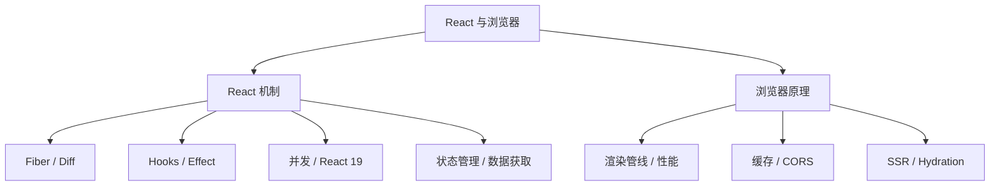
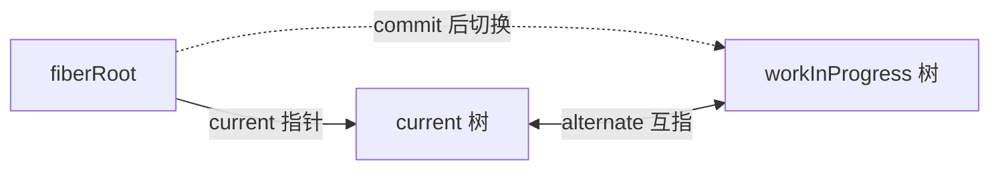
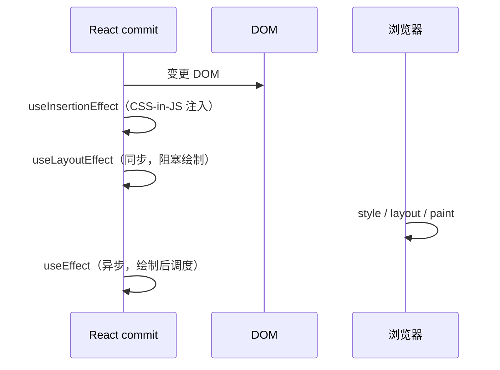
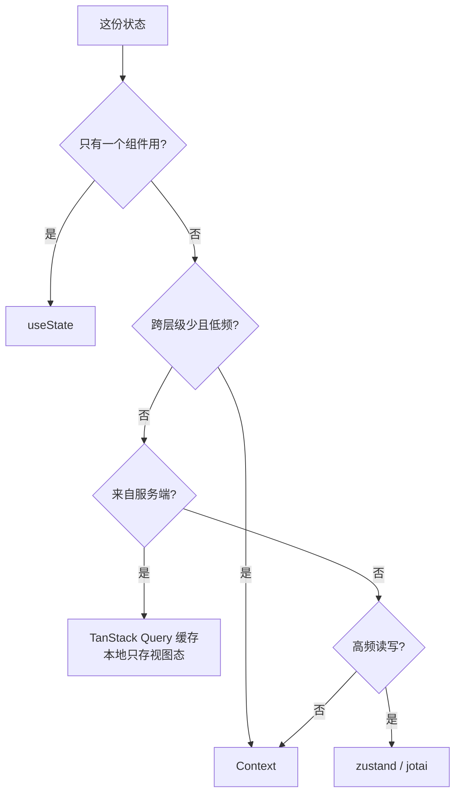
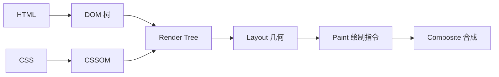
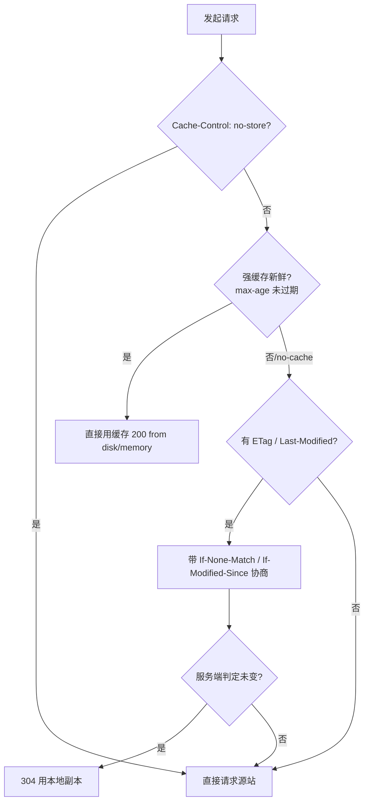

本篇 65 题覆盖 React 渲染机制与浏览器原理两条主线，项目例证来自本机 `yukino-chat`（HEAD `555f625`，React 19 + TanStack Query v5 + zustand 5 + Vite）与 `yukino-chatbot`（HEAD `13332f3`，React + jotai + TanStack Query）两个 client 的实读源码，路径相对各自仓库根目录。凡标注「事实基线」的常量均可回源码核对；通用机制按 React 19 / 现代浏览器口径表述。



## 一、Fiber 架构与协调

### Q1. Fiber 解决了 React 15 的什么问题

**基础**。React 15 的 Stack Reconciler 递归遍历整棵树，**不可中断**：大树更新会长时间霸占主线程，掉帧、输入卡顿。Fiber 把渲染拆成**可中断、可恢复、可排序**的工作单元：每个组件对应一个 fiber 节点，调度器按优先级在约 5ms 的时间片间让出主线程（通过 `MessageChannel` 而非 `setTimeout`，避免 4ms 嵌套节流），高优更新（输入）可打断低优更新（数据渲染）。

```js
// fiber 节点的核心形状（简化）
{
  tag, type, key,            // 组件种类 / 类型 / 身份
  stateNode,                 // 对应 DOM 或类实例
  child, sibling, return,    // 链表树：第一个孩子 / 兄弟 / 父
  alternate,                 // 双缓冲的另一棵树上的自己
  pendingProps, memoizedProps, memoizedState,
  flags, lanes,              // 副作用标记 / 优先级车道
}
```

递归变链表后，「遍历到哪」成为可序列化的指针状态，随时可停可续——这是时间切片的结构基础。

### Q2. Fiber 的双缓冲（double buffering）指什么

**进阶**。同时存在两棵树：`current`（屏幕上的）与 `workInProgress`（内存中构建的）。更新在 WIP 树上进行，commit 完成后 React 把 `fiberRoot.current` 指针**一次性切换**到 WIP 树，原 current 树在下次更新时复用为 WIP——避免中间态暴露给用户，也复用节点对象减少 GC。



### Q3. render 阶段与 commit 阶段的边界

**进阶**。render 阶段：构建 WIP 树、计算 effect 列表，**纯函数、可中断、可丢弃重来**（并发模式下被高优打断的渲染直接废弃）；commit 阶段：**同步不可中断**，执行 DOM 变更、`useLayoutEffect`、`componentDidMount/Update`、调度 `useEffect`。推论：render 里不能有副作用（可能执行多次或作废），DOM 测量放 layout effect，请求放 effect 或数据层。

### Q4. reconciliation 的三个假设与复杂度

**基础**。通用树 diff 是 O(n³)，React 用三个假设降到 O(n)：

1. 不同类型的元素产生**不同的树**（`div → p` 直接销毁重建整棵子树）；
2. 同级元素用 **key** 标识复用；
3. 只做**同层比较**，跨层移动视为删除 + 新建。

代价：把深层节点移到另一棵子树会整段重建——这是「列表项外包一层无 key 容器导致内部状态全部丢失」的根因。

### Q5. key 的作用？为什么不建议用数组下标

**基础**。key 是同级节点的稳定身份，diff 时据此判断「复用 / 移动 / 删除」。用下标的问题：列表头部插入 / 删除 / 排序时，**下标与数据的对应关系整体错位**：

```text
旧: [A, B, C]  key=0,1,2
头部插入 X → 新: [X, A, B, C] key=0,1,2,3
diff 结果: key0 由 A 变 X（更新）、key1 由 B 变 A（更新）… 全部误判为内容更新
```

React 会复用错误的 DOM 与组件状态（输入框内容串行、动画错乱），且本该是一次移动 + 一次插入变成全量更新。判据：key 用数据自身的稳定 id；纯展示、无状态、永不重排的静态列表用下标无害。

### Q6. React 事件系统是如何工作的

**进阶**。合成事件（SyntheticEvent）：React 不逐节点绑定，而是把事件**委托到根容器**（React 17+ 是 mount 的 root 而非 document），原生事件触发后沿 fiber 树模拟捕获 / 冒泡派发，抹平浏览器差异。后果：

- `e.stopPropagation()` 只阻止 **React 树内**传播；要拦原生监听得用 `e.nativeEvent.stopImmediatePropagation()`；
- portal 内的事件仍按 **React 树**冒泡（而非 DOM 树）——弹窗里的点击会触发弹窗外父组件的 onClick；
- React 17 起不再池化事件对象，异步读 `e.target` 安全。

### Q7. `memo` / `useMemo` / `useCallback` 的取舍

**进阶**。三者都是「比较成本换渲染成本」：memo 浅比较 props 跳过子树渲染；useMemo 缓存计算结果；useCallback 缓存函数引用（常为 memo / 依赖数组服务）。**不是免费**：每次渲染都要执行比较与缓存维护，缓存本身占内存。原则：先度量（Profiler），对「渲染贵 + props 稳定」的组件用；React Compiler 的目标就是让手写 memo 退出历史（见 Q25 的项目实证）。

### Q8. StrictMode 的双调用意味着什么

**进阶**。开发模式下组件函数、`useState` 初始化器、effect 的 mount/unmount 都会**执行两次**（第二次结果被丢弃），用于暴露「渲染不纯」与「effect 不幂等」。推论：effect 必须写成「订阅 → 清理 → 再订阅」仍正确；带副作用的初始化（注册全局、发请求）要么幂等要么移出渲染路径。生产构建无双调用，所以「开发环境请求发了两次」不是 bug 而是体检。

## 二、Hooks 底层与时序

### Q9. Hooks 为什么有调用顺序规则

**基础**。每个 fiber 的 hooks 以**链表**挂在 `memoizedState` 上，按调用顺序匹配存储槽位，没有名字索引：

```text
fiber.memoizedState → hook1(useState) → hook2(useEffect) → hook3(useState) → null
每次渲染按调用顺序走链表取第 n 个槽位
```

条件 / 循环 / 提前 return 中调用会让链表错位——第 n 个 hook 读到别的 hook 的状态。这就是「只能在顶层调用」的底层原因；eslint `react-hooks/rules-of-hooks` 是静态护栏。

### Q10. `useState` 的更新是同步还是异步

**进阶**。React 18 起**自动批处理**：事件回调、Promise、setTimeout 内的多次 setState 合并为一次渲染（React 17 只在合成事件与生命周期内批处理）：

```js
// React 18：只渲染一次
setTimeout(() => {
  setA(1);
  setB(2); // 与 setA 合并
}, 0);
```

读取「最新值」要用函数式更新 `setX(x => x + 1)`——直接读闭包里的 state 是**本帧快照**。需要立即读到更新后的 DOM 用 `flushSync`（打破批处理，慎用）。

### Q11. `useEffect` 与 `useLayoutEffect` 的时序差异

**基础**。commit 阶段顺序：



推论：测量 DOM / 防闪烁（tooltip 定位、滚动位置恢复）用 layout effect；数据请求、订阅、日志用 effect。滥用 layout effect 会阻塞首帧，SSR 下还会告警（服务端无布局阶段）。

### Q12. effect 的清理函数何时执行

**基础**。两个时机：**下一次同 effect 重跑之前**（依赖变化）与**组件卸载时**。语义是「撤销上一次 effect 建立的世界」。经典错误：订阅了没清理、定时器没 cancel、请求没 abort。`yukino-chat` 的 `useDebouncedValue` 在 cleanup 里 `update.cancel()` 是最小正例（`client/src/lib/use-debounced-value.ts`）。React 18 StrictMode 的 mount → unmount → mount 双调用专门检验清理的正确性。

### Q13. 依赖数组的空数组、缺省、与闭包陷阱

**进阶**。`[]` = 只在 mount 后跑一次；缺省 = 每次渲染后都跑；有依赖 = 依赖**浅比较**（`Object.is` 逐项）变化后跑。陷阱：依赖里漏掉函数 / 对象（每次渲染都是新引用 → effect 每次跑；或相反地捕获过期值 → stale closure）。解法阶梯：`useCallback` 稳定函数 → 把函数移进 effect 内部 → 用 ref 存最新值。判据是「effect 体内读到的所有响应式值都应在依赖里」。

### Q14. `useRef` 与 `useState` 的本质区别

**基础**。两者都跨渲染保存值；区别：state 写入**触发重渲染**且本帧读旧值，ref 写入**不触发渲染**且立即可读。ref 是「组件实例的可变口袋」：存 DOM 节点、定时器 id、上一帧 props、最新回调。流式 UI 的典型分工：高频数据进 ref（写不渲染），rAF 按帧把 ref 快照搬进 state——`yukino-chatbot` 的 `StreamingMarkdown` 正是这个模式（详见 [AI 流式前端专题](/interview/qa/ai-streaming-ui)）。

### Q15. 自定义 hook 的设计原则

**进阶**。① 命名 `useXxx`（规则检查与可读性）；② 输入输出最小化，状态内聚——`yukino-chat` 的 `useMediaQuery` 只返回 boolean，订阅 / 清理全内聚（`client/src/lib/use-media-query.ts`）；③ 清理责任归 hook（返回的订阅必须在内部解绑）；④ 避免返回每次渲染都新建的对象 / 函数导致消费者 effect 抖动；⑤ 组合优先继承：`useIsMobile = useMediaQuery(MOBILE_QUERY)` 一行复用，且 `MOBILE_QUERY = "(max-width: 47.9375rem)"` 与 Tailwind `md` 断点严格对齐（`client/src/lib/use-is-mobile.ts`）——JS 判断与 CSS 断点永不打架。

### Q16. `useSyncExternalStore` 解决什么问题

**深挖**。外部 store（非 React 状态）在并发渲染下可能 **tearing**：同一次渲染树里不同组件读到 store 的不同快照（渲染可中断，中断期间 store 变了）。`useSyncExternalStore(subscribe, getSnapshot, getServerSnapshot?)` 保证：快照变化即同步重渲染、渲染期间快照一致、SSR 用第三参。`yukino-chat` 的 `useMediaQuery` 是教科书实现：

```ts
return useSyncExternalStore(
  subscribe, // matchMedia(query).addEventListener("change", ...)
  getSnapshot, // () => window.matchMedia(query).matches
  () => false, // server snapshot：SSR 恒为桌面布局，水合后切换
);
```

（`client/src/lib/use-media-query.ts`）。zustand v5 / Redux 的订阅底层同样是它。

### Q17. 受控组件与非受控组件如何选

**基础**。受控：值与 onChange 全由 React 管——可校验、可联动、可回放，代价是每次击键一次渲染（大表单要拆状态或 debounce）；非受控：DOM 自持值，`ref` 取——性能好、接入三方 DOM 库自然。混合模式 `defaultValue + key` 重置是常用技巧。`yukino-chat` 用 TanStack Form + zod resolver 做受控校验（`@tanstack/react-form` 在其 `client/package.json` 依赖中），输入搜索类场景再叠 `useDebouncedValue` 降频。

### Q18. 为什么「在渲染期间写别的组件状态」是反模式

**进阶**。渲染必须是当前组件 props/state 的纯函数；渲染期间 setState 别的组件会造成级联渲染甚至无限循环（React 报 _Maximum update depth exceeded_）。合法例外极少：派生状态调整**自身**可用 render 期 setState 模式（官方称 adjusting state when props change，需配条件防死循环）。跨组件联动应上移状态、用 effect 响应、或交给状态库的 action 统一编排。

### Q19. Portal 的用途与事件语义

**进阶**。`createPortal(child, domNode)` 把子树渲染到 DOM 树的另一处（body 末尾），但**React 树关系不变**：context 照常继承、事件按 React 树冒泡。用途：Modal / Tooltip / Toast 摆脱父容器 `overflow: hidden` 与 `z-index` 层叠上下文限制。注意：portal 内的 focus 管理（trap）与滚动锁定要自己做，无障碍属性（`aria-modal`、`role="dialog"`）不能省。

### Q20. `React.lazy` 与代码分割的粒度设计

**进阶**。`lazy(() => import("./X"))` + Suspense 实现组件级动态导入，打包器自动分 chunk。粒度设计：路由级必分（首屏只载当前路由）；重组件按需分（图表、编辑器、Markdown 渲染器——`yukino-chat` 的 tiptap 编辑器与 streamdown 属此类候选）；弹窗内容延迟分。反模式：把每个小组件都 lazy（请求碎片化 + 瀑布）。配合 `prefetch`（idle 时预取下一步路由）平衡首屏与导航延迟。

## 三、并发特性与 React 19

### Q21. `useTransition` 与 `useDeferredValue` 的分工

**进阶**。两者都把更新标记为**可中断的低优 transition**，让高优更新（输入）先上屏：

```jsx
// 控制得了更新源头：transition
const [isPending, startTransition] = useTransition();
startTransition(() => setTab(next)); // 输入框回显不被 tab 渲染阻塞

// 控制不了（值来自 props）：deferred
const deferredQuery = useDeferredValue(query);
<ExpensiveList q={deferredQuery} />; // 列表慢一拍，输入即时
```

口诀：能包住 setState 用 transition，只能延迟读值用 deferred。`isPending` 可驱动「加载中但旧内容可见」的降级 UI，优于整块 spinner。

### Q22. Suspense 的机制与边界设计

**进阶**。组件在渲染期 **throw 一个 Promise**，React 捕获后向上找最近的 Suspense 边界显示 fallback，Promise resolve 后重试渲染。用途：代码分割（`lazy`）、数据获取（配合支持的框架 / 库）、流式 SSR 的分段发送。边界设计原则：按**加载语义**而非组件树位置切——整页骨架、卡片占位、行内 spinner 是三种粒度；边界内组件在 fallback 期间会被卸载，注意输入保留（把状态放边界外或 store）。

### Q23. React 19 的 Actions / `useActionState` / `useOptimistic`

**进阶**。Action = 使用 async transition 的表单提交范式：`<form action={fn}>` 自动管理 pending（`useFormStatus`）、提交期间禁用、错误交给最近的 ErrorBoundary 或 `useActionState` 返回的 error：

```jsx
const [state, submit, isPending] = useActionState(createSession, initial);
const [optimisticLikes, addOptimisticLike] = useOptimistic(likes);
// action 期间展示乐观值，完成 / 失败后自动回落到真实值
```

「点赞先变红，请求失败再回滚」成为内建能力，不再手写三态机。

### Q24. `use()` 与 `useEffect` 取数的区别

**进阶**。`use(promise)` 在**渲染期**读 Promise：未决时 suspend（走 Suspense），且可在条件分支里调用（它是 API 不是 hook）；要求 Promise 有稳定缓存源（如 Query），否则每次渲染新建 Promise 会无限 suspend。`useEffect` 取数是渲染后副作用，需手写 loading/error 三态与竞态处理。方向：数据获取向「渲染期声明式 + Suspense」迁移，effect 退回订阅 / 同步外部系统的本职。

### Q25. React Compiler 是什么？`"use no memo"` 何时用

**深挖**。React Compiler（React 19 生态的构建期优化器）在编译期自动为组件与 hook 插入记忆化，等价于全自动 `useMemo/useCallback/memo`，目标是消灭「忘记 memo 导致重渲染」整类问题。**事实基线**：`yukino-chatbot` 的 `MessageList` 组件第一行就是 `"use no memo";` 指令（`client/src/pages/ai-chat/components/message-list/index.tsx`）——该组件依赖 `useVirtualizer` 返回的每帧变化的对象，自动记忆化无收益甚至干扰，故显式退出编译优化。**面试怎么讲**：先讲编译器解决什么问题（手动 memo 的心智负担与遗漏），再讲退出机制（指令级 opt-out），最后落到项目实证。

### Q26. 并发渲染下「副作用幂等」为什么更重要

**进阶**。render 可被打断重来、StrictMode 双调用、Suspense 重试——同一段代码可能执行多次而只有一次生效。检查清单：请求去重（同 key 只发一次，TanStack Query 天然具备）、订阅 / 取消成对、计数器类状态用函数式更新、`AbortController` 在 effect cleanup 里 abort 过期请求。这是「并发安全」在前端的具体化，也是 React 文档反复强调 render 必须纯的原因。

### Q27. React 19 还有哪些值得讲的变更

**进阶**。`ref` 作为普通 prop（函数组件直接收，`forwardRef` 逐步退役）；ref 回调支持**返回清理函数**；`<Context>` 直接作 JSX 提供者（免 `.Provider`）；文档元数据原生支持（组件内 `<title>/<meta>` 自动提升到 head）；样式表 `precedence` 控制插入顺序与去重；`<script async>` 内建去重预加载；错误对象带 component stack。面试挑 2–3 个讲出动机即可，重点是「React 在吸收原本属于框架 / 库的能力」。

## 四、状态管理对比

### Q28. 客户端状态与服务端状态为什么要分开治理

**进阶**。客户端状态（UI 开关、草稿、主题）：同步、无权威源、生命周期随组件；服务端状态（消息、会话、用户）：有权威源、会过期、有多端一致性问题。用 useState 管服务端状态要手写缓存、去重、失效、重试、乐观更新——这正是 TanStack Query 的职责。项目分工（事实基线）：`yukino-chat` 用 Query 管会话 / 消息 / 联系人，zustand 管 WS 连接、agent 流、UI 偏好；`yukino-chatbot` 用 Query 管会话与消息，jotai 管当前会话 / 流式标志（`client/src/stores/chat.ts`）。

### Q29. Context 适合做什么？性能边界在哪

**基础**。适合：低频变化的全局配置（主题、locale、当前用户）、依赖注入（测试替身）。性能边界：value 变化时**所有消费者重渲染**，且 `memo` 无法拦截（消费者订阅的是 context 本身而非 props）。缓解：拆分多个小 context、value 用 useMemo 稳定、消费者内再包 memo 组件只透传所需字段。高频数据（每秒几十次的流式 token）放 Context 是灾难——应进外部 store + 选择器订阅，或干脆 ref + rAF 合帧。

### Q30. Redux / Zustand / Jotai 的模型差异

**进阶**。

| 库      | 模型                                 | 订阅粒度                            | 心智成本                  |
| ------- | ------------------------------------ | ----------------------------------- | ------------------------- |
| Redux   | 单一 store + reducer 纯函数 + 中间件 | selector 订阅，immutable 更新       | 高（action/reducer 样板） |
| Zustand | 单一 store + 直接 setState           | **selector + 浅比较**，只订所选切片 | 低                        |
| Jotai   | 原子 atom 自底向上组合               | 按 atom 订阅，派生原子自动依赖追踪  | 中（原子拆分设计）        |

事实基线：`yukino-chat` 的 `store/ws.ts` 用 zustand，组件 `useWsStore(s => s.status)` 只订阅连接状态；`yukino-chatbot` 的 `stores/chat.ts` 全是 jotai 原子（`sessionsAtom / currentMessagesAtom / isStreamingAtom / selectedModelAtom` 默认 `"openai"`）。选型结论：中小应用 zustand/jotai 足够，Redux 的价值在大型团队的强约束与 DevTools 时间旅行调试。

### Q31. zustand 如何避免无关渲染

**进阶**。`useStore(selector, equalityFn?)`：selector 从 state 切出所需片段，默认 `Object.is` 比较，变化才重渲染。陷阱：selector 返回**每次新建的对象 / 数组**（`s => ({a: s.a, b: s.b})`）永远不等 → 用 `useShallow` 或拆成两次订阅。store 外访问用 `useXxx.getState()`——`yukino-chat` 的 http 层在纯函数里 `useAuthStore.getState()` 取 token 拼 Authorization 头（`client/src/service/http.ts` 的 `authHeaders`），完全不经过 React 渲染。

### Q32. jotai 的派生原子与读写原子

**进阶**。`atom(get, set)` 可定义只读派生（聚合多个原子）与可写原子（set 里编排多个写操作），形成**依赖图**：只有订阅了变化原子的组件重渲染：

```ts
const unreadCountAtom = atom(
  (get) => Object.values(get(sessionsAtom)).filter((s) => s.unread > 0).length,
);
```

对照 Redux：无 action 样板、无全局 reducer，代价是原子拆分与依赖关系需要设计。适用：细粒度共享状态——「多个组件各取一小片」的场景。

### Q33. 状态应该放在哪一层：决策树

**进阶**。自顶向下问：



反模式：把服务端数据复制进全局 store 再手动同步——缓存权威源分裂，失效逻辑散落各处。

### Q34. 不可变更新为什么必要？immer 的原理

**进阶**。React 用**引用比较**判断 state 是否变化（`Object.is`），原地修改数组 / 对象不产生新引用 → 不重渲染或渲染出旧视图。immer 用 Proxy 拦截 draft 上的写操作，记录变更后**结构化共享**生成新对象（未改动的子树复用引用）——O(变更量) 而非 O(全量克隆)。替代方案：展开运算符、ES2023 不可变数组方法（`toSpliced/toSorted/with`）。zustand 的 `set` 默认浅合并第一层，深层仍需不可变写法或 immer 中间件。

## 五、数据获取与 TanStack Query

### Q35. `staleTime` 与 `gcTime` 分别控制什么

**基础**。`staleTime`：数据保持 **fresh** 的时长，期内重复挂载不重新请求（命中缓存直接用）；过期变 stale，挂载时**仍立即展示旧数据**并后台 refetch（stale-while-revalidate 语义）。`gcTime`（v5 前称 cacheTime）：查询变为**不活跃**（无订阅者）后缓存保留多久，到期回收。事实基线：`yukino-chat` 全局 `staleTime: 30_000`、`refetchOnWindowFocus: false`（`client/src/lib/query-client.ts`）——IM 场景数据新鲜度由 WS 推送兜底，30s 足够，关掉焦点重拉避免切窗风暴。

### Q36. 查询键（query key）如何设计

**进阶**。key 是**数组**，前缀匹配决定失效范围。项目实装：`yukino-chat` 用 `keys` 工厂集中生成（`keys.messages.with(selfId, cid)`、`keys.sessions.all`），WS 收到系统事件后按主题映射失效——`SystemTopic.Session → keys.sessions.all`、`SystemTopic.Group → keys.groups.all + keys.contacts.all`（`client/src/store/ws.ts` 的 `staleKeysByTopic`）。原则：key 必须包含**所有影响结果的参数**（用户、会话、分页、筛选），否则缓存串台；集中定义 key 工厂是防散落的关键。

### Q37. 服务端推送如何与 Query 缓存协作

**深挖**。三种模式：① 推送触发 `invalidateQueries`（简单，多一次请求）；② 推送直接 `setQueryData` 写缓存（零请求，需保证 payload 完整）；③ 混合。`yukino-chat` 的 WS 帧处理是 ②+① 混合：

```ts
// client/src/store/ws.ts — appendToConversation（节选）
queryClient.setQueryData<Message[]>(queryKey, (current) =>
  uniqBy([...(current ?? []), frame], (message) => message.uuid),
);
invalidate(keys.sessions.all);
```

普通消息按 uuid 去重后追加进对应会话缓存（防推送与拉取重复），会话列表失效重拉；断线重连成功后**全量** `invalidateQueries()` 补漏（`openSocket` 的 onopen 分支）。**采分点**：写缓存必须过 schema 校验（该项目先 `messageSchema.safeParse`）与去重；重连补漏是推送系统的一致性兜底。

### Q38. 乐观更新的标准写法与回滚

**进阶**。三段式：

```ts
onMutate: async (newMsg) => {
  await queryClient.cancelQueries({ queryKey });   // 1. 取消在途请求防覆盖
  const snapshot = queryClient.getQueryData(queryKey); // 2. 快照
  queryClient.setQueryData(queryKey, (old) => [...old, newMsg]); // 3. 乐观写
  return { snapshot };
},
onError: (_e, _v, ctx) =>
  queryClient.setQueryData(queryKey, ctx.snapshot), // 回滚
onSettled: () => queryClient.invalidateQueries({ queryKey }), // 以服务端为准
```

适用低延迟感知场景（点赞、已读标记、发送中气泡）；风险是并发写冲突——服务端应有版本号兜底。`yukino-chat` 的 `markAsRead` 走保守路线：mutation 成功后只 invalidate 会话列表（`client/src/pages/chat.tsx`），因为已读态**多端一致**优先于本地即时性。

### Q39. 重试策略应该怎么定

**进阶**。默认 3 次指数退避对**业务错误**是错的：404 / 参数错误重试一百次也一样。事实基线：`yukino-chat` 的 retry 函数——

```ts
retry: (failureCount, error) =>
  error instanceof ApiError && error.code !== NETWORK_ERROR_CODE
    ? false // 业务错误码：零重试
    : failureCount < 2; // 网络错误（code -1）：最多重试 2 次
```

（`client/src/lib/query-client.ts`）。mutation 侧用 `MutationCache.onError` 全局 toast（错误可见性兜底），避免每个调用点重复写错误处理。

### Q40. 并发相同请求如何自动去重

**进阶**。同一 query key 的多个 `useQuery` 挂载只发**一个**网络请求，结果共享（按 key hash 去重 in-flight Promise）；命令式的 `queryClient.fetchQuery` 同样复用。推论：组件树里 10 处消费同一会话消息也只有 1 个请求；配合 `staleTime` 可把「页面级缓存」当免费 CDN 用。对照手写：自己维护 Promise map 就是重新发明 Query 的去重层。

## 六、浏览器渲染管线与性能

### Q41. 从 HTML 到像素：渲染管线五步

**基础**。



要点：CSS 不阻塞 DOM 解析但**阻塞渲染**（防 FOUC）；`<script>` 无 async/defer 会阻塞解析；`display:none` 不入渲染树，`visibility:hidden` 入树占位；**只改 `transform/opacity` 可跳过 Layout+Paint 直达 Composite**——动画首选的根本原因。

### Q42. 重排（reflow）与重绘（repaint）的区别与规避

**进阶**。重排：几何变化（宽高 / 位置 / 字体）→ 重新 layout，**必伴随重绘**；重绘：仅外观变化（颜色 / 阴影）不 layout。规避：批量写 DOM（DocumentFragment / 一次 innerHTML）、读写分离避免强制同步布局、`contain: layout` / `content-visibility: auto` 隔离渲染范围、虚拟列表减少节点总量（万级消息列表不虚拟化，任何优化都白搭）。

### Q43. 强制同步布局与 layout thrashing 的实例

**深挖**。

```js
// 坏：每轮先写后读，浏览器被迫每轮同步 layout
els.forEach((el) => {
  el.style.width = box.offsetWidth + "px";
});

// 好：读阶段与写阶段分离
const w = box.offsetWidth; // 一次读
els.forEach((el) => {
  el.style.width = w + "px";
}); // 批量写
```

循环里读写交错就是 layout thrashing（每帧几十次强制 layout，长任务元凶）。替代：`ResizeObserver` 异步观测尺寸变化——`yukino-chatbot` 的消息列表用它监听内容区增长触发滚动跟随，而不是每帧读 scrollHeight（`client/src/pages/ai-chat/components/message-list/index.tsx`）。

### Q44. 合成层与 `will-change` 的正确用法

**进阶**。满足条件（transform 动画、video、canvas、will-change）的元素提升为独立合成层，动画时只挪层内位图，不触发主文档 layout/paint。代价：每层占显存，层爆炸（几千层）反而卡顿、内存告急。纪律：`will-change` 只在动画**即将发生**时加、结束移除（常驻 = 显存泄漏）；不要全站 `* { will-change: transform }`。

### Q45. `requestAnimationFrame` 与 `IntersectionObserver` 的性能用途

**进阶**。rAF：把视觉更新对齐到帧边界，高频事件（scroll / resize / stream chunk）经 rAF 合帧后**每帧至多一次** DOM 写——`yukino-chat` 的 `useVisualViewport` 用 `cancelAnimationFrame + requestAnimationFrame` 合并键盘视口更新（`client/src/lib/use-visual-viewport.ts`）。IntersectionObserver：异步观测元素进出视口，替代 scroll 监听做懒加载 / 曝光埋点 / 无限滚动哨兵，回调不阻塞滚动，`rootMargin` 可提前预加载。

### Q46. Core Web Vitals 三项指标与优化抓手

**进阶**。

| 指标 | 度量                       | 良好阈值 | 主要抓手                                           |
| ---- | -------------------------- | -------- | -------------------------------------------------- |
| LCP  | 最大内容绘制时间           | <2.5s    | 资源预加载、CDN、SSR 首屏、图片压缩与优先级提示    |
| INP  | 交互到绘制延迟（取代 FID） | <200ms   | 拆长任务、transition 降优、减少主线程 JS           |
| CLS  | 累计布局偏移               | <0.1     | 尺寸占位（aspect-ratio）、字体交换策略、禁插队广告 |

度量：`PerformanceObserver` + web-vitals 库；区分 lab（Lighthouse）与 field（RUM 真实用户）数据——优化决策以 field 的 **P75** 为准，lab 数据只用于回归。

### Q47. 长任务如何诊断与拆分

**进阶**。Long Task = 主线程占用 >50ms 的任务，直接恶化 INP。诊断：Performance 面板火焰图、`PerformanceObserver({entryTypes:["longtask"]})` 上报、React Profiler 找重渲染热点。拆分手段：`scheduler.yield()` / `setTimeout` 切片、`startTransition` 降优、计算进 Web Worker（`yukino-chat` 的文件哈希在 `client/src/workers/file-hash.worker.ts`）、`content-visibility` 推迟屏外渲染、代码分割推迟执行。

### Q48. 移动端键盘弹出为什么会顶乱布局？visualViewport 怎么用

**深挖**。Android 键盘弹出通常**缩小布局视口**，iOS 则是**滚动 visualViewport** 而布局视口不变——`100vh` 与 `innerHeight` 都失真，fixed 底栏被键盘盖住。解法：监听 `window.visualViewport` 的 resize/scroll，把真实可视高度写成 CSS 变量驱动布局；新 CSS 单位 `dvh/svh/lvh` 是标准化替代。事实基线：`yukino-chat` 的 `useVisualViewport` 把 `--app-height / --app-offset-top / --app-viewport-bottom` 写到 `document.documentElement`，且在 `viewport.scale !== 1`（捏合缩放）时跳过更新、让浏览器自己处理缩放（`client/src/lib/use-visual-viewport.ts`）。

### Q49. 虚拟列表的原理与不定高处理

**进阶**。原理：只渲染视口内 + overscan 缓冲的行，用总高度撑出滚动条、`transform: translateY` 定位可见行。定高：`index = floor(scrollTop / rowHeight)` 直接算。不定高：先 `estimateSize` 估算，渲染后 `measureElement` 实测回填缓存（TanStack Virtual 的 `data-index` 关联），滚动位置随测量修正。事实基线：`yukino-chatbot` 消息列表 `estimateSize: () => 120, overscan: 5` + `ref={virtualizer.measureElement}` 动态测量；`yukino-chat` 的 `useWindowedRows` 用 `overscan: 8` 与 paddingTop/paddingBottom 撑高方案（`client/src/lib/use-windowed-rows.ts`）。深入展开见 [AI 流式前端专题](/interview/qa/ai-streaming-ui)。

## 七、网络、缓存与跨域

### Q50. HTTP 缓存：强缓存与协商缓存的完整判定流

**基础**。



`no-cache` 是「每次都要协商验证」而非不缓存，`no-store` 才是不缓存。SPA 标配：HTML `no-cache`（发版即生效），带内容哈希的静态资源 `max-age=31536000, immutable`（永久 + 免协商）。

### Q51. ETag 的强弱校验与分布式部署陷阱

**进阶**。强 ETag 逐字节比较（`"abc"`），弱 ETag 只要求语义等价（`W/"abc"`，gzip 前后内容不同但语义同）。分布式陷阱：多实例各自生成 ETag（基于 inode/mtime）→ 负载均衡把协商请求打到另一台 → 永远 200 全量返回，304 优化失效。解法：ETag 用**内容哈希**（与 CDN 行为一致）。记住：304 仍要一次 RTT，**新鲜期内的强缓存才是真优化**。

### Q52. CORS 预检的触发条件与缓存

**进阶**。非简单请求触发 OPTIONS 预检：方法超出 GET/HEAD/POST，或 POST body 非 `application/x-www-form-urlencoded | multipart/form-data | text/plain`，或带了自定义头（`Authorization` 是最常见触发器——两个项目的 API 层都带 Bearer 头，故所有 POST 都走预检）。预检问答：

```http
OPTIONS /api/ai/chat HTTP/1.1
Origin: https://app.example.com
Access-Control-Request-Method: POST
Access-Control-Request-Headers: authorization, content-type

HTTP/1.1 204
Access-Control-Allow-Origin: https://app.example.com
Access-Control-Allow-Methods: POST
Access-Control-Allow-Headers: authorization, content-type
Access-Control-Max-Age: 86400
```

`Max-Age` 缓存预检结果（Chrome 上限 2h）。带凭据时：`credentials: "include"` + `Allow-Credentials: true` 且 **Origin 不能为 `*`**。

### Q53. 为什么 CORS 错误在浏览器控制台而不是响应里

**进阶**。请求其实**发出去了、响应也回来了**，浏览器发现响应缺 `Access-Control-Allow-Origin`（或不匹配）才拦截 JS 读取——安全模型是「浏览器代理执行同源策略」，不是服务器拒绝。排查顺序：① OPTIONS 是否 204/200；② 响应头拼写（`Access-Control-Allow-*`，写成 `Allowed-` 是高频错误）；③ Origin 大小写与端口精确匹配；④ 重定向后头部丢失。JSONP / 图片 ping 是同源策略的历史绕过，现代只用 CORS 或同域反向代理。

### Q54. Cookie / Session / Token 在浏览器侧的安全属性

**进阶**。cookie 可设 `HttpOnly`（JS 不可读，防 XSS 窃取）、`Secure`（仅 HTTPS）、`SameSite`（防 CSRF，详见 [CSRF 与 SameSite](/interview/answers/csrf-and-samesite)）；localStorage 无 HttpOnly，XSS 一旦发生 token 即泄露。取舍：cookie+HttpOnly 安全性高但需 CSRF 防护与跨域携带配置；Bearer token 存内存 + refresh token 轮换是 SPA 常见折中。事实基线：`yukino-chatbot` 采用 localStorage 存 JWT + axios 拦截器注入、401 清除并跳登录（`client/src/api/fetch-client.ts`）——简单直接，安全边界靠输入转义与 CSP 守住 XSS。

### Q55. HTTPS 握手与 HTTP/2/3 对前端的影响

**进阶**。TLS 1.3 握手 1-RTT（0-RTT 复用有重放风险，仅限幂等请求）。HTTP/2：二进制分帧、多路复用（一条 TCP 并发多请求——**域名分片技巧作废**）、HPACK 头部压缩；仍受 TCP 队头阻塞（丢包阻塞全部流）。HTTP/3 = QUIC（UDP）：连接迁移（切网不断流）、0-RTT、流级独立无队头阻塞。前端影响：请求合并 / 雪碧图 / 内联小图等 HTTP/1.1 技巧在 H2+ 下是**反优化**，应回归细粒度资源 + 长缓存 + 优先级提示（`fetchpriority`）。

### Q56. PWA 与离线能力：Service Worker 的角色

**进阶**。SW 是浏览器与网络之间的可编程代理：拦截 fetch、按策略缓存（cache-first 静态资源 / network-first API / stale-while-revalidate 页面）、支持后台同步与推送。生命周期 install → activate → fetch，更新是「字节级 diff 触发整脚本重装」，需 `skipWaiting/clientsClaim` 或提示用户刷新。事实基线：`yukino-chat` client 集成 `vite-plugin-pwa`（`client/vite.config.ts` 的 `VitePWA` 插件与 `pnpm pwa` 图标生成脚本），IM 场景用其做安装到桌面与静态资源离线缓存。

## 八、SSR、Hydration 与错误治理

### Q57. SSR 解决了什么？hydration mismatch 如何发生

**进阶**。SSR 收益：首屏 HTML 直出（LCP/FCP 快）、SEO 友好、弱设备友好。hydration：客户端 React 复用服务端 HTML 并绑定事件。mismatch：客户端首次渲染输出与服务端 HTML 不一致——时间戳 / 随机数 / `window` 依赖 / 浏览器扩展注入 DOM，React 报警并可能**丢弃整段 DOM 重建**（性能与状态双输）。治理：不确定值推迟到 mount 后（effect 或 `useSyncExternalStore` 的 server snapshot，见 Q16 的 `() => false` 实例）、`suppressHydrationWarning` 只用于确定无害的文本。

### Q58. 流式 SSR 与 Selective Hydration

**深挖**。`renderToPipeableStream` + Suspense：先发送外壳 HTML，异步数据就绪后**流式追发**该 Suspense 边界的 HTML 与内联脚本（乱序到达，`<template>` 占位替换）；客户端 hydration 分段进行，且用户点击未水合区域时**提升该区域水合优先级**（selective hydration）。收益：TTFB 与 FCP 不再被最慢数据源绑架。代价：服务器持有连接时间变长、需要 CDN / 代理支持分块传输（缓冲会破坏流式）。

### Q59. RSC（React Server Components）与传统 SSR 的区别

**深挖**。SSR 是「组件在服务器**执行一次**生成 HTML，客户端仍要全量水合」；RSC 是组件**长期运行在服务端**，产物是序列化的 UI 描述（RSC payload），只有客户端组件才发 JS。收益：数据获取进组件树（免 API 层）、纯展示组件零客户端 JS、bundle 显著变小；约束：服务端组件无状态 / 无 effect / 无浏览器 API，跨边界传值需可序列化（函数不行，要传 action 引用）。Next.js App Router 是主流落地（本机 `yukino-dev-agent` 即 Next.js 全栈工程）。

### Q60. 错误边界能捕获什么、不能捕获什么

**进阶**。ErrorBoundary 是实现了 `getDerivedStateFromError`（渲染降级 UI）/ `componentDidCatch`（上报日志）的**类组件**：

```tsx
class Boundary extends React.Component<Props, { hasError: boolean }> {
  static getDerivedStateFromError() {
    return { hasError: true };
  }
  componentDidCatch(error, info) {
    report(error, info.componentStack);
  }
  render() {
    return this.state.hasError ? <Fallback /> : this.props.children;
  }
}
```

捕获**子树渲染期**错误；不能捕获：事件处理器、异步代码（setTimeout/Promise）、SSR、边界组件自身。补位：事件 / 异步错误 try-catch + 上报；全局 `window.onerror` + `unhandledrejection` 兜底；React 19 中 action 的错误可交给 ErrorBoundary。上报要带 component stack 与 sourcemap 还原——`yukino-chat` 在构建里用自定义插件把 `.map` 移到独立目录供监控平台私有化使用（`client/vite.config.ts` 的 `moveSourcemaps`）。

### Q61. 前端监控埋点的分层设计

**深挖**。四层：① **异常**——window 错误、Promise rejection、资源加载失败、框架 ErrorBoundary；② **性能**——CWV、长任务、资源瀑布（PerformanceObserver 统一采集，`buffered: true` 防漏报）；③ **行为**——PV / 点击 / 漏斗（无埋点 vs 声明式埋点的取舍）；④ **业务**——成功率、耗时分布（如流式首字时间）。工程要点：采样与配额防埋点风暴、`navigator.sendBeacon` 保证页面卸载时送达、sourcemap 私有化、隐私合规。事实基线：`yukino-chat` 集成 `@yukino.js/sentry` SDK 与其 Vite 插件（`client/package.json`、`client/vite.config.ts` 的 `sentryPlugin`），覆盖 ①② 层。

### Q62. 富文本输入为什么用 ProseMirror 系（tiptap）而不是 contentEditable 裸写

**进阶**。contentEditable 只给「可编辑」不给「文档模型」：浏览器各自实现粘贴清洗、选区管理、撤销栈，跨浏览器行为不一致且无法约束结构。ProseMirror（tiptap 是其封装）提供 schema 约束的文档模型、事务化更新、插件化扩展（mention、suggestion）。事实基线：`yukino-chat` 的输入框基于 `@tiptap/react` + `@tiptap/extension-mention` + `@tiptap/suggestion`（`client/package.json`，版本用 `=` 锁死避免 minor 破坏），实现 @ 提及联系人与斜杠命令补全。取舍：包体大、学习曲线陡，换来的是 IM 输入框必需的结构可控。

### Q63. 主题切换（暗色模式）有哪些实现方案

**进阶**。三方案：① `class` 策略——`html.dark` + CSS 变量两套值，切换只改一个类（Tailwind `darkMode: "class"` 配套）；② `prefers-color-scheme` 媒体查询——跟随系统但用户不能单独覆盖；③ CSS 变量 + `color-scheme` 属性——表单控件 / 滚动条也随主题。工程要点：首屏防闪烁（内联脚本在 head 里先读 localStorage 设置 class，早于 CSS 渲染）；图表 / 代码高亮要双主题——`yukino-chatbot` 的 Markdown 渲染传 `shikiTheme={["github-light", "github-dark"]}` 让代码块随主题切换（`client/src/components/markdown/index.tsx`），并有独立 `theme-provider` 组件目录。

### Q64. i18n 的架构要点

**进阶**。键值抽取（避免硬编码文案）、复数与性别规则（ICU MessageFormat）、日期数字本地化（Intl）、RTL 支持（逻辑属性 `margin-inline-start` 替代 left/right）、懒加载语言包。事实基线：`yukino-chatbot` 用 `react-i18next` + `client/src/i18n/locales/` 语言包目录，组件内 `const { t } = useTranslation()` 取文案（`message-list/index.tsx` 的空态标题 `t("chat.empty_title")`）。陷阱：翻译文案长度变化破坏布局（德语平均长 30%），要用弹性布局而非定宽。

### Q65. 命令面板（command palette）与快捷键系统的实现要点

**进阶**。命令面板 = 模糊搜索（fzf 类算法：子序列匹配 + 连续命中加分）+ 键盘导航（上下 / 回车 / Esc）+ 分组渲染；现成方案 cmdk（`yukino-chat` 依赖 `cmdk`，`client/src/components/command-palette.tsx`）。快捷键：全局监听 keydown 要处理输入焦点豁免（输入框内不触发单键快捷键）、组合键平台差异（mac ⌘ / win Ctrl）、`react-hotkeys-hook` 声明式绑定（同为该项目依赖）。无障碍：面板要 `role="dialog"` + `aria-expanded`，焦点圈定在面板内。

## 速记卡

- **Fiber = 可中断的链表树**；render 阶段纯且可丢弃，commit 阶段同步不可断；双缓冲一次切指针。
- **diff 三假设**：类型定树、key 定身份、只比同层；下标 key 在增删排序时整体错位。
- **hooks 是链表**：顺序即身份；state 触发渲染、ref 不触发；layout effect 绘制前、effect 绘制后。
- **并发三件套**：transition 包更新源头、deferred 延迟昂贵消费、Suspense 以 throw Promise 换 fallback。
- **React 19**：Actions/useActionState/useOptimistic 内建三态与乐观更新；`use()` 渲染期读 Promise；ref 即 prop。
- **状态分层**：服务端数据进 Query（staleTime/gcTime/失效），客户端高频状态进 zustand/jotai，低频全局进 Context。
- **Query 实战口径**：业务错误零重试、网络错误限次；推送写缓存要 schema 校验 + uuid 去重；重连后全量失效补漏。
- **渲染管线**：transform/opacity 只动合成层；读写分离防 layout thrashing；长任务 >50ms 是 INP 杀手。
- **缓存口诀**：HTML no-cache + 静态资源 immutable；304 也要 RTT，新鲜期才是真省钱。
- **CORS**：预检由方法 / 头 / 内容类型触发；带凭据时 Origin 不能 `*`；错误发生在浏览器拦截而非服务端拒绝。
- **SSR/RSC**：mismatch 源于不确定值；流式 SSR 让 TTFB 不被最慢数据绑架；RSC 把组件执行留在服务端。

## 延伸阅读

[JavaScript 与 TypeScript 语言](/interview/qa/js-ts-language) · [AI 流式前端专题](/interview/qa/ai-streaming-ui) · [前端工程化](/interview/qa/frontend-engineering) · [浏览器与 React 知识卡](/interview/fundamentals/frontend-browser) · [续传、虚拟滚动与告警治理](/interview/answers/upload-scroll-alerting-deadlock) · [CSRF 与 SameSite](/interview/answers/csrf-and-samesite) · [全量题库](/interview/question-bank)
