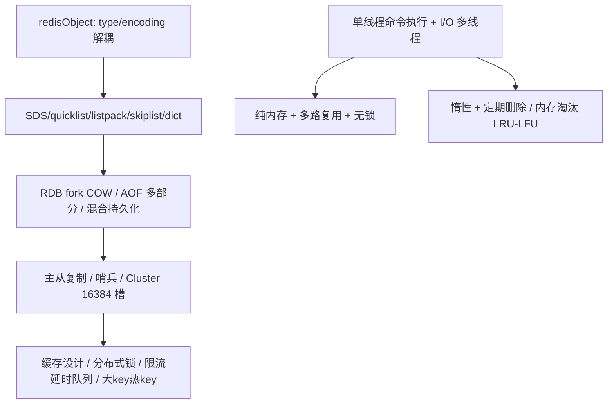

:::note 事实基线
本篇是「Redis 技术深挖」带解答题库，共 **95 题**，事实来源为 `content/be/redis.md`，内容以 **Redis 8.x** 行为为准（编码阈值、淘汰参数与持久化默认值核对 8.0 官方 `redis.conf` 与源码常量；实例化结论需以本机 `CONFIG GET` 实测为准）。本篇是「知识点」型题库（非单一项目），与 [缓存、存储与 ORM 题库](/interview/qa/cache-storage-orm)（项目侧的缓存选型与一致性）和 [MySQL 与 InnoDB 技术深挖题库](/interview/qa/mysql-innodb)（缓存一致性章节）互补——本篇讲 Redis 的机制本身。Redis 是后端面试出现密度最高的主题之一，数据结构编码、持久化、淘汰、集群、分布式锁都是高频连问点。
:::

本篇是「Redis」技术深挖题库。它的面试价值在于：**Redis 是内存数据结构存储的事实标准，其机制（redisObject 编码、单线程模型、RDB/AOF 持久化、过期淘汰、主从哨兵集群、分布式锁）是后端面试的核心考点**，且这些机制彼此关联（如「单线程」之于「大 key 阻塞」、「fork 写时复制」之于「RDB/AOF 重写」、「TTL」之于「分布式锁续期」）。本篇的组织顺序是：**先讲数据结构与底层编码 → 再讲线程模型与高性能 → 再讲持久化 → 再讲过期删除与内存淘汰 → 再讲高可用与集群 → 再讲缓存设计 → 再讲分布式锁 → 再讲限流与延时队列 → 最后讲大 key/热 key 治理**。

**主线一览**



## 一、数据结构与底层编码

### Q1. redisObject 的五个核心字段是什么？为什么要包一层 redisObject？

Redis 中每个键和值都是一个 `redisObject`，核心字段五个：`type`（4 位，数据类型如 string/list/hash/set/zset/stream）、`encoding`（4 位，底层编码如 int/embstr/raw/listpack/quicklist/hashtable/intset/skiplist）、`lru`（24 位，记录 LRU 时间戳，或高 16 位记录访问时间、低 8 位记录对数访问频率 LFU）、`refcount`（指针宽度，引用计数，支撑小整数对象共享与内存回收）、`ptr`（指针宽度，指向底层数据结构）。

包一层 redisObject 有三个原因：① **类型与编码解耦**——同一个 type 可以有多种 encoding，Redis 依据数据规模自动在编码间转换，对上层命令透明；② **统一内存管理**——refcount 支持 0~9999 的小整数全局共享并支撑引用计数回收；③ **lru 字段为近似 LRU 与 LFU 内存淘汰提供元数据**。

### Q2. string 的三种编码是什么？44 字节分界怎么来的？

**int**：值可以用 long 表示时，ptr 直接存整数值，额外内存为零；**embstr**：值是不超过 44 字节的字符串时，一次内存分配同时保存 redisObject 与 SDS，两者地址连续（分配与释放各只需一次、CPU cache 局部性好，但一整块内存无法单独扩容，因此 embstr 是只读的，对 embstr 执行 append 等修改命令会先转成 raw 再修改）；**raw**：值超过 44 字节时，两次内存分配分别保存 redisObject 与 SDS。

**44 字节的由来**：jemalloc 以 64 字节为一个分配粒度，embstr 要求 redisObject、SDS 头、字符串与结尾的 `\0` 一起装进 64 字节：`64 - 16(redisObject) - 3(sdshdr8 的 len/alloc/flags) - 1('\0') = 44`。

### Q3. SDS 相比 C 字符串有哪些优势？

SDS（Simple Dynamic String）由头部与字节数组组成，头部按需选择 `sdshdr5/8/16/32/64`，记录已使用长度 len、已分配容量 alloc 与头类型 flags。相比 C 字符串：① 获取长度是 O(1)（直接读 len，C 字符串 strlen 是 O(n)）；② **二进制安全**（以 len 而非 `\0` 判断结尾，可存图片或序列化对象等任意二进制数据）；③ 拼接前检查剩余容量、空间不足自动扩容，杜绝缓冲区溢出；④ **空间预分配**（小于 1MB 时翻倍，大于等于 1MB 时每次多分配 1MB）减少内存重分配，缩短字符串时惰性释放留待复用；⑤ 头类型按需选择，短字符串用 sdshdr8 节省头部开销。

### Q4. list 为什么用 quicklist？listpack 如何避免级联更新？

list 的底层是 **quicklist**（双向链表加紧凑数组的折中）：链表的每个节点是一个 listpack。纯双向链表每个节点都有前后指针、内存碎片多、指针开销大；纯紧凑数组的插入删除需要整体挪动内存、数据量大时性能差；quicklist 在链表层面获得 O(1) 的头尾插入，节点内部是连续内存的 listpack，兼顾内存效率与操作效率，中间节点还可以用 LZF 压缩（由 `list-compress-depth` 控制压缩深度）。

**listpack 避免级联更新**：每个 entry 只记录自身长度、不记录前一个 entry 的长度，从后往前遍历时通过反向解析元素自身的长度字段实现。若像旧式紧凑数组那样让每个 entry 记录前驱长度，某个 entry 变大会导致该长度字段膨胀、进而引起后续 entry 连锁扩容，最坏达到 O(n²)。hash、zset、list 的内层紧凑编码统一为 listpack。

### Q5. hash、set、zset 的紧凑编码与转换阈值？

| 类型 | 紧凑编码           | 转换条件（任一不满足即转通用编码）                                                                                                                                         | 通用编码  |
| ---- | ------------------ | -------------------------------------------------------------------------------------------------------------------------------------------------------------------------- | --------- |
| hash | listpack           | 字段数 ≤ `hash-max-listpack-entries`（默认 512）且每个字段/值 ≤ `hash-max-listpack-value`（默认 64 字节）                                                                  | hashtable |
| set  | intset 或 listpack | 全整数且成员数 ≤ `set-max-intset-entries`（默认 512）用 intset；非全整数时成员数 ≤ `set-max-listpack-entries`（默认 128）且成员 ≤ `set-max-listpack-value`（默认 64 字节） | hashtable |
| zset | listpack           | 成员数 ≤ `zset-max-listpack-entries`（默认 128）且每个成员/分数 ≤ `zset-max-listpack-value`（默认 64 字节）                                                                | skiplist  |

转换是单向的（紧凑 → 通用），即使之后数据量缩小也不会转回——避免频繁转换的开销。

### Q6. zset 为什么用跳表而不是红黑树或 B+ 树？

跳表是多层有序链表：底层链表包含所有节点，每个新节点通过随机化确定层高（Redis 中每层晋升概率为 0.25，最大 32 层，足以容纳 2^64 个元素），高层链表是低层的快速通道。查找从最高层开始，向右走到不能再走就下沉一层，平均时间复杂度 O(log n)。跳表节点除成员与分数外，还有底层的后退指针，以及每层的前进指针和**跨度（span）**——跨度用于在 O(log n) 时间内计算排名，支撑 `zrank` 与 `zrevrank`。

选择跳表的原因：① **范围查询更自然**（找到起点后沿底层链表顺序遍历即可，红黑树需要中序遍历回溯）；② **实现简单**（插入删除只需修改相邻节点指针，不需要旋转与变色）；③ **跨度字段天然支持排名**（红黑树需要额外维护子树大小）；④ **不需要 B+ 树**（B+ 树为磁盘页设计以减少磁盘 I/O，而 Redis 是纯内存操作，没有页对齐收益）。

### Q7. dict 的渐进式 rehash 如何工作？

Redis 的 dict 内部有两个哈希表 `ht[0]` 与 `ht[1]`：① **触发扩容**——负载因子（used/size）≥ 1 且当前没有 bgsave 或 bgrewriteaof 子进程时扩容；**有子进程运行时扩容阈值提高到 5**（因为扩容会触发写时复制，与子进程的 COW 叠加会造成大量内存页复制）；负载因子 < 0.1 时缩容；② **渐进式迁移**——为 ht[1] 分配约两倍空间后，不是一次性迁移（百万级键会阻塞主线程），而是把 rehashidx 置 0，之后每次对该字典增删改查时顺带把一个桶从 ht[0] 迁移到 ht[1]，定时任务也会批量迁移；③ **迁移期间的读写规则**——查找与删除先查 ht[0] 再查 ht[1]，新增只写 ht[1]（保证 ht[0] 只减不增）；④ 迁移完成后释放 ht[0]，用 ht[1] 替换它。

### Q8. 五种数据类型的典型场景与关键命令？

| 类型   | 典型场景                             | 关键命令                                 |
| ------ | ------------------------------------ | ---------------------------------------- |
| string | 缓存对象、计数器、分布式锁、共享会话 | `set nx px`、`incr`                      |
| list   | 简易消息队列、最新列表               | `lpush` 配 `brpop`、`lmove` 移入备份队列 |
| hash   | 购物车、对象部分字段更新             | `hset`、`hincrby`                        |
| set    | 点赞去重、共同关注、抽奖             | `sinter`、`srandmember`、`spop`          |
| zset   | 排行榜、延迟队列、滑动窗口限流       | `zincrby`、`zrange ... byscore`          |

**list 做队列不支持消费组与消息确认**，需要消费组、消息确认与回溯时应使用 stream。

## 二、线程模型与高性能

### Q9. Redis「单线程」的准确含义是什么？

**命令执行是单线程的**，由主线程串行执行，因此单条命令天然原子。**网络 I/O 默认也由主线程读写 socket，但可以开启 I/O 多线程**，让多个线程并行处理读请求解析与写回包，命令执行仍在主线程串行。**后台线程一直存在**，主线程作为生产者把耗时任务放入队列，后台线程作为消费者轮询处理，包括关闭文件描述符（`bio_close_file`）、AOF 刷盘（`bio_aof_fsync`）、异步释放内存（`bio_lazy_free`，`unlink`、`flushdb async`、`flushall async` 走此线程）。

### Q10. I/O 多线程为什么引入？如何配置？

`io-threads` 默认为 1（关闭），需显式设置 `io-threads N`（通常不超过 8）；`io-threads-do-reads` 默认为 no，决定是否把读请求的解析也交给 I/O 线程。**引入 I/O 多线程的原因**：随着网卡带宽提升到 10G 或 25G，网络 I/O 与协议解析成为新的瓶颈，而这部分不涉及共享数据结构修改、可以安全并行；命令执行保持单线程，保住了无锁的简单性。

### Q11. ae 事件循环的每一轮做什么？

Redis 基于 ae 事件库封装平台的多路复用原语（Linux 用 epoll，BSD/macOS 用 kqueue，其他平台用 select）。事件循环每一轮（aeMain）：① **beforeSleep**——阻塞等待之前，把上一轮产生的回复写回客户端，处理待执行的活跃过期、AOF 刷盘等就绪任务；② **aeApiPoll（epoll_wait）**——阻塞等待文件事件就绪，超时时间取最近一个定时任务的到期时间；③ **处理文件事件**——连接事件到来时 accept 获取客户端 socket 并注册读事件回调，读事件到来时 read 请求、解析命令、执行命令、把结果写入发送缓冲区，写事件到来时把缓冲区数据 write 出去；④ **处理时间事件**——serverCron 按 hz 频率执行，负责定期删除过期键、渐进式 rehash、主从心跳、Cluster 通信与统计信息更新等后台维护。

### Q12. Redis 为什么快？单线程成立的前提是什么？

① **纯内存操作加高效数据结构**（SDS、跳表、listpack、渐进式 rehash 的 dict）；② **I/O 多路复用**——单线程监听大量文件描述符的可读可写事件，高并发下不需要为每个连接创建线程；③ **单线程执行命令**——没有线程切换开销、没有锁竞争，也不存在并发读写的数据不一致。

**单线程成立的前提是瓶颈不在 CPU 而在内存大小与网络 I/O**。一旦网络 I/O 成为瓶颈，就启用 I/O 多线程；一旦命令本身（如大 key 操作、`keys`、复杂 Lua）占用主线程过久，则只能在应用层规避。

## 三、持久化

### Q13. RDB 快照的原理？fork 写时复制的代价？

RDB 是把某一时刻的全量数据以二进制快照写入磁盘。`bgsave` 时主进程 fork 出子进程，**子进程共享父进程的物理内存页（只复制页表），父进程继续处理写命令**；子进程遍历内存数据写入临时 RDB 文件，完成后原子替换旧文件。**写时复制（COW）**：只有某一方写某个页时内核才复制该页，因此 bgsave 期间的写操作会导致对应内存页被复制，子进程看到的是 fork 瞬间的一致性快照。极端情况下，若 bgsave 期间所有数据都被修改，内存占用最坏翻倍，需要预留余量。自动触发的默认配置是 3600 秒内至少 1 次修改、300 秒内至少 100 次修改、60 秒内至少 10000 次修改，满足任意一条即触发 bgsave。

### Q14. AOF 的写入流程与三种写回策略？为什么 Redis 是「先执行命令再写日志」？

AOF（Append Only File）每执行一条写命令就把该命令追加到缓冲区，重启时重放日志恢复数据。**注意 Redis 是先执行命令再写日志，与 MySQL 的 WAL 相反**：好处是不需要语法检查（能追加进 AOF 的都是执行成功的命令），也不阻塞当前写命令；风险是命令执行成功后、写 AOF 前宕机该命令会丢失，且写 AOF 在主线程进行、磁盘压力大时会阻塞后续命令。

`appendfsync` 控制 fsync 时机：**Always**（每条写命令都同步 fsync，最多丢 1 条命令，性能最差）、**Everysec**（默认，每秒由后台线程 fsync 一次，最多丢约 1 秒数据，折中）、**No**（只 write 到内核页缓存，由操作系统决定刷盘，丢失量不可控，性能最好）。

### Q15. AOF 重写与多部分 AOF（multi-part AOF）是什么？

AOF 会随写命令持续膨胀（对同一个 key 的 100 次 incr 会记录 100 条命令）。当增长超过 `auto-aof-rewrite-percentage`（默认 100）且文件不小于 `auto-aof-rewrite-min-size`（默认 64MB）时触发重写：不修改旧文件，而是根据当前内存数据生成等价的最小命令集写入新的 base 文件。

AOF 采用**多部分结构**：一个 manifest 文件记录文件清单，数据集由全量 base 文件与一个或多个增量 incr 文件组成，重写即替换 base 与 incr 的组合。重写流程：主进程切换追加目标为新的 incr 文件并原子更新 manifest → fork 子进程 → 子进程遍历内存数据库、每个键值转为写命令、写入临时 base 文件（主进程继续处理写命令，直接落入新 incr 文件）→ 子进程退出通知重写完成 → 临时 base 重命名为正式 base → 原子更新 manifest（新 base + 新 incr 成为当前数据集）→ 旧 base 与旧 incr 标记为 history 由后台线程删除。**增量一致性由结构本身保证**：重写期间的增量已经写进新的 incr 文件，只需原子切换 base 与 manifest，不需要额外的重写缓冲区。

### Q16. AOF 重写为什么用子进程而不是线程？

因为**写时复制**：线程共享内存，子任务读数据时主线程还在写，必须加锁；fork 子进程时父子进程共享物理内存页（只复制页表），天然无锁，只有某一方写某个页时内核才复制该页。fork 瞬间复制页表本身在数据量极大时也可能造成短暂阻塞。

### Q17. 混合持久化是什么？兼得什么优点？

| 方式     | 优点       | 缺点                   |
| -------- | ---------- | ---------------------- |
| RDB 快照 | 恢复快     | 快照间隔期间数据丢失多 |
| AOF 日志 | 数据丢失少 | 恢复慢                 |

混合持久化（`aof-use-rdb-preamble yes`，默认开启）让 AOF 重写生成的基础文件使用 RDB 二进制格式：子进程把 fork 瞬间的全量数据以 RDB 格式写入 base 文件，重写期间的增量命令以 AOF 文本格式写入 incr 文件。**最终数据集等于 RDB 格式的 base（恢复快）加 AOF 文本格式的 incr（丢失少），兼得两者优点**。代价是 base 文件不再可读，需要专门工具解析。

### Q18. 持久化与主从复制对过期键如何处理？

**RDB**：生成阶段不写入已过期的键；加载阶段主节点检查并跳过过期键，从节点则全部加载（因为从节点以主从同步为准，主节点会发删除命令）。**AOF**：写入阶段，过期但未被删除的键其命令仍在文件中，键被惰性删除或定期删除时追加一条 del；重写阶段检查每个键，过期键不写入新文件。**主从复制**：从库不主动删除过期键（以保证主从一致），由主库在键过期时向 AOF 与从库同步 del 命令；从库对逻辑过期的键，读命令返回不存在，但键本身仍在内存中等待主库的 del，因此从库上可能短暂存在已过期但未删除的键。

## 四、过期删除与内存淘汰

### Q19. 过期删除的两种策略是什么？定期删除的参数细节？

Redis 用过期字典保存键到过期时间（毫秒时间戳）的映射。删除采用**惰性删除加定期删除**的组合：① **惰性删除**——不主动删，每次访问键时检查是否过期，过期则删除并返回 nil（CPU 友好，但过期但不再被访问的键会一直占内存）；② **定期删除**——由 `hz` 驱动的定时任务触发（默认 hz 为 10 即每 100 毫秒一轮），每轮从过期字典随机抽取 20 个键（`ACTIVE_EXPIRE_CYCLE_KEYS_PER_LOOP`），删除其中已过期的；**时间上限不是固定的毫秒数，而是本轮可用 CPU 时间的 25%**（`ACTIVE_EXPIRE_CYCLE_SLOW_TIME_PERC`，默认 hz=10 下折算约 25 毫秒），超时即中断等下一轮防止阻塞主线程；若本批过期比例超过 25% 说明过期键还很多、继续抽样，否则结束本轮。

两者互补：定期删除兜底清理冷数据，惰性删除保证访问正确性，最终还有内存淘汰兜底。

### Q20. 内存淘汰策略分哪三组？如何选择？

当内存达到 `maxmemory` 阈值时触发淘汰，`maxmemory-policy` 取值分三组：

| 组别                         | 取值                                                              | 说明                                                 |
| ---------------------------- | ----------------------------------------------------------------- | ---------------------------------------------------- |
| 不淘汰                       | `noeviction`（默认）                                              | 写命令直接报错，读命令正常                           |
| 只在设置了过期时间的键中淘汰 | `volatile-random`、`volatile-ttl`、`volatile-lru`、`volatile-lfu` | 分别按随机、最早过期、最近最少使用、最低使用频率淘汰 |
| 在所有键中淘汰               | `allkeys-random`、`allkeys-lru`、`allkeys-lfu`                    | 同上，但候选集是全部键                               |

选择经验：**缓存场景通常用 `allkeys-lru` 或 `allkeys-lfu`**；若同一实例混存持久数据与缓存数据，用 `volatile-*` 避免淘汰持久数据，但必须为缓存键设置过期时间。

### Q21. LRU 与 LFU 的近似实现是什么？为什么不用全局链表？

LRU 按最近访问时间淘汰，缺陷是**缓存污染**（一次性批量扫描大量只读一次的数据会把真正的热数据挤出去）；LFU 按一段时间内的访问频率淘汰，能抵抗扫描型缓存污染。**Redis 不维护全局链表或堆**（指针内存与操作开销太大），而是基于 redisObject 的 24 位 lru 字段做近似：

**近似 LRU**：淘汰时随机采样 `maxmemory-samples`（默认 5）个键，淘汰其中最久未访问的，并维护一个候选池提高精度。**LFU**：复用同一个 24 位字段，高 16 位存分钟级访问时间，低 8 位存对数计数器（计数器越大、再增长的概率越小，255 封顶），通过 `lfu-decay-time`（默认 1 分钟）让计数随时间衰减，避免历史热点永远不被淘汰。

### Q22. 内存优化有哪些手段？

控制键名与值长度（短字符串优先落入 embstr）；用 hash 分桶降低大量小对象的开销（但要把字段数和字段大小控制在 listpack 阈值内）；集合类数据控制元素数量与单个元素大小（尽量维持在 listpack 或 intset 编码，可用 `object encoding` 检查）；为所有缓存键设置过期时间避免无界增长；值在写入前压缩、大对象拆分存储；及时删除无用键（大批量删除用 `unlink` 交给后台线程异步释放）；合理设置 maxmemory 与淘汰策略并预留空间给复制缓冲区、AOF 缓冲区与 fork 期间的写时复制；避免在生产执行 `keys`、`monitor` 等阻塞或高开销命令。

## 五、高可用与集群

### Q23. 主从复制的全量复制与增量复制流程？

架构是一个主节点可读写加多个只读从节点，实现读写分离与数据冗余。**首次全量复制**：① 从库发送 `psync ? -1`，主库回复 `+FULLRESYNC <replid> <offset>`；② 主库执行 bgsave 生成 RDB 发给从库，期间的新写命令写入复制缓冲区（replication buffer）；③ 从库清空旧数据并载入 RDB，主库再把缓冲区中的增量命令发给从库。

**断线重连后的增量复制**：主库维护环形缓冲区 `repl_backlog_buffer`，从库重连时携带自己的 offset；若 offset 仍在环形缓冲区内只补发缺失部分，若已被覆盖（断线太久或缓冲区太小）退化为全量复制。因此 `repl-backlog-size`（默认 1MB）应按「写入速率乘以平均断线时长」调大。稳定阶段主库把每条写命令异步发给从库（异步复制，主从之间存在数据延迟窗口），主节点故障时不能自动故障转移、需人工提升从库，所以引入哨兵。

### Q24. 哨兵的主观下线与客观下线？故障转移流程？

架构是一个主节点加多个从节点加多个哨兵节点（通常三个以上奇数个）。哨兵负责监控、自动故障转移与通知客户端新主地址。**主观下线（SDOWN）**：单个哨兵 ping 主节点超时未响应，该哨兵主观认为其下线（可能只是它与主节点之间网络抖动）。**客观下线（ODOWN）**：该哨兵向其他哨兵求证，当认为主节点下线的哨兵数达到法定数量（quorum）时判定客观下线并触发故障转移。

故障转移流程：哨兵之间通过类似 Raft 的投票选出 leader 哨兵执行转移；leader 从从库中挑选新主（依次比较 `replica-priority`、复制偏移量（数据最全）、runid 最小）；向新主发送 `replicaof no one`，向其余从库发送 `replicaof <新主>`；通过发布订阅通知客户端新主地址；旧主恢复后被降级为从库。

### Q25. Cluster 的哈希槽机制？为什么是 16384 而不是 65536？

Cluster 模式没有哨兵节点，多个主节点分片存储数据，每个主节点带若干副本；节点间用 Gossip 协议交换状态，多数主节点判定某主节点下线后从其副本中选举新主。**哈希槽机制在键与分片之间加一层固定映射：`槽 = CRC16(key) % 16384`**，键到槽的映射与节点数量无关，节点变化时只需迁移部分槽及其数据。迁移过程中，已迁往新节点的键在源节点返回 **ASK 重定向**；迁移完成后槽归属变更，访问收到 **MOVED 重定向**。

**为什么是 16384 而不是 65536**：① Gossip 心跳包携带节点负责的槽位图（bitmap），16384 位等于 2KB，65536 位等于 8KB，心跳包过大会浪费带宽；② Redis 官方建议集群主节点不超过 1000 个，16384 个槽足够分配。

### Q26. 多键命令为什么要求同槽？hash tag 如何强制同槽？

Cluster 下多键命令（如 `mget`、`mset`、事务、Lua 脚本涉及多键）要求所有键在同一个槽，否则报 `CROSSSLOT` 错误——因为不同槽可能在不同节点，跨节点的多键原子操作无法保证。可用 **hash tag** 强制同槽：`{user:1}:profile` 与 `{user:1}:orders` 只对花括号内的部分（`user:1`）计算 CRC16，因此两个键必然落同一槽。

### Q27. 脑裂是什么？min-replicas-to-write 如何防护？

**脑裂过程**：主节点 M1 与集群其他节点网络分区但与部分客户端仍连通，客户端继续向 M1 写数据而 M1 无法同步给从库；集群通过 Gossip 判定 M1 客观下线并选举其从库 R1 为新主，此时集群中同时存在两个主节点；网络恢复后 M1 重新加入、被降级为 R1 的从库，第一次同步会清空 M1 本地数据做全量同步，**分区期间写入 M1 的数据全部丢失**。

解决方案是让少数派主节点拒绝写入：`min-replicas-to-write 1`（至少有 1 个从库连接正常，否则拒绝写）+ `min-replicas-max-lag 10`（从库复制延迟不超过 10 秒，否则视为异常）。主节点发现健康从库数量低于阈值时对写命令直接返回错误，**把损失从静默丢数据变成显式写失败**，客户端可以重试到新主。

## 六、缓存设计

### Q28. 缓存穿透、击穿、雪崩分别是什么？如何解决？

| 问题     | 定义                                                                     | 解决方案                                                                                  |
| -------- | ------------------------------------------------------------------------ | ----------------------------------------------------------------------------------------- |
| 缓存穿透 | 请求的数据缓存与数据库都没有，每次都穿透到数据库（常见于恶意攻击或误删） | 缓存空值并设短 TTL；接口层参数校验拦截非法请求；缓存前加布隆过滤器快速判断一定不存在      |
| 缓存击穿 | 单个热点 key 过期瞬间，高并发请求全部打到数据库                          | 互斥锁或 singleflight 只放一个请求回源重建；热点 key 逻辑过期不物理过期，后台线程异步续期 |
| 缓存雪崩 | 大量 key 同一时刻过期或 Redis 宕机，请求集体打到数据库                   | 过期时间加随机值打散；热点数据不过期加后台异步更新；服务熔断与限流兜底；使用高可用集群    |

**三者的递进关系**：雪崩是面（大量 key），击穿是点（单个热 key），穿透是防线外（数据根本不存在）。

### Q29. Cache Aside 模式是什么？为什么删除而不是更新缓存？

Cache Aside 适合读多写少：读时命中直接返回，未命中则读数据库、写缓存、返回；写时**先更新数据库，再删除缓存**。

选择删除而不是更新缓存的原因：① 缓存值常是多表聚合的计算结果，写后可能没人再读，立即重算浪费；② 更新缓存必须知道如何重算，与业务逻辑深度耦合；③ DEL 幂等且无顺序要求，更新不幂等且在并发下可能乱序；④ 缓存本就不应承担数据所有权。「先删缓存再更新数据库」在并发下必然不一致（删除缓存后并发读未命中会读到旧值并回填，随后数据库才更新）；「先更新数据库再删缓存」理论上也有窗口，但需要读请求在写请求更新数据库前未命中并读到旧值，且「读数据库加写缓存」比「更新数据库加删缓存」还慢，实际概率极低。（完整的四种写策略组合、延迟双删、重试分层、binlog 订阅兜底见 [MySQL 与 InnoDB 技术深挖题库](/interview/qa/mysql-innodb) 的缓存一致性章节。）

### Q30. 热点 key 的治理手段有哪些？

热点 key 指单位时间内访问量远超其他键的单个键。危害：在 Cluster 或代理分片下会把单个分片的 CPU 与网络打满；过期瞬间可能触发缓存击穿；大 key 与热 key 叠加时阻塞更明显。治理手段：① **进程内本地缓存**挡住最热的一小部分数据（用极短 TTL 或发布订阅广播失效来收敛）；② **热点 key 打散**（在键名后追加随机后缀拆成多个副本键，读时随机选取，写时全部更新或只更新一份并由 TTL 收敛）；③ 使用主从复制或只读副本分担读流量，或增加 Cluster 分片并调整分片键；④ **逻辑过期**（热点 key 不设物理过期，值里带逻辑过期时间，由后台线程异步重建，避免过期瞬间的集中回源）；⑤ 上线前压测并监控单键 QPS，对秒杀、热点新闻等可预期场景提前预热。

## 七、分布式锁

### Q31. 用 Redis 实现分布式锁要解决哪七个问题？

① **互斥**——同一时刻只有一个客户端持锁，用 `SET key value NX` 的原子性保证（**禁止 `setnx` 加 `expire` 两条命令**，它们非原子，中间宕机会产生永不过期的死锁）；② **防死锁**——持锁客户端崩溃后锁必须能自动释放，用 `PX ttl` 设置过期时间；③ **防误删**——客户端 A 的锁过期后被 B 获取，A 恢复后不能删掉 B 的锁，value 存唯一标识，释放时用 Lua 脚本原子地先比对再删除；④ **锁续期**——业务执行时间超过 TTL 会导致锁提前失效、互斥被破坏，用看门狗后台任务定期续期；⑤ **可重入**（可选）——同一客户端可重复加锁，用 hash 结构记录持有者与重入次数；⑥ **等锁效率**——加锁失败后如何等待；⑦ **主从切换下的安全性**——异步复制导致主库宕机时锁可能丢失，需要 Redlock 或接受最终一致。

### Q32. 标准的加锁命令与释放脚本是什么？为什么释放必须用 Lua？

加锁：`SET lock_key <uuid> NX PX 30000`（一条命令原子地完成「不存在才设置 + 设过期时间」）。释放：必须用 Lua 保证 GET 与 DEL 的原子性：

```lua
if redis.call("GET", KEYS[1]) == ARGV[1] then
  return redis.call("DEL", KEYS[1])
else
  return 0
end
```

**为什么释放必须用 Lua**：如果先 GET 判断再 DEL（两条命令），在 GET 与 DEL 之间锁可能恰好过期并被其他客户端获取，此时 DEL 会误删别人的锁。Lua 脚本在 Redis 中原子执行（单线程串行），保证「比对 token + 删除」不可分割。

### Q33. 看门狗（watchdog）如何解决 TTL 的两难？

TTL 设短了业务没执行完锁就过期，设长了持锁者崩溃后其他客户端要等很久。看门狗的做法：**TTL 设为较短值（如 30 秒），后台任务在持锁期间按 TTL 的三分之一周期用 Lua 脚本原子续期**；续期同样要校验 token（防止给别人的锁续期）；续期返回 0 说明锁已丢失，业务侧应感知并中止临界区操作；持锁进程崩溃时看门狗随进程消失，锁在一个 TTL 后自动释放。

### Q34. 单实例 Redis 加主动轮询的实现要点与核心缺点？

思路是加锁失败后客户端自旋加间隔休眠，主动重复发起 `SET NX` 尝试，直到成功或超时（Redisson 与 redsync 的默认模式本质相同）。关键设计点：① **轮询间隔的权衡**——间隔越短获锁延迟越低，但对 Redis 的无效 QPS 越高，可用指数退避加抖动优化（如 50 毫秒起步、每次乘 1.5、上限 1 秒并加随机抖动防惊群）；② **必须支持等锁超时**，否则故障时调用方无限阻塞拖垮上游；③ **高竞争下大量客户端同时轮询存在羊群效应**——N 个等待者每个间隔都打一次 Redis，无效请求约为 N 除以间隔，这是该方案的核心缺点。

### Q35. Redis 加事件驱动通知如何把忙轮询变为事件驱动？

轮询的问题是无效请求持续存在。改进思路：锁的状态仍存 Redis（保留高性能与过期兜底），但等锁不再轮询——**持锁者释放锁时向一个协调组件（如 etcd）写入通知键，等锁者通过 Watch 机制阻塞监听，收到释放事件后再抢锁**，把忙轮询变为事件驱动。关键设计点：① **必须先抢锁、再建立 Watch、再做一次 double check**（若只抢一次锁再 Watch，在「抢锁失败」与「Watch 生效」之间锁被释放，等锁者会错过事件而永久等待）；② **兜底超时不可省略**（持锁者崩溃时不会主动发通知，但 Redis 锁会因 TTL 过期，等锁者必须以 TTL 为周期兜底重试）；③ 惊群仍然存在但被大幅削弱（释放事件唤醒所有 watcher 同时抢锁，无效请求从持续变为脉冲，进一步优化可用 etcd 的有序 key 实现 FIFO 每次只唤醒一个等待者）；④ **为什么不直接全用 etcd 锁**——etcd 基于 Raft，每次写都要多数派落盘，加锁吞吐远低于 Redis，混合方案让高频的抢锁与释放走 Redis、低频的等待通知走 etcd。

### Q36. Redlock 算法是什么？为什么有争议？

问题背景是单主 Redis 锁在主从切换时不安全：客户端 A 在主库加锁成功，锁还未异步复制到从库时主库宕机，从库提升为新主，客户端 B 在新主上再次加锁成功，互斥被破坏。

**Redlock 算法**：部署 N 个完全独立、不做主从复制的 Redis 实例（通常 5 个），记录起始时间，依次向 N 个实例用相同键与 token 加锁（每个实例设置很短的请求超时避免被故障节点拖住），当多数派（N/2+1）加锁成功且总耗时小于锁 TTL 时视为加锁成功（锁的真实有效时间等于 TTL 减去加锁总耗时再减去时钟漂移补偿），加锁失败则向所有实例发起释放。

**争议三点**：① **依赖时钟**——某实例发生时钟跳变（NTP 校时、管理员改时间）会导致锁提前过期、多数派被破坏；② **进程暂停问题**——客户端拿到锁后发生长时间 GC 暂停或严重缺页，恢复时锁已过期但客户端不自知、继续操作共享资源，这个问题任何带 TTL 的锁都无法解决，只能靠存储层的 **fencing token** 兜底（存储层拒绝旧令牌的写入），而 Redlock 无法生成单调递增的令牌；③ **结论**——Redlock 是效率锁与正确性锁之间的折中产物，追求效率用单实例 Redis 锁即可（偶尔失效可接受），追求严格正确性应使用带共识协议的 etcd 或 ZooKeeper 加 fencing token。

**采分点**：能说出「**先区分锁的两种用途：效率（避免重复计算，偶尔失效只是浪费）vs 正确性（锁失效会导致数据损坏），用途决定选型**」——这是分布式锁选型的根本判断。

### Q37. 主动轮询与事件驱动通知两种实现如何对比选型？

| 维度       | 主动轮询                               | 事件驱动通知                       |
| ---------- | -------------------------------------- | ---------------------------------- |
| 等锁机制   | 客户端自旋加间隔重试                   | 协调组件 Watch 事件驱动            |
| 获锁延迟   | 平均为半个间隔，最坏一个间隔           | 释放后近实时                       |
| Redis 压力 | 等待者越多、间隔越短压力越大，持续 QPS | 仅在释放时有一波脉冲               |
| 依赖组件   | 仅 Redis                               | Redis 加协调组件，多一个故障面     |
| 公平性     | 随机抢占                               | 默认不公平，用有序 key 可实现 FIFO |
| 适用场景   | 竞争少、锁持有时间短                   | 竞争激烈、等锁者多、对延迟敏感     |

选型结论：大多数业务锁竞争不激烈，主动轮询加指数退避足够；出现明显锁热点且基础设施已有 etcd 时升级为事件驱动；一致性要求压倒性能时直接用共识系统原生锁。

## 八、限流与延时队列

### Q38. 固定窗口、滑动窗口、令牌桶限流各如何实现？

**固定窗口**：用 `INCR` 计数并设置过期时间（键名包含时间窗口，第一次请求时设置过期时间，计数超过阈值即拒绝）。缺陷是**窗口边界效应**——窗口切换瞬间可能出现两倍于阈值的流量。

**滑动窗口**：用 zset 记录每次请求的时间戳（分数为毫秒时间戳，成员可带唯一后缀防止同一毫秒重复），处理时先用 `ZREMRANGEBYSCORE` 移除窗口外成员，再用 `ZCARD` 判断是否超限，未超限则 `ZADD`。**为防止检查与写入之间的竞态，应把这几步放进 Lua 脚本原子执行**。滑动窗口比固定窗口更平滑，代价是每个请求都占用一个 zset 成员、内存随请求量增长。

**令牌桶**：允许一定程度的突发流量（桶按固定速率补充令牌，请求消耗令牌，桶空则拒绝或排队）。典型实现用 hash 保存当前令牌数与上次补充时间，用 Lua 脚本原子地计算应补充的令牌、判断并扣减。

### Q39. zset 延时队列如何实现？什么时候该用 stream？

用 zset 实现延时队列：成员是任务标识，分数是执行时间戳。生产者 `ZADD` 入队；消费者用 `ZRANGE key -inf now BYSCORE LIMIT 0 N` 取出到期任务，再用 `ZREM` 删除。**由于取出与删除需原子，应放进 Lua 脚本，保证同一任务不会被多个消费者重复取走**。它的局限是没有重试与死信机制，适合简单的延时触发。

更完整的需求（消费组、消息确认、重试、回溯）应使用 **stream**：`XADD` 写入消息，`XREADGROUP` 以消费组读取，`XACK` 确认，`XPENDING` 与 `XAUTOCLAIM` 处理未确认消息。stream 本身没有延时语义，延时通常仍由 zset 调度、到期后再投递到 stream。

## 九、大 key 与热 key 治理（一句话速答）

**Q40. 一句话解释大 key 的经验阈值。** string 类型的值超过 10KB；hash、list、set、zset 的元素数量超过 5000 或总大小超过 10MB。

**Q41. 一句话解释大 key 的四类危害。** 阻塞主线程（命令执行单线程，hgetall/del 对大 key 耗时长，del 大 key 时主线程同步释放海量内存尤其危险）；网络拥塞（1MB 的键在 1000 QPS 下就是 1GB/s）；数据倾斜（集群模式下大 key 所在分片内存与 QPS 远高于其他分片，槽迁移也会被大 key 卡住）；主从同步与持久化变慢（fork 时页表更大、RDB 传输更久）。

**Q42. 一句话解释大 key 的排查与删除。** 排查用 `redis-cli --bigkeys`（基于 scan 抽样，只能找到每种类型的最大键）、`memory usage <key>`（精确查单个键）、rdb-tools 离线分析 RDB；删除用 `unlink` 代替 `del`（交给后台线程异步释放），集合类型用 hscan/sscan/zscan 分批配合 hdel/srem/zrem 渐进删除。

**Q43. 一句话解释热 key 的排查。** `redis-cli --hotkeys`（需 LFU 策略，统计访问频率最高键）、`monitor` 或代理层访问日志采样统计单键 QPS、客户端埋点统计。

**Q44. 一句话解释为什么 del 大 key 危险而 unlink 安全。** del 在主线程同步释放海量内存（阻塞后续所有命令），unlink 把释放交给后台线程（bio_lazy_free）异步执行——主线程只做逻辑删除。

**Q45. 一句话解释为什么生产禁用 keys 与 monitor。** keys 是 O(n) 全量扫描会阻塞主线程，monitor 输出所有命令、高开销且暴露数据——两者都会拖垮单线程的 Redis。

**Q46. 一句话解释 embstr 为什么是只读的。** embstr 把 redisObject 与 SDS 装进一块连续内存，无法单独扩容，所以 append 等修改命令会先转成 raw 再修改——embstr 本身只读。

**Q47. 一句话解释小整数对象共享。** refcount 支持 0~9999 的小整数全局共享——多个键引用同一个整数对象，节省内存。

**Q48. 一句话解释为什么有子进程时 dict 扩容阈值提高到 5。** 扩容会触发写时复制，与 bgsave/bgrewriteaof 子进程的 COW 叠加会造成大量内存页复制——所以有子进程时把扩容阈值从 1 提高到 5，推迟扩容。

**Q49. 一句话解释渐进式 rehash 为什么「新增只写 ht[1]」。** 保证 ht[0] 只减不增，迁移才能收敛完成——若新增也写 ht[0]，迁移永远追不上新增。

**Q50. 一句话解释 zset 跨度（span）字段的作用。** 跨度记录每层前进指针跨越的节点数，用于在 O(log n) 时间内计算排名（zrank/zrevrank）——红黑树需要额外维护子树大小才能做到。

**Q51. 一句话解释跳表每层晋升概率 0.25 的意义。** 平衡查找效率与空间——概率太高链表层数多、空间大，概率太低退化成单层链表；0.25 是经验平衡点，最大 32 层足以容纳 2^64 个元素。

**Q52. 一句话解释 list 做队列为什么不如 stream。** list 不支持消费组与消息确认（lpush+brpop 是简单队列，消息被 pop 即丢失），stream 支持消费组、XACK 确认、XPENDING/XAUTOCLAIM 重试与回溯。

**Q53. 一句话解释单线程为什么「单条命令天然原子」。** 命令执行由主线程串行执行，不存在并发交错——所以 INCR、SET NX、Lua 脚本都是原子的，无需额外加锁。

**Q54. 一句话解释 I/O 多线程为什么「命令执行仍单线程」。** 网络 I/O 与协议解析不涉及共享数据结构修改、可安全并行，但命令执行涉及共享数据（必须串行保证无锁）——所以只把 I/O 并行化，命令执行保持单线程。

**Q55. 一句话解释 bio_lazy_free 后台线程的作用。** unlink、flushdb async、flushall async 的内存释放交给后台线程异步执行——避免主线程同步释放海量内存阻塞。

**Q56. 一句话解释 beforeSleep 在事件循环里的作用。** 阻塞等待（epoll_wait）之前，把上一轮产生的回复写回客户端、处理待执行的活跃过期与 AOF 刷盘等就绪任务——保证「响应及时写出 + 就绪任务不积压」。

**Q57. 一句话解释 serverCron 按 hz 频率做什么。** 定期删除过期键、渐进式 rehash、主从心跳、Cluster 通信与统计信息更新等后台维护——hz 默认 10（每 100ms 一轮）。

**Q58. 一句话解释 RDB 为什么「恢复快但丢失多」。** RDB 是二进制全量快照，恢复时直接加载（快），但快照间隔期间的数据丢失（两次快照之间的写不在文件里）。

**Q59. 一句话解释 AOF 为什么「丢失少但恢复慢」。** AOF 记录每条写命令，Everysec 最多丢 1 秒（丢失少），但恢复时要重放所有命令（慢）。

**Q60. 一句话解释混合持久化为什么是默认平衡点。** RDB 格式 base（恢复快）+ AOF 文本 incr（丢失少），兼得两者优点——所以 `aof-use-rdb-preamble yes` 默认开启。

**Q61. 一句话解释 AOF「先执行命令再写日志」与 MySQL WAL 的区别。** Redis 先执行再写 AOF（不需语法检查、不阻塞当前命令，但执行成功后写 AOF 前宕机会丢），MySQL WAL 先写 redo 再改数据页（保证崩溃可恢复）——两者顺序相反，取舍不同。

**Q62. 一句话解释多部分 AOF 为什么不需要重写缓冲区。** 重写期间的增量已经写进新的 incr 文件，只需原子切换 base 与 manifest——结构本身保证了增量一致性，不需要额外的重写缓冲区。

**Q63. 一句话解释定期删除为什么用「25% CPU 时间」而非固定毫秒。** 时间上限是本轮可用 CPU 时间的 25%（hz=10 下约 25ms），防止定期删除阻塞主线程——用 CPU 占比而非固定时长，让清理力度随 hz 自适应。

**Q64. 一句话解释惰性删除与定期删除为什么互补。** 惰性删除保证访问正确性（访问时检查过期），定期删除兜底清理冷数据（不再被访问的过期键）——单靠任一者都有缺陷（惰性留冷数据、定期漏访问）。

**Q65. 一句话解释 noeviction 为什么是默认策略。** 写命令直接报错、读命令正常——默认不淘汰是「宁可写失败也不静默丢数据」的保守选择，缓存场景应显式改为 allkeys-lru/lfu。

**Q66. 一句话解释 LFU 为什么能抵抗缓存污染。** LRU 按最近访问时间淘汰，一次性批量扫描会把热数据挤出去；LFU 按访问频率淘汰，扫描型访问频率低、不会挤掉高频热数据。

**Q67. 一句话解释 lfu-decay-time 的作用。** 让 LFU 计数随时间衰减（默认 1 分钟），避免历史热点（曾经高频但现已冷却）永远不被淘汰。

**Q68. 一句话解释主从为什么是异步复制。** 稳定阶段主库把每条写命令异步发给从库，主从之间存在数据延迟窗口——同步复制会拖慢主库写延迟，异步是性能与一致性的取舍。

**Q69. 一句话解释 repl-backlog-size 如何调。** 按「写入速率乘以平均断线时长」调大——断线重连后 offset 仍在环形缓冲区内才能增量复制，否则退化为全量复制。

**Q70. 一句话解释哨兵为什么要奇数个（三个以上）。** 故障转移需要多数派投票（quorum），奇数个哨兵避免平票，三个以上容忍一个哨兵故障。

**Q71. 一句话解释新主选举的三个比较维度。** 依次比较 replica-priority（优先级）、复制偏移量（数据最全）、runid 最小——保证选出的新主数据最完整、配置最优先。

**Q72. 一句话解释 ASK 与 MOVED 重定向的区别。** ASK 是迁移过程中「已迁往新节点的键」的临时重定向（仅本次请求），MOVED 是迁移完成后槽归属变更的永久重定向（客户端应更新槽映射缓存）。

**Q73. 一句话解释 Gossip 协议在 Cluster 里的作用。** 节点间用 Gossip 交换状态（谁负责哪些槽、谁上线/下线），多数主节点判定某主节点下线后从其副本中选举新主——去中心化的故障检测与选举。

**Q74. 一句话解释 min-replicas-to-write 如何把「静默丢数据」变成「显式写失败」。** 主节点发现健康从库数量低于阈值时对写命令直接返回错误，客户端可重试到新主——脑裂时少数派主节点拒绝写入，避免分区期间的写在旧主恢复后被清空丢失。

**Q75. 一句话解释缓存穿透为什么用布隆过滤器。** 布隆过滤器能快速判断「一定不存在」（有误判但不漏判），把「数据根本不存在」的请求挡在缓存与数据库之外——但要注意布隆过滤器的假阳性与删除问题。

**Q76. 一句话解释缓存击穿为什么用 singleflight。** 单个热点 key 过期瞬间高并发请求全部打到数据库，singleflight（或互斥锁）只放一个请求回源重建、其余等待结果——把 N 次回源合并成 1 次。

**Q77. 一句话解释缓存雪崩为什么「过期时间加随机值」。** 大量 key 同一时刻过期会集体打到数据库，给 TTL 加随机值打散过期时间，避免集中失效。

**Q78. 一句话解释逻辑过期与物理过期的区别。** 物理过期是 Redis 的 TTL（到期键被删除），逻辑过期是值里带过期时间字段（键不物理过期，由后台线程异步重建）——逻辑过期避免过期瞬间的集中回源（击穿）。

**Q79. 一句话解释为什么禁止 setnx + expire 两条命令加锁。** 它们非原子，setnx 成功后、expire 之前宕机会产生永不过期的死锁——必须用 SET NX PX 一条命令原子完成。

**Q80. 一句话解释分布式锁 value 为什么存唯一标识（uuid）。** 防止误删——客户端 A 的锁过期后被 B 获取，A 恢复后释放时若不带 token 校验会删掉 B 的锁；value 存 uuid，释放时 Lua 脚本先比对再删除。

**Q81. 一句话解释 fencing token 是什么、为什么 Redlock 无法生成。** fencing token 是单调递增的令牌，存储层拒绝旧令牌的写入（解决「客户端 GC 暂停后锁已过期但仍操作共享资源」）；Redlock 基于多个独立 Redis 实例，无法生成全局单调递增的令牌——所以严格正确性场景要用 etcd/ZooKeeper（共识协议天然产生单调 revision）。

**Q82. 一句话解释为什么「效率锁用 Redis、正确性锁用共识系统」。** 效率锁（避免重复计算）偶尔失效只是浪费，Redis 高性能足够；正确性锁（失效会导致数据损坏）必须严格互斥，要用带共识协议的 etcd/ZooKeeper 加 fencing token——用途决定选型。

**Q83. 一句话解释固定窗口限流的边界效应。** 窗口切换瞬间可能出现两倍于阈值的流量（前一个窗口末尾 + 后一个窗口开头的请求叠加）——滑动窗口用 zset 时间戳消除这个边界。

**Q84. 一句话解释滑动窗口限流为什么用 Lua 脚本。** ZREMRANGEBYSCORE（移除窗口外）+ ZCARD（判断超限）+ ZADD（写入）三步必须原子，否则检查与写入之间的竞态会放过超限请求。

**Q85. 一句话解释令牌桶为什么允许突发流量。** 桶按固定速率补充令牌、可累积，请求消耗令牌——桶里有存量令牌时允许短时突发（超过平均速率），桶空则拒绝或排队。

**Q86. 一句话解释 zset 延时队列为什么取出与删除要原子。** ZRANGE 取出到期任务 + ZREM 删除必须放进 Lua 脚本，否则多个消费者可能重复取走同一任务。

**Q87. 一句话解释 stream 相对 list/zset 队列的优势。** stream 支持消费组（XREADGROUP）、消息确认（XACK）、未确认消息处理（XPENDING/XAUTOCLAIM）与回溯——list 不支持消费组与确认，zset 延时队列没有重试与死信。

**Q88. 一句话解释为什么延时通常仍由 zset 调度再投递到 stream。** stream 本身没有延时语义（按写入顺序消费），延时需要 zset 按执行时间戳排序、到期后再 XADD 投递到 stream——两者分工。

**Q89. 一句话解释大 key 为什么会让槽迁移卡住。** 集群槽迁移以 key 为单位，大 key 迁移时占用大量带宽与时间，导致该槽迁移长时间无法完成——大 key 所在分片成为迁移瓶颈。

**Q90. 一句话解释 hash 分桶如何降低小对象开销。** 大量小 key 各自有 redisObject + 字典条目开销，用 hash 分桶（把多个小对象收进一个 hash 的字段）共享一个 redisObject，且字段数/大小在 listpack 阈值内时用紧凑编码——显著降低元数据开销。

**Q91. 一句话解释为什么「不要把 Redis 当作不会丢数据的持久存储」。** 异步复制 + Everysec AOF + 淘汰策略都意味着 Redis 可能丢数据——它是「带持久化能力的缓存」，不是「带缓存能力的数据库」，关键数据必须以数据库为准。

**Q92. 一句话解释 maxmemory 为什么要预留空间。** 除数据本身外，还要预留空间给复制缓冲区、AOF 缓冲区与 fork 期间的写时复制——maxmemory 设满会导致 fork 时 COW 内存翻倍触发 OOM。

**Q93. 一句话解释 object encoding 的用途。** 查看某个键当前的底层编码（listpack/intset/hashtable/skiplist/embstr/raw/int）——验证「数据规模是否触发了编码转换」，是内存优化的诊断工具。

**Q94. 一句话解释这个知识库与 MySQL 缓存一致性章节的分工。** 本篇讲 Redis 机制本身（数据结构/持久化/淘汰/集群/锁），缓存与数据库的一致性策略（四种写组合、延迟双删、binlog 订阅兜底）见 [MySQL 与 InnoDB 技术深挖题库](/interview/qa/mysql-innodb) 的缓存一致性章节——两者互为引用。

**Q95. 一句话总结 Redis 的机制主线。** type/encoding 解耦让数据结构按规模自动转换（listpack→hashtable/skiplist）、单线程命令执行 + I/O 多线程 + ae 事件循环换来无锁高性能、fork 写时复制支撑 RDB/AOF 重写、惰性 + 定期删除 + 内存淘汰管理生命周期、主从异步复制 + 哨兵故障转移 + Cluster 16384 槽支撑高可用与扩展、缓存设计（穿透/击穿/雪崩）与分布式锁（SET NX PX + Lua + 看门狗）是应用层高频考点、大 key/热 key 是单线程模型下最主要的可用性风险——一条「用编码换内存、用单线程换无锁、用 fork 换持久化、用槽换扩展、用 TTL 换最终一致」的工程主线。

---

**延伸阅读**

- [缓存、存储与 ORM 题库](/interview/qa/cache-storage-orm)：项目侧的缓存选型、Redis/MySQL 一致性与 ORM（与本篇「Redis 机制本身」互补）。
- [MySQL 与 InnoDB 技术深挖题库](/interview/qa/mysql-innodb)：缓存与数据库一致性的完整章节（四种写组合、延迟双删、binlog 订阅兜底）。
- [ClickHouse 与 Kafka 技术深挖题库](/interview/qa/clickhouse-kafka)：消息队列消费组、回溯与可靠投递（对比 Redis stream 的适用边界）。
- [分布式组件与一致性题库](/interview/qa/distributed-components)：etcd 共识锁与 fencing token、Raft、一致性哈希的通用原理。
- [Yukino 缓存与 ORM 题库](/interview/qa/yukino-cache-orm)：缓存封装、并发重建与失效广播在 Go 工程代码中的落地。
- [工作文档 · Redis 8.x 核心原理与工程实践](/be/redis)：本篇的事实来源（Redis 8.x 基线）。
