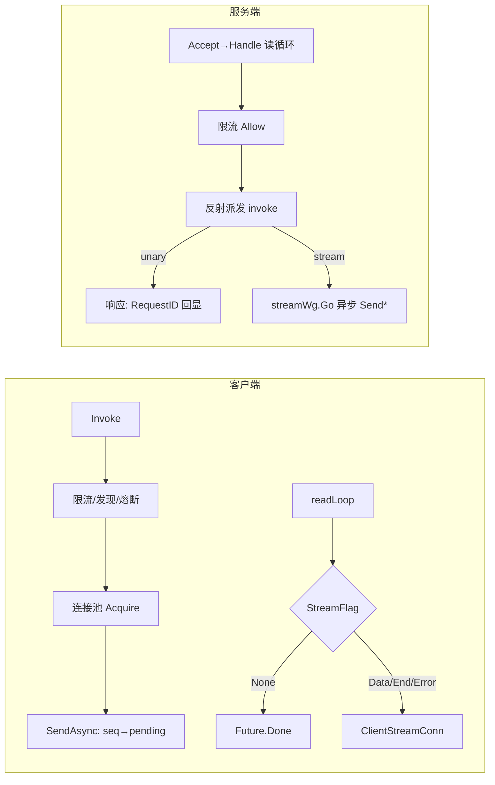
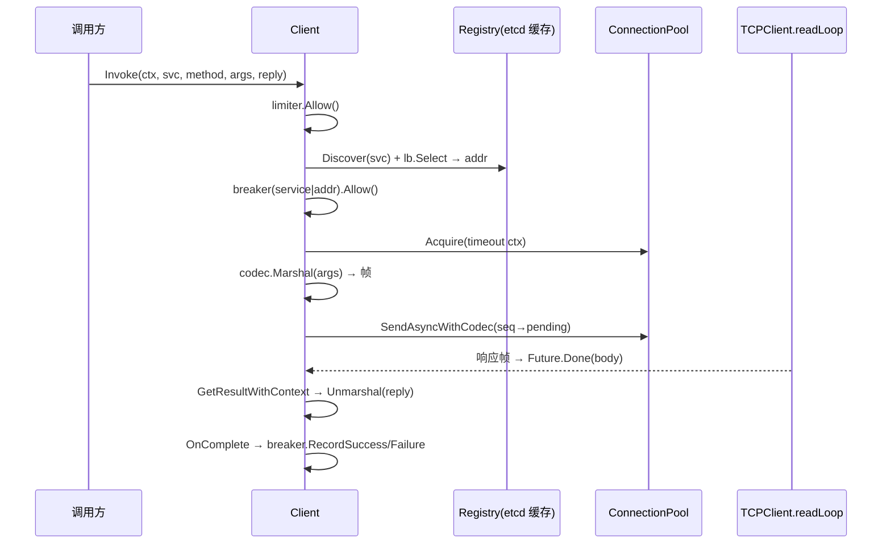
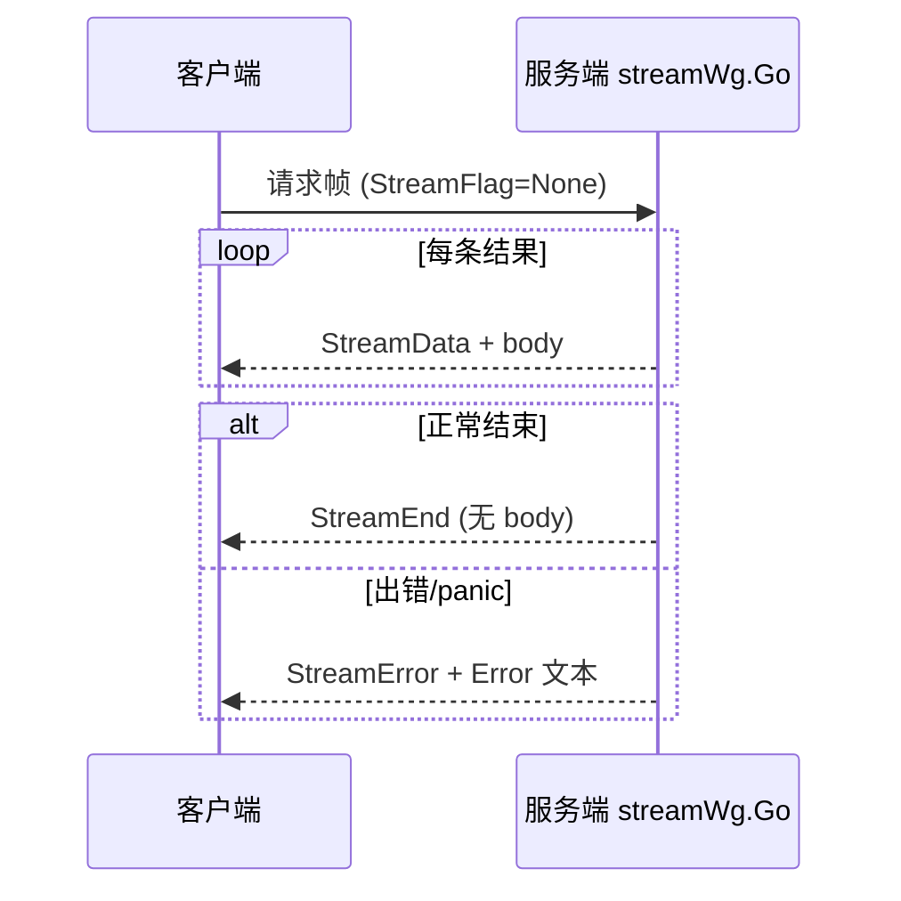
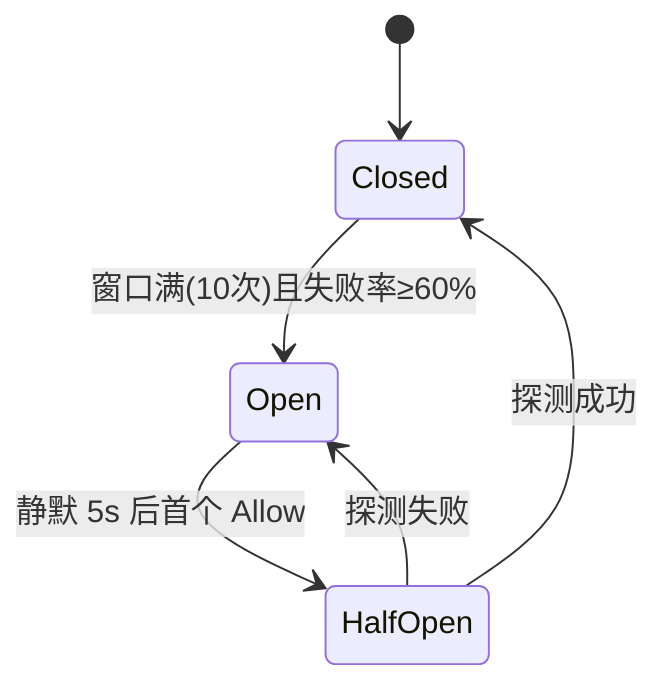

本篇是 RPC 与网络编程方向的带解答题库（52 题）。项目部分逐机制精读 `$HOME/github/yukino.go/libs/yukino_rpc`（HEAD `facf5d6`，`go.mod` 依赖 `go.etcd.io/etcd/client/v3 v3.7.0`、`google.golang.org/protobuf v1.36.12`）；通用部分按标准网络知识作答。路径为 yukino.go 仓库根相对路径。



## 一、二进制协议与帧格式

### Q1. TCP 为什么会有粘包/拆包？yukino_rpc 的帧格式如何解决？

TCP 是**字节流**协议，没有消息边界：Nagle 合并、MSS 分片、缓冲策略都会让「一次 Write」与「一次 Read」不对应。解法三类：定长、分隔符、**长度字段**。

**事实基线**（`internal/protocol/message.go`）：yukino_rpc 用长度字段方案，帧布局（大端）：

```
| Magic 0x1234 (2B) | headerLen (4B) | bodyLen (4B) | header (JSON) | body |
```

`Encode` 先按 `Header.Compression` 压缩 body，再把 Header 用 **JSON codec** 序列化，最后拼装 10 字节固定前缀 + 两段变长数据。`Decode` 先验 `len(data) < 10` → `"data too short"`，再验 Magic → `"invalid magic number"`，算出 `totalLen = 10 + headerLen + bodyLen`，`totalLen > math.MaxInt` → `"packet too large"`（防 32 位溢出与内存炸弹），`len(data) < totalLen` → `"incomplete packet"`（半包，等更多数据）。

### Q2. 为什么 Header 固定 JSON，Body 却可插拔 codec？

**事实基线**：`Encode/Decode` 里 header 恒用 `codec.New(codec.JSON)`；body 的 codec 由 `Header.CodecType`（`CodecTypeJSON=1`/`CodecTypeProto=2`）声明。设计动机：

1. **Header 是协议的协议**——必须零协商可读，JSON 文本便于抓包调试（`tcpdump` 直接可读 ServiceName/MethodName），且 Header 很小，JSON 的体积劣势可忽略；
2. **Body 是业务数据**——体积敏感，允许 Proto（紧凑二进制）；codec 注册表（`internal/codec/codec.go` 的 `factories map[Type]Factory`）支持扩展新编码而不动帧格式；
3. 服务端 `handler.Process` 优先采用**请求头声明的 codec**（`msg.Header.CodecType != 0` 时 `codec.New`），否则用服务端默认——**编码协商由客户端发起**，响应沿用请求的 codec 编码 body。

### Q3. Magic 数字除了校验还有什么用途？项目里怎么用它做重同步？

**事实基线**（`internal/transport/tcp_connection.go` `PacketBuffer.Read`）：

```go
for len(pb.buf) >= 2 && binary.BigEndian.Uint16(pb.buf[0:2]) != protocol.Magic {
    pb.buf = pb.buf[1:]
}
```

Magic（`0x1234`）是帧的**自描述锚点**：一旦流错位（对端崩溃写了一半、协议版本错配），逐字节前移直到重新对上 Magic，即可恢复帧边界继续服务，而不是整条连接报废。取舍要讲清：重同步可能把合法 body 里恰好出现的 `0x1234` 误判为帧头（概率低但存在），且逐字节扫描在严重错位时是 O(n)——更严格的做法是错位即断连重连（fail-fast）。项目选择「尽力恢复」，适合长连接 RPC 的可用性偏好。

### Q4. 长度字段协议、分隔符协议、定长协议怎么选？

| 方案     | 代表                         | 优点               | 缺点                        |
| -------- | ---------------------------- | ------------------ | --------------------------- |
| 定长     | 部分行情协议                 | 解析最简单         | 浪费带宽或限制消息大小      |
| 分隔符   | HTTP/1.1（\r\n）、Redis RESP | 文本友好           | payload 需转义/禁止含分隔符 |
| 长度字段 | yukino_rpc、Dubbo、Thrift    | 二进制紧凑、无转义 | 需处理半包/大包/字节序      |

长度字段方案的三个实现要点（yukino_rpc 全有）：**先读固定前缀**（10B）→ **校验上限**（MaxInt/可扩展最大帧长）→ **攒够再解析**（`incomplete packet` 等待）。

### Q5. 压缩放在哪一层？为什么 Header 不压缩？

**事实基线**（`internal/codec/compress.go` + `message.go`）：`CompressionType`（`None=0`/`Gzip=1`）只作用于 **body**——Encode 先压缩 body 再组帧，Decode 解出 header 后按 `header.Compression` 解压 body。Header 不压缩：① 它本身很小，gzip 的头部开销（~20B）可能比省下的还多；② 压缩 header 会让「读 header 决定如何解 body」变成先解压再读，多一次拷贝与失败点。注册表模式（`RegisterCompressor`/`GetCompressor`，`init()` 注册 gzip）允许扩展 zstd/snappy。

**追问预案**：服务端响应**硬编码 `Compression: codec.CompressionGzip`**（`handler.go`/`stream.go` 所有响应）——小消息（如 `Arith.Add` 返回一个 int）gzip 后反而变大且耗 CPU，这是可指出的改进点：按 body 大小阈值（如 >1KB）才压缩，或让客户端在请求头声明 Accept-Encoding 语义。

### Q6. Header 用 JSON 天然获得了什么兼容性？StreamFlag 的 omitempty 是干嘛的？

**事实基线**（`internal/protocol/header.go`）：

```go
type Header struct {
    RequestID   uint64
    ServiceName string
    MethodName  string
    Error       string
    CodecType   CodecType
    Compression codec.CompressionType
    StreamFlag  StreamFlag `json:",omitempty"`
}
```

JSON 对**未知字段忽略、缺失字段取零值**——新增 Header 字段时旧节点自动兼容（零值语义），这是「协议演进」的最便宜方案（对比 protobuf 需要 field number 纪律）。`omitempty` 让非流式帧不带 `StreamFlag` 字段，减小高频帧的体积；`Error` 空串时也会省略。演进纪律要讲：**只加字段不改语义、零值必须等价于旧行为**——`StreamNone=0` 正是为此设计。

### Q7. Encode 的内存分配能优化吗？

**事实基线**：`Encode` 每帧 `make([]byte, total)` 一次分配 + header/body 两次 `copy`——已经是单帧单次分配的良好实践。可优化方向（方案推导）：① `sync.Pool` 复用帧缓冲（注意归还前截断）；② header JSON 序列化换用追加式/流式序列化器（如新版 `encoding/json` 实现路线）避免中间 `[]byte`；③ 大 body 场景用 writev/scatter-gather 避免拼装拷贝。当前实现对中等 QPS 足够，**先测量再优化**是标准答案姿态。

### Q8. 这个协议支持请求-响应之外的哪些语义？

**事实基线**：`StreamFlag` 四态（`None=0/Data=1/End=2/Error=3`）+ `Error` 字符串字段，使单一帧格式承载三种会话：unary（None 一来一回）、server streaming（Data…End/Error 多帧）、错误传播（任意帧可带 Error）。没有 client streaming 与 bidi——因为 `Handle` 的读循环把每个消息独立派发给 handler，**请求间无会话状态**；要加 bidi 需要引入 stream 级的双向帧路由（客户端也要能发 Data 帧、服务端 handler 要有 Recv 接口），这是可讲的扩展路线。

## 二、连接层：缓冲、拆包与写路径

### Q9. PacketBuffer 的结构与职责？

**事实基线**（`tcp_connection.go`）：

```go
type PacketBuffer struct {
    buf  []byte
    lock sync.Mutex
}
```

职责：把**任意边界的读入字节**重组为**完整帧**。`Write` 追加；`Read` 返回一个完整帧的拷贝或 nil（数据不足）。初始容量 `BufferSize*2`（8192）。它把「网络读」与「协议解析」解耦：`TCPConnection.Read` 循环「buffer 有整帧就 Decode，没有就从 bufio 再读一块（4096）」。**采分点**：注意 `Read` 返回的是 `copy`（`packet := make([]byte, totalLen)`）——buf 前移复用（`pb.buf = pb.buf[totalLen:]`）后原数据仍可能被后续 append 覆盖，拷贝保证了 Decode 期间的数据稳定。

### Q10. TCPConnection 的读路径为什么套 bufio？写路径为什么不套？

**事实基线**：读侧 `bufio.NewReaderSize(conn, BufferSize)`（4096）——拆包需要频繁的小读（先 10 字节前缀、再按长度读），系统调用次数多，用户态缓冲把多次小读合并。写侧直接 `conn.Write` + **writeMu + 短写循环**：

```go
total := 0
for total < len(data) {
    n, err := tc.conn.Write(data[total:])
    ...
    total += n
}
```

写不缓冲的原因：帧已经是「一次 Encode 一次 Write」的原子单元，再套 bufio 反而引入「缓冲何时 flush」的延迟问题；RPC 响应要求尽快上 wire。`writeMu` 保证**多 goroutine 共享连接时帧不交错**（unary 响应、多个 stream 的 Data 帧、错误帧可能并发写同一连接）。

### Q11. 一条连接上并发读写、并发多写，分别靠什么保证正确？

**事实基线**：读——每连接一个 goroutine 串行读（服务端 `Handle` 循环 / 客户端 `readLoop`），`PacketBuffer.lock` 是防御性的（当前无并发 Write 调用方）；写——`writeMu` 互斥 + 单帧单次完整 Write（`writeFull` 语义的循环）。组合效果：**帧是调度的最小原子单位**，读侧按 RequestID/StreamFlag 分发，写侧按锁排队。这与 HTTP/2 的帧交错模型同构，但简单得多（无优先级、无流控窗口——见 Q38）。

### Q12. 客户端连接是怎么建立与复用的？连接池参数有什么讲究？

**事实基线**（`tcp_client.go` + `tcp_connection_pool.go`）：`newTCPClient` 用 `net.DialTimeout("tcp", addr, 5*time.Second)` 建连并立即起 `readLoop` goroutine。`ConnectionPool`：

- `Acquire`：`len(conns) < maxActive` → 新建；否则从 `next` 游标**环形扫描**，跳过已关闭的（`conn.closed.Load() == 0` 判定，顺手从切片摘除），扫完仍无可用 → 兜底新建；
- 客户端实际以 `NewConnectionPool(addr, 0, 1)` 创建——**每个地址 1 条连接**（`resolver.go` `getPool`、`pkg/rpc/client.go` `Dial` 静态模式同）。

为什么 1 条够：协议用 **RequestID 多路复用**（Q13），单连接并发承载所有在途请求，加连接只增加内核缓冲与队头阻塞面。`maxIdle` 参数被接收但未存储（池只增不减，靠 Close 全量释放）——可作为「池化策略待完善」的诚实观察点。

### Q13. RequestID 多路复用的完整闭环？

**事实基线**：

1. 客户端 `SendAsyncWithCodec`：`seq atomic.Uint64` 自增生成 RequestID，`pending.Store(seq, future)`，写帧；
2. 服务端 `Handle` 读到帧，`Process` 处理后响应头**回显 `RequestID`**（`handler.go` 所有响应路径）；
3. 客户端 `readLoop` 按 `msg.Header.RequestID` 从 `pending.LoadAndDelete(seq)` 取出 Future 并 `Done`。

关键性质：**响应乱序到达无影响**（按 ID 认领）；**一个响应丢失只挂一个 Future**（超时兜底，见 Q28）；连接故障时 `shutdown` 把 pending 全部置错（Q30）。这就是「单连接多路复用」的最小完备实现——对比 HTTP/1.1 的 keep-alive 只能串行（无 ID），HTTP/2 的 stream ID 是同思路的标准化。

### Q14. 半包/大包在 TCPConnection.Read 里如何收敛？

**事实基线**：`Read` 是「先查缓冲、再补读」的循环：buffer 有整帧 → `protocol.Decode` 返回；否则从 bufio 读最多 4096 字节追加。半包（`incomplete packet`）不会发生——因为 `PacketBuffer.Read` 只在 `len(buf) >= totalLen` 时才取出帧，**拆包在缓冲层完成，Decode 永远拿到完整帧**（Decode 的 incomplete 分支是对直接调用者的防御）。大包：帧多大就读多大（`make([]byte, totalLen)`），上限由 Decode 的 MaxInt 校验与协议约定控制——生产化应加**最大帧长配置**（如 64MiB）超限断连，这是可主动提出的加固点。

### Q15. 连接关闭的语义差异：Close、SetLinger(0)、SetReadDeadline(now) 各用在哪？

**事实基线**（对照三处用法）：

- `TCPConnection.Close`：`SetLinger(0)` 后 Close → **RST 关闭**，丢弃在途数据、免 TIME_WAIT——用于「连接已不可信」（读错误、shutdown 清理）；
- `Server.GracefulStop`：对在册连接 `SetReadDeadline(time.Now())` → 让阻塞的 `conn.Read` 立即返回超时错误，`Handle` 循环自然退出、`defer conn.Close()` 走正常关闭路径——**优雅唤醒**；
- WebSocket/长连接场景（对照 yukino_http）：`SetDeadline(time.Time{})` 清除超时。

面试表述：**「怎么关连接」取决于连接里还有没有值钱的数据**——有则排空或半关（CloseWrite），无则 RST 快速回收。

## 三、服务端：派发、限流与生命周期

### Q16. Server 的连接生命周期管理？

**事实基线**（`internal/server/server.go`）：`Serve` 是 accept 循环：每个连接 `NewTCPConnection` 包装 → 登记进 `conns map[*TCPConnection]struct{}`（mu 保护）→ `s.wg.Go(func(){ s.Handle(tcpConn); 注销 })`。`closing` channel + `shutdownOnce` 构成关停信号：`beginShutdown` 幂等地 close(closing) 并关 listener；accept 错误时先查 closing（是则正常返回，否则 continue 重试）。`Addr()` 支持 `:0` 随机端口（测试友好）。**采分点**：连接登记的意义是关停时能**主动触达每条连接**（设 deadline/关闭）——没有登记表，长连接服务的优雅关闭无从谈起。

### Q17. Handle 的读循环为什么是串行的？unary 和 stream 的并发模型差异？

**事实基线**（`server.go` `Handle` + `handler.go`）：

```go
var streamWg sync.WaitGroup
defer conn.Close()
defer streamWg.Wait()   // LIFO: 先等流结束，再关连接
for {
    msg, err := conn.Read(); if err != nil { return }
    if !s.limiter.Allow() { 写 "rate limit exceeded" 错误帧; continue }
    service := s.services[msg.Header.ServiceName]  // mu 保护
    s.handler.Process(conn, msg, service, &streamWg)
}
```

- **unary 方法在 Handle goroutine 内同步执行**（`invoke` → `safeCall` → 写响应）——同一连接上的 unary 请求**串行处理**，天然避免同连接内的写竞争与请求乱序副作用，代价是慢方法阻塞同连接后续请求（多路复用的队头阻塞，客户端可用多连接池缓解）；
- **stream 方法通过 `streamWg.Go` 异步执行**（`invoke` 检测第二参实现 `ServerStream` 接口后），读循环立即返回继续收帧——流式推送不阻塞连接；
- `defer` 顺序保证优雅关闭时**流先收敛、连接后关闭**。

### Q18. 服务端限流被触发时为什么「写错误帧」而不是断连？

**事实基线**：`!s.limiter.Allow()` 时构造带 `Error: "rate limit exceeded"` 的响应帧回给该 RequestID，然后 `continue` 读下一帧。设计取舍：**限流是针对请求的，连接是无辜的**——断连会惩罚该连接上所有在途请求并引发重连风暴；按请求拒绝让客户端的 Future 精确收到错误，可自行退避重试。对比网关层限流（直接 429/断连）：越靠近服务端内部，越倾向「精确到请求」的拒绝语义。客户端侧也有限流（`Client.limiter`，同为 10000/s）——**双层限流**：客户端自保护防打爆自己，服务端自保护防被打爆。

### Q19. 反射派发的三种方法签名，流式签名的 Convert 技巧是什么？

**事实基线**（`handler.go` `invoke`，详见 [Go 语言与运行时](/interview/qa/go-language-runtime) Q56）：① `func(ctx, *T) (*R, error)`；② `func(*T, *R) error`；③ `func(*T, S) error` 且 `S` 实现 `stream.ServerStream`。流式分支的关键一行：

```go
args := []reflect.Value{req, reflect.ValueOf(ss).Convert(secondParam)}
```

`ss` 是内部 `*serverStream`，用户方法声明的却是**自己的接口类型** `S`（如 `type ArithStream interface { stream.ServerStream }`）——`reflect.Convert` 在两个接口类型间做合法转换（方法集包含即可），让用户无需 import internal 包。随后 `streamWg.Go` 异步执行，结束时按结果发 `end()`（StreamEnd）或 `sendError`（StreamError）。**采分点**：`safeCall` 的 recover 把 handler panic 转成 `handler panic: %v` 错误——流式分支里 panic 也会变成 StreamError 帧，连接不受影响。

### Q20. 服务端处理用的 context 是什么？取消能传播吗？

**事实基线**：`handler.Process` 调 `h.invoke(context.Background(), ...)`——unary 与 stream 拿到的都是 **Background ctx**，客户端断开或超时**不会**取消正在执行的 handler。诚实评估：这是当前实现的边界——① 客户端超时（`Future.Done(DeadlineExceeded)`）只是本地放弃，服务端仍会把活干完并写响应（`readLoop` 侧 `pending.LoadAndDelete` 找不到 Future 就丢弃，无泄漏）；② 改进路线：把连接级 ctx（`Handle` 里 `context.WithCancel`，读错误时 cancel）传入 invoke，handler 即可感知断连。面试主动讲出「现状 + 后果 + 改法」，比假装有取消传播得分高。

### Q21. 服务注册与查找的并发安全？

**事实基线**：`Register(name, service)` 在 mu 下写 `services map[string]any`；`Handle` 每帧在 mu 下读。注册通常发生在 `Serve` 之前（启动期），运行期只读——**读多写少但没用 RWMutex**，因为临界区只有一次 map 查找，Mutex 足够且更简单。服务未注册时 `invoke` 返回 `service not found: %s` 错误帧（不是 panic/断连）——**未知服务是请求级错误**。

### Q22. GracefulStop 与 Stop 的完整对比？

见 [HTTP 框架与网关工程](/interview/qa/http-framework-gateway) Q52 的并排分析。RPC 侧补充两点：① `GracefulStop` 用 `SetReadDeadline(time.Now())` 而非关连接——给 `Handle` 的 defer 链（streamWg.Wait → conn.Close）留出执行机会，**在途流能跑完**；② `Stop` 直接 `conn.Close()`，阻塞读立即 EOF 退出，流被截断。两者都 `serveWg.Wait()` 先停 accept、`limiter.Stop()` 收尾（停 ticker goroutine，防泄漏）。

### Q23. 这个 RPC 服务端的可观测性现状与加固方案？

**事实基线**：现状只有 `log.Println("server graceful stop complete")` 级别的日志与限流错误帧——无指标、无 tracing。**方案推导**（面试标准答案）：① RED 指标：每 ServiceName/MethodName 的请求计数、错误计数、耗时直方图（在 `Process` 入口/出口埋点，天然覆盖 unary+stream）；② 连接指标：`len(conns)` gauge、accept 速率；③ 限流/熔断触发计数（客户端侧同理）；④ 帧级 tracing：RequestID 作为 span 关联键透传。埋点位置选 `handler.Process` 与 `client.invokeAsync` 两处即可全链路覆盖——**在框架的汇聚点埋点，而不是每个业务 handler 里**。

## 四、客户端：调用链、Future 与故障清理

### Q24. 画出客户端一次 Invoke 的完整调用链。

**事实基线**（`internal/client/invoke.go`）：



任一环节失败的语义：限流/熔断 → 本地立即错误（不出网）；Acquire 失败 → `br.RecordFailure()`（连接建立失败是强故障信号）；发送失败 → RecordFailure + `c.fail(err)` 触发连接级清理。

### Q25. Future 的完整设计：幂等、回调、超时、取结果。

**事实基线**（`internal/transport/future.go`）：

- `done chan struct{}` + `complete bool` + `mu`：`Done(res, err)` **幂等**（重复调用直接返回）——超时 goroutine 与真实响应竞争时只有一个生效；
- `OnComplete(fn)`：未完成则注册（mu 下），**已完成则立即执行**——注册时机无关紧要，无竞态；
- 等待家族：`Wait()`（裸等）、`WaitWithContext`（select ctx.Done）、`WaitWithTimeout`（包一层 WithTimeout）、`GetResult(reply)`（等完再 `decodeResult` 反序列化）；
- `decodeResult` 在 mu 下检查 `f.err` 再 Unmarshal——**错误优先于结果**。

**采分点**：Future 是「一次性 rendezvous」的最小实现：一个 close(done) 广播 + 互斥保护的结果槽。对比 channel 方案（`chan result` 容量 1）：Future 多了 OnComplete 回调与幂等 Done，适合「多方可能完成它」的场景（响应/超时/连接失败三路竞争）。

### Q26. InvokeAsync 的超时为什么用独立 timer goroutine 而不是 ctx？

**事实基线**（`invoke.go`）：

```go
go func() {
    timer := time.NewTimer(c.timeout)
    select {
    case <-future.DoneChan():
    case <-timer.C:
        future.Done(nil, context.DeadlineExceeded)
    }
}()
```

因为 Future 可能被**任意持有者**在任意 select 里等待（不一定带着 ctx）；把超时「物化」为 Future 的完成事件，所有等待路径统一获得超时语义。同步版 `Invoke` 则双管齐下：`context.WithTimeout` 包住等待（`GetResultWithContext`），超时后还补一刀 `future.Done(nil, callCtx.Err())` 确保 Future 不悬挂。**追问预案**：timer goroutine 会泄漏吗？——不会，两个 case 必有一个先到（Future 终会被响应/超时/连接清理之一完成），goroutine 随即退出。

### Q27. readLoop 的分发逻辑？未知 RequestID 的响应怎么处理？

**事实基线**（`tcp_client.go` `readLoop`）：按 `StreamFlag` 四路分发：`StreamData` → `streams.Load(seq)` 的 `ClientStreamConn.Push(body)`；`StreamEnd` → `LoadAndDelete` + `End()`；`StreamError` → `LoadAndDelete` + `Error(errors.New(header.Error))`；默认（unary）→ `pending.LoadAndDelete(seq)`，**找不到就 `continue` 丢弃**——这正是「客户端已超时放弃、服务端迟到的响应」的归宿：Future 已被 timer Done 过，迟到响应安全丢弃，无泄漏无 panic。`Header.Error != ""` 时 `future.Done(nil, errors.New(...))` 把服务端错误（含 `rate limit exceeded`、`service not found`、`handler panic`）转成 Go error。

### Q28. 客户端超时、服务端慢响应、连接断开三者同时发生时，谁赢？

**事实基线**：三方都通过 `Future.Done` 的**幂等性**竞争：① timer 到点 → Done(DeadlineExceeded)；② 响应到达 → readLoop Done(body)；③ 连接断开 → `shutdown` Range pending 逐个 Done(err)。`complete` 标志保证**先到先得，后到静默**；调用方拿到的错误类型决定重试策略（DeadlineExceeded 可重试、连接错误看熔断器）。这个「多源完成、幂等收敛」模式是异步 RPC 客户端的正确性基石——面试画出三方竞争图是强采分点。

### Q29. 连接池 Acquire 的环形扫描为什么边扫边删？

**事实基线**（`tcp_connection_pool.go`）：扫描发现 `conn.closed.Load() != 0` 的连接时**立即从切片摘除**（`append(conns[:idx], conns[idx+1:]...)` 并回退 i、n--），一次 Acquire 顺带完成死连接回收——无需后台 reaper goroutine。取舍：摘除发生在锁内，O(n) 移动但 n=maxActive 很小（默认 1）。若池规模大，应改为标记+异步清理。`ErrPoolClosed` 与 `ctx.Done` 检查在最前——**池关闭与取消优先于一切**。

### Q30. shutdown 的清理顺序？为什么先 CAS 再关连接？

**事实基线**（`tcp_client.go`）：

```go
func (c *TCPClient) shutdown(err error) {
    if !c.closed.CompareAndSwap(0, 1) { return }  // 只执行一次
    _ = c.conn.Close()                            // 打断 readLoop 的阻塞读
    c.pending.Range(... future.Done(nil, err); Delete ...)
    c.streams.Range(... Error(err); Delete ...)
}
```

顺序逻辑：CAS 抢占清理权（并发的 fail/Close 只有一个执行）→ **先关连接**让 readLoop 退出（它退出时也会调 fail，但 CAS 已挡住）→ 再清扫两个 map，把所有悬挂的 Future/Stream 置错。若先清扫后关连接，readLoop 可能在清扫与关闭之间又 Store 新 Future（SendAsync 的双重检查正是防这个，见 [Go 语言与运行时](/interview/qa/go-language-runtime) Q40）。**结论**：调用方永远不会拿到「永远不完成的 Future」——这是 RPC 客户端最重要的活性保证。

### Q31. observedStream 的错误归类为什么这样设计？

**事实基线**（`invoke.go`）：流式调用的熔断记账包了一层装饰器：

```go
switch {
case err == nil:                    // 每条数据帧：不记账（流还在进行）
case errors.Is(err, io.EOF):        // 流正常结束：once.Do(RecordSuccess)
case errors.Is(err, context.Canceled): // 调用方主动取消：不记账
default:                            // 其他错误：once.Do(RecordFailure)
}
```

三个判断都有讲究：① 数据帧不记账——流中途的每个 Recv 成功不代表服务整体健康，记 Success 会稀释故障率，记 Failure 更不对，**只在终态记一次**；② `io.EOF` 是流的成功终态（对应服务端 StreamEnd）；③ 主动取消是调用方行为，与服务健康无关，记入会污染熔断判断；④ `once` 保证终态只记一次。**采分点**：熔断器的输入质量决定其价值——「什么算失败」的定义比状态机本身更重要。

### Q32. 客户端默认参数透露了什么容量假设？

**事实基线**：`NewClient` 默认 `timeout: 5*time.Second`、`limiter: NewTokenBucket(10000)`、`lb: &RoundRobin{}`、codec JSON；熔断器（`resolver.go` `getBreaker`）`windowSize=10, failureThreshold=0.6, openTimeout=5s`；连接池每地址 1 连接；Dial 超时 5s。读法：**面向低频控制面/中频业务调用**（5s 超时不适合大模型流式长响应——流式调用应显式 `WithTimeout` 放大或按流单独管理）；单连接多路复用假设请求体积小、并发适中；JSON 默认假设调试友好优先于极致吞吐（可 `WithDialCodec(rpc.CodecProto)` 切换）。面试讲默认参数 = 讲设计者对目标场景的判断。

### Q33. pkg/rpc 门面包（facade）是怎么收敛 API 的？

**事实基线**（`pkg/rpc/`）：对外只暴露 `Server/ClientConn/Dial/NewServer/Register/Invoke/InvokeAsync/NewStream/GracefulStop` 等，内部实现全在 `internal/`（Go 的 internal 目录强制不可被外部 import）。收敛手法：① **类型别名**（`rpc.go`：`type Future = transport.Future`、`type Registry = registry.Registry`、`CodecType = codec.Type`）——零成本透传，调用方无需知道 internal 包路径；② **选项翻译**（`server.go`：公开的 `WithCodec` 翻译成 `internal_server.WithServerCodec`）；③ **双模式 ClientConn**（`client.go`：`Dial` 传 registry 走 modeRegistry，否则 modeStatic 直连池）——同一 API 覆盖「服务发现」与「点对点」两种部署。这是 Go 库设计的标准分层：**internal 放实现自由度，pkg 放稳定性承诺**。

## 五、流式 RPC

### Q34. StreamFlag 状态机与帧序列。

**事实基线**：一次 server stream 的帧序列：



`StreamNone=0` 用于 unary（omitempty 时字段直接不出现）；Data/End/Error 三态构成「多帧 + 唯一终态」协议。终态帧由 `handler.invoke` 的异步包装保证**恰好一个**（run 函数里 err 非空发 sendError，否则 end）。

### Q35. serverStream 的三个方法分别写什么帧？

**事实基线**（`internal/server/stream.go`）：`Send(msg)` → codec.Marshal + `StreamData` 帧（失败返回 err 给业务 handler，由它决定终止）；`end()` → `StreamEnd` 空帧；`sendError(msg)` → `StreamError` + `Error` 字段。三者都硬编码 `Compression: codec.CompressionGzip`。`Context()` 返回构造时传入的 ctx（当前为 Background，见 Q20）。接口面（`internal/stream/stream.go`）刻意最小：`ServerStream{Send, Context}`、`ClientStream{Recv, Context}`——**接口越小，用户自定义流类型越容易满足**（反射 Convert 的前提）。

### Q36. ClientStreamConn 的缓冲与终止模型？

**事实基线**（`internal/transport/stream.go`）：

- `ch chan streamFrame` 容量 **64**：readLoop Push、业务 Recv 消费，缓冲吸收突发；
- `Push` 三路 select：入队 / `ctx.Done()`（调用方取消）/ `termCh`（已终止）——**终止后不再阻塞 readLoop**；
- 终止 `terminate(err)`：`once` 保证一次，记 `termErr` 并 close(termCh)；`End()` = terminate(`io.EOF`)，`Error(err)` = terminate(err)；
- `Recv` 三段式（快速排空 → 阻塞等待 → 终止后排空残留，见 [Go 语言与运行时](/interview/qa/go-language-runtime) Q28）。

64 的容量是吞吐与内存的折中；真正的背压靠 TCP（Q38）。

### Q37. 流式调用的背压是怎么形成的？和 HTTP/2 流控对比？

**事实基线 + 推导**：yukino_rpc 无显式流控帧——背压是**隐式**的：业务 Recv 慢 → ch 满（64）→ Push 阻塞 → readLoop 停读 → TCP 接收缓冲满 → 接收窗口收缩 → 对端 Write 阻塞/变慢。整条链路由 TCP 窗口机制自动传导。对比 HTTP/2：显式 `WINDOW_UPDATE` 帧做**每流**流控，可以在连接级窗口内精细调度多路流；yukino_rpc 的单流模型下 TCP 隐式背压已足够，且零协议开销。**采分点**：说出「背压不一定要协议显式支持，TCP 窗口就是免费的背压通道；显式流控的价值在多流复用与跨连接公平」这一层。

### Q38. 流与连接的生命周期关系？连接挂了流怎么办？

**事实基线**：`streams sync.Map` 挂在 **TCPClient**（连接）上——流的生命周期 ≤ 连接。连接故障时 `shutdown` Range streams 逐个 `Error(err)`，所有 Recv 立即得到错误；服务端侧 `Handle` 退出前 `streamWg.Wait()` 等流 goroutine 收敛（它们对已关连接的 Write 会失败退出）。客户端 `Cancel()`（`context.WithCancel` 的 cancel）可主动放弃流——但注意**取消只影响本地 Recv**，服务端无取消传播（Q20），这是协议现状的又一例证。

### Q39. 如果要给这个框架加 client streaming / bidi，最小改动是什么？

**方案推导**（展示协议设计能力）：① 协议层：请求帧带 `StreamFlag` 表示「客户端将发 Data 帧」，服务端按 RequestID 把 Data 帧路由给 handler 的 Recv；② 服务端：`Handle` 读循环对 Data 帧查 streams 表而非派发新调用；handler 接口加 `Recv(msg) error`；③ 客户端：对称的发送侧 stream（复用 SendAsync 的写路径 + writeMu）。帧格式**无需改动**（StreamFlag 已够用），改的是路由表与接口——好的协议设计为演进留好了位，这正是 Q8 的呼应。

## 六、服务治理：注册发现、负载均衡、熔断

### Q40. etcd 注册的完整流程？KeepAlive 的 channel 为什么要消费？

**事实基线**（`internal/registry/registry.go` `Register`）：

```go
leaseResp, _ := r.client.Grant(r.ctx, ttl)          // 1. 租约
key := prefix + service + "/" + ins.Addr
r.client.Put(r.ctx, key, ins.Addr, WithLease(...))  // 2. 挂租约写入
ch, _ := r.client.KeepAlive(r.ctx, leaseResp.ID)    // 3. 续租流
go func() { for { if _, ok := <-ch; !ok { return } } }() // 4. 消费
```

Key 前缀是 `"/github.com/hangtiancheng/yukino.go/libs/yukino_rpc/services/"`（模块路径命名空间）。**为什么必须消费 KeepAlive channel**：etcd client 的 KeepAlive 返回的是应答流，**不消费会阻塞内部续租管道**，租约到期 key 被删、服务被摘除——这是 etcd 注册最经典的隐性 bug。进程崩溃则无人续租，ttl 后 key 自动过期——**租约 = 心跳 = 健康检测**三合一，无需额外探活。

### Q41. Discover 的缓存与 watch 增量维护？watch 断线怎么办？

**事实基线**：`Discover` 快路径 RLock 查本地 `services` 缓存，miss 则 `initService`：Lock 双检 → `Get(key, WithPrefix)` 全量拉取 → 起 `watch` goroutine。watch 处理 `EventTypePut`（加实例）/`EventTypeDelete`（按 key TrimPrefix 出 addr 删除）。**断线处理**：`for watchResp := range watchChan` 结束后（channel 关闭），select `ctx.Done` 或 `time.After(time.Second)` **1 秒退避后重建 Watch**——外层死循环保证 watch 永续。诚实指出边界：watch 断开到重建之间的事件会丢，重建后**没有重新全量 Get**，极端情况下本地缓存可能与 etcd 漂移；生产化应在重连后先 Get 全量再续 watch（或用 etcd 的 revision 连续订阅）——主动讲出这个缺口是深挖题的采分点。

### Q42. 三种负载均衡实现，重点讲平滑加权轮询。

**事实基线**（`internal/load_balance/`），统一接口 `Select([]Instance) Instance`：

- **RoundRobin**：`idx atomic.Uint64` 无锁自增，`list[(i-1)%len]`——实例列表变化时可能轻微不均，但零锁开销；
- **Random**：`rand.Rand` + mutex（`rand.Rand` 非并发安全，必须锁；Go 1.20+ 可用全局 `rand.IntN` 免锁）；
- **WeightedRR**：**平滑加权轮询（nginx SWRR 算法）**——每轮所有节点 `currentWeight[i] += weights[i]`，选 currentWeight 最大者，中选者 `currentWeight[max] -= totalWeight`。

SWRR 妙处（举例 weights={5,1,1}）：7 轮选择序列是 `a,a,b,a,c,a,a` 式的**均匀交错**，而非 `aaaaa,b,c` 的块状——后者会让 b/c 节点长期空闲后突接请求、缓存全冷。数学性质：每 totalWeight 轮各节点恰好被选 weights[i] 次，且任意前缀内分布都接近目标比例。边界处理：`len(list) != len(weights)` 或 `totalWeight <= 0` 返回空实例（调用方 `getAddr` 检查空 Addr 报错）——**权重与实例列表必须同源配置**，这是使用约束。

### Q43. 熔断器状态机完整走一遍？参数含义？

**事实基线**（`internal/breaker/breaker.go`），客户端默认 `NewCircuitBreaker(10, 0.6, 5*time.Second)`：



- **Closed**：`Allow` 恒真；每次结果累计 failure/success，**总数达到 windowSize 才结算**——失败率 ≥ threshold 则 toOpen，否则清零重计（计数窗口，非时间窗口）；
- **Open**：拒绝一切请求；`time.Since(lastStateChange) > openTimeout` 时**在 Allow 内惰性转 HalfOpen**（无后台 timer）并放行探测；
- **HalfOpen**：`halfOpenProbe` 标志保证**同时只有一个探测请求**，其余拒绝；探测成功 toClosed，失败 toOpen。

**采分点**：① 惰性状态迁移（检查时迁移）省去定时器 goroutine；② 单探测防「半开洪泛」；③ 计数窗口的已知弱点——窗口不满时不熔断（冷启动期无保护）、窗口满后一次结算即清零（突发失败被稀释），生产级多用**滑动时间窗 + 最小请求数**（可主动提出改进）。

### Q44. 熔断器为什么按 `service|addr` 粒度？

**事实基线**（`resolver.go` `getBreaker`）：key = `service + "|" + addr`，`sync.Map` + `LoadOrStore` 懒创建。粒度选择的逻辑：**故障是实例级的，不是服务级的**——3 个实例挂 1 个，服务级熔断会把健康实例一起断掉；实例级熔断让 LB 自然把流量绕向健康实例（配合 RR）。代价：实例缩容后 breaker 条目残留（sync.Map 不清理）——量小可忽略，大规模需加 TTL 清理。对比：限流是**客户端全局**（保护自己）、熔断是**按目标实例**（隔离故障），两者粒度不同因为目的不同。

### Q45. 注册发现、负载均衡、熔断、限流在一次调用里如何协作？

**事实基线**（`invokeAsync` 顺序）：限流（自我约束）→ Discover+Select（**先选地址**）→ 该地址的 breaker.Allow（**后查健康**）→ Acquire → 发送 → 结果回记 breaker。顺序细节有讲究：LB 在熔断之前，意味着**可能选中一个熔断打开的实例然后被拒**（`circuit breaker open` 错误）——更优做法是 LB 感知熔断状态做过滤（filtering balancer），这是可讲的演进方向；当前实现的好处是 LB 无状态、breaker 自包含，组合简单。四层防线一句话总结：**限流保自己、发现找目标、熔断避故障、超时兜底**。

## 七、RPC 与网络通用知识

### Q46. RPC 和 REST 的本质区别？各自适合什么场景？

| 维度 | RPC（yukino_rpc/gRPC）            | REST/HTTP JSON                 |
| ---- | --------------------------------- | ------------------------------ |
| 抽象 | 远程**方法调用**（动词内建）      | 资源 + 统一接口（HTTP 动词）   |
| 契约 | 强 schema（proto/反射签名）       | 弱契约（OpenAPI 可选）         |
| 传输 | 长连接多路复用、二进制            | 短连接为主、文本               |
| 流式 | 一等公民（StreamFlag）            | SSE/WebSocket 补丁             |
| 调试 | 需工具（本项目 Header JSON 缓解） | curl 即调试                    |
| 适用 | 内部服务间、低延迟、流式          | 开放 API、浏览器直连、缓存友好 |

yukino_rpc 的 `pkg/api/arith.go`（`Arith.Add(ctx, *Args) (*Reply, error)`）展示了 RPC 的心智模型：**像调本地函数一样调远程**，错误、超时、重试都由框架承载。

### Q47. protobuf 为什么能兼容字段增删？yukino_rpc 的 Proto codec 怎么接的？

protobuf 兼容性三支柱：① **field number 是线上身份**（名字可改，号不可复用）；② 未知字段**保留转发**（旧版本收到新字段不丢，反序列化跳过但可再序列化回去）；③ wire type 决定跳过方式（varint/length-delimited 等可安全跳过）。删除字段要 `reserved` 锁号防复用。

**事实基线**（`internal/codec/protobuf.go`）：`protoCodec` 要求值实现 `proto.Message`（`google.golang.org/protobuf/proto`），否则 `not proto.Message` 错误——即只支持 proto3 生成类型。注册走统一 `Register(PROTO, factory)`。**注意**：反射派发分支对请求对象做 `reflect.New(...).Elem()` 后交给 codec Unmarshal，proto 消息是指针接收者语义，`invoke` 的 `In(1).Kind() == reflect.Pointer` 约束天然满足。

### Q48. HTTP/2 多路复用解决了什么？队头阻塞彻底消失了吗？

HTTP/2 在**单 TCP 连接**上跑多路 stream：帧化（HEADERS/DATA/WINDOW_UPDATE）+ stream ID 多路复用（与 yukino_rpc 的 RequestID 同构）+ 头压缩 HPACK + 每流流控。它消除了 **HTTP 层的队头阻塞**（一个慢请求不阻塞其他流）。但 **TCP 层队头阻塞仍在**：一个丢包阻塞整个连接的重组，所有流一起等。QUIC 把传输层搬到 UDP 并**每流独立重传**才真正消除。yukino_rpc 的单连接多路复用同样受 TCP 层 HOL 影响——大响应丢包会卡住同连接的小请求，这是 Q12「每地址 1 连接」取舍的另一面。

### Q49. QUIC 的核心要点？

① UDP 承载、用户态实现（协议演进不需要改内核）；② **0-RTT/1-RTT 握手**（TLS 1.3 内嵌）；③ 流独立：丢包只阻塞所属流；④ **连接迁移**：连接 ID 而非四元组标识连接，Wi-Fi↔蜂窝切换不断连；⑤ 内建拥塞控制与丢包恢复改进。代价：UDP 在部分网络被限速/丢弃、用户态开销。面试关联：gRPC-over-QUIC（HTTP/3）是趋势，但内网 RPC（如 yukino_rpc 的场景）TCP 足够。

### Q50. epoll 的 LT 与 ET？为什么 ET 必须读到 EAGAIN？io_uring 改进了什么？

- **LT（水平触发，默认）**：只要 fd 就绪就反复通知——编程简单，不读也不丢事件；
- **ET（边沿触发）**：只在状态**变化**时通知一次——必须循环读到 `EAGAIN`，否则残留数据不再通知（永久饥饿）。ET 减少 epoll_wait 唤醒次数，常配非阻塞 fd。
- Go 的 netpoller 用 **LT**：runtime 把「就绪」转成 goroutine 唤醒，每个 goroutine 只服务一个 fd，无需 ET 的「一次读尽」纪律，简单性优先。
- **io_uring**：提交队列 SQ + 完成队列 CQ 的**共享内存环**，批量提交 + 完成事件异步收割，消灭「每 I/O 一次系统调用」；SQPOLL 模式内核线程轮询 SQ，连提交都不陷入内核。适合高 IOPS 存储与代理场景（对照 wanproxy 这类字节泵送，`io.Copy` 的 splice/sendfile 已是内核态优化路径，见 [HTTP 框架与网关工程](/interview/qa/http-framework-gateway) Q65）。

### Q51. JSON / protobuf / gob / msgpack 序列化怎么比？

| 格式     | 体积              | 速度 | schema         | 跨语言    | 自描述 |
| -------- | ----------------- | ---- | -------------- | --------- | ------ |
| JSON     | 大（文本+字段名） | 中   | 弱             | 极好      | 是     |
| protobuf | 小                | 快   | 强（演进规则） | 好        | 否     |
| gob      | 中                | 快   | Go 反射推导    | **仅 Go** | 部分   |
| msgpack  | 较小              | 快   | 无             | 好        | 否     |

yukino_rpc 的选择（JSON 默认 + Proto 可选 + gzip 兜底体积）是「调试性优先、可升级」的务实组合。追问预案：JSON 的两个隐藏成本——`encoding/json` 的反射开销（可用 `json/v2` 或 codegen 缓解）、数字精度（int64 > 2^53 经 JS 会丢精度，跨端 API 要用 string 传大整数）。

### Q52. 这个 RPC 框架有心跳吗？断线重连怎么做？现状与改法。

**事实基线**（诚实表述现状）：框架**没有应用层心跳**——连接健康靠「读错误即死」检测：对端关闭/崩溃后，下一次 Read 得到 EOF/错误，`readLoop` → `fail` → shutdown；客户端下次 `Acquire` 发现 `closed.Load() != 0` 即摘除并新建连接（连接池扫描逻辑），**重连是惰性的、按调用触发**。空闲连接上的「半开」故障（NAT 超时、中间设备静默丢连接）要等到下次写/读才暴露。

**方案推导**（改法）：① 空闲心跳：连接级 ticker 发 ping 帧（协议需加控制帧类型，或复用空 body unary），连续 N 次无 pong 判死；② 主动保活：`net.TCPConn.SetKeepAlivePeriod`（利用内核 TCP keepalive，零协议改动，但默认 2h 太长，需调短）；③ 重连退避：池层加指数退避防重连风暴。三层递进，成本递增——**先用内核 keepalive，不够再上应用心跳**是标准演进路径。

## 速记卡

- **帧格式**：`Magic 0x1234 + headerLen(4) + bodyLen(4) + JSON header + body`，大端；Header 恒 JSON（零协商 + 可抓包 + 天然兼容演进），body 可 JSON/Proto，gzip 只压 body。
- **拆包**：PacketBuffer 攒够整帧才交给 Decode；Magic 逐字节重同步；`incomplete packet`/`packet too large` 双防御。
- **多路复用**：`seq atomic.Uint64` → pending sync.Map → 响应按 RequestID 认领；迟到响应 LoadAndDelete miss 即丢弃。
- **Future**：done chan + complete 幂等 + OnComplete；超时/响应/断连三方竞争，先到先得。
- **服务端**：Handle 串行读循环，unary 同步执行（同连接串行）、stream `streamWg.Go` 异步；`defer streamWg.Wait()` 先于 `conn.Close()`；限流触发写错误帧不断连。
- **反射派发**：三签名（ctx 式 / net-rpc 式 / ServerStream 式），`reflect.Convert` 跨接口注入内部流实现；`safeCall` recover → 错误帧。
- **现状边界（主动讲）**：服务端 ctx 是 Background，取消不传播；响应硬编码 gzip；无应用层心跳；watch 重连后不全量对账。
- **流式**：StreamFlag None/Data/End/Error；客户端 64 帧缓冲 + 终止后排空；背压靠 TCP 窗口隐式传导。
- **etcd 注册**：Grant+Put+KeepAlive（channel 必须消费！）；Discover 本地缓存 + watch 增量 + 1s 退避重建。
- **SWRR**：currentWeight 累加选最大、中选减总量——nginx 同款平滑加权。
- **熔断**：Closed/Open/HalfOpen 惰性迁移；窗口 10、阈值 0.6、静默 5s、半开单探测；粒度 service|addr。
- **四层防线**：限流保自己 → 发现找目标 → 熔断避故障 → 超时兜底（5s 默认）。

## 延伸阅读

[Go 语言与运行时](/interview/qa/go-language-runtime) · [HTTP 框架与网关工程](/interview/qa/http-framework-gateway) · [缓存、存储与 ORM](/interview/qa/cache-storage-orm) · [服务架构与任务系统](/interview/qa/service-architecture) · [全量题库](/interview/question-bank)
