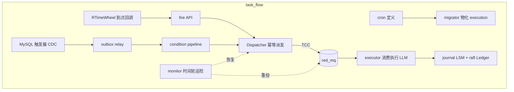
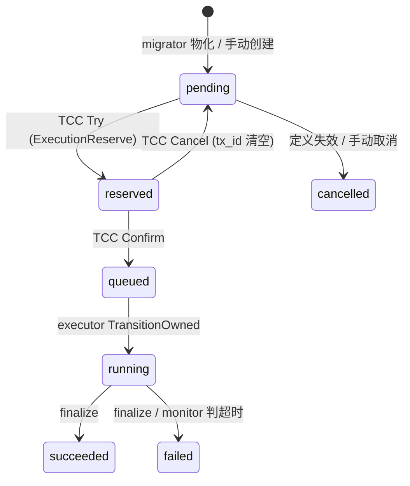

:::note 事实基线
源码均实读自 `$HOME/github/yukino.go`（HEAD `facf5d6a8670`）:`apps/task_flow`（AI 任务编排与执行系统:cron/事件触发 → 幂等派发 → MQ 执行 → 监控恢复 → 审计）与 `apps/agent_proxy`（LLM 协议翻译网关:Anthropic/OpenAI 双向桥接、流式转发、daemon 管理）；路径相对仓库根目录；`源码:` 为事实基线，通用部分为方案推导。
:::

本篇以两个真实应用为骨架出题:**task_flow**（`apps/task_flow`，AI 任务编排与执行系统:cron/事件触发 → 幂等派发 → MQ 执行 → 监控恢复 → 审计）与 **agent_proxy**（`apps/agent_proxy`，LLM 协议翻译网关:Anthropic/OpenAI 双向桥接、流式转发、daemon 管理）。源码均实读自 `yukino.go` 仓库 HEAD `facf5d6a8670`，路径相对仓库根目录；`源码:` 为事实基线，通用部分为方案推导。

**主线一览**



## 一、task_flow 总体架构与状态机

### Q1. 讲一下 task_flow 的整体架构与角色分工。

源码:`apps/task_flow/server/`。系统把「AI 任务」（本质是一次带 prompt 的 LLM agent 运行）的**定义、触发、派发、执行、恢复、审计**拆成独立环节:

| 环节 | 组件                                                    | 职责                                              |
| ---- | ------------------------------------------------------- | ------------------------------------------------- |
| 定义 | `ScheduledTask` / `ConditionTask`（MySQL）              | cron 任务与事件触发任务的声明                     |
| 物化 | `Migrator`（`engine/migrator.go`）                      | cron 展开成未来窗口的 `Execution` 行 + 时间轮注册 |
| 触发 | `RTimeWheel` 回调 `/internal/v1/fire`；CDC relay        | 到点触发 / 数据变更触发                           |
| 派发 | `Dispatcher`（`engine/dispatcher.go`）                  | 幂等认领 + TCC 事务（预留 + 入队）                |
| 执行 | `Executor`（`engine/executor.go`）+ red_mq 消费组       | 状态机推进 + LLM agent 运行 + 报告渲染            |
| 恢复 | `Monitor`（`engine/monitor.go`）                        | 巡检 stuck/overdue，重派发/重投/判失败            |
| 审计 | `journal`（lsm_tree）+ `consensus.Ledger`（raft）       | 派发与终态的不可篡改记录                          |
| 观测 | OTel trace + Sentry + Redis stats + Prometheus 风格指标 | 全链路可观测                                      |

三类任务（`model/po/po.go`）:`TaskTypeScheduled`（cron）、`TaskTypeCondition`（表变更事件）、`TaskTypeManual`（手动触发）。

### Q2. `Execution` 的状态机是怎样的？为什么要有 `reserved` 这个中间态？

源码:`model/po/po.go` 定义七个状态:`pending → reserved → queued → running → succeeded / failed / cancelled`。



`reserved` 的意义:派发是「DB 状态变更 + MQ 投递」**两个系统的复合操作**，用 TCC 包裹（见 Q12）。`reserved` 就是 Try 阶段的资源冻结态——执行记录已被某个事务认领（`tx_id` 落库），但尚未入队；Confirm 才进 `queued`，Cancel 退回 `pending` 并释放幂等认领。没有这个中间态，就无法表达「已认领未入队」的悬挂窗口，monitor 也无法区分「没人管」与「事务在途」。

### Q3. `FireKey` 是什么？三种任务的 FireKey/触发方式有何不同？

源码:`Execution.FireKey` 是 `size:191;uniqueIndex` 的唯一键——**一次触发的全局幂等标识**。

- scheduled:`SchedFireKey(taskID, fireAt) = "sched:{taskID}:{fireAt.Unix()}"`（`migrator.go`）——同一任务同一触发时刻全局唯一，重复物化被唯一索引挡住；
- condition:由事件派生（`engine/condition.go`，基于变更事件键）；
- manual:API 创建时生成。

派发侧围绕 FireKey 建了三层防重（Q10）；执行命令 `ExecCommand{ExecutionID, TxID, FireKey, TraceCarrier}` 也携带它做端到端校验（`executor.go` 的 `cmd.FireKey != exec.FireKey` 直接报错）。**采分点**:幂等键要在**业务语义**上定义（任务 × 触发时刻），而不是用随机 UUID——UUID 只能防重复提交，防不了重复触发。

### Q4. 完整描述一次 cron 任务从定义到执行完成的链路。

1. **物化**（`migrator.go`）:`MigrateTickSeconds`（默认 30s）tick；先查 `SingletonRegistry.IsOwner(SingletonMigrator)`（一致性哈希定主）+ 抢 `task_flow:lock:migrator` Redis 锁（TTL = 2×tick）；对每个启用的 ScheduledTask:按 `Timezone`（默认 `Asia/Shanghai`）加载时区、`cronx.Parse` 解析，从 `max(recoverStart, task.CreatedAt)` 迭代 `schedule.Next` 直到 `windowEnd = now + MigrateStepMinutes`（默认 60min）；每个触发点 `InsertPending` 一条 execution（FireKey 唯一索引去重），并向 `RTimeWheel` 注册 HTTP 回调（`POST {BaseURL}/internal/v1/fire`，带 `Bearer InternalToken` 与节点/触发时刻头）；已过点的触发把 executeAt 推到 `now+5s` 立即补跑；
2. **触发**:时间轮到点回调 fire API → `Dispatcher.Dispatch`；
3. **派发**（`dispatcher.go`）:到期检查 → 定义有效性检查（任务被删/禁用/cron 已变 → 直接 `cancelled`）→ 布隆预检 → `ClaimFire` 认领 → TCC（reserve + enqueue）→ 布隆标记 + journal + ledger 审计；
4. **执行**（`executor.go`）:消费组拉到命令 → `awaitSettled` 等状态落定 → `TransitionOwned(queued→running)` → `runExecution`:加载定义快照（prompt/model）→ `llm.Agent.Run` → `finalize`（渲染报告、写 token/tool 统计、`TransitionOwned(running→终态)`、更新 `last_fire_at`、journal + ledger 审计）。

### Q5. condition 任务的触发链路是什么？

源码:`cdc/capture.go` + `cdc/relay.go` + `engine/condition.go`:

1. **捕获**:`EnsureCapture(table)` 给被监听表安装 `AFTER INSERT` 与 `AFTER DELETE` **MySQL 触发器**，把整行序列化为 JSON 写入 `task_flow_changes` 表（`ChangeEvent{EventKey(UUID), SourceTable, Operation, RecordJSON, OccurredAt, ProcessedAt}`）；触发器名 `task_flow_capture_v1_{sha256(table:op)前8字节hex}`，装前用 `GET_LOCK('task_flow:capture:'+table, 10)` 防并发安装；二进制列自动 `HEX()`；表名走白名单校验（`identifier` 正则 + 排除 `task_flow_*` 等系统表），**防 SQL 注入**；
2. **扇出**:`Relay.Drain` 每秒执行，`fanout` 用 `SELECT ... FOR UPDATE SKIP LOCKED` 逐条认领未处理变更，匹配「启用中 + 监听该表 + 创建于变更之前」的 ConditionTask，为每个匹配生成触发；`publish` 把 outbox 条目发布到 MQ；
3. **执行**:进入与 scheduled 相同的 Dispatch → Execute 链路。

### Q6. CDC 为什么用触发器而不是 binlog 订阅？各自的取舍？

本实现选触发器（事实），取舍:

| 维度       | 触发器（本实现）                       | binlog 订阅（Canal/Debezium）    |
| ---------- | -------------------------------------- | -------------------------------- |
| 部署依赖   | 零额外组件，纯 SQL                     | 需要订阅进程、位点管理、权限配置 |
| 事务一致性 | **与业务写同事务**，变更与业务原子落库 | 异步消费，有延迟窗口             |
| 写放大     | 每次写多一条 INSERT，同库同表          | 不影响写路径                     |
| 覆盖能力   | 需要逐表安装；DDL 变更后要重装         | 全库自动                         |
| 权限要求   | 需要 CREATE TRIGGER                    | 需要 replication 权限            |

对「少量业务表 + 强一致要求（变更必须和业务写一起成功）」的场景，触发器是务实选择；大规模 CDC 应上 binlog 订阅。**采分点**:指出触发器与业务同事务既是优点（不丢事件）也是风险（触发器 bug 拖垮业务写），以及 `GET_LOCK` + 幂等触发器名保证安装安全。

### Q7. Outbox 模式是什么？task_flow 的 relay 怎么实现的？

**Outbox**:要「写 DB + 发消息」原子完成时，把消息先**写入与业务同库的 outbox 表**（同事务），再由独立 relay 进程把 outbox 投递到 MQ 并标记已发布——业务事务成功则消息必然最终发出（at-least-once）。

源码:`model/po/po.go` 的 `Outbox{EventKey 唯一, Topic, Payload, PublishedAt}` + `cdc/relay.go`:`Drain(budget=100)` 每轮先 `fanout`（变更 → 触发）再 `publish`（outbox → MQ），各最多 100 步；`fanout` 用 `FOR UPDATE SKIP LOCKED` 认领——**多 relay 实例可并行**，行锁 + 跳锁避免互相阻塞；`PublishedAt` 标记发布完成。

与「直接发 MQ 再写 DB」对比:后者任一环节失败都会造成「消息发了业务没写」或「业务写了消息丢了」；outbox 把分布式事务降级为本地事务 + 异步重放，代价是延迟（relay 轮询间隔）与至少一次语义（消费端要幂等）。

### Q8. raft Ledger 在 task_flow 里做什么？为什么是单节点 raft？

源码:`consensus/ledger.go`:`NewLedger(id)` 用 `raft.MemoryStorage` 起**单节点** raft（`PreVote: true, ElectionTick: 10, HeartbeatTick: 1`），100ms tick；`Propose(ctx, key, value)` 把「dispatch:{fireKey}」「finish:{id}」等审计事件走一遍共识日志，apply 后写入内存 `state map` 与 `recent []AppliedEntry`（`recentCap = 64` 环形保留），并维护 `applied/proposed` 计数与 soft/hard state 快照供 API 查询。

为什么单节点:它不是为容错，而是把审计写入**收敛成一条全序日志**——所有审计事件经过 propose → commit → apply 的确定性管线，天然有序、可回放、有 index/term 坐标；同时这块代码是 `components/raft` 的实战集成示范（Q16 的 raftkv 同款模式）。多节点部署时每个节点各有一个 Ledger（事实），审计的最终权威是 MySQL + journal，Ledger 是节点内的有序事件视图。**面试口径**:如实说明「单节点 raft 提供全序与结构化审计，不是高可用手段」。

### Q9. journal 为什么用 lsm_tree 做存储？

源码:`journal/journal.go`:`Open(dir, nodeID)` 以 `lsm_tree.NewConfig(dir, WithMaxLevel(4), WithSSTSize(1<<20), WithSSTNumPerLevel(4), WithSSTDataBlockSize(16<<10))` 建本地 LSM 树；`RecordDispatch/RecordOutcome` 把审计条目 JSON 化后以 `fk:{fireKey}` 为 key 写入（同 fireKey 的后续记录覆盖前一条——LSM 的新胜旧语义正好表达「最新状态」）。

选型逻辑:审计是**纯追加、写多读少、按 key 查最新**的负载——正是 LSM 的主场；嵌入式（无外部依赖）、WAL 保证进程崩溃不丢已确认记录；参数刻意调小（4 层、1MB SST）匹配审计数据量。**采分点**:能把存储引擎特性（Q18-20 的分布式组件篇）与业务负载对上号。

## 二、幂等与防重体系

### Q10. Dispatcher 的防重有几层？各防什么？

源码:`engine/dispatcher.go` 的 `Dispatch`，四层:

1. **MySQL 唯一索引**（`FireKey uniqueIndex`）:物化阶段就挡住重复触发记录——数据库层最终权威；
2. **布隆预检**（`bloom.MaybeSeen(fireKey)`）:命中「可能已派发过」则查库确认——同 ID 且非 pending 直接抑制。布隆挡掉绝大多数重复请求的**查库成本**，fail-open（Redis 故障时返回 false 放行，见 Q11）；
3. **Redis SETNX 认领**（`idem.ClaimFire`，键 `task_flow:idem:fire:{fireKey}`，带 TTL）:跨节点的「谁来做这次派发」互斥——多实例同时收到 fire 回调时只有一个认领成功；
4. **状态复查**（认领后 `GetExecution` 确认仍是 `pending`）:认领与执行之间仍有窗口，以 DB 状态为准。

四层的关系:唯一索引防**重复记录**，SETNX 防**并发派发**，状态复查防**时序竞态**，布隆是**性能加速层**。任何一层失效，其余层仍能保证正确（最坏多查几次库）——纵深防御。

### Q11. 布隆过滤器为什么 fail-open？如果 fail-closed 会怎样？

源码:`idem/bloom.go` 的 `MaybeSeen`:Redis 出错时 `slog.Warn("failing open")` 并返回 false（当作没见过）。

布隆在这里是**优化层不是正确性层**:fail-open 只是让重复请求走到后续 SETNX/DB 层被挡下（多花一次查询）；若 fail-closed（出错当「已见过」），Redis 抖动期间**所有正常触发都会被误杀**——任务漏执行是比重复执行严重得多的故障（重复有幂等兜底，漏执行没有）。**原则**:加速/过滤组件故障时要退化到慢路径（fail-open），只有安全组件（鉴权、限流）才 fail-closed。timer 的 executor 布隆判重同理（分布式组件篇 Q48）。

### Q12. 派发为什么必须是 TCC 事务？两个组件分别做什么？

源码:`dispatcher.go` 调 `manager.Transaction` 传入两个组件（`engine/components.go`）:

- `ComponentExecutionReserve`（MySQL）:Try = `Transition(pending→reserved, tx_id, claimed_at)`；Confirm = `TransitionOwned(reserved→queued)`；Cancel = `TransitionOwned(reserved→pending)` 并清空 tx_id、`ReleaseFire` 释放幂等键；
- `ComponentMQDispatch`（Redis Streams）:Try = `producer.SendMsg(ExecTopic, fireKey, cmd)`；Confirm/Cancel 均为直接 ACK 的 no-op。

要原子化的矛盾:「执行记录置为已派发」与「执行命令入队」分属 MySQL 与 Redis，任一失败都会造成**状态与消息不一致**——只改状态没入队 → 任务卡死；只入队没改状态 → 重复派发。TCC 把两者纳入同一事务:任一 Try 失败，TXManager 驱动 Cancel 回滚预留、释放幂等键。

**深挖**:MQDispatch 的 Cancel 是 no-op——消息已经发出去了怎么「回滚」？答案是**不回滚消息，靠消费端状态机消化**:executor 的 `awaitSettled` 发现 execution 仍是 `pending` 且 `TxID` 与命令不符（事务已回滚、记录被新事务接管或释放），直接丢弃命令（`stale exec command ignored`）。这是「消息不可撤回时，用接收方状态判定代替发送方回滚」的经典手法。

### Q13. `claimStuckThreshold` 的接管逻辑解决什么问题？

源码:`dispatcher.go`:`ClaimFire` 失败（别的实例已认领）时复查 DB——若记录仍是 `pending` 且 `UpdatedAt` 距今超过 `claimStuckThreshold = 5min`，日志标记「taking over stuck pending execution」继续派发。

问题场景:实例 A 认领成功（SETNX 带 TTL），但在 TCC 完成前崩溃且**没来得及释放**——SETNX 键有 TTL 会过期，但若 TTL 较长或时钟因素，记录可能长时间卡在「已认领无人管」。5 分钟阈值给了正常 TCC 流程充足时间（秒级），超过即判定原认领者失活，允许接管。**采分点**:所有「认领-执行」模型都要回答「认领者死了怎么办」——答案无非:租约 TTL 自动过期、监控兜底重派、超时接管三选一或组合。

### Q14. API 层的 `Idempotency-Key` 是怎么用的？

源码:`server/api.go` 的创建类接口（如手动触发）读取 `Idempotency-Key` 请求头:带 key 的请求先查该 key 是否已有结果，有则直接返回缓存的结果而不重复执行；无则执行并记录。CORS 中间件也把 `Idempotency-Key` 列入 `Access-Control-Allow-Headers`（`server/middleware.go`）。

这是 Stripe 风格的**客户端幂等**协议:网络超时后客户端可以安全重试同一个 key。与 FireKey 的区别:FireKey 是服务端按业务语义生成的**触发**幂等键；Idempotency-Key 是客户端提供的**请求**幂等键，防的是「重试导致重复创建」。两者分别守住入口与执行两道门。

### Q15. `awaitSettled` 的状态判定表是怎样的？为什么需要等待窗口？

源码:`executor.go` 的 `awaitSettled`:最多 12 次、每次间隔 500ms 轮询 execution:

| DB 状态 + TxID 对比             | 动作                                 |
| ------------------------------- | ------------------------------------ |
| `cancelled`                     | 返回 nil（不执行）                   |
| `running/succeeded/failed`      | 返回 nil（已有别人在跑/跑完）        |
| `pending` 且 `TxID == ""`       | 继续等（可能被 Cancel 后重新派发中） |
| `pending` 且 `TxID != cmd.TxID` | 返回 nil（命令被新事务取代）         |
| `TxID != cmd.TxID`（其他状态）  | 返回 nil（stale 命令）               |
| `reserved`                      | 继续等（TCC 还没 Confirm）           |
| `queued`                        | **返回 execution，开始执行**         |
| 12 次后仍未落定                 | 报错（消息将重试/进死信）            |

为什么需要等待窗口:MQ 消息（Try 阶段发出）可能**先于** TCC Confirm 落库到达消费者——此时 DB 还是 `reserved`。消费者若立即按「不是 queued」丢弃，会漏执行；等一等让事务收敛。TxID 对比是**消息与 DB 的关联校验**:同一 execution 可能被多轮事务经手（取消后重派），只有当前 TxID 的命令才有效。**采分点**:能讲出「消息与状态的先后竞态」以及「用事务 ID 做消息版本」两个要点。

## 三、执行与消费工程

### Q16. executor 的消费组是怎么配置的？各参数的含义？

源码:`executor.go` 的 `Start(workers)`，每个 worker 一个 `red_mq.Consumer`（consumerID = `{nodeID}-exec-{i}`）:

- `WithMaxRetryLimit(cfg.MQ.MaxRetry)`:默认 3 次后进死信表（`DeadLetterMailbox.ForTopic` 落 MySQL + Sentry 上报）；
- `WithReceiveTimeout(ReceiveTimeoutMs)`:XREADGROUP 阻塞时长；
- `WithHandleTimeoutSeconds(HandleTimeoutSeconds)`:默认 900s，单批处理 ctx 超时；
- `WithAbandonedMessageRecovery(HandleTimeoutSeconds + 60)`:XAUTOCLAIM 的空闲阈值——**必须大于处理超时**，否则正常处理中的消息会被别的 worker 抢走并发双跑。

配置校验（`conf/conf.go`）强制两个不等式:`HandleTimeoutSeconds > TimeoutSeconds`（单条执行超时 600s < 批处理超时 900s）且 `StuckRunningMinutes×60 > TimeoutSeconds`（monitor 判 stuck 的 30 分钟阈值必须大于执行超时，否则会误杀正在跑的任务）。**采分点**:超时参数不是各写各的，存在**偏序约束**——能讲出这条链（执行 < 批处理 < 认领 < stuck 判定）就是真懂超时设计。

### Q17. `runExecution` 到 `finalize` 有哪些工程细节？

源码:`executor.go`:

1. `runExecution` 顶层 `defer recover`——panic 转 `CapturePanic` 上报并以 failed 收尾，**保证状态机不会停在 running**；
2. 定义快照:`defs.LoadDefinition` 取 prompt/model（DefinitionCache 带 TTL，默认 60s，monitor 有 drift 修复），model 为空回退 `cfg.LLM.Model()`；执行用的是**派发时刻的定义快照**（`PromptSnapshot/ModelSnapshot` 在物化时落库），任务定义中途修改不影响在途执行；
3. `finalize` 用 `context.WithoutCancel(ctx) + 15s`——执行 ctx 超时/取消后，收尾（写终态、报告、审计）**必须完成**，否则产生 stuck running；
4. 报告渲染失败会把成功的执行翻转为 failed（`reportErr != nil && runErr == nil` → status=failed）——报告是交付物的一部分；
5. `TransitionOwned(running→终态)` affected==0 时只告警不报错（执行已被 monitor 判失败接管）；
6. 成功后更新 `ScheduledTask.last_fire_at`；`reports.Warm` 预热报告缓存（Redis，`ReportExpireSeconds` 默认 600s）。

### Q18. monitor 的 sweep 做哪几件事？为什么用时间轮调度自己？

源码:`monitor.go`:`Start` 建 `time_wheel.NewTimeWheel(32, 5s)`，用固定 key `monitor-sweep` 挂任务，`scheduleSweep` 执行完再挂下一次（30s 后）——**自续期任务**，利用时间轮同 key 覆盖语义天然防重入。sweep（50s ctx）顺序执行:

1. `failStuckRunning`:running 超过 `StuckRunningMinutes`（默认 30min）的判 failed（「节点崩溃或 LLM 调用挂起」），8 worker 并发处理；
2. `redispatchOverdue`:pending 超过 `OverdueRecoverMinutes`（默认 2min）的重新走 `Dispatch`（配合 Q13 的接管逻辑）；
3. `republishStuckQueued`:queued 超时的重新投递 MQ 命令（带原 TxID）；
4. `syncData`:执行状态镜像同步（Q22）+ 定义缓存 drift 修复；
5. `publishStats`:当日执行统计 + 启用任务数 + 角色归属 + 镜像大小，JSON 写 Redis（`task_flow:monitor:stats`，TTL 2min）供 API 查询。

### Q19. monitor 为什么需要「单例角色 + Redis 锁」双保险？

源码:`monitor.go` 的 `sweep` 开头两道闸:`registry.IsOwner(SingletonMonitor)`（一致性哈希判定本节点是否是 monitor 角色归属者）+ `redis_lock.NewRedisLock("task_flow:lock:monitor", WithExpireSeconds(55))`。

- 哈希定主是**常态优化**:多节点集群里 monitor 工作（扫描全表、批量恢复）只需一个节点做，按角色 key 哈希归属固定节点，避免 N 个节点重复扫描；
- Redis 锁是**正确性闸门**:哈希环在节点增删/心跳抖动时可能短暂双主（归属迁移窗口），锁保证任一时刻 sweep 互斥；55s 过期 > 50s sweep ctx，正常情况锁随流程释放，异常崩溃后 55s 自动恢复；
- `IsOwner` 在环查询出错时**返回 true**（fail-open，`registry.go`）——宁可多节点同时尝试（有锁兜底），不能因环故障让 monitor 整体停摆（恢复机制本身不能成为单点）。

### Q20. `SingletonRegistry` 的成员管理与角色分配怎么实现？

源码:`engine/registry.go`:

- **注册**:`Register` 先 `beat`（`SET task_flow:node:{nodeID} now EX 45`）再 `ring.AddNode(nodeID, weight=1)`（`components/consistent_hash` 的 Redis 环），随后 15s 间隔心跳循环；
- **心跳与驱逐**:`heartbeatTTL = 45s = 3 × heartbeatInterval(15s)`——三次心跳失败判死；每轮心跳顺带 `evictDeadNodes`:遍历环节点，心跳键不存在的 `ring.RemoveNode` 摘除；
- **角色归属**:`IsOwner(roleKey) = ring.GetNode(roleKey) == nodeID`——角色 key（`task_flow:singleton:migrator/monitor`）按一致性哈希落到某节点；节点增删时角色自动迁移（哈希环语义），无需选举协议；
- **可观测**:`Members` API 输出每个节点的 weight/alive/self 与两个角色的当前归属。

对比 etcd 选主（lease + campaign）:哈希定主**无选举开销、无任期抖动**，但依赖所有节点对环视图一致（所以环变更要加锁、要有驱逐机制）。适合「少量固定角色、可容忍秒级双主窗口（有锁兜底）」的场景。

### Q21. 执行状态镜像（mirror）同步是怎么做的？为什么写 Redis 要用 Lua 比较时间戳？

源码:`storage/mirror.go` 的 `SyncExecutionMirror` + `monitor.go` 的 `syncData`:

- **游标分批**:`mirrorCursor{LastID, MaxID, Prune}` 存 Redis；每批 `WHERE id > LastID AND id <= MaxID ORDER BY id LIMIT 500`，monitor 每轮最多 4 批——按主键范围推进的增量同步，重启后从游标续传；
- **Lua 防回退写入**:`mirrorWrite` 脚本先 `HGET` 旧值，若旧值 `updated_at > 新值` 则拒绝写入——多来源（monitor 同步、API 实时更新）并发写同一 execution 的镜像时，**旧状态不能覆盖新状态**（例如 running 不能盖掉已写入的 succeeded）；
- **裁剪**:7 天前的终态条目跳过写入，镜像键整体 TTL 7 天（`execMirrorTTL`）——镜像是**热数据视图**，不是存储；
- 用途:`StatusMirror` API 用 `HSCAN` 快速查状态，不打 MySQL。

**采分点**:「镜像/缓存的并发写要带版本比较」是通用原则——这里的版本是 `updated_at`，也可以是单调序号（与 fencing token 同源）。

### Q22. task_flow 的可观测性体系包含哪些部分？

源码映射:

| 支柱  | 实现                                                                                                                                                                                                                                       |
| ----- | ------------------------------------------------------------------------------------------------------------------------------------------------------------------------------------------------------------------------------------------ |
| Trace | `telemetry/telemetry.go`:OTel SDK，W3C `TraceContext + Baggage` 传播器，exporter 可选 stdout/file；`TraceMiddleware` 从请求头 Extract、回写 `X-Trace-Id`；trace 载体随 `ExecCommand.TraceCarrier` 跨 MQ 传播（`telemetry.Inject/Extract`） |
| 错误  | `obsx/sentry.go`:`CaptureError/CapturePanic` 上报 Sentry；`SentryRecoverMiddleware` 兜底 HTTP panic                                                                                                                                        |
| 指标  | monitor `publishStats`（Redis）+ `/api/v1/monitor/*` API 族（nodes/stats/cache/dead-letters/consensus/journal/mirror/storage）                                                                                                             |
| 日志  | `AccessLogMiddleware`（method/path/status/duration_ms 结构化 slog）                                                                                                                                                                        |
| 审计  | journal（LSM）+ Ledger（raft）+ `/monitor/journal`、`/monitor/consensus` 查询 API                                                                                                                                                          |
| 报告  | `ReportStore` 渲染执行报告（path/body/excerpt 280 字摘要），`/executions/:id/report` 提供                                                                                                                                                  |

亮点:**trace 跨 MQ 传播**——派发时把 traceparent 注入消息体（`TraceCarrier`），executor 消费时 Extract 接续，LLM 执行的 span 与触发请求同一条 trace。这是很多系统缺失的一环（消息队列断链）。

## 四、HTTP 服务工程与安全

### Q23. Token 鉴权为什么用 `subtle.ConstantTimeCompare`？

源码:`server/middleware.go` 的 `TokenMiddleware`:

```go
expected := sha256.Sum256([]byte("Bearer " + token))
received := sha256.Sum256([]byte(ctx.Get("Authorization")))
if subtle.ConstantTimeCompare(expected[:], received[:]) != 1 { ... 401 }
```

普通字符串比较在**第一个不同字节处提前返回**，攻击者可通过测量响应时间逐字节猜出 token（时序攻击）。`ConstantTimeCompare` 对全长做异或累积，耗时与匹配长度无关。先 SHA-256 再比较还有两个好处:① 归一化长度（ConstantTimeCompare 对不等长输入直接返回 0，会泄露长度信息）；② 内存中不出现明文 token 的逐字节比对。失败时设置 `WWW-Authenticate: Bearer` 符合 RFC 6750。**采分点**:能讲出「为什么先哈希」而不只是「防时序攻击」。

### Q24. internal 端点的鉴权策略是什么？

源码:`TokenMiddleware(token, internal)`:配置了 token 则任何来源都校验 Bearer；未配置 token 且 `internal=true` 时**要求 loopback 连接**（解析 `RemoteAddr` 的 IP，非回环地址 403）。

`/internal/v1/fire` 是时间轮回调入口:生产配置 InternalToken（migrator 注册回调时带 `Authorization: Bearer {token}`），开发环境可退化为仅本机访问。这是「内部接口也要有门禁，门禁形式按部署形态选择」的务实设计。**注意**:RemoteAddr 判回环只在**无代理直连**时可信，若前面有 LB，取到的是 LB 地址——面试要点出这个前提。

### Q25. BodyLimit 中间件做了哪些防护？

源码:`middleware.go` 的 `BodyLimitMiddleware`:

1. `ContentLength > 1MB` 直接 413（快路径拒绝，不读 body）；
2. `http.MaxBytesReader` 包 body——**chunked 传输没有 ContentLength 也能限流**，超限读取报错；
3. `X-Content-Type-Options: nosniff`——禁止浏览器 MIME 嗅探，防内容类型混淆攻击；
4. `/api/` 路径加 `Cache-Control: no-store`——API 响应不进任何缓存。

与 agent_proxy 的 32MiB 限制（Q31）对比:管理面 API 的 body 都是小 JSON，1MB 足够且越小越安全；代理转发面要承载 LLM 长上下文，限额放大 32 倍。**限额要匹配业务形态，不是越小越好也不是越大越好**。

### Q26. CORS 中间件为什么回显具体 Origin 而不是 `*`？

源码:`CORSMiddleware(allowAll, allowedOrigins)`:白名单匹配（或 allowAll）后 `Access-Control-Allow-Origin: {具体 origin}` + **`Vary: Origin`**；预检 OPTIONS 直接 204。

- `*` 与**携带凭据**（cookies/Authorization）的请求不兼容（浏览器规范禁止），且把响应暴露给任意站点；回显具体 origin 才能配合 `Access-Control-Allow-Credentials`；
- `Vary: Origin` 告诉缓存层「响应随 Origin 变化」，否则 CDN/代理可能把 A 站点的 CORS 响应缓存给 B 站点——**CORS 配置最隐蔽的坑**；
- `Access-Control-Max-Age: 600` 缓存预检 10 分钟，减少 OPTIONS 请求；允许的 headers 明确列出（含 `Idempotency-Key`、`traceparent`）。

### Q27. health 与 ready 探针有什么区别？task_flow 怎么实现的？

源码:`server/server.go`:`/api/v1/health`（`handleHealth`）与 `/api/v1/ready`（`handleReady`，走 `s.ready` 回调检查依赖），两者与 `/telemetry/log` 一起豁免 Token 鉴权。

- **liveness（health）**:进程活着且 HTTP 层能响应——失败意味着该重启；
- **readiness（ready）**:依赖就绪（DB/Redis 可连、引擎启动完成）——失败意味着暂时摘流量，不该重启；
- 混淆两者的后果:把「Redis 抖动」当 liveness 失败 → 节点被杀 → 雪崩；把「启动中」当 ready 成功 → 流量打到未就绪节点 → 错误。K8s 里对应 `livenessProbe/readinessProbe`。**采分点**:ready 检查要覆盖**关键依赖**但别过度（把非关键依赖放进去会造成不必要的摘流）。

### Q28. 配置校验里的超时不等式为什么重要？

源码:`conf/conf.go` 的校验:`HandleTimeoutSeconds <= TimeoutSeconds` 或 `StuckRunningMinutes*60 <= TimeoutSeconds` 直接拒绝启动。

这三层超时的语义链:**单条执行超时（600s）< 批处理超时（900s）< stuck 判定阈值（1800s）**。若倒挂:执行超时 ≥ 批处理超时 → ctx 先被批处理取消，执行永远等不到自己的超时；stuck 阈值 ≤ 执行超时 → monitor 把正常长跑任务判死。类似约束还有 XAUTOCLAIM idle > HandleTimeout（Q16）。**原则**:超时体系是**偏序关系**，配置层把非法偏序挡在启动前，比运行时诡异行为便宜得多。

## 五、agent_proxy:LLM 协议翻译网关

### Q29. agent_proxy 解决什么问题？整体形态？

源码:`apps/agent_proxy/`。Coding agent CLI（Claude Code / Codex）各自绑定自家 API 协议；agent_proxy 在本地起一个**协议翻译代理**:对 agent 暴露 Anthropic 风格 `/v1/messages`，对上游按 provider 配置说 anthropic / openai（Responses）/ openai-compat（Chat Completions）——让任意 agent 接任意模型后端。形态:

- `claude/proxy` 与 `codex/proxy` 两套桥接（`bridge/` 目录:request/response 翻译、SSE 流转换、thinking/tools 适配）；
- `daemon/`:后台进程管理（状态文件 + PID 存活检查 + 控制 token）；
- `mcpserver/`:把「启动/停止代理」本身暴露为 MCP 工具（`StartInput{Agent, Protocol, Name}`），供 agent 自助管理；
- 基于 `libs/yukino_http` 构建（复用 SSE、中间件能力）。

### Q30. Provider 配置模型有哪些校验？安全意识体现在哪？

源码:`internal/config/config.go`:`~/.yukino/config.yaml`，`Provider{Name, Protocol, BaseURL, Model, APIKey, Thinking, ContextWindow, MaxOutputTokens}`。`Validate()` 的校验链:

1. protocol ∈ {anthropic, openai, openai-compat}；name/model 非空；
2. **BaseURL 必须是纯 HTTP(S)**:`u.Host` 非空、scheme 限 http/https、**禁止 User（内嵌凭据）、RawQuery、Fragment**——防止 `base_url: https://evil.com?redirect=...` 这类注入与凭据混入 URL；
3. token 限额非负；
4. Thinking 级别归一化:`enabled/adaptive → high`，非法值报错——把上游五花八门的开关收敛成有限枚举；
5. APIKey 先 `os.ExpandEnv`（支持 `${KEY}` 引用环境变量），为空则按协议回退 `ANTHROPIC_API_KEY`/`OPENAI_API_KEY`，仍为空报错。

`UnmarshalYAML` 还自定义 AST 校验 `default_provider` 必须是整数——配置错误在加载期报出，而不是运行期 panic。**采分点**:URL 校验那三条（无凭据/无 query/无 fragment）是 SSRF 与凭据泄漏的第一道防线。

### Q31. `/v1/messages` 的请求处理路径有哪些防御性设计？

源码:`claude/proxy/server.go`:

1. **体积限制**:`MaxBody = 32MiB`，`http.MaxBytesReader` 限流读取；
2. **严格 JSON**:decoder 解完一个对象后再 `Decode(&trailing)`，非 EOF 即报「must contain exactly one JSON object」——拒绝多文档拼接注入；
3. **类型校验**:`stream` 字段存在则必须是 bool；
4. `bridge.Request(body, provider)` 做协议翻译（Anthropic 请求 → 上游格式，含 model 替换为 provider 配置的模型）；
5. `count_tokens` 端点仅 anthropic 协议可用，其他返回 501——**能力矩阵如实暴露**，不假装支持；
6. `/v1/models` 返回单模型列表、`/health` 返回服务状态——模拟 Anthropic API 表面，让 agent 的探测逻辑正常工作。

### Q32. 流式响应是怎么桥接的？非流式请求遇到流式上游怎么办？

源码:`proxy/server.go` 的 `handleMessages` + `bridge/sse.go`:

- **判定 SSE**:上游 `Content-Type` 含 `text/event-stream`；若请求未声明 stream 且 Content-Type 不明，**嗅探首字节**——跳过空白后，非 `{`/`[` 开头即按 SSE 处理（兼容上游不标注 Content-Type 的情况）；
- **stream=true**:`c.SSE()` 开流 + `Heartbeat(15s)` 防中间设备掐空闲连接；`bridge.Stream(reader, protocol, model, sink)` 逐事件翻译（OpenAI chat/responses 事件 → Anthropic 的 `message_start/content_block_delta/...` 事件族，`payload["type"] = event` 保持自描述）；sink 每次发送前检查 `ctx.Err()`——客户端断开即停；
- **stream=false 但上游是 SSE**:`bridge.Collector` 把所有事件**聚合成一条完整 message** 返回 JSON——协议适配不仅是事件翻译，还要做「流 ↔ 非流」的形态转换；
- **错误脱敏**:流中错误用 `redact(err.Error(), APIKey)` 把意外混入的 API key 替换成 `[redacted]`。

### Q33. 上游客户端为什么 `MaxRetries(0)` + `Accept-Encoding: identity`？

源码:`upstream/client.go`:anthropic-sdk-go / openai-go 客户端都 `WithMaxRetries(0)`，HTTP client `Timeout: 10*time.Minute`，请求头强制 `Accept-Encoding: identity`，anthropic 路径额外 `WithHeaderDel("Authorization")`（删掉调用方透传的 Authorization，用配置里的 key）并透传 `anthropic-version/anthropic-beta`。

- **禁 SDK 重试**:代理是**转发层**，重试策略归客户端（agent 有自己的退避逻辑，见限流器篇的 `RateLimitError` 处理）；SDK 自动重试会让流式请求重放、让超时语义混乱——转发层保持透明；
- **identity**:禁用压缩，SSE 事件按原文字节流动——压缩会引入缓冲（破坏实时性）且部分上游在压缩流上的分块行为不一致；
- **10 分钟超时**:LLM 长输出（含 thinking）可能跑几分钟，代理超时必须大于上游最长生成时间；
- **删 Authorization**:防止调用方的凭据被意外转发到配置之外的上游——**凭据边界在代理层收敛**。

### Q34. 上游错误是怎么映射回 Anthropic 错误语义的？

源码:`proxy/server.go` 的 `upstreamError`:

| 上游状态码  | 映射的 error kind       |
| ----------- | ----------------------- |
| 400/404/422 | `invalid_request_error` |
| 401         | `authentication_error`  |
| 403         | `permission_error`      |
| 429         | `rate_limit_error`      |
| 529         | `overloaded_error`      |
| 其他 ≥400   | `api_error`             |

同时:状态码 <400 的异常响应统一 502；上游 body 里若有 `error.message` 则透传文案（脱敏后）；**`Retry-After` 响应头原样转发**——客户端的退避策略依赖它；所有错误响应保持 Anthropic 的 `{type: "error", error: {type, message}}` 形状——agent 的错误处理代码无需感知上游差异。**采分点**:协议网关的职责是「把上游的差异性吸收掉，向下游呈现单一契约」，错误形状统一与 Retry-After 透传是两条硬指标。

### Q35. daemon 模式与控制通道怎么保证安全？

源码:`daemon/serve.go` + `manager.go`:控制 token = `"control_" + hex(crypto/rand 12 字节)`（96 位熵），进程状态写状态文件（含 PID），启动前 `processAlive(current.PID)` 检查防重复启动（`lockStartup` 加锁串行化启动竞态）。Unix/Windows 分别实现进程管理（`process_unix.go/process_windows.go`）。

要点:本地控制面也要鉴权——同机其他进程若能调控制端口，就能篡改代理配置或窃取上游凭据；随机 token + 文件权限是最低成本的本地鉴权。PID 存活检查解决「状态文件残留导致无法启动」的经典问题，但 PID 复用（回绕）是已知边界——更严谨可用进程启动时间戳比对（方案推导）。

## 六、通用服务架构方法论

### Q36. 服务注册发现有哪些实现形态？怎么选型？

| 形态              | 代表                               | 故障感知         | 依赖           |
| ----------------- | ---------------------------------- | ---------------- | -------------- |
| 租约 + 强一致存储 | etcd（yukino_cache 篇 Q29）        | TTL 到期自动删键 | 需要 etcd 集群 |
| 心跳 + 哈希环     | task_flow SingletonRegistry（Q20） | 3 次心跳失败驱逐 | 只需 Redis     |
| 客户端探测        | DNS + 健康检查                     | 探测周期         | 无中心         |
| Sidecar/服务网格  | Istio                              | 数据面感知       | 基础设施重     |

选型维度:一致性要求（租约型强、心跳型有窗口）、运维成本、故障感知时延、与既有基础设施的匹配。面试讲法:先给分类，再用项目两个实例（etcd 版与 Redis 版）说明同一问题的两种取舍。

### Q37. 限流、熔断、降级分别是什么？算法与关键参数？

- **限流**:保护自身不被打垮。算法:固定窗口（边界 2× 突发）、滑动窗口日志（精确、O(limit) 内存，见[代码题:限流器](/interview/code/rate-limiter)）、滑动窗口计数（近似 O(1)）、令牌桶（允许突发、控速率）、漏桶（恒定输出）。参数:limit、window、突发容量、拒绝策略（429 + Retry-After）；
- **熔断**:保护下游不被无效请求轰炸、保护自己不等待必败请求。状态机 closed → open（失败率/慢调用率超阈值）→ half-open（放探测流量）；参数:窗口大小、失败率阈值、open 时长、half-open 探测数；
- **降级**:功能层面的取舍——返回缓存旧值、默认值、简化结果。项目例证:`yukino_cache` peer 失败回源 getter、布隆 fail-open、agent_proxy count_tokens 不可用返回 501 而非挂起。

三者关系:限流是入口闸门（量），熔断是出口闸门（质），降级是业务兜底（功能）。

### Q38. 重试应该怎么设计？什么是重试风暴？

要素:**可重试错误分类**（网络/超时/429/5xx 可重试；4xx 业务错误不可重试，见 `redis_lock.IsRetryableErr` 的区分）、**退避**（指数 + 抖动，`register.go` 的 reRegister 1s→30s 封顶；[限流器篇](/interview/code/rate-limiter)的客户端退避链）、**次数上限**、**预算**（总耗时约束，gRPC deadline 传播）。

重试风暴:下游变慢 → 上游重试放大流量 → 下游更慢 → 正反馈压垮系统。防护:① 抖动打散同步重试；② 熔断器在失败率高时直接快速失败（不重试）；③ 服务端过载信号（429 + Retry-After、529 overloaded）让客户端有序退避；④ 队列/准入控制限制在途量。项目例证:red_mq 消费失败固定 1s backoff 防打爆 Redis；agent_proxy 转发层 MaxRetries(0) 把重试责任推回真正的发起方（Q33）。

### Q39. 幂等与去重表怎么设计？与 Q10-15 的实战怎么对应？

通用模式:① **业务唯一键**（天然幂等，优先）；② **去重表/唯一索引**（FireKey）；③ **token 核销**（Idempotency-Key）；④ **状态机条件更新**（Transition from 指定状态，affected==0 即重复）；⑤ **判重加速层**（布隆/缓存，fail-open）。

设计检查清单:幂等键谁生成（服务端按业务语义 vs 客户端请求级）→ 存哪里（DB 唯一索引是最终权威，Redis 是加速层）→ 保留多久（TTL 要覆盖最大重试窗口）→ 并发窗口怎么堵（SETNX/行锁/条件更新）→ 故障后谁兜底（monitor 扫描 + 接管，Q13）。task_flow 的五层组合就是这份清单的完整答案。

### Q40. 优雅上下线与发布策略有哪些？

**下线三步**（`yukino_cache` Server.Stop 是标准样例，缓存篇 Q33）:摘流量（健康检查置 NOT_SERVING / 注册中心注销 / LB 摘除）→ 排水（等在途请求完成，`GracefulStop`；MQ 消费者停止拉新、处理完存量）→ 释放资源。**上线**:预热（缓存预载、连接池预建）后再放流量。

发布策略:滚动（逐实例替换，要求无状态或状态外置）、蓝绿（双环境切流，回滚快、成本高）、金丝雀（按比例/标签放量，配合指标观察与自动回滚）。无状态化是前提——task_flow 把执行状态放 MySQL/Redis、节点只做计算，任何节点可随时被替换；崩溃恢复靠 monitor 兜底而非节点自身。

### Q41. 可观测性三支柱怎么落地？指标怎么分层？

落地（对照 Q22 的 task_flow 全景）:**Metrics** 看趋势与告警（便宜、聚合），**Logging** 看单点细节（贵、要采样/分级），**Tracing** 看跨服务因果（采样、按 trace_id 串联）。三者必须能互相跳转:指标异常 → 按标签找到 trace → trace 定位到日志。

指标分层（方案推导 + 项目映射）:业务层（任务成功率、执行延迟 `ReportTimerDelayRecord`）、服务层（QPS、错误率、队列深度、死信数）、资源层（CPU/内存/连接池）。告警原则:按 SLO 告警（错误率/延迟预算）而非按原因告警；每个告警要有 runbook。USE（资源:利用率/饱和度/错误）与 RED（服务:速率/错误/时延）两套方法论分别覆盖资源层与服务层。

### Q42. 容量估算的方法论是什么？「口径先行」指什么？

面试被问「你的系统 QPS 多少」时，数字本身不重要，**口径**才重要:

1. **baseline**:什么时间段、什么环境、什么数据规模下测的；
2. **分子分母**:QPS = 请求数/时间窗——请求是入口还是出口？包不包含重试与内部调用？时间窗是峰值还是均值（峰值/均值比本身就是信息）；
3. **采集点**:在哪一层统计（网关 vs 应用 vs DB 查询数，三层数字不同且都「对」）；
4. **可复现性**:压测工具、并发模型、数据分布是否可重复。

估算（正向设计时）:从业务量出发（日活 × 人均请求 × 峰谷比）→ 推导各层放大系数（一次用户请求 = N 次 RPC = M 次 DB 查询）→ 对照单机能力（压测或经验值）→ 得出实例数并留冗余（通常 2-3 倍 headroom）。**答法**:先给口径再给数字，「我们统计的是网关层日均峰值 QPS，口径是……」，说不出口径的数字宁可不报。

### Q43. 高可用架构怎么选型:主备、多活、弹性扩容？

| 模式     | 一致性难度           | 成本 | 适用                 | 项目对应                            |
| -------- | -------------------- | ---- | -------------------- | ----------------------------------- |
| 主备     | 低（单写）           | 低   | 写少、可接受切换时延 | raft leader-follower、MySQL 主从    |
| 多活     | **高**（跨区写冲突） | 高   | 异地容灾、就近访问   | 需要 CRDT/单元化                    |
| 弹性扩容 | 中（状态迁移）       | 变动 | 流量波动大           | 一致性哈希 + 数据迁移（缓存篇 Q27） |

决策链:先问**状态在哪**——无状态服务直接水平扩容 + LB；有状态先分片（哈希/范围）再谈扩容；写冲突域越大一致性越难，多活的前提是把冲突域切小（单元化:用户 ID 取模决定单元，跨单元调用最小化）。可用性目标（99.9% vs 99.99%）决定冗余度与演练投入——**SLA 是用钱和复杂度买的**，不是架构师拍板的。

### Q44. 如果让你把 task_flow 扩展到多区域部署，要解决什么？（开放设计题）

约束盘点（基于现有实现）:① MySQL 是执行状态的唯一权威——跨区域要么单主多读（`storage/status.go` 的 `Fleet` 已有 replica 概念，`ReplicaAddresses` 配置只读副本、连接池 2+1），要么按 fire_key 分片单元化；② Redis（幂等键、镜像、环、锁）跨区域延迟不可接受——每区域一套 Redis，幂等键改为「区域唯一前缀 + 全局 FireKey」；③ MQ 天然按 topic 区域化；④ monitor/migrator 单例角色改为**每区域一组**（角色 key 带区域后缀）；⑤ 审计（journal/Ledger）节点本地即可，汇总走异步。**采分点**:先识别「哪些组件假设了低延迟共享存储」，再逐个给区域化方案——架构扩展题的通用解法是先找隐含假设。

### Q45. 从 task_flow 与 agent_proxy 两个系统里，能提炼出哪些「网关/中间层」的共性设计原则？

1. **契约收敛**:对下游呈现单一协议形状（agent_proxy 的 Anthropic 错误形状、task_flow 的统一 API 响应），把上游差异在层内消化；
2. **转发透明**:不擅自重试、不擅自压缩、透传关键头（Retry-After、traceparent、anthropic-beta）；
3. **体积与形状防御**:MaxBytesReader + 严格 JSON + 类型校验，入口默认不可信；
4. **凭据边界**:API key 在代理层注入/脱敏，绝不向下游泄漏、绝不透传上游；
5. **能力诚实**:不支持的能力返回 501/明确错误，不假装；
6. **流式优先**:心跳保活、断流感知（ctx.Err 检查）、流与非流互转；
7. **可观测内建**:trace 传播、访问日志、错误上报从第一版就在。

## 速记卡

- **task_flow 状态机**:`pending →(TCC Try)→ reserved →(Confirm)→ queued → running → 终态`；reserved 表达「已认领未入队」的悬挂窗口；Cancel 回 pending 并释放幂等键。
- **防重四层**:唯一索引（记录）→ 布隆预检（加速、fail-open）→ SETNX 认领（并发）→ 状态复查（时序）；5 分钟接管 stuck 认领。
- **TCC 派发**:reserve(MySQL) + enqueue(MQ) 原子化；MQ 消息不可撤回 → 消费端 `awaitSettled` 用 TxID 判定丢弃 stale 命令。
- **超时偏序**:执行(600s) < 批处理(900s) < stuck 判定(1800s)；XAUTOCLAIM idle > 批处理；配置层强制校验。
- **monitor 五件事**:stuck running 判失败、overdue pending 重派、stuck queued 重投、镜像同步（Lua 防回退）、stats 发布；单例角色（哈希定主，fail-open）+ Redis 锁双保险。
- **CDC**:MySQL 触发器 + outbox relay（`FOR UPDATE SKIP LOCKED`）——变更与业务同事务，at-least-once 靠消费端幂等。
- **agent_proxy**:协议翻译网关 = 契约收敛 + 转发透明（MaxRetries 0、identity）+ 32MiB/严格 JSON + 错误映射表 + Retry-After 透传 + key 脱敏；流式 15s 心跳、Collector 流转非流。
- **方法论**:幂等键按业务语义定义；重试 = 分类 + 退避抖动 + 上限，防风暴靠熔断与过载信号；下线 = 摘流 → 排水 → 释放；容量估算口径先行；高可用先问状态在哪。

## 延伸阅读

[缓存、存储与 ORM](/interview/qa/cache-storage-orm) · [分布式组件与一致性](/interview/qa/distributed-components) · [Go 并发模型与 AI 网关工程](/interview/fundamentals/backend-go-gateway) · [大 Body 与并发容量](/interview/answers/large-payload-capacity) · [指标口径与基线定义](/interview/metrics-baseline)
