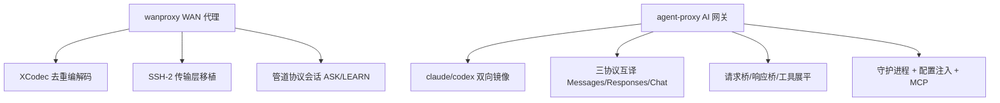

:::note 事实基线
本篇是「WANProxy 与 Agent Proxy」带解答题库，共 **76 题**，事实来源为 `content/be/wanproxy.md`（WAN 代理的 Go 移植，对照 `$HOME/github/wanproxy`）与 `content/be/yukino-agent-proxy.md`（AI 模型协议网关，对照 `$HOME/github/yukino.go/apps/agent/server_proxy` @ go 1.26.0）。wanproxy 是工作经历（C++ 原版移植），agent-proxy 是 AI 工程（协议翻译网关）。
:::

本篇是「WANProxy 与 Agent Proxy」题库。这两个项目代表两类工程能力：**wanproxy 是「把 C++ 网络代理移植到 Go」的系统编程能力**（去重编解码、SSH 传输、管道协议），**agent-proxy 是「AI 模型协议翻译网关」的 AI 工程能力**（让 Claude Code/Codex 用任意兼容模型）。本篇分两部分。

**主线一览**



## 一、wanproxy：XCodec 去重编解码

### Q1. XCodec 把数据流变成哪三类元素？四种流帧是什么？

XCodec 把数据流变成三类元素的混合：**对已见段的哈希引用、对新段的带内声明、以及转义后的字面数据**。转义字节（Magic）为 `0xf1`，段长固定 2048 字节，四种流帧：

| 帧          | 线上格式                  | 语义                                       |
| ----------- | ------------------------- | ------------------------------------------ |
| `<ESCAPE>`  | `f1 00`                   | 输出一个字面 `0xf1` 字节                   |
| `<EXTRACT>` | `f1 01` + 2048 字节       | 带内声明新段：哈希后进入输出流与回引用窗口 |
| `<REF>`     | `f1 02` + uint64 大端哈希 | 按哈希引用已声明的段                       |
| `<BACKREF>` | `f1 03` + uint8 下标      | 按回引用窗口位置引用段                     |

### Q2. 滚动哈希怎么工作？为什么能逐字节前滚？

`Hash` 对恰好 2048 字节的窗口做内容哈希，由**两个 32 位回绕累加器**组成：`bytes` 累加每字节的 word 值（`ch + 1`），`bits` 累加 `ffs(ch)`（最低置位位的 1 起始下标）。窗口满后可用 `Roll` **逐字节前滚**：从 sum1 减去被淘汰字节的 word、从 sum2 减去 `dead × SegmentLength`，再加入新字节。`Mix()` 把内部状态压缩成 64 位摘要。

**采分点**：能说出「**滚动哈希让窗口滑动时不用重算整个窗口，只需减去出窗字节、加入入窗字节**」——这是「滚动」的核心，O(1) 更新而非 O(窗口)。摘要与 C++ XCodecHash 逐字节一致（用已知答案向量验证）。

### Q3. 编码器的 EXTRACT 与 REF 怎么选？最坏情况为什么翻倍？

`EncodeWithReferences` 的主循环：用滚动哈希覆盖每个 2048 字节窗口，**若缓存命中且内容逐字节相等**（哈希冲突时跳过且不记候选），先转义输出引用之前的间隙，再输出引用；**未命中则记为候选，候选与后续窗口不重叠时被声明**。声明行为取决于缓存是否带外：**带内缓存（内存/磁盘）输出 `<EXTRACT>` 并进入窗口，带外缓存直接输出 `<REF>`**。

**最坏情况下编码把数据翻倍**（每个字面 `0xf1` 后补一个 `0x00`，全是字面数据时翻倍），**这正是管道协议把帧上限设为载荷上限两倍的依据**。

### Q4. 解码器遇到未知 REF 怎么处理？skim 是什么？

`<REF>` 查缓存，命中即输出并声明进窗口，**未命中则停下**，用 `skim` **不消费地扫描缓冲余部**，收集所有既不在缓存也不被余下 `<EXTRACT>` 定义的哈希（排序后随 `DecodeResult.Unknown` 返回），**调用方把段喂进缓存（通常经由 `<LEARN>`）后再次 Decode 即可从断点恢复**。

**采分点**：能说出「**REF 未命中不报错，而是收集未知哈希让调用方补缓存后从断点恢复**」——这是「解码可恢复」的设计，配合管道协议的 ASK/LEARN 机制。

### Q5. 回引用窗口（BACKREF）解决什么？为什么默认关闭？

`WithBackrefs()` 选项允许编码器对仍在回引用窗口中的段输出 `<BACKREF>`（**3 字节代替 10 字节**的 REF）。**C++ 编码器从不发出 backref，因此默认关闭**——保证与 C++ 的互操作性（Go 解码器支持 backref，但编码器默认不发）。

### Q6. XCDFS 磁盘缓存的「little consistency」取舍是什么？

XCDFS 是磁盘缓存，**在途索引块只在写满时落盘，退出时最多丢 203 条**——这是文档化的「little consistency」取舍（丢少量索引不影响正确性，只影响命中率）。`lookup` 读块并复核哈希，读失败或哈希不符即删除内存索引项。任何一次写失败都会置 `writeErr`，之后的变更全部禁用。

### Q7. DiskCache.Connect 的降级策略是什么？

`Connect(uuid)` 为对端分配 XUID 并写 registry；**XUID 耗尽返回错误**（空的命名空间可能仍被活跃会话持有，复用会串写），而 `DiskCache.Connect` **在磁盘端失败时退回一个隔离的内存缓存，让流以 ASK/LEARN 方式继续而不是失败**。

**采分点**：能说出「**磁盘缓存失败降级为内存缓存，流不失败而是走 ASK/LEARN**」——这是「降级而非失败」的容错设计。

## 二、wanproxy：SSH-2 传输层与管道协议

### Q8. SSH-2 握手的四步是什么？

① **版本交换**——写出识别串（默认 `SSH-2.0-WANProxy Go`）再逐字节读对端，要求 `SSH-2.0` 前缀；② **KEXINIT 交换与协商**——16 字节随机 cookie 加各类算法 name-list，协商规则是客户端偏好顺序决定，压缩只接受 `none`；③ **diffie-hellman-group-exchange**——客户端请求 `[min=1024, n=1024, max=8192]`，服务端恒定回复硬编码的 1024 位测试素数；④ **NEWKEYS**——发送自己的 NEWKEYS 并立即切换发送方向密钥，然后持续读包直到对端 NEWKEYS。

### Q9. Go 版相对 C++ 原版的关键修复是什么？

**C++ 代码从不发送第一个 NEWKEYS（源码里有两处 XXX 注释承认），导致数据阶段不加密；Go 版按 RFC 在密钥交换后发送 NEWKEYS**，C++ 的 NEWKEYS 处理器会回应并激活密钥，因此双向互通。此外 Go 版加入：随机填充、畸形包对齐/超大应用帧/退化 DH 公值的拒绝、**包长上限 4 MiB**（C++ 原版没有，防恶意对端耗尽内存）。

**采分点**：能说出「**C++ 原版不发 NEWKEYS 导致数据不加密，Go 版修复**」+「**包长上限 4MiB 防内存耗尽**」——这是「移植时修复原版缺陷」的具体案例。

### Q10. 管道协议会话的 ASK/LEARN/ADVANCE 怎么工作？

管道协议让两端同步缓存状态：解码端遇到未知 REF 时发 **`<ASK>`**（带未知哈希列表），编码端用 refmap（哈希→段）应答 **`<LEARN>`**（把段发给对端），对端把段喂进缓存后发 **`<ADVANCE>`** 继续。这样「编码端有但解码端没有」的段能按需补齐，而不需要预先同步全部缓存。

**采分点**：能说出「**ASK/LEARN 让缓存状态按需同步，不需要预先全量同步**」——这是「增量缓存同步」的协议设计。

### Q11. 双向中继与半关闭怎么处理？

proxy 的双向中继：两个 goroutine 分别读两个方向，用 flowQueue 做流量控制。**半关闭**：一端关闭写（CloseWrite）时，中继要把 FIN 传给另一端但不关闭反向——`CloseWrite` 委托底层连接的半关闭。这保证「一端说完话，另一端还能继续说」。

### Q12. wanproxy 与 C++ 原版的一致性怎么保证？

**摘要与 C++ XCodecHash 逐字节一致**——`hash_test.go` 运行 C++ `xcodec-hash1` 的已知答案向量（256 个单字节填充段摘要）以及 roll 与重算的一致性检查。SSH 算法表、密钥派生、二进制包格式都与 C++ 对齐（省略 Go 标准库没有的算法）。

**采分点**：能说出「**用已知答案向量（KAT）验证与 C++ 逐字节一致**」——这是「移植正确性」的验证方法。

## 三、agent-proxy：定位与协议镜像

### Q13. agent-proxy 解决什么问题？两个方向的镜像是什么？

让 **Claude Code 与 Codex 都能使用任意 OpenAI 兼容或 Anthropic 兼容的模型服务，而不修改客户端本身**。两个方向恰好镜像：

| `--agent` | 客户端      | 客户端侧协议       | 可用上游协议                                                                    |
| --------- | ----------- | ------------------ | ------------------------------------------------------------------------------- |
| `claude`  | Claude Code | Anthropic Messages | anthropic（直连）/ openai（Responses 桥）/ openai-compat（Chat Completions 桥） |
| `codex`   | Codex       | OpenAI Responses   | openai（Responses 透传）/ openai-compat（Chat 桥）/ anthropic（Messages 桥）    |

### Q14. direct 模式与 proxy 模式的区别？

**选择 anthropic 协议且代理 Claude Code 时，网关不参与推理流量**：它把客户端配置直接指向真实上游地址（**direct 模式**），本地服务只承担管控与状态职责。**其余组合都会把流量引到本地回环端点，由桥接层双向翻译（proxy 模式）**；Codex 恒为 proxy 模式，每个请求都经过本地网关。

**采分点**：能说出「**direct 模式网关不碰推理流量（只做管控），proxy 模式每个请求都经本地翻译**」——这是「能不翻译就不翻译」的性能取舍（翻译有开销，能直连就直连）。

### Q15. 一次代理请求的完整链路是什么？

```text
客户端原始请求 JSON(≤32MiB) → 服务面 yukino_http（校验形状与 stream 类型，读 body，Codex 侧先解 gzip/zstd）
  → 请求桥 bridge.Request（校验角色/参数 → 替换模型别名 → 按上游协议转换）
     → anthropic: 原样透传 / Responses 转 Messages
     → openai: 构造 Responses input/instructions/tools
     → openai-compat: 构造 Chat messages/tools/推理力度
  → 传输层 upstream.Client（低层 Post，关闭重试，强制 identity 编码）
  → 上游供应商（非流式 JSON 或 SSE 事件流）
  → 响应桥 bridge.Response/Stream（归一为客户端协议形状 / SSE 逐块翻译 / 四象限容错）
  → 客户端（SSE 心跳每 15s，失败发 error 事件，不伪造成功终态）
```

**转换与转发共享同一条流水线，协议选择只改变其中的翻译环节**。

### Q16. 网关除协议翻译外的四类职责是什么？

① **从统一的 provider 配置文件选择上游并做连通性预检**；② **备份并改写客户端配置**，把 base URL、模型别名、上下文窗口注入进去；③ **以守护进程方式常驻并暴露带鉴权的本地控制面**；④ **提供 stdio 或 HTTP 传输的 MCP 工具**，让其他 Agent 能启动、查看、停止代理。HTTP 服务面复用同仓库的 yukino-http 框架。

## 四、agent-proxy：请求桥与响应桥

### Q17. 请求桥的模型别名替换与输出上限决议链是什么？

请求桥（bridge.Request）校验角色/参数后**替换模型别名**（客户端配置的别名 → 真实上游模型名），再按上游协议转换。**输出上限决议链**：请求值、provider 值、默认 8192 依次回退，再被 provider 上限与上下文窗口封顶。**推理力度决议链**：请求的 `reasoning.effort`、provider 的 `thinking`、默认 high 依次回退，`true` 归一为 high，`off`/`false` 归一为 none。

**采分点**：能说出「**输出上限与推理力度都是『请求 → provider → 默认』三级回退，再被上限封顶**」——这是「多层配置优先级」的决议链设计。

### Q18. Anthropic 分支的 thinking 预算分档与自适应模型怎么处理？

`instructions` 与 system 角色消息合并进顶层 `system`；**thinking 预算按力度分档**：minimal/low 为 2048，high 为 16384，xhigh/max 为 24576，其余（含 medium）为 8192。**非自适应模型使用 `{type:"enabled", budget_tokens}` 时，预算被限制为不超过输出上限的一半，且需不小于 1024 才启用**。**模型族判定决定自适应行为**：模型名归一化（转小写、点换连字符）后按子串匹配内置家族表，自适应族走 `{type:"adaptive"}` 加 `output_config.effort`。**启用 thinking 时删除 temperature 与 top_p**。

**采分点**：能说出「**thinking 预算不超过输出上限一半，启用 thinking 删 temperature/top_p**」——这是 Anthropic extended thinking 的协议约束。

### Q19. 响应桥的四象限容错是什么？

响应桥要处理「**JSON/SSE 与请求不符**」的情况（请求要流式但上游返回 JSON，或反之）。**四象限容错**：① 请求流式 + 上游流式 → 逐块翻译；② 请求流式 + 上游 JSON → 把 JSON 包装成单个 SSE 事件；③ 请求非流式 + 上游 JSON → 直接归一；④ 请求非流式 + 上游流式 → 聚合流式块成完整 JSON。**失败发 error 事件，不伪造成功终态**。

**采分点**：能说出「**四象限处理流式/非流式的请求-响应组合，失败发 error 不伪造成功**」——这是「协议翻译的边界情况处理」。

### Q20. SSE 心跳与「不伪造成功终态」是什么？

客户端 SSE 连接**每 15s 发心跳**（防止代理/负载均衡器因空闲断开）。**失败发 error 事件，不伪造成功终态**——上游出错时不能假装成功结束流，要让客户端知道失败了（否则客户端以为回答完整，实际是截断的）。

## 五、agent-proxy：工具展平与续接缓存

### Q21. 工具展平的 ns__name 截断怎么做？

Codex 的工具形态比 Chat/Anthropic 更丰富（命名空间嵌套、自定义文本工具、工具搜索）。桥接层统一展平为函数：**命名空间与名字拼接为 `ns__name`；超过 64 字符时截断为前 46 字符加 `__` 加 sha256 前 8 字节的十六进制（恰好 64 字符）**，保证在上游长度限制内且几乎不冲突；展平后同名但定义不同的工具直接报错，完全相同的重复注册则去重。

**采分点**：能说出「**超 64 字符截断为前 46 + __ + sha256 前 8 字节 hex（恰好 64）**」——这是「工具名长度限制下的确定性截断，几乎不冲突」的具体算法。

### Q22. 自定义工具与工具搜索怎么展平？web_search 为什么丢弃？

**自定义（custom）工具包成函数**，schema 为单个必填字符串入参 `input`，描述追加原始定义 JSON；**工具搜索物化为必填 `query` 字符串的查询函数**；递归展开命名空间工具的 children；**`web_search` 与 `web_search_preview` 类工具被静默丢弃**（配置层禁用与桥接层丢弃双重保障）。上游回调经还原函数变回 Responses item（普通调用变 function_call，自定义调用变 custom_tool_call，工具搜索变带 execution:"client" 的 tool_search_call）。

### Q23. 续接缓存（previous_response_id）怎么补上？

Responses 协议支持用 `previous_response_id` 续接，但**转换后的上游没有 OpenAI 侧的存储**，网关用**进程内缓存**补上（重启即失，openai 原生协议不使用）：以响应 id 为键保存该轮的输入与输出；**单条超过 32 MiB 不记录；FIFO 淘汰，上限 128 条或 64 MiB**。请求带 previous_response_id 且命中时，用「缓存输入加缓存输出」前置展开并删除该字段；未命中报错要求重发完整历史。

**采分点**：能说出「**进程内缓存补上 previous_response_id 续接，重启即失，未命中要求重发完整历史**」——这是「协议能力在翻译层的补偿」。

### Q24. Codex 只发工具结果不带原调用怎么修复？

Codex 有时只发工具结果而不带原调用。对输入中的每个工具结果 item，**若其 call_id 对应的调用不在当前输入且在历史缓存中唯一命中，则把该次历史输出的签名思考与工具调用按原顺序插回该结果之前**（已存在的思考密文与 call_id 去重）；**非唯一命中不修复，宁可失败也不猜测**。

**采分点**：能说出「**非唯一命中不修复，宁可失败也不猜测**」——这是「不确定时不猜测」的正确性原则。

## 六、agent-proxy：守护进程与配置

### Q25. 守护进程的「先检查，后产生副作用」启动协议是什么？

启动协议：**先检查，后产生副作用**——先检查端口是否被占用、配置是否有效、上游是否连通，都通过后才启动监听、改写配置、注册守护进程。这避免「启动到一半失败，留下半成品状态」（如配置已改但服务没起来）。

**采分点**：能说出「**先检查后副作用，避免启动到一半失败留下半成品状态**」——这是「幂等启动」的设计。

### Q26. 配置注入与备份策略是什么？

**备份并改写客户端配置**：把 base URL、模型别名、上下文窗口注入客户端配置（Claude Code 的 settings.json、Codex 的 config.toml 与模型目录）。**改写前先备份原配置**，失败或停止时可恢复。配置注入是「让客户端指向本地网关」的关键——客户端不修改，只是配置被指向代理。

### Q27. MCP 工具面提供什么？

提供 **stdio 或 HTTP 传输的 MCP 工具**，让其他 Agent 能**启动、查看、停止代理**。这让 agent-proxy 本身可以被其他 Agent 编排（如「启动一个代理 Claude Code 用某模型」）。

### Q28. 传输层为什么关闭重试、强制 identity 编码？

**关闭重试**：推理请求重试可能导致重复计费/重复副作用，且流式请求重试无意义——失败让客户端决定。**强制 identity 编码**：请求体不用 gzip/deflate 压缩（避免与上游的编码协商冲突），但**响应可能是 gzip/zstd，Codex 侧要先解码**。

### Q29-Q76. 快速自检与深挖补充

**Q29. 一句话解释 XCodec 的去重原理。** 对已见段用哈希引用（REF/BACKREF），新段带内声明（EXTRACT），字面数据转义——重复数据只存哈希引用，实现去重压缩。

**Q30. 一句话解释段长为什么固定 2048。** 固定段长让滚动哈希窗口与帧格式统一——EXTRACT 带 2048 字节，REF 按 2048 字节段的哈希引用。

**Q31. 一句话解释 ESCAPE 的作用。** 数据里的字面 0xf1 要转义为 f1 00，否则会被误认为帧头——转义字节本身需要转义。

**Q32. 一句话解释 BACKREF 相对 REF 的优势。** 3 字节代替 10 字节——回引用窗口内的段用下标引用更短，但 C++ 不发 backref 故默认关闭。

**Q33. 一句话解释滚动哈希的两个累加器。** bytes 累加 word 值（ch+1），bits 累加 ffs(ch)——两个独立累加器降低哈希冲突。

**Q34. 一句话解释 Mix 的 64 位摘要。** bitsHash = (bits.sum1<<16)+bits.sum2，bytesHash = (bytes.sum1<<20)+bytes.sum2，结果 (bitsHash<<36)+bytesHash。

**Q35. 一句话解释编码器为什么哈希冲突要跳过。** 缓存命中但内容逐字节不等是哈希冲突，跳过且不记候选——避免错误引用不同内容的段。

**Q36. 一句话解释带内与带外缓存的声明差异。** 带内缓存输出 EXTRACT（段进输出流与窗口），带外缓存直接输出 REF（段已在外部缓存）。

**Q37. 一句话解释最坏翻倍与帧上限两倍的关系。** 全是字面数据时每个 0xf1 补 0x00 翻倍——管道协议帧上限设为载荷上限两倍的依据。

**Q38. 一句话解释解码 skim 为什么不消费。** 不消费地扫描缓冲余部收集未知哈希——让调用方补缓存后从断点恢复，不丢失已解析进度。

**Q39. 一句话解释 EXTRACT 的 Replace 与 Enter。** 缓存已有不同内容时 Replace（带内缓存名字复用），否则 Enter——处理哈希冲突与名字复用。

**Q40. 一句话解释 XCDFS 的写满落盘。** 在途索引块只在写满时落盘，退出最多丢 203 条——little consistency 取舍，丢索引只影响命中率。

**Q41. 一句话解释 writeErr 的禁用语义。** 任何一次写失败置 writeErr，之后变更全部禁用——避免在损坏的缓存上继续写。

**Q42. 一句话解释 XUID 耗尽为什么返回错误。** 空命名空间可能仍被活跃会话持有，复用会串写——宁可失败不复用。

**Q43. 一句话解释 DiskCache 失败降级内存缓存。** 磁盘端失败退回隔离内存缓存，流以 ASK/LEARN 继续而非失败——降级而非失败。

**Q44. 一句话解释 SSH 协商为什么客户端偏好决定。** 客户端偏好顺序决定算法，且选中算法必须在本地注册表——压缩只接受 none。

**Q45. 一句话解释 DH 组交换为什么用硬编码 1024 位测试素数。** 镜像 C++ USE_TEST_GROUP——恒定回复测试素数（生成元 2），简化实现。

**Q46. 一句话解释密钥派生的 KEY = HASH(K||H||letter||session_id)。** 不够长时用 HASH(K||H||KEY_so_far) 扩展，字母 A-F 分别是双方向的 IV/加密密钥/MAC 密钥。

**Q47. 一句话解释二进制包的填充长公式。** 4 + (blockSize - ((4+1+len(payload)+4) % blockSize))，块大小取密码块长且至少 8。

**Q48. 一句话解释 MAC 的计算与校验。** 按 seq(4字节大端)||明文包 计算并截断到 MAC 尺寸，加密包体后 MAC 附在密文后，接收端用 hmac.Equal 验。

**Q49. 一句话解释包长上限 4MiB 防什么。** C++ 原版没有包长上限，恶意对端可发超大包耗尽内存——Go 版加上限防御。

**Q50. 一句话解释 Go 版为什么发 NEWKEYS。** C++ 从不发第一个 NEWKEYS 导致数据不加密，Go 版按 RFC 发送——修复原版缺陷，双向互通。

**Q51. 一句话解释应用帧的 0xff 前缀包。** 该跳有激活编解码时用 0xff 前缀包（写方向按 32768 字节切块），读方向剥前缀——否则内部用 [uint32 长度][数据] 帧。

**Q52. 一句话解释为什么不做按首字节分发。** 避免未加标签流的首字节恰好是协议号时被破坏——除 DISCONNECT 与 IGNORE 外都按应用数据处理。

**Q53. 一句话解释管道协议为什么需要 ASK/LEARN。** 编码端有但解码端没有的段，按需补齐——不需要预先全量同步缓存。

**Q54. 一句话解释 refmap 的作用。** 编码同时返回 refmap（哈希→段），管道协议靠它在对端 ADVANCE 之前应答 ASK。

**Q55. 一句话解释双向中继的半关闭。** 一端 CloseWrite 时把 FIN 传给另一端但不关反向——保证一端说完另一端还能说。

**Q56. 一句话解释 flowQueue 的作用。** 双向中继的流量控制——防止一个方向过快撑爆缓冲。

**Q57. 一句话解释 wanproxy 的配置系统。** 纯 JSON 配置加载、命名资源解析、磁盘句柄生命周期、Schema 与夹具——JSON Schema 校验配置。

**Q58. 一句话解释 agent-proxy 为什么让客户端用任意兼容模型。** 协议翻译网关——Claude Code/Codex 不改客户端，网关把请求翻译成上游协议。

**Q59. 一句话解释 claude 与 codex 的默认监听端口。** claude 127.0.0.1:17861，codex 127.0.0.1:17862——本地回环端点。

**Q60. 一句话解释为什么 Codex 恒为 proxy 模式。** Codex 用 Responses 协议，上游若是 Chat/Anthropic 必须翻译——每个请求都经本地网关。

**Q61. 一句话解释 direct 模式的管控职责。** 不碰推理流量，只做配置改写、连通性预检、状态管理、MCP 工具——能直连就直连。

**Q62. 一句话解释请求桥为什么校验角色/参数。** 防止非法请求（错误的 role、缺失参数）到达上游——在翻译前拦截。

**Q63. 一句话解释模型别名替换的价值。** 客户端配置别名，网关映射到真实上游模型名——客户端不感知真实模型，换模型只改 provider 配置。

**Q64. 一句话解释输出上限为什么被上下文窗口封顶。** 输出是上下文窗口的一部分，不能超过——provider 上限与上下文窗口双重封顶。

**Q65. 一句话解释推理力度 true/off 的归一。** true 归一为 high，off/false 归一为 none——统一不同客户端的力度表达。

**Q66. 一句话解释压缩信封项的展开。** 压缩触发项注入压缩提示 user 消息，压缩信封项展开为「上一轮对话摘要」文本，读不懂的退化为占位说明。

**Q67. 一句话解释压缩请求为什么移除 tools。** 让模型专注产出摘要——压缩时不需要工具调用。

**Q68. 一句话解释模型族判定的归一化。** 转小写、点换连字符后按子串匹配内置家族表——决定自适应行为与力度映射。

**Q69. 一句话解释力度映射为什么抬升。** none/minimal 抬为 low，名字含 4-6 的模型上 xhigh 抬为 max——适配不同模型的力度语义。

**Q70. 一句话解释 Chat Completions 分支的 max_tokens 选择。** 按模型名前缀（o 或 gpt-5）决定用 max_completion_tokens 还是 max_tokens。

**Q71. 一句话解释 reasoning_content 的累积。** reasoning 信封与原生 reasoning 项的文本累积进下一条 assistant 消息的 reasoning_content。

**Q72. 一句话解释流式为什么注入 stream_options.include_usage。** 让流式响应也返回 usage（token 计数）——非流式默认有，流式要显式开启。

**Q73. 一句话解释工具展平为什么报错同名不同定义。** 同名但定义不同的工具会冲突——直接报错而非静默覆盖，完全相同的重复注册则去重。

**Q74. 一句话解释 web_search 为什么双重丢弃。** 配置层禁用 + 桥接层丢弃——web_search 类工具不支持，双重保障防止漏过。

**Q75. 一句话解释续接缓存为什么重启即失。** 进程内缓存，不持久化——重启后 previous_response_id 失效，要求重发完整历史。

**Q76. 一句话总结两个项目的能力。** wanproxy 体现系统编程能力（去重编解码、SSH 移植、管道协议、KAT 验证），agent-proxy 体现 AI 工程能力（三协议互译、决议链、四象限容错、工具展平、续接缓存补偿）——一个是「把 C++ 移植到 Go 并修复缺陷」，一个是「让 AI 客户端用任意模型」。

---

**延伸阅读**

- [Yukino HTTP 与 RPC 题库](/interview/qa/yukino-http-rpc)：agent-proxy 复用的 yukino_http 框架。
- [Yukino Go 分布式组件题库](/interview/qa/yukino-go-components)：同仓库的分布式组件。
- [Coding Agent Harness 题库](/interview/qa/coding-agent-harness)：Claude Code/Codex 客户端侧的实现（agent-proxy 是它们的协议网关）。
- [RPC 与网络编程题库](/interview/qa/rpc-and-network)：网络协议、SSH、代理的通用原理。
- [工作文档 · wanproxy](/be/wanproxy) 与 [yukino-agent-proxy](/be/yukino-agent-proxy)：本篇的事实来源。
