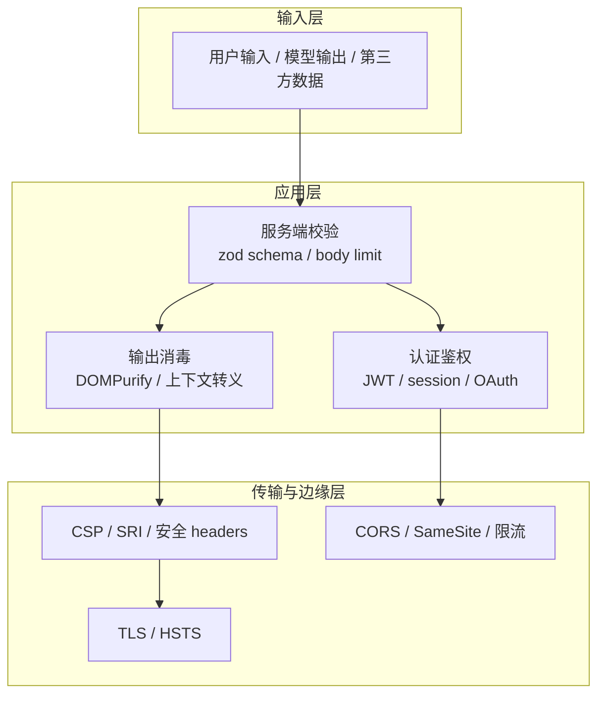
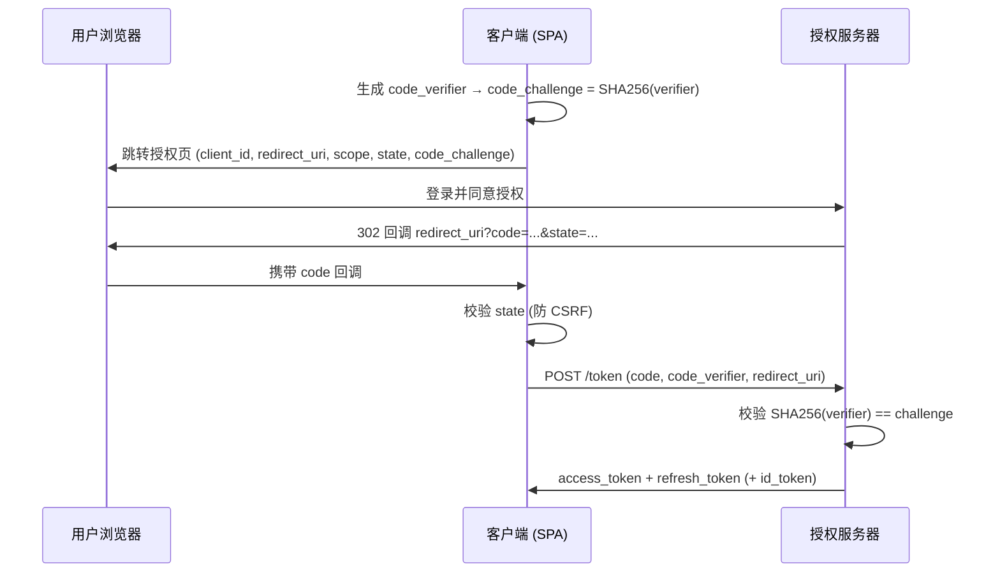

:::note 事实基线
本篇项目例证实读自 `$HOME/github/yukino-codegen`（HEAD `da904a235056`）、`$HOME/github/yukino-chat`（HEAD `555f62572a3a`）、`$HOME/github/yukino-dev-agent`（HEAD `ea0fd1957f83`）与本仓库 `26autumn`（HEAD `cd2cbfcd523b`）；通用安全机制按当前规范口径作答（CSP 3、SameSite、OAuth 2.1/PKCE、TLS 1.3）。
:::

本章覆盖 Web 安全与认证的机制层：注入类攻击（XSS）、请求伪造（CSRF）、内容安全策略、会话与令牌、OAuth/OIDC、CORS、传输层、存储与上传、供应链，以及 AI 应用特有的前端防线。CSRF/SameSite 的概念辨析已在 [CSRF 与 SameSite](/interview/answers/csrf-and-samesite) 写透，本章**只深化不重复**。所有「项目里」的陈述均实读源码。

| 仓库（本机路径）   | HEAD           | 本文引用的证据点                                                                                                                                                                    |
| ------------------ | -------------- | ----------------------------------------------------------------------------------------------------------------------------------------------------------------------------------- |
| `yukino-codegen`   | `da904a235056` | `server/src/config/env.schema.ts`、`server/src/middleware/security-middleware.ts`、`server/src/agent-runtime/mcp-crypto.ts`（测试）、`client/src/shared/ui/render-safe-markdown.ts` |
| `yukino-chat`      | `555f62572a3a` | `server/src/common/jwt.ts`、`server/src/common/token.ts`、`server/src/middleware/auth.ts`、`server/src/config/env.ts`、`docker-compose.yml`、`docker/nginx.conf.template`           |
| `yukino-dev-agent` | `ea0fd1957f83` | `prisma/schema.prisma`（`tokenEncrypted`）                                                                                                                                          |
| `26autumn`         | `cd2cbfcd523b` | `pnpm-workspace.yaml`（`allowBuilds` / `minimumReleaseAge`）                                                                                                                        |

**主线一览**



## 一、XSS 与输出编码

### Q1. XSS 三类（存储/反射/DOM）的攻击面分别在哪？

**存储型**：恶意脚本入库，所有访问者中招（评论区、用户资料、知识库文档）——危害最大，因为不依赖诱骗点击。**反射型**：脚本藏在 URL 参数里，服务端未转义直接回显到 HTML，需诱导受害者点击特制链接。**DOM 型**：漏洞完全在前端——JS 把不可信数据写进 `innerHTML`、`document.write`、`location`、`eval` 等 **sink**，服务端甚至无感知。防御的统一视角：**找到所有 source（URL/输入/存储/`postMessage`）到 sink 的通路，逐点消毒或改道**。

### Q2. 为什么转义必须「分上下文」？

同一份数据在 HTML 的不同位置需要不同编码：HTML 正文转义 `<>&"'`；**属性内**要转义全部非字母数字字符（防引号逃逸）；**JS 上下文**（内联 `<script>` 或事件属性）需 JS 字符串转义；**URL 上下文**要 `encodeURIComponent`；CSS 上下文另有规则。只做「HTML 实体转义」就塞进 `<script>` 或 `href` 仍可被绕过。结论：没有万能转义函数，**上下文感知模板引擎**（React/JSX 默认按位置转义）才是正解。

| 数据落点           | 需要的编码               | 典型绕过                      |
| ------------------ | ------------------------ | ----------------------------- |
| HTML 正文          | `&lt; &gt; &amp;` 实体   | 未转义 `<script>`             |
| 带引号属性         | 实体 + 引号转义          | `" onmouseover="...` 属性逃逸 |
| 无引号属性         | 全部非字母数字字符编码   | 空格/反引号断开属性           |
| 内联 JS / 事件属性 | JS 字符串转义 + 实体     | `</script>` 提前闭合标签      |
| `href` / `src`     | URL 编码 + scheme 白名单 | `javascript:alert(1)`         |

### Q3. React 默认防 XSS 的边界在哪？`dangerouslySetInnerHTML` 何时用？

React 把字符串子节点一律 HTML 转义，`{userInput}` 注入不进去。边界：**`dangerouslySetInnerHTML`** 是显式逃生舱，内容原样进 DOM——必须配合消毒器使用。事实基线：`yukino-codegen` 的 `client/src/shared/ui/render-safe-markdown.ts` 就是标准姿势——`marked.parse` 渲染 Markdown 后**先**过 `DOMPurify.sanitize(rawHtml, { USE_PROFILES: { html: true }, FORBID_TAGS: ["script", "style"] })` **再**做代码高亮，顺序不可颠倒（先高亮后消毒会破坏高亮标签，先消毒后高亮才安全）。

```ts
// yukino-codegen/client/src/shared/ui/render-safe-markdown.ts (全文)
export function renderSafeMarkdown(content: string): string {
  const rawHtml = marked.parse(content, {
    async: false,
    gfm: true,
    breaks: true,
  });
  if (typeof rawHtml !== "string") return "";
  const safeHtml = DOMPurify.sanitize(rawHtml, {
    USE_PROFILES: { html: true },
    FORBID_TAGS: ["script", "style"],
  });
  return highlightCodeBlocks(safeHtml); // 消毒后才高亮, 顺序不可颠倒
}
```

### Q4. DOMPurify 的原理与局限？

DOMPurify 用浏览器自带的 DOM 解析器把输入解析成 DOM 树，再按白名单**逐节点过滤**（标签、属性、URL scheme），最后序列化输出——「解析再重建」天然免疫正则消毒器常见的嵌套/编码绕过。局限：它只保证**消毒时刻**安全；若消毒后的 HTML 被二次拼接、或模板引擎再次解释（如 Vue 的 `v-html` + 模板注入），防线失效。另需跟进版本：mutation XSS 类绕过（mXSS）靠版本更新修复。

### Q5. 什么是 mutation XSS（mXSS）？

浏览器解析 → 序列化 → 再解析时，HTML 语义可能**变异**：消毒时安全的结构，经 `innerHTML` 写入后被浏览器的纠错/命名空间规则重解释成可执行形态（典型如 SVG/`<noscript>`/表格 foster parenting 场景）。防御：消毒器保持更新；对高危场景（富文本编辑器输出）叠加 CSP 禁内联脚本；消毒后避免再经 `innerHTML` 二次解析链。

### Q6. Trusted Types 解决什么问题？

把「危险 sink」（`innerHTML`、`document.write`、`eval`、`setAttribute` 的 `on*` 等）的入参类型从 string 收窄为 **TrustedHTML/TrustedScript 对象**——只能通过注册的 policy 创建，policy 内集中消毒。效果：XSS 防御从「找到每个 sink」变成「浏览器强制所有 sink 只收 policy 产物」，漏网 sink 直接抛异常。落地节奏：`Content-Security-Policy: trusted-types` 先 report-only 收集违规点，再逐个收敛。

### Q7. 危险 API 清单有哪些？

注入 sink:`innerHTML/outerHTML/insertAdjacentHTML`、`document.write/writeln`、`eval/new Function/setTimeout(string)`、`location.href/assign/replace`、`window.open`、`postMessage` 的 targetOrigin 失控、`srcdoc`、SVG 的 `href`。属性侧：`href="javascript:..."`、`src` 指向 `data:text/html`、`formaction`、`xlink:href`。面试答法：**按「HTML/属性/JS/URL」四上下文分类列举**，比裸背 API 名更显体系。

### Q8. 服务端渲染（SSR）场景 XSS 有何不同？

SSR 把数据在**服务端**拼进 HTML：转义责任从浏览器框架移到模板引擎（Next.js 的 JSX 默认转义依然有效，但 `dangerouslySetInnerHTML`、流式注入、邮件模板、Markdown 渲染管线都是缺口）。额外风险：SSR 输出若被 CDN 缓存，**一份注入内容缓存给所有用户**（存储型 + 缓存放大）。AI 应用尤甚：模型输出是不可信数据，进 DOM 前必须消毒——见 Q48。

## 二、CSRF 与请求伪造（深化）

### Q9. 已有 [CSRF 与 SameSite](/interview/answers/csrf-and-samesite) 的分层防御，工程上还有哪些深化点？

三个进阶：**其一**，`SameSite=Lax` 放行顶层导航 GET，因此必须保证 **GET 全幂等**——任何「GET 改状态」的接口（退出登录、删除）都是 Lax 下的漏网点；**其二**，双重提交 cookie 方案在多子域场景会被「子域写父域 cookie」绕过，需配 `__Host-` 前缀（强制 host-only + Secure + 无 Domain）；**其三**，架构级方案是**弃用 cookie 改 Bearer**——浏览器不自动携带 `Authorization` 头，CSRF 根因消失，代价是 XSS 窃取风险上升，需配合短有效期 + 刷新轮换。

### Q10. 为什么「接口只收 JSON」不能防 CSRF？

表单虽不能设 `Content-Type: application/json`，但能用 `text/plain` 编码**拼出合法 JSON 字符串**（`enctype="text/plain"` 的 form 可控制 body 形状），且 `text/plain` 是简单请求**不触发 preflight**。服务端若宽松解析（很多框架对 text/plain 也尝试 JSON parse），攻击成立。正确姿势：要求**自定义头**（如 `X-Requested-With`）——表单加不了头，跨源 fetch 加头必触发 preflight。

### Q11. WebSocket 为什么需要单独防跨站劫持（CSWSH）？

浏览器建立 WebSocket 时**不受同源策略约束**，且会自动携带目标站的 cookie。攻击站可直接 `new WebSocket("wss://bank.com/ws")` 借用户会话收发消息。防御：服务端握手时校验 `Origin`（白名单），或要求连接 URL/首帧带一次性 token。事实基线：`yukino-chat` 的 WS 鉴权走 `wsTokenUUID`——从 `?token=` 查询参数解析 JWT（`server/src/middleware/auth.ts`），不依赖 cookie；注意 query token 会进访问日志，属于**可接受的取舍**（短时效 JWT + 日志脱敏）。

```ts
// yukino-chat/server/src/middleware/auth.ts (节选)
const PUBLIC_PATHS = new Set([
  "/login",
  "/register",
  "/user/update-password",
  "/log",
]);

export const authMiddleware = createMiddleware<AppEnv>(async (c, next) => {
  if (c.req.method !== "POST" || PUBLIC_PATHS.has(c.req.path)) return next();
  const token = (c.req.header("Authorization") ?? "").replace(/^Bearer /, "");
  if (!token) return authError(c, "missing token");
  const claims = parseToken(token, env.JWT_SECRET);
  if (!claims) return authError(c, "invalid or expired token");
  c.set("uuid", claims.uuid);
  await next();
});

// WS 无法设 Authorization 头 → token 走 query, 同一套 parseToken 验证
export function wsTokenUUID(c: Context): string | null {
  const claims = parseToken(c.req.query("token") ?? "", env.JWT_SECRET);
  return claims?.uuid ?? null;
}
```

### Q12. Fetch Metadata（Sec-Fetch-*）怎么用作防线？

`Sec-Fetch-Site`（same-origin/same-site/cross-site/none）、`Sec-Fetch-Mode`（navigate/cors/no-cors）、`Sec-Fetch-Dest`、`Sec-Fetch-User` 由**浏览器强制附加、不可伪造**。服务端策略：状态变更请求若 `Sec-Fetch-Site: cross-site` 且非白名单流程（OAuth 回调）直接拒绝。相比 Origin/Referer 的优势：Referer 可被策略裁剪、Origin 在部分请求缺失，而 Sec-Fetch-* 覆盖更全。局限：旧浏览器不带，只能作增强层不能作唯一防线。

## 三、点击劫持、CSP 与 SRI

### Q13. 点击劫持怎么防？`X-Frame-Options` 与 CSP `frame-ancestors` 谁优先？

攻击：透明 iframe 盖在诱饵页面上，用户的「点击领取」实际点了攻击者 iframe 里的「确认转账」。防御：CSP `frame-ancestors 'none'`（或指定允许的父站）是现代表述，**优先级高于** `X-Frame-Options`（后者只有 DENY/SAMEORIGIN 两档，且与 CSP 同时出现时以 CSP 为准）。注意 `frame-ancestors` **只能**由响应头/HTTP-equiv 下发，`<meta>` 标签无效。

### Q14. CSP 指令体系怎么组织？

`default-src` 兜底，各资源类型细分覆盖：`script-src`、`style-src`、`img-src`、`connect-src`（管 fetch/XHR/WebSocket）、`frame-src`、`font-src`、`object-src 'none'`（封 Flash 类插件）、`base-uri 'none'`（防 `<base>` 劫持相对路径）、`form-action`（限制表单提交目标，可辅助防 CSRF）。策略演进路线：先 `Content-Security-Policy-Report-Only` + `report-uri` 收集违规，修完再切实执行。

### Q15. nonce 与 hash 两种 CSP 脚本白名单怎么选？什么是 `strict-dynamic`？

**nonce**：每次响应生成随机数，脚本标签带 `nonce="..."`，CSP 写 `script-src 'nonce-xxx'`——适合服务端渲染、脚本动态生成的场景；**hash**：对静态脚本内容取 SHA256/384/512，适合内容固定的脚本。`strict-dynamic`：被信任脚本（带 nonce/hash）**动态创建**的脚本自动放行，免去维护域名白名单——现代 CSP 推荐组合是 `script-src 'nonce-...' 'strict-dynamic'`，配合禁内联（不开 `unsafe-inline`）。

### Q16. CSP 的 `report-uri` / `report-to` 有什么运营价值？

违规报告是**免费的攻击探测器**：被注入的页面会触发 CSP 违规上报，报告里的 `blocked-uri`、`violated-directive`、`document-uri` 能定位注入点与攻击载荷。工程上把 CSP 报告接入日志/告警管道，与前端错误监控并列。注意报告量可能很大（第三方脚本违规是常态），按 `document-uri + blocked-uri` 聚合降噪。

### Q17. SRI（Subresource Integrity）防什么？局限是什么？

防 CDN 上的第三方脚本被篡改/投毒：`<script src="..." integrity="sha384-..." crossorigin="anonymous">`，哈希不匹配浏览器拒绝执行。局限：**只适用于固定内容**（带版本号的静态资源）；资源内容变了哈希就得更新；对同源资源意义不大；`crossorigin="anonymous"` 要求服务端允许跨域读取。配合供应链防御（Q45）使用。

## 四、会话认证：JWT 与 Session

### Q18. JWT 的三段结构各承担什么？

`header.payload.signature`，均 base64url:**header** 声明算法与类型（`alg`/`typ`）；**payload** 是 claims（注册 claims:`iss/sub/aud/exp/nbf/iat/jti`，私有 claims 自定义）；**signature** 是对前两段的签名（HMAC 或 RSA/ECDSA）。关键认知：**header 与 payload 只是编码不是加密**——任何人可解码读取，绝不能放敏感数据；签名保证的是**完整性与来源**，不是机密性。

```text
eyJhbGciOiJIUzI1NiIsInR5cCI6IkpXVCJ9   ← header: {"alg":"HS256","typ":"JWT"} 的 base64url
.eyJ1dWlkIjoiLi4uIiwiaWF0IjoxNzYyLCJleHAiOjE3NjN9   ← payload: claims, 可直接解码
.8c1a...f3b2                            ← signature: HMAC-SHA256(header.payload, secret)
```

### Q19. `alg=none` 与算法混淆攻击的原理？

`alg=none`：早期库见 `none` 就跳过验签——攻击者把 header 改成 `{"alg":"none"}` 即可伪造任意 token。**算法混淆**（RS256→HS256）：服务端用 RSA 公钥验签时，若允许客户端指定算法，攻击者把 `alg` 改成 `HS256`，库就用「公钥字符串」当 HMAC 密钥——公钥是公开的，签名可伪造。防御：**服务端写死算法，绝不信任 header 里的 `alg`**。事实基线：`yukino-chat` 的 `server/src/common/jwt.ts` 是手写 HS256 实现——header 是**硬编码常量** `{"alg":"HS256","typ":"JWT"}`，`parseToken` 从不解析输入 token 的 header，两类攻击面直接不存在。

```ts
// yukino-chat/server/src/common/jwt.ts (节选)
const JWT_HEADER = Buffer.from('{"alg":"HS256","typ":"JWT"}').toString(
  "base64url",
);

export function parseToken(token: string, secret: string): TokenClaims | null {
  const parts = token.split(".");
  if (parts.length !== 3) return null;
  const [header, payload, signature] = parts as [string, string, string];
  const expected = Buffer.from(
    sign(`${header}.${payload}`, secret),
    "base64url",
  );
  const actual = Buffer.from(signature, "base64url");
  // 恒定时间比较, 防时序侧信道; 注意 header 不参与算法选择 ← 混淆攻击面不存在
  if (expected.length !== actual.length || !timingSafeEqual(expected, actual))
    return null;
  // ... 再验 claims: uuid 非空字符串、exp 未过期
}
```

:::tip 采分点
能把「手写 JWT」讲出两个亮点——**header 硬编码**（消灭 alg 选择面）与 **timingSafeEqual**（消灭时序侧信道）——比背「用成熟库」更能展示安全直觉；同时要诚实补一句：生产首选仍是维护良好的库，手写的前提是像这样把攻击面逐个封死并有测试覆盖。
:::

### Q20. 验签为什么必须用恒定时间比较？

逐字节比较会在**第一个不同字节**处提前返回，响应耗时泄露签名前缀的正确长度 → 逐字节爆破签名。防御：恒定时间比较。事实基线：`yukino-chat` 的 `jwt.ts` 用 `crypto.timingSafeEqual(expected, actual)`，且先比长度（`timingSafeEqual` 要求等长输入）。这是「手写认证代码」面试里最值钱的细节之一。

### Q21. JWT 撤销为什么难？有哪些解法？

JWT 无状态 = 服务端不存会话 = **没有天然的撤销点**，签发后到期前永远有效。解法谱系：**短有效期**（access token 分钟级）+ refresh token 轮换（撤销面缩小到 refresh）；**黑名单/版本号**（logout 把 `jti` 进 Redis，或用户维度的 `token_version` 自增——牺牲部分无状态性）；**事件驱动失效**（改密/封号时 bump 版本）。取舍本质：**无状态扩展性 vs 即时撤销能力**，金融/权限敏感场景宁可加状态。

:::tip 采分点
主动给出「有效期 × 撤销延迟 × 状态成本」三维取舍表，并举一个具体场景（如封号需秒级生效 → 必须加黑名单或短有效期）才算答完整。
:::

### Q22. session（服务端状态）与 token（无状态）怎么选？

| 维度     | 服务端 session                  | JWT token                |
| -------- | ------------------------------- | ------------------------ |
| 撤销     | 删 session 即生效               | 难，需黑名单/短有效期    |
| 扩展     | 需 session 共享（sticky/Redis） | 天然无状态，水平扩展简单 |
| 载荷     | 引用式，可随时改                | 自包含，签发后内容冻结   |
| 体积     | 一个 session id                 | 每请求携带完整 token     |
| 典型搭配 | cookie + HttpOnly               | Bearer 头（免疫 CSRF）   |

事实基线：`yukino-chat` 选 JWT Bearer（`auth.ts` 从 `Authorization` 头取 token，`token.ts` 签发 `uuid/iat/exp` 三 claims），`TOKEN_EXPIRE_HOURS` 默认 **336 小时（14 天）**——长有效期换取免刷新体验，配合「改密后旧 token 仍有效」的已知取舍；`yukino-codegen` 则用服务端 session（`SESSION_TTL_SECONDS` 默认 7 天，`SESSION_SECRET` 签名）。两种都在真实项目成立，**讲清各自取舍比站队重要**。

### Q23. token 存哪：cookie vs localStorage 的威胁模型对比？

**HttpOnly cookie**:JS 读不到 → 免疫 XSS 窃取，但自动携带 → 暴露于 CSRF（需 SameSite/Token 补防）。**localStorage**：不受 CSRF 影响（不自动携带），但任何 XSS 都能一行读走且**永不过期**（除非手动清）。现代主流：**HttpOnly + Secure + SameSite=Lax 的 cookie** 存 refresh/access token，CSRF 靠 SameSite 打底；或 Bearer in memory + refresh in HttpOnly cookie 的混合方案。答案必须带威胁模型：**你更怕 XSS 还是 CSRF，决定存储选择**。

### Q24. refresh token 轮换与重用检测怎么做？

每次用 refresh token 换新 access token 时**同时签发新 refresh token 并作废旧的**（轮换）。若被窃的旧 refresh token 再次出现（重用检测），说明令牌已泄露 → **吊销该用户整条令牌链**。实现要点：refresh token 记库/记 Redis（家族 id + 当前有效 id），重用判定是「家族存在但 id 非当前」。这是把「无状态 JWT」拉回一点状态换安全性的标准做法。

### Q25. 密钥管理与轮换：JWT_SECRET 该怎么管？

原则：**密钥不进代码仓库、不进前端 bundle、不进日志**；按环境注入；支持轮换（双密钥并行窗口：新 token 用新密钥签，验签兼容旧密钥直到旧 token 过期）。反面教材要会讲：事实基线——`yukino-chat` 的 `docker-compose.yml` 写 `JWT_SECRET: ${JWT_SECRET:-yukino-chat-jwt-secret}`，`env.ts` 的 zod 默认值同为 `yukino-chat-jwt-secret`：**开发默认值进了仓库**，生产若忘记覆盖等于公开密钥。对照正解：`yukino-codegen` 的 `env.schema.ts` 在 `superRefine` 里**生产环境强制拒绝默认值**（`SESSION_SECRET === "server-default-secret"` 等直接报 issue，进程起不来）——fail-fast 的密钥治理范本。

```ts
// yukino-codegen/server/src/config/env.schema.ts (节选) —— 生产环境硬门禁
export const envSchema = baseEnvSchema
  .extend(aiEnvSchema.shape)
  .superRefine((value, ctx) => {
    if (value.NODE_ENV !== "production") return; // 开发态宽容, 生产态严格
    if (value.CORS_ALLOWED_ORIGINS.includes("*")) {
      ctx.addIssue({
        code: "custom",
        path: ["CORS_ALLOWED_ORIGINS"],
        message:
          "CORS_ALLOWED_ORIGINS must not include wildcard origins in production",
      });
    }
    if (value.SESSION_SECRET === "server-default-secret") {
      /* addIssue: 必须覆盖 */
    }
    if (value.PASSWORD_SALT === "yukino") {
      /* addIssue: 必须覆盖 */
    }
    if (value.MCP_SECRET_KEY === "c3dpZnR5...") {
      /* addIssue: 必须覆盖 */
    }
    if (value.STORAGE_DRIVER === "local") {
      /* addIssue: 生产禁用本地存储 */
    }
  });
```

## 五、OAuth2 与 OIDC

### Q26. OAuth2 四种授权流各适用什么场景？

**授权码流**（Authorization Code）：有后端的 Web 应用，client_secret 存服务端——最标准；**授权码 + PKCE**：公开客户端（SPA、移动 App）——唯一正确选择；**客户端凭证**（Client Credentials）：机器对机器（微服务间），无用户参与；**设备码**（Device Code）：无浏览器输入能力的设备（电视/CLI）。隐式流把 token 暴露在 URL fragment、密码流把用户密码直接交给客户端，均不在现代 OAuth 2.1 选型内。



### Q27. PKCE 防的是什么？原理？

防**授权码拦截**：公开客户端无法保管 client_secret，攻击者若截获回调里的授权码即可换 token。PKCE：客户端生成随机 `code_verifier`，发起授权时只发其哈希 `code_challenge`；换 token 时提交原文，授权服务器比对哈希。截获授权码的攻击者没有 verifier，换不到 token。即使后端应用也建议常开——多一层无成本防御。

### Q28. `state`、`nonce`、PKCE 各防什么？

**state**:CSRF 防护——发起授权时生成随机 state 存会话，回调时比对，防攻击者把**自己的账号**绑定到受害者会话（登录 CSRF）。**nonce**:OIDC 特有，写入 id_token，防**重放**——客户端校验 id_token 里的 nonce 与会话中一致。**PKCE**：防授权码拦截（Q27）。三者职责不重叠，面试常考辨析。

### Q29. OIDC 在 OAuth2 上加了什么？implicit 流为什么不适用于现代 SPA？

OIDC = OAuth2 + **身份层**：`id_token`（JWT，含 `sub/iss/aud/exp/nonce`）、`/userinfo` 端点、标准 claims 与发现协议（`.well-known/openid-configuration`）。OAuth2 本身只是**授权**框架，拿 access token 不代表知道「用户是谁」——OIDC 补上认证语义。implicit 流不适用于现代 SPA 的原因：token 走 URL fragment（浏览器历史/日志/referrer 泄露）、无客户端认证、无法用 PKCE；现代 SPA 选型是授权码 + PKCE，或 token 直接走后端。

### Q30. `redirect_uri` 为什么要严格匹配？

开放重定向 = 授权码/token 被钓鱼走。若允许 `redirect_uri=https://app.com/redirect?url=...` 或前缀匹配（`https://app.com.evil.com`、`https://app.com@evil.com`），攻击者构造合法授权请求把 code 导向自己控制的地址。规范做法：**精确字符串匹配**预注册的 redirect_uri 列表，不用通配/前缀；回调页本身也禁止开放跳转。

## 六、CORS 深入

### Q31. 哪些请求会触发 preflight？简单请求的完整条件？

同时满足才是简单请求：方法为 GET/HEAD/POST；**POST 的 Content-Type 只能是** `application/x-www-form-urlencoded`、`multipart/form-data`、`text/plain`；无自定义头（仅 CORS-safelisted 头：Accept/Accept-Language/Content-Language/Content-Type）；无 `Authorization` 头。任一不满足 → 先发 `OPTIONS` preflight，服务器用 `Access-Control-Allow-*` 应答，通过后才发真实请求。**带 Authorization 的 API 调用几乎必然 preflight**——这是「为什么我的请求总多发一次 OPTIONS」的答案。

```http
OPTIONS /api/chat HTTP/1.1            ← preflight (浏览器自动发)
Origin: https://app.example.com
Access-Control-Request-Method: POST
Access-Control-Request-Headers: authorization, content-type

HTTP/1.1 204 No Content               ← 服务端应答
Access-Control-Allow-Origin: https://app.example.com   # 精确回显, 非 *
Access-Control-Allow-Methods: GET, POST, PUT, PATCH, DELETE, OPTIONS
Access-Control-Allow-Headers: Content-Type, Authorization
Access-Control-Allow-Credentials: true
Access-Control-Max-Age: 86400         # 缓存 preflight 结果, 减少 OPTIONS 次数
```

### Q32. `credentials: true` 对 CORS 的约束是什么？

带 cookie/认证头跨域时：`Access-Control-Allow-Origin` **不能是 `*`**，必须回显精确 origin；必须附 `Access-Control-Allow-Credentials: true`；preflight 的 `Allow-Headers/Methods` 也不能用 `*`。事实基线（正反对照）：`yukino-codegen` 的 `security-middleware.ts` 用 hono 的 `cors({ credentials: true, origin: corsOrigin() })`，而 `env.schema.ts` 的 superRefine **禁止生产环境 CORS_ALLOWED_ORIGINS 含 `*`**——因为「`*` + credentials」在规范层就不成立，留着只会造成「开发能跑、生产全挂」或误配放行。开发默认 `*`、生产强制白名单，是该校验的完整语义。

```ts
// yukino-codegen/server/src/middleware/security-middleware.ts (全文要点)
export const corsOrigin = (): string | string[] =>
  env.CORS_ALLOWED_ORIGINS.includes("*") ? "*" : env.CORS_ALLOWED_ORIGINS;

export const createCorsMiddleware = () =>
  cors({
    allowHeaders: ["Content-Type", "Authorization"],
    allowMethods: ["GET", "POST", "PUT", "PATCH", "DELETE", "OPTIONS"],
    credentials: true, // 带凭证 → origin 必须精确, 生产禁 "*" (env.schema 把关)
    origin: corsOrigin(),
  });
```

### Q33. CORS 拦的是「请求发出」还是「响应读取」？

**只拦读取**。跨域请求早已到达服务端并执行（副作用已发生），浏览器只是不把响应交给 JS。推论两条：其一，**CORS 不是 CSRF 防线**（详见 [CSRF 与 SameSite](/interview/answers/csrf-and-samesite)）；其二，「不安全方法」（POST/PUT/DELETE）的跨域请求仍会执行，服务端鉴权必须独立于 CORS 存在。preflight 看起来像「拦截」，其实只是浏览器替 JS 问一句「能不能读」，真实请求照发。

### Q34. 常见的 CORS 误配有哪些？

**Origin 反射**：把请求 Origin 原样回填 `Allow-Origin` 且带 credentials ≈ 全开（任何站都能带凭证读响应）；**正则白名单过宽**：`*.example.com` 忘了 `.` 被 `evilexample.com` 绕过，或未锚定结尾；**`null` origin**:sandboxed iframe/data URL 的 Origin 是 `null`，白名单含 `null` 可被构造；**漏 `Vary: Origin`**:CDN 缓存了某个 origin 的响应发给其他 origin。审计口诀：**白名单要锚定、凭证要精确、缓存要 Vary**。

## 七、TLS 与传输层

### Q35. TLS 1.3 握手相比 1.2 改了什么？

TLS 1.2 完整握手 2-RTT（ClientHello → ServerHello+证书 → 密钥交换 → Finished）；TLS 1.3 把密钥交换提前到第一个往返，**1-RTT** 完成，且支持 **0-RTT** 恢复（重连时首个包即带应用数据，代价是 0-RTT 数据可被重放，只能用于幂等请求）。同时砍掉不安全套件（RSA 密钥交换、CBC 模式、SHA-1），只留 ECDHE 前向保密 + AEAD。面试关键词：**1-RTT、前向保密默认化、0-RTT 重放风险**。

### Q36. 证书链如何验证？自签证书为什么失败？

浏览器用证书里的签名逐层上溯：叶子证书 ← 中间 CA ← 根 CA，直到命中**内置信任库**中的根；每层验证签名、有效期、域名匹配（SAN）、吊销状态（OCSP stapling）。自签证书失败是因为**信任链无法锚定到内置根**——不是加密不成立，而是身份无人背书。推论：内网服务要么用私有 CA 分发到信任库，要么走公网 CA（Let's Encrypt）；「忽略证书错误」等于放弃身份验证，MITM 门户大开。

### Q37. HSTS 解决什么？preload list 是什么？

HTTPS 降级攻击：首次访问走 http，中间人劫持后永远不给 https。HSTS（`Strict-Transport-Security: max-age=...; includeSubDomains`）让浏览器**记住**该域只能走 https，后续 http 请求在浏览器内直接升级为 https。缺口是**第一次**访问仍可能降级 → **preload list**：域名申请进浏览器内置清单，出厂即强制 https。注意：HSTS 一旦开启、max-age 未过期就回不了 http，上线前确认全站 https 就绪。

## 八、Cookie 与存储安全

### Q38. cookie 安全属性全集与推荐组合？

`HttpOnly`（禁 JS 读取，防 XSS 窃取）、`Secure`（仅 HTTPS 传输）、`SameSite`（跨站携带策略，见 [CSRF 与 SameSite](/interview/answers/csrf-and-samesite)）、`Domain`/`Path`（作用域，默认 host-only 最安全）、`Max-Age`/`Expires`（寿命）、`Partitioned`（CHIPS，第三方 cookie 按顶层站点分区）、`__Host-` 前缀（强制 Secure + host-only + 无 Domain，防子域投毒）、`__Secure-` 前缀（强制 Secure）。推荐组合：**`__Host-` + HttpOnly + Secure + SameSite=Lax + 短 Max-Age**。

```http
Set-Cookie: __Host-session=abc123; HttpOnly; Secure; SameSite=Lax;
            Path=/; Max-Age=900
# __Host- 前缀 = 浏览器强制校验 Secure + Path=/ + 无 Domain,
# 子域无法覆盖该 cookie (防会话固定/投毒)
```

### Q39. localStorage / sessionStorage / IndexedDB / cookie 的安全对比？

| 存储             | XSS 可读 | CSRF 自动携带        | 容量  | 生命周期       | 适合                      |
| ---------------- | -------- | -------------------- | ----- | -------------- | ------------------------- |
| cookie(HttpOnly) | ❌       | ✅（可 SameSite 控） | ~4KB  | 可控过期       | **凭证**                  |
| localStorage     | ✅       | ❌                   | ~5MB  | 永久（手动清） | 非敏感偏好/缓存           |
| sessionStorage   | ✅       | ❌                   | ~5MB  | 标签页会话     | 临时表单草稿              |
| IndexedDB        | ✅       | ❌                   | GB 级 | 永久           | 结构化大数据（离线/向量） |

结论一句话：**凡 XSS 可读的存储都不放凭证**；凭证要么 HttpOnly cookie，要么只存内存（刷新后靠 refresh token 恢复）。

### Q40. 第三方 cookie 退场与 CHIPS / Storage Access API？

隐私监管与浏览器（Safari ITP、Chrome 第三方 cookie 限制）逐步收紧跨站 cookie 跟踪。替代方案：**CHIPS**（`Partitioned` cookie，按顶层站点分区，嵌入式登录 iframe 仍可用）；**Storage Access API**（`document.requestStorageAccess()` 显式申请跨站 cookie 权限）；**FedCM**（联邦身份浏览器原生 API）。影响面：跨站 SSO、嵌入式组件（支付/客服 iframe）、广告归因都要改造——架构评审时「第三方 cookie 还能用多久」是必答题。

## 九、上传与输入边界

### Q41. 文件上传的类型校验为什么是「三件套」？

扩展名可伪造、MIME 头可乱填、内容才是真相：**扩展名白名单**（拦绝大多数）+ **Content-Type 校验**（防明显伪装）+ **magic number（文件头）校验**（防改后缀的真正的可执行文件/HTML）。前端校验只改善体验，**服务端必须全量重查**。终极防线不在校验而在存储侧（Q42）。

### Q42. 上传文件的存储隔离怎么做？

原则：**上传物永远不与主站同源、不可执行**。手段：独立域名/对象存储（`Content-Disposition: attachment` 强制下载、`X-Content-Type-Options: nosniff` 防类型嗅探）；图片走 CDN 重编码（顺带剥离嵌入的恶意载荷）；服务端存储目录禁脚本执行权限。反面案例：把上传图存在主站 `/static/` 且允许 HTML MIME → 存储型 XSS（访问 `site.com/uploads/a.html` 直接执行）。

### Q43. 大文件分片上传的安全与工程要点？

工程：客户端哈希分片（秒传/完整性）、分片并发 + 断点续传、服务端合并校验。安全：每分片仍需鉴权与大小上限；**合并接口要防「任意文件写」**（分片 id 与目标路径强绑定，防路径穿越）；总体积配额防磁盘打爆。事实基线：`yukino-chat` 的 nginx 配置 `client_max_body_size 100m`，注释写明「客户端先哈希再切分大文件」；`yukino-codegen` 在应用层再加一道 `bodyLimit({ maxSize: env.REQUEST_BODY_LIMIT_BYTES })`（默认 **1MB**），超限返回 **413**——**边缘层与应用层双闸门**，任何一层被绕过另一层仍兜底。

### Q44. 请求体限制（body limit）为什么是安全控制而不只是性能控制？

无上限的请求体 = 内存耗尽型 DoS（一个 10GB body 就能拖垮解析进程）、磁盘写满（上传）、JSON 解析 CPU 放大。控制要**尽早**：边缘（nginx `client_max_body_size`）→ 框架（bodyLimit 中间件，流式计数、超限即断）→ 业务（字段级长度，如 `yukino-codegen` 的 `PROMPT_MAX_LENGTH` 默认 4096，上限 50000——对 LLM 应用同时是**成本与注入面**控制）。返回码用 **413** 并带明确错误体（codegen 返回 `ErrorCode.ParamsError` + "Request body is too large"）。

:::tip 采分点
能画出「边缘 → 框架 → 字段」三层闸门并说出每层的失效场景（边缘被绕过直连应用、框架限制过宽、字段级缺失导致单字段超大），再补 LLM 应用的特殊性（prompt 长度 = 成本 = 注入面），就是满分答案。
:::

## 十、供应链安全

### Q45. npm 供应链攻击的完整攻击面？

**typosquatting**（`lodahs` 类近似名）、**dependency confusion**（内网私有包名被公网抢注，配置不当的解析器拉了公网版）、**install 脚本投毒**（postinstall 执行任意代码，窃取环境变量/CI 凭证）、**维护者账号被盗**后发布恶意版本、**lockfile 篡改**（PR 里悄悄改 lockfile 引入恶意解析结果）、**抗议软件**（依赖作者主动投毒）。检测信号：新依赖的周下载量/维护历史、install 脚本内容、版本发布突增。

### Q46. 防御分层怎么搭？（结合 pnpm 当前版本的 install 脚本管控机制）

**安装期**：pnpm 默认阻断依赖 install 脚本，`allowBuilds` 白名单显式放行（事实基线：`26autumn` 只放行 `esbuild`，`yukino-chat` 放行 `@prisma/engines`、`better-sqlite3`、`esbuild`、`prisma`、`protobufjs`——全是原生编译刚需）；`minimumReleaseAge` 拒装刚发布的版本，给社区暴露恶意发布留时间窗。**构建期**：`--frozen-lockfile` 防 lockfile 漂移。**运行期**：`pnpm audit` 进 CI、依赖更新走 PR 评审、CI 凭证最小化（投毒脚本拿不到生产密钥）。

```yaml
# yukino-chat/pnpm-workspace.yaml (节选) —— 安装脚本白名单
allowBuilds:
  "@prisma/engines": true # 原生二进制, 必须跑 install 脚本
  better-sqlite3: true
  esbuild: true
  prisma: true
  protobufjs: true
minimumReleaseAge: 0 # 未启用「新发布冷却期」, 生产建议设 7 天
```

### Q47. lockfile 在供应链安全里扮演什么角色？

lockfile 是**依赖解析结果的快照**：没有它，每次安装都重新解析，`^1.0.0` 可能今天装 1.0.0 明天装 1.2.3（含被投毒的新版本）。有它，安装结果可复现、可评审——**lockfile diff 就是依赖变更的代码评审对象**。配套纪律：lockfile 与 package.json 同 commit 提交；CI `--frozen-lockfile`；出现「只有 lockfile 变更」的可疑 PR 重点审查。

## 十一、AI 应用的前端防线

### Q48. 模型输出（LLM output）算什么信任级别？前端怎么渲染？

**模型输出 = 不可信外部输入**：它复述了知识库文档、网页、用户消息里的任何内容，包括攻击者埋的 HTML/JS。渲染管线必须消毒。事实基线：`yukino-codegen` 的 `render-safe-markdown.ts`——`marked.parse(gfm)` → `DOMPurify.sanitize(USE_PROFILES html, FORBID_TAGS script/style)` → 代码高亮，三步顺序固定。流式渲染（SSE token 流）的额外难点：**半截 Markdown 也要先消毒再上屏**，不能等完整再渲染，见 [AI 流式前端专题](/interview/qa/ai-streaming-ui)。

:::tip 采分点
能主动说出「模型输出的信任级别 = 爬来的网页」这个类比，并补上流式场景的增量消毒难点，就超过了绝大多数只会背「输出要转义」的候选人。
:::

### Q49. prompt injection 的攻击面里，前端能做什么？

prompt injection 的根治在服务端（工具权限、证据与指令隔离），但前端是**最后一道呈现防线**：其一，模型诱导生成的 HTML/链接不直接执行（消毒 + `rel="noopener"` + 外链确认）；其二，**工具调用可视化与确认**——Agent 要执行写操作（发消息、改数据）时 UI 显式展示参数并要求人工确认，把「模型被诱导」的爆炸半径压到单次确认；其三，渲染隔离——生成式 UI 在独立 origin/iframe 沙箱执行（`yukino-codegen` 的 `static-preview` + `preview-bridge` + `sandbox-session` 即此架构）。

### Q50. AI 应用的密钥暴露面有哪些特殊之处？

LLM API key 一旦进前端 bundle = 公开（浏览器里一切皆可见）。正确架构：**密钥只在服务端**，前端经服务端代理调用（代理层做鉴权、限流、审计）。事实基线：`yukino-codegen` 的 `env.schema.ts` 有 `LLM_RATE_LIMIT`（默认 10 次）+ `LLM_RATE_LIMIT_WINDOW_SECONDS`（默认 60s）——代理层的每用户模型调用限流，防「借你的代理刷他的 key」；`yukino-chat` 的 compose 里 `YUKINO_AI_API_KEY` 只注入 app 服务，nginx/前端容器无此变量。附带：MCP server 凭据等第三方密钥应加密存储——codegen 的 `mcp-crypto.ts` 提供 `encryptSecret/decryptSecret`（随机 IV、base64 载荷不含明文、`secretsEqual` 比较），`tests/mcp-crypto.test.ts` 对往返/随机 IV/损坏载荷有完整断言。

## 十二、安全响应头与密钥治理

### Q51. 安全响应头一览（各防什么）？

| Header                                           | 防御目标                                           |
| ------------------------------------------------ | -------------------------------------------------- |
| `Content-Security-Policy`                        | XSS / 注入（资源白名单）                           |
| `Strict-Transport-Security`                      | HTTPS 降级                                         |
| `X-Content-Type-Options: nosniff`                | MIME 嗅探执行                                      |
| `X-Frame-Options` / CSP `frame-ancestors`        | 点击劫持                                           |
| `Referrer-Policy`                                | Referrer 泄露敏感参数                              |
| `Permissions-Policy`                             | 关闭摄像头/定位等能力面                            |
| `Cross-Origin-Opener-Policy` + `Resource-Policy` | 跨源隔离（Spectre 缓解、`SharedArrayBuffer` 前提） |
| `Cache-Control: no-store`                        | 敏感响应不落缓存                                   |

面试答法：按「注入 / 降级 / 劫持 / 泄露 / 能力面」五类归组，比裸背 header 名高一档。

### Q52. 密钥管理的完整纪律？

**不进仓库**（git-secrets/gitleaks 扫描兜底）、**不进前端 bundle**（`VITE_` 前缀审计）、**不进日志与错误上报**（脱敏过滤器）、**按环境注入**（compose/K8s secret/KMS）、**最小权限**（每个服务独立凭证）、**可轮换**（双密钥窗口）、**默认值治理**（生产拒绝默认值，fail-fast）。事实基线对照：`yukino-chat` 的 compose 给 `JWT_SECRET`/`POSTGRES_PASSWORD` 留了**仓库内默认值**（开发便利，生产风险）；`yukino-codegen` 的 zod superRefine 在生产环境**逐项拒绝默认密钥**（`SESSION_SECRET`、`PASSWORD_SALT`、`MCP_SECRET_KEY` 等）并要求 `REDIS_URL`、MinIO 密钥必填——后者是应当效仿的模式。

### Q53. 敏感数据落库加密怎么做？

分级：**不落库**（能不留就不留，如信用卡走支付网关 token 化）→ **哈希**（口令用 bcrypt/argon2id 加盐慢哈希，绝不用 MD5/SHA 裸哈希）→ **对称加密**（需读回的机密：API token、第三方凭据，AES-GCM + KMS 管密钥）。事实基线：`yukino-dev-agent` 的 `prisma/schema.prisma` 里 `Repository.tokenEncrypted String?`——GitHub token **加密后**落库而非明文；`yukino-codegen` 的 `mcp-crypto.ts` 用随机 IV 保证「相同明文两次加密结果不同」（防模式分析），并有「密文不含明文子串」的测试断言。

```ts
// yukino-codegen/server/tests/mcp-crypto.test.ts (节选) —— 加密层测试该断言什么
it("produces a base64 payload that does not contain the plaintext", () => {
  expect(encryptSecret("PLAINTEXT_MARKER")).not.toContain("PLAINTEXT_MARKER");
});
it("uses a random IV: two encryptions differ but both decrypt", () => {
  const a = encryptSecret("same-input");
  const b = encryptSecret("same-input");
  expect(a).not.toBe(b); // 随机 IV → 密文不可比对/不可模式分析
  expect(decryptSecret(a)).toBe("same-input"); // 但都能解回
});
it("throws on a too-short (corrupt) payload", () => {
  /* 损坏载荷 → HttpError */
});
```

## 高频误区纠偏

| 误区                           | 纠正                                                                          |
| ------------------------------ | ----------------------------------------------------------------------------- |
| 「CORS 配好就防 CSRF 了」      | CORS 只拦响应读取，请求早已执行；CSRF 防线是 SameSite/Token/自定义头          |
| 「HttpOnly 能防 CSRF」         | HttpOnly 防的是 XSS **窃取凭证**，与 CSRF 无关                                |
| 「接口只收 JSON 就安全」       | `text/plain` 表单能拼出 JSON 且不触发 preflight；要自定义头                   |
| 「JWT 是加密的」               | 只是 base64url 编码 + 签名；payload 任何人可解码，不放敏感数据                |
| 「用了 HTTPS 就安全」          | TLS 保传输，不保应用层漏洞；XSS/SQLi 在 TLS 里照样跑                          |
| 「前端校验过了就行」           | 前端校验只改善体验；服务端必须全量重查（上传三件套、body limit 双闸门）       |
| 「模型输出是自己生成的，可信」 | 模型输出复述不可信语料，按外部输入消毒；这是 AI 应用与经典 Web 安全最大的增量 |

## 速记卡

- **XSS**：四上下文转义 + React 默认转义 + `dangerouslySetInnerHTML` 必经 DOMPurify；mXSS 靠版本与 CSP 兜底。
- **CSRF**:SameSite 打底、自定义头触发 preflight、Sec-Fetch-* 增强；Bearer 架构换赛道但 XSS 风险上升。
- **JWT**：服务端写死算法（防 none/混淆）、`timingSafeEqual` 验签、短有效期 + refresh 轮换、密钥生产拒绝默认值。
- **OAuth2**：公开客户端必 PKCE；state 防 CSRF、nonce 防重放、redirect_uri 精确匹配；implicit 已死。
- **CORS**:credentials 下禁 `*`、Origin 白名单要锚定、缓存加 `Vary: Origin`；CORS 不是 CSRF 防线。
- **供应链**：pnpm 10 默认拦 install 脚本 + `allowBuilds` 白名单 + frozen-lockfile + lockfile 评审。
- **AI 增量**：模型输出按不可信输入消毒；密钥只在服务端代理层；工具调用要 UI 确认。

## 延伸阅读

[CSRF 与 SameSite](/interview/answers/csrf-and-samesite) · [前端工程化](/interview/qa/frontend-engineering) · [AI 流式前端专题](/interview/qa/ai-streaming-ui) · [Web 安全与可观测性](/interview/fundamentals/security-observability) · [全量题库](/interview/question-bank)
