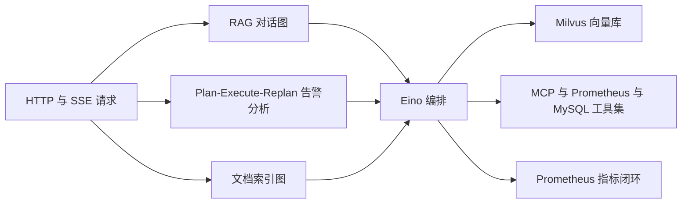

:::note 事实基线
本篇是「Yukino Agent（Go Eino RAG 运维 Agent）」项目深挖带解答题库，共 **88 题**，事实来源为 `content/be/yukino-agent.md`，对照本地仓库 `~/github/yukino.go/apps/agent` @ `facf5d6` 核验（frontmatter `local_commit` 与本机 HEAD 一致）。这是一个**用 Go 编写的 AI 运维助手后端**：以 CloudWeGo Eino 编排「RAG 对话、Plan-Execute-Replan 告警分析、文档向量化索引」三条流水线，对外经 yukino_http 暴露 HTTP/SSE，对内以 Milvus 为向量知识库、以 MCP/Prometheus/MySQL/时间/文档检索为工具集，并承担一个**监控桥**角色——把浏览器 SDK（`@yukino.js/sentry`）上报转成 Prometheus 指标，让「前端异常」反向触发「Agent 分析」。面试里它以「**介绍一个你做过的 Go AI Agent / AIOps / RAG 后端项目**」的形式出现。
:::

本篇是「Yukino Agent」项目深挖题库。它的面试价值在于：**它是「在 Go 里用成熟编排框架（Eino）落地 LLM Agent + RAG + AIOps」的完整参考**——核心取舍是「编排框架 + 组件适配」而非「从零造轮子」，项目自身代码集中在把外部世界（Milvus、MCP、Prometheus、MySQL、各家 LLM Provider）适配成 Eino 组件，以及为不可靠的 LLM 输出与外部依赖做容错兜底。本篇的组织顺序是：**先讲定位与架构 → 再讲 RAG 对话图 → 再讲 Plan-Execute-Replan → 再讲文档索引图 → 再讲模型层与 Provider 适配 → 再讲工具集与 MCP → 再讲 Milvus 引导与读写 → 再讲 HTTP 层与前端契约 → 再讲监控桥与告警闭环 → 最后讲会话记忆、容错与部署边界**。

**主线一览**



## 一、定位与架构总览

### Q1. 这个项目是什么？要同时解决哪四个工程问题？

yukino_agent 是一个用 Go 编写的 AI 运维助手后端，把「检索增强对话（RAG）」「自主告警分析（Plan-Execute-Replan）」「文档向量化索引」三条能力统一构建在 CloudWeGo Eino 编排框架之上。它要同时解决四个工程问题：

| 问题                    | 设计取向             | 落地手段                                                                   |
| ----------------------- | -------------------- | -------------------------------------------------------------------------- |
| 如何让 LLM 用上私有知识 | RAG 而非微调         | Milvus 向量库 + 文档索引流水线，检索结果注入 system prompt                 |
| 如何让 LLM 触达真实系统 | 工具调用而非纯文本   | ReAct Agent 绑定 MCP 日志、Prometheus 告警、MySQL、时间、文档检索工具      |
| 如何完成多步复杂任务    | 规划-执行-重规划闭环 | Plan-Execute-Replan，思考模型规划、快模型执行、思考模型复盘                |
| 如何让前端异常可被告警  | 观测数据指标化       | `/api/log` 接收 SDK 上报，转成 `yukino_sentry_*` 指标，`/api/metrics` 暴露 |

### Q2. 核心取舍「编排框架 + 组件适配」体现在哪？

核心取舍是**「编排框架 + 组件适配」而非「从零造轮子」**：图的编排、ReAct 循环、Plan-Execute 骨架都复用 Eino/ADK 的 prebuilt 能力，项目自身代码集中在两件事——① 把外部世界（Milvus、MCP、Prometheus、MySQL、各家 LLM Provider）适配成 Eino 组件；② 为不可靠的 LLM 输出与外部依赖做容错兜底。

**采分点**：能说出「**复用 Eino/ADK prebuilt（图编排、ReAct、Plan-Execute），自研代码集中在『外部系统适配成 Eino 组件』与『容错兜底』**」——这是「用框架」与「造框架」的清醒分工。

### Q3. 后端模块结构与六个可执行入口分别是什么？

后端是一个 Go module（`github.com/hangtiancheng/yukino.go/apps/agent/server`，`go.mod` 声明 `go 1.26.0`），通过相对路径 `replace` 引用同仓库的四个库（`yukino_cache`、`yukino_http`、`yukino_orm`、`yukino_rpc`），其中实际 require 并使用的是 `yukino_http` 作为 HTTP 框架。`cmd/` 下六个可执行入口：**agent**（HTTP 服务，生产主进程）、**chat**（两轮固定问题的 RAG 对话，演示多轮记忆）、**ai_ops**（命令行跑一次告警分析）、**knowledge**（批量索引 file_dir 下所有 .md）、**recall**（直接查询 Milvus 检索器）、**llm_tool**（验证模型的工具绑定能力）。

### Q4. 关键依赖与版本有哪些？

CloudWeGo `eino` v0.9.22（图编排/ReAct/ADK）、`eino-ext` 的 model/openai v0.1.13 与 model/claude v0.1.26、indexer/milvus 与 retriever/milvus、document/loader/file 与 splitter/markdown、libs/acl/openai v0.1.17、`anthropic-sdk-go` v1.84.0、`milvus-sdk-go/v2` v2.4.2、`modelcontextprotocol/go-sdk` v1.8.0、`eino-contrib/jsonschema` v1.0.3、`prometheus/client_golang` v1.25.0 与 `prometheus/common` v0.72.1、`gorm` v1.31.2 加 `driver/mysql` v1.6.0、`google/uuid` v1.6.0。

### Q5. 三条流水线为什么能共享同一套 Eino 编排与工具集？

因为三条流水线（RAG 对话、Plan-Execute-Replan、文档索引）都构建在 Eino 的 `compose.Graph` / ADK prebuilt 之上，**对话图与 Plan-Execute 执行器共享同一套工具**（注册顺序略有差异，集合一致：MCP、Prometheus、MySQL、时间、文档），保证两条流水线能力对等。文档索引图则是另一条线性链。共享编排与工具集让「新增一条流水线」的成本集中在「装配图」而非「重写工具」。

## 二、RAG 对话图

### Q6. RAG 对话图的拓扑是什么？为什么用 AllPredecessor 触发模式？

`chat_pipeline.BuildChatAgent` 用 `compose.NewGraph[*UserMessage, *schema.Message]` 声明一张有向图：

```text
            +--> InputToRag --> MilvusRetriever --+
START ------+                                     +--> ChatTemplate --> ReactAgent --> END
            +--> InputToChat ---------------------+
```

**检索与对话变量准备并行，二者汇聚到同一个 ChatTemplate**。图以 `compose.WithNodeTriggerMode(compose.AllPredecessor)` 编译，意味着 ChatTemplate 必须等两条入边（检索结果 + 对话变量）都就绪才触发——这正是「并行准备、汇聚渲染」的语义保证。

### Q7. 图里各节点的职责是什么？

**InputToRag**（Lambda）只把 `UserMessage.Query` 抽成字符串作为检索输入；**MilvusRetriever**（Eino Retriever 节点）用 `compose.WithOutputKey("documents")` 把检索结果写进模板变量 `documents`，与 system prompt 里的 `{documents}` 占位符对应；**InputToChat**（Lambda）产出 `map[string]any{content, history, date}`，分别填充用户问题、历史占位符与按 `2006-01-02 15:04:05` 格式化的当前时间；**ChatTemplate** 用 `schema.FString` 格式，由三段组成（固定 system prompt、`MessagesPlaceholder("history")`、`UserMessage("{content}")`）；**ReactAgent** 是终点。

### Q8. system prompt 如何组装？日志主题上下文为什么是条件注入？

system prompt 由 `buildSystemPrompt` 组装，定义了 "Conversational Assistant" 角色、交互准则与输出要求（只输出 markdown），并把检索到的文档夹在 `==== Documents Start/End ====` 之间。其中有一行日志主题上下文（`Log topic region` / `log topic ID`）是**条件注入**的：只有当配置里 `log_topic_region` 与 `log_topic_id` 都非空时才拼进去，否则整行省略——**这样 prompt 不会带着空占位符污染模型**。

### Q9. ReAct Agent 如何构建？为什么同时支持 Invoke 与 Stream？

ReAct Agent 由 `newReactAgentLambda` 构建，使用 **Quick 模型**（`models.NewQuickChatModel`），`MaxStep` 设为 25 以限制推理-行动循环的步数，`ToolReturnDirectly` 为空（没有任何工具的输出绕过模型直接作为最终回答），工具集与 Plan-Execute 的执行器完全一致。最后用 `compose.AnyLambda(agent.Generate, agent.Stream, nil, nil)` 把 Agent 包成 Lambda 节点，**同时支持 `Invoke`（一次性）与 `Stream`（流式）两种调用**，分别服务于 `/api/chat` 与 `/api/chat_stream`。

## 三、Plan-Execute-Replan 告警分析

### Q10. Plan-Execute-Replan 的三个角色与模型分工？

`plan_execute_replan.BuildPlanAgent` 面向「分析所有活跃告警并产出运维报告」这类多步任务，复用 Eino ADK 的 `planexecute` prebuilt，把三个角色拼成闭环：

| 角色      | 模型       | 职责                         | 关键约束                          |
| --------- | ---------- | ---------------------------- | --------------------------------- |
| Planner   | Think 模型 | 把目标拆成 `steps` 列表      | 结构化输出 JSON，非工具调用       |
| Executor  | Quick 模型 | 逐步执行，每步可多轮工具调用 | 单步 ReAct 循环实际不设上限       |
| Replanner | Think 模型 | 复盘进度，决定继续或收尾     | 输出 `{done, remaining, summary}` |

### Q11. 为什么整体 MaxIterations=20 而单步 ReAct 循环设为 999999？

整体 `MaxIterations=20` 封顶，由 `adk.NewRunner` 驱动；而**单个步骤内的 ReAct 循环 `MaxIterations` 被设为 999999**——因为一个计划步骤可能对每条活跃告警各发一次工具调用（如 `query_internal_docs` 或日志查询），因此把执行器的单步循环放大到近乎无限，**让整体循环成为唯一的收敛边界**。这是「收敛边界要设在正确的层级」的设计：单步不该被人为掐断，整体才需要封顶。

### Q12. BuildPlanAgent 消费事件流时为什么「只收执行器的非空 assistant 消息」？

`BuildPlanAgent` 消费 Runner 的事件流时有一个刻意的克制：它**只把「执行器产出的、不含工具调用的、非空的 assistant 消息」收进 `detail` 列表**，而把 Planner/Replanner 的 JSON 与工具调用轮次全部丢弃，最终回答取最后一条消息的 `Content`（没有任何消息时返回 "no response generated" 错误）。原因是这些中间产物若直接渲染到前端步骤列表里会变成乱码，所以只保留每一步的最终自然语言答案。

### Q13. 事件日志为什么「不读 MessageStream」？

事件日志只记录 `agent`/`path`/`has_output`/`err` 等元信息，而**不去读 `MessageStream`**——因为一旦读取就会把流抽干，导致后续 `adk.GetMessage` 拿不到内容。这是流式消费的一个经典陷阱：流只能被消费一次，观测代码不能与业务代码抢同一条流。

**采分点**：能说出「**MessageStream 只能消费一次，日志只记元信息不读流，否则抽干流导致 GetMessage 拿不到内容**」。

### Q14. Planner/Replanner 为什么走「基于 prompt 的结构化输出」而非工具调用？

因为**部分模型对 `tool_choice: forced` 支持不完整**，强行用工具调用做结构化输出会失败。于是 `structuredOutputModel` 包装了 `ToolCallingChatModel`，在 `Generate` 返回后对内容跑一遍 `extractJSONObject`，剥掉模型可能套上的 ` ```json ` 代码围栏或前置的推理文字，保证下游 `plan.UnmarshalJSON` 永远看到一个干净的 JSON 对象。这是「为兼容性做的妥协」——不依赖模型的 forced tool choice 能力。

### Q15. `extractJSONObject` 的容错逻辑是什么？

`extractJSONObject` 是这套容错的核心工具函数：先去掉单层 markdown 围栏，再定位第一个 `{`，然后取到与之配对的最后一个 `}` 的子串；若定位失败则返回原始内容的尾部，均连同错误，让调用方把原始模型输出一并暴露出来便于调试。它解决的是「模型输出 JSON 时爱套围栏、爱加前置推理文字」的现实问题。

### Q16. Replanner 为什么自己实现一个 adk.Agent 并用 defer recover？

`customReplanner.Run` 自己实现了一个 `adk.Agent`：它在一个 goroutine 里跑，**用 `defer recover()` 把 panic 转成带堆栈的 `AgentEvent{Err}` 再关闭迭代器，避免单个步骤的崩溃掀翻整个 Runner**。它从 ADK 会话里取出「已执行步骤结果」（`ExecutedStepSessionKey`）、「当前计划」（`PlanSessionKey`）、「历史步骤」（`ExecutedStepsSessionKey`）与「原始用户输入」（`UserInputSessionKey`），把刚执行的步骤并入历史后拼成复盘 prompt，让模型判断目标是否达成：达成则发出 `summary` 并触发 `NewBreakLoopAction` 跳出循环；未达成则用 `remaining` 构造新计划写回会话，进入下一轮。

### Q17. AIOpsQuery 的固定查询骨架是什么？为什么「告警名就是 API」？

`/api/ai_ops` 与 `cmd/ai_ops` 共用的查询是常量 `AIOpsQuery`：先调 `query_prometheus_alerts` 拉活跃告警，再对每条告警按告警名调 `query_internal_docs` 取处理手册，时间参数先经 `get_current_time`，日志查询必须带 region 与 topic，最后按固定的中文报告骨架（活跃告警列表 / 告警归因 N / 处理流程 N / 结论）输出。

**这也意味着告警名就是 API**：`prometheus.rules.yml` 里的每条规则名都要在知识库的 `data/docs/alert-handling-guide.md` 里有同名章节，检索才能命中。这是一个隐式契约——告警规则名与文档章节名必须对齐。

## 四、文档索引图

### Q18. 文档索引图的拓扑与触发模式？

`knowledge_index_pipeline.BuildKnowledgeIndexing` 是一张 `compose.NewGraph[document.Source, []string]`，把「一个文件路径」变成「一批写入 Milvus 的文档 ID」：`Source --> FileLoader --> MarkdownSplitter --> MilvusIndexer --> IDs`。这张图以 **`AnyPredecessor` 触发模式**编译（线性链，与对话图的 `AllPredecessor` 并行汇聚不同），并带 `compose.WithGraphName("KnowledgeIndexing")`。

### Q19. MarkdownSplitter 如何切分？为什么按一级标题？

`MarkdownSplitter` 用 eino-ext 的 `markdown.NewHeaderSplitter`，**按 `#` 一级标题切分**（`TrimHeaders: false`），把标题文本写进 `title` 元数据，并为每个切片用 `uuid.New()` 生成 ID。按一级标题切分是为了「精确命中单篇文档/单节」的运维问答场景（配合检索 `TopK=1`），而不是通用大规模语义搜索。

### Q20. IndexFile 的「先删后插」去重如何做？为什么去重键用 basename？

真正对外的入口是 `IndexFile`，被 HTTP 上传处理器与 `cmd/knowledge` 批量 CLI 共享（保证两条路径的索引行为一致）。`IndexFile` 的关键动作是**先删后插的去重**：先用加载器读取文档拿到 `_source` 元数据（`consts.MilvusSourceKey`），取其 basename 作为去重键，调用 `DeleteBySource` 删掉同名旧切片（删除失败只记 warn，不阻断索引），再跑索引图。这样重复索引同一个文件不会产生重复条目。**去重键统一用 basename，是为了让「在不同工作目录下索引同一个文件」得到稳定的键**。

## 五、模型层：Think/Quick 双模型与 Provider 适配

### Q21. Think/Quick 双模型的分工是什么？

`internal/ai/models` 提供两个工厂：`NewThinkChatModel`（规划/复盘，深度推理）与 `NewQuickChatModel`（对话/工具执行，快响应），二者都返回 Eino 的 `model.ToolCallingChatModel`。**Think 用于 Planner/Replanner（需要深度推理），Quick 用于对话与工具执行（需要快响应）**——这是「按任务性质选模型」的成本/质量平衡。

### Q22. openai 与 anthropic 两个 Provider 的适配差异？

底层实现由配置 `model_provider` 选择：**openai**（默认）走 eino-ext 的 OpenAI 兼容实现，只传 `Model`/`APIKey`/`BaseURL` 三项，`base_url` 原样使用（通常含 `/v1`），任何 OpenAI 兼容端点（OpenAI 本体、阿里 DashScope 兼容模式、本地 vLLM/Ollama 网关）都可用；**anthropic** 走 eino-ext 的 Claude 实现，`base_url` 为空时不覆盖 SDK 默认值，非空时**不能含 `/v1`**（SDK 会自己追加 `/v1/messages`），当 `thinking=true` 且 `max_tokens>1` 时开启扩展思考，`budgetTokens = max_tokens - 1`。

### Q23. `signaturePatchingTransport` 兼容补丁解决什么问题？

Anthropic 路径上有一个值得注意的兼容补丁 `signaturePatchingTransport`：它包装 `http.RoundTripper`，对 `Content-Type: application/json` 的非流式响应，解析出 `type=message` 的 body，**给任何缺失 `signature` 字段的 `thinking` 内容块补一个空字符串**。原因是官方 Anthropic API 总会在思考块上带 `signature`，但一些第三方网关会省略它，导致 Anthropic SDK 拒绝整个响应。流式（SSE）响应原样透传不做改写；补丁后会同步修正 `Content-Length` 头与 `resp.ContentLength`。

**采分点**：能说出「**第三方网关省略 thinking.signature 导致 SDK 拒绝整个响应，用 RoundTripper 补丁补空字符串 + 修正 Content-Length**」——这是「对接第三方 Anthropic 兼容网关」的真实坑。

### Q24. 向量化为什么只支持 OpenAI 兼容协议？ProbeDimension 的作用？

向量化由 `internal/ai/embedder` 负责，**只支持 OpenAI 兼容的 `/v1/embeddings` 协议**（经 eino-ext 的 `libs/acl/openai` 客户端，显式指定 float 编码格式），HTTP 超时 60s。它额外提供 `ProbeDimension`：用一个临时 embedder 对探针文本 `"dimension probe"` 做向量化，**以实际输出长度作为权威维度**。这个维度会在 Milvus 引导时决定 collection 的 `DIM`，因此**配置里无需、也不应手写维度**——避免「配置维度与实际模型输出维度不一致」的错误。

## 六、工具集：把外部系统适配成 Eino Tool

### Q25. 四个内置工具如何反推 JSON Schema？MCP 工具为何不同？

四个内置工具（`query_prometheus_alerts`、`mysql_crud`、`get_current_time`、`query_internal_docs`）都用 `utils.InferOptionableTool` **从 Go 函数签名与 struct tag（`jsonschema` / `jsonschema_description`）反推 JSON Schema**；MCP 工具则不经推断，由适配器直接携带服务器下发的 `InputSchema`。这是「内置工具用 Go 类型即 schema、外部工具用服务器下发 schema」的分工。

### Q26. 五个工具的能力与容错取向？

| 工具                      | 能力                                     | 容错取向                                                  |
| ------------------------- | ---------------------------------------- | --------------------------------------------------------- |
| MCP 日志工具（动态）      | 连接 MCP 服务器，枚举其工具并逐个适配    | 连不上则降级为空工具集，不阻断构建                        |
| `query_prometheus_alerts` | 拉取活跃告警，按 alertname 去重          | `prometheus_url` 为空返回空结果；运行期错误转成 JSON 载荷 |
| `mysql_crud`              | 对 MySQL 执行 query/insert/update/delete | 运行期错误转成 JSON 错误载荷回喂模型                      |
| `get_current_time`        | 返回多格式当前时间                       | 无参工具，容忍空 Arguments                                |
| `query_internal_docs`     | 对知识库做 RAG 检索                      | 运行期错误转成 JSON 错误载荷                              |

### Q27. MCP 适配支持哪三种传输？连接失败如何降级？

MCP 适配（`mcp_tool.go`）支持三种传输：`streamable_http`（默认）、`sse`、`stdio`（拉起子进程，继承当前环境并叠加配置的 `env`）；HTTP 两种传输校验 `mcp.url` 非空，stdio 校验 `mcp.command` 非空，未知传输直接报错。连接成功后用 go-sdk 的 `session.Tools` 迭代器（自动翻页）枚举服务器工具，把每个 MCP 工具的 `InputSchema` 经 JSON round-trip 转成 Eino 的 `jsonschema.Schema`，再包成 `mcpToolAdapter`。**连不上则降级为空工具集，不阻断构建**。

### Q28. MCP 为什么缓存「长连接会话」而非「工具切片」？watchSession 如何失效缓存？

缓存的是一个长连接的 `mcp.ClientSession`，而非每请求重连。`buildMcpTools` 先用 **`context.WithoutCancel` 把请求上下文脱钩**（SSE 传输会把长连接绑定到 `Connect` 的 ctx，若沿用首个请求的 ctx，该请求一结束就会掐断被缓存的会话），再在后台起一个 **`watchSession` goroutine 阻塞在 `session.Wait()`**，一旦服务器关闭连接或传输断开即失效缓存；没有持久流的传输（新版 streamable-HTTP 不再有独立 SSE 监听）则靠调用时失效兜底。适配器 `InvokableRun` 遇到请求级失败（区别于 `result.IsError` 的工具级失败）且自身 ctx 未被取消时，也调用 `invalidateMcpSession` 丢弃缓存并 `Close` 会话，让下次构建重连。

**采分点**：能说出「**context.WithoutCancel 脱钩请求 ctx 防长连接被掐断 + watchSession 后台失效 + 连接失败不缓存以支持恢复重连 + 命中时 slices.Clone 防别名**」——这是「缓存有状态长连接」的完整正确性链条。

### Q29. MCP 缓存键为什么用 json.Marshal 派生？命中时为什么 slices.Clone？

整个 MCP 工具集按配置做缓存（`mcpCacheKey` 用 `json.Marshal` 派生稳定键，**因为 encoding/json 会对 map 键排序**），但连接失败不缓存（返回空工具集），以便服务器恢复后下次请求能重连。**命中缓存时返回 `slices.Clone(cachedTools)`，避免调用方追加元素时别名或竞争缓存底层数组**；配置变化时先 `Close` 旧会话（顺带停掉可能拉起的 stdio 子进程）再重建。

### Q30. MySQL 工具的 normalizeDsn 为什么强制补 parseTime=true？

MySQL 工具（`mysql_crud.go`）用 GORM 执行 SQL。`normalizeDsn` 同时接受 go-sql-driver 格式与 `mysql://` URL 格式，并**强制补上 `parseTime=true`**（否则时间列会以 `[]byte` 返回，GORM 扫描进 `time.Time` 会报 "unsupported Scan"）。`execMysqlSql` 按 `operate_type` 只执行一次（`query` 走 `db.Raw().Scan` 到 `[]map[string]any`，写操作走 `db.Exec`），**每次调用开新连接池并在结束时关闭以防泄漏**。工具的 `operate_type` 在 schema 里用 `enum=query,insert,update,delete` 约束。

### Q31. TolerateEmptyArguments 解决什么模型兼容问题？

无参工具的兼容（`empty_arguments.go`）：`TolerateEmptyArguments[T]` 是一个自定义的 `utils.UnmarshalArguments`，**把空/纯空白的 Arguments 归一成 `"{}"` 再解码**。因为 Eino 默认的 sonic 反序列化会把空串当语法错误，而**部分模型（如 Qwen）对无参工具就是返回空串而非规范的 `"{}"`**。`get_current_time` 与 `query_prometheus_alerts` 都挂了这个选项。

### Q32. 「错误即观测」的容错范式是什么？为什么不返回 Go error？

MySQL、Prometheus 告警与文档检索工具在运行期失败时，**不返回 Go error，而是返回一个 `{success:false, error, message}` 的 JSON 字符串（error 为 nil）**。这样错误会作为「工具观测结果」回喂给模型，让 Agent 有机会推理并重试（比如修正 DSN），而不是直接中断整个 ReAct 流。这是「把错误变成模型可消费的观测数据」的容错范式。

**采分点**：能说出「**工具运行期错误转 JSON 载荷回喂模型而非返回 Go error，让 ReAct 流不中断、模型可自纠**」——这是 Agent 工具设计与传统 API 错误处理的本质区别。

## 七、向量知识库：Milvus 引导与读写

### Q33. Milvus 客户端为什么按配置缓存？bootstrap 的七步顺序？

`internal/utility/milvus` 负责把 Milvus 从零引导到可用并缓存连接。`NewClient` 按 Milvus 配置做缓存（键同样是 `json.Marshal` 派生），**因为对话处理器每个请求都会重建流水线，不能每次都付一遍引导成本**（两次 gRPC 连接 + 一次维度探测 + collection 建库建表 + 加载）。`bootstrap` 的引导顺序经过精心安排：① 先连 `default` 库（目标库可能还不存在，而 Milvus 拒绝连接不存在的库）；② 若目标库不是 default，`ListDatabases` 检查，不存在则 `CreateDatabase`；③ 关掉 default 连接，重连到目标库；④ 用 `embedder.ProbeDimension` 探测真实维度；⑤ 检查 collection（默认 `biz`）：若已存在但存储维度与探测维度不一致，直接 `DropCollection` 重建（并打 warn 日志），不存在则按 `Fields(dim)` 建表；⑥ 在 `vector` 字段上建 `AUTOINDEX` + `COSINE` 向量索引；⑦ `GetLoadState` 检查加载状态，未加载则 `LoadCollection`（collection 必须先加载才能搜索）。

### Q34. collection schema 的四个字段是什么？

| 字段       | 类型               | 说明                                |
| ---------- | ------------------ | ----------------------------------- |
| `id`       | VarChar(255)，主键 | 文档/切片 ID                        |
| `vector`   | FloatVector(dim)   | 内容向量，COSINE 度量               |
| `content`  | VarChar(8192)      | 文档内容，上限即 `MaxContentLength` |
| `metadata` | JSON               | 序列化的元数据，含去重键 `_source`  |

### Q35. documentToRows 为什么把向量转成原生 []float32 而非 BinaryVector？

写入（`internal/ai/indexer`）：`documentToRows` 把 Eino 文档 + 向量映射成行式记录 `docRow`（用 `milvus:"name:..."` tag 绑定字段）。它做三件事：① **把向量转成原生 `[]float32`**（而非 Eino 组件默认打包的 BinaryVector，后者与 FloatVector schema 不匹配）；② 把 `metadata["_source"]` 归一成 basename 以稳定去重键；③ 用 `truncateToRuneBoundary` 把 content 截断到 `MaxContentLength` 以匹配 schema。

### Q36. truncateToRuneBoundary 为什么必要？

知识库切片以中文为主，**按字节硬切会在末尾留下半个多字节 rune 从而产生非法 UTF-8**，该函数回退到最近的 `utf8.RuneStart` 边界再截断。这是「多字节文本按长度截断」的经典正确性问题——直接 `s[:8192]` 可能切在一个汉字的中间。

### Q37. 检索为什么 TopK=1 且不设 radius/range_filter？

检索（`internal/ai/retriever`）：`NewMilvusRetriever` 用 COSINE 度量、`AUTOINDEX` 搜索参数（**不设 radius/range_filter——Eino 默认会从 collection 维度推一个，反而会把所有 COSINE 结果静默过滤掉**）、`TopK=1`，输出 `id`/`content`/`metadata` 三字段，并用 `floatVectorConverter` 保证查询向量也是 FloatVector。`TopK=1` 配合按一级标题切分，偏向「精确命中单篇文档」的运维问答，不是通用大规模语义搜索的调参起点。

**采分点**：能说出「**不设 radius/range_filter，否则 Eino 默认推的阈值会把所有 COSINE 结果静默过滤掉**」——这是 Milvus + Eino 集成的隐蔽坑。

### Q38. emptyTolerantRetriever 解决什么「先有鸡还是先有蛋」问题？

检索器外面套了一层 `emptyTolerantRetriever`：**当 collection 还没有任何行时，Eino 组件会抛 "no results found" 错误，这个包装器把它映射成空文档列表而非错误**——否则「在索引第一篇文档之前就聊天」会让整条流水线失败。这是「空知识库容错」：系统刚启动、还没索引任何文档时，对话仍应可用（只是没有检索增强）。

### Q39. DeleteBySource 如何分批删除？为什么要转义？

去重删除（`DeleteBySource`）：先用布尔表达式 `metadata["_source"] == "<source>"` 查出所有匹配 ID，再**按 500 一批拼 `id in [...]` 表达式删除，以保持表达式短小**。字符串经 `escapeMilvusString` 转义反斜杠与双引号（防止 source 名里的特殊字符破坏布尔表达式）。

## 八、HTTP 应用层与前端契约

### Q40. HTTP 应用层如何装配？六个路由是什么？

`internal/app.New` 用 `yukino_http.Default()` 建引擎（自带日志与 panic 恢复中间件），挂一个 CORS 中间件（允许 `*` 源、GET/POST/OPTIONS、Content-Type 头，预检直接返回 204），然后在 `/api` 分组下注册六个路由：

| 方法 | 路径               | 处理器             | 说明                                           |
| ---- | ------------------ | ------------------ | ---------------------------------------------- |
| POST | `/api/chat`        | `handleChat`       | 同步 RAG 对话，返回 `{message, data:{answer}}` |
| POST | `/api/chat_stream` | `handleChatStream` | SSE 流式对话                                   |
| POST | `/api/upload`      | `handleFileUpload` | 上传文档入知识库                               |
| POST | `/api/ai_ops`      | `handleAIOps`      | 跑一次告警分析，返回 `{result, detail[]}`      |
| POST | `/api/log`         | `handleSentryLog`  | 监控上报汇聚点（SDK 的 dsn）                   |
| GET  | `/api/metrics`     | `handleMetrics`    | Prometheus 文本暴露                            |

所有响应统一用 `{message, data}` 信封，出错时 `data` 为 `null`——这是前端依赖的契约。

### Q41. 主进程的优雅关停如何做？

`cmd/agent` 主进程用 `signal.NotifyContext` 监听 SIGINT/SIGTERM，在一个 goroutine 里 `Listen` 服务、主 goroutine `select` 等待「服务出错」或「收到停止信号」二者之一。收到信号后**以 10 秒超时调 `Engine().Shutdown` 排水连接**，超时则记 error 日志但不强杀；排水期间服务协程返回的 `http.ErrServerClosed` 被视为正常退出。

### Q42. 对话处理器为什么「每次请求都重建流水线」？

对话处理器每次请求都重建流水线（`BuildChatAgent`），从 `mem` 取历史，以 `ctx.Request.Context()` 驱动整条图，成功后把「用户问题 + 助手回答」追加进会话记忆。重建流水线的成本被 Milvus/MCP 的进程级缓存吸收（连接与会话不重建），所以「每请求重建图」是廉价的——图只是装配声明，重的资源（连接、会话）走缓存。

### Q43. SSE 流式对话的帧格式是什么？与 OpenAI 风格有何不同？

`handleChatStream` 走 `Stream`，用 yukino_http 的 SSE 能力依次发出 `connected`（含 `client_id`）、若干 `message`（内容分片）、`done` 或 `error` 事件，并在 `defer` 里把累积的非空完整回答写回记忆。**SSE 帧格式是 `event: <name>` 行加一行或多行 `data: <payload>` 再以空行收尾**（多行载荷会拆成多个 `data:` 行），**没有单独的 id 行也没有 `[DONE]` 尾帧**；`connected` 载荷用 `json.Marshal` 编码而非字符串拼接，以保证会话 ID 里的特殊字符安全。

### Q44. 上传处理器的安全设计有哪几层？

上传处理器（`file_handler.go`）的安全设计较密：① 客户端文件名先经 `safeUploadName` 归一——**把反斜杠也替换成正斜杠**（Unix 上反斜杠是普通字符，否则 `filepath.Base` 会漏掉 Windows 风格的 `..\..\evil.md` 穿越），取 basename，拒绝空名/`.`/`..` 与不支持的扩展名（只允许 `.txt`/`.md`/`.markdown`）；② 再经 `confinedPath` 验证解析后的目标确实落在上传目录内；③ 最后用 `writeLimited` 流式落盘，通过「多读一字节」（`io.LimitReader(src, limit+1)`）证明是否超过 50MB 上限（`maxUploadBytes = 50 << 20`），超限或出错时删除半成品文件。

**采分点**：能说出「**反斜杠也替换成正斜杠防 Windows 风格穿越 + io.LimitReader(limit+1) 多读一字节证明超限**」——这两个是文件上传安全最容易漏的细节。

### Q45. 上传后索引为什么用 context.WithoutCancel 脱离请求上下文？

落盘后调用共享的 `IndexFile` 完成去重索引；这一步用 **`context.WithoutCancel(ctx.Request.Context())` 脱离请求上下文**——文件已经落盘，而 `IndexFile` 是先删旧切片再插新切片，**若在客户端断开时被中途取消，会让知识库停在「旧切片已删、新切片只插了一半」的状态**。这与 MCP 长连接用 WithoutCancel 是同一个模式：「已开始的、必须原子完成的操作不能被请求取消打断」。

### Q46. 错误信封为什么用反射抽取诊断字段？

错误信封（`errors.go`）：`structuredErrorMessage` 用**反射**从 LLM/API 错误里抽取诊断字段，拼成 `{name, message, statusCode, url, responseBody}` 的 JSON。之所以用反射，是为了**让 app 包不必 import 各家 Provider SDK**——它对任何暴露 `StatusCode` int 字段、`Request.URL` 或 `RawJSON()` 方法的错误类型都生效（尤其是 `*anthropic.Error`），对其它 Provider 的 `fmt.Errorf` 包装错误则回退到 name+message，还能用 `errors.As` 兜底 `*url.Error` 的 URL。

## 九、监控桥：浏览器可观测性到 Prometheus

### Q47. 监控桥的角色与私有 registry 设计？

`sentry_metrics_handler.go` 是一个独立的子系统，把 `@yukino.js/sentry` 浏览器 SDK 的上报转成 Prometheus 指标。它维护一个**私有 registry（`sentryRegistry`），与全局默认 registry 隔离**，在 `init()` 里注册三类东西。私有 registry 的意义：监控桥的指标与 Go 服务自身的指标分开管理，`/api/metrics` 只 Gather 私有 registry，避免与全局 registry 的其他指标混淆。

### Q48. GoCollector 为什么显式开启 runtime/metrics 规则组？

Go 运行时指标用 `collectors.NewGoCollector` 并**显式开启 `runtime/metrics` 的 GC/内存/调度器规则组**，外加 `/cpu/classes/*`、`/sync/*`、`/cgo/*` 三条正则规则。默认的 GoCollector 只暴露 `go_memstats_*` 等少量指标，这里补上了排查 Go 服务真正需要的**调度延迟、GC 暂停、各状态 goroutine 数、互斥锁竞争**等；采集规则只包含这些显式枚举的组，`/godebug/*` 等恒为零的序列不会被引入。还注册了两个自定义 GaugeFunc：`yukino_go_memory_limit_bytes`（GOMEMLIMIT）与 `yukino_go_heap_used_ratio`（存活堆占比）。

### Q49. 异构上报载荷如何解码？boundedLabel 如何防标签爆炸？

由于上报载荷是异构的，`decodePayload` 把「字段不匹配」当作预期情况**静默跳过而非报错**；高基数标签（如点击事件名、错误名、资源标签）经 `boundedLabel` 收敛：**每个标签键最多保留 `maxLabelValues=50` 个不同取值，超出的统一折叠成 `other`，空值归一为 `unknown`，防止标签爆炸**。`handleMetrics` 则 `Gather` 私有 registry，用 `expfmt` 编码成文本暴露格式写出。

**采分点**：能说出「**boundedLabel 每键最多 50 个取值、超出折叠成 other、空值归一 unknown**」——这是「前端事件转 Prometheus 指标」必须做的基数控制，否则时间序列爆炸。

### Q50. 前端事件类型如何映射到指标族？

事件类型映射：`Error` → `errors_total`/`error_details`（按失败元素标签）；`Performance` → `web_vitals`、`web_vital_samples_total`、`navigation_timing_ms`、`resource_*`、`long_tasks_*`、`browser_memory_*`，名为 `HTTP <method>` 的性能事件落到 `http_requests_total`/`http_request_duration_ms`，其余落到 `performance_value`；`Click`/`Exposure`/`PV`/`WhiteScreen`/`Custom` → `clicks_total`、`exposures_total`/`exposure_duration_ms`、`page_views_total`/`page_dwell_ms`、`white_screens_total`、`custom_events_total`。

### Q51. prometheus.rules.yml 的五组告警如何形成闭环？

`prometheus.yml` 配置三个抓取作业（prometheus 自身、yukino-agent 的 `/api/metrics`、milvus），抓取与规则评估间隔均为 15s。`prometheus.rules.yml` 定义五组告警：`targets`（抓取目标离线 ServiceOffline）、`go-runtime`（GoGoroutineLeak、GoSchedulerLatencyHigh、GoStopTheWorldHigh、GoGcCpuPressure、GoHeapNearLimit、GoMutexContention、GoThreadGrowth）、`telemetry-pipeline`（批量上报被持续拒绝、遥测停滞）、`client-errors`（React 崩溃、错误率突增、白屏、资源加载失败）与 `client-performance`（接口失败率、p95 延迟、Web Vitals 劣化、导航缓慢、长任务压力、浏览器内存）。**这些告警一旦触发，又能被 `query_prometheus_alerts` 工具拉回给 Agent 分析，形成闭环**——前端异常 → 指标 → 告警 → Agent 分析。

## 十、会话记忆、容错与部署（一句话速答）

**Q52. 一句话解释会话记忆的 LRU 与滑动窗口。** 会话记忆（`internal/utility/mem`）是带 LRU 的进程内存储：全局 `memMap` + `container/list` 双向链表，`MaxSessions=100` 封顶超限淘汰最久未用；每个 `ConversationMemory` 维护 `MaxWindowSize=6` 的滑动窗口，`Append` 超窗时成对丢弃最旧消息（excess 向上取偶）以保持 user/assistant 配对不被破坏。

**Q53. 一句话解释 All() 为什么返回快照拷贝。** 返回快照拷贝而非内部切片，防止调用方透过引用篡改状态；全局 map 与每个 memory 各自用 `sync.Mutex` 保护，并发安全。

**Q54. 一句话解释会话记忆的边界。** 会话记忆是进程内的，多副本部署时不共享，重启即丢；生产级多实例需要外置存储。

**Q55. 一句话解释优雅降级为什么是贯穿全局的容错主线。** MCP 连不上降级为空工具集；Prometheus 未配置则告警工具返回空结果（没有隐式默认地址）；知识库为空则检索返回空列表而非报错；工具运行期错误转 JSON 载荷回喂模型而非中断；Replanner 的 panic 被 recover 成事件错误——共同保证「任何一个外部依赖缺席，都不会让整个 Agent 构建或请求失败」。

**Q56. 一句话解释配置为什么读 config.json 而非环境变量，且允许 JSONC。** `stripJSONC` 在解码前剥掉 `//` 行注释、`/* */` 块注释与尾随逗号；剥离器逐字符扫描并感知字符串字面量，因此字符串里的 `//`（如 `https://api.example.com/v1`）不会被误判成注释。

**Q57. 一句话解释尾随逗号判定。** 用 `nextSignificant` 跳过空白与注释后看下一个有效 token 是否为 `}`/`]`——是则当前逗号是尾随逗号，剥掉。

**Q58. 一句话解释 applyDefaults 与 prometheus_url 的刻意留空。** `applyDefaults` 为缺省字段填默认值（`:8123`、`openai`、Think/Quick 各自 `max_tokens=4096`、`./data/docs`、`localhost:19530`、`agent`/`biz`、`streamable_http` 等）；`prometheus_url` 刻意不设默认，留空即视为关闭告警工具。

**Q59. 一句话解释 config.example.jsonc 与 config.json 的关系。** example 提供逐字段完整示例（含解释性行注释与尾随逗号，由 JSONC 剥离器在解码前移除），可原样拷贝成 config.json（后者因含真实密钥而被 git 忽略）。

**Q60. 一句话解释日志与 Eino 回调。** `internal/utility/logger` 用 `log/slog` 文本 handler 输出到 stdout（INFO 级）并设为全局默认；`internal/utility/log_callback` 是 Eino 回调 handler，把流水线各组件的 start/end/error 生命周期事件经 slog 打出，配置为 nil 时默认开启输入载荷详情（`Detail=true`）。

**Q61. 一句话解释本地部署与 air 热重载。** `cp config.example.jsonc config.json` 后 `go run ./cmd/agent` 或 `make dev`（air 热重载监听 go/tpl/tmpl/html，排除 tmp/bin/data/node_modules 与 _test.go，产物落 tmp/main）；注意 config.json 只在启动时读一次，改配置需手动重启。

**Q62. 一句话解释基础设施 compose。** `docker compose up -d` 拉起 Milvus standalone v2.5.10（etcd + minio + milvus + attu）、Prometheus v2.55.1、Grafana 11.4.0；Milvus 监听 19530，后端首连时自动建库建表；Prometheus 经 `host.docker.internal:8123` 抓取宿主机上的 `/api/metrics`（compose 用 host-gateway 映射）。

**Q63. 一句话解释容器多阶段构建与 GOWORK=off。** Dockerfile 多阶段（golang:1.25-alpine 构建、alpine 运行；go.mod 声明 go 1.26.0，GOTOOLCHAIN=auto 在镜像内拉取匹配工具链）；因为 go.mod 用相对路径 replace 了同仓库的库，构建上下文必须是仓库根，且构建时设 `GOWORK=off` 让本模块脱离 go.work 独立编译。

**Q64. 一句话解释镜像的 config 挂载策略。** 镜像 `EXPOSE 8123`，只内置 `config.example.jsonc` 作参考，真实 `config.json` 需运行时挂载，缺失则进程以清晰的加载错误退出。

**Q65. 一句话解释单元测试的覆盖面。** 集中在纯函数与可离线验证的边界：JSONC 剥离（含 URL 保留）、默认值、上传文件名归一/路径限制/限长写盘、Milvus 转义/维度解析/schema、索引行转换与 rune 边界截断、检索器空库容错与向量转换、MySQL DSN 归一与工具 schema、MCP 传输选择/降级/缓存切片独立性、请求上下文取消后 SSE 缓存会话仍存活、服务器重启后重连，以及监控桥的指标族完整性、事件明细、标签收敛与畸形载荷存活；`make test` 即 `go test ./... -race -cover`。

**Q66. 一句话解释这个项目的适用场景。** 需要在 Go 里落地带私有知识库的对话 Agent 且复用成熟编排框架（Eino）；需要把 LLM 接到真实运维系统做 AIOps 并要 Plan-Execute-Replan 闭环；需要把前端可观测性数据指标化让浏览器异常进入 Prometheus 告警再被 Agent 消费；需要对接多家 LLM Provider 与 MCP 工具生态并要一套针对不可靠模型输出的容错范式。

**Q67. 一句话解释检索 TopK=1 的边界。** 检索 `TopK=1` 且按一级标题切分，偏向「精确命中单篇文档」的运维问答，不是通用大规模语义搜索的调参起点。

**Q68. 一句话解释 Milvus 维度不匹配的代价。** 维度不匹配时会直接 drop 重建 collection，换 embedding 模型即清空知识库，需重新索引——这是「维度由 ProbeDimension 权威探测」的另一面。

**Q69. 一句话解释 mysql_crud 的安全边界。** 工具把 DSN 与 SQL 都交给模型生成并直接执行，无交互确认、无语句白名单，接到生产库前必须自行加权限与审计约束（诚实指出的高危面）。

**Q70. 一句话解释监控桥的扩缩边界。** 监控桥的指标是进程内累积的，与对话/分析能力同进程；若要把可观测性独立扩缩，需要把 `/api/log`+`/api/metrics` 拆成单独服务。

**Q71. 一句话解释为什么「告警名就是 API」是一个隐式契约。** `prometheus.rules.yml` 的每条规则名都要在 `data/docs/alert-handling-guide.md` 里有同名章节，`query_internal_docs` 才能命中——告警规则名与文档章节名必须对齐，否则检索落空。

**Q72. 一句话解释 Think/Quick 双模型的成本逻辑。** Planner/Replanner 用 Think（深度推理、贵但少调用），对话/工具执行用 Quick（快响应、便宜但多调用）——按「调用频率 × 任务复杂度」分配模型档位。

**Q73. 一句话解释为什么对话图用 AllPredecessor 而索引图用 AnyPredecessor。** 对话图是「并行准备、汇聚渲染」（ChatTemplate 要等检索 + 对话变量两条入边都就绪），索引图是线性链（任一前驱完成即可推进）——触发模式匹配拓扑语义。

**Q74. 一句话解释 MilvusRetriever 的 WithOutputKey("documents") 如何对接模板。** 检索结果写进模板变量 `documents`，与 system prompt 里的 `{documents}` 占位符对应——Eino 用 output key 把节点输出绑定到模板变量。

**Q75. 一句话解释为什么 ToolReturnDirectly 为空。** 没有任何工具的输出绕过模型直接作为最终回答——所有工具结果都要经模型再加工，保证回答是「模型基于观测的推理」而非「工具原始输出」。

**Q76. 一句话解释 MaxStep=25 与单步 999999 的层级差异。** 对话 ReAct 的 MaxStep=25（单次对话的推理-行动步数上限），Plan-Execute 单步 ReAct 的 MaxIterations=999999（近乎无限，让整体 20 轮成为唯一收敛边界）——不同层级的收敛边界。

**Q77. 一句话解释 NewBreakLoopAction 的作用。** Replanner 判定目标达成时发出 summary 并触发 `NewBreakLoopAction` 跳出 Plan-Execute 循环——这是「模型自主决定收尾」的机制。

**Q78. 一句话解释 ADK 会话键的作用。** `ExecutedStepSessionKey`/`PlanSessionKey`/`ExecutedStepsSessionKey`/`UserInputSessionKey` 是 Replanner 从 ADK 会话里取复盘上下文的键——Plan-Execute 的状态在会话里跨步骤传递。

**Q79. 一句话解释为什么 Planner/Replanner 的 JSON 被丢弃不渲染。** 这些中间产物若直接渲染到前端步骤列表里会变成乱码，所以只保留每一步的最终自然语言答案——前端契约是「人可读的步骤」，不是「模型原始 JSON」。

**Q80. 一句话解释 formatCallResult 的渲染规则。** MCP 工具结果：文本内容直接透传，图片/资源/结构化输出回退成 JSON，被标记 `IsError` 的结果转成 Go error 让模型自我纠正。

**Q81. 一句话解释 MCP 工具级失败与请求级失败的区别。** `result.IsError` 是工具级失败（转 Go error 回喂模型自纠），请求级失败（连接/传输断开）则 `invalidateMcpSession` 丢弃缓存并 Close 会话让下次重连——两种失败走不同恢复路径。

**Q82. 一句话解释为什么 stdio MCP 配置变化要先 Close 旧会话。** 顺带停掉可能拉起的 stdio 子进程——否则旧子进程会泄漏。

**Q83. 一句话解释 Milvus 引导为什么「先连 default 库」。** 目标库可能还不存在，而 Milvus 拒绝连接不存在的库——所以先连 default，建库后再重连目标库。

**Q84. 一句话解释 ClBounded 一致性级别与 DefaultShardNumber。** 建表用 `entity.DefaultShardNumber` 与 `ClBounded` 一致性级别——Bounded 是「有界陈旧」一致性，在一致性与性能间取平衡，适合知识库这种「写后稍延迟可读」的场景。

**Q85. 一句话解释 AUTOINDEX + COSINE 的选择。** AUTOINDEX 让 Milvus 自动选索引类型，COSINE 度量适合归一化文本向量的相似度——与检索器不设 radius 呼应（COSINE 结果不该被阈值静默过滤）。

**Q86. 一句话解释这个项目与 yukino-ecomm-agent 的技术路线差异。** yukino_agent 是 Go + CloudWeGo Eino（图编排/ReAct/ADK prebuilt）+ Milvus；yukino-ecomm-agent 是 TS + Hono + LangGraph + Prisma/PostgreSQL——同一「RAG + Agent」问题的两种语言/框架实现，可作 Eino vs LangGraph 的对照。

**Q87. 一句话解释这个项目与 yukino-dev-agent 的差异。** yukino-dev-agent 是 TS + Next.js + Vercel AI SDK 的全栈应用（OnCall/DevFlow 双产品面）；yukino_agent 是纯 Go 后端（无前端，经 yukino_http 暴露 API），定位是 AIOps 运维助手 + 监控桥——前者全栈、后者纯后端。

**Q88. 一句话总结这个项目的架构哲学。** 编排框架 + 组件适配（复用 Eino/ADK prebuilt，自研集中在外部系统适配与容错兜底）、三条流水线共享编排与工具集、Think/Quick 双模型按任务分配、错误即观测（工具错误转 JSON 回喂模型而非中断）、优雅降级贯穿全局（任一外部依赖缺席都不让 Agent 构建或请求失败）、监控桥把前端异常指标化形成「异常→告警→Agent 分析」闭环、有状态长连接用 WithoutCancel + watchSession 正确缓存——一个「在 Go 里用成熟框架落地 LLM Agent + RAG + AIOps」的完整参考。

---

**延伸阅读**

- [Go 实现 AI Agent 工程题库](/interview/qa/go-agent-engineering)：Go 落地 LLM Agent 的通用工程视角（本篇是其项目深挖版）。
- [Yukino Ecomm Agent 项目深挖题库](/interview/qa/yukino-ecomm-agent-project)：TS + LangGraph 的电商客服 Agent（与本篇 Go + Eino 形成框架对照）。
- [Yukino Dev Agent 项目深挖题库](/interview/qa/yukino-dev-agent-project)：TS + Next.js + Vercel AI SDK 的全栈 AI 应用。
- [RAG 与检索深挖题库](/interview/qa/rag-and-retrieval)：分块、嵌入、向量检索、置信度门禁的通用原理。
- [前端监控 SDK 题库](/interview/qa/frontend-monitoring-sdk)：本篇监控桥的上游——`@yukino.js/sentry` 浏览器 SDK。
- [Yukino HTTP 框架与 RPC 题库](/interview/qa/yukino-http-rpc)：本篇 HTTP/SSE 能力所依赖的 yukino_http 框架。
- [工作文档 · yukino_agent](/be/yukino-agent)：本篇的事实来源。
