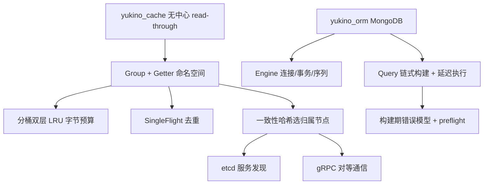

:::note 事实基线
本篇是「Yukino 缓存与 ORM」带解答题库，共 **84 题**，事实来源为 `content/be/yukino-cache-go.md` 与 `content/be/yukino-orm.md`，对照本地仓库 `$HOME/github/yukino.go`（子路径 `libs/yukino_cache`、`libs/yukino_orm`）核验。yukino_cache 是无中心节点的 read-through 分组缓存（gRPC 对等 + etcd 发现），yukino_orm 是 MongoDB 链式查询构建器（依赖 mongo-driver/v2）。
:::

本篇是「Yukino 缓存与 ORM」题库。这两个库是面试里「**你实现过缓存/ORM 吗**」「**read-through 缓存怎么设计**」「**链式查询构建器怎么做**」的直接素材。本篇先讲 yukino_cache（架构、LRU、SingleFlight、一致性哈希、服务发现），再讲 yukino_orm（Engine/Query、延迟执行、错误模型、聚合、事务）。

**主线一览**



## 一、yukino_cache：架构与 read-through

### Q1. yukino_cache 的核心设计目标与四层架构是什么？

核心设计目标是**在没有中心协调节点的前提下，让每个节点既服务本地请求、又能作为 peer 被其它节点访问，从而把缓存容量与热点压力分散到整个集群**。整体分四层：

| 层次   | 组件                                 | 职责                                                                |
| ------ | ------------------------------------ | ------------------------------------------------------------------- |
| 接口层 | `Group` + `Getter`                   | 命名空间隔离，对外暴露 Get/Set/Delete/Clear，承载 read-through 语义 |
| 缓存层 | `Cache` → `lruStore`                 | 分桶双层 LRU，按字节预算与条数上限淘汰，TTL 过期清理                |
| 路由层 | `ClientPicker` + `ConsistentHashMap` | 一致性哈希选节点，etcd 动态维护 peer 列表                           |
| 传输层 | `Server` / `Client`                  | 节点间 gRPC 通信，共用同一份 protobuf 服务定义                      |

### Q2. 三个关键架构决策是什么？

- **无中心节点**：每个节点同时运行 gRPC Server 与 ClientPicker，通过对等协议互相访问；集群成员信息只存在于 etcd 的注册项中。
- **read-through 语义**：调用方只提供 Getter，命中、未命中、远端取回、回填本地都由 Group 统一处理。
- **分片而非复制**：未命中时优先向 key 的**归属节点**请求，而不是广播或副本读；写操作只写本地并异步同步给归属节点，属于**弱一致的最终一致性**。

**采分点**：能说出「**分片而非复制——未命中向归属节点请求，写只写本地异步同步**」——这是 groupcache 风格的设计，区别于「每个节点全量复制」或「广播查询」。

### Q3. read-through 的读路径完整流程是什么？

```text
调用方 Group.Get(key)
  → 本地 Cache 命中？是 → 返回
  → 否 → SingleFlight 去重（同 key 并发只回源一次）
  → 一致性哈希算归属节点
     → 归属是自己？调 Getter 回源 → 回填本地 → 返回
     → 归属是远端？gRPC 向归属节点请求
        → 远端命中/回源 → 返回 → 本地回填 → 返回
```

**采分点**：能说出「**SingleFlight 在回源之前去重**」——避免缓存击穿时同 key 的并发请求都打到归属节点/数据库。

### Q4. Group 与全局注册表怎么管理？

`Group` 是缓存的基本单位，持有 Getter、本地 Cache、可选的 PeerPicker（由 `peersMu sync.RWMutex` 保护）、SingleFlightGroup、默认 TTL 与一组原子统计计数。值统一封装为**不可变的 `ByteView`**（提供 `ByteSlice()` 拷贝读与 `String()`）。Group 通过**全局注册表按名字去重**：`NewGroup(name, cacheBytes, getter, opts...)` 创建并注册（getter 为 nil 或名字重复时 panic），`GetGroup(name)` 按名取，`DestroyGroup(name)` 移除并 Close，`g.Close()` CAS 置关闭标志、关闭本地缓存、从注册表注销（幂等）。

**采分点**：能说出「**值封装为不可变 ByteView，ByteSlice() 是拷贝读**」——不可变值避免并发修改，拷贝读避免调用方改到缓存内部数据。

## 二、yukino_cache：LRU 与时钟

### Q5. 分桶双层 LRU 是什么？为什么分桶？

本地存储是**分桶双层 LRU**：按 key 哈希分桶，每桶内是双层 LRU（L1 热、L2 温）。**分桶的目的**：① 降低锁竞争（每桶独立锁，而不是全局一把锁）；② 双层 LRU 区分冷热（新条目进 L1，被淘汰到 L2，L2 再淘汰才真正驱逐），比单层 LRU 更抗扫描污染（一次性大量冷 key 不会冲掉热 key）。按**字节预算**（MaxBytes）与**条数上限**淘汰。

**采分点**：能说出「**分桶降锁竞争 + 双层 LRU 抗扫描污染**」——这是高并发缓存的两个关键优化。

### Q6. TTL 过期清理的两条路径是什么？

| 路径     | 触发时机                                       | 行为                                                              |
| -------- | ---------------------------------------------- | ----------------------------------------------------------------- |
| 懒清理   | 每次 `Get` 命中时比较 `Now() >= expireAt`      | 过期则删除 L1/L2 中的条目、扣减字节、触发 `OnEvicted`，返回未命中 |
| 定时清理 | 后台 goroutine 按 `CleanupTime`（默认 1 分钟） | 逐桶 walk L1/L2 收集过期 key 后批量删除                           |

`Cache.AddWithExpiration` 在传入时间已过期（`time.Until(expirationTime) <= 0`）时**直接跳过写入，不会缓存已过期的值**。

### Q7. 粗粒度时钟为什么能规避 time.Now() 开销？

存储层的时间源不是 `time.Now()`，而是一个**粗粒度时钟**：全局 `int64` 时钟由一个后台 goroutine 维护，每约 1 秒用真实时间重新校准一次，期间每 100ms 按 +100ms 的步长原子累加推进；**读路径的 `Now()` 只做一次 `atomic.LoadInt64`**。这样规避了高 QPS 下 `time.Now()` 的 vDSO 开销，代价是时间精度只有约 100ms。

**采分点**：能说出「**用原子累加的粗粒度时钟替代 time.Now()，读路径只做一次 atomic.Load**」——这是高 QPS 缓存的性能优化，精度换吞吐。

## 三、yukino_cache：SingleFlight 与一致性哈希

### Q8. SingleFlight 怎么去重？panic 怎么处理？

`SingleFlightGroup.Do(key, fn)` 保证同一个 key 的并发调用只执行一次 fn，其余调用者阻塞等待并共享结果。实现用 `sync.Map`：每个调用者先构造 `call{wg, val, err}` 并 `wg.Add(1)`，然后 `LoadOrStore`；**加载者（loaded == false）执行 fn 并 `defer g.m.Delete(key)` 让后续请求触发新一次加载**，等待者取出同一个 call 后 `wg.Wait()` 再读结果。**fn 内部 panic 会被 recover 并转换为错误返回给所有调用者**，因此一次回源失败会让该 key 的所有并发等待者一起失败，下一个请求会重新加载。

**采分点**：能说出「**加载者 defer Delete 让后续请求触发新加载**」+「**panic 转错误返回给所有等待者**」——前者保证不会永久卡住，后者保证失败共享。

### Q9. ConsistentHashMap 的虚拟节点与查找怎么工作？

`ConsistentHashMap` 是带虚拟节点的并发哈希环：每个物理节点虚拟节点数默认 50（`DefaultReplicas`），哈希函数默认 `crc32.ChecksumIEEE`，虚拟节点键 `<node>-<i>`。**查找**：对 key 哈希后在排序哈希值数组上二分（`sort.Search`），找第一个 `>= hash` 的位置，越界回绕到 0；空 key 或空环返回空串。**新增节点**：追加其虚拟节点后对全数组重新排序；哈希冲突时跳过该虚拟点而不是覆盖已有归属。**删除节点**：移除其全部虚拟节点、哈希项与计数器。

**采分点**：能说出「**虚拟节点解决数据倾斜**」——只有 3 个物理节点时 key 分布极不均匀，50 个虚拟点能让分布趋近均匀；节点增删时理论上只迁移约 1/N 的 key。

### Q10. 为什么虚拟节点数固定不做动态再均衡？

每个物理节点的虚拟节点数固定为 DefaultReplicas，**不做动态再均衡**：这样 key 到归属节点的映射**只随节点增删而变，不会因为负载波动而在环上漂移**，与 groupcache 的稳定归属语义一致。

**采分点**：能说出「**固定虚拟节点保证归属稳定，不因负载波动漂移**」——动态再均衡会让 key 归属频繁变化，破坏缓存局部性。

## 四、yukino_cache：服务发现与对等通信

### Q11. etcd 服务注册与重注册退避怎么做？

**注册**（`Register(svcName, addr, stopCh)`）：`:port` 形式的地址用 `getLocalIP()` 返回的本机第一个非 loopback IPv4 补全；申请 **10 秒 TTL 的租约**，以 `/services/<svc>/<addr>` 为 key 写入并绑定租约，然后启动 KeepAlive。一个后台 goroutine 监听 stopCh 与续约 channel：收到停止信号时用 3 秒超时的上下文撤销租约并退出；**续约 channel 关闭（etcd 抖动或网络分区）时进入 reRegister，以 1 秒起步、失败翻倍（上限 32 秒）的退避重新注册**，直到成功或收到停止信号。

**采分点**：能说出「**续约 channel 关闭触发 reRegister，指数退避重注册**」——这是「etcd 抖动后自动恢复注册」的容错设计。

### Q12. ClientPicker 的服务发现怎么工作？

构造时**先把自身地址加入哈希环**（保证 key 归属在全局视角下一致），再通过 `startServiceDiscovery` 做全量拉取 + 增量监听。`fetchAllServices` 用 3 秒超时的前缀 Get 拉取 `/services/<svc>/` 下的注册项，跳过空地址与自身后，对缺失地址 NewClient 建立 gRPC 连接入环，并关闭、移除 etcd 中已不存在的多余连接，最后返回 etcd revision；随后启动 watch 循环增量维护。

**采分点**：能说出「**先把自身加入哈希环，保证全局视角的归属一致**」——否则本节点算出的归属与其他节点不一致。

### Q13. 节点间 gRPC 对等通信与容错降级是什么？

每个节点既是 gRPC Server 又是 Client，共用同一份 protobuf 服务定义。**容错与降级**：远端节点不可达时，可以降级为本地回源（调 Getter）而不是失败——但这会破坏「归属节点」语义（同一 key 可能在多个节点回源），是弱一致的体现。

### Q14. yukino_cache 与 groupcache 的对比是什么？

yukino_cache 借鉴 groupcache 的核心设计（无中心、read-through、一致性哈希归属、ByteView 不可变值），但增加了：① **etcd 服务发现**（groupcache 需要静态配置 peer 列表）；② **分桶双层 LRU + 字节预算**（更精细的淘汰）；③ **TTL 过期**（groupcache 原生无 TTL）；④ **粗粒度时钟**（性能优化）；⑤ **Dashboard/可观测**（原子统计计数）。

**采分点**：能说出「**借鉴 groupcache 的无中心 read-through，但补了 etcd 发现、TTL、分桶双层 LRU**」——这体现「站在成熟设计肩膀上做增量」的工程思路。

## 五、yukino_orm：定位与核心抽象

### Q15. yukino_orm 的设计原则有哪些？

| 原则                   | 具体体现                                                                                        |
| ---------------------- | ----------------------------------------------------------------------------------------------- |
| 链式而非结构化查询对象 | 所有条件、排序、分页方法都返回同一个 `Query` 指针，可自由拼接                                   |
| 延迟执行               | 构建阶段不访问数据库，只有终结方法才把累积状态翻译成驱动调用                                    |
| 不静默出错             | 非法的构建输入被记录为错误，在终结方法处以 error 返回，而不是 panic 或发出错误查询              |
| 不静默覆盖             | 同一字段上的多个条件总是 AND 合并，无法合并时用顶层 `$and` 保留                                 |
| 贴近 Knex 的写语义     | 普通文档自动包 `$set`，`Update` 返回匹配数，`Insert` 接受切片，`Increment`/`Decrement` 直接可用 |
| 薄封装                 | 以 `$` 开头的未识别操作符原样透传，原始驱动错误原样返回                                         |

### Q16. Engine 与 Query 两个核心抽象的职责是什么？

| 抽象     | 职责                                                                 |
| -------- | -------------------------------------------------------------------- |
| `Engine` | 连接与数据库句柄，是所有查询的入口，也负责事务与自增序列             |
| `Query`  | 链式查询构建器，累积条件/排序/分页/投影/分组状态，并在终结方法中执行 |

`engine.Collection(name)` 在 name 为空白或 engine 为 nil 时**不会立即报错**，而是构造一个集合为 nil 的 Query，真正的错误在终结方法的预检阶段以 `ErrCollectionRequired` 返回。`NewEngine(ctx, uri, database)` 构造时校验 uri/database 非空、`mongo.Connect`、并执行一次 `Ping`（**Ping 失败时立即关闭连接再返回错误，避免留下悬空句柄**）。所有 getter 都做了 nil 接收者保护。

**采分点**：能说出「**构建期不报错，终结方法预检统一返回错误**」——这是「延迟执行 + 不静默出错」的具体落地。

### Q17. 集合命名策略怎么反射推导？

`engine.Model(value)` 通过 `CollectionName(value)` 反射推导集合名：剥掉指针与切片/数组到达底层结构体，把 CamelCase 转成 snake_case（每个非首位大写字母前插入 `_`），再按英文规则变复数。`User` → `users`，`ChatHistory` → `chat_histories`，`Address` → `addresses`。

## 六、yukino_orm：链式构建与错误模型

### Q18. 条件方法的 AND 合并与 $and 保留是什么？

**同一字段上的多个条件总是 AND 合并**（不静默覆盖），无法合并时用顶层 `$and` 保留。例如 `Where("age", ">", 18).Where("age", "<", 60)` 合并为 `{age: {$gt: 18, $lt: 60}}`；两个 `Where("status", ...)` 无法合并到一个字段时用 `{$and: [{status: ...}, {status: ...}]}`。

**采分点**：能说出「**不静默覆盖——同字段多条件 AND 合并，无法合并用顶层 $and**」——这是「不静默」原则在条件构建上的体现。

### Q19. 操作符与过滤文档的构建规则是什么？

条件方法支持操作符（`=`、`>`、`<`、`>=`、`<=`、`!=`、`in`、`nin`、`like` 等），映射到 MongoDB 操作符（`$eq`、`$gt`、`$lt`、`$in` 等）。**以 `$` 开头的未识别操作符原样透传**（薄封装）。过滤文档的构建把链式累积的条件翻译成 MongoDB 的 BSON 过滤文档。

### Q20. 排序、分页、投影与 Clone 怎么工作？

- `OrderBy(field, direction)` 排序；`Limit(n)`/`Offset(n)` 分页（Limit 仅在 n > 0 时下推给驱动）；`Select(fields...)` 设置投影（替换旧投影，`-` 前缀表示排除）。**MongoDB 只允许「包含投影」与「仅排除 \_id」混用**，其它混合方式会被服务端拒绝。
- **`Clone`**：Query 是可变的，要从公共基础派生多个变体用 Clone，它**深拷贝条件、$or 分组、排序、投影、分组键、Having 条件、聚合别名与已记录的构建错误**，使克隆体与原体互不影响。

```go
base := engine.Collection("users").Where("active", true)
adults := base.Clone().Where("age", ">=", 18)
minors := base.Clone().Where("age", "<", 18)
```

### Q21. 构建期错误模型与 preflight 预检是什么？

构建器把所有输入问题记录在内部的 `err` 字段（**只保留第一个**），终结方法在执行前的预检阶段统一返回。这样链式调用本身不会中断，调用方只需在终结方法处检查一次错误。**预检分两层**：基础预检（`preflightBase`）依次检查 nil Query、已记录的构建错误、nil 集合；普通预检在基础预检之上再**拒绝「存在未消费的 GroupBy/Having/聚合别名状态却调用了非 Aggregate 的终结方法」**，防止分组状态被静默忽略。`Aggregate` 只走基础预检，因此它是唯一允许携带分组状态的终结方法。

**采分点**：能说出「**预检拒绝『有分组状态却调非 Aggregate 终结方法』，防止分组被静默忽略**」——这是「不静默」原则的精细化落地。

## 七、yukino_orm：执行、聚合与事务

### Q22. 执行方法的关键语义有哪些？

- **`Update`/`Delete` 使用 Many 系列**，会作用于全部匹配文档。**没有任何 Where 条件时它们会命中整个集合**，因此调用方必须在应用层保证至少有一个条件。
- **`Insert` 的切片展开有白名单式例外**：`bson.D`（本身是切片但语义上是单个文档）与字节切片/数组不会被展开，其余切片/数组会被摊平成多个文档；展开只发生在「恰好一个可变参数」时。`InsertMany` 中途失败时，会把已成功插入的 ID 连同错误一起返回，便于补偿。
- **`Update`/`Upsert` 的更新文档经 `$set` 归一化**（`normalizeUpdate`）：`bson.M`/`map[string]any`/`bson.D` 若不含 `$` 前缀键，会被包成 `{$set: doc}`，含任一 `$` 键则原样透传；结构体一律包 `$set`。**结构体更新会把所有被序列化的字段（包括零值，遵守 omitempty）写进 $set，因此部分更新更适合用 bson.M**。
- **`First` 应用排序、偏移与投影但不应用 limit**（FindOne 语义）；`Find`、`Cursor`、`Each` 与 `Pluck` 额外应用 limit。

**采分点**：能说出「**Update/Delete 无条件会命中整个集合，调用方要保证有条件**」+「**结构体更新写所有字段（含零值），部分更新用 bson.M**」——这是 ORM 使用的两个高频陷阱。

### Q23. 单值聚合与分组聚合怎么做？

- **单值聚合**：`Sum`/`Avg`/`Min`/`Max`/`Count`/`Distinct`/`Pluck` 等，底层用 MongoDB aggregation pipeline。`Pluck` 内部临时构造自己的投影，不读取也不修改 Query 自身的投影状态。
- **分组聚合**：`GroupBy` + `Having` + 聚合别名，翻译成 `$group` + `$match` pipeline。分组状态只能由 `Aggregate` 终结方法消费（Q21）。

### Q24. 事务与自增序列怎么实现？

- **事务**：`engine.Transaction(ctx, fn)` 开启会话并执行带自动提交/回滚的闭包，返回一个**事务子 Engine**（自动绑定 session），闭包内的查询都走这个 session。
- **自增序列**：`engine.NextSequence(ctx, name)` 返回全局递增的 int64（MongoDB 没有原生自增，用 findAndModify 原子递增一个序列集合实现）。

**采分点**：能说出「**MongoDB 没有原生自增，用 findAndModify 原子递增序列集合**」——这是 MongoDB 自增 ID 的标准实现。

### Q25. 流式查询（Cursor/Each）与日志怎么做？

- **流式查询**：`Cursor` 返回游标，`Each` 遍历游标逐条处理——适合大结果集，避免一次性加载全部到内存（`Find` 是 `Cursor.All` 一次性加载）。
- **日志**：日志器记录查询与耗时，便于调试与慢查询定位。

### Q26. yukino_orm 的并发与安全约束、性能边界是什么？

- **并发**：Query 是可变的，并发派生要用 Clone；Engine 的连接池由 mongo-driver 管理。
- **安全**：以 `$` 开头的操作符原样透传，**面向不可信输入时要校验操作符**（防止操作符注入）。
- **性能**：`Find` 一次性加载全部匹配文档，大结果集要用 Cursor/Each + Limit；无条件 Update/Delete 命中全集合。

### Q27-Q84. 快速自检与深挖补充

**Q27. 一句话解释 yukino_cache 为什么无中心。** 每个节点同时是 gRPC Server 与 ClientPicker，对等互访，集群成员只在 etcd 注册项——没有中心协调节点。

**Q28. 一句话解释 read-through 的语义。** 调用方只提供 Getter，命中/未命中/远端取回/回填本地都由 Group 统一处理——调用方不感知缓存层级。

**Q29. 一句话解释分片而非复制。** 未命中向 key 的归属节点请求（不广播），写只写本地异步同步归属节点——弱一致的最终一致性。

**Q30. 一句话解释 ByteView 为什么不可变。** 避免并发修改，ByteSlice() 拷贝读避免调用方改到缓存内部数据——不可变值是并发安全的基础。

**Q31. 一句话解释全局注册表按名去重。** NewGroup 名字重复时 panic，GetGroup 按名取，DestroyGroup 移除并 Close——Group 是命名空间隔离的基本单位。

**Q32. 一句话解释分桶为什么降锁竞争。** 按 key 哈希分桶，每桶独立锁而非全局一把锁——高并发下锁竞争从全局降到桶级。

**Q33. 一句话解释双层 LRU 为什么抗扫描污染。** 新条目进 L1，淘汰到 L2，L2 再淘汰才驱逐——一次性大量冷 key 不会冲掉 L1 的热 key。

**Q34. 一句话解释字节预算淘汰。** 按 MaxBytes（字节预算）与条数上限淘汰，而不只是条数——大 value 占字节多，按字节预算更公平。

**Q35. 一句话解释懒清理与定时清理的分工。** 懒清理在 Get 命中时检查过期（即时），定时清理后台逐桶 walk 批量删（兜底）——两者协同。

**Q36. 一句话解释为什么已过期值不写入。** AddWithExpiration 在传入时间已过期时直接跳过——不缓存已过期的值，避免无效占用。

**Q37. 一句话解释粗粒度时钟的精度代价。** 每 100ms 原子累加、每秒校准，读路径只做 atomic.Load——精度约 100ms，换取规避 time.Now() 的 vDSO 开销。

**Q38. 一句话解释 SingleFlight 的 LoadOrStore。** 每调用者构造 call{wg,val,err} 并 wg.Add(1)，LoadOrStore 决定谁是加载者——加载者执行 fn，等待者 wg.Wait 共享结果。

**Q39. 一句话解释加载者为什么 defer Delete。** 让后续请求触发新一次加载——否则 fn 执行期间的新请求会一直等同一个 call。

**Q40. 一句话解释 SingleFlight panic 的处理。** fn 内 panic 被 recover 转错误返回给所有等待者——一次回源失败让该 key 所有并发等待者一起失败，下个请求重新加载。

**Q41. 一句话解释虚拟节点为什么默认 50。** 解决数据倾斜——3 个物理节点时 key 分布极不均，50 个虚拟点让分布趋近均匀。

**Q42. 一句话解释一致性哈希查找的二分。** 对 key 哈希后在排序哈希值数组上 sort.Search 找第一个 >= hash 的位置，越界回绕到 0。

**Q43. 一句话解释新增节点为什么重新排序。** 追加虚拟节点后全数组重新排序保持有序——二分查找的前提是数组有序。

**Q44. 一句话解释哈希冲突为什么跳过而非覆盖。** 冲突时跳过该虚拟点，不覆盖已有归属——避免改变已存在 key 的归属。

**Q45. 一句话解释为什么虚拟节点数固定。** key 归属只随节点增删而变，不因负载波动在环上漂移——与 groupcache 稳定归属语义一致。

**Q46. 一句话解释 etcd 注册的 10 秒租约。** 申请 10 秒 TTL 租约，以 /services/<svc>/<addr> 为 key 写入并绑定，启动 KeepAlive 续约。

**Q47. 一句话解释 reRegister 的退避。** 续约 channel 关闭（etcd 抖动/网络分区）时进入 reRegister，1 秒起步失败翻倍（上限 32 秒）退避重注册。

**Q48. 一句话解释 ClientPicker 为什么先加自身入环。** 保证 key 归属在全局视角下一致——否则本节点算出的归属与其他节点不一致。

**Q49. 一句话解释 fetchAllServices 的多余连接清理。** 拉取 etcd 注册项，对缺失地址建连接入环，关闭移除 etcd 中已不存在的多余连接——保持环与 etcd 一致。

**Q50. 一句话解释远端不可达的降级。** 可降级为本地回源（调 Getter）而非失败，但破坏归属语义（同 key 可能多节点回源）——弱一致的体现。

**Q51. 一句话解释 yukino_cache 相对 groupcache 的增量。** etcd 服务发现（groupcache 静态配置）、分桶双层 LRU + 字节预算、TTL 过期、粗粒度时钟、Dashboard 可观测。

**Q52. 一句话解释 yukino_orm 的延迟执行。** 构建阶段不访问数据库，只有终结方法才把累积状态翻译成驱动调用——链式构建与执行分离。

**Q53. 一句话解释「不静默出错」。** 非法构建输入记录为错误，终结方法以 error 返回，不 panic 不发错误查询——错误延迟到终结方法统一暴露。

**Q54. 一句话解释「不静默覆盖」。** 同字段多条件 AND 合并，无法合并用顶层 $and 保留——不丢失条件。

**Q55. 一句话解释薄封装的透传。** 以 $ 开头的未识别操作符原样透传，原始驱动错误原样返回——不重新发明 MongoDB 查询语言。

**Q56. 一句话解释 Engine 构造为什么 Ping。** 校验连接可用，Ping 失败立即关闭连接再返回错误，避免悬空句柄。

**Q57. 一句话解释 nil 接收者保护的价值。** engine 未初始化时调用 getter 不 panic 而返回零值——让「先构造 Query 后补 engine」的路径更安全。

**Q58. 一句话解释集合命名复数化。** CamelCase 转 snake_case 再变复数（User→users，ChatHistory→chat_histories，Address→addresses）。

**Q59. 一句话解释 Collection(name) 为什么空白不立即报错。** 构造集合为 nil 的 Query，错误在终结方法预检以 ErrCollectionRequired 返回——延迟执行的一致体现。

**Q60. 一句话解释 $and 保留的场景。** 同字段两个等值条件无法合并到一个字段（如 status=A AND status=B），用顶层 $and 数组保留。

**Q61. 一句话解释 Select 投影的混用限制。** MongoDB 只允许「包含投影」与「仅排除 _id」混用，其它混合被服务端拒绝。

**Q62. 一句话解释 Limit 为什么 n>0 才下推。** n<=0 时无意义，不下推给驱动——避免错误的 limit 0。

**Q63. 一句话解释 Clone 深拷贝什么。** 条件、$or 分组、排序、投影、分组键、Having、聚合别名、构建错误——克隆体与原体互不影响。

**Q64. 一句话解释为什么需要 Clone。** Query 可变，从公共基础派生多个变体时不 Clone 会互相污染——Clone 让 base 复用且变体独立。

**Q65. 一句话解释构建错误为什么只保留第一个。** err 字段只记第一个构建错误——终结方法返回它，调用方修第一个再发现下一个。

**Q66. 一句话解释 preflight 两层预检。** 基础预检（nil Query/构建错误/nil 集合），普通预检再拒绝「有分组状态却调非 Aggregate 终结方法」。

**Q67. 一句话解释为什么 Aggregate 只走基础预检。** 它是唯一允许携带分组状态的终结方法——GroupBy/Having 只能由 Aggregate 消费。

**Q68. 一句话解释 Update/Delete 无条件命中全集合的风险。** Many 系列作用于全部匹配，无 Where 时命中整个集合——调用方必须保证至少一个条件。

**Q69. 一句话解释 Insert 切片展开的白名单例外。** bson.D（语义单文档）与字节切片/数组不展开，其余切片摊平成多文档——展开只在恰好一个可变参数时。

**Q70. 一句话解释 InsertMany 中途失败的补偿。** 把已成功插入的 ID 连同错误返回——便于调用方补偿（删除已插入的或重试剩余的）。

**Q71. 一句话解释 $set 归一化。** 不含 $ 前缀键的文档包成 {$set: doc}，含 $ 键原样透传——贴近 Knex 写语义。

**Q72. 一句话解释结构体更新为什么写所有字段。** 结构体序列化的字段（含零值，遵守 omitempty）都进 $set——部分更新更适合用 bson.M。

**Q73. 一句话解释 First 为什么不应用 limit。** FindOne 语义（取第一条），应用排序/偏移/投影但不 limit；Find/Cursor/Each/Pluck 额外应用 limit。

**Q74. 一句话解释 Pluck 为什么不读 Query 投影。** 内部临时构造自己的投影，不读取也不修改 Query 自身投影状态——避免污染。

**Q75. 一句话解释分组聚合的 pipeline。** GroupBy + Having + 聚合别名翻译成 $group + $match——分组状态只能由 Aggregate 消费。

**Q76. 一句话解释事务子 Engine。** Transaction 开启会话执行闭包，返回自动绑定 session 的子 Engine，闭包内查询都走该 session。

**Q77. 一句话解释 NextSequence 的实现。** MongoDB 无原生自增，用 findAndModify 原子递增序列集合返回全局递增 int64。

**Q78. 一句话解释 Cursor/Each 相对 Find 的价值。** Find 是 Cursor.All 一次性加载，大结果集用 Cursor/Each 流式逐条处理避免内存爆。

**Q79. 一句话解释操作符注入的防护。** 以 $ 开头操作符原样透传，面向不可信输入要校验操作符——防止操作符注入。

**Q80. 一句话解释 yukino_orm 与 mongo-driver 的关系。** 依赖 mongo-driver/v2，是其上的链式查询构建器薄封装——不重新实现驱动。

**Q81. 一句话解释这两个库的共同风格。** 显式状态与所有权、不静默（错误/覆盖都暴露）、薄封装不重新发明——与 go-components 同一工程哲学。

**Q82. 一句话解释 yukino_cache 的适用场景。** 读多写少、热点分散、需要把缓存容量与热点压力分散到集群、能接受弱一致最终一致——不适合强一致读。

**Q83. 一句话解释 yukino_orm 的适用场景。** MongoDB 应用需要链式构建、延迟执行、不静默出错的查询——贴近 Knex 写语义，薄封装透传原生能力。

**Q84. 一句话总结两个库的设计哲学。** yukino_cache 用无中心对等 + 一致性哈希归属 + SingleFlight 去重把缓存分散到集群；yukino_orm 用链式延迟执行 + 构建期错误模型 + 不静默原则把 MongoDB 查询做得可预测——两者都把正确性建立在显式状态与原子操作上。

---

**延伸阅读**

- [Yukino Go 分布式组件题库](/interview/qa/yukino-go-components)：consistent_hash、redis_lock 等组件（yukino_cache 的一致性哈希与 groupcache 对比）。
- [Yukino HTTP 与 RPC 题库](/interview/qa/yukino-http-rpc)：同仓库的 HTTP 与 RPC 框架。
- [Yukino Task Flow 题库](/interview/qa/yukino-task-flow)：yukino_cache 被用作报告分组缓存的完整案例。
- [缓存、存储与 ORM 题库](/interview/qa/cache-storage-orm)：缓存与 ORM 的通用原理。
- [工作文档 · yukino-cache-go](/be/yukino-cache-go) 与 [yukino-orm](/be/yukino-orm)：本篇的事实来源。
