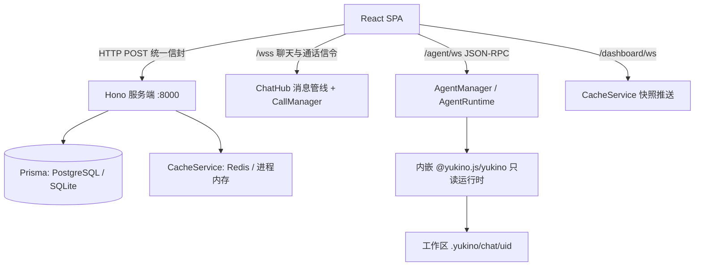

:::note 事实基线
本篇是「Yukino Chat」项目深挖带解答题库，共 **92 题**，事实来源为 `content/fe/yukino-chat.md`，对照本地仓库 `~/github/yukino-chat`（子路径 `server/`、`client/`）@ `555f625` 核验（frontmatter `local_commit` 与本机 HEAD 一致）。这是一个**自托管即时通讯平台**：单聊/群聊、WebRTC 音视频通话（服务端只做信令）、分块断点续传文件传输，并为每个登录用户**内嵌一个完整的只读 coding agent** 作为一等聊天参与者。面试里它以「**介绍一个你做过的实时系统 / 在既有产品里嵌入 Agent 的项目**」的形式出现。
:::

本篇是「Yukino Chat」项目深挖题库。它的面试价值集中在三处工程设计：**线协议语义保真**（JSON 零值、空列表 null 序列化、通道溢出帧都是稳定契约）、**Agent 与聊天的合流**（落库回复走与人类消息完全相同的「插入加广播」路径，流式过程走独立 RPC 通道，「转录是事实、overlay 是过程」）、**断点续传的极简状态机**（服务器状态就是分块目录里的文件集合）。本篇的组织顺序是：**先讲定位与运行时形态 → 再讲数据模型与双 schema → 再讲 HTTP/WS 通道与鉴权 → 再讲 ChatHub 消息管线与投递语义 → 再讲 WebRTC 信令 → 再讲分块断点续传 → 再讲缓存与看板 → 再讲每用户内嵌 Agent 与只读圈禁 → 再讲 JSON-RPC 桥与转录缝合 → 最后讲前端工程化与部署边界**。

**主线一览**

## 一、定位与运行时形态

### Q1. 这个项目是什么？与纯 LLM 聊天应用的本质区别在哪？

它是一个**自托管即时通讯平台**，同时覆盖五类能力：账号体系与权限管理；联系人、群组、会话与富消息（文本、图片、文件、音视频信令）；WebRTC 音视频通话（服务端只做信令）；大文件的分块上传与断点续传；**每用户一个内嵌 Agent**，支持工具执行、MCP、权限确认与技能。

与纯 LLM 聊天应用的本质区别在于：集成的不是「调一次补全接口」，而是**以库形式（`@yukino.js/yukino` 的 `Remote.Server` 面）嵌入服务进程的完整 coding agent 栈**——能读文件、抓取网页、调用 MCP 工具、在需要时向用户请求授权，但被**只读策略**约束在每用户独立的工作区内。Agent 不是子进程，而是与服务同进程长驻的运行时。

**采分点**：能说出「**完整 agent 栈以库形式同进程嵌入 + 只读圈禁**」这一组合，并点出它回答的是「多用户宿主如何安全地内嵌一个能力不打折的 coding agent」。

### Q2. 技术选型一览？

| 维度       | 选型                                                                                                                                    |
| ---------- | --------------------------------------------------------------------------------------------------------------------------------------- |
| 服务端     | Node.js 24（`node:24-alpine`）+ TypeScript 5.9 + Hono，HTTP 由 `@hono/node-server` 承载                                                 |
| ORM/数据库 | Prisma 7 驱动适配器，PostgreSQL（`@prisma/adapter-pg`，默认）或 SQLite（`@prisma/adapter-better-sqlite3`），由 `DATABASE_PROVIDER` 选择 |
| 缓存       | Redis（ioredis），`REDIS_URL` 为空串时降级进程内存                                                                                      |
| 认证       | 手写 HS256 JWT + bcryptjs 口令哈希                                                                                                      |
| 实时通道   | `@hono/node-ws` 适配器 + `ws`，三条独立端点                                                                                             |
| Agent      | `@yukino.js/yukino` 以 `latest` tag 声明，库形式嵌入，每用户一个运行时，独立工作区，只读工具策略                                        |
| 前端       | React 19 + React Router 7 + Vite 8 + TypeScript 6 + Tailwind 4 + shadcn/ui（Base UI 原语）                                              |
| 前端状态   | Zustand（会话、通话、Agent、主题与 UI 状态）+ TanStack React Query/Form/Virtual                                                         |
| 富文本     | TipTap 3（输入）+ Streamdown（消息渲染，含公式、mermaid、代码高亮与中日韩排版插件）                                                     |
| PWA        | vite-plugin-pwa，`autoUpdate` 策略                                                                                                      |
| 工具链     | pnpm workspace（client + server）、ESLint（前端）、Biome（服务端）、Vitest 与 Node 冒烟脚本、Prettier                                   |

### Q3. 服务端运行时形态与启动顺序是什么？

服务端是**纯 Node.js 进程**，不托管任何前端静态文件。入口顺序：① 先创建四个静态目录（头像、普通文件、分块临时目录、Sentry 遥测日志目录）；② 组装依赖包；③ 确保内置 Agent 账号存在；④ 启动聊天枢纽与 Agent 管理器的定时器；⑤ 构建应用并监听端口。默认监听 `0.0.0.0:8000`，开发态用 `tsx watch`，生产态构建后直接 `node` 启动。应用另暴露免鉴权的 `GET /health` 存活探针，供容器编排与反向代理做健康检查。

SPA 由独立的 Nginx 边缘镜像部署，边缘把 `/api/*` 全量路径（HTTP、WebSocket、上传静态资源）剥前缀反代到后端——于是换域名、加 TLS 都无需重建前端。

### Q4. 依赖如何注入？进程退出时的清理顺序？

依赖通过一个 `Deps` 接口集中注入路由：数据库、缓存、通话管理器、聊天枢纽、五个业务服务（会话、用户、联系人、群组、消息）以及 Agent 管理器。**没有全局单例**，便于测试时替换实现，也让进程退出时可以按依赖顺序统一释放。

进程退出（SIGINT/SIGTERM）时的清理顺序是：**释放全部 Agent 运行时 → 停止聊天枢纽心跳定时器 → 关闭 Redis → 断开数据库连接**。先释放最重、最可能有在途状态的 Agent 运行时，最后才断数据库。

### Q5. 为什么前后端分离 + Nginx 边缘？边缘做了哪些事？

分离的核心收益是**换域名、加 TLS 无需重建前端**。Nginx 是唯一入口：托管 SPA（`/assets/*` 一周 immutable 长缓存、`/sw.js` 强制再验、其余路径回落 `index.html`），并把 `/api/*` 全量路径（HTTP、三条 WebSocket、`/api/static/*` 上传）剥前缀反代到后端，带 `Upgrade` 头映射、小时级读写超时、关闭请求与响应缓冲，`client_max_body_size` 提到 100 MB 以容纳分块上传，另开 gzip。后端上游可用 `YUKINO_API_UPSTREAM` 覆盖（默认 `app:8000`）。

### Q6. 单实例定位体现在哪？要做多实例需先解决哪四件事？

单实例体现在：**连接表、通话房间、消息串行链、Agent 运行时表、限流桶都在进程内存，无跨实例总线**。这是「内网自托管」定位下的自觉取舍——单实例换来极简的内存态设计与可预测的调试体验，代价是无法水平扩展。

若要做多实例，需先解决四件事：① 把聊天扇出改为跨实例总线（如 Redis Pub/Sub）；② 把通话房间状态外置；③ 把 Agent 运行时按用户做粘性路由或外置会话；④ 把限流桶换成共享计数器。

### Q7. 这个项目有哪些已知约束？

| 约束             | 说明                                                                                                                                                  |
| ---------------- | ----------------------------------------------------------------------------------------------------------------------------------------------------- |
| 单实例           | 连接表、通话房间、消息串行链、Agent 运行时表、限流桶都在进程内存                                                                                      |
| 无 TLS           | 后端与边缘容器均为明文 HTTP，TLS 需在 Nginx 之前终结；且 `getUserMedia` 与 Web Crypto 都要求安全上下文，非 HTTPS 页面上音视频通话与分块上传哈希不可用 |
| 改密无验证       | 免鉴权按手机号重置，只有按 IP 限流，公网暴露前必须加验证                                                                                              |
| 无 STUN/TURN     | WebRTC 跨 NAT 打不通                                                                                                                                  |
| 外部依赖自备     | PostgreSQL 与 Redis 由部署方提供；选 SQLite 则无需外部数据库，Redis 为空时降级进程内存                                                                |
| 迁移不自动执行   | 裸 `node` 进程启动不做迁移，建表靠 `prisma migrate deploy`；容器入口脚本会在启动前自动执行                                                            |
| 声明未消费的依赖 | 服务端 package 中对象存储与压缩库被声明但零引用，属于预留                                                                                             |

## 二、数据模型与双镜像 schema

### Q8. 数据库定义了哪八个模型？为什么是两套镜像 schema？

八个模型：`UserInfo`、`Session`、`Message`、`GroupInfo`、`UserContact`、`ContactApply`、`ContactTag`、`AgentSession`。由两套镜像 schema 承载：`server/prisma/schema.prisma`（PostgreSQL）与 `server/prisma-sqlite/schema.prisma`（SQLite），由 `DATABASE_PROVIDER` 选用（连同各自的 migrations 目录）。

两套 schema 的列类型按各自数据库能力对齐（PostgreSQL 用 `@db.VarChar` 与原生数组，SQLite 用无标注字符串与 JSON），但**模型形状一致**，因此应用代码只对单一 Prisma 客户端类型编程——`createPrismaClient` 在 SQLite 模式下把 better-sqlite3 客户端 cast 成 PostgreSQL 客户端类型。

### Q9. 带前缀 uuid 的「路由语义」是什么？为什么不用自增整数做业务引用？

每张表都带一个自增整数物理主键 `id`，但**业务层互相引用的一律是 `uuid` 列**。聊天实体的 `uuid` 是带前缀的 12 位随机串（1 位前缀 + 11 位随机字符，62 字符表），**前缀即路由语义**——收件人 id 以 `U` 开头走单聊分支，以 `G` 开头走群聊分支。

用带前缀字符串而非自增整数：① 避免跨表协调（不必先查库拿 id）；② 让业务层**仅凭 id 前缀就能选择分发路径**。唯一的例外是 `AgentSession`，它直接以数据库生成的 UUID 作主键，并以 `userId` 唯一约束保证每用户一行。

**采分点**：能说出「**id 前缀承载路由语义，U 单聊 / G 群聊**」——这是把「类型信息编码进标识符」的典型设计。

### Q10. 八个模型各自的要点？

| 模型         | 要点                                                                                                                                                                |
| ------------ | ------------------------------------------------------------------------------------------------------------------------------------------------------------------- |
| UserInfo     | 主体唯一；手机号索引作为登录凭据；状态与管理员用整数线路值；记录最近上线/下线时间                                                                                   |
| Session      | 每用户每对端一行，以拥有者（sendId）视角存储；软删除；`lastReadAt` 驱动未读计数                                                                                     |
| Message      | 冗余发送者昵称与头像以省去 JOIN；`status` 记送达状态；通话信令以 JSON 存在 `avData` 字段                                                                            |
| GroupInfo    | 成员列在 PostgreSQL 用原生数组、SQLite 镜像 schema 用 JSON；入群模式 `addMode` 分直接进群与需审批；状态覆盖正常、禁用、解散                                         |
| UserContact  | 双向联系人边，状态覆盖正常、拉黑、被拉黑、删除、被删除、免打扰、退群、被踢（0 到 7）                                                                                |
| ContactApply | 好友与入群申请，状态覆盖申请中、通过、拒绝、拉黑                                                                                                                    |
| ContactTag   | 联系人标签，注册时默认创建 "Friends" 标签                                                                                                                           |
| AgentSession | 每用户一行；对话上下文与激活技能（`activeSkills`）以 JSON 存快照，另存权限模式与最近活跃时间；状态是六值数据库枚举（IDLE/RUNNING/WAITING/COMPLETED/ABORTED/FAILED） |

### Q11. 为什么聊天域的状态/类型列保持整数而不改成数据库枚举？

因为**线路上传输的就是原始整数，这些取值是承重墙**：一旦改成枚举就会引入序列化层的不一致（枚举名 ↔ 整数值的映射要在两端维护）。所以消息类型常量为 `0 文本、1 图片、2 文件、3 音视频信令、4 视频、5 系统通知`，客户端镜像同一组常量；送达状态为 `0 未送达、1 已送达`。**枚举只用于 Agent 内部状态**（AgentSession 的六值状态），因为那是进程内语义、不直接上线协议。

### Q12. 为兼容 SQLite 的 JSON 成员列，入群写操作做了什么调整？

PostgreSQL 的 `GroupInfo.members` 是原生数组，可以用数组 `push`；但 SQLite 镜像 schema 用 JSON 列，没有原生数组 push 语义。因此入群写操作从数组 `push` 改为**整列重写**（`members: [...group.members, userId]`），让同一份应用代码在两种后端下行为一致。

### Q13. Agent 的交互（权限请求、提问）为什么不落库？

因为交互是**瞬态的人机往返**：重启后重放旧交互没有意义，落库反而要处理过期数据的清理。所以交互完全不落库，只活在内存 broker 里，配合握手时的快照重放，语义更干净。数据库侧只有 `AgentSession` 一张表承载 Agent 状态；取用会话行时，残留的 `RUNNING`/`WAITING` 一律复位为 `IDLE`（防止上次进程崩溃留下的脏状态把新会话钉死）。

### Q14. 内置 Agent 账号是怎么接线的？

启动时确保内置保留账号存在：固定主体 `UYUKINOAGENT`（以 `U` 开头，因此天然是单聊分支）、名字 Yukino 与签名。注册与登录时**幂等**地建立双向联系人边与会话行，且该会话在服务端被**显式拒绝删除**——保证每个用户始终能与自己的 Agent 对话。

## 三、HTTP API 与鉴权

### Q15. HTTP API 面是怎么组织的？

所有 HTTP 业务路由均为 **POST**，按业务域分组；统一信封之外另有两个运维类端点。分组：认证/用户（登录、注册、改密、搜索用户、改资料、查资料、WS 登出，前三免鉴权，登录注册限流）、用户管理（列表、启用、禁用、批量删除、设管理员，需管理员）、群组、会话、联系人、消息（单聊/群聊历史、上传文件、上传头像）、分块上传（校验、上传分块、合并）、聊天室（在线用户、通话成员，带房间可见性校验）、运维/遥测（`GET /health` 存活探针、`POST /log` 前端遥测摄入，均免鉴权）。

### Q16. JWT 认证有哪些细节与已知缺口？

认证是**手写 HS256 JWT + bcryptjs 口令哈希**。两个已知缺口：① **JWT 无 refresh**，意味着泄露的 token 在 14 天内持续有效；② **改密接口免鉴权、按手机号重置**（没有邮件或短信验证环节），仅有按 IP 的 5 次/分钟限流作为缓解，公网暴露前必须补齐验证步骤。

**采分点**：能主动点出「**无 refresh + 改密无验证**」是自觉的已知缺口而非疏漏，并给出补齐方案（refresh token 轮换、改密加验证码/旧密码校验）。

## 四、WebSocket 三通道与握手防伪

### Q17. 三条 WebSocket 通道分别做什么？鉴权有何不同？

| 通道            | 用途                     | 鉴权                                                     |
| --------------- | ------------------------ | -------------------------------------------------------- |
| `/wss`          | 消息、在线状态、通话信令 | query token 验签；若带 `client_id` 则须与 token 主体一致 |
| `/agent/ws`     | Agent 的 JSON-RPC 流     | query token 验签                                         |
| `/dashboard/ws` | 管理员缓存看板推送       | query token 验签 + 管理员校验                            |

经 Nginx 边缘访问时，三条通道分别位于 `/api/wss`、`/api/agent/ws` 与 `/api/dashboard/ws`，升级头由边缘的 `Upgrade`/`Connection` 映射透传。

### Q18. 为什么 token 只能走 query？`/wss` 的 `client_id` 防伪动机是什么？

**浏览器无法在 WebSocket 升级请求上添加自定义请求头**，因此 token 只能放在 query。`/wss` 额外校验客户端自报的 `client_id`：非空时必须与 token 主体一致，否则握手直接回 403。

动机是安全——**若信任客户端自报的 id，任何知道他人 uuid 的人都能顶掉其连接并接收消息**。把「连接归属」绑定到 token 主体而非客户端自报值，堵死了连接劫持。`/agent/ws` 与 `/dashboard/ws` 只认 token，后者再叠加一次管理员校验。

## 五、ChatHub 消息管线与投递语义

### Q19. 消息管线的七步串行链是什么？

消息管线是实时通道全部入站帧的处理器，设计为**单消费者串行链**：

1. **串行化**：所有帧经一条 Promise 链顺序处理；链深度达到 1024 时回发溢出帧 `{type: -1, content: "message send failed, please retry"}`，让客户端重试而不是无限堆积。
2. **帧解析**：采用 JSON 零值语义——缺失的字符串字段取空串零值，字段类型错误才拒绝整帧；`type` 必须是整数。
3. **防伪**：请求中的发送者字段被强制覆写为连接属主的主体，昵称与头像从缓存或数据库重取，客户端无法冒充他人。
4. **持久化**：普通消息（类型非 3）先写消息表，失败即静默返回。
5. **会话触达**：单聊消息保证双方各有一行会话（软删的自动恢复）；群聊消息批量保证每个成员都有群会话行——会话行是消息投递的副产物。
6. **扇出**：单聊为接收者加发送者回显，群聊为全体成员含发送者；逐个检查是否在线后发送。至少送达一人且非信令帧时，把消息状态置为已送达并记录送达时间。
7. **Agent 分发**：收件人是内置 Agent 主体时进入 Agent 分发路径。

### Q20. 「持久化先行、扇出在后」保证了什么性质？

保证了一个重要性质：**即使扇出阶段所有目标都离线，消息也已落库**。离线用户上线后靠会话列表的未读计数与历史接口补齐，**不依赖实时通道的可靠性**。这是把「实时通道」降级为「加速手段」而非「事实来源」的关键——事实来源永远是数据库。

**采分点**：能说出「**实时通道只负责失效信号与加速，数据一致性由 HTTP 接口与数据库保证**」，并联系到系统通知的「变更通知与数据拉取分离」。

### Q21. 什么是「JSON 零值线协议语义」？为什么它是承重墙？

帧解析采用 JSON 零值语义：**缺失的字符串字段取空串零值，字段类型错误才拒绝整帧**；`type` 必须是整数。配合「空列表序列化为 null」「通道容量溢出帧 `type: -1`」，这些都被当作**稳定的线协议契约**保留下来，冒烟脚本因此有可靠的回归面。

它是承重墙，因为客户端与服务端两端都按这套零值约定解析；任何一端擅自把「缺失」当「错误」拒绝，就会破坏互操作。把零值语义显式固化，避免了「字段可选性」在两端理解不一致导致的偶发丢帧。

### Q22. 系统通知为什么用「定向推送 + 变更通知与数据拉取分离」？

系统通知构造一帧 `{type: 5, send_id: "SYSTEM", content: topic}`，topic 覆盖联系人（contact）、群组（group）、申请（apply）、会话（session）、在线状态（online）五类，语义是「**该列表脏了，请重新拉取**」，**帧本身不携带数据**。

把「变更通知」与「数据拉取」分离，让实时通道只负责失效信号，数据一致性仍由 HTTP 接口保证。这样实时通道无需保证「数据帧」的可靠投递与顺序，只需保证「失效信号」能到达——大大简化了实时通道的正确性负担。

### Q23. 客户端的帧分派规则有哪些？

- 不是以 `{` 开头的帧（欢迎文本）直接忽略。
- 类型 `-1` 溢出帧弹提示。
- 类型 `3`（信令）**先于**系统帧分派给信令监听器，因为通话失败会以「系统发送者加类型 3」的复合形态到达。
- 发送者为 `SYSTEM` 的类型 `5` 帧按 topic 查表，使对应的 React Query key 整支失效（如群组 topic 同时失效群组与联系人两支）。
- 其余消息帧以 uuid 去重后追加进已缓存的会话记录；**未打开过的会话不写缓存**，避免「伪造的 fresh 状态」抑制真实拉取。

### Q24. 用户注销时如何兜底通话中的死流？

注销时若该用户还在通话中，**代其向房间剩余成员广播离开信令**（以 `PROXY/leave_call` 形态），保证对端关闭死流；随后广播下线通知并更新最近下线时间。断连兜底由聊天枢纽的注销流程统一负责——因为浏览器标签页被杀掉时不会发 close 帧，必须由服务端主动清理。

### Q25. 客户端连接生命周期与重连策略？

客户端采用**指数退避重连**（1 秒起步翻倍，上限 30 秒），重连成功后**全量失效查询缓存**（因为断线期间可能漏掉失效信号）；连接由顶层组件跟随登录主体建立与断开。

## 六、WebRTC 音视频信令

### Q26. 服务端对 WebRTC 的理解边界在哪？信令形状是什么？

**服务端不理解 WebRTC**，只把类型 3 消息的信令字段当作 JSON 信封路由。信令形状为 `{messageId, type, media, room_id}`：当 `messageId` 为 `PROXY` 时表示服务器要介入房间生命周期，为 `PEER_LEAVE` 时表示对端断连，其余（sdp、candidate）纯转发。

### Q27. 通话管理器维护哪两张表？房间 id 如何派生？

通话管理器只有两张表：**房间到成员集合**，以及**用户到房间**（每用户至多一个房间，即「忙」状态）。房间 id 派生规则保证两端算出同一个值：群聊直接用群主体，一对一用排序后的双方 id 组合（`P:<a>:<b>`），**客户端逐字复刻同一算法**。

### Q28. 各类信令帧的服务端动作？

| 帧                            | 服务端动作                                                                                                           |
| ----------------------------- | -------------------------------------------------------------------------------------------------------------------- |
| `PROXY/start_call`            | 校验对端在线且不忙（群聊则筛出在线空闲成员），主叫入房，向被叫转发邀请；任一失败向主叫回失败帧与原因；Agent 直接拒绝 |
| `PROXY/receive_call`          | 一对一接听：被叫入房并转发给主叫，主叫收到后创建 offer，以约定消除 glare                                             |
| `PROXY/join_call`             | 群聊接听：新人入房，只通知房间既有成员，每人与新人单独建连                                                           |
| `PROXY/reject_call`           | 一对一拒接：房间全员释放并转发；群聊拒接是纯本地行为，客户端不发帧                                                   |
| `PROXY/leave_call` / 对端离开 | 挂断：释放并返回剩余成员转发；若一对一房间外的对端未被通知到，补发帧关闭其来电弹窗                                   |
| sdp / candidate               | 点对点原样转发，收件人指向单个对端，不广播                                                                           |

### Q29. 哪些信令会落库？客户端渲染历史时怎么处理类型 3？

**只有开始、接听、拒接三种信令会落库为消息**，供聊天记录保留通话痕迹；sdp/candidate 这类纯转发信令不落库。客户端渲染历史时把类型 3 **全部过滤**——落库只是为了「通话痕迹」的审计，不是用来重建媒体会话。

### Q30. 客户端为什么是全网状（mesh）拓扑？没有 STUN/TURN 意味着什么？

客户端通话管理器持有一张「对端到连接」的映射，每个连接是一条 `RTCPeerConnection` 加一个聚合远端轨道的媒体流——**群聊是全网状拓扑，没有 SFU**。创建连接对象时**不带任何配置，也就没有 STUN/TURN 服务器**，ICE 只能靠 host candidate，跨 NAT 的场景无法打通，适用于局域网或同机部署。这是定位为自托管内网工具的**自觉取舍**，而非疏漏。

### Q31. glare 如何消除？candidate 竞态如何处理？

**glare 消除靠角色约定**：一对一由主叫在收到接听回执后发起 offer，群聊由既有成员向新人发起，**发起方始终唯一**——避免双方同时发 offer 的冲突。**candidate 竞态**：远端描述尚未就绪时，candidate 先进入队列，设置远端描述后统一冲刷（因为 addIceCandidate 必须在 setRemoteDescription 之后）。

### Q32. 通话 UI 状态机与迟到帧防护？

UI 层维护 `空闲/振铃/拨号/通话中` 状态机，拨出 45 秒无应答自动挂断；信令监听在模块加载时**全局订阅**，因此任何页面都能响铃。携带房间 id 且与当前房间不符的**迟到帧直接忽略**，防止跨通话串台。`getUserMedia` 失败按错误名归类为人类可读提示（非安全上下文需 HTTPS、权限被拒、设备不存在、设备被占用等），拨号与接听失败都先挂断/拒接再弹对应提示。

## 七、分块断点续传文件传输

### Q33. 分块上传的三个端点构成怎样的状态机？

服务端提供三个端点，构成「校验、上传分块、合并」的状态机：

- **校验**：入参为文件哈希、扩展名、分块总数。先看最终文件是否存在，存在则直接返回已上传与访问地址（**秒传**）；否则逐个探测分块目录中的 `chunk-<下标>` 文件，返回缺失下标数组。
- **上传分块**：multipart 表单，服务端用正则白名单校验哈希为 8 到 64 位十六进制、扩展名为 1 到 10 位字母数字，单块上限 10 MiB，写入以小写哈希命名的目录。
- **合并**：按序号排序拼接全部分块，写出最终文件后删除分块目录。

### Q34. 「无数据库状态机」优雅在哪？代价是什么？

优雅在于：**断点续传的服务器状态就是磁盘上已存在的分块文件集合，没有任何数据库记录**——分块目录即进度，校验即查询，合并在磁盘上完成。刷新页面后重选同一文件，已上传分块不再传。

代价是**依赖本地磁盘**：多实例部署时校验与合并必须落在同一实例（或共享存储），否则分块目录不互通。

### Q35. 内容寻址命名如何同时做到去重与路径穿越防护？

最终文件以**内容寻址命名**（哈希加扩展名，一律小写），同内容天然去重，经静态文件路由公开访问。由于哈希与扩展名都过了**正则白名单**（哈希 8–64 位十六进制、扩展名 1–10 位字母数字），路径穿越的攻击面被压掉——攻击者无法用 `../` 或绝对路径作为哈希/扩展名注入。

### Q36. 合并为什么是幂等的？中途读失败如何处理？

合并时**最终文件已存在则直接返回成功**，因此合并是幂等的（重复调用不产生副作用）。中途读失败会**删除半成品最终文件**，避免被截断的文件在后续校验中被误判为秒传——这是「失败时清理半成品」保证「校验即真相」的关键。

### Q37. 客户端分块上传的参数是怎么选的？

分块大小 **5 MiB**（是服务端 10 MiB 上限的一半，留出 multipart 编码开销的余量）；并发分块数 **3**（用信号量限流）；每块重试 **3 次并线性退避**（第 n 次等 n 秒）；总大小上限 **2 GiB**。

### Q38. 哈希为什么放在 Web Worker 里用「二次摘要」计算？

因为 **Web Crypto 没有增量摘要 API**，一次性哈希 2 GiB 需要整块 ArrayBuffer 驻留内存。所以哈希在 Web Worker 中逐 5 MiB 切片做 SHA-256，再把所有分片摘要拼接后做**第二次 SHA-256** 得到最终值——把内存占用钳制在一个切片大小。worker 开工前先检查 `crypto.subtle` 是否存在（Web Crypto 只在安全上下文可用），非 HTTPS 页面直接报「需要安全连接」的错误而非晦涩的 undefined。

**采分点**：能说出「**分片二次摘要规避内存峰值 + 安全上下文显式检查**」——这是浏览器端大文件哈希的标准工程姿势。

### Q39. 完整上传流程与中止信号穿透？

流程是：哈希 → 校验 → 秒传则直接返回 → 只上传缺失的分块 → 合并 → 返回访问地址、文件名与大小。**全链路穿透中止信号**，worker 收到中止即终止。上传成功后按 MIME 派生消息类型（图片走图片类型，视频走视频类型，其余走文件类型）并以帧发送。

### Q40. 传统单请求上传端点保留了哪些防护？

保留传统单请求上传端点用于普通文件与头像：普通文件上限 **50 MiB**，头像上限 **5 MiB** 且扩展名白名单为 jpg/jpeg/png/gif/webp；落盘用**流式管道**避免大文件整体进内存，存储名加 **8 位随机前缀**防碰撞，并对文件名做清洗——剥掉路径分量只保留安全字符集。

## 八、缓存双实现与管理看板

### Q41. 缓存服务的两个读穿组是什么？双实现如何降级？

缓存服务使用两个读穿组：**用户信息组**（按主体缓存用户投影，不含口令与删除标记）与**会话列表组**（按拥有者缓存会话行）。双实现：Redis（ioredis）在 `REDIS_URL` 非空时启用；`REDIS_URL` 为空串时**降级到进程内存**。读穿（read-through）语义让上层只面对「按 key 取投影」，底层实现在 Redis 与进程内存间切换而调用方无感。

### Q42. 管理端与缓存看板是怎么做的？

管理端页面挂在主框架下，导航入口仅对管理员渲染，数据接口一律要求管理员：用户表支持启用、禁用、批量删除、设管理员，群组表支持状态控制与删除，长表用虚拟化。缓存看板经 `/dashboard/ws` 由 `CacheService` 推送快照，固定间隔重连，让管理员实时看到两个读穿组的命中与占用。

## 九、每用户内嵌 Yukino Agent

### Q43. Agent 配置如何发现？两级回退与「不可用」语义？

Agent 配置按两级回退加载，并在进程内缓存一次（运行期改配置需要重启）：

1. 首选库的标准配置：`Config.loadConfig` 允许 provider 列表为空，按 `default_provider` 解析默认 provider（越界钳制、缺省回落第一个），连同 MCP 服务器列表、钩子、`enable_memory` 开关与权限模式一起使用。**LSP 集成刻意不接入聊天宿主**，配置中的 `lsp_servers` 从不被读取。
2. 无配置文件时用环境变量合成单 provider（`YUKINO_AI_PROTOCOL` 为空时默认 `openai-compat`），`YUKINO_AI_BASE_URL` 或 `YUKINO_AI_MODEL` 为空则返回 `null`。
3. `null` 表示「**Agent 不可用**」：聊天主流程完全不受影响，用户私聊 Agent 会收到一条「未配置」的聊天回复；`AgentManager` 构造时就把 `available` 算好。

### Q44. AgentManager 的空闲回收为什么以「连接心跳」为前提？

空闲回收由 30 秒定时器扫描，每一轮先对每个存活运行时做**连接心跳**（`sweepConnections`）：超过 75 秒没见过任何帧/pong 的 socket 直接 `terminate()`，其余逐个协议层 `ping`。心跳之后，运行时若既不在忙、连接数为 0、且空闲超过阈值（默认 30 分钟）就释放。

**心跳是驱逐正确性的前提**——浏览器标签页被杀掉时不发 close 帧，若不回收，它的连接槽会让 `connectionCount` 永远大于 0，整个用户运行时（连同 agent 句柄）就**永久泄漏**。

**采分点**：能说出「**心跳先于空闲驱逐，否则被杀标签页的连接槽会让运行时永久泄漏**」——这是长生命周期 Agent 与易断浏览器连接共处的核心正确性约束。

### Q45. Agent 的最终回复如何成为「一等聊天参与者」？

最关键的设计是**消息汇点**：Agent 的最终文本回复经「写消息表加枢纽广播」走**与人类对端完全相同的路径**，发送者取内置 Agent 账号——于是助手消息天然获得历史记录、会话预览与未读计数，刷新后依然存在。这正是「Agent 是一等聊天参与者」在实现上的落点：**它不维护自己的消息视图，而是复用人类对端的那条链路**。

### Q46. Agent 分发入口有哪些限制？为什么群聊不接入？

分发入口**只接受文本帧**，非文本消息回复一句固定提示；**群聊不接入分发**，因为多人群聊里 Agent 的工具执行与权限交互无法清晰归属（谁授权？工具结果广播给谁？）。把 Agent 收敛到「一对一私聊」让权限交互与责任归属都清晰。

### Q47. AgentRuntime 的生命周期与并发重建防护？

每个用户的运行时是长生命周期对象：首次使用时创建或复用数据库中的会话行，创建工作区目录，并经 `Remote.Server.createRemoteAgent` 构造完整 Agent 栈句柄（LLM 客户端、会话管理器、工具注册表、命令注册表、技能目录、MCP 管理器、团队与后台任务管理器等），并把配置里的 `memoryEnabled` 传入；用 **Promise 缓存防止并发重建**；**初始化失败不缓存**——瞬态的 provider/MCP 错误不能把用户运行时永久钉死，下次 attach/dispatch 会重试。

### Q48. 多用户只读策略的三层隔离是什么？

**多用户只读策略**在句柄就绪时一次性施加（`applyReadOnlyPolicy`），由 `read-only-tools.ts` 实现三层隔离：

1. **工具白名单**：`handle.toolFilter` 只放行读类工具，外加全部 `mcp__*` MCP 工具（后者仍受权限 broker 把关）；写/命令类工具从模型可见面与执行面同时消失。
2. **路径圈禁**：把 ReadFile/Glob/Grep 重新注册为带守卫的包装版，路径归一化后必须落在本用户工作区内。
3. **网络与 fork 出口**：WebFetch 先过公网断言；fork 模式的技能子代理剥掉同一组写/命令能力。

### Q49. 工具白名单具体放行/排除哪些？为什么 EnterPlanMode 也被排除？

放行：ReadFile/Glob/Grep/WebFetch/ToolSearch/McpCall/LoadSkill/AskUserQuestion/SyntheticOutput，以及 TodoWrite/TaskOutput/Goal 这几个**每会话内部状态工具**，外加全部 `mcp__*`。

库虽把 EnterPlanMode/ExitPlanMode/TeamList/LSP 也归为读类，但**前两者会翻转权限模式、破坏「永远只读」的不变量**；TeamList 在禁用团队编排（`enableCoordinatorMode: false`）下只能返回空表；LSP 在聊天宿主没有任何语言服务器接线——故一并排除。其余写/命令类工具（Bash、PowerShell、EditFile、WriteFile、worktree、团队、子代理派生等）从模型可见面与执行面同时消失。

### Q50. 路径圈禁 `containReadTools` 如何归一化路径？为什么必须自己包一层？

因为 **Yukino 自身的权限层只对「写」做路径沙箱，读是放行的**。所以 `containReadTools` 把 ReadFile/Glob/Grep 重新注册为带守卫的包装版：路径参数按「展开 `~`、解析符号链接（逐层回溯到最近存在的祖先）、再判包含关系」归一化后必须落在本用户工作区内，Glob 的 pattern 还额外拒绝绝对路径与 `..` 段——否则直接返回「在工作区之外」的错误结果。

没有这层，**一个 ReadFile 就能读到隔壁用户的工作区或宿主机的 `~/.yukino/config.yaml`**——这是多用户宿主最致命的越权面。

### Q51. 网络出口 `assertPublicHttpUrl` 做了哪些判定？为什么要自建？

WebFetch 包装后先过一道本仓库自建的公网断言 `assertPublicHttpUrl`：只允许 http/https、拒绝内嵌凭据，对主机名做 **DNS 解析后逐个地址**用库的 `Utils.PublicHttp.isPublicIpAddress` 判定，拒绝环回、私网、链路本地与保留段。**因为 Yukino 0.0.20 未导出该断言，故自行拼装**。这堵住了 SSRF——否则模型可以让 WebFetch 去打内网元数据服务或隔壁用户的内部端点。

### Q52. fork 模式的技能子代理如何不成为「写的逃生舱」？

fork 模式的技能子代理通过 `FORK_DISALLOWED_TOOLS`（14 个写/命令工具）剥掉同一组能力，并**复用被包装的注册表、继承路径圈禁**——委派不成为写的逃生舱。`LoadSkill` 工具本身也被替换为挂只读 fork host 的版本。即「子代理继承父代理的只读约束」，而不是「子代理另起一套不受限的工具面」。

### Q53. 再水化为什么「不重置对话」？如何防止系统提醒累积？

再水化与持久化采用「**数据库为唯一事实源**」的策略，但**不重置**对话：`createRemoteAgent` 已在会话头部注入了长期记忆提醒（项目指令加自动记忆），重置会把它一并抹掉。因此再水化只把数据库里的历史消息**追加在后**，并**过滤掉可再生的系统提醒包裹消息**（`<system-reminder>...</system-reminder>`），防止跨重启累积、同时让头部那条记忆提醒始终生效；按 `activeSkills` 名单从磁盘当前内容重新内联执行技能，让压缩后的上下文恢复仍带 SOP；每回合结束把消息快照与激活技能名单一起写回数据库。

### Q54. 提示队列为什么是单 worker 串行？队长上限到了怎么办？

提示队列是**单 worker 串行消费**，队长达到上限（默认 8）时向所有连接推送「仍在处理更早的消息，请等待」的系统通知并**丢弃新任务**。串行化的意义在于：同一用户的 Agent 运行时是有状态的（工作区、上下文、权限模式），并发处理多条提示会互相踩踏上下文与文件状态；串行保证每条提示在一致的运行时状态下被处理。

## 十、Agent 的 JSON-RPC 桥与转录缝合

### Q55. RPC 桥的方向约定为什么是「不对称」的？

RPC 桥使用 JSON-RPC 2.0 词汇。方向约定是不对称的：**服务器只推通知（无 id），客户端只发带 id 的请求，客户端发的通知被静默忽略**。这个单向性简化了状态机——**客户端永远不需要实现请求路由**（不必处理「服务器发来的请求」），所有服务器→客户端的信息都是通知。

### Q56. 握手流程推送哪些内容？运行时不可用时如何表现？

握手流程：token 验签 → 获取或创建运行时并 `attach` 连接 → 依次推送**连接就绪通知**（含模型、流式状态、就绪标记、锚点、token 用量、权限模式）、**命令清单通知**、以及 **broker 快照中全部挂起的权限与提问**。运行时创建失败（未配置）时回一条 `agent/error` 错误通知而**不中断连接**，因此前端可以稳定地显示「Agent 不可用」。

### Q57. 入站帧的错误码约定是什么？

入站帧上限由 `AGENT_WS_MAX_MESSAGE_BYTES` 配置（默认 4 MiB），超限回 `-32600`；解析失败回 `-32700`；`jsonrpc` 版本或 method 非法同样回 `-32600`；运行时不可用回 `-32000`；未知方法返回 `-32601`，参数不合法返回 `-32602`。客户端可调方法：保活应答（`ping`）、权限响应（允许、拒绝、始终允许）、提问响应、会话取消；响应类方法返回 `{applied: boolean}`，其中 `false` 表示 id 未知或已过期。

### Q58. 连接关闭时为什么必须 `detach`？

连接关闭/出错时路由层的闭包会 `detach`——**少了这一步，连接槽永不释放，空闲驱逐失效，是每用户一条的泄漏**。这与 Q44 的心跳驱逐是同一正确性主题的两面：心跳清理「假死连接」，detach 清理「正常关闭的连接」，两者都缺会让 `connectionCount` 虚高、运行时无法回收。

### Q59. 客户端 agent store 的分工一句话是什么？

**提示词与已完成的回复走聊天通道，RPC 通道只承载聊天记录无法表达的东西**——流式气泡、思考过程、工具卡片、等待中的权限与提问卡。连接在进入助手会话时建立（组件 effect 随会话建断），离开即断开；指数退避重连（1 秒起步，上限 30 秒）；每次重连都以**空 overlay** 开始，因为「进度只有依附于它所属的聊天记录才有意义」；每 10 秒发一次保活请求防止代理因闲置而断连。

### Q60. 重连的丢数据窗口由哪两个机制兜住？

① **落库回复**经聊天通道与 HTTP 历史重新取回（因为 Agent 最终回复走与人类相同的落库路径，刷新/重连后从历史接口补齐）；② **挂起的权限与提问**由握手时的 broker 快照重放。于是交互类状态不会因断连而悬空——这正是「转录是事实、overlay 是过程」分工的收益。

### Q61. 客户端状态机把通知折叠成哪六类 item？

状态机把通知折叠成一条带锚点的 item 时间线（**stream/thinking/tool/permission/question/notice** 六类）：回合开始把锚点设为用户消息 id；流式与思考通知增量拼接当前流式/思考项；流结束把流式项定格并绑定落库消息 id，锚点前移；工具调用对同名同 id 的重复公告去重（参数只在第二次公告到达）；循环完成、出错或命令结束时把未答的权限与提问卡定格，防止死卡常驻。系统与错误行做去重（与上一条完全相同即丢弃，防止重连风暴刷屏）。响应请求是 fire-and-forget。

### Q62. 转录与 overlay 如何缝合？流式气泡的零闪烁交接怎么做？

聊天页把 Agent 的 item 按锚点缝进消息流：以落库消息的 uuid 集合为基准，**锚点命中的 item 归入按锚点分组的 overlay**，经气泡组件的「之后渲染」回调渲染在该气泡之后；未命中的进尾部 overlay 渲染在列表末尾。

流式气泡的交接是**零闪烁**的：一旦某个流式项绑定的消息 id 出现在落库集合中（即聊天通道已把落库消息推来），该 overlay 项被跳过，由真实消息气泡接管。于是用户看到的是「流式气泡平滑变成正式消息」，而不是「流式气泡消失 + 正式消息闪现」。

### Q63. InteractionBroker 的人机回环如何做到 fail-closed？

工具权限与提问走交互 broker：请求返回 Promise，把 resolver 存入映射，**超时（默认 5 分钟）后 fail-closed**——权限超时视为拒绝（与「不确定就拒绝」的安全默认一致），提问超时则以错误终止回合。权限请求还携带中止信号：库内部取消（不只是用户的停止按钮）会立即以拒绝结算提示，而不必把一次运行钉到交互超时。**快照方法让重连的客户端立刻重放所有挂起提示**，因此网络抖动不会让权限卡悬空。

### Q64. 流式文本是如何「冲刷」成持久聊天消息的？

流式增量是瞬态的，**完成的文本块每块冲刷成一条持久聊天消息**：取走累积文本（trim 后为空则不发），经消息汇点写入消息表并广播，再发流结束通知，其中的消息 id 成为客户端后续 overlay 的锚点。工具调用前先冲刷已完成的文本块落库，再发工具调用通知；回合/循环完成时冲刷文本并发完成通知（回合数、耗时、停止原因）；取消引发的错误被吞掉。

## 十一、前端工程化、部署与边界（一句话速答）

**Q65. 一句话解释前端状态分层。** Zustand 管会话/通话/Agent/主题/UI 等客户端状态，TanStack Query/Form/Virtual 管服务端状态、表单与长列表虚拟化——客户端状态与服务端状态分治。

**Q66. 一句话解释认证状态为什么存 sessionStorage。** 同一浏览器不同标签页各自独立登录，适合多账号调试，也降低 token 在多标签页间被共享的风险——刻意的隔离决定。

**Q67. 一句话解释 useIsMobile 为什么镜像 Tailwind 的 md 断点。** 用媒体查询镜像 `md`（47.9375rem），保证 JS 布局判断与 `md:` 类永不分歧——避免「JS 认为移动端、CSS 认为桌面端」的撕裂。

**Q68. 一句话解释 useVisualViewport 的用途。** 把视觉视口高度与偏移写入 CSS 变量（`--app-height` 等），让应用与传送门弹窗始终待在软键盘之上的可见区域内。

**Q69. 一句话解释移动端导航与 master-detail。** 手机上导航从左侧竖栏换成底部标签栏（带 safe-area 内边距，会话进行中隐藏），会话页走 master-detail 单栏：列表全屏，进入会话后由返回按钮回到列表。

**Q70. 一句话解释触屏设备回车为什么只换行不发送。** 避免软键盘「发送」键误触；交互元素普遍满足 44px 触控目标。

**Q71. 一句话解释主题闪白的预防。** `index.html` 用内联脚本在首次绘制前从 localStorage 读出主题并应用，防止暗色模式闪白；viewport meta 追加 `viewport-fit=cover` 与 `interactive-widget=resizes-content`。

**Q72. 一句话解释消息渲染器为什么单独懒加载。** Streamdown 携带语法高亮与图表库、体积较大，在气泡与 Agent item 中都单独懒加载成独立分块——避免拖慢首屏。

**Q73. 一句话解释 TipTap 输入器为什么关掉全部 mark 与节点。** 让字面 markdown 原样入库、由渲染端还原；回车发送、Shift+回车换行、输入法组字过程中不发送。

**Q74. 一句话解释生成头像的算法。** 用 FNV-1a 播种的 xorshift32 随机数发生器在画布上绘制 5x5 镜像格，按用户 id 记忆化，作为缺省头像——确定性、无需服务端存储。

**Q75. 一句话解释主题切换为什么优先用 View Transition API。** 做一次合成层交叉淡入（避免逐元素动画拖慢长会话），不支持时退化为 paint-only 的类过渡，两者都尊重 `prefers-reduced-motion`，并同步更新 `theme-color` meta。

**Q76. 一句话解释命令面板的懒加载。** 用 cmdk 加 `mod+k` 热键，仅在打开时才拉取数据；开关状态存进 ui store，小屏下改为顶部全宽抽屉。

**Q77. 一句话解释 PWA 的更新与预缓存策略。** `autoUpdate` 策略，workbox 预缓存脚本/样式/文档/图片/字体，对两个外部字体域走缓存优先；manifest 名称 Yukino Chat，scope 与 start_url 固定根路径，声明 `display_override`。

**Q78. 一句话解释浏览器监控 SDK 的接入边界。** 仅在开发环境初始化（projectId `yukino-chat`，dsn 指向 `/api/log`），启用性能采集与录屏插件；登录主体变化时同步用户 id 给 SDK。

**Q79. 一句话解释服务端遥测摄入端点。** `POST /log`（公开）把每批上报事件按一行 JSONL 追加进 `<SENTRY_LOG_DIR>/<YYYY-MM>/sentry.jsonl`，`HEAD /log` 供 SDK 探测服务恢复；高吞吐部署应把 dsn 指向独立的 `@yukino.js/sentry` 摄入服务。

**Q80. 一句话解释生产构建的 source map 策略。** 使用隐藏式 source map（`sourcemap: "hidden"`），并用自定义插件把映射文件挪出发布产物目录，兼顾可反解与源码不外泄；另有插件给样式与模块脚本注入 `fetchpriority="high"`。

**Q81. 一句话解释两级错误边界。** 根级组件边界（监控 SDK 的 React 边界）包裹整个应用，路由级边界展示路由错误——全局兜底与路由级隔离两层。

**Q82. 一句话解释 docker-compose 的服务编排。** `postgres:17-alpine`、`redis:7-alpine`、app 与 nginx 四个服务：数据库与缓存带健康检查，app 经 `depends_on` 条件等待二者就绪并以 `GET /health` 做自身存活检查；app 不发布端口，只有 nginx 暴露 `${HTTP_PORT:-8000}:80`。

**Q83. 一句话解释容器入口脚本。** `docker/entrypoint.sh` 先跑 `prisma migrate deploy` 再 `exec node dist/index.js`，因此建表在启动前自动完成；`DATABASE_PROVIDER` 决定迁移读取 `prisma/`（pg）还是 `prisma-sqlite/`（sqlite）。

**Q84. 一句话解释三个命名卷。** 上传目录、SQLite 数据文件与遥测日志分别落在 `app-static`、`app-data`、`app-logs` 三个命名卷——把可变状态与容器镜像分离。

**Q85. 一句话解释 Agent 配置的两种提供方式。** 可经 `YUKINO_AI_*` 环境变量提供，也可把 `config.yaml` 只读挂到 `/root/.yukino/config.yaml`。

**Q86. 一句话解释表单校验。** TanStack Form 加 zod（手机号正则、密码最少 6 位、昵称 3 到 10 位），登录页含封禁检测与重置密码弹窗。

**Q87. 一句话解释表格虚拟化为什么用 spacer 行。** 用 spacer 行保持真实表格语义（而不是把表格拆成 div），兼顾长表性能与可访问性。

**Q88. 一句话解释「线协议语义保真」为什么是价值点。** JSON 零值解析、空列表 null 序列化、通道容量溢出帧全部作为稳定线协议契约保留，冒烟脚本因此有可靠的回归面——把「偶发丢帧」变成「可回归的契约」。

**Q89. 一句话解释「转录是事实、overlay 是过程」。** 落库回复走聊天通道（事实），流式/思考/工具/权限走 RPC overlay（过程）；刷新、顶号、多端都不丢结果，因为事实永远在数据库里。

**Q90. 一句话解释这个项目最值得借鉴的三处工程设计。** 线协议语义保真、Agent 与聊天的合流（落库走人类路径 + overlay 走 RPC + broker 快照重放）、断点续传的极简无数据库状态机。

**Q91. 一句话解释产品化演进的最高优先级。** 补齐 Agent 交互的持久化与多实例路由——当前的纯内存 broker 与单实例运行时是体验最好但扩展性最弱的一环。

**Q92. 一句话总结这个项目的架构哲学。** 单实例内存态换极简调试体验、数据库为唯一事实源（实时通道只做加速与失效信号）、完整 agent 栈以库嵌入 + 只读三层圈禁回答多用户宿主安全、线协议契约化保证可回归——一个「内网自托管 IM + 一等公民 Agent」的参考实现。

---

**延伸阅读**

- [Yukino Codegen AI 代码生成平台项目深挖题库](/interview/qa/yukino-codegen-project)：同样以库形式复用 Yukino 编码 Agent，但走「沙箱构建 + 静态预览」路线。
- [Yukino Chatbot 全栈 LLM 应用项目深挖题库](/interview/qa/yukino-chatbot-project)：Koa 3 + React 19 的分层全栈 LLM 聊天（与本篇的「内嵌完整 agent 栈」形成对照）。
- [Yukino 官方 MCP 服务器项目深挖题库](/interview/qa/yukino-mcp-server-project)：本篇 Agent 经 `mcp__*` 工具接入的官方工具集合服务器。
- [Agent 执行循环与工具体系题库](/interview/qa/agent-loop-and-tools)：ReAct 循环、工具调用、权限交互的通用机制。
- [AI 流式前端专题题库](/interview/qa/ai-streaming-ui)：流式渲染、overlay 缝合、取消与恢复的前端通用原理。
- [工作文档 · Yukino Chat](/fe/yukino-chat)：本篇的事实来源。
