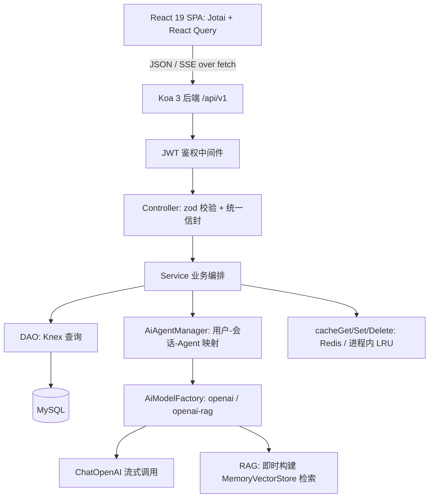

:::note 事实基线
本篇是「Yukino Chatbot」项目深挖带解答题库，共 **88 题**，事实来源为 `content/fe/yukino-chatbot.md`，对照本地仓库 `~/github/yukino-chatbot`（子路径 `client/`、`server/`）@ `13332f3` 核验（frontmatter `local_commit` 与本机 HEAD 一致）。这是一个 **pnpm workspace 组织的全栈 LLM 聊天应用**：前端 React 19 单页应用，后端 Koa 3 服务，具备 JWT 会话、模型热切换、RAG 检索增强与 SSE 流式输出。面试里它以「**介绍一个你做过的 LLM 聊天 / 流式渲染项目**」的形式出现，与 yukino-chat（内嵌完整 agent 栈）、yukino-codegen（沙箱构建预览）是同一作者的不同形态对照。
:::

本篇是「Yukino Chatbot」项目深挖题库。它的面试价值集中在两处：**后端用一套清晰分层把「LLM 聊天」从 demo 推到可维护产品**（工厂 + 管理器把模型抽象与生命周期隔开、内存上下文 + write-behind 落库换低延迟、即时构建检索链路实现零运维 RAG、绕过框架原生响应写入实现真正流式）；**前端把高频流式数据挡在 React 之外**（ref + rAF 把渲染频率钳制在帧率、增量解析的流式 markdown 把渲染成本与文本长度解耦）。本篇的组织顺序是：**先讲定位与技术选型 → 再讲后端分层与工程化 → 再讲认证与会话 → 再讲 AI 能力层与热切换 → 再讲 RAG 检索链路 → 再讲 SSE 流式输出与断线恢复 → 再讲前端状态分层与流式渲染性能 → 再讲数据模型与缓存 → 再讲设计模式与水平扩展 → 最后一句话速答**。

**主线一览**



## 一、定位与技术选型

### Q1. 这个应用提供哪些能力？模型类型有哪两个取值？

应用提供账号注册登录、会话管理、**普通对话与 RAG 增强对话两条链路**、文件上传、流式打字机输出、中英文界面与亮暗主题。AI 能力通过 **OpenAI 兼容端点**接入，因此同一套代码可以对接云端模型服务，也可以对接本地推理服务（如 Ollama）。模型类型只有两个取值：`openai`（普通对话）与 `openai-rag`（检索增强对话），由服务端枚举 `ModelType` 与前端常量对象 `MODELS` 分别声明。

### Q2. 技术选型一览？

| 维度     | 选型                                                                    |
| -------- | ----------------------------------------------------------------------- |
| 前端     | React 19 + TypeScript + Vite 8                                          |
| 状态管理 | Jotai（客户端状态）+ TanStack Query v5（服务端状态）                    |
| 表单     | TanStack Form + zod 校验                                                |
| UI       | Base UI（headless 原语）+ Tailwind CSS 4 + shadcn/ui 模式               |
| 后端     | Koa 3 + @koa/router                                                     |
| LLM      | LangChain（@langchain/openai 的 ChatOpenAI）对接 OpenAI 兼容聊天端点    |
| 数据库   | MySQL，通过 Knex 查询构建器访问                                         |
| 缓存     | Redis（ioredis），不可用时降级到进程内 LRU                              |
| RAG      | LangChain MemoryVectorStore + OpenAIEmbeddings，默认 `nomic-embed-text` |
| 构建     | 前端 Vite，后端 Rollup 打包为单文件 ESM                                 |
| 认证     | `jsonwebtoken` 签发/验签 + 自写 Koa 鉴权中间件 + 前端 axios 拦截器      |
| 国际化   | i18next + react-i18next，中文/英文两套语言包                            |

### Q3. 这是怎样的 monorepo？同仓管理的价值在哪？为什么不共享类型包？

这是一个前后端分离的 **pnpm monorepo**，`pnpm-workspace.yaml` 只声明 `client` 与 `server` 两个 workspace 包，**没有共享类型包**。`Message`、`Session` 等类型由前后端各自独立定义，仅靠约定保持字段兼容：例如 `ModelType` 的取值两边一致，但服务端消息是 `{session_id, username, content, is_user}`，前端消息是 `{role, content, status?}`，形状并不相同。

同仓管理的价值**不在于共享类型，而在于接口变更可以在一次提交内原子完成**，并且根脚本用 `concurrently` 一条命令同时拉起前后端开发服务器。

**采分点**：能说出「**同仓的价值是接口变更原子提交，而非共享类型**」——并诚实指出前后端消息形状不一致是靠约定维持的。

## 二、后端分层与工程化

### Q4. 后端的分层架构与各层职责？

```text
Router (@koa/router)   URL 映射, 中间件挂载
  └─ Controller        zod 参数校验 + 响应体格式化
       └─ Service      业务编排, 协调 DAO 与 AI Agent
            └─ DAO     纯数据访问, 封装 Knex 查询
                 └─ MySQL / Redis
```

Router 负责 URL 到 Controller 的映射并挂载横切中间件；Controller 用 zod 校验入参、调用 Service、组装统一响应体；Service 做业务逻辑编排，协调 DAO、缓存与 AI Agent；DAO 是纯数据访问，**所有 SQL 只在这一层**。AI 系统（AiAgent / AiModelFactory / AiAgentManager）独立于以上业务分层。

### Q5. 后端为什么用 Rollup 打单文件 ESM 而不是 `tsc` 输出多文件？

三个原因：① **单文件 bundle（`dist/main.js`）简化部署**，运行时不再需要 node_modules 中的本地源码树；② **tree-shaking** 能移除未使用的代码路径；③ 通过 **external 配置把全部第三方依赖排除在 bundle 之外**——`node:` 内建模块、`@langchain/` 与 `@koa/` 前缀走正则匹配，其余（koa、knex、mysql2、ioredis、pino、zod 等）逐个列名，运行时再从 node_modules 加载。TypeScript 只在构建期做类型擦除，产物是纯 JavaScript。

### Q6. 开发态如何运行？代码规范工具怎么分工？

开发态后端用 `tsx watch` 直接运行 TypeScript，无构建步骤，文件变更自动重启，与前端 Vite 的 HMR 组合成完整的本地开发闭环。代码规范上**前端用 ESLint + Prettier，后端用 Biome**（lint 与 format 合并为单一工具）。

### Q7. 配置体系如何组织？聊天端点与向量端点的配置差异？

配置集中在 `server/src/config`，启动时用 dotenv 读取 cwd 下的 `.env`，**模型端点全部通过环境变量注入，代码里不出现任何硬编码地址**。关键变量：`OPENAI_MODE_NAME`（聊天模型名，默认 `qwen3`）、`OPENAI_BASE_URL`/`OPENAI_API_KEY`、`EMBEDDING_MODEL`（默认 `nomic-embed-text`）、`EMBEDDING_BASE_URL`/`EMBEDDING_API_KEY`、`REDIS_ENABLED`（非 `"true"` 走 LRU）。

一个值得注意的差异：**聊天端点本身不出现在配置对象里**——`ChatOpenAI` 只显式传入模型名，base URL 与 API key 由 OpenAI SDK 按 `OPENAI_BASE_URL`/`OPENAI_API_KEY` 的环境变量约定自行读取；**向量端点则相反**，`OpenAIEmbeddings` 显式接收 `configuration.baseURL`、`apiKey` 与 `encodingFormat: "float"`。聊天与向量两套端点分开配置，是因为二者在生产中经常落在不同服务上。

## 三、认证与会话管理

### Q8. JWT 流程与前端 token 管理？

认证用 `jsonwebtoken` 签发/验签 + 自写 Koa 鉴权中间件 + 前端 axios 拦截器。前端普通请求统一走一个 axios 实例，要点四条：① baseURL 固定为 `/api`（开发由 Vite 代理、生产由反向代理，业务代码不感知部署形态）；② **超时设为 0（不限时）**，因为 AI 生成回答的耗时不可预估；③ 请求拦截器从 `localStorage` 读取 token 注入 Bearer header；④ 响应拦截器统一处理 401（清除本地 token 并跳转登录页）。

### Q9. 为什么 401 拦截分支在常规接口路径上不会触发？

因为**鉴权中间件对无效 token 返回的是 HTTP 200 加业务码 `TokenInvalid` 的信封，并不会产生 401 状态**。因此常规接口路径上这段拦截逻辑不会触发，各页面靠响应体里的 `code` 判断成败；401 分支只在反向代理层或其他组件真正返回该状态时才会命中。这是「统一信封 + 业务码」与「HTTP 状态码」两套语义并存时的典型错位。

### Q10. SSE 场景的鉴权如何兼容？为什么 header 是首选？

鉴权中间件**同时支持两种取 token 的方式**：优先从 `Authorization` header 读取，找不到时回落到 query 参数 `token`。前端的 SSE 走 `fetch`，本可直接设置 header，**保留 query 兜底是为了兼容那些无法自定义请求头的消费方式**（如原生 EventSource）。由于 URL 可能进入日志与浏览器历史，**header 是首选路径**。

### Q11. 路由与权限守卫如何实现？

路由表定义五条路由：根路径的 loader 直接重定向到登录页，以及登录、注册、菜单、AI 聊天四页。页面组件均通过 `lazy` 懒加载并包一层 `withLazy`（Suspense 加全屏加载图标），受保护的菜单与聊天页再额外包裹 `withAuth` 高阶组件。`withAuth` 读取登录态派生 atom，未登录时用 `useEffect` 以 replace 方式跳转登录页并返回 `null`，已登录则渲染被包裹组件。（仓库中另有一个逻辑等价但未被引用的 `ProtectedRoute` 守卫组件，属于可清理冗余。）

### Q12. 这个项目有哪些已知安全弱点？

| 弱点                | 风险                                    | 改进方向                         |
| ------------------- | --------------------------------------- | -------------------------------- |
| 密码用 MD5 哈希     | 无盐值，可被彩虹表攻击                  | 改用 bcrypt/argon2 + 随机盐      |
| JWT 有效期一年      | token 泄露后长期有效                    | 缩短有效期并引入 refresh token   |
| JWT secret 有默认值 | 未配置时使用可预测密钥                  | 启动时强制要求配置，否则拒绝启动 |
| 无速率限制          | 暴力破解与资源耗尽                      | 接入限流中间件                   |
| CORS 全开           | 扩大跨域攻击面                          | 配置域名白名单                   |
| 请求体上限 100MB    | 大 payload 造成 DoS                     | 按接口收紧限制                   |
| 鉴权日志打印 token  | 中间件以 info 级别把完整 token 写进日志 | 降为 debug 或只记不可逆指纹      |

**采分点**：能主动、诚实地列出这些弱点并给改进方向——面试里「知道自己项目的安全债」比「假装没有」更可信。

## 四、AI 能力层：Provider、工厂与热切换

### Q13. AI 能力层的三个角色如何分工？

| 角色           | 职责                                                                |
| -------------- | ------------------------------------------------------------------- |
| AiModelFactory | 模型注册表与创建入口：注册创建器、按类型创建模型实例、创建 Agent    |
| AiAgentManager | 单例生命周期管理：维护 `用户 -> 会话 -> Agent` 的映射，负责热切换   |
| AiAgent        | 单会话实例：持有内存对话历史与当前模型，提供普通/流式对话与消息追加 |

设计原则是「**工厂负责如何创建，管理器负责在哪里、给谁，Agent 负责如何对话**」，三者职责单一，通过组合协作。工厂构造时已内置注册 `openai` 与 `openai-rag` 两种创建器，其中 RAG 创建器要求配置里带上 `username`（用于定位该用户的文档目录），缺失即抛错。

### Q14. 新增一个模型类型需要改哪些地方？

先在 `ModelType` 枚举中加取值，再注册对应创建器即可，**Agent、管理器与 Controller 无需改动**。工厂另暴露 `registerModel` 方法，管理器另暴露 `removeAiAgent`、`getUserAllSessionIds` 等维护用接口。这是工厂模式 + 注册表的扩展性收益：新增类型是「加一个创建器」，不是「改一条 if-else 链」。

### Q15. 对话上下文为什么存在内存里？持久化用什么模式？

每个 Agent 实例在内存中维护一个完整的历史消息数组，每次调用 LLM 前把历史转换为 LangChain 的消息格式（`is_user` 映射为 `HumanMessage`，其余为 `AIMessage`）传入。选择内存存储有三个理由：① LLM 调用需要完整上下文，从内存读取是 O(1) 而查库有网络开销；② 无需序列化与连接池竞争，实现更简单；③ 消息写入内存后立即可用于下一次调用，具备**写后读一致性**。

持久化采用 **write-behind 模式**：`addMessage` 先写内存，再以 fire-and-forget 方式异步落库（`shouldSave` 参数控制是否落库），落库失败只在 catch 里记日志、不阻塞主流程。代价是进程重启后内存丢失，必须靠启动物化流程重建。

### Q16. 模型热切换如何做到「上下文完整延续」？

管理器在被请求获取 Agent 时检查已有实例的模型类型：若与请求携带的 `model_type` 不一致，就用工厂创建新模型实例并通过 `setModel` 替换 Agent 持有的引用，**而对话历史数组保持不变**。于是用户在普通对话与 RAG 对话之间切换时，上下文完整延续，无需新建会话。**切换的成本只是重建一个模型对象，历史转移是引用赋值**。

### Q17. 重启后的上下文如何重建？有哪两个代价？

服务启动时执行一次全量重建：从 MySQL 的 messages 表按 `created_at` 升序加载全部消息（**不查 sessions 表，会话按消息携带的 `session_id` 与 `username` 字段隐式恢复**），逐条调用管理器的 `getOrCreateAiAgent`，再以「仅恢复内存、不重复落库」（`shouldSave` 传 `false`）的方式注入 Agent 的历史数组。

两个代价：① **启动耗时随历史消息总量线性增长**；② 重建时统一按普通模型创建 Agent，如果用户上次停在 RAG 模型，要等下一次请求携带新 `model_type` 时才由热切换纠正。面向生产更稳妥的做法是**按会话分页懒加载，而非启动时全量回放**。

**采分点**：能说出「**启动全量物化的两个代价 + 分页懒加载的演进方向**」——体现对「内存上下文」方案规模边界的清醒认识。

## 五、RAG 检索链路

### Q18. 文件上传到落盘的完整路径？内容寻址去重怎么做？

上传路径：① 前端用隐藏的 `input` 触发选择，`accept` 只放行 `.md`/`.txt`，上传 hook 再做一次小写扩展名校验；② 以 `FormData` 提交到上传接口，服务端经 multer 写入临时目录 `uploads/tmp/`；③ 服务端做白名单校验后，以 **CRC32 内容哈希命名**，拷贝到 `uploads/<username>/` 并删除临时文件。

关键设计是**内容寻址去重**：文件名取文件内容 CRC32 的无符号十六进制表示并补齐 8 位，同一内容重复上传会得到相同路径，拷贝时直接覆盖，天然去重且无需额外索引。目标目录按用户名隔离，与检索时定位用户目录的规则一一对应。multer 先落临时目录再拷贝，使校验失败的请求不会污染用户目录。

### Q19. 这里有一处前后端白名单不一致，是什么？说明什么原则？

服务端允许 `.md`、`.txt`、`.json` 三种扩展名，而前端 `accept` 与校验只放行前两种，因此 `.json` 文件实际上无法通过界面传入。说明的原则是：**服务端白名单是最终防线，前端校验只是体验层的先行过滤**——前端校验可以被绕过（直接发请求），所以安全边界必须在服务端。

### Q20. RAG 检索链路的每一步是什么？

当请求的 `model_type` 为 `openai-rag` 时，**每轮对话会即时构建检索链路**：检查该用户目录是否存在（不存在直接抛错）→ 读取目录下的文档 → 用递归字符分块器切分 → 经 Embedding 端点向量化写入 `MemoryVectorStore` → 用 `similaritySearchWithScore` 检索与问题最相关的 **Top-5** 片段 → 把片段注入 Prompt 交给聊天模型生成回答。

Prompt 的结构包含三部分：要求「基于参考文档回答，文档中没有相关信息时明确说明未找到」；以 `[Document N]` 编号列出的参考文档片段；用户原始问题。**增强方式是只替换最后一条用户消息，历史消息保持原样**，因此多轮对话里只有当前问题会被检索结果增强。

### Q21. 检索链路的容错降级怎么做？体现什么定位？

检索链路的每一步都可能失败：用户没有上传任何文件、文档读取异常、embedding 调用失败、检索结果为空。`ragEnhanceMessages` 对**构建失败与检索异常**两种情况记 warn 日志并直接返回原始消息，对**空结果**则不注入 Prompt，三条路径都让本轮对话**静默降级为普通问答**，而不是把错误抛给用户。这种「**检索是增强而非依赖**」的定位让 RAG 故障不会中断聊天主流程。

### Q22. 分块参数 `chunkSize=1000`、`chunkOverlap=200` 的选择依据？

1000 字符约覆盖一个完整段落或代码块，过小会丢失段落语义，过大则引入噪声、降低相似度匹配的精度。200 字符对应约 **20% 的重叠率**，用于覆盖被截断在块边界上的关键概念：若某个概念恰好在第 1000 字符处被切开，重叠部分保证下一个块仍包含完整语境。`RecursiveCharacterTextSplitter` 的分割优先按空行、再按换行、空格逐级递归，尽量落在自然语义边界；最后的空串分隔符是兜底，保证超长且无分隔符的文本也能被硬切分。

### Q23. 为什么用内存向量库？局限与演进方向？

当前选型的合理性来自规模：**单用户文档量有限，向量数量在百到千级别，内存足以承载**；无需额外部署独立向量数据库，降低运维复杂度；每用户索引独立构建，天然隔离，不必在向量库中做 namespace 管理。

局限同样明确：**每次请求都重建索引，文档未变也会重复向量化**，既有 embedding 调用的延迟也有费用；文档量增长到数万页时内存与延迟都不可接受。演进方向是**接入持久化向量库并做增量索引，只在文档变更时重新向量化**。

**采分点**：能说出「**即时构建零运维 vs 每次重嵌入的延迟/费用代价 + 增量索引演进**」——这是「demo 级 RAG」与「生产级 RAG」的分水岭。

## 六、SSE 流式输出与断线恢复

### Q24. SSE 的完整数据链路是什么？

```text
用户输入 → useStreamMessage（原生 fetch POST, 携带 Bearer token）
  → Koa Controller（zod 校验 → 直接操作 Node 原生 res）
    → SessionService → AiAgent.responseStream()
      → ChatOpenAI.stream()（async iterator, 逐 chunk 回调）
        → res.write("data: <json>\n\n")
          → 客户端 response.body.getReader() + TextDecoder
            → 按行解析 SSE, 累加全文写入 streamTextRef（零 React 渲染）
              → StreamingMarkdown 的 rAF 循环拉取
                → Streamdown 增量解析 → DOM 更新
                  → 收到 data: [DONE] → onDone 落单
```

服务端每产生一个 chunk 就立即写入并 flush，客户端通过 `ReadableStream` 逐块读取。chunk 以 JSON 字符串编码写入 data 字段，客户端再 `JSON.parse` 还原，**这样换行等特殊字符不会破坏 SSE 分帧**。

### Q25. 服务端 SSE 实现有哪些要点？为什么必须绕过 Koa？

要点：绕过 Koa 的响应模型，直接操作 Node 原生 `ServerResponse`，用 `res.writeHead` 写出 `Content-Type: text/event-stream`、`Cache-Control: no-cache`、`Connection: keep-alive`、`Access-Control-Allow-Origin: *` 与 **`X-Accel-Buffering: no`**（禁止 Nginx 之类的反向代理缓冲，否则 chunk 会被攒成大块再下发，打字机效果消失）；「创建会话并流式发送」端点先用 `randomUUID` 生成会话 ID 落库，再把 `{session_id}` 作为 SSE 首帧元数据下发；全部完成后发送 `data: [DONE]` 结束哨兵；出错时发送 `event: error` 帧再关流；参数校验失败发生在切换 SSE 之前，此时仍以普通 JSON 信封返回。

**为什么必须绕过 Koa**：Koa 的响应模型是一次性的，中间件链执行完毕后才把 `ctx.body` 序列化发送，而 SSE 需要在请求生命周期内**持续写入并即时 flush**；连接关闭时机由业务逻辑（收到哨兵或出错）决定，而非中间件链结束。直接操作原生响应对象也便于设置 `X-Accel-Buffering` 这类非标准头。

### Q26. 为什么用 Fetch + ReadableStream 而非 EventSource？

| 维度     | EventSource        | Fetch + ReadableStream          |
| -------- | ------------------ | ------------------------------- |
| 请求方法 | 只支持 GET         | 任意方法，本项目用 POST         |
| 自定义头 | 不支持             | 可携带 `Authorization`          |
| 错误粒度 | 不暴露 HTTP 状态码 | 可检查 `response.ok` 与状态码   |
| 请求体   | 无                 | 可发送 `{question, model_type}` |

三点合起来决定了 `EventSource` 不可用：**流式接口需要 POST 请求体，需要 Bearer header，还需要区分鉴权失败与服务错误**。实现上用 `body.getReader()` 拿到 reader，配合 `TextDecoder` 逐块解码，再手动按行解析 SSE：以换行切分并保留半行 buffer，剥掉行尾 `\r`，只处理 `data:` 开头的行，去掉一个前导空格后先判 `[DONE]` 哨兵，其余尝试 JSON 解析——字符串是正文 chunk，带 `session_id` 的对象是会话元数据，其它对象帧（包括服务端的 error 帧）直接跳过。

### Q27. 流式会话的页面级编排（临时会话）怎么做？

前端用 `currentSessionId = "temp"` 与 `tempSession = true` 表示尚未落库的临时会话。第一条消息的时序：① 请求打到「创建会话并发送消息」的流式端点，服务端生成 session_id 并先写入 sessions 表；② SSE 首帧是 `{session_id}` 元数据，客户端解析出对象且带 session_id 时触发 `onSessionCreated` 回调并跳过正文累加；③ 回调把真实 session_id 写入会话映射（标题先占位为「新会话」），切换当前会话并取消临时标记。

### Q28. 流文本的落定为什么「只做一次」？有哪层兜底？

流文本的落定只做一次：**chunk 全程只写 ref，在 `onDone`/`onError` 时用一次状态提交把完整内容写回尾部 AI 消息**，并置状态为 `done`/`error`；出错时同样保留已到达的部分回答。另有一层兜底：若 mutation 正常返回但 ref 里仍有未提交内容（流里始终没出现结束哨兵），再补一次提交。历史消息接口直接从内存中的 Agent 读取（管理器按 `username + session_id` 定位），不查数据库——它能查到历史的正是启动时重建的成果。

### Q29. 断线恢复的现状结论是什么？

结论是：**没有实现流级自动重连，但通过「生成与连接解耦」加上「结果级对账」保证回答不丢失**。客户端行为：fetch 失败或流中途读取出错时，mutation 的 `onError` 把尾部消息以 error 状态落定并提示，已到达的部分回答不丢。服务端行为：**没有监听连接的 close/aborted 事件，客户端掉线不会中断生成**，模型流继续跑完，全量回答经 `addMessage` 进入内存并异步落库；后续对已关闭连接的写入字节被丢弃，但结果在服务端完整保留。

因此恢复模型是「**流是一次性的，结果是可找回的**」：用户点击「同步历史」后，服务端从内存读出完整对话，断线那轮的回答就完整回来了——这是一次人工触发的结果级重连。

### Q30. 现状有哪些缺口？为什么「直接重试原请求」是错误的重连方式？

现状缺口：客户端没有任何 `AbortController`，无法主动中止，也没有「停止生成」按钮，组件卸载或路由切走时在途 fetch 不会被取消；没有自动重试；**重发不幂等**——同样的问题再 POST 一次会再次执行生成，用户消息被重复追加进上下文，因此「直接重试原请求」是错误的重连方式。

### Q31. 标准 SSE 恢复机制（EventSource 三件套）为什么在本项目全部失效？

标准机制是 EventSource 配套的三件套：服务端为每个事件附 `id:` 字段，浏览器记住最后收到的 id；断线后按服务端 `retry:` 指定的间隔自动重连，并自动带上 `Last-Event-ID` 请求头；服务端据此重放该 id 之后的事件。三件套在本项目中全部失效：

| 机制                 | 失效原因                                              |
| -------------------- | ----------------------------------------------------- |
| EventSource 自动重连 | 传输层是 fetch POST，不是 EventSource                 |
| `id:` 断点           | 主数据流帧只有 data 字段，服务端没有事件序号概念      |
| `retry:` 间隔        | 只对 EventSource 生效，fetch 消费者不会读取也不会遵守 |

更深一层的错位在语义：**事件推送系统重连要解决「丢了哪几条事件、从哪条补放」，而 LLM 回答是一段持续增长的文本，重连真正要做的是重新附着到仍在进行的生成过程，拿到「到目前为止的全文加后续增量」**。字节级重放只是手段之一，全文快照重放同样正确，甚至更简单。

### Q32. 真正的断点重连，服务端要改造哪三步？

设计目标是弱网、切后台、服务发布导致连接断开后，回答自动续上，不重头生成、不重复调用 LLM。服务端改造三步：① **输出流变成可重放日志**——为每次回答分配 stream_id，每个 chunk 单调递增 seq，chunk 除写入响应外同时追加进重放缓冲（单机用内存映射，多实例用 Redis Stream 并做长度修剪）；② **增加恢复端点**，参数为 `{stream_id, last_seq}`，先重放缓冲中序号更大的事件，再切换到实时尾随，若生成已结束则重放完补发结束哨兵，同时把帧格式升级为带 `id:` 的形式；③ **断连清理**——监听 close 事件，连接消失后停止写入与逐 chunk 日志以节省 CPU，但不停止生成、不清空缓冲，缓冲在生成完成后保留一段时间再回收。

### Q33. 真正的断点重连，客户端要改造哪五项？

① **游标加去重**：用 ref 维护 `{streamId, lastSeq}`，只接受序号更大的事件，让重放天然幂等；② **退避重连**：未收到哨兵就中断时，指数退避加完全抖动重试，重连请求携带 `last_seq`；③ **死连接检测**：SSE 长连接最大的坑是半开连接（传输层未断但数据不再流动），客户端需设读取超时，服务端可周期性发送注释帧作为心跳（现有解析器天然跳过非 data 行，协议解析零改动）；④ **补齐 AbortController**：fetch 传 signal，新增「停止生成」按钮，组件卸载或路由离开时 abort，配合服务端 close 监听还能实现「停止即取消生成」以节省 token；⑤ **监听 `online` 事件**：网络恢复立即重连，不等退避计时器。

重连循环应封装在 mutationFn 内部，上层看到的仍是一次 mutation 的语义，重试预算耗尽才触发 `onError`。**本项目「累计全文回调加覆盖式落单」的数据模型让重放绝对安全**：无论重放多少次、顺序如何，最后一次覆盖即最新状态。终态判据只有收到结束哨兵，重连过程中不要提前落定消息。

### Q34. 不改服务端的低成本演进路径是什么？

把现在人工点击的「同步历史」**自动化**：出错后轮询历史接口直到完整回答出现。这利用了「服务端生成不中断」这一既有事实，代价是拿不回生成中的打字机体验。

## 七、前端状态分层与流式渲染性能

### Q35. 前端三层状态分别承载什么？分层依据是什么？

| 层             | 承载内容                                                  | 存储与同步               |
| -------------- | --------------------------------------------------------- | ------------------------ |
| Jotai atoms    | token、主题、语言等纯客户端状态                           | localStorage，本地即真相 |
| React Query    | 会话列表、聊天历史等需要与后端同步的数据                  | 内存缓存 + 失效/重新获取 |
| 组件本地 state | messages 数组、streaming 标记、选中模型等高频或页面级状态 | 组件内，不穿透到全局     |

分层的依据是**数据性质而非偏好**：Jotai 适合低频、本地即真相的状态，不需要缓存键与失效策略；React Query 解决服务端状态的缓存失效、后台重取、请求去重与 loading/error 管理；主聊天页的 messages 与 streaming 标记更新频率最高，留在组件内避免高频更新穿透全局 store。React Query 的全局默认值设置为 `retry: 1`、`refetchOnWindowFocus: false`、`staleTime` 5 分钟。

### Q36. 流式渲染的「头号陷阱」是什么？为什么 React 自动批处理救不了场？

LLM 流式输出常见为每秒几十到上百个 chunk。如果每个 chunk 直接 `setState`，每次都会触发一次子树重渲染，其中包括随文本长度增长的 reconciliation、O(文本长度) 的 markdown 全量重解析、以及浏览器布局与绘制。**一条 2000 token 的回答约产生上千次渲染，且单次成本随长度上升，总成本接近平方级**；主线程被占满后就会出现掉帧、输入延迟与滚动抖动。

常见误解是 React 的自动批处理能救场。实际边界是：**自动批处理只合并同一任务（含其微任务 flush）内的多次 `setState`；而 `reader.read()` 随网络包到达在各个独立宏任务里被唤醒，跨包的 chunk 永远不会被合并**。即使一个传输段带多帧被合并成一次渲染，渲染频率仍与包到达速率成正比，量级问题依旧。**批处理是缓解手段，不是解法**。

**采分点**：能说出「**跨宏任务的 chunk 不会被自动批处理合并 + 总成本接近平方级**」——这是流式渲染性能的核心认知，答错这点会暴露没真正做过。

### Q37. 三层解耦方案是什么？

把热路径完全移出 React，分三层：

| 层     | 职责                                                   | 效果                                |
| ------ | ------------------------------------------------------ | ----------------------------------- |
| 写入层 | onChunk 只写 mutable ref                               | 零渲染成本                          |
| 调度层 | 独立的 rAF 循环按帧拉取，长度变化才 setState           | 渲染频率被钳制在帧率而非 chunk 频率 |
| 落单层 | 整个流只有一次真正的 state 提交，done/error 时写回全文 | 避免中途反复渲染                    |

渲染频率由此被钳制在 60/秒上限，且没有新内容的帧零成本。rAF 拉取的关键实现是：用 `requestAnimationFrame` 循环检查 ref，把文本长度与上次渲染比较，长度未变则直接跳过 setState，并在组件卸载时 `cancelAnimationFrame`。

### Q38. 「每帧传全文」的回调协议为什么不昂贵？

累计全文的字符串拼接看似每次都全量复制，**实际现代 JS 引擎对 `+=` 采用惰性拼接的 rope 结构，追加接近 O(1)**，真正的摊平推迟到字符串被消费时，因此「每帧传全文」的回调协议本身并不昂贵。这个细节常被误判为「每帧 O(n) 复制」，能答出 rope 结构是加分项。

### Q39. 节流方案对比中，rAF 方案胜出的三个理由？

| 方案                   | 渲染频率                    | 后台标签页行为                       |
| ---------------------- | --------------------------- | ------------------------------------ |
| 逐 chunk setState      | 等于 chunk 频率（数百/秒）  | 持续渲染                             |
| setInterval 节流       | 由间隔决定                  | 被浏览器钳制到 1s+ 仍继续            |
| **rAF 拉取（本项目）** | **60/秒上限，空闲帧零成本** | **自动暂停，恢复可见后首帧补齐全文** |
| useSyncExternalStore   | 等于通知频率，仍需自行节流  | 持续通知                             |
| transition/deferred    | 可能长期滞后                | 持续                                 |

rAF 胜出的三个理由：① **帧对齐**让渲染只发生在浏览器即将绘制下一帧的时刻，不会做超出显示能力的无效渲染；② 页面不可见时 rAF **自动暂停**，回到前台第一帧就拉到最新全文一次性补齐，既没有后台空转也没有恢复时的补渲染风暴；③ **实现极简**，一个 effect 加一个循环加一次长度比较即可，不需要 store 的订阅管道。若改用 `useSyncExternalStore`，`getSnapshot` 必须返回缓存的稳定引用，否则每次返回新值会引发无限重渲染；而本项目的流只被尾部一条消息消费，没有多组件共享需求，因此 rAF 更合适。

### Q40. 消息列表虚拟化与贴底滚动策略？

消息列表用 `@tanstack/react-virtual` 做窗口化渲染，只挂载视口附近的消息，用 **120 像素的估算高度与 5 条 overscan** 平衡首屏填充与内存占用，实际高度由 `measureElement` 逐条测量修正。自动滚动策略以**尊重用户控制权**为前提：① 近底检测——`onScroll` 时计算 `scrollHeight - scrollTop - clientHeight`，小于 80 像素记为「贴底」；② 新消息滚动——用户自己发的消息强制滚到底部，AI 消息仅在用户已贴底时才滚动；③ 流式增长跟踪——用 `ResizeObserver` 监听内容容器高度变化，仍在贴底状态才滚到末尾；④ 用户阅读保护——用户正在翻阅历史时自动滚动完全停止，不打断阅读。

### Q41. 单条消息如何用 memo 隔离？Streamdown 如何做增量解析？

单条消息用 `React.memo` 包裹，且内部按状态分支：thinking 渲染三点跳动动画，streaming 渲染 rAF 驱动的 `StreamingMarkdown`，其余渲染静态 markdown。于是**流式期间只有最后一条气泡在渲染，已定型的旧消息不会因父组件更新而重渲染**。

流式 markdown 渲染直接交给 `Streamdown` 组件：流式消息传 `mode="streaming"` 与 `isAnimating`，定型消息用默认静态模式。Streamdown **按语义块处理文本，已完整接收的块（例如闭合的代码围栏）解析结果被缓存，后续更新只重新解析末尾未完成的块**，渲染成本与消息总长度解耦，只与当前增量成正比；写到一半的围栏、粗体等标记会被智能补全，不会把后续内容吞进代码块。代码高亮通过 `@streamdown/code` 插件接入 Shiki，传入 `github-light`/`github-dark` 双主题。

### Q42. 流式渲染的系统性检查清单里，本项目哪一项未落地？

检查清单覆盖数据层（高频数据走 ref、覆盖式回调协议）、调度层（rAF 加长度去重）、落单层（流结束单次 setState）、组件层（memo 隔离、虚拟化）、滚动层（ResizeObserver 驱动贴底加近底门控）、渲染层（块级增量解析加已定型块缓存）、服务端（关闭代理缓冲、避免逐 chunk 日志）。本项目**唯一未落地的是「避免逐 chunk 日志」**——每 chunk 一条 info 日志，高并发下会成为热路径负担，建议降级。

**采分点**：能诚实指出「**逐 chunk info 日志是未落地的热路径负担**」，并给出验证手段（React DevTools Profiler 确认提交次数约等于帧数而非 chunk 数、Chrome Performance 观察长任务是否对齐 chunk 到达时刻、超长回答压测尾部块解析耗时应当恒定）。

## 八、数据模型与缓存

### Q43. 三张核心表与设计要点？

服务启动时通过 Knex 的 `hasTable` 检查自动建表：

| 表       | 关键字段                                                                      |
| -------- | ----------------------------------------------------------------------------- |
| users    | 自增 bigint 主键；name、email（索引）、username（唯一）、password；软删除字段 |
| sessions | 会话 ID 作主键（UUID，服务端生成）；username 索引、title；软删除字段          |
| messages | 自增整型主键；session_id 索引、username、content（TEXT）、is_user；无软删     |

设计要点：**会话主键由服务端生成 UUID，不依赖数据库自增协调**，流式建会话接口先落库再通过 SSE 首帧把 ID 下发给前端；消息用自增整型保证插入顺序与查询性能；软删除用于用户与会话两张表，DAO 查询统一附加 `whereNull("deleted_at")`；username 冗余存储在消息表中，避免跨表 JOIN。MySQL 连接池配置为 min 0、max 100。

### Q44. 缓存层为什么用「函数入口 + 布尔分发」而非抽象类？

缓存层**不定义抽象类，而是导出模块级的 `cacheGet`、`cacheSet`、`cacheDelete` 三个函数**，内部通过一个布尔开关分发到两套实现，同文件里还包含消息落库的 `saveMessage` 插入函数供 Agent 调用。这种「函数入口 + 布尔分发」的适配器写法，让上层只需调用统一函数，不感知底层是 Redis 还是进程内 LRU。

### Q45. 缓存降级策略与 LRU 参数？

降级策略在服务启动时执行：配置启用 Redis 时先初始化连接并做一次 `ping` 连通性测试，成功则置位启用标记，失败则记 warn 日志并回退初始化进程内 LRU。**LRU 的参数为最大 10000 条目、按 `Buffer.byteLength` 计的最大 256MB、TTL 10 分钟**。设计意义在于开发环境无需安装 Redis 即可运行，生产环境可用 Redis 做跨实例共享。

### Q46. 缓存读写当前的真实接入状态是什么？

**当前业务代码尚未真正接入读写缓存函数，只有消息落库使用了同文件的插入函数，缓存读写属于预留的基础设施**；未来接入时上层无需改动调用形态。这是诚实口径——不能把「预留的缓存层」讲成「已全面接入缓存」。

## 九、设计模式、水平扩展与 UI（一句话速答）

**Q47. 一句话列举本项目落地的设计模式。** 工厂模式（AiModelFactory）、单例模式（AiAgentManager/AiModelFactory）、策略模式（AiModel 接口多实现）、观察者/回调（StreamCallback 解耦 chunk 生成与 SSE 写入）、中间件模式（Koa 鉴权）、分层架构（Router→DAO）、适配器模式（缓存层布尔分发）。

**Q48. 一句话解释水平扩展的四个瓶颈。** Agent 内存状态（对话历史在进程内存）、RAG 向量索引（每次请求重建无共享）、文件存储（本地磁盘 uploads）、SSE 长连接（绑定特定进程）——分别对应迁共享存储/粘性会话、独立向量库、对象存储、Redis Pub/Sub 广播。

**Q49. 一句话解释最小改造路径与完整改造路径。** 最小改造是负载均衡按 username 一致性哈希（无需改 Agent 内存模型，但牺牲故障转移）；完整改造是让服务无状态（对话历史存 Redis 列表，每次请求加载上下文、响应后写回，代价是每次多一次上下文读写往返）。

**Q50. 一句话解释组件体系为什么用 shadcn/ui 模式。** 组件不是 npm 依赖而是源码拷贝进项目（`components.json` 描述生成配置），基础原语用 Base UI（headless、可访问性优先），样式用 Tailwind CSS 4，变体用 CVA，类名冲突用 `tailwind-merge`、条件组合用 `clsx`——源码在项目内可任意定制，不受库版本约束。

**Q51. 一句话解释国际化的「校验消息与展示文案解耦」。** zod 校验 schema 的 message 直接写成 i18n key（如 `auth.password_required`），渲染时经翻译函数转换——新增语言不需要改校验逻辑。

**Q52. 一句话解释初始语言如何决定。** 优先读 localStorage 中持久化的手动选择（仅接受 `zh`/`en`），未选择时按 `navigator.language` 是否以 zh 开头二选一，fallback 语言为中文。

**Q53. 一句话解释主题系统三态与一处失效逻辑。** 主题三态（亮/暗/跟随系统）通过带持久化的 atom 存 localStorage，派生 atom 在「跟随系统」时用 `matchMedia` 解析；Provider 同步移动端状态栏颜色的逻辑因页面模板未声明 `theme-color` meta 而永远查不到目标节点、实际不生效（诚实指出的死代码）。

**Q54. 一句话解释代码高亮如何跟随亮暗。** 为渲染器传入 `github-light`/`github-dark` 双主题，跟随全站亮暗类自动切换。

**Q55. 一句话解释聊天输入交互。** Enter 发送、Shift+Enter 换行，生成中禁用输入；聊天头部集中返回菜单、同步历史、模型选择（openai/openai-rag）、流式开关与文件上传按钮。

**Q56. 一句话解释为什么 SSE chunk 要 JSON 编码再写 data 字段。** 换行等特殊字符不会破坏 SSE 分帧——data 字段里的裸换行会被当成帧分隔符，JSON 字符串编码后换行被转义。

**Q57. 一句话解释客户端如何手动按行解析 SSE。** 以换行切分并保留半行 buffer，剥掉行尾 `\r`，只处理 `data:` 开头的行，去掉一个前导空格后先判 `[DONE]` 哨兵，其余尝试 JSON 解析。

**Q58. 一句话解释「累计全文回调 + 覆盖式落单」为什么让重放绝对安全。** 无论重放多少次、顺序如何，最后一次覆盖即最新状态——幂等的数据模型是断点重连正确性的地基。

**Q59. 一句话解释半开连接为什么是 SSE 长连接最大的坑。** 传输层未断但数据不再流动，客户端不会触发 error；需设读取超时 + 服务端周期注释帧心跳（现有解析器天然跳过非 data 行，零改动）。

**Q60. 一句话解释「停止即取消生成」如何节省 token。** 客户端补 AbortController + 服务端监听 close，用户点停止时 abort 让服务端中止模型流——否则模型继续跑完白白烧 token。

**Q61. 一句话解释 write-behind 落库的代价。** 先写内存再 fire-and-forget 异步落库，落库失败只记日志不阻塞——换取低延迟，代价是进程重启内存丢失、需启动物化重建。

**Q62. 一句话解释为什么历史消息接口不查数据库。** 直接从内存中的 Agent 读取（按 username + session_id 定位），它能查到历史的正是启动时全量重建的成果——内存是读权威，数据库是重建源。

**Q63. 一句话解释 RAG 为什么只替换最后一条用户消息。** 历史消息保持原样，只有当前问题被检索结果增强——避免每轮都重嵌入历史、也避免检索噪声污染上下文。

**Q64. 一句话解释 CRC32 内容寻址为什么能天然去重。** 同一内容 CRC32 相同 → 路径相同 → 拷贝直接覆盖，无需额外去重索引。

**Q65. 一句话解释 multer 为什么先落临时目录再拷贝。** 校验失败的请求不会污染用户目录——临时目录是「校验通过前的隔离区」。

**Q66. 一句话解释 `X-Accel-Buffering: no` 的作用。** 禁止 Nginx 之类反向代理缓冲，否则 chunk 被攒成大块再下发、打字机效果消失。

**Q67. 一句话解释 axios 超时为什么设为 0。** AI 生成回答耗时不可预估，限时会误杀正常的长回答。

**Q68. 一句话解释 React Query 全局默认值的取舍。** `retry: 1`（瞬时错误重试一次）、`refetchOnWindowFocus: false`（避免聊天页频繁重取）、`staleTime` 5 分钟（会话列表等低频数据）。

**Q69. 一句话解释流式请求为什么绕开 axios。** 需要手动控制响应体的 `ReadableStream`，axios 的响应模型拿不到逐块流。

**Q70. 一句话解释 `withLazy` 与 `withAuth` 的组合。** `withLazy` 给懒加载页面包 Suspense 加全屏加载图标，`withAuth` 给受保护页面做登录态守卫——关注点分离的两层 HOC。

**Q71. 一句话解释设置 store 里那个无人引用的模型类型 atom。** 持久化的模型类型 atom（存储键 `yukino_chatbot_model`）全仓无组件引用，聊天页真正用的选中模型是组件本地 state（初值 openai，刷新回默认）——可清理的冗余。

**Q72. 一句话解释 `src/api/index.ts` 的冗余 axios 副本。** 与 `fetch-client.ts` 逻辑重复且全仓无引用，实际请求统一走 `fetch-client` 那个实例——可清理的冗余。

**Q73. 一句话解释这个项目的核心价值。** 用一套清晰分层把「LLM 聊天」从 demo 推到可维护产品：后端工厂 + 管理器隔开模型抽象与生命周期、内存上下文 + write-behind 换低延迟、即时构建检索实现零运维 RAG、绕过框架原生响应写入实现真正流式；前端把高频流式数据挡在 React 之外。

**Q74. 一句话解释这个项目不适合什么场景。** 不适合直接用于大规模多实例生产：Agent 上下文、RAG 索引、文件与 SSE 连接都绑定单进程，会话模型还停留在固定有效期的一长串 JWT，缓存与限流是预留而非落地。

**Q75. 一句话解释生产规模使用要优先补齐的三件事。** 把对话上下文迁到共享存储、把向量索引改为独立服务加增量更新、把断线恢复从人工点按升级为带游标的自动重连。

**Q76. 一句话解释与 yukino-chat 的形态差异。** yukino-chatbot 是「Koa 3 + 内存上下文 + 即时 RAG + SSE」的轻量全栈聊天；yukino-chat 是「Hono + 内嵌完整只读 coding agent 栈 + WebSocket 三通道」的自托管 IM——前者调补全接口，后者嵌完整 agent。

**Q77. 一句话解释与 yukino-codegen 的形态差异。** yukino-chatbot 输出文本回答；yukino-codegen 输出可运行 Web 应用（沙箱构建 + 静态预览）——同一作者从「聊天」到「生成应用」的能力跃迁。

**Q78. 一句话解释为什么 `openai` 与 `openai-rag` 共用一个 Agent 实例。** 热切换只替换模型引用、历史数组不变——两条链路共享上下文，切换零成本。

**Q79. 一句话解释 RAG 创建器为什么要求 `username`。** 用于定位该用户的文档目录（`uploads/<username>/`），缺失即抛错——每用户索引独立、天然隔离。

**Q80. 一句话解释 `similaritySearchWithScore` 为什么取 Top-5。** 在「召回足够证据」与「上下文预算/噪声」间取平衡，5 片是经验值（诚实口径：无消融实验，非调参结论）。

**Q81. 一句话解释为什么 Prompt 要求「文档中没有相关信息时明确说明未找到」。** 抑制幻觉——给模型「承认不知道」的出口，而不是强行编造。

**Q82. 一句话解释 `encodingFormat: "float"` 的作用。** 显式指定嵌入返回浮点数组（而非 base64），避免 SDK 默认格式与 MemoryVectorStore 期望不一致。

**Q83. 一句话解释为什么聊天端点不出现在配置对象里。** `ChatOpenAI` 只传模型名，base URL 与 key 由 OpenAI SDK 按环境变量约定自读——少一层显式传递，但代价是配置不在一处可见。

**Q84. 一句话解释 Knex `hasTable` 自动建表的取舍。** 启动时检查并建表，省去手动迁移；代价是没有版本化迁移历史，schema 演进靠代码而非迁移文件。

**Q85. 一句话解释 messages 表为什么无软删。** 消息是会话的事实记录，删除语义在会话层（sessions 软删）；消息无软删简化查询、避免「已删消息仍进上下文」。

**Q86. 一句话解释 username 为什么冗余存进 messages 表。** 避免跨表 JOIN——按 username + session_id 直接定位，读路径无需联 users/sessions。

**Q87. 一句话解释连接池 min 0 / max 100 的取舍。** min 0 让空闲时不占连接（适合小规模/开发），max 100 给突发并发留余量；但 max 100 对单实例 MySQL 偏激进，生产应按实例数与 MySQL max_connections 统筹。

**Q88. 一句话总结这个项目的架构哲学。** 分层可替换（Router→Controller→Service→DAO + 工厂/管理器/Agent 三角色）、内存上下文 + write-behind 换低延迟、即时构建 RAG 零运维、绕过框架原生响应写入实现真流式、前端 ref + rAF 把渲染频率钳制在帧率、Streamdown 块级增量解析让渲染成本与文本长度解耦——一个「把 LLM 聊天从 demo 推到可维护产品」的全栈参考实现，边界是单实例、缓存与限流预留、断线恢复人工触发。

---

**延伸阅读**

- [Yukino Chat 自托管 IM 与内嵌 Agent 项目深挖题库](/interview/qa/yukino-chat-project)：内嵌完整只读 coding agent 栈的自托管 IM（与本篇「调补全接口」形成对照）。
- [Yukino Codegen AI 代码生成平台项目深挖题库](/interview/qa/yukino-codegen-project)：沙箱构建 + 静态预览的 AI 生成平台。
- [AI 流式前端专题题库](/interview/qa/ai-streaming-ui)：流式渲染、rAF 节流、增量解析的通用原理。
- [RAG 与检索深挖题库](/interview/qa/rag-and-retrieval)：分块、嵌入、混合检索、置信度门禁的通用机制。
- [React 与浏览器题库](/interview/qa/react-and-browser)：reconciliation、memo、虚拟化、rAF 的框架层机制。
- [工作文档 · Yukino Chatbot](/fe/yukino-chatbot)：本篇的事实来源。
