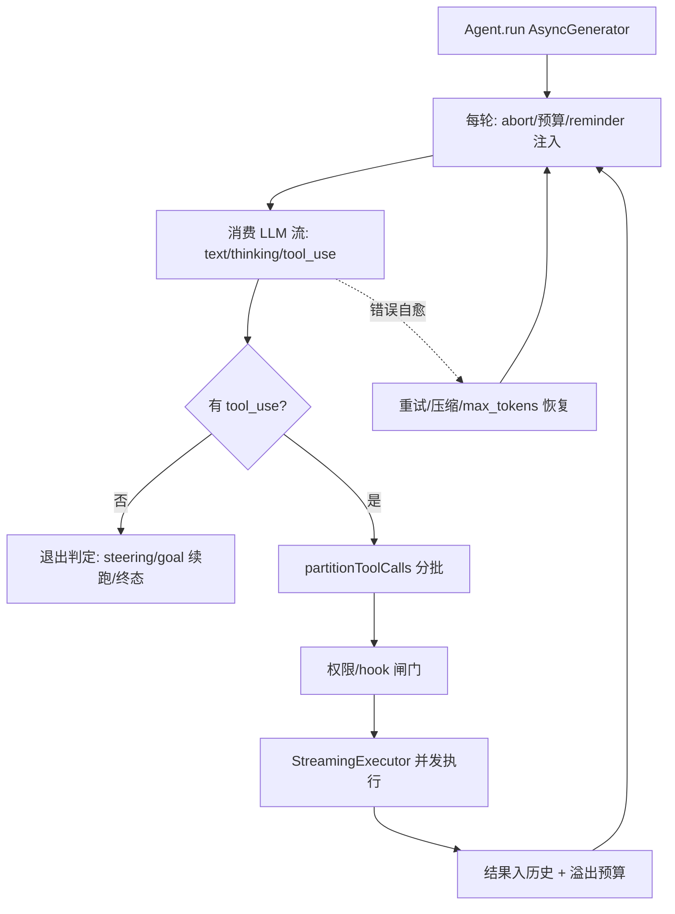

:::note 事实基线
本篇是「Yukino Code 执行内核与上下文工程」带解答题库，共 **96 题**，事实来源为 `content/docs/yukino/`（`yukino-code.md`、`react-and-agent-loop.md`、`llm.md`、`function-calling.md`、`context-compaction.md`、`system-prompt.md`、`what-is-an-agent.md`），对照本地仓库 `~/github/yukino-code/apps/yukino` @ `7b9add5` 核验（本机 HEAD；该栏目 25/27 篇笔记 frontmatter 即此哈希，`yukino-code.md` 等 2 篇标注的 `1847a71e` 落后于 HEAD，以磁盘代码为准）。Yukino Code 是 npm 包 `@yukino.js/yukino`（Node ≥ 20），用 React 19 + Ink 7 渲染单窗格 TUI，通过可配置 LLM Provider 驱动「模型 → 工具 → 模型」的自治循环。面试里它以「**介绍一个你做过的 Coding Agent / Agent 基础设施项目**」的形式出现。
:::

本篇是「Yukino Code 执行内核」题库。它的面试价值在于：**它是「把 Agent 做成产品级终端应用」的工程权衡参考**——主循环如何把一轮推理拆成可中断、可恢复、可观测的事件流，多协议如何在同一接口下收敛，工具与 MCP 如何在不破坏 prompt cache 的前提下进入上下文，上下文满了如何压缩并在恢复时找回细节。本篇的组织顺序是：**先讲定位与分层 → 再讲 ReAct 与主循环骨架 → 再讲每轮 reminder 注入 → 再讲 AgentEvent 事件流 → 再讲退出条件与错误自愈 → 再讲 max_tokens 恢复 → 再讲 steering 与工具分批执行 → 再讲 LLM 三协议适配 → 再讲思考强度与缓存前缀 → 再讲工具系统与 MCP 延迟加载 → 再讲上下文压缩与恢复 → 最后一句话速答**。多代理协作、权限、沙箱与宿主形态见姊妹篇 [Yukino Code 多代理协作与宿主形态题库](/interview/qa/yukino-code-orchestration)。

**主线一览**



## 一、定位与分层架构

### Q1. Yukino Code 与普通 CLI 工具的本质区别是什么？

普通 CLI 是「输入 → 执行 → 输出」的一次性映射；Yukino 是一个 **LLM 驱动的多轮闭环**：用户给出目标，模型推理，调用工具，观察结果，再推理，直到不再调用工具为止。这个闭环叫 **Agent 循环（agent loop）**，它才是产品内核，**终端只是它的一种宿主**。

**采分点**：能说出「**Agent 循环是内核，TUI/print/remote/A2A 都只是宿主**」——这决定了「表现层与领域层彻底解耦」的全部后续设计。

### Q2. 系统的分层架构是怎样的？关键解耦点在哪？

```text
入口分发层    解析参数, 选择 TUI / print / remote / A2A
Agent 循环层  run(): AsyncGenerator<AgentEvent>, 多轮推理与工具执行
LLM 抽象层    统一 LLMClient, 适配 anthropic / openai / openai-compat
工具层        统一 Tool 接口, 按 category 分类并支持并行调度
表现层        Ink/React 终端 UI, 或把事件转成 WebSocket/协议消息
横切支撑      权限、压缩、会话、记忆、目标、钩子、MCP、技能、多智能体
```

关键点是**表现层与领域层彻底解耦**：所有宿主消费的都是同一个事件流，Agent 核心不知道 UI 是否存在。这决定了后续几乎所有设计——测试可以无头运行，宿主可以替换，交互可以注入。

### Q3. 为什么 Agent 循环用 AsyncGenerator 而不是 EventEmitter 或回调？

`run()` 的签名是返回事件流的异步生成器，消费侧统一写成 `for await (const event of agent.run())`。相比推送式事件总线，它带来四个结构性好处：① **拉取式背压**——只有消费方 `await` 下一个事件时循环才前进一步，渲染慢时 Agent 自然减速，不存在事件积压与缓冲队列；② **控制流即代码**——多轮推理、错误恢复、退避重试都能用普通 `while` 与 `try/catch` 线性表达，不必拆成状态机；③ **中断语义天然**——调用方 `break` 或触发底层 `AbortController`，生成器帧连同流式连接、睡眠定时器一起回收，不需要手动摘除监听器；④ **统一消费接口**——TUI、print、remote 用完全相同的 `for await` 循环，差别只在如何渲染或序列化事件。

### Q4. AsyncGenerator 的代价是什么？并行信息怎么走？

代价是**生成器只能推一条主线**，所以并行信息（子代理进度、团队邮箱消息、钩子输出）走**回调旁路**，再由主循环在每轮开头排空成 system-reminder。**主线用生成器、旁路用回调**，是这个架构明确的分工。

**采分点**：能说出「**主线生成器 + 旁路回调，旁路在每轮开头排空成 reminder**」——这解释了「为什么子代理进度不会打乱主事件流」。

### Q5. 「一轮」与「一次 run」为什么要分开？

**一轮（turn）是一次模型调用加可选的一批工具执行；一次 run 可以包含许多轮（ReAct）或许多次续跑（goal）**。事件流里的 `turn_complete` 与 `loop_complete` 分别对应这两个层级，宿主因此能区分「又走了一步」和「整个任务结束」。这个分层让「持久目标续跑」「steering 注入」都能自然地表达为「再走一轮」，而不是重启整个 run。

### Q6. 哪些宿主/后台任务复用同一份循环？

UI 和 print 直接 `new Agent`，remote/A2A 经 `createRemoteAgent` 装配，消费的都是同一种 `AgentEvent`。**subagent、记忆提取等后台任务也是同一份循环的另一个实例**。这是「内核可被多种宿主、多种协议、多种协作规模复用」的直接体现——也是 yukino-chat / yukino-codegen 能以库形式嵌入它的前提。

## 二、ReAct 范式与主循环骨架

### Q7. ReAct 范式的一个回合由哪三个角色组成？

**Reasoning（text）**：解释为什么要做这一步，把思考过程写出来；**Acting（tool_use）**：选择调用一个工具去改变或观察环境；**Observation（tool_result）**：分析工具调用的结果，决定下一步怎么做。三者首尾相接：Observation 触发新一轮 Reasoning，Reasoning 导向下一次 Acting。LLM 的每次流式响应就是一次 Reasoning + Acting，CLI 执行工具后把 Observation 作为 user 消息回灌，循环继续。

### Q8. ReAct 与 Chain-of-Thought / Act-only / Plan-then-execute 的区别？

| 范式              | 特点                                                   |
| ----------------- | ------------------------------------------------------ |
| Chain-of-Thought  | 只推理不行动；一口气想完直接给答案                     |
| Act-only          | 只行动不推理；不输出思考直接调工具                     |
| **ReAct**         | 推理与行动交替，每步行动有思考依据，每次观察反馈给推理 |
| Plan-then-execute | 先生成完整计划再逐步执行；计划一旦定死不随观察调整     |

Yukino 的主循环是 ReAct；需要长时间自主推进时再叠加**持久目标（goal）**，让「推理-行动-观察」的回合一直跑到目标完成或预算耗尽。

### Q9. 一次 run 的生命周期大致有哪几步？

① `restoreContext`：把项目指令、自动记忆、技能清单经会话管理器注入（仅首次，之后由压缩触发重注）；② 打文件检查点快照，让本轮开始时的文件状态可回退；③ `goalManager.beginTurn` 累计目标轮数与活跃时间，触发 `session_start` 钩子；④ 进入 while 循环，每轮先按当前工具面与工作目录重算 reminder，再在需要时压缩上下文；⑤ 发起流式请求，处理文本、思考、工具调用、用量事件，出现自愈信号时压缩或重试；⑥ 有工具调用则分批执行，结果先过溢出与聚合预算再写进历史；无工具调用则检查 steering 队列与持久目标决定是否继续；⑦ 收尾时打检查点快照、触发后台记忆提取、上报遥测，并在 finally 里结算目标用时。

### Q10. 每轮（iteration）按代码顺序做哪些事？

① **abort 检查**（已触发则 `loop_complete(interrupted)` 退出）；② **持久目标预算检查**（`budget_limited` 时进入预算小结轮或直接输出小结并退出）；③ **maxIterations 检查**（`>0` 且超限时 yield `error` 退出，默认 0 不限制）；④ **组装本轮工具集**（`getAllSchemas`/`listVisibleToolNames` 按协议和 `toolFilter` 算可见工具）；⑤ **注入 reminder**（工具指引 → 工作目录 → 持久目标 → plan 模式 → coordinator → 延迟工具指引，再排空钩子通知、外部通知与技能增量）；⑥ **触发 turn_start 与 pre_send 钩子**（输出再 drain 一次补进 reminder）；⑦ **自动上下文压缩**（`manageContext`，成功则 yield `compact` 并 `restoreContext` 重注）；⑧ **发起 LLM 流**并逐事件消费；⑨ **错误自愈**；⑩ **max_tokens 处理**；⑪ **assistant 消息入历史并持久化**，记录 usage anchor；⑫ **有 tool_use** 则分批执行 → 溢出预算 → tool_result 入历史 → yield `turn_complete` → 投递 steering；⑬ **无 tool_use** 则 yield `turn_complete`、投递 steering，有 steering 继续，否则问持久目标是否续跑，都没有则打文件快照、`loop_complete`、fire-and-forget 触发 `onLoopComplete`。

### Q11. `finally` 块负责哪些收尾？

`goalManager.endRun()`、每轮的 `turn_end` 钩子、`session_end` 钩子、**把升级过的 `maxOutput` 还原成 `initialMaxOutput`**、`endAgentTelemetry(telemetry, aborted ? "interrupted" : outcome)`；钩子抛错会把 outcome 置为 error 并重新抛出。「还原 maxOutput」与 max_tokens 恢复的「请求级抬升」呼应——抬升只影响本次 run，收尾必须还原，避免污染共享客户端默认值。

## 三、每轮注入：reminder 通道而非系统提示词

### Q12. 系统提示词为什么只包含「与项目无关的产品定义」？

系统提示词由 `PromptBuilder` 按固定小节拼装（身份、系统约定、任务执行、动作执行、工具使用、语气风格、输出效率、环境信息），**保持全局唯一副本，以便跨项目命中同一份 prompt cache**。环境小节里的 git 探测带 1500ms 超时、分支名截断到 256 字符，防止一个异常的仓库拖慢每次启动。

### Q13. 项目指令、记忆、技能清单为什么走 `<system-reminder>` 而不是系统提示词？

因为**系统提示词是缓存前缀，一旦改动整段历史缓存失效；而 reminder 本身就是对话内容，只影响它之后的部分**。所以项目指令、自动记忆、技能清单、逐工具使用指引、工作目录、plan 模式提醒、coordinator 指引、持久目标提醒、延迟工具清单，全部改由 `<system-reminder>` 消息注入会话。这是「prompt cache 是一等约束」的直接产物。

**采分点**：能说出「**系统提示词是缓存前缀（改动即全段失效），reminder 是对话内容（只影响其后）**」——并联系到 99.4%→9.5% 的缓存命中实测落差。

### Q14. 每轮 reminder 注入的固定顺序是什么？

工具指引 → 工作目录 → 持久目标 → plan 模式 → coordinator → 延迟工具指引，然后排空钩子通知、外部通知与技能增量，再触发 `turn_start` 与 `pre_send` 钩子。固定顺序保证「工具面是否变化」的比较稳定（顺序抖动会导致同样的工具集生成不同文本，进而误判为变化、破坏缓存）。

### Q15. plan mode 提醒为什么分「全文版」与「精简版」？

第 1 轮和之后每 5 轮（`REMINDER_INTERVAL = 5`，判定 `iteration > 1 && (iteration - 1) % 5 !== 0`）注入分节的全文提醒（只读约束、探索建议、plan 文件写法、审批规则），其余轮次注入不分节的精简版——以 `PLAN_MODE_STILL_ACTIVE = "Plan mode still active."` 开头，仍附带当前约束、plan 文件路径、澄清与审批提示。这是「反复把模型拉回当前约束」与「不每轮都灌全文」的平衡。

## 四、AgentEvent 事件流

### Q16. AgentEvent 为什么用判别联合而不是类继承？

事件被定义成以 `type` 为判别字段的联合类型。选判别联合有三个原因：① **穷尽性**——消费侧 `switch (event.type)` 配合 `never` 兜底，新增事件类型会在编译期暴露所有未处理分支；② **可序列化**——纯数据对象天然能跨 WebSocket/协议边界传输（remote/A2A 要把它翻译成协议事件）；③ **无状态**——事件只是数据，不携带行为，宿主决定如何渲染。

### Q17. AgentEvent 有哪些成员？关键载荷是什么？

| 事件                            | 关键载荷                                                                   | 语义                               |
| ------------------------------- | -------------------------------------------------------------------------- | ---------------------------------- |
| `stream_text` / `thinking_text` | `text`                                                                     | 正文 / 思考增量                    |
| `thinking_complete`             | `thinking`、`signature`                                                    | 思考块完成，签名供回传             |
| `tool_use`                      | `toolName`、`toolId`、`args`                                               | 工具调用开始                       |
| `tool_result`                   | `toolName`、`toolId`、`output`、`isError`、`elapsed`、可选 `contentBlocks` | 工具结果，富内容走 `contentBlocks` |
| `turn_complete`                 | 无                                                                         | 一轮结束                           |
| `loop_complete`                 | `stopReason`                                                               | 整个循环结束                       |
| `steering_delivered`            | `text`                                                                     | 排队的用户插话已在轮次边界注入     |
| `usage`                         | `UsageInfo`                                                                | token 用量                         |
| `error`                         | `Error`                                                                    | 错误                               |
| `compact`                       | `message`、可选 `boundary`                                                 | 发生压缩，带边界负载时需持久化     |
| `retry`                         | `reason`、`delay`                                                          | 自愈重试                           |
| `permission_request`            | `toolName`、`args`                                                         | 需要人机确认                       |

### Q18. `loop_complete` 的 stopReason 有哪些取值？

`end_turn`（模型正常结束）/ `interrupted`（用户中断）/ `budget_limited`（目标预算耗尽），或透传 provider 的 stop reason。宿主据此区分「任务完成」「被中断」「预算用尽」三种终态——这也是 yukino-codegen 的 `finalizeTurn` 只在 `end_turn` 时做 git 快照的依据。

## 五、退出条件与错误自愈

### Q19. Agent 循环的退出条件有哪六种？

① **LLM 决定退出**：响应中没有 tool_use（但退出前还要过持久目标这一关——goal 活跃且预算未耗尽时生成续跑 prompt 注入，循环继续）；② **达到最大循环次数**：`maxIterations > 0` 时超过后 yield `error` 退出，默认 0 不限制；③ **用户中断（abortSignal）**：循环顶部、压缩后、流事件内、工具结果入历史后都有检查点，中断时先持久化已产出的部分内容再 `loop_complete(interrupted)`；④ **持久目标预算耗尽**：`loop_complete(budget_limited)`，目标转 `budget_limited` 态等待用户显式 replace；⑤ **LLM 请求了不存在的工具**：返回错误结果反馈给 LLM 自纠，**循环继续**；⑥ **ExitPlanMode / EnterPlanMode 执行成功**：规划类工具成功即暂停循环等待用户，`loop_complete(end_turn)`。

### Q20. 为什么「未知工具」不退出循环而是回灌错误？

因为这是**软防线**：未知工具与被 `toolFilter` 过滤的工具，都以错误结果（`Error: unknown tool '<name>'` / `Tool '<name>' is not available to this agent.`）反馈给 LLM 自纠，模型通常一两轮内改正。硬防线（迭代上限、压缩熔断、目标闸门）必须独立于模型行为——不能指望模型自己停下来；软防线的作用是让大多数潜在死循环在早期被模型自己化解，而不是频繁触发硬终止。

### Q21. 防止工具调用死循环的多层防线有哪些？

| 防线     | 机制                                                 | 性质 |
| -------- | ---------------------------------------------------- | ---- |
| 迭代上限 | 超过配置的最大迭代数即终止（需角色显式配置）         | 硬   |
| 压缩熔断 | 自动压缩连续失败 3 次后暂停（除非已过硬阻塞线）      | 硬   |
| 目标闸门 | 续跑轮数上限 150、同一阻塞原因连续 3 轮转阻塞态      | 硬   |
| 自我纠正 | 未知工具与执行错误作为结果回灌，模型通常一两轮内改正 | 软   |
| 可见成本 | 每轮流出的用量事件让用户随时中断                     | 人工 |

### Q22. 三种错误自愈路径分别是什么？

① **ContextTooLongError（prompt too long）**：立即 `forceCompact` 强制压缩，`clearUsageAnchor` 后 `continue` 重试本轮；若强制压缩没成功落地（`result.compacted === false`）或压缩自身抛异常且未被中断，则持久化错误并 yield `error` 退出，不再无限重试；② **瞬态错误重试**：`RateLimitError`(429)、`ServerError`(5xx)、`NetworkError` 最多重试 `MAX_RETRIES = 3` 次；③ **其他错误**：持久化已流出的部分文本后 yield `error` 退出循环。

### Q23. 瞬态重试为什么「只在还没有可见输出时重放」？

因为**传输层无法撤回已经流式输出的片段**。如果模型已经吐出一段正文或发起了一个工具调用后连接中断，重放会产生重复内容或重复调用。所以重试的前置条件是本轮尚未产生任何正文、思考或工具调用事件；已有可见输出时直接持久化已流出部分并报错。这是「宁可报错也不重复」的取向。

**采分点**：能说出「**重放前置条件是本轮无可见输出（无 text/thinking/tool_use）**」——答不出这点会暴露没真正处理过流式重试。

### Q24. 退避策略如何计算延迟？

`RateLimitError`/`ServerError` 优先解析 `retry-after` 响应头（支持秒数和 HTTP date 两种格式），缺省时指数退避（限流 5s 起步即 `RATE_LIMIT_BASE_DELAY_MS`，其他 1s 起步即 `BACKOFF_BASE_DELAY_MS`），上限 `MAX_DELAY_MS = 60s`。等待是可中断的 `interruptibleSleep`，abortSignal 触发可提前唤醒。每次重试发 `retry` 事件（reason 为 `rate limited` 或 `temporary provider failure`）。成功一轮后重试计数 `transientRetries` 归零。

## 六、max_tokens 恢复

### Q25. max_tokens 截断的恢复路径如何设计？

前提是停止原因为 `max_tokens` 且本轮没有 tool_use。恢复分两阶段：**阶段一抬升输出上限（只做一次）**——朝 `min(MAX_TOKENS_CEILING = 64000, contextWindow)` 抬升，把已生成的部分文本作为 assistant 消息落历史，追加一条「从断点继续」的用户消息（`MAX_TOKENS_RESUME_PROMPT`），yield `retry("max_tokens escalation")` 后 `continue`；**阶段二多轮续写**——若抬升后仍截断，继续有限轮续写（`MAX_TOKENS_RECOVERIES = 3`），提示词改为「把剩余工作拆成更小的块」。

### Q26. 为什么抬升是「请求级」而非改共享客户端默认值？

抬升是请求级的：**Agent 只改自己的上限并在后续请求里传入，不触碰共享客户端的默认值**，因此并发 Agent 之间互不干扰；run 收尾时（finally）恢复自己的初始值。若改共享默认值，一个 Agent 的抬升会污染同进程其他 Agent 的请求。

### Q27. 若被截断的轮里仍带了 tool_use 怎么处理？为什么？

这些调用的参数可能被截断，循环会给它们打上 `MAX_TOKENS_TRUNCATED_ARGS_NOTICE` 标记，**以错误结果反馈让 LLM 重新完整发起调用，而不是执行它们**——防止被截断的实参被误执行（例如一条被截断的 Bash 命令或写文件路径）。零输出轮则原样重放（不追加 user 消息，避免破坏 user/assistant 角色交替）。

## 七、Steering 与工具分批执行

### Q28. steering 队列是什么？为什么在轮次边界投递？

steering 是用户在 Agent 运行中插入的补充消息。它们不会立刻打进对话，而是先进入队列（`Agent.steer`）；主循环在**轮次边界**（工具结果之后、下一次模型调用之前）统一排空，逐条作为用户消息注入并发出 `steering_delivered` 事件。在边界投递有两个原因：① **配对安全**——如果在工具执行中途插入用户消息，会破坏 tool_use 与 tool_result 的相邻关系；② **缓存友好**——边界处插入不会让模型对当前批工具结果的理解错位。队列还支持投递前撤回（`removeSteering`）与退出时排空，保证不丢用户输入。

### Q29. steering 队列非空为什么是目标续跑的抑制条件？

**steering 队列非空同时是目标续跑与预算总结轮的抑制条件——用户在说话时，机器不抢方向**。这体现了「人负责方向，机器负责推进」的取舍：持久目标驱动自动续跑，但一旦用户插话，续跑让位于用户输入。

### Q30. partitionToolCalls 如何分批？安全性怎么判定？

按工具的 `isConcurrencySafe` 分批：**连续的并发安全调用合并为一个 parallel 批，并发不安全的调用各自单独成批，批次按 LLM 给出的顺序保持相邻**。安全性判定是 `tool.isConcurrencySafe?.(args) ?? tool.category === "read"`：按本次实参判断（Bash 的 `isConcurrencySafe` 是 `isSafeCommand(command)`，`ls` 可并发而 `rm` 必须独占），未声明时 read 类工具默认并发安全；Agent 工具的 `isConcurrencySafe` 恒为 true，主 agent 可以并行跑多个 subagent。

例如 LLM 返回 `[Read, Read, Edit, Read, Read]`，分批为 `[Read,Read]`（parallel）→ `[Edit]`（顺序）→ `[Read,Read]`（parallel）。

### Q31. StreamingExecutor 为什么「没有内置信号量或并发数上限」？

parallel 批的所有调用先 `submit` 进待办队列，`runPending()` 一次性把队列里的调用映射成并发任务，**并发度等于当前 parallel 批内的调用数**。这样设计的原因：read 类工具彼此无共享写状态，并行只受模型一轮发起的调用数约束，再加全局信号量只会拉长长尾；**真正的写冲突由 `partitionToolCalls` 的分批规则在前面挡住，而不是靠执行层排队**。代价是同一批内若模型一次发出大量重型 Bash/HTTP 调用，执行层不会主动限流，资源争用由工具自身（超时、子进程上限）兜底。

**采分点**：能说出「**写冲突靠分批规则前置拦截，执行层不设信号量**」——这是「并发安全在调度层而非执行层保证」的设计。

### Q32. 「观察流无序、数据流有序」是什么不变量？

**并发只发生在观察层**：工具结果按完成顺序流向宿主（给人看的部分，先后无关紧要，先到先 yield `tool_result` 让 UI 即时渲染）；而进入对话历史与持久化的顺序**严格按模型调用顺序**（给模型和缓存看的部分，必须确定——先收集进 Map，再按 `toolUses` 顺序重组）。两层用同一个结果集合，只是遍历顺序不同。

这条不变量带来三个好处：用户即时反馈、模型看到稳定顺序、prompt cache 前缀不被并发打乱。它也是「读并行、写串行」策略能安全落地的前提。

### Q33. 工具执行前的逐层检查有哪六道关卡？

① **参数解析失败（parseError）**：短路为错误结果，不执行；② **abort**：已中断时尚未执行的调用返回取消错误结果，保证每个 tool_use 都有配对的 tool_result；③ **toolFilter**：本次 run 不可见的工具被拒绝；④ **pre_tool_use 钩子**：reject 时返回 `Rejected by hook: <reason>`；⑤ **权限检查**：`PermissionChecker.check` 给出 allow/ask/deny，McpCall 会对目标 MCP 工具做第二次权限检查（双重检查）；⑥ **执行**：`tool.execute`，遥测包裹计时，抛错被捕获为错误工具结果，循环不中断。执行后 ReadFile 的成功结果快照进压缩恢复状态（`recoveryState.recordFileRead`）。

### Q34. 中断时如何保证每个 tool_use 都有配对的 tool_result？

这是 API 的硬要求（缺失配对会导致请求被直接拒绝）。循环在多处保证：执行器对每个待执行调用先做中断检查，已中断的立即产出中断错误结果；工具执行期间用户中断时，已产出的结果照常入历史，未启动的剩余调用逐个回报「命令已中断」；整个循环因中断提前退出时，收尾也会把未处理的调用补成错误结果。此外每次请求前还会做一次配对修复（`ensureToolPairing`）：缺结果的调用补上「已中断」错误结果，无主或重复的结果消息直接丢弃，**修复只作用于发出的请求副本，不写回历史**。

## 八、LLM 三协议适配

### Q35. LLMClient 接口为什么刻意保持最小化？

接口只承诺四件事：能流式产出事件（`stream`）、能替换系统提示词（`setSystemPrompt`）、可选地暴露协议名（`protocol`）与运行时控制（输出上限、思考强度，都以 `Partial` 混入），以及可选地报告当前输出预算（`getOutputBudget()` 返回 `{ maxOutputTokens, thinkingTokens }`）。客户端实例由工厂按协议**动态 import** 对应实现，只有被配置的协议会被加载，未配置的供应商 SDK 不进运行时；未知协议直接抛错，不做隐式回退。

### Q36. 三套协议的差异被如何收敛？

差异集中在三处，其余全部下沉到各自的客户端实现：

| 维度         | anthropic                 | openai (Responses)         | openai-compat (Chat Completions) |
| ------------ | ------------------------- | -------------------------- | -------------------------------- |
| 系统提示词   | 独立 system 字段          | input 里第一条 system 消息 | messages 里 system 消息          |
| 思考强度     | budget 或 adaptive effort | `reasoning.effort`         | `reasoning_effort`               |
| 输出上限参数 | `max_tokens`              | `max_output_tokens`        | `max_completion_tokens`          |
| 思考内容来源 | thinking 块（带签名）     | 推理摘要增量               | 非标准 `reasoning_content` 字段  |
| 缓存         | 显式缓存断点              | 由服务端处理               | 由服务端处理                     |

三套实现共享同一套内部事件模型——**Provider 只负责把各自 wire 格式翻译成统一的流事件，主循环不感知协议差异**。配置未声明窗口与输出上限时有兜底默认值：上下文窗口 1,000,000、最大输出 128,000。

### Q37. Anthropic 的「user 消息合并」解决什么问题？

Anthropic 的消息角色必须严格交替，而 Yukino 的历史里经常出现连续的 user 消息（工具结果消息、紧随其后的 system-reminder、steering 注入都可能连续落在 user 角色）。所以构造请求时要把连续的 user 消息合并成一条，满足「角色严格交替」的硬约束。这是「内部历史模型」与「协议线格式」之间的必要翻译。

### Q38. 错误分类为什么要统一到内部类型？

因为不同错误的恢复策略不同，而恢复策略决定了用户体验与成本。分类至少区分：上下文超长（可压缩后重试）、限流（可退避且优先遵循服务端建议）、服务端错误（可退避）、网络与连接错误（可退避）、鉴权与请求错误（不可重试）、流未正常结束（不可重试，因为无法撤回已输出内容）。两个供应商的错误分类器各自把 SDK 异常映射到同一套内部错误类型，**上层只依赖内部类型，不依赖任何 SDK 的异常类名**。上下文超限的识别同时覆盖 Anthropic 的「prompt is too long」与 OpenAI 系的 `context_length_exceeded` / `maximum context length` 措辞。

## 九、思考强度与缓存前缀

### Q39. 思考强度如何做到「不靠模型名猜能力」？

能力声明是**显式元数据**，不是从模型名推断。配置里为每个 provider 声明是否支持 reasoning，以及可选的逐等级映射表。逻辑等级有七档（`off`、`minimal`、`low`、`medium`、`high`、`xhigh`、`max`），默认 `high`，每档对应固定 token 预算（minimal 1024、low 2048、medium 8192、high 16384、xhigh 32768、max 65536）。`off` 永远显式关闭思考（不能靠省略字段，否则会启用服务端默认值）。

### Q40. 思考强度的收敛规则「只降不升」是什么意思？

不支持的请求被**钳制到最近的可用等级**（降级只降不升）。openai 系列原样透传全部七个等级（包括 xhigh 与 max），仅当 `thinking_level_map` 显式映射或置 null 时才改变；Anthropic 自适应模式把 minimal 抬到 low、把 xhigh 降到 high。Anthropic 预算模式下思考预算与输出上限共享额度，必须同时满足最小思考预算 1024 与最小回答空间 1024；输出上限装不下时可用等级只剩关闭。

### Q41. 运行时切换思考强度后，子代理如何继承？

当前会话切换时写入配置并应用到客户端，保存失败不回滚运行时变更（避免「看起来切换了其实没生效」的错觉）。**子代理派生时继承父客户端当前的有效等级，而不是父 provider 的初始配置**，所以主代理运行中调低强度，新起的子代理也随之降低。要区分「用户设置的等级」与「生效的等级」——客户端保存钳制后的有效值，子代理继承的是这个有效值，否则会继承一个 provider 根本不支持的请求值。

### Q42. prompt cache 为什么是「一等约束」？实测落差是多少？

工具数组在请求中位于系统提示词之后、消息之前，因此**工具面的任何变化都会让其后整段历史缓存失效**。源码注释给了量化实测：**两万 token 的历史里，往工具数组尾部追加一个工具，缓存命中率从 99.4% 跌到 9.5%**，等于整段重算。由此派生出多条设计：系统提示词保持项目无关；工具按协议导出但顺序稳定；MCP 加载模式一旦决定不在每轮重算；每条工具消息一旦进入历史便不再修改。

**采分点**：能说出「**99.4%→9.5% 的实测落差**」并列出由此派生的设计约束——这是「缓存优先」取舍最有力的证据。

### Q43. Anthropic 协议上还有哪两处缓存优化？

① 对工具与消息内容加 ephemeral 的 `cache_control` 断点——工具断点落在**最后一个非延迟工具**上（`defer_loading` 与 `cache_control` 同时出现在一个工具上会被 API 拒绝整个请求），尾部用户消息断点优先落在**最后一个非图像块**上（部分网关拒绝对图像块打点）；② 延迟加载用 beta 头 `advanced-tool-use-2025-11-20` 加 `defer_loading`。二者都只在需要时发送（只有工具面上存在延迟工具时才发对应 beta 头）。

## 十、工具系统与 MCP 延迟加载

### Q44. Tool 契约包含哪些字段？注册表如何划分资源所有权？

工具统一实现一个接口：名称、描述、类别（read/write/command）、可选的按实参并发安全判定、可选的延迟标记、schema、`execute`，以及可选的 `dispose`（释放资源，典型是 MCP 子进程）。注册表区分两种登记方式划分资源所有权：**`register` 表示本注册表拥有该工具，`registerBorrowed` 只挂引用不接管所有权**。这个区分支撑了代理派生：子代理的克隆注册表只拥有被重新实例化的作用域工具，继承的父级工具都是借用，因此**子代理退出时不会断开父级的 MCP 资源**。

### Q45. `takeOwnershipFrom` 与 `unregister` 分别用在什么场景？

反向的所有权转移有显式入口：`takeOwnershipFrom(source)` 把源注册表里同名工具的所有权整体接过来自行管理，供 `/mcp` 重载这类「新实例接管旧资源」的场景使用；`unregister` 会同时清掉该工具的已发现状态，重载后模型需要重新经 ToolSearch 发现它。`dispose` 是幂等的，只对自有工具执行释放，并把聚合失败以 `AggregateError` 抛出；向已 dispose 的注册表注册工具会直接报错，避免资源泄漏被静默吞掉。

### Q46. MCP 的三种加载模式分别是什么？如何判定？

MCP 工具默认延迟加载，但具体怎么进入上下文分三种模式，在 MCP 连接后决定一次（交互式界面在切换 Provider 时重新决定）：

- **eager**：MCP 工具 schema 总量不足上下文窗口的 10%（`DEFAULT_EAGER_THRESHOLD_PERCENT`），全部直接进工具数组，不做延迟——省下的上下文不值得承担额外风险；
- **native**：官方 Anthropic 端点（baseUrl 为空或指向 api.anthropic.com）且协议为 anthropic。工具留在数组里但标记 `defer_loading`，由服务端决定是否展示；ToolSearch 返回 `tool_reference` 让服务端展开 schema（需要 beta 头）；
- **dispatch**：其他端点（国内厂商、各类代理网关）既不支持 `defer_loading` 也不支持 `tool_reference`，于是模拟——MCP 工具完全不进工具数组，统一经一个入口工具（McpCall）调用。

### Q47. MCP 加载模式的估算为什么用「字符除以 2.5」？

模式判定的输入是 MCP schema 的字符数、上下文窗口、协议与端点是否官方。估算用「**字符除以 2.5**」的经验比率，因为 **MCP schema 是符号密集的 JSON，每 token 字符数低于对话估算用的 3.5**。模式可用配置项 `mcp_loading` 强制覆盖，但强制 native 仅在 Anthropic 协议下有效，否则降级为 dispatch——否则 OpenAI 协议客户端会丢掉 `tool_reference` 又隐藏入口工具，使所有延迟工具不可达。

### Q48. MCP 工具名如何消歧？参数如何归一？

MCP 工具全名形如 `mcp__<服务器>__<工具>`，两段各经 `sanitizeSegment` 清洗（只保留字母、数字与下划线，其余字符含连字符一律替换为下划线）。经统一入口 McpCall 调用时，**权限规则的匹配目标不是某个参数，而是 `服务器__工具` 形式**（传入全名会剥掉 `mcp__` 前缀），因此既能按服务器管控也能按具体工具管控。参数会先按目标工具的完整 schema 逐层归一（`coerceBySchema`）：字符串与数字按全匹配模式互转、`"true"/"false"` 转布尔、单键对象解包进数组、逗号分隔字符串拆成数组、对象与数组递归处理，`__proto__` 这类危险键用 `defineProperty` 写入而不是直接赋值；修不动的值原样透传，让服务器自己报错而不是在本地猜。

### Q49. ToolSearch 的发现机制是什么？

ToolSearch 是延迟工具的发现入口：query 以 `select:` 开头时按名字精确取回，否则做关键词搜索，`max_results` 钳制在 1..50（默认 5）。发现的本地工具会被 `markDiscovered` 进入工具数组；MCP 工具在 native 模式下额外以 `tool_reference` 内容块返回，交给服务端展开。延迟工具名列表按字典序排序——不是为了好看，而是为了让「工具面是否变化」的比较稳定。

### Q50. 代理派生时工具面如何多层过滤？

按固定顺序多层过滤：MCP 工具豁免全局限制但仍受角色级黑白名单约束；一组**主线程专属工具**被移除——Workflow、物理设备 ComputerUse、单例对话框 AskUserQuestion、计划模式入口 EnterPlanMode 与出口 ExitPlanMode、持久目标 Goal，再加上委派策略限制的递归派生 Agent 与团队权限类 TeamCreate/TeamDelete/SendMessage；后台代理再套一层允许白名单；最后应用角色定义的黑名单与白名单交集（`tools: ["*"]` 可关掉白名单层）。plan 模式派生的 teammate 例外保留 ExitPlanMode。

## 十一、上下文压缩与恢复

### Q51. 上下文压缩的两层机制是什么？

**第 1 层**在工具结果进入历史时把大结果溢出到磁盘、只留预览；**第 2 层**在 token 用量越过阈值（或手动 `/compact`）时由 LLM 生成对话摘要，近期消息逐字保留。两层是「无损落盘」与「有损压缩」的两级降级：显式的大结果先落盘（廉价、无损、可回读），只有窗口将满时才动用会丢细节的摘要压缩。

### Q52. 压缩的两条阈值与熔断如何计算？

```text
effectiveWindow = contextWindow - min(maxOutput, SUMMARY_OUTPUT_RESERVE=20000)
自动压缩阈值     = effectiveWindow - 自动安全边际
强制压缩阈值     = effectiveWindow - 手动安全边际   # 硬阻塞线
```

两条安全边际名义上是 13,000（自动）与 3,000（手动），但都**按有效窗口的比例封顶**（自动 25%、手动 10%）——小窗口模型上固定边际会吃掉过大比例，比例封顶让阈值随窗口缩放。连续压缩失败 3 次（`MAX_CONSECUTIVE_FAILURES`）后熔断自动压缩，除非已经越过硬线。带上下文的模型自愈路径（ContextTooLongError）走强制压缩，不受熔断限制。

### Q53. 锚点式 token 估算解决了什么痛点？

纯字符估算误差会累积。每轮结束用 API 返回的真实用量打**锚点**：记录当时的输入、缓存读、缓存写与输出总和，以及消息数。之后只对锚点之后新增的消息做字符估算（按每 token 3.5 字符），而不是每轮重新估算整个转录。冷启动（尚无锚点）才全量字符估算。这样**误差只来自「锚点之后的那一小段」，不会随会话变长而放大**。图像块按 7,000 字符当量（`IMAGE_CHAR_EQUIV`）计入，否则图像密集的会话会系统性低估、压缩触发过晚。rewind 截断对话时锚点被清空，强制下一轮重新全量估算——**过期的锚点比没有锚点更危险**。

### Q54. token 估算为什么用固定字符比例？不同地方比例为何不同？

因为它是**估算不是精确计数**，目标是触发阈值判断不是计费。用一个偏保守的单一比例（对话按每 token 3.5 字符）覆盖大多数情况，真正的偏差由锚点机制吸收；压缩阈值本身也留了安全余量，估算偏低不会溢出、偏高只会稍微提前压缩。**不同地方比例不同**：对话消息用面向自然语言的 3.5，而 MCP 工具 schema 是符号密度很高的 JSON，单独用 2.5 估算，才能准确判断「schema 是否小到可以全量加载」（eager 阈值判定）。

### Q55. 压缩为什么「保留尾部原文、只摘要更早的前缀」？保留边界如何确定？

压缩不是把整段历史折成摘要，而是**保留尾部原文、只摘要更早的前缀**。保留边界从尾部往前走累积 token，满足两个「足够」下限之一即停（至少保留 `KEEP_RECENT_TOKENS=10,000` token，或至少保留 `MIN_KEEP_MESSAGES=5` 条消息），并且不超过 `KEEP_MAX_TOKENS=40,000` 的上限；最近一条消息即使自身超上限也始终保留。随后有一个关键的**配对修正**：若边界落在一个承载工具结果的用户消息上，就往前退到发起该调用的助手消息，保证工具调用与结果不被拆开。若待摘要前缀不足 `MIN_COMPACT_PREFIX=2` 条，压缩直接跳过——省下的 token 不值得一次摘要往返与缓存失效。

**采分点**：能说出「**保留边界的配对修正（不拆开 tool_use/tool_result）+ 前缀不足 2 条直接跳过**」——这是「压缩不能破坏 API 硬约束」的体现。

### Q56. 摘要生成的三条路径是什么？优先级如何？

摘要请求经 `answerReserveTokens` 声明「这次要为回答预留 16,000 token」（`SUMMARY_ANSWER_RESERVE_TOKENS`），Provider 结合 `getOutputBudget` 把输出上限与思考预算调到相应位置，避免摘要写到一半被掐断。三条路径优先级递减：① **缓存共享路径**——保留原消息列表不做序列化，只把摘要指令作为最后一条用户消息追加，于是请求前缀与主对话最后一次调用一致，从而命中 prompt cache；② **上下文超限重试路径**——若摘要请求本身超限，把前缀序列化成文本（图像块压成占位符），按「API 轮次」分组从头部丢弃 1/5（`PTL_TRUNCATE_DIVISOR`）后重试，最多 3 次（`MAX_PTL_RETRIES`）；③ **瞬态重试**——限流、服务端、网络类失败按共享退避重试，每次用全新缓冲区，不拼接半成品文本。

### Q57. 摘要为什么「宁可保留原历史也不要坏摘要」？

摘要流必须收到完成事件且 stopReason 正常，否则判失败并保留原历史；结果需抽出 `<summary>` 块，模型若自发输出 `<analysis>` 块则剥掉，标签未闭合或结果为空都算失败。**摘要生成期间若主对话被并发修改（steering 注入、其他压缩），结果按 `COMPACTION_CONVERSATION_CHANGED_ERROR` 丢弃**——基于过期前缀的摘要会静默丢掉新消息。这套取向与「压缩本身是为了安全推进上下文」的目标一致：坏摘要比不压缩更危险。

### Q58. 压缩后的消息形态与恢复附件是什么？

压缩后历史被替换为「一条摘要用户消息加保留的尾部」。摘要消息里带一句提示：需要压缩前的细节可以用文件读取工具读完整会话转录。除此之外还附一个**恢复附件**：最近读过的文件快照（最多 `RECOVERY_FILE_LIMIT=5` 个文件，每文件 5,000 token 上限，超限截断）、当前仍可用的工具名列表（与工具面导出共用同一可见性判定）、一条说明（以上是重建的上下文，需要精确内容请重读源码而不是从摘要猜）。

### Q59. 恢复附件为什么「只进对话，不进 boundary」？

**恢复附件只进对话，不进 boundary**：Agent 在发布 `compact` 事件之前先把 boundary 落进会话日志，持久化的是不含附件的版本，恢复时附件按当时的文件快照重新生成。被激活的技能 SOP 不走这个附件，而是压缩后由循环重新注入项目指令、记忆与技能——因为它们本就由同一套注入路径管理。这样「持久化的压缩边界」是干净可重放的，而「恢复附件」是运行时按当前状态派生的。

### Q60. 工具结果的两道预算是什么？

工具结果进入对话历史前要过两道预算：**第一道单条结果上限**——超过 50,000 字符（`MAX_OUTPUT_CHARS`）的结果写入磁盘，历史里只留 2,000 字符预览加文件路径，模型可以用读取工具回读全文；**第二道整批聚合上限**——同一条消息内全部结果的字符总数超过 200,000 时，从最大的结果开始逐个落盘，直到总量达标。落盘只作用于进入历史的副本——工具结果事件在落盘之前已经按完成顺序实时发给宿主，用户看到的是完整输出，对话历史里才是预览加路径。

### Q61. 溢出结果的「回读豁免」防御的是什么死循环？

防御「**落盘—回读—再落盘**」的循环：模型读回落盘文件的全文后，这个读取结果本身可能又超过单条上限；如果对新结果再执行一次落盘，模型就永远只能看到预览、永远拿不到全文，于是不断重复「回读」与「落盘」。因此判定逻辑是：如果本次工具调用本身就是对某个会话产物落盘文件的回读（`isSpillReadback`），那么它的结果豁免再落盘。豁免判定基于工具名、实参与产物命名空间 id，与溢出目录的归属判断共用同一套命名空间。没有 sessionId 的匿名对话用 WeakMap 持有一个惰性匿名命名空间并注册退出清理。

## 十二、系统提示词与记忆（一句话速答）

**Q62. 一句话解释 system prompt 的 8 个固定模块。** 身份设定、系统约定、任务执行、动作执行、工具使用指引、语气风格、输出效率、环境信息（工作目录、操作系统平台、git 状态、日期）——由 `buildSystemPrompt` 拼装，全局唯一副本以命中跨项目缓存。

**Q63. 一句话解释环境小节的 git 探测为什么带超时。** git 探测带 1500ms 超时、分支名截断到 256 字符——防止一个异常的仓库（超大、损坏、网络挂载）拖慢每次启动。

**Q64. 一句话解释三层记忆。** 工作记忆（上下文窗口本身）、持久化到磁盘的长期记忆（用户/项目级指令文件 AGENTS.md、JSONL 会话日志加文件快照，支撑恢复会话与检查点回退）、Agent 在对话中自动积累经验的自动记忆。

**Q65. 一句话解释 restoreContext 为什么「仅首次」注入。** 项目指令、自动记忆、技能清单经会话管理器在首轮注入，之后由压缩触发重注——避免每轮重复注入撑大上下文，同时保证压缩后这些约束被找回。

**Q66. 一句话解释自动记忆提取的触发时机。** run 收尾时 fire-and-forget 触发 `onLoopComplete`（如后台记忆提取）——不阻塞主循环，提取结果下次会话经 restoreContext 注入。

**Q67. 一句话解释 usage anchor 与 goalManager.addTokens 的关系。** 每轮 `stream_end` 记录 stopReason 和 usage 并 `goalManager.addTokens`——真实用量既打 token 估算锚点，又累计持久目标的已用预算。

**Q68. 一句话解释为什么「消息进入历史后不再修改」。** 这是 prompt cache 一等约束的派生——修改历史消息会让其后整段缓存失效，所以工具结果一旦入历史便不再改动（压缩是「替换整段前缀」而非「修改单条」）。

**Q69. 一句话解释 plan mode 的权限矩阵。** `modeDecide` 对 plan 模式返回「read 放行，其余拒绝」，再叠加前置守卫——非 read 类调用除非命中例外（plan 文件写入、PLAN_COORDINATION_TOOLS、`isSafeCommand` 只读命令），一律以「Plan mode forbids mutations」拒绝。

**Q70. 一句话解释 plan mode 的唯一出口。** ExitPlanMode 工具：LLM 写完 plan 后调用它，成功即结束本轮 loop（`loop_complete(end_turn)`），UI 弹出审批对话框（YOLO 自动批准 / 手动逐项批准 / 反馈修改意见）；reminder 明确约束「call ExitPlanMode for approval; never request approval through prose」。

**Q71. 一句话解释 plan 文件路径与增量编辑提示。** plan 文件在 `~/.yukino/plans/<slug>.md`；reminder 在文件已存在时提示先读再用 EditFile 增量编辑，不存在时提示用 WriteFile 创建。

**Q72. 一句话解释为什么 AskUserQuestion 在 plan 模式只允许澄清。** 审批必须走 ExitPlanMode（结构化、可阻塞、可审计），AskUserQuestion 只允许用于澄清——避免模型用散文式提问绕过审批闸门。

**Q73. 一句话解释 `getOutputBudget` 对压缩器的意义。** 它返回当前输出上限与思考预算，压缩器靠它给摘要请求算出「预留 16,000 token 回答空间」之后还剩多少可用——不必复制各协议的预算推导逻辑。

**Q74. 一句话解释 Responses 协议为什么记录 providerItemId。** 以便在多轮里正确回放推理项（reasoning item）——OpenAI Responses 的推理摘要需要靠 itemId 在后续请求里关联。

**Q75. 一句话解释工具 schema 的协议转换。** 工具内部只有一种声明形式（名称、描述、JSON Schema），导出时按协议转换（`getAllSchemas` 接受协议参数）：Anthropic 形态附加 `type: "custom"` 等字段，只有 Anthropic 原生支持 `defer_loading` 且需 beta 头，可见性与延迟指引、恢复附件共用同一 `isToolVisible` 判定。

**Q76. 一句话解释 `redacted_thinking_complete` 事件。** Anthropic 的 thinking 块可能被服务端脱敏，统一抽象里为它单独建一个事件类型——保证脱敏的思考块也能被正确收集与回传（带签名）。

**Q77. 一句话解释为什么「失败要显式」是贯穿全局的取舍。** OS 沙箱不可用就 fail closed 拒绝执行而不静默放行；上下文超限就压缩而不硬塞；摘要不完整或对话已变就保留原历史；解析不了的 shell 命令升级为人审——宁可显式失败，也不让模型在无声的降级里给出错误结论。

**Q78. 一句话解释「人负责方向，机器负责推进」的边界。** 权限默认询问、主会话计划审批阻塞等待、目标设定与替换只属于用户、预算耗尽前给一次总结轮、团队消息里的沉默不算同意——自治循环的边界由人划定。

**Q79. 一句话解释「资源所有权显式建模」。** 注册表的自有与借用、`takeOwnershipFrom` 的显式移交、作用域工具的重新实例化、退出时「先同步清理再异步 flush」的顺序——让「多个代理共享一个进程」不靠约定而靠类型与生命周期保证。

**Q80. 一句话解释这个内核的代价。** 把内核做成「可被多种宿主、多种协议、多种协作规模复用」的形态，代价是概念与生命周期显著增多（reminder 通道、所有权模型、三加载模式、锚点估算、配对修复……）。

**Q81. 一句话解释 Yukino Code 与 yukino-chat/codegen 的关系。** 后两者都以库形式（`Remote.Server.createRemoteAgent`）复用这个内核——yukino-chat 走「每用户只读运行时 + 聊天落库」，yukino-codegen 走「每应用可写工作区 + 沙箱构建 + 静态预览」，内核本身不知道宿主是谁。

**Q82. 一句话解释为什么测试可以无头运行。** 表现层与领域层彻底解耦，Agent 核心不知道 UI 是否存在——测试直接 `for await` 消费 `AgentEvent` 断言行为，无需渲染 TUI。

**Q83. 一句话解释 `interruptibleSleep` 的价值。** 退避等待是可中断的，abortSignal 触发可提前唤醒——用户中断时不必等完整个退避周期，优雅退出并发出中断结束事件。

**Q84. 一句话解释为什么非瞬态错误（鉴权失败）不重试。** 鉴权失败重试无意义（不会因重试而变有效），且会拖慢失败反馈——直接持久化错误并退出，让用户尽快看到「需要重新登录/配置」。

**Q85. 一句话解释 `ensureToolPairing` 为什么「只作用于请求副本」。** 修复（补中断结果、丢弃无主/重复结果）是为了满足本次请求的 API 硬约束，不应污染持久化的历史——历史保留原始事实，请求副本做协议适配。

**Q86. 一句话解释 ReadFile 结果为什么快照进 recoveryState。** `recoveryState.recordFileRead` 记录最近读过的文件，压缩后的恢复附件据此重建「最近读过的文件快照」——让模型压缩后仍记得刚读过的内容，不必重读。

**Q87. 一句话解释溢出目录为什么按会话隔离。** 溢出目录按 sessionId 隔离；没有 sessionId 的匿名对话分配一个惰性匿名命名空间（WeakMap 持有，注册进退出清理），跨 run 复用、退出时清理，且不产生可 resume 的会话文件。

**Q88. 一句话解释「两级降级」的成本排序。** 显式大结果先落盘（廉价、无损、可回读）→ 窗口将满才摘要压缩（昂贵、有损、丢细节）——按成本从低到高动用，能落盘解决就不摘要。

**Q89. 一句话解释压缩熔断为什么「越过硬线仍压缩」。** 连续失败 3 次熔断自动压缩是为了「不在持续失败的状态里反复付出昂贵调用」，但已过硬阻塞线（强制阈值）时不压缩就无法继续，所以熔断不拦截硬线压缩。

**Q90. 一句话解释 `MAX_TOKENS_CEILING = 64000` 与 contextWindow 取 min 的原因。** 抬升上限不能超过模型上下文窗口（否则请求非法），也不能超过 64000（产品设定的安全上限）——取二者较小值。

**Q91. 一句话解释为什么零输出轮 max_tokens 重放不追加 user 消息。** 没有产出任何文本或 thinking 时直接重放，避免破坏 user/assistant 角色交替（追加 user 消息会造成连续两条 user）。

**Q92. 一句话解释 `outputRecoveries` 与 `transientRetries` 的归零时机。** 非 max_tokens 的轮次把 `outputRecoveries` 归零，成功一轮后 `transientRetries` 归零——两个计数器各自独立，恢复耗尽后降级为正常结束。

**Q93. 一句话解释为什么「工具面顺序稳定」能保缓存。** 工具数组是缓存前缀的一部分，顺序抖动会让「同样的工具集」生成不同请求字节，从而误判为变化、击穿缓存——所以延迟工具名列表按字典序排序。

**Q94. 一句话解释 dispatch 模式为什么「MCP 工具完全不进工具数组」。** 非官方端点既不支持 `defer_loading` 也不支持 `tool_reference`，留在数组里会撑爆上下文又无法延迟——干脆全部移出，统一经 McpCall 入口调用，由入口工具按需转发。

**Q95. 一句话解释为什么 McpCall 要做「双重权限检查」。** McpCall 是统一入口，第一道检查入口工具本身，第二道检查目标 MCP 工具（`服务器__工具` 形式）——否则「允许 McpCall」会等于「允许所有 MCP 工具」，绕过按工具管控。

**Q96. 一句话总结这个执行内核的架构哲学。** 缓存优先（系统提示词项目无关、工具面顺序稳定、消息入历史不改、压缩保留尾部、摘要走缓存共享路径）、失败显式（沙箱 fail closed、超限即压缩、坏摘要不如不压缩）、人定方向机器推进（权限默认询问、目标设定属用户、沉默不算同意）、资源所有权显式建模（自有/借用、takeOwnershipFrom、先同步清理再异步 flush）——一个「可被多宿主、多协议、多协作规模复用」的产品级 Agent 内核。

---

**延伸阅读**

- [Yukino Code 多代理协作与宿主形态题库](/interview/qa/yukino-code-orchestration)：姊妹篇——权限/沙箱/Hook、Subagent/Agent Team/Workflow/Goal、Skills/Slash Command、TUI/Print/Remote/A2A/Telemetry。
- [Coding Agent Harness 实现剖析题库](/interview/qa/coding-agent-harness)：claude-code / pi 等参照 harness 的对比视角。
- [Agent 执行循环与工具体系题库](/interview/qa/agent-loop-and-tools)：ReAct 循环、工具调用的通用机制。
- [LLM 与推理基础题库](/interview/qa/llm-fundamentals)：三协议、思考强度、prompt cache 的通用原理。
- [Yukino Codegen AI 代码生成平台项目深挖题库](/interview/qa/yukino-codegen-project)：以库形式复用本内核的全栈生成平台。
- [工作文档 · Yukino Code 源码解析](/docs/yukino/yukino-code)：本篇的事实来源（含 31 问设计问答篇）。
