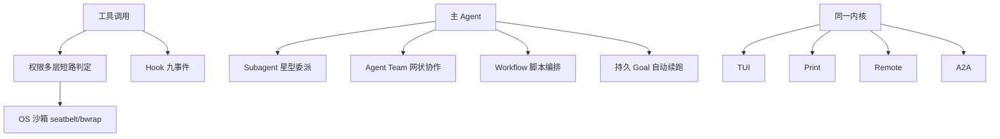

:::note 事实基线
本篇是「Yukino Code 多代理协作、权限与宿主形态」带解答题库，共 **95 题**，事实来源为 `content/docs/yukino/`（`permission.md`、`sandbox.md`、`hook.md`、`subagent.md`、`agent-team.md`、`goal.md`、`skills.md`、`slash-command.md`、`workflow.md`、`worktree.md`、`task-tracking.md`、`code-review.md`、`terminal-ui.md`、`print-mode.md`、`remote.md`、`a2a.md`、`telemetry.md`），对照本地仓库 `~/github/yukino-code/apps/yukino` @ `7b9add5` 核验（本机 HEAD，与该栏目 25/27 篇笔记 frontmatter 一致）。本篇是 [Yukino Code 执行内核与上下文工程题库](/interview/qa/yukino-code-engine) 的姊妹篇——前者讲「单 agent 的主循环与上下文」，本篇讲「多 agent 协作、权限边界与宿主形态」。
:::

本篇是「Yukino Code 多代理协作、权限与宿主形态」题库。它的面试价值在于：**它回答了「一个能力不打折的 coding agent，如何在多用户/多代理/多宿主环境下被安全地组织起来」**——权限如何多层短路抵御 prompt 注入/越权/数据泄露，沙箱如何把破坏半径收敛到 OS 层，subagent/team/workflow 三种协作拓扑各解决什么，goal 如何让 agent 跨轮次自动推进又不失控，四种宿主形态如何复用同一内核。本篇的组织顺序是：**先讲权限系统 → 再讲 OS 沙箱 → 再讲 Hook → 再讲 Subagent 委派 → 再讲 Agent Team 协作 → 再讲 Coordinator 与持久 Goal → 再讲 Skills 与 Slash Command → 再讲 Workflow 与 Worktree → 再讲四种宿主形态 → 最后讲 Telemetry 与隐私洗消**。

**主线一览**



## 一、权限系统：多层短路判定

### Q1. 权限系统回答什么问题？要抵御哪三类攻击面？

LLM 生成的每一次工具调用都是一次真实世界的动作（执行命令、改写文件、发起网络请求）。权限系统回答一个问题——这次调用应该直接放行（**allow**）、停下来问人（**ask**），还是直接拒绝（**deny**）。它要同时抵御三类攻击面：① **prompt 注入**（被污染的文件内容诱导模型执行恶意命令）；② **越权**（模型做出超出用户授权范围的动作，如写坏项目外的文件、强推分支）；③ **数据泄露**（读工具把敏感内容带出边界，如 `.env` 里的密钥）。单一检查点无法同时覆盖这三类问题，所以判定被拆成多层，层层短路，任何一层说「不」都优先于放行。

### Q2. 判定入口与 Decision 结构是什么？

判定入口是 `PermissionChecker.check(toolName, category, args)`，返回一个 `Decision`：`{ effect: "allow" | "deny" | "ask", reason: string, rememberPatterns?: string[] }`。`ask` 触发 HITL（人在回路）确认；`reason` 是判定的可读解释，会展示在确认对话框里，也拼进 deny 时返回给 LLM 的工具结果；`rememberPatterns` 是「始终允许」时可以持久化的规则 scope 列表。

### Q3. 工具的 category 是怎么来的？它决定什么？

`category` 不是 checker 猜的，而是每个工具注册时声明的 `ToolCategory`：`read` / `write` / `command` 三类。代表性归属：ReadFile/Glob/Grep/WebFetch/TaskOutput/AskUserQuestion 是 `read`；WriteFile/EditFile/InstallSkill/EnterWorktree 是 `write`；Bash/PowerShell/ComputerUse/McpCall/Workflow/Agent 是 `command`。分类决定了**模式矩阵兜底时的默认行为**，也决定**路径沙箱是否介入（只对 `write` 介入）**。

### Q4. 权限判定的逐层短路顺序是什么？

`checkAction` 按以下顺序逐层判定，前面的层命中即短路返回：① **plan 模式守卫（deny）**——`mode === "plan"` 且 category 不是 read 时，除四类例外一律 deny（`Plan mode forbids mutations`），这个守卫位于显式规则之前，意味着 plan 模式下即使有显式 allow 规则也打不开写操作；② **显式规则（deny/ask 短路）**——规则文件命中的 deny 或 ask 立即返回，显式 allow 故意不在这里短路（只记录 effect 放到后面，让路径沙箱等机制可以先介入）；③ **plan 协调工具放行**；④ 空命令 ask；⑤ 复杂 shell 语法 ask；⑥ 沙箱 auto_allow 且 Bash 则 allow；⑦ 路径沙箱越界（write）则 ask；⑧ 显式 allow 命中；⑨ `modeDecide(mode, category)` 模式矩阵兜底。

### Q5. 为什么 `check` 要包一层 fail-closed？

`check` 内部包了一层 fail-closed：私有方法 `checkAction` 抛出任何异常（典型是路径解析失败），`check` 捕获后返回 **deny**，reason 为 `Permission path resolution failed: ...`——**判定链路出错时宁可拒绝也不放行**。这是「失败要显式」取舍在权限层的体现：一个解析 bug 不应该变成「默认允许」。

**采分点**：能说出「**判定链路异常 → fail-closed 返回 deny**」——并联系到「规则文件 YAML 解析失败也按 deny 处理（更严格而非更宽松）」。

### Q6. 四个权限模式与兜底矩阵是什么？

`PermissionMode` 有四个值，兜底矩阵由 `modeDecide` 给出：

| 模式              | read  | write | command |
| ----------------- | ----- | ----- | ------- |
| default           | Allow | Ask   | Ask     |
| acceptEdits       | Allow | Allow | Ask     |
| plan              | Allow | Deny  | Deny    |
| bypassPermissions | Allow | Allow | Allow   |

plan 模式下 write/command 的 Deny 来自判定流程第 1 层的守卫（早于矩阵本身）。**plan 模式和 default 模式的差别不在 ask 的多少，而是 plan 直接 deny 变更**。bypassPermissions 在权限层放行一切；对危险命令的防护来自权限规则（deny）、pre_tool_use hook 的 reject 和 OS 沙箱，而不是模式本身——**源码里没有 `rm -rf` 之类的硬编码危险命令拦截**。

### Q7. 模式如何切换与继承？为什么「继承只会放宽不会收紧」？

**Shift+Tab 循环**：终端 UI 按 `PERMISSION_MODE_CYCLE` = default → acceptEdits → bypassPermissions 循环切换（plan 不在循环里，UI 上 bypassPermissions 显示为 "YOLO"）。**subagent 继承**：`forSubagent` 派生子 checker 后，有效模式按 `mode` getter 合并——teammate 且要求 leader 审批计划、自身值为 plan → plan（这一判定先于父模式合并，teammate 在计划获批前保持只读）；父或子任一是 bypassPermissions → bypassPermissions；父是 acceptEdits → acceptEdits；其余用子自己的值，缺省 default。**除 teammate 计划审批这一例外，继承只会放宽不会收紧**——子代理不该比父代理更受限（否则委派失去意义），但 teammate 计划审批是「先只读出计划、批准后才放宽」的刻意例外。

### Q8. 安全只读命令白名单为什么「刻意收得很窄」？

命令分类只针对 `command` 类工具，判定函数是 `isSafeCommand(command)`。两个要点：① **元字符拒绝集**——CR、LF、`&`、`|`、`;`、`<`、`>`、反引号、`(`、`)`、`{`、`}`、`[`、`]`，命中任意一个即判不安全，防止 `cat a | rm -rf b` 这类把安全前缀当作管道/链式/重定向/命令替换入口的绕过；② **白名单内容**（`SAFE_PREFIXES`）——51 个字符串前缀加一条正则，都是无危险参数的只读工具（查看类 cat/head/tail/wc、文本处理类 cut/tr、系统信息类 id/uname/df、路径类 basename/realpath、其他 echo/grep/test/sleep），唯一的正则覆盖 `docker ps`/`docker images`。

白名单**刻意收得很窄**：`git`/`npm`/`kubectl` 等都不在列（落入模式矩阵 ask 或被显式规则覆盖），`find` 列入 `COMPLEX_COMMANDS` 永远要求审批。只有命中白名单的命令才直接 allow，也才允许与其他工具并发执行（`isConcurrencySafe` 即 `isSafeCommand`）。

### Q9. `analyzeShell` 这个自研轻量 shell 词法分析器做什么？

`analyzeShell(command, powershell?)` 把一行命令拆成字面简单命令列表（`ShellAnalysis = { commands, complete }`）。它识别单/双引号、反斜杠转义、注释和 `;`/`|`/`&&`/`||` 分隔，遇到下列任一情况就标记 `complete = false`：词中出现 `$`、反引号、`(`、`)`、`{`、`}`、`<`、`>`、NUL（变量展开、命令替换、子 shell、重定向）；引号未闭合或行尾悬空转义符；以 `|`/`&` 开头；第一个词为空/含空白/通配符/方括号/波浪线，是变量赋值，或可执行文件名命中 `COMPLEX_COMMANDS`（if/for/while/case/function/eval/exec/source/sudo/bash/xargs/find 等控制流与提权名单）。

`complete = false` 的命令在两个地方起作用：① 判定流程第 8 层——非 bypassPermissions 模式下一律 ask（`Complex shell syntax requires approval`），因为展开和重定向的真实效果无法靠字面前缀授权；② 显式规则匹配——Bash/PowerShell 的规则按拆出的子命令逐条评估。

### Q10. 路径沙箱（PathSandbox）只管 write 类工具，为什么？

`PathSandbox` 只管 write 类工具的路径参数；**读工具不再经过这一层**（`canReadSearchPath` 恒返回 true，读路径由 deny 规则按需拦截），bypassPermissions 模式也跳过。允许的根目录默认两个：项目根目录和系统临时目录（`os.tmpdir()`，macOS 上是 `/var/folders/...` 而不是 `/tmp`）。检查流程：`resolveToolPath` 展开 `~` 并相对项目目录 resolve → `canonicalPath` 解析符号链接（尾部文件甚至父目录不存在时逐级向上回退再拼接，最大深度 `MAX_SYMLINK_DEPTH = 40`）→ `isPathWithin` 用 `path.relative` 判断是否落在某个根内。

### Q11. 路径沙箱越界为什么包装成 ask 而不是 deny？

`PathSandbox.check` 返回 `Path <filePath> is outside allowed directories`，判定流程把它包装成 **ask 而不是 deny**——用户可能确实需要写外部路径，deny 太激进。ask 之前会重查一次显式规则，显式 allow 可以覆盖沙箱决策。这体现了「越界是可疑但不是非法」的判断：交给用户裁决，而不是一刀切拒绝。

### Q12. 权限规则的语法与裁决优先级？规则文件写坏了会怎样？

两个规则文件加载后统一裁决：用户级 `~/.yukino/permissions.yaml`、项目级 `~/.yukino/projects/<projectKey>/permissions.yaml`。规则能表达「允许 `git push` 但不允许 `git push --force`」「允许读 src/ 但不允许读 `.env`」这类需求。单条格式非法（effect 不在枚举内、rule 不匹配 `RULE_RE`）的条目被跳过，不中断加载。**整个文件的 YAML 解析失败会抛 `Cannot parse permission rules`，被 `checkExplicitRules` 捕获后按 deny 处理——规则文件写坏了的结果是更严格，不是更宽松**。

### Q13. 「始终允许」（allowAlways）的 scope 如何生成与持久化？

HITL 确认对话框的第二项是 "Yes, remember the scopes above for all agents in this project"。用户选择后调用 `checker.allowAlways`，把 scope 作为 allow 规则追加到**项目级**规则文件。`rememberPatterns(toolName, args)` 决定 scope 形态：文件类工具——目标所在目录 + `/*`（如 `WriteFile(/abs/project/src/*)`）；Bash/PowerShell——每个子命令的前两个词 + `*`（如 `Bash(git push*)`），去重；McpCall/WebFetch/InstallSkill/TaskOutput——精确内容（如 `WebFetch(https://example.com)`）；其他工具不生成 pattern（即使收到 allowAlways 也降级为一次性 allow）。持久化由 `RuleEngine.appendProjectRule` 完成：按 `{tool, pattern, effect}` 三元组去重，整个过程持有 `withFileSyncLock` 文件锁，新内容经 `yaml.dump` 写入临时文件后 rename 原子替换。

### Q14. 人在回路（HITL）的三种决策如何落地？为什么 deny 的错误消息要「不描述命令会做什么」？

判定结果是 ask 时，`executeBatch` 阻塞在 `requestToolPermission` 上，通过 `onPermissionRequest` 回调发起审批（返回 `Promise<"allow" | "deny" | "allowAlways">`），回调与 abort signal 竞速（用户中断立即得到 deny）。三种决策：**allow**——本次执行不记规则；**allowAlways**——先把 `rememberPatterns` 持久化到项目级规则文件（用发起请求时生成的快照，避免审批期间路径别名变化导致 scope 漂移），然后执行；**deny**——工具不执行，向 LLM 返回 `isError: true` 的 `REJECTED_TOOL_RESULT`，agent loop 继续运行，LLM 下一轮看到拒绝信息自行调整策略。

规则/守卫层面的 deny（不经过人）返回 `buildPermissionDeniedOutput(reason)`——"Permission denied: ... 告知用户命令被拒绝，**且不要描述这条命令会做什么**"，防止模型借错误消息复述危险命令的内容（一种 prompt 注入的二次传播防御）。

## 二、OS 级沙箱

### Q15. 权限系统与 OS 沙箱的分工是什么？

**权限系统回答「这个工具调用要不要用户确认」，沙箱回答「这条命令允许碰什么」**；两者独立又协同：沙箱开启后，Bash 命令的破坏半径被 OS 收敛，权限层就可以免人工确认（auto_allow）。config.yaml 的 `sandbox` 段有三个键：`enabled`、`auto_allow`、`network_enabled`；运行时也可以用 `/sandbox auto | manual | off` 切换。沙箱开启后判定流程第 9 层让 Bash 命令免人工确认——且**只有当沙箱真正就绪（seatbelt/bwrap 可用）时 `sandboxEnabled`/`sandboxAutoAllow` 才会置位**。

### Q16. OS 沙箱用什么技术？跨平台如何统一？

把 Bash 命令放进操作系统提供的隔离环境执行：**macOS 用 seatbelt（SBPL profile），Linux 用 bubblewrap（bwrap）**，文件系统写入被收敛到允许目录，网络可以整体关闭。统一接口 `Sandbox`（`SandboxConfig { allowWrite, denyWrite, networkEnabled }`），`createSandbox()` 按平台分派：darwin → SeatbeltSandbox，linux → BwrapSandbox，其他平台返回 null。`available()` 且 `prepare` 成功才执行，否则**命令不执行、返回错误工具结果（fail-closed）**。

### Q17. 默认沙箱策略的 allowWrite 为什么必须包含 tmpdir？

默认策略由 `configureBashSandbox` 组装：`allowWrite: [cwd, tmpdir()]`（项目目录 + 临时目录），`denyWrite: []`，`networkEnabled` 取配置。**tmpdir 必须在 allowWrite 里**：mktemp、编译器、git、python tempfile 都依赖临时目录；macOS 的 tmpdir 是 `/var/folders/...` 而不是 `/tmp`；seatbelt 生成 profile 时还会为每个路径补发 realpath 变体（覆盖 `/tmp` → `/private/tmp` 这类符号链接）。TUI 有一份自己的同名闭包，差别是 allowWrite 额外硬编码 `/tmp`。

### Q18. 沙箱与 worktree 如何联动？

经 `forWorktree` 派生的隔离 agent 会把沙箱根切换为 worktree 目录本身（`isolatedRoot`），且不再包含系统临时目录。OS 沙箱的写根（`sandboxWriteRoots`）合并 extraRoots 与共享的 worktree 登记簿，主 agent 和委派 agent 口径统一。这样「在独立 worktree 里跑的 subagent」的写权限被精确收敛到它自己的 worktree 目录。

## 三、Hook：生命周期自动化

### Q19. Hook 的三要素是什么？为什么配置只来自用户全局文件？

Hook 是在 Agent 的生命周期事件上挂载自动化动作：**事件**（挂在哪个生命周期点）、**条件**（可省略，省略则无条件触发）、**动作**（触发后做什么）。典型用途：写文件后自动 format、危险命令执行前拦截、会话开始时注入项目约定。

配置**只来自用户全局配置文件 `~/.yukino/config.yaml` 的顶层 `hooks` 数组，没有项目级 hook 配置**——因为 hook 的 command 动作可以执行任意 shell 命令，**项目级配置意味着 clone 一个仓库就获得了任意代码执行入口**。这是一个重要的安全边界。

**采分点**：能说出「**hook 无项目级配置，因为 command 动作 = 任意代码执行，clone 仓库即获得执行入口**」——这是「供应链攻击面」的清醒认识。

### Q20. Hook 的 9 个事件分别挂在什么生命周期点？

**会话级**：`session_start`（run() 启动时触发一次，进入主循环之前）、`session_end`（run() 结束时，位于外层 finally，用户中断或抛错也会触发）。**轮次级**：`turn_start`（每轮开始，发起 LLM 请求前）、`turn_end`（每轮结束，位于该轮 finally）。**消息级**：`pre_send`（紧跟 turn_start，发起请求前）、`post_receive`（收到完整响应后，message 携带回复全文）。**工具级**：`pre_tool_use`（工具执行前，在权限检查之前，配合 reject 可拦截）、`post_tool_use`（工具执行完成后，message 携带工具输出；MCP dispatch 模式的路由调用会对内层目标工具和外层工具各触发一次）。**系统级**：`shutdown`（已定义且能通过校验，当前没有触发点，预留）。

### Q21. Hook 的执行顺序与 abort 行为？`on_error` 有哪些取值？

一个事件有多个 hook 时，按 yaml 数组中的顺序逐个执行（`HookEngine.fire` 顺序遍历）：逐个跳过 event 不匹配、condition 求值为 false、once 已触发的 hook，并在 `abortSignal` 已中断时立即结束遍历。单个 hook 的字段：`id`（once 槽位 key）、`event`、`condition`（JS 表达式）、`action`（type 加 command/url/method/prompt）、`reject`（只对 pre_tool_use 有拦截语义）、`once`（每会话只执行一次）、`async`（后台执行不阻塞）、`on_error`（ignore 默认 / fail / reject，schema 只要求是字符串，其他取值等同 ignore）。

## 四、Subagent：星型委派子系统

### Q22. Subagent 解决什么问题？委派拓扑是什么？

一个大的重构任务中想插入一个小的「更新 README.md」任务：直接在主对话里执行，会把大量无关的工具调用和中间输出混进主 Agent 的上下文（**上下文污染**）。Subagent 把这类有界子任务委派给独立的 agent loop 执行：独立的上下文窗口、独立的工具集和权限边界，只把一份简洁结果交回主 agent。

Yukino 的委派拓扑是**主从（星型）**的：主 agent 在中心，subagent 在边缘，subagent 只对自己的任务负责，**相互之间不通信**，执行结果作为 Agent 工具的返回值进入主 agent 的上下文——没有中心化的编排器，也不会出现 agent 之间的循环等待。需要相互通信、可反复追加任务的持久成员用 agent team。

### Q23. 「Agent 也是一种工具」这个洞察的意义是什么？

Agent 和 Tool 抽象同构：把 Agent 包装为 Tool（`AgentTool`），注册到 ToolRegistry，主 agent 就能像调用 Bash 一样「调用」另一个 agent。`AgentTool` 实现 Tool 接口：`name = "Agent"`，`category = "command"`，**`isConcurrencySafe()` 恒返回 `true`**——LLM 在同一批里请求多个 Agent 调用时，多个 subagent 并行运行，各自有独立的工具执行上下文，完成序流式上报。

### Q24. Agent 工具的参数有哪些？`kind`/`subagent_type`/`fork` 三个维度分别决定什么？

`schema()` 中 `description` 和 `prompt` 必填，其余可选：`kind`（teammate 默认 / subagent 一次性）、`team_name`（仅 teammate 有意义）、`subagent_type`（缺省 general-purpose）、`fork`（缺省 true）、`model`、`run_in_background`（仅 subagent）、`worktree`。三个独立维度：**`kind` 决定生命周期**（subagent 一次性、teammate 持久成员）；**`subagent_type` 决定角色**（工具白/黑名单、权限模式、模型、轮数上限）；**`fork` 决定初始上下文**（继承父对话快照还是全新对话）。三者正交。

### Q25. fork 的 subagent 如何构造初始对话？为什么要补配对 tool_result？

`fork: true` 时 `forkConversation()` 构造初始对话：① `conversation.fork()` 用 structuredClone 复制父 Agent 的完整对话历史，连同长期记忆注入标志、baselineTokens 和 usage anchor；② **扫描快照中所有没有配对 tool_result 的 tool_use（包括触发本次 fork 的那个 Agent 调用本身），追加一条 tool_results 用户消息**，保持 user/assistant 角色交替——否则子代理的请求会因「tool_use 缺配对 tool_result」被 API 拒绝；③ 快照作为子代理的对话，先注入子代理指令 system-reminder，再把任务指令追加为 user 消息。

### Q26. 子代理指令（buildSubagentInstructions）为什么能防止「fork 的 subagent 把自己当成父 agent」？

子代理指令是唯一的行为约束来源（fork 的和定义式 subagent 用同一段），按定义字段拼装：角色声明、定义的 description 和 initialPrompt、max_turns 提示、readOnly 角色的永久只读声明、范围约束（**继承的对话是背景上下文，不是接管父任务的指令**；共享文件的修改要协调；汇报时带路径、实际执行过的验证和未解决的阻塞点，不把未验证的工作声称为完成）。

这段约束回答了「为什么 fork 的 subagent 不会把自己当成父 agent 继续和用户对话」：**它没有 AskUserQuestion 工具（被剥离），指令又明确要求把结果返回父 agent、受阻时如实汇报**。

### Q27. 所有委派路径最终都走哪个执行内核？模型解析优先级是什么？

所有委派路径（一次性 subagent、teammate、skill 的 fork 模式、workflow 原语）最终都走 `spawnSubagent`。**模型解析优先级**：调用参数 `model` > 定义的 `model` > 父 Agent 的 provider model；只有存在 model override 或 systemPromptOverride 时才新建 LLMClient，否则复用父 client（省成本）。每次运行有独立 session id 和 transcript（`~/.yukino/sessions/artifacts/<sessionId>/transcript.jsonl`），运行抛错时写入一条 `subagent_error` 记录。

### Q28. 四个内置 subagent_type 分别是什么？

`BUILTIN_AGENTS` 四个内置角色：**general-purpose**（通用研究和多步任务执行，无工具限制，fork 的 subagent 缺省也由它承载）；**plan**（软件架构师，只读规划，`disallowedTools: ["EditFile","WriteFile","ExitPlanMode"]`，`permissionMode: "plan"`，`readOnly: true`）；**explore**（代码探索专家，只读，找代码、追调用链、报告带文件路径和行号的证据）；**review**（代码审查专家，读 PR diff 和相关代码，从正确性/项目约定/性能/测试覆盖/安全五个角度给发现，`disallowedTools` 同 plan 但无 permissionMode/readOnly——可以跑 `gh` 等命令但不能编辑文件）。

### Q29. plan 角色的「两种形态」是什么？为什么要替换定义？

同一个 plan 名字有两种形态：**`kind: "subagent"`** 保持永久只读，计划以文本返回；**`kind: "teammate"`** 定义被替换为 `PLAN_TEAMMATE_AGENT`（只保留 `permissionMode: "plan"`，无 disallowedTools）——先调查并通过 ExitPlanMode 向团队提交计划，审批通过后在当前工具权限下继续实施。原因是 plan teammate 的使命是「先出计划、批准后执行」，需要保留 ExitPlanMode（重绑为向团队提交计划）与批准后的完整工具面；而一次性 plan 子代理是纯只读调研，从头到尾不该写。

### Q30. 后台异步任务（run_in_background）如何回流主 agent？

`run_in_background: true`（仅 subagent）时异步执行、立即返回 task ID。任务结束后结果用 `<task-notification>` 标签包裹（`formatAgentTaskNotification`），经 agent loop 的 notificationFn drain 作为 system-reminder 注入主 agent 的上下文（含 task_id、status、name、transcript_path 与执行结果，所有字段经 XML 转义）。已通知的完结任务内存保留上限 200 条（`MAX_RETAINED_FINISHED_TASKS`），超出淘汰最旧，运行中的任务永不淘汰。**前台/后台的边界**：Bash/PowerShell 有「超时自动转后台」和 Ctrl+B 手动转后台，Agent 没有——Esc/Ctrl+C 对前台 Agent 调用是中断（输出附 `[Interrupted]`），不是转后台。

## 五、Agent Team：网状协作

### Q31. agent team 与 subagent 的拓扑差异是什么？

subagent 是**星型拓扑**（主 agent 在中心，subagent 只能和主 agent 通信，不能相互通信）；agent team 是**网状拓扑**（每个 teammate 是有独立上下文窗口的 agent 实例，teammate 之间可以相互发送邮件）。协调能力建立在两个共享结构上：**共享任务板（`tasks.json`）+ 每个成员独立的邮箱（`inboxes/`）**。邮件投递不走网络传输：文件邮箱 + 轮询，leader 和 teammate 在下一轮 agent loop 迭代开始时读到邮件。

### Q32. 去中心化协调的收益与代价是什么？

Yukino 把协调能力以工具的形式注入每个 teammate 的工具集（TodoWrite + SendMessage），agent 自己查看共享任务列表、自己从独立的邮箱中接收邮件，**没有中心调度器决定「下一个该谁发言」**。代价：可预测性较低，agent 可能漏看消息或误认领任务；收益：新增协调模式只需要修改/新增工具，不需要复杂的调度器。

### Q33. 团队的磁盘布局与命名空间隔离？

```txt
~/.yukino/teams/<sha256(规范化项目路径)>/   # 按项目命名空间哈希隔离 (projectKey)
  <team-slug>/
    config.json        # TeamFile
    inboxes/leader.json, jane.json   # 每个成员一个邮箱
    tasks.json         # 共享任务板 { nextId, tasks[] }
    logs/
```

命名空间目录是规范化 cwd 的 sha256 hex，**不同项目不能恢复、列出、修改、删除彼此的 team**。团队名 sanitize（非字母数字转 `-`、小写）得到目录 slug；成员名约束 `^[A-Za-z0-9_-]+$` 且不能是 `leader`（邮箱文件名就是成员名）。

### Q34. 文件邮箱的消息结构与原子性保证？

每个收件人一个 JSON 数组文件 `inboxes/<name>.json`（不是 jsonl），消息结构 `{ from, text, timestamp, read?, type?, requestId?, approve? }`。`read` 布尔字段是每条消息的读指针（没有单独的 .read 文件），receiveSync 一次返回全部未读并标记已读。**写入用「写临时文件 + rename」原子替换，中途崩溃不会留下截断的 JSON**。已读消息保留上限 `MAX_READ_MESSAGES = 500` 条（超出从最旧删起），**未读消息永不删**。requeue 把已消费的消息以未读状态追加回邮箱末尾（用于 teammate 空闲轮询时同一批读到 shutdown_request 的场景——其余消息重新入队，下一轮再投递）。

### Q35. 邮箱文件锁为什么用 Lamport bakery 式票据锁？stale 判定的两个条件？

多个进程可能并发读写同一个邮箱、tasks.json、config.json，每次读-改-写都包在 `withFileSyncLock` 里——这是一个 **Lamport bakery 式票据锁，用 Atomics.wait 同步等待**：竞争者先写 `choosing-<pid>-<rand>` 条目声明选号，再写 `ticket-<16位票号>-<pid>-<rand>` 条目（票号 = 现有最大票号 + 1）；没有人在选号时最小票号获胜。获取超时 `LOCK_ACQUIRE_TIMEOUT_MS = 5000ms`；退避从 5ms 起指数翻倍封顶 80ms，每次等待加随机抖动防止惊群。

**stale 判定两个条件缺一不可**：条目 mtime 超过 `LOCK_STALE_MS = 10s`，**且**持有者进程已死（`kill(pid, 0)` 探测；Linux 上另读 `/proc/<pid>/stat` 的启动 tick，PID 被复用时也能识别出原持有者已退出）。递归获取同一把锁直接抛错。

**采分点**：能说出「**stale 判定要 mtime 超时 + 进程已死两个条件，且 Linux 用 /proc 启动 tick 防 PID 复用误判**」——这是「跨进程文件锁」最容易出错的地方。

### Q36. 多团队如何消歧？`resolveTeam` 的解析规则？

多个 team 可以同时存在，协作工具（Agent、SendMessage、TodoWrite、TaskStop、TeamDelete）都带可选的 `team_name` 参数，解析统一走 `TeamManager.resolveTeam(name?, memberName?)`：**显式给出 team_name**——按名字查，不存在报 `Team '<name>' not found.`；**省略 team_name**——按成员归属过滤（teammate 只能命中自己所在的 team），命中多个报歧义错误（`Multiple teams match. Specify team_name; use TeamList...`），一个都没有时 Agent 自动创建 team、SendMessage 报 `No active team found for this sender.`、TodoWrite 回落私有任务板。

### Q37. 共享任务板的认领规则有哪些约束？

共享任务板是每团队一个 JSON 文件，任务是包含 id、主题、状态、负责人、依赖、优先级、元数据的统一模型。所有变更都在跨进程锁内 reload、克隆、操作、校验依赖、保存，任一步失败整体回滚且不落盘。**teammate 的认领在同一把锁内完成**：已有他人负责人直接拒绝；teammate 不能把任务指派给别人（只有 leader 能）；置为进行中会自动把负责人写成自己；已完成或已取消的任务不能直接重开；未解决依赖被拒（只有完成算解决）；**一个成员不能同时有两个进行中任务**。成员退出或失联时，其未完成任务被批量重置为待办并清空负责人（releaseOwner），保证任务不悬空。

### Q38. plan-mode teammate 的审批流如何按 coordinator 模式分叉？

需要计划审批的 teammate 以 plan 模式派生，只能读。它的一轮结束时经 ExitPlanMode 提交计划：计划审批请求（带计划全文与 requestId）先进 leader 邮箱留档。审批路径按团队是否处于 coordinator 模式分叉：**非 coordinator 模式下由运行时自动批准**（不经 leader 或人工审核，一条关联的审批回执写回同一邮箱，成员的权限模式切到团队当前模式）；**coordinator 模式下 `requiresLeaderPlanApproval` 为真**，teammate 进入阻塞轮询等待 leader 经 SendMessage（type 为 plan_approval_response）回复 approve 与实质性反馈，leader 拒绝时 teammate 收到修订指令、停留在 plan 模式并重新提交。**批准通过不豁免后续工具调用，每次调用仍走完整权限管线**。

### Q39. teammate 为什么「一律进程内运行」？

`Team.spawnTeammate` 接收一个 `runAgent` 回调（由 `teamRunAgentFactory` 用 teammate 作用域的注册表与权限检查器构造），**在同一进程的事件循环里跑子代理主循环**，派生成功的回执明确标注 `(in-process)`。没有 tmux/iTerm/独立子进程那套外部 backend。进程内 teammate 共享事件循环，因此进度 UI 能实时更新；中止经 AbortController 直接传到成员的主循环，`stopMember` 会等成员当前循环真正停下。需要 worktree 隔离的成员会拿到自己的 worktree 目录作为 `memberCwd`，但仍在进程内运行。

### Q40. 团队消息里为什么「沉默从不被当作同意」？

结构化消息（关停请求与响应、计划审批请求与响应）带 requestId 关联请求与响应（随机生成以避免跨进程计数器冲突）；**approve 用可选字段区分「未响应」与「明确拒绝」——沉默从不被当作同意**。这是「人负责方向」取舍在团队协议层的体现：一个没有显式 approve 的审批请求，绝不能被默认放行。

## 六、Coordinator 模式与持久 Goal

### Q41. Coordinator 模式按什么切 leader 的工具面？为什么不是「读与写」？

Coordinator 模式把 leader 的工具面收窄为纯编排白名单：Workflow、Goal、Agent、SendMessage、TaskStop、SyntheticOutput、TeamCreate、TeamList、TeamDelete、TodoWrite。**分界线不是读与写，而是「会不会往 leader 上下文灌大量内容」**。leader 的上下文要装任务分解、成员状态与消息历史；一旦它能读文件或跑命令，模型就会自己去查代码，几千行涌进来后编排空间就没了。因此文件读取、搜索与命令类被排除（要看代码就委派 teammate 带回结论），MCP 也被排除（抓网页与查数据库同样会瞬间灌满上下文）。

**采分点**：能说出「**coordinator 的分界线是『会不会灌大量内容进上下文』而非读写**」——这是「上下文预算决定工具面」的深刻洞察。

### Q42. Coordinator 启用与否为什么「只看配置，不看当前是否有团队」？

因为**中途切换会在历史里留下无法撤回的旧编排指令，模型的约束认知会混乱**。指引经 reminder 注入（完整版在第 1、6、11… 轮，其余轮给精简版），同样是为了不动系统提示词的缓存前缀。

### Q43. 持久 Goal 的三件套与权限边界？

持久目标让 agent 跨轮次、跨用户消息地朝一个目标自动推进，直到完成、受阻或预算耗尽。三件套：**GoalManager**（系统，目标状态机，持久化到会话日志，token 和轮次记账，生成续跑 prompt、预算总结和每轮 reminder）、**`/goal` 命令**（用户，设置/替换/暂停/恢复/继续/完成/清空）、**Goal 工具**（agent，只读查询 `action: get` 和汇报 `action: update`，status 为 in_progress/complete/blocked，必附 reason）。

**权限边界是单向的**：只有用户可以设置、替换、暂停、恢复、清空目标；agent 不能修改目标本身，只能查询状态和汇报进展——**这防止 agent 为了「完成」而悄悄降低或改写目标**。`Goal` 是主会话专属工具（列在 `MAIN_AGENT_ONLY_TOOLS`），subagent 和 teammate 的注册表过滤时直接剔除它。

### Q44. Goal 状态机有哪六态？goal_state 记录如何持久化与恢复？

GoalState 的 status 有六态：`active`、`paused`、`blocked`、`complete`、`budget_limited`、`max_turns`。每次状态变化 `persist()` 向会话 jsonl 追加一条 `role: "system"`、`type: "goal_state"` 的记录（content 是当前 GoalState 的 JSON），`clear()` 写入 JSON `null` 作为墓碑。恢复时 `loadSession` 扫描整份会话日志，取最后一条能解析的 goal_state 记录作为当前状态。

这带来三个性质：① `/resume` 恢复会话后目标原样恢复，会话日志被回退时目标状态也跟着回退；② **对话重建只回放 user/assistant 消息，system 记录被丢弃，所以 goal_state 永远不会进入对话历史，也不受上下文压缩影响**——压缩边界前后的目标状态都能找回；③ 解析失败的记录被跳过，保留上一条有效状态。

### Q45. Goal 的四个终止闸门是什么？为什么区分「困难」与「真正阻塞」？

续跑有四个终止闸门：① 轮数达到 `MAX_GOAL_TURNS=150` 后转「轮数上限」态；② **同一阻塞原因在连续续跑轮各记一次，连续 `MAX_BLOCKED_ATTEMPTS=3` 轮同一阻塞才转「阻塞」态**（同轮重复调用只计一次）；③ 预算耗尽转「预算受限」态；④ 用户暂停、完成或清除。**区分「困难与部分进展」和「真正的阻塞」是这套审计的核心，否则模型会把慢当成停**——一轮受阻就停太脆弱，连续三轮同一阻塞才是真阻塞。

### Q46. 预算耗尽为什么不是直接掐断，而是给一次「总结轮」？

预算耗尽不是直接掐断：循环会尝试给模型一次「**无工具总结轮**」，让它把已完成的工作、剩余事项与关键结论写下来。总结轮的准入条件是不在总结中、非 plan 模式、目标仍应续跑且 steering 队列为空；满足则以一个特殊轮运行——**工具过滤器恒为 false**（不给任何工具），跳过上下文管理与延迟工具指引，请求 maxRetries 为 0，模型若仍尝试调工具，调用被标 parseError。这保证「预算耗尽」时用户拿到的是一份有价值的收尾总结，而不是戛然而止。

### Q47. `activeMs` 与 `tokensUsed` 的记账语义有什么讲究？

**`activeMs` 只累计「在跑」的时间**：`beginTurn()` 启动计时，`endRun()`/状态转换时结算，轮次之间的空闲、paused 期间、进程重启都不计入。**`tokensUsed` 只在计时窗口内累加**：每轮 LLM 响应的 stream_end 事件到达时把 usage 四项（input、output、cache read、cache creation）求和后经 `addTokens` 计入，不在计时窗口内的 usage 一律忽略；预算总结轮由 `takeBudgetSummary` 重新开启记账，所以这一轮的 token 也算数。这保证「预算」度量的是「为目标实际消耗的」，而非「进程存活期间的全部」。

## 七、Skills 与 Slash Command

### Q48. Skill 是什么？三层目录扫描的优先级？

skill 是**写给 AI 的 SOP**（Standard Operation Procedure）：一个带 YAML frontmatter 的 SKILL.md，描述一类任务该怎么一步步做。相比硬编码在代码里的 prompt，skill 可（热）更新、可复用、可移植，可显式指定提高准确率，可携带资产，有 inline/fork 两种执行模式，支持参数占位符 `$ARGUMENTS`。

三层目录按顺序扫描，优先级从低到高：① 用户级（跨工具共享）`~/.agents/skills/`；② 用户级（Yukino 专属）`~/.yukino/skills/`；③ 项目级 `<workDir>/.agents/skills/`。**同名 skill 后扫描的覆盖先扫描的，即项目级赢**。扫描支持分组目录递归发现，以 realpath 的 visited 集合防环，跳过 `.` 开头的隐藏项和 node_modules。

### Q49. 渐进式披露的两阶段加载是什么？为什么 skill 列表不进 system prompt？

catalog 启动时完整解析每个 SKILL.md（含 SOP 正文），但**注入给模型的只有元信息；SOP 正文要到激活时才进入对话**——上下文里始终只有一行 description，选择压力低，注意力集中在当前任务。**第一阶段**：`buildSkillSection` 生成 `## Skills` 段落（使用说明 + `<skills-directory>` + `<available-skills>` XML 列表，每项含 name、description 折叠截断到 200 字、mode）。**第二阶段**：LLM 判断意图匹配时调用 LoadSkill，完整 SOP 作为工具调用结果返回，在下一轮可见。

**skill 列表不进 system prompt**：列表是项目相关的，放进 system prompt 会让每个项目各持一份副本，破坏跨项目的 prompt cache 前缀；因此走对话历史首条 `<system-reminder>` 通道下发。

### Q50. inline 与 fork 两种执行模式的区别？`fork_context` 有哪三档？

**inline 模式**：SOP 内联进当前对话，主 agent 直接按 SOP 执行（能真正驱动工具调用）；**fork 模式**：经 `runSkillFork` 在隔离子代理中运行（不可用时退回 inline）。frontmatter 的 `mode` 缺省 inline，`fork_context` 仅 fork 模式生效，三档：`none`（默认，全新对话）/ `recent`（近期上下文）/ `full`（完整父对话快照）。归一化写法：mode 缺省时检查 `context: fork` 归一化为 `mode: fork`（与其他 agent 生态的隔离执行语义等价，外部来源的 skill 无需改写即可加载）。

### Q51. Slash Command 的四种类型如何分派？

以 `/` 开头的输入在进入 agent loop 之前被命令系统拦截，先解析、匹配注册表，再按命令类型分派：**local**（handler 结果作为 system 消息）、**local_ui**（动作 token，UI 执行对话框/模式切换）、**prompt**（构造 prompt 发给 LLM；带 `agent` 字段的走 `runSubagentCommand` 在前台 subagent 里执行）、**skill_fork**（隔离 subagent 运行 skill）。handler 一律返回字符串，含义随类型而变。`CommandRegistry.register` 遇到重名（不区分大小写）直接抛错，注册方捕获异常即可实现「先注册者赢」。

### Q52. 命令解析有哪些规则？`/skill` 路由捷径是什么？

`parse` 把输入切成命令名 + args：只有以 `/` 开头的输入才进入命令流程；首个空白之前的部分是命令名，其余作为 args；**命令名不允许包含 `/`**（名字里带 `/` 的输入被判定为文件系统路径，返回 null 按普通用户消息处理）；注册表查找大小写不敏感。`resolve` 内置 `/skill` 路由捷径：`/skill <name> [args]` 改写为 `/<name> [args]`（按名运行 skill），`/skill reload` 路由到 `/skills reload`，`/skill` 不带参数时不改写（注册表里没有 skill 命令，报 unknown command）。

## 八、Workflow 与 Worktree

### Q53. Workflow 解决什么问题？为什么用确定性脚本而非让主 agent 循环委派？

Workflow 用一段**确定性的 JavaScript 脚本**编排多个 subagent，在后台并发跑完一整套「拆解 → 执行 → 验证」流程，最终结果经任务通知回流主 agent。为什么需要它：Agent 工具一次只委派一个 subagent，主 agent 要逐个等待、逐个整合；当任务能拆成几十上百个独立子项（逐文件审查、批量迁移、全仓扫描）时，**用脚本一次性编排比让主 agent 循环委派更省 token、更可控**。每次启动都会落盘脚本源码和 JSON args，已成功的 agent 调用在恢复（resume）时直接从 journal 回放，流程可重放、可审计。

### Q54. Workflow 脚本模型为什么是 AsyncFunction 函数体而非 ESM 模块？

脚本是 **AsyncFunction 函数体，不是 ESM 模块**。引擎先用正则加括号配对提取 `export const meta = {...}`，再把剩余代码包成 `(async function(agent, parallel, pipeline, phase, log, workflow, args, budget, Date, Math) { ... })` 交 `node:vm` 编译——**原语全部以参数形式注入**。这样脚本拿不到 require/import，无法逃逸到任意模块，原语面被精确控制（agent 派发、parallel 并发、pipeline 流水线、phase 阶段、log、budget 预算）。`maxConcurrency` 整数 1-16，缺省 3，并发 agent 数由 Semaphore 限流。

### Q55. Worktree 子系统解决什么问题？三个入口是什么？

worktree 子系统用 git worktree 给每个并发工作单元一份独立的检出：独立的目录、独立的分支，**并发的文件修改互不覆盖**，产出落在各自的分支上，是否合并由主 agent 决定。三个入口共用同一套机制：① 主会话直接调用 `EnterWorktree`/`ExitWorktree` 工具；② subagent/teammate 指定 `worktree: true` 时在独立 worktree 中运行；③ Workflow 的 agent adapter 用 `isolation: "worktree"` 为每个脚本步骤开一个 worktree。worktree 目录放在 `~/.yukino` 下而不是仓库内（不污染主工作区），分支统一收在 `worktree/` 前缀下。

### Q56. worktree 的 slug 校验与分支已存在时的处理？

worktree 目录在 `~/.yukino/worktrees/<projectKey>/<slug>`，分支名固定 `worktree/<slug>/work`。**slug 必须匹配 `/^[a-zA-Z0-9_-]+$/`**（只允许字母、数字、连字符、下划线），以此排除路径遍历（如 `../../etc/passwd`）和 shell 元字符。subagent/teammate 的 slug 自动生成为 `agent-a<7位hex>`（用随机串而非任务描述，因为描述里的空格和非 ASCII 字符不能直接进分支名）。

创建时先用 `git branch --list` 探测分支是否存在，再二选一：分支不存在用 `git worktree add -b`，**分支已存在选择重挂现有分支 tip 而不是强制覆盖（`-B`）**——因为并发场景下另一个 agent 可能刚在这个分支上提交了工作，`-B` 会把分支重置到 base，悄悄丢掉这些提交。

### Q57. worktree 的 HEAD 读取为什么「纯文件系统优先」？删除安全闸是什么？

创建后要拿到 HEAD 的 commit SHA 作为退出时变更检测的基准。常规做法是 `git rev-parse HEAD`（要 spawn 子进程），但这里有一条**纯文件系统的捷径**（`readWorktreeHeadSha`，性能目标 ≤10ms，无子进程）：读 worktree 目录下的 `.git` 指针文件（worktree 的 `.git` 不是目录而是文本文件，内容以 `gitdir:` 开头）→ 读 gitdir 下的 HEAD 文件 → 解析（裸 SHA 直接返回；符号引用提取分支名后先查 gitdir 的 loose ref 和 packed-refs，再查 commondir 的——worktree 的分支 ref 存放在共享的 commondir 里，所以必须两级都找），读失败再回退 `git rev-parse HEAD`。退出 remove 时经**变更检测 + 删除安全闸**，确认无未合并变更才 `git worktree remove + branch -d`。

## 九、宿主形态：TUI / Print / Remote / A2A

### Q58. 四种宿主形态分别是什么？它们如何复用同一内核？

五种运行模式（a2a、print、remote、terminal、unknown）都消费同一个 `Agent.run()` 事件流：**TUI**（React 19 + Ink 7 渲染单窗格终端界面，直接 `new Agent`）；**Print**（`-p` 非交互一次性执行，自组装完整运行时，用于脚本/CI）；**Remote**（`--remote` 起 WebSocket 服务器，浏览器 React 前端消费，经 `createRemoteAgent` 装配）；**A2A**（`--a2a` 作为 Agent2Agent 协议服务器，供其他 agent 派发任务）。差别只在如何渲染或序列化 `AgentEvent`——内核不知道宿主是谁。

### Q59. Print 模式与交互模式的关键差异是什么？

Print 模式是非交互的一次性执行：一条命令进去，agent 循环跑完，结果打印到 stdout，进程退出。与交互模式的差异：① **bypassPermissions**（无人值守，不能弹审批对话框）；② **无 hook/skill 的交互式装配**；③ 输出格式 `text`（stdout）或 `stream-json`（逐行 + result 汇总行）；④ prompt 可以是 slash command（特判 `/goal`、`/ultracode`、命名 workflow、`/workflows` 四类）。`-p` 不能与 `--resume` 或任何服务器模式同时出现。finally 里清理所有子进程和后台任务（停后台任务/团队 → dispose 注册表 → 断开 MCP）。

### Q60. Remote 模式的 WS 接入控制有哪些？为什么 HTTP 层没有账号体系？

每个 `RemoteServer` 实例构造时生成一次性访问 token（`randomBytes(32)` 编码为 base64url）：升级请求必须在 `?token=` 查询参数里携带，用 `timingSafeEqual` 做时序安全比较，不匹配返回 401；升级路径必须是 `/ws`（否则 404）；**`Origin` 头存在时必须与 `Host` 同源且协议为 `http:`，防浏览器跨站 WebSocket 劫持**，违反返回 403（不带 Origin 的非浏览器客户端不受此限）。token 只经 stderr/URL fragment 本地分发，前端从 `location.hash` 读出后存入 sessionStorage 并把 fragment 从地址栏抹掉。**HTTP 层没有任何账号体系，暴露到公网必须自己套反向代理 + 认证**——默认只绑定 loopback（127.0.0.1:18888）。

### Q61. A2A 模式解决什么？为什么只允许绑定 loopback？

A2A（Agent2Agent）是开放的 agent 互通协议：**MCP 解决「agent 接入工具」，A2A 解决「agent 接入 agent」**。`--a2a` 模式下 Yukino 作为 A2A 1.0 服务器运行（基于 `@a2a-js/sdk`），提供 Agent Card 发现、JSON-RPC 与 REST 双绑定、artifact 流式助手文本与 input-required 权限握手扩展，供其他 agent 或编排器发现、派发任务并消费流式更新。

**只允许绑定 loopback 地址**（127.0.0.1/::1/localhost），非 loopback 直接抛错——因为服务器**没有内置鉴权**（SDK 侧挂的是 `UserBuilder.noAuthentication`，card 的 securitySchemes 为空），暴露到网络上等于把代码执行能力暴露到网络上。

### Q62. A2A 的 JSON-RPC 方法白名单与版本门是什么？

JSON-RPC 方法白名单（`A2A_METHODS`）共 11 个：SendMessage、SendStreamingMessage、GetTask、ListTasks、CancelTask、SubscribeToTask、CreateTaskPushNotificationConfig 等；**白名单之外的方法名（例如 `message/send`）直接以 `-32601` 拒绝**，错误消息回显方法名并列出全部受支持方法，不会触碰 agent。协议请求（`/` 与 `/v1/...`）必须带 `A2A-Version: 1.0` 头，由服务器自己的中间件在 SDK handler 之前校验（Agent Card 端点不受限制）。权限 ask 时任务状态转入 `TASK_STATE_INPUT_REQUIRED`，等待调用方 agent 回传决策。

### Q63. TUI 的渲染为什么用「synchronized output」？transcript identity 变化时怎么处理？

检测支持 DEC 2026 synchronized output 的终端会在每次写外侧包裹 BSU/ESU（`\x1b[?2026h` / `\x1b[?2026l`），避免半帧渲染。**transcript identity 变化即整体重印**：identity 是 `<sessionId>-<revision>-<expanded>`，Ctrl+O（切换 expanded）、/resume、/rewind（递增 revision）都会改变它——此时清屏（含 scrollback）按新状态重放全部历史；普通重绘永远保留 scrollback。**resize 只重绘实时帧**（已打印的历史保留原换行，走终端自己的 reflow，不为更宽的终端重建或拉伸）。

### Q64. TUI 输入框的粘贴折叠与剪贴板图片如何处理？

**粘贴折叠**：bracketed paste 走 Ink 的 usePaste；不支持的终端用兜底启发式（单个 chunk 含换行且带其他内容，或不带 Ctrl/Meta 且超过 1000 字符，判定为粘贴而非回车）。超过 10 行或 1000 字符的文本折叠为 `[paste #1 +124 lines]` 或 `[paste #1 1580 chars]` 占位符。**剪贴板图片**：Ctrl+V（Windows 是 Alt+V）或空文本粘贴触发读图——macOS 走 osascript，Linux 走 wl-paste/xclip，Windows 走 PowerShell；必须是 PNG，上限 32 MiB；存进会话产物目录，文件名取内容 sha256 前 16 位 hex（重复粘贴复用同一文件），输入框里显示为 `[Image #1]`，提交时还原成 cwd 相对的带引号 `'@path'` 引用经 @ 展开作为内联图片块发送。

### Q65. TUI 的提交路由有哪些分支？

`!`/`!!` 前缀先走用户 Bash（不经模型）；`/` 走 slash-command 分派；**模型流式期间的普通文本 steering 进运行中的轮次**（在下一个轮次边界注入，status 区显示 `Steering:` 行），其余情况进 follow-up 队列（空闲时按序发送，显示 `Follow-up:` 行）；空输入按 ↑ 把最近一条队列消息弹回编辑器。这与 yukino-codegen 的 submit 分流是同源的「一个入口、多路流量」设计。

## 十、Telemetry 与隐私洗消（一句话速答）

**Q66. 一句话解释遥测的三后端与默认状态。** OpenTelemetry（traces/logs/metrics 三路 OTLP）、Langfuse（LLM 可观测，与 OTel 共享同一棵 trace 树）、Sentry（进程级错误上报）；默认关闭，只通过环境变量配置（不落配置文件，避免密钥进版本库），显式设置后才启用。

**Q67. 一句话解释遥测 SDK 为什么放 optionalDependencies 且动态 import。** 所有遥测 SDK 声明在 optionalDependencies，`initializeTelemetry()` 判定需要开启后才动态 `import("./providers.js")`，导入或装配失败静默回退 noop——库入口刻意不静态再导出 providers.js，否则可选依赖缺失时库无法加载。

**Q68. 一句话解释 `safely()` 的容错语义。** 四部分（Tracer/Logger/Meter/Sentry）并行装配，每部分独立容错——某一路信号配置错误只让该路 provider 为 null，不影响其余信号。

**Q69. 一句话解释 Sentry 为什么移除 OnUncaughtException/OnUnhandledRejection。** 崩溃路径由应用自己的 `recover()` 统一接管（未捕获异常先 captureTelemetryError 再清理、flush 遥测后退出，退出码与清理顺序由应用而非 SDK 掌控），`skipOpenTelemetrySetup: true` 保持 OTel 独立。

**Q70. 一句话解释 `yukino.mode` 属性的用途。** 五种运行模式经 `setTelemetryMode` 写入运行时，所有指标与日志自动携带 `yukino.mode`，Sentry 也设同名 tag——同一份观测数据可以按宿主形态切片分析。

**Q71. 一句话解释遥测的隐私前提与三层洗消。** 前提是「提示词内容不出本机」（埋点只记录名称、时延、用量、错误类型等元数据，从不记录提示词、模型输出、工具参数与文件路径）；出口处 Sentry 的 beforeSend 先删请求体与 cookie，再经 `scrubTelemetryPayload` 递归洗消三层：环境密钥值（按长度降序替换防切碎）、字段名模式（authorization/api key/password/secret/token/dsn/cookie 等）、家目录路径替换为波浪线。

**Q72. 一句话解释洗消为什么「按长度降序替换」。** 防止短密钥先替换把长密钥切碎留下残片——例如 `KEY` 是 `KEYSECRET` 的子串时，先替换长的。

**Q73. 一句话解释递归洗消如何防环。** 用 WeakSet 记录已访问对象，防止循环引用导致无限递归。

**Q74. 一句话解释遥测生命周期与进程退出的绑定。** `beforeExit` 触发 flush；remote 服务器额外安装 SIGINT/SIGTERM 处理器，先执行业务清理（后台任务、teammate、MCP 子进程）并保留真实退出码（SIGINT 130、SIGTERM 143），再 shutdown 遥测后退出；flush 与 close 统一有 2 秒超时上限（`SHUTDOWN_TIMEOUT_MS`），遥测永不阻塞退出。

**Q75. 一句话解释 trace 树为什么与 agent 执行结构同构。** observation 分 agent/generation/tool 三种类型，建在共享 TracerProvider 上——trace 树直接映射「agent 循环 → LLM 调用 → 工具执行」的执行结构，便于定位慢在哪一层。

**Q76. 一句话解释 task-tracking 的「任务板」与「后台任务」两套系统的区别。** 任务板（TodoWrite/TaskList，tasks.json 持久化）登记「计划做什么」，是计划层；后台任务（TaskManager，agent-/bash-/ps-/workflow- 前缀，TaskOutput/TaskStop）登记「现在后台跑什么」，是运行时登记表。

**Q77. 一句话解释私有任务板的原子写入。** 落盘格式 `{ nextId, tasks }` 快照，写入走「临时文件 + 原子 rename」（临时名带随机 UUID 后缀），读者和崩溃都不会看到半截 JSON；加载时用 schema 校验并要求每个 task 的 id 都小于 nextId，否则拒绝加载。

**Q78. 一句话解释 code review 为什么收敛成「一个角色 + 一条命令」。** 审查的本质是「读 diff + 读上下文 + 给结论」，一个剥掉写工具的前台 agent 循环就够了；PR 采集交给 `gh` CLI（不自己解析 git diff），发现以文字返回主会话（主 agent 拿到即可修复，不需要评论锚定机制）。

**Q79. 一句话解释 `/review` 的提示词末尾约束。** "Review only: do not modify files or publish a GitHub review. Return your findings directly."——只审查、不修改文件、不发布 GitHub review，直接把发现返回。

**Q80. 一句话解释 worktree 的 projectKey 隔离。** worktree 目录在 `~/.yukino/worktrees/<projectKey>/` 下，projectKey 是仓库根规范路径的 sha256——不同仓库的 worktree 天然隔离，不会串。

**Q81. 一句话解释 EnterWorktree 的 slug 缺省与随机生成。** `EnterWorktree` 的 slug 参数可选，缺省用随机 UUID；subagent/teammate 的 slug 自动生成为 `agent-a<7位hex>`（randomBytes(4) 取前 7 位）。

**Q82. 一句话解释 workflow 的 journal 重放。** 每次启动落盘脚本源码和 JSON args，已成功的 agent 调用写进 journal.jsonl，resume 时直接从 journal 回放——流程可重放、可审计，不重复执行已成功的步骤。

**Q83. 一句话解释 workflow 的 `resumeFromRunId` 校验。** 复用已存的脚本、args 与 journal 恢复运行，需匹配 `^[a-zA-Z0-9][\w-]{0,127}$`——防止路径遍历与非法 run id。

**Q84. 一句话解释 skill 的热加载三层机制。** catalog 启动扫描 + 文件监听增量 + `/skills reload` 手动重载；会话中途新增的 skill 不改 system prompt，而是经 skillDeltaFn 增量下发为 system-reminder。

**Q85. 一句话解释 InstallSkill 工具的作用。** 即时安装新 skill（从源拉取到 `~/.yukino/skills`），让模型能在会话中自助扩展能力，而不必重启。

**Q86. 一句话解释 hook 的 condition 为什么是 JS 表达式。** condition 是 JS 表达式（如 `tool === "WriteFile"`），求值为 false 则跳过——比固定字段匹配更灵活，但代价是表达式在受限上下文求值（不是任意代码执行）。

**Q87. 一句话解释 pre_tool_use hook 为什么在权限检查之前。** hook reject 时直接产出 `Rejected by hook` 错误结果，不再走权限——让「项目自定义的硬拦截」优先于「通用权限判定」，例如「永远禁止改某个文件」。

**Q88. 一句话解释 MCP dispatch 模式为什么对内外层工具各触发一次 hook。** McpCallTool 路由调用会对内层目标工具和外层工具各触发一次 pre_tool_use/post_tool_use——保证「经入口转发的 MCP 调用」也能被 hook 按具体工具拦截/观测。

**Q89. 一句话解释 A2A 的 input-required 权限握手。** 工具权限 ask 时任务状态转入 `TASK_STATE_INPUT_REQUIRED`，等待调用方 agent 回传 permission-response——把「人在回路」扩展为「agent 在回路」，让编排器能代答权限。

**Q90. 一句话解释 remote 与 terminal 共享会话文件的意义。** remote 会话写入同样的 session JSONL，既能被 CLI `--resume` 恢复，也能在浏览器里用 `/resume` 选择器恢复（最多列 50 条）——宿主切换不丢会话。

**Q91. 一句话解释 remote 的 agent 懒创建兜底。** run() 启动时先尝试 createRemoteAgent，失败（如 provider 未配置）只记警告，推迟到第一条消息经 ensureAgent() 重试；初始化去重靠共享的 init Promise，失败给所有客户端广播 error。

**Q92. 一句话解释记忆整理（consolidation）的门槛。** remote 和交互式 UI 都运行同一套 MemoryConsolidator 门槛：距上次整理 ≥ 24h、会话数 ≥ 5、文件锁互斥——避免频繁整理与并发整理。

**Q93. 一句话解释 TUI 主题检测的降级链。** config 的 theme 为 auto 时，先看 `COLORFGBG` 环境变量，再向终端发 `CSI ?996n` 和 OSC 11 背景色查询（100ms 超时，无应答按 dark），按背景色亮度选 light/dark；终端与浏览器 UI 共用同一套 Catppuccin 调色板（dark 用 Mocha、light 用 Latte）。

**Q94. 一句话解释 TerminalInput 这个 Transform 流的作用。** 夹在真实 stdin 和 Ink 之间：把 OSC 11 背景色应答和 CSI ?997 配色应答从按键流里摘出发给主题检测（不进 Ink 按键分发），bracketed paste 定界符原样转发，孤立 ESC 由 25ms 超时冲刷（保证 Esc 键可用）。

**Q95. 一句话总结 Yukino Code 的协作与边界哲学。** 权限多层短路 + fail-closed 抵御注入/越权/泄露、OS 沙箱把破坏半径收敛到系统层、hook 无项目级配置堵住供应链执行入口、subagent 星型/team 网状/workflow 脚本三种拓扑各解决一类协作、coordinator 按上下文成本切工具、goal 单向权限边界防 agent 篡改目标、四宿主复用同一事件流内核、遥测源头不采集 + 出口再洗消——「人负责方向、机器负责推进，边界由类型与生命周期显式建模」。

---

**延伸阅读**

- [Yukino Code 执行内核与上下文工程题库](/interview/qa/yukino-code-engine)：姊妹篇——ReAct 主循环、三协议适配、prompt cache、上下文压缩与恢复。
- [Coding Agent Harness 实现剖析题库](/interview/qa/coding-agent-harness)：claude-code / pi 等参照 harness 的对比视角。
- [MCP 协议与 Agent 安全题库](/interview/qa/mcp-and-agent-security)：MCP 传输、工具注解、宿主校验的通用协议机制。
- [Agent 沙箱与 JS 运行时题库](/interview/qa/agent-sandbox-autofix)：OS 沙箱、构建与自动修复的通用原理。
- [Yukino Chat 自托管 IM 与内嵌 Agent 项目深挖题库](/interview/qa/yukino-chat-project)：以库形式复用本内核、施加只读三层圈禁的多用户宿主。
- [工作文档 · Yukino Code 源码解析](/docs/yukino/yukino-code)：本篇的事实来源（27 篇子系统笔记）。
