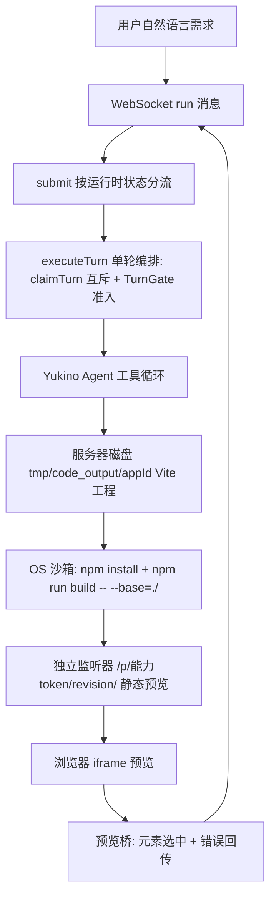

:::note 事实基线
本篇是「Yukino Codegen」项目深挖带解答题库，共 **90 题**，事实来源为 `content/fe/yukino-codegen.md`，对照本地仓库 `~/github/yukino-codegen`（子路径 `client/`、`server/`）@ `da904a2` 核验（frontmatter `local_commit` 与本机 HEAD 一致）。这是一个 **AI 全栈代码生成平台**：用户用一句自然语言描述想要的应用，平台在服务器上驱动一个真实的编码 Agent 在文件系统上迭代产出前端工程，再在 OS 沙箱内完成依赖安装与生产构建，把 `dist` 产物经独立监听器发布为静态预览。后端把 `@yukino.js/yukino` 当作库复用（经 `Remote.Server.createRemoteAgent`）。面试里它以「**介绍一个你做过的 AI 生成 / Agent 编排平台**」的形式出现。
:::

本篇是「Yukino Codegen」项目深挖题库。理解这个平台的关键，是先抓住闭环两端各自的**事实权威**：**服务器磁盘是文件的权威源与唯一构建场地，浏览器只消费已发布的构建快照**。围绕这条「生成 → 运行 → 反馈 → 再生成」的闭环，本篇的组织顺序是：**先讲定位与核心承诺 → 再讲生成流水线（submit/executeTurn）→ 再讲 TurnGate 与计划/权限模式 → 再讲斜杠命令与输入增强 → 再讲 RuntimeManager 与 rehydrate → 再讲事件溯源与事件适配器 → 再讲 finalizeTurn 与 rewind → 再讲销毁与优雅关闭 → 再讲连接层与 claimTurn → 再讲 OS 沙箱构建与预览发布 → 再讲预览桥 → 再讲引擎集成与运行时切换 → 再讲修复闭环与安全边界 → 最后讲测试纪律与适用边界**。

**主线一览**

## 一、定位与核心承诺

### Q1. 这个平台的核心承诺是什么？与模板填充式生成的本质区别？

核心承诺是「**描述它，看着它自己构建出来**」：用户输入一段自然语言需求，得到的是一个**能被浏览器直接打开运行的 Web 应用**，而不是一段需要人工拼装的代码片段。

与模板填充式生成的本质区别在于：模板/低代码是「模型输出 JSON 配置去填固定模板」，能力上限被模板锁死；而本平台是**驱动一个真实的编码 Agent 在文件系统上迭代写代码**，能产出任意结构的前端工程，并通过「生成 → 运行 → 反馈 → 再生成」的闭环不断修正。

### Q2. 仓库结构与 Agent 引擎的复用方式？

平台是一个 **pnpm workspace 单仓**，由 `client/`（React 19 + Vite 7 前端）与 `server/`（Hono 4 + Prisma 7 后端）两个包组成。后端把 `@yukino.js/yukino` 当作**库**复用（在 `server/package.json` 中以 `latest` tag 声明）——它**不是自己实现一个 Agent**，而是通过引擎的远程入口 `Remote.Server.createRemoteAgent` 拿到一整套 Agent 句柄，再把它接到自己的会话存储、WebSocket 协议与预览构建流水线上。

**采分点**：能说出「**复用成熟编码 Agent 引擎而非自研循环**」，并点出平台真正自研的是「会话存储、WS 协议、构建发布流水线」这层产品化外壳。

### Q3. 理解这个平台的关键——两端的事实权威分别是什么？

**服务器磁盘是文件的权威源与唯一构建场地，浏览器只消费已发布的构建快照**。这带来两个推论：① 只有 Agent 写服务器磁盘，浏览器没有可写副本，**不存在文件同步与合并冲突**；② 代价是用户不能手工改代码，源码修改只能经 Agent 或 zip 导出后本地进行。

### Q4. 平台提供哪些产品能力？它们围绕什么组织？

认证与用户体系、应用广场（`awesome` 列表）、我的应用、聊天记录持久化与回放；每个应用一个 Agent 工作区（会话 transcript、权限模式、计划模式、MCP 服务器配置、生命周期 Hook、技能、长期记忆、子代理与团队、模型与思考强度覆盖、沙箱策略）；实时交互（流式叙述、运行中 steering、排队 follow-up、计划审批、对话回退检查点、提示词历史最近 200 条、历史会话恢复）；输入增强（`@` 文件提及带补全、图片上传、`!`/`!!` 用户 shell、斜杠命令）；可视化编辑（在实时预览里点选元素，描述修改意图，由 Agent 映射回源码）；Git 快照安全网（每轮对话结束后对生成项目做一次提交，可列出快照并连同对话一起回滚）；工程侧能力（应用 zip 导出、管理后台、Prometheus 指标与健康探针）。

这些能力**不是并列堆叠的，而是围绕「生成 → 运行 → 反馈 → 再生成」这一条闭环组织的**。面试讲这个项目时应先给闭环主线，再把能力挂到闭环环节上，而不是罗列功能清单。

## 二、生成流水线：submit 与 executeTurn

### Q5. 平台为什么不维护自己的生成提示词模板？行为约束来自哪三层？

平台**不维护自己的生成提示词模板，也不做任何占位符注入**——行为约束来自三层：① **系统提示词**由引擎按运行环境构造（`Prompt.Builder.detectEnvironment(cwd)` + `buildSystemPrompt`），平台在切换模型重建 LLM 客户端时显式复用这同一组函数保证两处一致；② **工作区指令**以函数形式传给每轮 Agent（`instructions: () => Memory.Instructions.loadInstructions(handle.cwd)`），每一轮都从工作目录重新读取最新指令；③ **长期记忆**同样以函数形式门控（`memoryContent` 在工作区 `memoryEnabled` 时返回 `memoryManager.buildSystemReminder()`，否则返回空串）。

### Q6. `submit` 如何「一个入口、多路流量」地分流？

WebSocket 的 `run` 消息统一进入 `submit()`，由它按运行时状态分流：**运行中**走 `steerOrQueue`——斜杠命令与用户 shell 不参与 steering 直接排队，其余输入若存在活跃且未被取消的 Agent 循环就调 `currentAgent.steer(text)` 实时注入当前轮（落库一条 `steered: true` 的 `user_message` 并广播 `steering_queued`），无法 steering 时转入 follow-up 队列并广播 `followup_queued`；**空闲时**输入以 `!`/`!!` 开头走用户 shell、以 `/` 开头且能解析走命令分发、否则作为一轮 `runTurn` 执行；**收尾**时 `submit` 末尾检查是否有已批准待执行的计划（`pendingPlanExecution`），再 `drainFollowUps` 把队列里的输入按序重放。

### Q7. `executeTurn` 一轮的完整编排有哪十步？

`runTurn` 把 `executeTurn` 包在每运行时的内部锁里（同一应用不会有两轮并发），顺序：① 落库 `user_message`（含可选 `selectedElement`/`previewError`）；② **`claimTurn` 数据库互斥**（跨节点抢占并把会话状态原子置为 `RUNNING`，失败则广播 `workspace_busy`）；③ 广播 `runtime_status: running`，建事件适配器与**每轮的** `Permissions.PermissionChecker`（权限模式、沙箱开关、计划文件路径每轮重新套用，软设置变更无需重建句柄）；④ `composePrompt` 在用户原文后按需追加 `<selected-element>` JSON 块与 `<preview-error>` 块，再经 `expandAtRefsWithImages` 展开 `@` 提及（transcript 存原文，会话存展开结果）；⑤ `syncMcpInstructions` 播报本会话尚未见过的 MCP 服务器指令；⑥ **构造 `Agent.Agent`**（关键字段 `sessionId: ""` 禁用引擎自身 JSONL 会话写入，让 DB transcript 成为唯一权威；`maxIterations` 取 `AI_MAX_ITERATIONS` 默认 40）；⑦ **`turnGate.acquire(abort.signal, actorUserId)`** 进程级准入；⑧ `for await (const event of agent.run())` 逐事件经适配器分发；⑨ **计划审批门**（权限模式为 `PLAN` 且 `ExitPlanMode` 成功时广播 `plan_approval_request`）；⑩ `finalizeTurn` 收尾。

**采分点**：能说出「**`sessionId: ""` 禁用引擎 JSONL 写入、让 DB transcript 成唯一权威**」——这是「会话持久化纯 DB」的关键开关。

### Q8. 引擎运行抛错时为什么不中断 `finalizeTurn`？

引擎运行抛错时，落一条 `error` 事件并广播 `agent_error`（标记 `recoverable: true`），但**不中断 `finalizeTurn`**——收尾仍会跑，保证状态一致（会话状态复位、上下文保存、指标上报都不被跳过）。否则一次模型错误会让会话卡在 `RUNNING` 态、丢失本轮已产生的上下文。

## 三、TurnGate 与计划/权限模式

### Q9. TurnGate 与每运行时内部锁的分工？公平调度怎么做？

所有运行时共享**一把进程级的 `TurnGate`**（由 RuntimeManager 创建后注入），上限 `AGENT_MAX_CONCURRENT_TURNS`（默认 4），即整个进程同时最多有 4 个 Agent 循环在烧模型。超限时 `acquire(signal?, fairnessKey?)` 把调用方挂进等待队列；`takeNextWaiter` 在 FIFO 之上做**公平调度**——优先唤醒 `fairnessKey`（即 `actorUserId`）与上一个被准入者**不同**的等待者，防止单一用户长时间占满全局名额。AbortSignal 触发时把对应等待者从队列移除并 reject，不留幽灵排队；`release` 幂等。

它与每运行时的内部锁分工明确：**锁保证同一应用的轮次串行，门保证进程内模型并发有全局上限**。

### Q10. 计划模式与计划审批的完整流程？

句柄以 `enableModelPlanMode: true` 创建，引擎为此注册 `EnterPlanMode`/`ExitPlanMode` 工具。权限模式为 `PLAN` 且 `ExitPlanMode` 成功时，广播 `plan_approval_request { planPath, planContent }` 并置 `planApprovalPending`；**10 分钟**（`PLAN_APPROVAL_TIMEOUT_MS`）未应答即过期，广播 `plan_approval_expired`。用户经 `plan_approval_response` 三选一：`yolo` → 权限模式切到 `BYPASS_PERMISSIONS`；`manual` → 恢复进入计划模式前的权限模式；两者随后都读取计划内容并立即提交「Execute this plan」执行计划（忙时存为 `pendingPlanExecution`，等槽位释放后自动执行），区别只在 manual 模式下每次编辑仍需确认；`feedback` → 把反馈意见作为新输入重新提交。从 `PLAN` 切回其他模式时注入 `buildPlanModeExitReminder` 告知模型计划模式已结束。

### Q11. 权限模式的五种数据库值如何映射到引擎四种？默认值是什么？

数据库侧有五种模式（`DEFAULT`/`ACCEPT_EDITS`/`PLAN`/`DONT_ASK`/`BYPASS_PERMISSIONS`），映射到引擎的四种（`default`/`acceptEdits`/`plan`/`bypassPermissions`，其中 `DONT_ASK` 与 `BYPASS_PERMISSIONS` 都落到 `bypassPermissions`）。**默认工作区用 `bypassPermissions`**，即生成过程不打断用户——这是「看着它自己构建」体验的必要条件。

### Q12. 交互代理（interaction broker）为什么是「失败关闭」的？

当模式不是 bypass 时，引擎的每次工具授权请求经 `onPermissionRequest` 回调进入交互代理：请求被持久化成一条 `AgentInteraction` 行，同时通过 WebSocket 推 `permission_request` 给前端，并把运行时状态置为 `waiting`。交互代理是**失败关闭**的：5 分钟超时、会话取消（abort）或运行时销毁，都会把待决的权限请求解析为 `deny`、把提问请求 reject，**而不是静默放行**；单纯的连接断开不会取消待决交互，它们会保留到重连。这保证了「无人值守的生成」不会在需要人确认时偷偷继续。`ready` 消息会带上当前所有待决交互（`pendingInteractions`），断线重连后用户仍能看到并处理。

**采分点**：能说出「**权限超时解析为 deny、连接断开不取消待决交互**」——失败关闭 + 重连可恢复，是 HITL 的两个正确性支柱。

## 四、斜杠命令与输入增强

### Q13. 服务端可执行的斜杠命令子集有多大？终端专属命令怎么处理？

前端聊天框支持斜杠命令，服务端可执行的集合是 `SERVER_SUPPORTED_COMMANDS` 的 **17 个**：`help`/`status`/`clear`/`compact`/`skills`/`skill`/`memory`/`mcp`/`rewind`/`goal`/`plan`/`model`/`thinking`/`sandbox`/`worktree`/`workflows`/`review`。**终端专属命令**（`login`/`provider`/`quit`/`feedback`/`resume`/`session`）明确不执行。不在这两个集合里的注册表命令，只要类型是 `prompt`/`skill_fork`/`local`（如 `ultracode`、用户自定义命令、命名工作流、直接技能调用）就走 `dispatchRegistryCommand` 通用分发。

### Q14. `/compact` 为什么用「客户端协议形状」渲染工具 schema？

`/compact [instructions]` 用**客户端协议形状**渲染工具 schema（而非 Anthropic 原始形状，以免在 OpenAI 系客户端上扭曲 token 估算），按活跃 `toolFilter` 收窄后调 `Compact.Compact.forceCompact`，支持自定义摘要指令；压缩结果落库为 `compact` 事件。这体现了「token 估算要与实际下发给模型的形状一致」的严谨——用错形状会让压缩阈值判断失真。

### Q15. `/clear` 做了哪些轮换？`/review` 如何执行？

`/clear`：先停后台任务与团队，再 `handle.clearConversation()` 轮换全部会话级状态（会话 id、文件历史、文件状态缓存、任务板、恢复状态、活跃技能、MCP 播报），重置计划模式状态，`startNewSession` 后给所有连接重发 `ready`。`/review [args]`：用**内置只读评审子代理**执行，`buildReviewPrompt` 把本地 git 上下文适配进评审提示词。

### Q16. `@` 文件提及、图片上传、用户 shell 如何实现？

**`@` 文件提及**：输入框键入 `@` 触发 `file_complete_request`，服务器在工作目录里匹配（30 秒文件缓存 `FILE_CACHE_TTL_MS`）并经 `file_complete_response` 回最多 8 个路径；提交时 `AtExpand.expandAtRefsWithImages` 把提及的文件内容（与图片）内联进会话消息。**图片上传**：`image_upload` 的 base64 解码后上限 32MB（`MAX_UPLOAD_IMAGE_BYTES`，协议帧上限 64MiB），按魔数校验。**用户 shell**：输入以 `!`/`!!` 开头走用户 shell，执行结果经 `command_complete` 回传（输出上限 1MB）。

## 五、RuntimeManager 与 rehydrate

### Q17. RuntimeManager 如何键控与空闲回收？

`createRuntimeManager` 持有所有 `AgentRuntime` 实例，以 `${ownerId}:${appId}` 为键（规范工作区属于应用 owner），工作目录由 `buildCodeOutputDir(rootDir, appId)` 解析为 `tmp/code_output/{appId}/`。运行时**跨连接长驻**：同一个应用的多个 WebSocket 订阅者共享一个运行时，一个用户断开不会销毁它。空闲回收由 `AGENT_WORKSPACE_IDLE_MS`（默认 15 分钟）控制，一个 60 秒的 `setInterval` 扫描器（已 `unref`）淘汰 `!isBusy && now - lastActivity > idleMs` 的运行时；淘汰前在生命周期锁内二次确认，避免与正在创建的运行时竞态。所有生命周期操作经一把每键的 `WorkspaceLockRegistry` 串行化，并被追踪进 `lifecycleTasks` 集合；`disposeAll` 会先等所有在途生命周期任务完成再逐个销毁。

### Q18. AgentRuntime 的句柄是如何惰性创建的？

一个 `AgentRuntime` 拥有：引擎句柄（`RemoteAgentHandle`）、规范 DB 会话、transcript 序列计数器、已连接订阅者集合，以及一把内部 `AsyncLock`。句柄是**惰性创建**的（`ensureHandle` → `createHandle`），失败时清空 promise 以便重试。创建时：① `mkdir` 工作目录；② 并行读取启用的 MCP 服务器行与 Hook 行；③ 用 `buildProviderConfig(env, workspace.modelOverride, workspace.thinkingLevel)` 组装 Provider（端点/协议/密钥/token 上限来自服务器配置，模型与思考强度可被工作区覆盖）；④ 调 `createRemoteAgent({ askUser, cwd, enableCoordinatorMode: false, enableModelPlanMode: true, hooks, mcpServers, memoryEnabled, provider, sandboxConfig?, onSubagentEvent })`；⑤ `rehydrate` 把 DB 里的历史灌回句柄的会话。

### Q19. rehydrate 为什么要先 `handle.conv.reset()` 抹掉创建期注入？

`createRemoteAgent` 在建句柄时会向会话做一次性注入（项目指令总是注入、长期记忆按 `memoryEnabled` 门控、置下 `longTermMemoryInjected` 标志）。平台在 rehydrate 时**先 `handle.conv.reset()` 抹掉这次注入与标志**，理由是：**引擎的 `Agent.restoreContext()` 才是唯一的注入点**——它在首轮重新注入指令、技能清单，并按工作区当前的 `memoryEnabled` 门控记忆。不重置的话，创建期注入会占住一次性标志使 `restoreContext` 被跳过，会话将一直携带创建时快照的旧指令与记忆，**运行期的记忆开关与指令文件编辑都不再生效**。

**采分点**：能说出「**让 restoreContext 成为唯一注入点，否则一次性标志被创建期注入占住**」——这是「运行期配置变更仍生效」的正确性关键。

### Q20. 历史恢复的两条路径？为什么丢弃 `<system-reminder>` 包裹消息？

历史恢复有两条路径，优先用规范路径：**规范路径**——若 DB 会话存了 `context.messages`（逐字保存的 `Conversation.Message[]`，含 thinking/tool-use/tool-result 块），就 `appendMessages` 原样灌回；**回放路径**——否则从 transcript 取最近 200 条（`REPLAY_LIMIT`），把 `user_message`/`assistant_message` 的文本逐条灌回。

规范路径还会**丢弃持久化的 `<system-reminder>` 包裹消息**：这些是运行时可重新派生的（记忆注入每次重建、MCP 指令经 `syncMcpInstructions` 重新播报），留着会每次重启累积一层。活跃技能也从会话的 `activeSkills` 恢复到句柄的技能表。

## 六、事件溯源与事件适配器

### Q21. 会话持久化为什么是「纯 DB」？事件如何带序列号？

会话持久化是**纯 DB** 的：引擎自身的 JSONL 会话写入被 `sessionId: ""` 禁用，权威记录是 `AgentSession`（含 `context`/`activeSkills`/`runtimeMetadata`）加一串按序递增的 `AgentTranscriptEvent`。每个事件带 `sessionId`/`sequence`（bigint）/`turnId`/`kind`/`payload`/`createdAt`。追加事件在事务里同时推高会话的 `lastEventSequence` 高水位。

### Q22. transcript 事件溯源如何支持断线重连不丢事件？

这套设计让「回放」成为一等能力：新连接发 `hello`（可带 `afterSequence`），服务器经 `sendBacklog` 从高水位往回按批（每批最多 1000 条）推送 `transcript_batch`，客户端据此重建完整对话。**断线重连只需带上自己见过的最高序列号，即可增量补齐，不丢事件**。这是把「实时推送」与「可靠回放」统一在同一套带序号的事件流上——实时通道负责低延迟，序列号负责可靠性。

### Q23. `createEventAdapter` 是什么？分流原则是什么？

`createEventAdapter` 是一个**有状态的逐轮翻译器**，把引擎的 `AgentEvent` 分成两类输出：**持久化的 transcript 事件**（带序列号）与**瞬时的结构化消息**（流式增量）。分流原则是：**高频 token 增量走瞬时通道，累积的助手文本在轮末作为一条 `assistant_message` 落库一次**——避免把每个 token 增量都写库。

**采分点**：能说出「**瞬时通道承载高频增量、轮末一次性落库累积文本**」——这是「流式体验」与「存储成本」的平衡点。

### Q24. 事件适配器的落库/不落库映射表？

| 引擎事件             | 适配器输出                                                                | 落库 |
| -------------------- | ------------------------------------------------------------------------- | ---- |
| `stream_text`        | `assistant_delta`（瞬时），同时累积进 narration                           | 否   |
| `thinking_text`      | `agent_status { phase: thinking }`（瞬时）                                | 否   |
| `steering_delivered` | `agent_status`（瞬时）                                                    | 否   |
| `permission_request` | `agent_status { phase: permission }`（瞬时）                              | 否   |
| `thinking_complete`  | `thinking` 事件                                                           | 是   |
| `tool_use`           | `tool_use`（含从 args 提取的 `detail` 摘要）                              | 是   |
| `tool_result`        | `tool_result`（输出截断到固定长度）                                       | 是   |
| `usage`              | `usage`，并累加 input/output token                                        | 是   |
| `compact`/`retry`    | 同名事件                                                                  | 是   |
| `error`              | `error`，并把 outcome 置 `error`                                          | 是   |
| `turn_complete`      | `turn_complete`                                                           | 是   |
| `loop_complete`      | `loop_complete`，按 `stopReason` 定 outcome（end_turn/interrupted/other） | 是   |

### Q25. `detail` 摘要是怎么提取的？解决什么问题？

`detail` 摘要从工具参数里**按优先级取第一个非空字符串字段**（`file_path`/`path`/`pattern`/`command`/`name`/`query`），折叠空白并截断到 200 字符。解决的问题是：让前端能在**不展开完整参数**的情况下显示「这个工具在干什么」——既节省渲染成本，又给用户可读的进度提示。

## 七、finalizeTurn 与 rewind 双维回退

### Q26. 轮末 `finalizeTurn` 依次做哪四件事？

1. **落库叙述**：把适配器累积的 narration 作为一条 `assistant_message` 落库（若非空）；
2. **上报指标**：把本轮 input/output token 用量记进 `metrics.recordAiTokenUsage`（`modelRole: "agent"`）；
3. **git 快照**：**仅当 outcome 为 `end_turn`**（模型正常结束而非中断/出错）时，对工作目录做一次 `git.snapshot(workDir, "agent: {turnId}")`，并广播带 revision 的 `files_changed`；
4. **保存上下文**：把 `handle.conv.getMessages()`、活跃技能名、运行时元数据存进 DB 会话，其中包含本轮新写入的 **rewind 检查点**（上限 50 个）。

最后置会话状态 `IDLE` 并广播 `runtime_status: idle`。

### Q27. 为什么 git 快照只在 outcome 为 `end_turn` 时做？

因为 `end_turn` 表示模型**正常结束**，此时工作目录是一个有意义的、完整的代码状态；而 `interrupted`（用户中止）或 `error`（出错）时，工作目录可能是半写入、不一致的状态，对这种状态做快照会污染快照历史。这是「**只对良态做检查点**」的原则。

### Q28. rewind 检查点如何同时锚定「对话」与「代码」两个维度？

每次 `finalizeTurn` 保存上下文时，会把当前轮末的对话位置**连同对应的 git 快照 sha 一起**，作为一个检查点追加进会话的 `runtimeMetadata.rewindPoints`（上限 `MAX_REWIND_POINTS = 50`）。因此回退能同时锚定两个维度：对话（消息截断）与代码（git 回退）。

### Q29. rewind 的三种动作分别做什么？客户端如何重建？

客户端回 `rewind_action { sha, action }`，`action` 三选一：`code_and_conversation`（对话与代码一起回退）、`conversation_only`（只回退对话）、`code_only`（只回退代码，`/rewind <sha>` 命令默认走这个）。服务端按动作组合执行：会话消息截断（`conv.truncateTo` 到检查点消息数）、transcript 截断并重置序列高水位（`truncateAfter` + `setSequence`）、`git rewindTo`，然后向所有连接广播 `session_replaced { sessionId, highWatermark }`。客户端收到后把本地序列归零、递增 `resyncCounter`，**重新发 `hello` 从序列 0 拉全量**，本地 transcript 完整重建。

## 八、销毁与优雅关闭

### Q30. `disposeResources` 的顺序是什么？为什么「排空内部锁」不能从锁内部调用？

`disposeResources` 的顺序是：**中止当前轮 → 取消会话所有待决交互（失败关闭）→ 排空内部锁（等当前轮结束）→ 等会话就绪后再取消一次交互 → 触发 `shutdown` Hook → `handle.dispose()`（停后台任务与团队成员、断开所有 MCP 连接、销毁工具注册表）→ 结算在途记忆任务并释放沙箱 → 以 1001 关闭所有 WebSocket 连接**。**销毁从不从锁内部调用，否则会死锁**——如果销毁逻辑持有内部锁又去等「排空锁」，就自己等自己。每一步都吞掉异常，保证一个资源清理失败不阻断其余。文件快照（fileHistory）由引擎在每次变更时增量落盘，销毁不做额外持久化。

### Q31. 进程优雅关闭的顺序？

进程收到 `SIGINT`/`SIGTERM` 后：先 `workspaceManager.dispose()`（关闭预览监听器、中止在途构建、销毁沙箱会话并失效能力 URL，**幂等**），再 `closeServer`（停止接受新请求），再 `runtimeManager.disposeAll()`（逐个销毁运行时），最后断开 Redis 与数据库。因为运行时是长驻的，关闭路径必须显式处理在途轮次与后台任务，否则会留下半写入的文件状态。`disposeAll` 会先等所有在途生命周期任务完成，保证不销毁一个正在创建的运行时。

## 九、连接层与消息协议

### Q32. WebSocket 端点与连接的读写分级？

Agent 实时协议走 `GET /app/:appId/agent/ws`（WebSocket 升级）。连接按访问权限分级：**owner 与管理员是可写连接**（能 run/abort/应答交互/发命令），**其他已登录用户是只读连接**（只能收事件与回放）。只读连接发起 `run` 或应答交互时，服务器返回**结构化的 `read_only` 错误**而非静默忽略。鉴权失败的连接在 `onOpen` 时直接以 1008 关闭。每个工作区还有连接数上限 `AGENT_MAX_CONNECTIONS_PER_WORKSPACE`（默认 8），超限的连接以 1013（服务过载）关闭。

**采分点**：能说出「**读写分级 + 只读违规返回结构化错误**」——让围观者能实时看生成过程，但无法干预，且违规有明确反馈。

### Q33. 心跳与重连的参数？

服务器每 **30 秒**向所有连接发 ping 并清扫：超过 **75 秒**没有活动的连接直接 terminate。客户端每 **20 秒**发一次 `heartbeat`（服务器回 `heartbeat_ack`），**10 秒**内没有 ack 就判定断线；重连退避从 **500ms** 起逐步拉长到 **15s**，重连后带上本地最高序列号增量补齐。

### Q34. 客户端 → 服务器的消息有哪些？关键上限？

`hello`（订阅并可带 `afterSequence` 触发增量回放）、`run`（提交输入，`input` 上限 50000 字符，可附 `selectedElement`、`previewError` 上限 20000、`clientFileRevision`）、`abort`（中止当前轮）、`permission_response`/`question_response`（应答权限 allow/deny 可 remember 与提问）、`command_complete`（回传命令执行结果 exitCode + 输出，上限 1MB）、`heartbeat`/`background_shells`（心跳；把前台 shell 转后台，对齐终端 Ctrl+B）、`plan_approval_response`（yolo/manual/feedback）、`rewind_action`（sha + 三种动作）、`file_complete_request`（`@` 提及的文件名补全，query 上限 1024）、`image_upload`（clientId + name + base64 数据，协议帧上限 64MiB）。

### Q35. 服务器 → 客户端的消息按职能分哪几组？

会话与回放（`ready`、`event`、`transcript_batch`、`session_replaced`）；流式增量（`agent_status`、`assistant_delta`、`tool_output`）；交互（`permission_request`、`question_request`、`interaction_resolved`，outcome 含 `expired`）；命令（`command_result`、`candidates`）；状态（`runtime_status`、`files_changed`、`permission_mode`、`usage`）；选择器（`plan_approval_request`、`model_list`、`thinking_form`、`rewind_list`）；输入辅助（`file_complete_response` 实际最多回 8 个匹配、协议上限 50，`image_saved`/`image_error`、`history`）；活动面板（`subagent`/`team`/`task`）；错误（`error { code, message, recoverable }`，典型 code 有 `read_only`、`bad_json`、`bad_message`、`workspace_busy`、`model_switch_failed`）。

### Q36. 双端消息协议如何保证类型一致？

双端消息**全部由 zod schema 严格定义（两端共享类型）**。这让「协议变更」成为编译期可发现的事——任何一端新增/修改消息字段，另一端的 schema 校验会立刻暴露不一致。测试里也有专门的 `protocol`（服务端）与 `agent-protocol`（客户端）schema 用例。

## 十、claimTurn 跨节点互斥

### Q37. claimTurn 如何用一条原子 SQL 实现跨节点轮次互斥？

多实例部署下，同一个工作区的轮次不能并发执行。`claimTurn` 用一条**原子 SQL 抢占**：`updateMany` 把会话状态从 `IDLE` 置为 `RUNNING`，条件是 `status = IDLE`，**或者** `status = RUNNING` 但 `lastActiveTime` 早于 `AGENT_TURN_CLAIM_STALE_MS`（默认 30 分钟）——后者是对崩溃节点留下「僵死 RUNNING」的回收。更新行数为 0 即抢占失败，服务器给连接回 `workspace_busy`。

**采分点**：能说出「**原子 updateMany 抢占 + 僵死 RUNNING 的 30 分钟回收**」——这是「无分布式锁的跨节点互斥」的标准姿势，用数据库行级原子性替代锁。

### Q38. claimTurn、每运行时内部锁、TurnGate 三者各管什么？

三者分层：**claimTurn** 管「跨节点」——同一工作区全局（含其他实例）不能有两轮并发，靠数据库原子性；**每运行时内部锁**管「同应用串行」——同一应用内轮次排队执行；**TurnGate** 管「进程级模型并发上限」——整个进程最多 4 个 Agent 循环同时烧模型，带用户公平调度。三层分别对应「分布式互斥、应用内串行、资源配额」三个不同维度。

## 十一、OS 沙箱构建与预览发布

### Q39. WorkspaceManager 的构建编排有哪几步？状态机是什么？

构建编排：① 串行化（同一工作区构建不并发）；② 依赖安装 `npm install --no-audit --no-fund`；③ 先整体删除旧 `dist`（失败/空转的构建绝不能发布旧产物），再执行 `npm run build -- --base=./`（Vite 的相对资产 base 让 `dist` 在任意能力 URL 前缀下可搬运）；④ 校验 `dist` 是真实目录（非符号链接）且 `dist/index.html` 的 realpath 不逃出工程，然后把 `dist` 拷贝进沙箱 scratch 目录下的 `preview-<n+1>`；⑤ 状态置 `ready`、`revision` 自增、新产物登记进发布表，并**只保留最近两个 revision**（旧 iframe 在下一次构建期间仍能加载稳定的资产 base，更早的产物目录被删除）。

整个过程受 `WORKSPACE_BUILD_TIMEOUT_MS`（默认 5 分钟）超时中止；构建日志环形追加，只保留最后 64000 字符。状态机是 `idle → installing → building → ready`（任一阶段失败转 `failed`，**失败的构建保留上一次成功的预览 URL**）。

### Q40. SandboxSession 的「缩减环境」体现在哪两个细节？

构建命令不直接跑在宿主上：`SandboxSession` 经 Yukino 引擎的 `Sandbox.createSandbox()` 创建沙箱（Linux bubblewrap、macOS seatbelt），**沙箱不可用（未装 bubblewrap 或用户命名空间未开启）时直接抛错而不执行任何命令——失败关闭**。命令准备时只放行对工作目录与 scratch 目录的写入，允许网络，cwd 为工作目录。两个细节：

- **环境变量白名单**：构建子进程拿到的是显式构造的环境（只有 PATH/LANG/TERM，HOME、TMPDIR、XDG_CACHE_HOME、npm_config_cache 全部指向 scratch 目录），**不继承服务器进程的环境**——数据库连接串、会话密钥、模型 API key 都不会泄漏进不可信项目的生命周期脚本，单测专门断言了这一点；
- **进程组回收**：子进程以 `detached` 方式 spawn，中止、超时或退出时对整个进程组（`-pid`）发 `SIGKILL`，连带收掉构建脚本留下的后代进程，不留孤儿。

**采分点**：能说出「**环境白名单不继承密钥 + 进程组 SIGKILL 收孤儿**」——这是「集中构建不可信代码」的两条硬安全线。

### Q41. 能力 URL 的路径安全有哪些层防御？

产物由一个**独立的 HTTP 监听器**（`PREVIEW_PORT` 默认 3001）提供，与 API 进程端口分离。URL 是能力式的：`/p/<48 位 hex token>/<revision>/<path>`，token 在工作区创建时随机生成，不匹配的路径一律 404。静态监听器**不读 API cookie**，安全模型是「URL 即授权」。服务逻辑（`servePreview`）多层防御：只接受 GET/HEAD（其余 405）；响应一律 `no-store`、`nosniff`、`no-referrer`；`decodeURIComponent` 失败或路径含 NUL、反斜杠直接 400；**解析前后都用 realpath 校验目标包含在产物目录内**（符号链接逃逸得 403）；无扩展名且 Accept 含 `text/html` 的路径才回落 `index.html`（SPA 路由），带扩展名的缺失资产保持 404。HTML 响应在 `<head>` 处注入 `<base href>` 与预览桥脚本。

## 十二、预览桥与可视化编辑

### Q42. 预览桥脚本承担哪两个职责？

每个构建出的 HTML 都被注入 `preview-bridge` 脚本：**可视化编辑**——父窗口发 `TOGGLE_EDIT_MODE`/`CLEAR_SELECTION`/`CLEAR_ALL_EFFECTS` 消息控制编辑模式，编辑态下悬停高亮元素、点击选中并把 `ELEMENT_SELECTED` 回传父窗口（带标签、id、类名、文本摘录、CSS 选择器、页面路径与包围盒），用户据此描述修改意图，由 Agent 映射回源码；**错误回传**——把 `window` 的 error、unhandledrejection 与 `console.error` 以 `PREVIEW_UNCAUGHT_EXCEPTION`/`PREVIEW_UNHANDLED_REJECTION`/`PREVIEW_CONSOLE_ERROR` 消息转发给父窗口。

### Q43. 客户端预览控制器如何收敛预览生命周期？

`usePreviewController` 把预览生命周期收敛成一个 hook：进入页面、Agent 轮次结束（`agentRunning` 由 true 翻 false）、`files_changed` 帧（git 快照后的 revision 变化）与用户点击 Rebuild 都会触发重建；构建期间每 750 毫秒轮询 `GET` 状态刷新进度与日志；Agent 运行中或构建进行中收到的新请求记为 pending，等当前构建结束后重放，**不会并发两个构建**。构建失败时错误与 ANSI 日志显示在面板里，同时保留上一次成功的预览 URL；预览 URL 带 `?v=<revision>` 破缓存参数，iframe 以 `sandbox` 属性（allow-scripts allow-same-origin allow-forms allow-popups allow-modals）加载。

### Q44. 为什么浏览器侧以预览为唯一渲染面？

浏览器侧**以预览为唯一渲染面，源码修改只经 Agent**；聊天页整屏只分两栏：左侧 Agent 对话，右侧实时预览。这与「服务器磁盘是文件权威源」一致——浏览器没有可写副本，用户想改就描述意图让 Agent 改源码再重新构建，而不是在浏览器里直接编辑。

## 十三、引擎集成与运行时切换

### Q45. `createRemoteAgent` 句柄暴露了哪些长驻状态？平台如何取用？

平台通过 `Remote.Server.createRemoteAgent` 拿到 `RemoteAgentHandle`，这是集成的核心接缝。句柄暴露引擎的全部长驻状态：`conv`/`client`/`registry`（会话、LLM 客户端、工具注册表，每轮构造 `Agent` 时传入）、`contextWindow`/`provider`（上下文窗口与 Provider 配置，切模型时重建）、`fileHistory`/`fileStateCache`（文件快照历史与文件状态缓存，rewind 与读文件用）、`recoveryState`（压缩恢复状态）、`skillCatalog`/`activeSkills`（技能目录与已激活技能）、`mcpManager`/`hookEngine`（MCP 连接与 Hook 引擎）、`memoryManager`（长期记忆管理）、`teamManager`/`backgroundTaskManager`（团队与后台任务，中止/销毁时停掉）、`goalManager`（目标跟踪）、`checker`（句柄级权限检查器）、`toolFilter`（句柄级工具过滤）。平台用 `enableCoordinatorMode: false`、`enableModelPlanMode: true` 创建句柄。

### Q46. 模型与思考强度如何运行时切换？

**模型**：`/model` 不带参数触发 `LLM.ModelDiscovery.discoverModels` 探测 Provider 的模型列表，广播 `model_list`（loading → ready/empty/error）；选定后 `applyModel` 在运行时锁内重建 LLM 客户端（显式复用 `detectEnvironment` + `buildSystemPrompt`），更新 `contextWindow` 并重算 MCP 工具策略，把 `modelOverride` 持久化到工作区；失败广播 `model_switch_failed`。**思考强度**：`/thinking` 广播 `thinking_form`（当前级别 + Provider 支持的级别列表），`applyThinkingLevel` 调 `client.setThinkingLevel` 并持久化 `thinkingLevel`。

### Q47. 沙箱策略与 MCP 热重载如何切换？

**沙箱**：`/sandbox auto|manual|off`。`auto`/`manual` 创建沙箱并挂到 `Bash` 工具上（`sandboxRequired: true`，允许写工作目录与系统临时目录，放行网络），分别对应「自动放行」与「逐次询问」；`off` 释放沙箱并清掉 Bash 上的沙箱绑定。两种状态都持久化为 `sandboxEnabled`/`sandboxAutoAllow` 并同步到权限检查器。**MCP 热重载**：`/mcp reload` 重读工作区启用的 MCP 配置行并原地重连（配置清空时断开全部连接并撤回已播报的 MCP 指令），返回连接数/工具数/错误列表，**无需重建句柄**。

## 十四、修复闭环、能力 REST 与 Git 快照

### Q48. 「报错 → 修复」闭环的两条回传路径？一键修复提示词长什么样？

闭环的「报错 → 修复」一段有两条回传路径，都复用 `run` 通道：**预览运行时错误**——构建 HTML 里注入的桥脚本把 iframe 中的错误经 `postMessage` 转发出来，前端 `usePreviewErrors` 监听窗口消息，校验 `event.source` 与 `event.origin` 后用 zod 判别三种类型，归一成 `{ message, stack? }`，既显示在预览错误面板，也经 `reportRuntimeIssue` 上报观测；**构建失败**——编译错误直接表现为构建失败，状态为 `failed` 时错误文本与构建日志被归一成一条 `PreviewRuntimeError`，与运行时错误共用同一个错误面板。**一键修复**：`buildPreviewFixPrompt` 把错误拼成固定提示词（「Fix the generated React app error below. Inspect the current project, make the smallest correct change, and keep all unrelated behavior intact.」后接 Error 与 Stack），作为 `previewError` 随 `run` 发给 Agent，在 executeTurn 第 4 步被包进 `<preview-error>` 块。

### Q49. 能力 REST 管理哪些工作区扩展能力？

每个应用工作区都能配置引擎的全套扩展能力，经一组 REST（`/:appId/agent/*`）管理：**Settings**（`GET`/`PATCH` 工作区设置 `permissionMode`/`sandboxEnabled`/`sandboxAutoAllow`/`memoryEnabled`/`hooksEnabled`/`modelOverride`/`thinkingLevel`）、**Sessions**（列出与恢复历史会话）、**Skills**（列出、`reload`、从源安装）、**Memory**、**Hooks**、**Teams**、**MCP**。原则是「不影响 Agent 栈的配置走轻量 PATCH，影响 Agent 栈的配置走重建」。

### Q50. Git 快照运行时如何实现？为什么是「尽力而为」？

`git-runtime` 在生成项目目录里维护一个**尽力而为**的 git 仓库：`ensureRepo` 首次 `git init`，随后 `add -A` + `commit --allow-empty`（消息 `chore: initial project snapshot`）打下基线；`snapshot` 在 `end_turn` 时 `add -A`，若 `status --porcelain` 无变更则跳过，否则提交（消息 `agent: {turnId}`）；`listSnapshots` 用 `git log -n 50 --pretty=format:%H%x1f%s%x1f%cI` 解析出 sha/消息/日期；`rewindTo` 用 `git checkout {sha} -- .` + `add -A` + 提交（`chore: rewind to {sha}`）实现回滚。所有 git 调用都带 16MB 的 `maxBuffer`，并**吞掉失败**（缺 git、非仓库），因为版本快照只是叠在引擎文件历史之上的便利层。提交者身份由 `GIT_SNAPSHOT_AUTHOR_NAME`（默认 "Yukino Agent"）/`GIT_SNAPSHOT_AUTHOR_EMAIL` 配置。

## 十五、安全边界

### Q51. 生成代码的执行隔离边界要清醒认识什么？

生成代码**从不在服务器进程内执行**，但会在服务器主机上执行：依赖安装与生产构建跑在 Yukino OS 沙箱（Linux bubblewrap / macOS seatbelt）包裹的子进程里，写路径被限制在工作目录与 scratch 目录，环境变量被白名单化，网络放行。需要清醒认识的是，**OS 沙箱是写路径限制而非虚拟机或完整的多租户隔离边界**——托管不可信项目时应以专用 OS 账户或容器运行服务。浏览器侧不执行任何生成代码：预览只是独立监听器服务的静态 `dist` 产物，iframe 还带 `sandbox` 属性。

### Q52. MCP 凭据如何加密落库？返回前端时如何脱敏？

MCP 服务器的 `headers` 与 `env` 以 **AES-256-GCM** 对称加密落库：密钥来自 `MCP_SECRET_KEY`（base64 编码的 32 字节），密文打包成 `iv(12) || authTag(16) || ciphertext` 再 base64 存储；解密时校验长度并 `setAuthTag`，篡改会导致认证失败。比较用 `timingSafeEqual` 恒定时间比较。**返回给前端的 MCP VO 完全脱敏，只暴露 `hasHeaders`/`hasEnv`**。模型端点密钥（`AI_API_KEY`）只存在于服务器环境，从不下发前端。

**采分点**：能说出「**AES-256-GCM + iv||authTag||ciphertext 打包 + 前端只给 hasHeaders/hasEnv 布尔**」——凭据加密与脱敏返回是两件事，都要答。

### Q53. 配置 fail-fast 在生产环境拒绝启动的条件有哪些？

平台在启动时对环境变量做结构校验（zod）与语义校验（`superRefine`）。生产环境（`NODE_ENV=production`）下，以下任一条件都会**拒绝启动**：CORS 含通配 `*`、`PASSWORD_SALT`/`SESSION_SECRET`/`MCP_SECRET_KEY` 仍是默认值、未配置 `REDIS_URL`、`STORAGE_DRIVER` 仍是 `local`、未配置 MinIO 的 access/secret key。**把部署错误暴露在启动期而非运行期**，是这套校验的核心价值。

### Q54. 传输层防护有哪些？

WebSocket 消息有大小上限（`AGENT_WS_MAX_MESSAGE_BYTES` 默认 512KB；图片上传帧单独放宽到 64MiB），解析失败与 schema 校验失败返回结构化错误（`bad_json`/`bad_message`），未鉴权连接被关闭，只读连接不能发起运行或应答交互，单工作区连接数超上限以 1013 关闭；HTTP 层有统一的请求体大小限制（`REQUEST_BODY_LIMIT_BYTES` 默认 1MB）、CORS 白名单与服务端会话（`httpOnly` cookie + 32 字节随机会话 id）。轮次执行权由 `claimTurn` 在数据库层互斥。

### Q55. 前端 XSS 与跨源消息如何防护？

Agent 回复的 Markdown 在渲染前经 `renderSafeMarkdown` 消毒：`marked`（gfm + breaks）解析后用 `DOMPurify.sanitize`（`USE_PROFILES: { html: true }`，`FORBID_TAGS: ["script", "style"]`）清洗，再做代码高亮。**前端安全在这里的重要性高于常规应用，因为页面要渲染模型生成的任意文本**。可视化编辑的跨源消息双向校验：发给 iframe 的 `postMessage` 优先用预览 origin（解析不到时回退 `*`）；收 iframe 回传的消息时校验 `event.source === iframe.contentWindow`，预览 origin 可解析时还要求 `event.origin === previewOrigin`，再过 zod schema 判别。

## 十六、活动面板、测试纪律与边界（一句话速答）

**Q56. 一句话解释 `attachActivityBridge` 广播哪三类并行活动。** 子代理（`onSubagentEvent` 折叠进 `subagentStates` 映射，每次变化广播 `subagent` 帧）、团队（500ms 周期轮询按内容签名去重，定时器 `unref`）、后台任务（订阅推送）——分别广播 `subagent`/`team`/`task` 帧。

**Q57. 一句话解释为什么需要「仅通知轮次」。** 后台任务与团队成员的通知只在引擎循环内投递，因此空闲运行时由一个 250ms 的唤醒定时器驱动 `runNotificationTurn`，让通知不依赖用户输入也能送达。

**Q58. 一句话解释健康探针与指标。** 平台暴露健康探针与 Prometheus 指标，但指标采集面目前只有 token 用量——可观测性接口已就位但尚未填满（诚实口径，不夸大为「已全面监控」）。

**Q59. 一句话解释测试的组织哲学。** 把并发、取消、构建发布这类易错的**纯逻辑**从 API 副作用里抽出来单独测；副作用集中在薄封装层——让沙箱构建这类难以端到端测试的代码仍有可靠回归保障。

**Q60. 一句话列举服务端的关键测试用例。** `agent-runtime-concurrency`（轮次串行化）、`turn-gate`（准入与公平性）、`command-dispatcher`、`event-adapter`、`mcp-config`、`mcp-crypto`、`protocol`（schema）、`workspace`（沙箱构建：并发合并、产物发布、不安全路径拒绝、失败保留旧快照、沙箱不可用拒执行、超时杀进程组、环境不继承密钥）、`workspace-routes`（预览 API 的鉴权与只读语义）。

**Q61. 一句话列举客户端的关键测试用例。** `use-agent-transcript`、`build-error-context`、`agent-socket-url`、`ansi-log`、`agent-protocol`（schema）。

**Q62. 一句话解释双端的类型纪律。** 双端都是 TypeScript strict，协议消息由 zod schema 两端共享类型——把协议不一致压到编译期。

**Q63. 一句话解释预览链路的技术栈边界。** 钉在 npm 生态 + `npm run build`（要求产出 `dist/index.html` 的 Vite 兼容构建脚本），一键修复提示词面向 React 应用；其他技术栈需自行适配预览与修复两端；没有 dev server 与热更新，每次修改都要经一次完整构建。

**Q64. 一句话解释集中构建的算力与隔离边界。** 预览算力全在服务器主机，依赖 OS 沙箱可用性；OS 沙箱不是完整的多租户隔离边界，托管不可信项目应用专用账户/容器运行服务。

**Q65. 一句话解释文件权威单一的代价。** 只有 Agent 写服务器磁盘，浏览器没有可写副本，不存在文件同步与合并冲突；代价是用户不能手工改代码，源码修改只能经 Agent 或 zip 导出后本地进行。

**Q66. 一句话列举容量与并发的关键阈值。** TurnGate 默认最多 4 个并发轮次（`AGENT_MAX_CONCURRENT_TURNS`）、每工作区最多 8 条 WebSocket 连接（`AGENT_MAX_CONNECTIONS_PER_WORKSPACE`）、空闲 15 分钟回收运行时（`AGENT_WORKSPACE_IDLE_MS`）、僵死跨节点轮次声明 30 分钟后回收（`AGENT_TURN_CLAIM_STALE_MS`）、单次构建默认 5 分钟超时（`WORKSPACE_BUILD_TIMEOUT_MS`）。

**Q67. 一句话解释权限默认模式与人工把关的切换。** 权限默认 `bypassPermissions`（无人值守生成），需要人工把关时应切到 `default`/`plan` 等模式，并接受交互代理 5 分钟超时后失败关闭（拒绝）、计划审批 10 分钟过期的行为。

**Q68. 一句话解释回退与历史的明确边界。** 对话回退检查点上限 50 个，提示词历史上限 200 条，transcript 回放路径只恢复最近 200 条消息——超长会话的细粒度回退能力有明确边界。

**Q69. 一句话解释 `ready` 帧承载哪些会话元数据。** sessionId、序列高水位、readOnly、权限模式、运行时状态、当前 turnId、待决交互、模型/思考强度、上下文 token/窗口、沙箱/记忆/Hook 开关、计划审批挂起标志——一次握手给全客户端重建视图所需的全部状态。

**Q70. 一句话解释 `background_shells` 的语义。** 把前台 shell 转后台（对齐终端 Ctrl+B），让长耗时命令不阻塞对话轮次。

**Q71. 一句话解释 `interaction_resolved` 的 `expired` outcome。** 交互（权限/提问）超时后被结算为 `expired`，客户端据此把对应卡片定格为过期态而非永久挂起。

**Q72. 一句话解释 `model_switch_failed` 错误码。** 运行中切换模型失败时回这个结构化错误码，客户端可提示用户并保持原模型——而不是静默失败或中断轮次。

**Q73. 一句话解释 `file_complete_response` 为什么实际最多回 8 个。** 协议上限 50，但实现实际最多回 8 个匹配——补全候选过多反而降低可用性，8 个是「够用不刷屏」的取舍。

**Q74. 一句话解释 `image_upload` 的 32MB/64MiB 两个上限。** base64 解码后上限 32MB（`MAX_UPLOAD_IMAGE_BYTES`），协议帧上限 64MiB——base64 约 33% 膨胀，两个上限分别约束解码后体积与线协议帧。

**Q75. 一句话解释 `command_complete` 的 1MB 输出上限。** 用户 shell 命令（`!`/`!!`）的执行结果回传给 Agent 时输出上限 1MB，防止超大输出撑爆 WS 帧与上下文。

**Q76. 一句话解释 git 快照的提交信息格式。** `git.snapshot(workDir, "agent: {turnId}")`——以 turnId 标注快照归属，便于把快照与对话轮次对应。

**Q77. 一句话解释 `files_changed` 为什么带 revision。** revision 标识构建版本，客户端据此判断预览是否需要刷新到新版本，避免「旧预览 + 新文件」的错位。

**Q78. 一句话解释 `resyncCounter` 的作用。** 每次收到 `session_replaced` 递增，作为「需要全量重建」的信号，配合序列归零 + 重发 `hello` 完成权威重建。

**Q79. 一句话解释 `truncateAfter` + `setSequence` 的组合。** transcript 截断到检查点后，重置序列高水位——让后续新事件从正确序号继续，避免序列空洞或冲突。

**Q80. 一句话解释只保留最近两个 revision 的用意。** 旧 iframe 在下一次构建期间仍能加载稳定的资产 base（不会 404），更早的产物目录被删除——在「预览连续性」与「磁盘占用」间取两点缓冲。

**Q81. 一句话解释构建日志为什么环形保留最后 64000 字符。** 构建日志可能很长，环形截断保留尾部（最相关的错误通常在末尾）且不无限占内存。

**Q82. 一句话解释 `dist` 为什么先整体删除再构建。** 失败/空转的构建绝不能发布旧产物——先删旧 `dist` 保证「发布的要么是这次成功构建、要么没有」。

**Q83. 一句话解释 `--base=./` 的作用。** Vite 的相对资产 base 让 `dist` 在任意能力 URL 前缀（`/p/<token>/<revision>/`）下可搬运，无需为每个前缀重新构建。

**Q84. 一句话解释 SPA 路由回落 `index.html` 的条件。** 无扩展名且 Accept 含 `text/html` 的路径才回落 `index.html`，带扩展名的缺失资产保持 404——避免把「找不到的 js/css」误返回成 HTML。

**Q85. 一句话解释预览响应为什么一律 `no-store`/`nosniff`/`no-referrer`。** 预览内容是动态生成的不可信产物：`no-store` 防缓存旧版本、`nosniff` 防 MIME 嗅探执行、`no-referrer` 防泄漏能力 URL。

**Q86. 一句话解释 `ELEMENT_SELECTED` 回传哪些信息。** 标签、id、类名、文本摘录、CSS 选择器、页面路径与包围盒——给 Agent 足够上下文把「点选的元素」映射回源码。

**Q87. 一句话解释 worktree 能力。** 平台提供 `createWorktree`/`removeWorktree`（委托引擎的 `Worktree.createAgentWorktree`/`removeAgentWorktree`）与 `listWorktrees`（原始 `git worktree list`），`/worktree` 命令列出当前工作区的全部 worktree。

**Q88. 一句话解释这个项目与 yukino-chat 的 Agent 复用差异。** 两者都以库形式复用 `@yukino.js/yukino`（`Remote.Server.createRemoteAgent`），但 yukino-chat 走「每用户只读运行时 + 聊天落库」，yukino-codegen 走「每应用可写工作区 + 沙箱构建 + 静态预览」——同一引擎、两种产品形态。

**Q89. 一句话解释 `steering_delivered` 的前端处理。** 引擎事件里的 `steering_delivered` 经适配器广播为瞬时 `agent_status`，前端据此把已送达的 steering 从待处理列表移除——给用户「纠偏已注入」的确定反馈。

**Q90. 一句话总结这个平台的架构哲学。** 服务器磁盘为文件权威源与唯一构建场地、浏览器只消费构建快照；submit 一个入口多路流量、executeTurn 十步编排、claimTurn 原子互斥 + TurnGate 公平准入支撑多实例；事件溯源序列号统一实时推送与可靠回放；rehydrate 让 restoreContext 成唯一注入点；finalizeTurn 只对良态做 git 检查点、rewind 双维回退；OS 沙箱缩减环境 + 能力 URL 路径安全 + AES-256-GCM 凭据加密 + 配置 fail-fast 守住集中构建不可信代码的安全底线——一个「描述即可运行」的 AI 全栈生成闭环。

---

**延伸阅读**

- [Yukino Chat 自托管 IM 与内嵌 Agent 项目深挖题库](/interview/qa/yukino-chat-project)：同样以库形式复用 Yukino 编码 Agent，但走「只读运行时 + 聊天落库」路线。
- [Yukino Chatbot 全栈 LLM 应用项目深挖题库](/interview/qa/yukino-chatbot-project)：Koa 3 + React 19 的分层全栈 LLM 聊天。
- [Coding Agent Harness 实现剖析题库](/interview/qa/coding-agent-harness)：本篇复用的编码 Agent 引擎的 Harness 层机制。
- [Agent 沙箱与 JS 运行时题库](/interview/qa/agent-sandbox-autofix)：OS 沙箱、构建与自动修复的通用原理。
- [工作文档 · Yukino Codegen](/fe/yukino-codegen)：本篇的事实来源。
