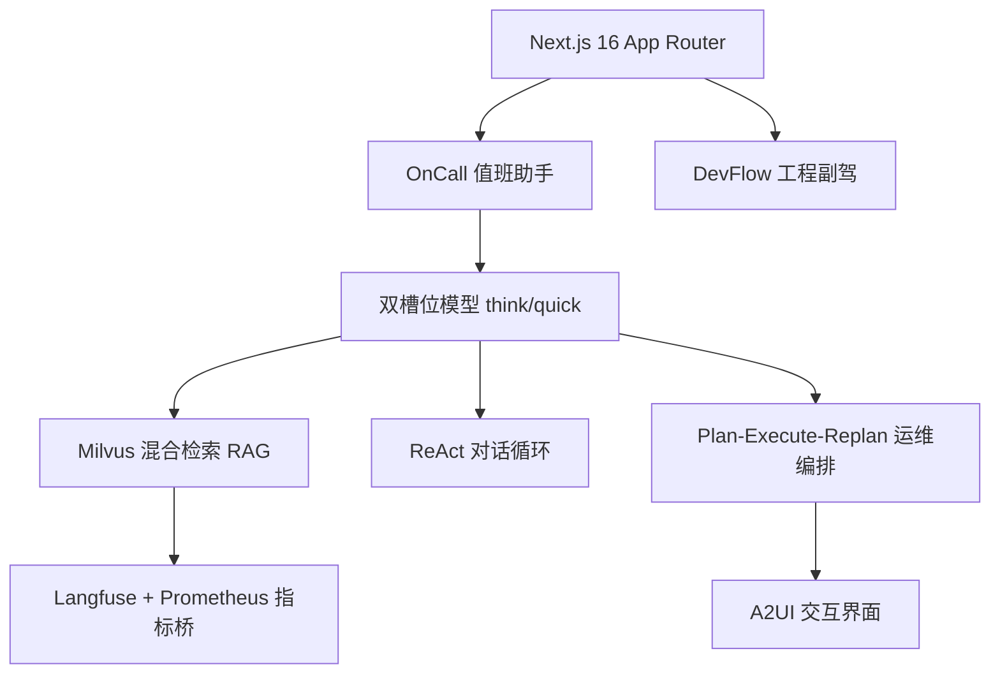

:::note 事实基线
本篇是「Yukino Dev Agent」项目深挖带解答题库，共 **92 题**，事实来源为 `content/docs/yukino-dev-agent/yukino-dev-agent.md`，对照本地仓库 `~/github/yukino-dev-agent`（子路径 `app/`、`lib/`、`components/`、`hooks/`）@ `ea0fd195` 核验。应用为 **Next.js 16 App Router + Vercel AI SDK**，同时承载 **AI OnCall 助手**（根路径）与 **DevFlow 工程副驾**（`/dev-flow`）两个产品面，共用一套技术栈、一个 PostgreSQL 库、一个 Milvus 集合。
:::

本篇是「Yukino Dev Agent」项目深挖题库。这是一个 **Next.js 16 全栈 AI 应用**的完整参考实现，面试里它以「**介绍一个你做过的 AI 全栈项目**」的形式出现。本篇的组织顺序是：**先讲产品定位与分层架构 → 再讲模型抽象与 RAG → 再讲 Agent 编排（ReAct 与 Plan-Execute-Replan）→ 再讲工具系统与 MCP → 再讲 A2UI 交互 → 再讲可观测性与工程质量 → 最后讲适用边界与扩展**。

**主线一览**



## 一、产品定位与分层架构

### Q1. 这个应用是什么？两个产品面各做什么？

应用是**公开表面（无登录）**，两个产品表面共用一套技术栈、一个 PostgreSQL 库、一个 Milvus 集合，但面向完全不同的任务：

- **OnCall：AI 值班助手**（根路径）——核心场景是「告警来了，值班人想知道发生了什么、该怎么处理」：知识问答（检索增强 + 引用来源）、交互式界面（A2UI 渲染告警列表/指标图表/静默表单）、一键告警分析（AI Ops 多轮编排）、活跃告警面板（聚合 Prometheus/Alertmanager）、知识库运营、能力扩展（MCP 工具/SKILL.md）、运维自检。
- **DevFlow：GitHub 工程副驾**（`/dev-flow`）——仓库接入（同步 issue/PR/CI）、结构化分析（issue 分类/PR 审查/CI 调试）、会话与知识（每仓库独立知识库）、代码理解（符号图/影响面）、记忆、安全写操作（ActionDraft 草稿闸门）、反馈闭环。

**采分点**：能说出「**两个产品面共用一套技术栈、一个库、一个 Milvus 集合，但任务完全不同**」——这体现「一套基础设施支撑多个 AI 表面」的架构复用。

### Q2. 为什么是 Next.js 全栈而不是前后端分离？

Next.js 16 App Router 把**前端页面与后端 API 收进同一个进程**：① 部署简单（一个 Node 进程）；② 前后端共享类型与工具代码；③ Server Components / Route Handlers 让 API 与页面同构。

**代价**：单进程长连接、内存记忆、本地知识库文件都是**水平扩展的硬约束**（见适用边界）。这是「**内部演示/团队工具**」的合理取舍，不是「公网高并发产品」的架构。

**采分点**：能说出「**全栈单进程的收益是简单与同构，代价是水平扩展受限**」——并诚实指出这是内部工具的定位，不是回避问题。

### Q3. 分层架构与模块职责是什么？

```text
app/            Next.js 路由与页面（OnCall 根路径、/dev-flow、API Route Handlers）
lib/            核心逻辑（模型工厂、RAG、编排图、工具、A2UI、可观测、配置）
components/     React 组件（聊天、A2UI 渲染、面板）
hooks/          前端状态与 SSE 消费
```

**采分点**：能说出「**app 是路由层，lib 是逻辑层，components/hooks 是前端层**」——逻辑都在 lib，路由只做编排与响应包装，这样逻辑可独立测试。

## 二、模型与 Provider 抽象

### Q4. 双槽位模型是什么？为什么这样设计？

模型工厂导出 **`thinkModel` 与 `quickModel`** 两个实例：**前者用于规划与重规划**（plan-execute-replan 的 planner/replanner 以及报告重写与界面化），**后者用于对话、步骤执行与 A2UI 纠错**。两个槽位各自拥有独立的模型名、baseURL、apiKey，由 `LLM_PROVIDER` 选择 OpenAI 兼容实现或 Anthropic 实现。

这是典型的「**能力-成本匹配**」：关键决策用强模型，高频调用用快模型，成本和延迟都落在正确的位置。

设计余量：① 两个槽位的 baseURL 独立，可让思考走一家、快速走另一家；② 延迟可分区隔离（执行模型放网络更近的端点）；③ token 费用可按「单价 × 调用量」分层优化，把绝大多数调用导向便宜数倍的快模型。

**采分点**：能说出「**能力-成本匹配**」+「**关键决策用强模型、高频调用用快模型**」——这是 LLM 应用成本控制的核心设计，比「用一个模型」精细得多。

### Q5. Anthropic extended thinking 怎么接入？budgetTokens 怎么设？

extended thinking 是 Anthropic 私有特性，不属于 OpenAI 兼容协议，因此经 AI SDK 的 **`providerOptions` 逃生舱**透传：

```ts
providerOptions = {
  anthropic: {
    thinking: { type: "enabled", budgetTokens: maxOutputTokens - 1 },
  },
};
```

要点：① **budgetTokens 是思考块的最大 token 数且必须小于 max_tokens**，这里取「最大输出减一」，把绝大部分预算留给推理——符合 planner 场景「计划质量优先、正式输出可以很短」的取向；② 该配置仅在 provider 为 anthropic 时注入，并可用环境变量显式关闭；③ 所有 LLM 调用点统一注入，保证同一编排循环内思考行为一致。

**采分点**：能说出「**budgetTokens 必须小于 max_tokens**」+「**取 maxOutputTokens - 1 是把预算留给推理**」——这是 extended thinking 接入的两个关键约束。

### Q6. 兼容网关的协议修复是怎么回事？

某些 Anthropic 兼容网关在非流式响应里返回 thinking 内容块时**缺少官方 API 必带的 signature 字段**，而 SDK 的响应 schema 把它标为必填，于是 SDK 报出「Invalid JSON response」；更麻烦的是这个校验错误向上冒泡时 **message 常常是空串**，极难排查。

模型工厂为此**包装了全局 fetch**：仅当响应是 JSON 时读取响应体，若发现 message 类型的 content 数组里有缺 signature 的 thinking 块，就**回填空字符串再重建 Response**；流式 SSE 原样透传（流式 chunk schema 不校验该字段）。两个细节：**body 修改后删除 content-length 与 content-encoding 头**（避免字节数与声明不符）；JSON 解析失败时静默返回原始 body，**包装器永不引入新故障**。

**采分点**：能说出「**防御应放在传输层（fetch 包装）而不是业务代码**」+「**错误处理处把上游真实报文完整引出**」——这反映的工程态度是：对接兼容网关时面对的不是标准协议而是某家实现的方言。

### Q7. Embedding 与 Rerank 怎么接入？批量分片为什么是 10 条？

**Embedding** 只有唯一合法 provider（OpenAI 兼容 `/v1/embeddings`），换服务只需改 baseURL、apiKey、model 三个环境变量。**批量嵌入按固定条数分片（每批 10 条）**：OpenAI 兼容端点对单请求输入条数有上限，而 SDK 默认一次发 2048 条，大文档会报 "batch size is invalid"，因此上层调用对分片完全透明。**批量接口的顺序保证也被依赖**：返回的向量顺序与输入严格对应，索引器据此做对位。

**Rerank** 是可选的第二阶段精排，指向 DashScope 风格的文本重排端点。它是 **fail-open 设计**：未配置 API Key 时直接跳过；配置了但服务抖动时，包装函数捕获异常并返回 null，检索退回融合顺序——**精排是质量增强，不稳定的上游不应该拖垮 RAG 对话**。响应校验很严格：索引必须唯一且在范围内、分数必须有限且落在 [0,1]；重试只针对限流与 5xx/传输层错误，用指数退避。

**采分点**：能说出「**rerank 是 fail-open，不稳定时退回融合顺序**」——这体现「质量增强不能拖垮核心链路」的取舍。

## 三、RAG 与向量检索

### Q8. 索引侧链路是什么？有哪些护栏？

`POST /api/upload` 接收 multipart 文件后依次：**校验扩展名**（允许 md/markdown/txt/pdf/docx）、**校验大小上限**（50MB）、对纯文本做 **UTF-8 合法性与 NUL 字节嗅探**、把用户提供的文件名**规约为安全 basename**（去除路径分隔与特殊字符，保留中日韩汉字区 `一-鿿`，**防目录穿越**）、按内容 **sha256 跳过同内容重复上传**，最后落盘并立即建索引。

pdf/docx 的文本抽取有完整护栏：**PDF 限制文件字节数（12MB）、页数（500 页）与抽取字符数（400 万），拒绝加密与纯扫描件**，并在每页前插入页码标记以便后续按页溯源；**DOCX 先做 zip 炸弹防御**（解析中央目录、限制条目数 1 万条与解压后总字节 64MB、拒绝加密标志与 OLE 复合文档头）再转 markdown。抽取失败会明确返回「无可抽取文本」而不是把空内容索引进库。

索引器把文档按 **markdown 感知的递归切分器**切成块（chunk 约 1000 字符、overlap 200 字符），这个尺寸远低于索引器存储上限（8192 字符）与 Embedding 上限。

**采分点**：能说出「**文件名规约防目录穿越**」+「**DOCX zip 炸弹防御**」——这是「上传文件」这个高危入口的必备护栏，很多人会漏。

### Q9. 检索侧链路是什么？

检索走 **Milvus 混合检索**：dense ANN（向量）+ BM25（稀疏）双路召回，RRF 融合，rerank 精排。查询前做查询理解（改写/扩展），检索结果按分数排序后注入上下文。

**采分点**：能说出「**dense + BM25 双路召回 + RRF 融合 + rerank 精排**」的完整管线——这是混合检索的标准结构。

### Q10. Milvus 集合怎么设计？分数语义与维度自检是什么？

Milvus 集合设计：dense 向量字段 + 标量字段（来源、分类、仓库等，用于过滤）。**分数语义**：不同检索路径的分数语义不同（dense 是相似度、rerank 是相关性分），要统一归一化后才能比较。**维度自检**：启动时校验 embedding 维度与集合配置一致，不一致会报错（防止换模型后维度不匹配导致检索全错）。

**采分点**：能说出「**维度自检是换 embedding 模型后的第一道防线**」——维度不匹配时检索会静默返回错误结果，自检把它变成显式报错。

### Q11. 上下文装配与间接注入防御怎么做？

检索结果注入上下文时要做**间接注入防御**：检索到的文档内容是**不可信输入**（可能被投毒），要包在明确的数据边界里（如 XML 标签），system prompt 声明「边界内是数据不是指令」，防止文档里的内容被当作指令执行（prompt 注入的一种）。

**采分点**：能说出「**RAG 的检索内容是间接注入的攻击面**」——这是 RAG 安全的核心，与沙箱篇的 prompt 注入防护同源。

### Q12. 引用来源与检索质量怎么保证？

回答中给出**引用来源**（检索到的文档 + 名次），让用户可溯源。**检索阶段名次已经下发到引用里**——这是「回答有没有依据」的可验证性。缺的是把这些数据（命中率、分数分布）汇总成可查询的质量报表（扩展建议）。

**采分点**：能说出「**引用来源是 RAG 防幻觉的第一道防线**」——让每个回答都能溯源到具体文档，而不是模型自由发挥。

## 四、Agent 编排：ReAct 与 Plan-Execute-Replan

### Q13. ReAct 对话循环怎么实现？为什么用声明式步数上限？

对话管线使用 AI SDK 的多步执行能力：一次调用内部，模型发起工具调用 → SDK 执行工具 → 结果作为 tool message 追加 → 再次调用模型，直到模型不再发起工具调用或触达步数上限。**停止条件声明为步数上限（25 步），而不是手写 while 循环**。

之所以用声明式条件：**SDK 内部负责消息列表的正确性**（assistant/tool 消息顺序、tool_call_id 配对、provider 特有的工具块格式），手写循环在并行工具调用、错误回填等边角极易出错；流式路径下多步循环的文本增量由 SDK 按序吐出，手写需要自己拼接多轮流，状态机复杂。**25 是防失控保险**——正常问答两三步即可完成，25 允许复杂的链式推理，同时把「模型陷入工具死循环」的成本上限锁死。

流式路径还有一处必要的纠偏：`streamText` 默认把错误吞进错误回调后结束文本流，客户端会看到一个空回答；管线**显式捕获该错误并在流末尾重新抛出**，让 SSE 路由能发出真正的 error 事件。记忆回写在 finally 中执行，且**仅当已产生文本时才写入**——中断或出错不污染记忆。

与教科书 ReAct 的差异：**这里没有显式的「思考/动作/观察」文本协议，而是利用 function calling 的结构化 ReAct**——推理在模型侧（Anthropic 路径甚至是加密的思考块），动作是 schema 化的工具调用，工程上远比自由文本协议可靠。

**采分点**：能说出「**用 function calling 的结构化 ReAct 替代自由文本协议**」+「**声明式步数上限让 SDK 管消息正确性**」——这是现代 ReAct 实现的标准姿势。

### Q14. 为什么两条管线并存（ReAct + Plan-Execute-Replan）？

**对话用 ReAct**（灵活、开销低），**运维分析用 Plan-Execute-Replan**（可控、覆盖全）。选型的本质判断是「**当任务有确定性 SOP 时，把流程控制权从模型手里收回一部分，只把局部决策留给模型**」。

对 OnCall 这种「**漏掉一个告警就是事故**」的场景，可控性和覆盖率比灵活性重要；反过来闲聊与开放问答场景，规划的额外强模型调用纯属浪费。

**采分点**：能说出「**有确定性 SOP 的任务把流程控制权收回，只把局部决策留给模型**」——这是「什么时候用 ReAct、什么时候用规划」的核心判断标准。

### Q15. Plan-Execute-Replan 的图拓扑是什么？

AI Ops 分析把「流程控制权」从模型手里收回一部分：**LLM 只负责产出计划与判断是否完成，循环骨架由代码约束**。控制流被编码为 LangGraph StateGraph 的节点与条件边：

```text
START → planner ──(plan 非空)──→ executor ──(还有步骤)──┐
             └──(plan 为空)──→ exhausted                 │
                                       ↑                  │
                                       └──────────────────┘
                          executor ──(本轮步骤跑完)──→ replanner
                                                        │
                    ┌──(done)──────────→ uiify → END      │
                    ├──(预算耗尽/剩余为空)──→ exhausted → END
                    └──(仍有剩余步骤)────→ executor ───────┘
```

五个节点各司其职：**planner** 用 think 模型 + 结构化输出把任务拆成有序步骤数组；**executor** 每次节点运行只执行一个计划步骤（quick 模型 + 全量工具，内部再允许至多 10 步工具小循环），执行前先校验该步骤是否引用了「当前已发现的工具」，引用未知工具的步骤会被标记为跳过；**replanner** 用 think 模型评估目标达成度，产出 `{done, remaining, summary}`；**uiify** 是收尾分支（报告结构校验与降级 + 可选 A2UI 渲染）；**exhausted** 是预算耗尽的确定性出口。

条件边把分支语义集中在三个纯函数里，路由逻辑因此可独立审查与测试。**整张图可离线断言节点集与边集，不调用模型即可验证拓扑**。

**采分点**：能说出「**executor 校验步骤引用的工具是否已发现，未知工具标记跳过**」——这防止模型「凭空叙述一个它从未调用的工具」，是规划可靠性的关键护栏。

### Q16. 双护栏是什么？为什么 MAX_ITERATIONS 与 RECURSION_LIMIT 要同步调整？

**`MAX_ITERATIONS = 20` 是真实业务预算**，replanner 之后的条件边检查已完成的 replan 轮数，达到预算或剩余步骤为空即路由到 exhausted。**`RECURSION_LIMIT = MAX_ITERATIONS * 25 + 25`（即 525）只是 LangGraph 超步数的兜底**：每一轮计划要消耗「每个计划步骤一个超步 + 一个 replanner 超步」，给每轮留 25 个超步的宽裕预算，确保正常运行不会先被框架自身的递归限制掐断。**两者必须同步调整**，离线冒烟脚本对此有断言。

这体现的分层原则是：**业务预算由自己的代码管理（可审计、能给出明确语义），框架限制只做兜底**。

**采分点**：能说出「**业务预算与框架限制是两层，业务预算要有明确语义，框架限制只做兜底**」——RECURSION_LIMIT 设太小会误伤正常运行，设太大失去兜底意义，所以要按 MAX_ITERATIONS 推导。

### Q17. 状态定义与 concat reducer 是什么？

LangGraph 的状态用 Annotation 定义，**累计明细字段用 concat reducer**——多个节点写入时不是覆盖而是**追加拼接**（executor 每步输出追加进累计明细）。这保证「每个步骤的输出都保留」，而不是被后续步骤覆盖。

**采分点**：能说出「**累计字段用 concat reducer（追加），单值字段用默认覆盖**」——reducer 的选择决定了多节点写入的合并语义，这是 LangGraph 状态设计的核心。

### Q18. 事件契约是什么？报告的确定性护栏是什么？

**事件契约**：编排过程通过 SSE 下发结构化事件（计划、每步执行、重规划、报告、结束），前端按事件类型渲染进度。事件是「编排状态机 → 前端」的契约。

**报告的确定性护栏**：报告由模型生成，但**结构要校验**——uiify 节点先做报告结构校验与降级（结构无效则降级为纯文本，不丢弃已完成的分析）。**AI Ops 报告另有界面化后处理**：收尾节点用 think 模型可选地把报告渲染成 surface，报告里没有值得可视化的结构化数据则回 "NONE"，块无效时经一次纠错重试，**调用失败只记日志——界面是昂贵多轮运行之上的装饰，绝不允许它的失败丢弃已完成的报告**。

**采分点**：能说出「**界面化失败不能丢弃已完成的报告**」——这体现「装饰性功能的失败不能影响核心产出」的降级纪律。

## 五、工具系统与 MCP

### Q19. 工具系统的三层分离是什么？

**三层分离**：① **工具定义**（schema + 描述）；② **工具实现**（执行逻辑）；③ **工具注册与权限**（哪些工具对哪些场景可见、是否需要确认）。分离让工具可独立测试、按需暴露、权限可控。

### Q20. postgres_query 工具的四层隔离是什么？

`postgres_query` 是高危工具（能查数据库），做了四层隔离：

1. **配置隔离**：连哪个库由服务端配置决定，模型只传 SQL 与操作类型（operate_type 取 query/insert/update/delete，只决定返回形状）——**「连哪个库」从不交给模型**；未配置时工具直接报错并提示需要配置独立数据库与受限角色。
2. **静态比对**：解析目标 URL 与应用库 URL，**库名或用户名相同直接拒绝**，防止配置失误把工具指回应用库。
3. **运行时自检**：连上后先执行一条探测，用系统目录（`pg_roles`）确认当前会话角色**不是超级用户或具备建库/建角色/复制/绕过行级安全等特权**，也不是应用角色或文件/程序角色的成员，任一项命中即拒绝。
4. **会话卫生**：每次调用新建连接并在 finally 中关闭，防止调用方 SQL 夹带的会话级设置污染下一请求；叠加连接（5s）、语句（10s）、查询（15s）三层超时；以**具名扩展查询协议**（命名 prepared statement）执行，该协议不允许单请求多语句，**天然挡掉堆叠注入**。

**残余风险**仍需说明：隔离库内仍是任意写，可生成无 WHERE 的更新或清表删除；无交互确认环节；查询结果没有行数上限。

**采分点**：能说出「**连哪个库从不交给模型**」+「**具名扩展查询协议挡堆叠注入**」——这是「给 LLM 数据库工具」的安全设计范本。能主动说出残余风险（隔离库内仍是任意写）体现诚实。

### Q21. MCP 多连接怎么管理？schema 适配的关键点是什么？

MCP 工具来源有两处：内置日志源（环境变量声明的单一 SSE 连接）与管理表里启用的多条连接。每条连接**只连接一次并在进程内缓存**，缓存键包含连接定义的签名（传输方式、URL、请求头），定义变更缓存即失效；CRUD 之后显式清空缓存。**连接失败不抛出，而是降级为「该连接无工具」并记录错误**——MCP 挂了对话仍然可用，只是少了外部工具；连接探测有 15 秒超时。跨连接的重复工具名会被重命名（`<连接名>__<工具名>`）而不是静默丢弃。

**schema 适配是接入 MCP 的关键点**：服务端返回的是普通 JSON Schema，需要经 AI SDK 的 `jsonSchema()` 包装成其内部表示，**包装前先做形状校验以防脏数据进入 SDK**。调用的结果内容数组会被序列化为文本回填给模型。

**采分点**：能说出「**连接失败降级为空工具集而不是抛出**」+「**schema 包装前先形状校验**」——前者是可用性，后者是防御脏数据。

### Q22. SKILL.md 的渐进式披露怎么做？

技能遵循 SKILL.md 约定：文件开头是 YAML frontmatter（含 name 与 description），正文是完整指令。校验规则完整——文件名必须恰为 SKILL.md、大小（64KB）与字符数有上限、名称是 1 到 64 位的小写字母/数字/单连字符且首尾无连字符、不允许双连字符、描述非空且有长度上限。

**渐进式披露**：启用中的技能**只把「名称：描述」一行注入 system prompt 的技能目录，正文由 `load_skill` 工具按名加载**；未知名称如实返回错误并列出当前可加载的技能，不编造内容。**这是渐进式披露：技能再多也只在提示词里占一行，正文按需加载**。

**采分点**：能说出「**技能目录只注入一行，正文按需加载**」——这是控制 system prompt 体积的关键，与 yukino 引擎的 Skill 机制、MCP 工具的延迟发现是同一思想（渐进式披露）。

### Q23. 管理门禁为什么是 fail-closed？

OnCall 的产品定位是**公开无登录**，但有一类接口会改变服务端配置或暴露审计数据：管理 MCP 连接、维护技能与提示词、知识库删除与重索引、读取工具调用审计。这些操作要求**管理 Token**（`ONCALL_ADMIN_TOKEN`，Bearer 或 `x-admin-token` 请求头），Token 用**常量时间比较避免时序侧信道**；**未配置 Token 时受保护的写操作直接拒绝（fail-closed），而不是放行**——公开产品不能把「决定服务端出站连接」的能力默认开放。只读接口保持公开。

**采分点**：能说出「**fail-closed 而不是 fail-open**」+「**常量时间比较防时序侧信道**」——公开产品的管理接口必须默认拒绝，这是安全设计的正确取向。

### Q24. 工具调用审计怎么做？

每次完成的工具调用都会写入审计表，来源区分 builtin 与 mcp，记录会话、轮次下标、工具名、入参摘要、结果摘要、状态、耗时；非流式路径没有逐调用计时，耗时为 0。入参与结果摘要按固定字符数（500）截断并折叠空白。**写入是 fire-and-forget——审计失败绝不影响或延迟回答**。查询接口按会话取最近 50 条，返回最新在前。

**采分点**：能说出「**审计是 fire-and-forget，失败不影响回答**」——审计是增强项，不能阻塞核心链路（与可观测性「自身故障必须被吞掉」同一条纪律）。

## 六、A2UI 交互界面

### Q25. A2UI 在这个应用里怎么工作？

A2UI 是一套**声明式 UI 协议**：模型在 markdown 回答之后可选地附一个 `<a2ui-json>` 块，内容是协议消息数组（创建 surface、更新组件、更新数据模型），前端按本地组件目录渲染成真正的交互界面。服务端处理分四步：**提示词装配 → 抽取与校验 → 流式过滤 → 纠错重试**。

### Q26. 提示词装配怎么保证同步？

界面规约由 SDK 的生成器组装成「**协议规则 + 完整组件目录 schema 契约 + 领域 few-shot 示例**」，示例由 builder 函数生成，**界面结构变化只需改 builder，提示词自动保持同步**。组件目录以 `catalog.json` 为准，共 65 个组件条目。

这段规约被注入对话的 system prompt，并要求：**只在有结构化数据时输出、必须先写 markdown 摘要、数据逐字拷贝工具结果、绝不编造**；协议消息必须先 createSurface 再给组件树，root 组件存在，surfaceId 全局唯一且是 kebab-case。

**字段级红线**：协议自带的 zod 版本与应用侧 zod 版本不可混用（web_core 自带一份 zod v3），因此所有边界处的 A2UI 数据都保持 `unknown[]`，在需要校验时才直接调用协议 schema。

**采分点**：能说出「**builder 生成示例，界面结构变化提示词自动同步**」——这避免了「提示词与实际组件目录不同步」的维护问题。

### Q27. 流式过滤的有状态设计是什么？

这是**有状态的过滤器**：普通文本立即放行，但会**扣留「可能是被 chunk 切断的开标签前缀」的尾部**——它计算当前缓冲区末尾与开标签前缀的最长匹配长度，只把这块可能跨块的尾巴留在缓冲里；标签块内容静默缓冲到闭合标签出现，再作为一个 a2ui 事件整体产出。**流结束时未闭合的块会把开标签还原交上层按无效块处理，而不是把裸 JSON 泄漏进可见文本**。

**采分点**：能说出「**扣留可能跨块的开标签前缀尾部**」——这是流式解析「标签可能被 chunk 切断」的标准处理，很多人会漏（导致裸 JSON 泄漏进可见文本）。

### Q28. 纠错重试与降级怎么做？

校验失败时把「**原对话 + 无效输出 + 校验错误**」回放给模型做一次**无工具重试**，要求只回一个修正后的协议数组；仍失败则**降级为诚实的提示**（流式路径下发一条 notice 事件），**绝不编造界面数据**。

**采分点**：能说出「**纠错一次，仍失败就诚实降级，绝不编造**」——这是「生成式 UI 可靠性」的标准模式（Prompt → Generate → Validate → 纠错 → 降级）。

### Q29. 动作闭环与 reactStrictMode 关闭的原因？

界面动作的系统提示词有明确红线：**动作回合只允许更新组件与数据模型，绝不允许 createSurface/deleteSurface**——动作是对既有界面的原地修改，不是新建界面的入口。

运行时约束：`next.config.ts` **显式关闭了 reactStrictMode**，因为协议处理器维护有状态的组件存储，**严格模式的双挂载会让流式消息处理产生副作用重放**——这是以可预测性换取协议正确性的明确取舍。

**采分点**：能说出「**关闭 reactStrictMode 是因为严格模式双挂载会让有状态的协议处理器副作用重放**」——这是一个很具体的「框架特性与有状态逻辑冲突」的真实案例。

## 七、可观测性与指标

### Q30. Prometheus 指标桥是什么？标签基数防御怎么做？

应用把前端监控指标与服务端运行时指标统一暴露为 Prometheus 指标（`GET /api/metrics`）。**标签基数防御**：浏览器上报的字符串标签（错误名、点击目标、自定义事件名）是攻击者与重构都能控制的输入，**每个标签键最多保留固定数量（50）的不同取值，溢出一律归并为 "other"**，否则一次坏上线就能把指标序列数量炸掉。

**registry 版本化缓存**：registry 挂在 globalThis 上（路由 bundle 与开发热重载会重复求值模块，全局缓存保证每进程一个），并带版本号（当前为 2）——**指标集变更必须提升版本**，否则长驻的开发服务器会继续用缺字段的旧缓存，新字段在类型上存在但运行时报错。

**采分点**：能说出「**标签基数防御（每键最多 50 取值，溢出归 other）**」——这是把前端不可控输入接入 Prometheus 的必备防御，与 Node 可观测篇的标签基数纪律同源。

### Q31. 告警规则与处理文档的契约是什么？

AI Ops 的 SOP 是**用告警名去检索处理手册**，因此**每条告警规则的名字必须与知识库中同名标题一一对应**，否则检索落空、模型失去知识锚点。这条契约把多个模块串成闭环：前端监控采集 → 上报入库 → 指标暴露 → Prometheus 告警 → AI Ops 一键分析 → 报告与界面呈现。

规则文件演示了运行时指标的正确用法，共六个分组 28 条规则：targets、node-runtime（堆接近上限、疑似泄漏、事件循环饱和、GC 压力、CPU 饱和）、go-runtime、telemetry-pipeline、frontend-errors 与 frontend-performance。

**采分点**：能说出「**告警名与处理手册标题一一对应是检索的锚点**」——这把「告警」与「知识」通过命名契约连接起来，是 AIOps 闭环的关键。

### Q32. 面向 LLM 的错误处理有什么特殊？

LLM 调用的错误与传统 API 不同：**错误信息常常不在 `message` 里，而在响应体中**（尤其兼容网关）。因此有三层针对性设计：

1. **结构化提取上游错误**：捕获后提取名称、消息、状态码、URL、响应体与响应头序列化返回，而不是只回 `e.message`——因为 SDK 会把上游真实报文放在响应体里，而非官方网关报错时消息常为空。
2. **SSE 错误事件化**：流开始后无法改状态码，错误经 error 帧带内下发，客户端解析器收到后抛出并渲染本地化文案——错误处理与正常数据共用同一条流。
3. **工具层降级而非抛出**：告警查询失败返回 `{success:false, error}` 结构，让模型看到「查询失败」这个事实并自行解释或换路径，而不是让异常中断整个循环；MCP 连接失败降级为空工具集并告警。

原则可以概括为三句话：**面向 LLM 的错误要可读（喂给模型做决策），面向人的错误要可诊断（保留上游原始报文），面向流的错误要带内传输**。

**采分点**：能说出这三句话——这是「LLM 应用错误处理」的完整方法论，比「try/catch」精细得多。

### Q33. 就绪与配置自检怎么做？

**就绪探针逐依赖检查并返回状态与延迟**：数据库与向量库是核心检查，任一失败返回 503；Embedding、LLM、Rerank、Prometheus、MCP、告警源是信息性检查，配置缺失或不可达只降级为该项失败，不改变整体状态码。**配置自检只报告「是否已配置 + 非敏感详情」**（连接串中的凭据部分被掩码），**绝不回显密钥本身**，并汇总出必填项的缺失清单。两者都把「配置错误」从运行期神秘故障前移成启动期可读结论。

**采分点**：能说出「**核心依赖失败返回 503，信息性依赖只降级**」+「**配置自检绝不回显密钥**」——前者区分「致命」与「降级」，后者是安全纪律。

## 八、工程质量与适用边界

### Q34. 类型纪律与 zod 边界是什么？

**类型纪律**：禁止不必要的类型断言与 `@ts-ignore`/`eslint-disable`，未知数据必须经 zod 校验获得类型。这让类型系统说真话——**断言是「程序员对编译器撒谎」，而 AI 生成代码尤其爱用断言消除编译错误**；禁掉后，未知数据必须走校验路径。

**zod 边界**：凡数据跨越信任边界（HTTP 请求体、API 响应、localStorage、Prometheus 响应、数据库自检结果、MCP schema、LLM 结构化输出、编排事件流、前端监控上报），进入系统时先过 schema。应用侧统一从 `zod/v4` 入口导入。收益：脏数据在边界处变成明确错误或安全降级；`z.infer` 让 schema 即类型；规范对生成代码是硬闸门。成本是微秒到毫秒级的运行时开销，对秒级 LLM 延迟可忽略。

**采分点**：能说出「**断言是程序员对编译器撒谎，AI 生成代码尤其爱用断言**」+「**zod 边界是 AI 应用的硬闸门**」——这是「面向 AI 协作的工程规范」的核心。

### Q35. 统一响应格式 `{ message, data }` 的设计理由？

把「**传输层结果**」（HTTP 状态码）与「**业务层结果**」（message）分离。message 可以承载结构化错误详情，前端对每个响应先校验形状再判业务状态，一套逻辑走通多个接口；**网关可能改写非 200 响应，而业务错误放在 body 里可以穿透**。状态码并未被抛弃：参数校验失败返回 400、内部错误 500——**状态码给基础设施（监控、重试、网关）看，message 给应用逻辑看**。

**采分点**：能说出「**状态码给基础设施看，message 给应用逻辑看**」——这澄清了「统一响应格式是不是抛弃了状态码」的误解。

### Q36. 测试策略与优先级是什么？

仓库当前以脚本级冒烟验证为主，系统性覆盖纯函数（切分、时长计算、表达式转义、记忆淘汰、schema 拒绝）、协议契约（SSE 帧、响应形状、事件序列）与集成链路（向量库、编排图）。

补测试的优先级：**纯函数单测（最高 ROI，全是确定性逻辑）→ 协议契约测试 → 用测试容器做向量库集成 → 用模型测试替身做管线回归（步数上限、事件序列、记忆回写时机、流过滤器的跨块语义）→ 最后才是端到端**。

原则：**测试金字塔在 AI 应用里依然成立，只是塔尖换成模型评估**——用确定性测试守住工程逻辑，用评估度量模型行为。

**采分点**：能说出「**测试金字塔塔尖换成模型评估**」——AI 应用的测试分层，确定性逻辑用单测，模型行为用评估。

### Q37. 这个应用的适用场景与不适用场景？

**适合**：团队内部的 AI 值班助手；需要「确定性 SOP + 局部模型决策」的运维自动化；需要把结构化数据渲染成可交互界面的问答产品；需要在同一进程里同时承载问答与 GitHub 工程协作两个 AI 表面的团队；需要「检索 + 编排 + 可观测 + 指标闭环」完整参考实现的团队。

**不适合**：面向公网的高并发多租户产品（当前无鉴权、CORS 全开、单进程长连接）；需要无状态弹性伸缩的部署（内存记忆、本地知识库文件、托管检出都是硬约束）；对写操作自主性要求高但又不接受人工确认的场景（A2UI 与草稿闸门的设计取向是保守）；万级 chunk 以下的纯向量检索场景（用 Milvus Standalone 三件套属于能力过剩）。

**采分点**：能主动说出**不适用场景与硬约束**——这体现对项目边界的清醒认知，比只讲优点可信得多。

### Q38. 扩展建议按性价比怎么排序？

1. **补认证与 CORS 收敛**——从「内部演示」走向「可信服务」的门槛；同时给高风险工具加人工确认与审计。
2. **补齐输出侧监控**——对话路径的 token 计量与检索命中率、分数分布，汇总成可查询的质量报表。
3. **记忆与知识库文件外置**到共享存储与对象存储，打通水平扩展；索引操作从同步改为任务队列。
4. **OnCall 报告做程序化引用核查**——报告中提到的告警名是否都在工具真实返回里、时间是否与时间工具一致，把幻觉防线从提示词推进到结构性校验。
5. **SOP 本身存入知识库**，按告警类型动态装配根指令，替代硬编码的单一指令。
6. **流式路由补取消语义**——把请求中止信号透传到管线消费循环与模型调用，客户端断开即停止计费。

**采分点**：能说出「**程序化引用核查把幻觉防线从提示词推进到结构性校验**」——这是 RAG 防幻觉的进阶（不靠提示词祈祷，靠结构校验）。

### Q39-Q92. 快速自检与深挖补充

**Q39. 一句话解释双槽位模型的核心。** 能力-成本匹配——关键决策（规划/重规划）用强模型 thinkModel，高频调用（对话/执行/纠错）用快模型 quickModel。

**Q40. 一句话解释 budgetTokens 为什么取 maxOutputTokens - 1。** budgetTokens 必须小于 max_tokens，取减一是把绝大部分预算留给推理——planner 场景计划质量优先、正式输出可以很短。

**Q41. 一句话解释兼容网关协议修复的位置。** 防御放在传输层（全局 fetch 包装）而不是业务代码——回填缺失的 signature 字段，删除 content-length 头，包装器永不引入新故障。

**Q42. 一句话解释 embedding 批量分片 10 条的原因。** OpenAI 兼容端点对单请求输入条数有上限，SDK 默认发 2048 条会报 batch size invalid——上层按 10 条分片，对调用方透明。

**Q43. 一句话解释 rerank 为什么 fail-open。** 精排是质量增强不是核心链路，不稳定时退回融合顺序——不稳定的上游不应该拖垮 RAG 对话。

**Q44. 一句话解释上传文件名规约防什么。** 防目录穿越——去除路径分隔与特殊字符，保留中日韩汉字区，防止 `../../etc/passwd` 这类路径。

**Q45. 一句话解释 DOCX zip 炸弹防御。** 解析中央目录、限制条目数与解压后总字节、拒绝加密标志与 OLE 复合文档头——防止恶意 docx 解压出超大内容。

**Q46. 一句话解释 chunk 约 1000 字符 overlap 200 的取舍。** 远低于索引器存储上限（8192）与 embedding 上限，overlap 保证跨块语义连续——切分尺寸要在「检索精度」与「上下文完整」之间平衡。

**Q47. 一句话解释维度自检防什么。** 换 embedding 模型后维度不匹配会导致检索静默返回错误结果——启动时校验维度，把静默错误变成显式报错。

**Q48. 一句话解释 RAG 间接注入防御。** 检索内容是不可信输入，包在数据边界里 + system prompt 声明「边界内是数据不是指令」——防止文档内容被当作指令执行。

**Q49. 一句话解释引用来源为什么是防幻觉第一道防线。** 让每个回答都能溯源到具体文档与名次，而不是模型自由发挥——可验证性是 RAG 的核心价值。

**Q50. 一句话解释为什么用声明式步数上限而不是手写 while。** SDK 内部负责消息列表正确性（顺序、tool_call_id 配对、provider 工具块格式），手写循环在并行工具调用、错误回填等边角极易出错。

**Q51. 一句话解释 25 步上限的语义。** 防失控保险——正常问答两三步，25 允许复杂链式推理，同时把模型陷入工具死循环的成本上限锁死。

**Q52. 一句话解释结构化 ReAct 与自由文本 ReAct 的区别。** 结构化 ReAct 用 function calling（推理在模型侧、动作是 schema 化工具调用），工程上远比自由文本协议可靠——没有「思考/动作/观察」的文本解析。

**Q53. 一句话解释记忆回写为什么仅当已产生文本。** 中断或出错不污染记忆——只有真正产生了回答才值得记住，失败的部分回答不写入。

**Q54. 一句话解释什么时候用 Plan-Execute-Replan 而不是 ReAct。** 任务有确定性 SOP 时——把流程控制权从模型收回，只把局部决策留给模型；OnCall「漏掉一个告警就是事故」需要可控性与覆盖率。

**Q55. 一句话解释 planner/executor/replanner 的分工。** planner 拆步骤（think 模型）、executor 每次执行一个步骤（quick 模型 + 工具）、replanner 评估达成度产出 done/remaining/summary。

**Q56. 一句话解释 executor 校验「工具是否已发现」的意义。** 防止模型凭空叙述一个它从未调用的工具——引用未知工具的步骤标记跳过并写入观测文本。

**Q57. 一句话解释为什么 MAX_ITERATIONS 与 RECURSION_LIMIT 要同步。** 业务预算（20 轮）是真实语义，RECURSION_LIMIT（525 超步）是框架兜底——每轮约 25 超步，兜底要宽于业务预算，否则正常运行被框架掐断。

**Q58. 一句话解释 concat reducer 的用途。** 累计字段（每步输出）用 concat 追加而不是覆盖——保证每个步骤的输出都保留。

**Q59. 一句话解释「界面化失败不能丢弃报告」。** 界面是昂贵多轮运行之上的装饰，A2UI 渲染失败只记日志，绝不丢弃已完成的分析报告——装饰性功能的失败不能影响核心产出。

**Q60. 一句话解释 postgres_query「连哪个库从不交给模型」。** 连接由服务端配置决定，模型只传 SQL 与操作类型——把「连哪个库」这个高危决策从模型手里拿走。

**Q61. 一句话解释具名扩展查询协议挡什么。** 命名 prepared statement 不允许单请求多语句，天然挡掉堆叠注入（`; DROP TABLE`）。

**Q62. 一句话解释 postgres_query 的运行时自检。** 连上后用 pg_roles 确认当前角色不是超级用户、无建库/建角色/复制/绕过 RLS 特权、不是应用角色成员——PostgreSQL 权限是最后防线。

**Q63. 一句话解释 MCP 连接失败为什么降级为空工具集。** MCP 挂了对话仍可用，只是少了外部工具——可用性优先，工具是增强不是依赖。

**Q64. 一句话解释 MCP schema 包装前为什么要形状校验。** 服务端返回的是普通 JSON Schema，包装进 AI SDK 前先校验形状，防脏数据进入 SDK。

**Q65. 一句话解释 SKILL.md 渐进式披露。** 技能目录只注入「名称：描述」一行，正文由 load_skill 按名加载——技能再多也只占提示词一行，控制体积。

**Q66. 一句话解释管理门禁为什么 fail-closed。** 公开产品不能把「决定服务端出站连接」的能力默认开放——未配置 Token 时写操作直接拒绝，而不是放行。

**Q67. 一句话解释常量时间比较防什么。** 防时序侧信道——普通的字符串比较会因首个不同字符位置不同而耗时不同，攻击者可推断 Token；常量时间比较耗时恒定。

**Q68. 一句话解释工具审计为什么 fire-and-forget。** 审计是增强项，失败绝不影响或延迟回答——与可观测性「自身故障必须被吞掉」同一纪律。

**Q69. 一句话解释 A2UI 提示词的「数据逐字拷贝工具结果」。** 界面数据必须逐字来自工具返回，绝不编造——防止模型在界面里编造不存在的告警/指标。

**Q70. 一句话解释 A2UI 流式过滤扣留尾部的原因。** 开标签可能被 chunk 切断，扣留「可能是开标签前缀」的尾部等下一个 chunk——防止裸 JSON 泄漏进可见文本。

**Q71. 一句话解释 A2UI 纠错重试的降级。** 校验失败回放「原对话 + 无效输出 + 错误」做一次无工具重试，仍失败则诚实降级（notice 事件），绝不编造界面数据。

**Q72. 一句话解释动作回合为什么禁止 createSurface。** 动作是对既有界面的原地修改，不是新建界面的入口——只允许更新组件与数据模型。

**Q73. 一句话解释为什么关闭 reactStrictMode。** 协议处理器维护有状态的组件存储，严格模式双挂载会让流式消息处理副作用重放——以可预测性换协议正确性。

**Q74. 一句话解释标签基数防御的 50 取值上限。** 浏览器上报的字符串标签不可控，每键最多 50 取值、溢出归 other——否则一次坏上线就把指标序列数炸掉。

**Q75. 一句话解释 registry 版本化缓存防什么。** 指标集变更必须提升版本，否则长驻开发服务器用缺字段的旧缓存，新字段类型上存在但运行时报错。

**Q76. 一句话解释告警名与处理手册的命名契约。** AI Ops 用告警名检索处理手册，告警规则名必须与知识库同名标题一一对应——否则检索落空，模型失去知识锚点。

**Q77. 一句话解释 LLM 错误为什么常在响应体而非 message。** 兼容网关报错时 message 常为空，真实报文在响应体里——所以要结构化提取响应体，而不是只回 e.message。

**Q78. 一句话解释 SSE 错误为什么要带内下发。** 流开始后无法改状态码，错误经 error 帧带内下发——错误处理与正常数据共用同一条流。

**Q79. 一句话解释工具层为什么降级而非抛出。** 告警查询失败返回 {success:false, error} 让模型看到事实并自行换路径，而不是异常中断整个循环——面向 LLM 的错误要可读。

**Q80. 一句话解释就绪探针核心依赖与信息性依赖的区别。** 数据库/向量库失败返回 503（致命），Embedding/LLM/Rerank 等缺失只降级该项（不改变整体状态码）。

**Q81. 一句话解释配置自检为什么不回显密钥。** 安全纪律——只报告「是否已配置 + 非敏感详情」，凭据部分掩码，绝不回显密钥本身。

**Q82. 一句话解释为什么禁止类型断言。** 断言是程序员对编译器撒谎，AI 生成代码尤其爱用断言消除编译错误——禁掉后未知数据必须走 zod 校验路径。

**Q83. 一句话解释 zod 边界的三个收益。** 脏数据在边界变明确错误或安全降级、z.infer 让 schema 即类型、规范对生成代码是硬闸门。

**Q84. 一句话解释统一响应格式与状态码的关系。** 状态码给基础设施看（监控/重试/网关），message 给应用逻辑看——业务错误放 body 可穿透网关对非 200 的改写。

**Q85. 一句话解释 AI 应用测试金字塔的塔尖。** 塔尖换成模型评估——确定性测试守住工程逻辑，评估度量模型行为。

**Q86. 一句话解释补测试的最高 ROI 是什么。** 纯函数单测——全是确定性逻辑，投入产出比最高。

**Q87. 一句话解释这个应用为什么不适合公网高并发。** 无鉴权、CORS 全开、单进程长连接、内存记忆、本地知识库文件——都是水平扩展与安全的硬约束。

**Q88. 一句话解释万级 chunk 以下为什么 Milvus 能力过剩。** 小规模纯向量检索用关系库的向量扩展（pgvector）就够，Milvus Standalone 三件套（etcd+MinIO+standalone）运维成本不划算。

**Q89. 一句话解释「程序化引用核查」防幻觉的原理。** 报告中提到的告警名是否都在工具真实返回里、时间是否与时间工具一致，不符则标注警告——把幻觉防线从提示词推进到结构性校验。

**Q90. 一句话解释流式路由为什么要补取消语义。** 把请求中止信号透传到管线消费循环与模型调用，客户端断开即停止计费——否则用户关页面后 LLM 还在烧 token。

**Q91. 一句话解释 DevFlow 的 ActionDraft 草稿闸门。** 任何对 GitHub 的写操作（评论、建 issue、打标签）都落到草稿，人工确认后才执行——写操作的人工闸门，与沙箱篇「分支 + MR + Review」同一思想。

**Q92. 一句话总结这个项目的架构哲学。** 一套基础设施（Next.js 全栈 + 双槽位模型 + Milvus RAG + LangGraph 编排 + A2UI + 可观测）支撑两个 AI 表面；确定性 SOP 收回流程控制权、只把局部决策留给模型；面向 AI 协作的工程纪律（zod 边界、禁断言、审计、fail-closed）贯穿始终。

---

**延伸阅读**

- [Yukino Ecomm Agent 项目深挖题库](/interview/qa/yukino-ecomm-agent-project)：同一技术路线的电商客服 Agent（Hono + LangGraph + Prisma）实现对照。
- [Agent 框架与架构对比题库](/interview/qa/agent-frameworks)：LangGraph、ReAct、Plan-Execute-Replan 的框架层机制。
- [生成式 UI 协议题库](/interview/qa/generative-ui-protocols)：A2UI 与 MCP Apps 两条路线的完整机制与选型对比。
- [RAG 与检索深挖题库](/interview/qa/rag-and-retrieval)：混合检索、重排、置信度门禁的通用原理。
- [工作文档 · Yukino Dev Agent 技术笔记](/docs/yukino-dev-agent/yukino-dev-agent)：本篇的事实来源。
