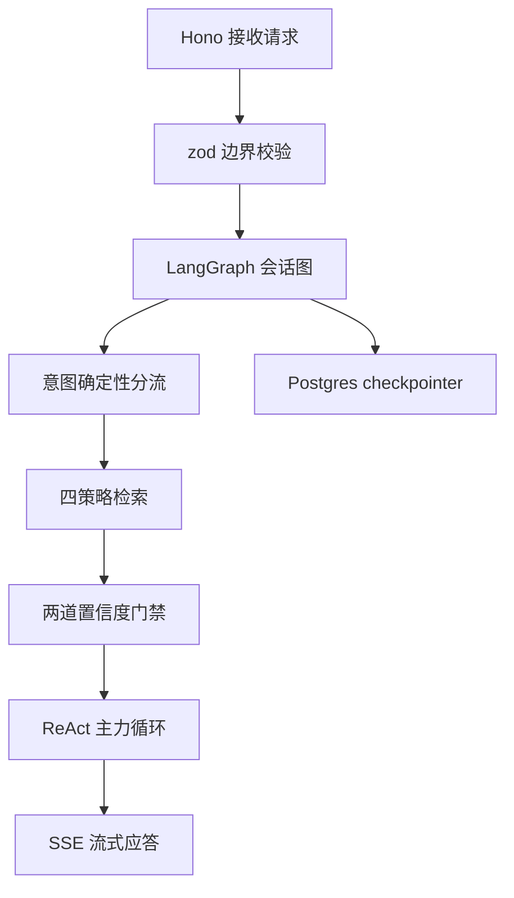

:::note 事实基线
本篇是「Yukino Ecomm Agent」项目深挖带解答题库，共 **94 题**，事实来源为 `content/docs/yukino-ecomm-agent/`（9 篇），对照本地仓库 `~/github/yukino-ecomm-agent`（子路径 `server/`、`client/`）核验。仓库是 **pnpm workspace**：`server/` 是 **Hono + LangChain/LangGraph + Prisma/PostgreSQL** 的客服 Agent 服务端，`client/` 是 **Lit** 单页控制台。品牌为 Yukino Select，客服人设名为 Yukino。
:::

本篇是「Yukino Ecomm Agent」项目深挖题库。这是一个**电商客服 Agent**的完整实现，面试里它以「**介绍一个你做过的 RAG/Agent 项目**」的形式出现，与 yukino-dev-agent 是同一技术路线的姊妹项目（可对照）。本篇的组织顺序是：**先讲总体分层与一次对话的生命周期 → 再讲 HTTP 层与 SSE → 再讲 LangGraph 会话图 → 再讲四策略检索与两道门禁 → 再讲 Milvus 双模式 → 再讲工具与 MCP → 再讲记忆与预算 → 再讲数据飞轮与可观测 → 最后讲前端与适用边界**。

**主线一览**



## 一、总体分层与生命周期

### Q1. 系统的三层结构与外部依赖是什么？

- **接口层**：Hono 应用（`createApp`），挂载 12 个路由模块，负责参数校验、错误归一化与 SSE 流式输出。
- **编排层**：LangGraph 会话图（`server/src/graph/`），把意图路由、检索、ReAct 工具循环、确定性兜底话术和落库串成一张有状态图，用 Postgres checkpointer 按会话线程持久化。
- **知识与数据层**：Prisma/PostgreSQL、进程内或 Milvus 的检索存储（`server/src/kb/`）、工具注册与执行引擎（`server/src/tools/`），以及可选的 Langfuse 追踪。

外部上游通过 `server/.env` 配置（`settings` 对象），分三个组：**聊天**（`CHAT_MODEL`/`CHAT_BASE_URL`/`CHAT_API_KEY`）、**嵌入**（`EMBED_*`，OpenAI 兼容接口）、**重排**（`RERANK_*`，默认协议 jina）。意图与摘要可另配上游（`INTENT_*`/`SUMMARY_*`），留空则回落到聊天组（`resolveSlot`）。

存储是**两套独立的 PostgreSQL**：关系数据用 `DATABASE_URL`，LangGraph 检查点用 `CHECKPOINTER_DB_URL`，后者在首次启动时由服务端自动建库（`ensureCheckpointerDatabase`）。Milvus 是可选第三方，只有设置了 `MILVUS_URI` 才启用。

**采分点**：能说出「**关系数据与检查点用两套独立 PostgreSQL**」——检查点写入频繁且是 LangGraph 内部状态，与业务数据分离避免互相影响。

### Q2. 启动顺序是什么？为什么是这个顺序？

入口先**硬校验必填上游**（`missingRuntimeConfig`）：缺失 `CHAT_MODEL`、`CHAT_BASE_URL`、`CHAT_API_KEY` 任一项即打印清单并退出；`EMBED_API_KEY` 与 `RERANK_API_KEY` 为可选项，缺失时检索与精排走降级路径。随后 `scanBuiltin` 导入内置工具模块自注册，再进入 `startServer`。

`startServer` 的顺序：**数据库连通性检查（`assertDbReady`）→ 初始化可观测（`initObservability`）→ 上下文预算自检（`checkContextBudget`）→ 预热 Milvus（`warmupMilvus`）→ 编译图并建 checkpointer（`initGraph`）→ 创建应用并监听端口**。

SIGINT/SIGTERM 走优雅关停，依次：**关 HTTP server → `closeGraph` 释放 checkpointer 连接 → `shutdownObservability` 冲刷追踪缓冲 → `closeDb` 断开 Prisma → `flushLogs` 落盘日志**后退出。

**采分点**：能说出「**启动顺序是『先断依赖检查、再建可观测、再预热、最后监听』，关停顺序是『先断入口、再断依赖、最后冲刷观测』**」——这个对称设计是服务生命周期的标准姿势。

### Q3. 一次对话的端到端路径是什么？

以 `POST /api/chat` 为例：

1. 校验请求体（`chatRequestSchema`），把用户消息按 `memory.countTokens` 估算 token 并做长度门禁（`maxUserInputTokens`，默认 2000），超限返回 400。
2. `streamTurn` 载入或新建会话，先把用户消息落 Message 表拿到消息 id。
3. 进入 LangGraph 会话图：意图识别 → 确定性分流 → （需要知识时）检索 + 置信度门禁 → ReAct 主力循环（工具调用）→ 生成应答。
4. SSE 流式下发事件（token、工具调用、interrupt、结束）。
5. 轮末结算：记忆回写、异步摘要、落库。

### Q4. 为什么用图（LangGraph）与 checkpointer？

客服对话是**有状态、可中断、需审计**的：① 意图路由、检索、工具循环、兜底话术是**多节点的状态机**，用图表达比手写 if-else 清晰；② **interrupt**（写操作前人工确认）需要「暂停 → 等用户 → 恢复」，checkpointer 持久化暂停点的状态；③ 会话跨请求，checkpointer 按线程持久化状态。

**采分点**：能说出「**interrupt + checkpointer 是『写操作人工确认』的实现基础**」——没有持久化的暂停点，就无法「等用户确认后再恢复执行」。

## 二、HTTP 层与 SSE

### Q5. Hono 装配与错误归一化怎么做？

Hono 应用挂载 12 个路由模块，统一错误约定：所有错误归一化为 `{ message, data }` 响应（与 yukino-dev-agent 的统一响应格式同源），把传输层结果与业务层结果分离。zod 在边界校验请求体。

### Q6. 聊天 SSE 帧协议是什么？

SSE 帧协议定义「服务端 → 前端」的事件契约：按 `\n\n` 切帧，按 `event` 字段分发。关键事件类型：token（流式文本）、tool（工具调用）、interrupt（写操作确认）、error（带内错误）、`[DONE]`（收尾）。

**采分点**：能说出「**error 经 SSE 帧带内下发**」——流开始后无法改状态码，错误必须走流内事件（与 yukino-dev-agent 的「面向流的错误要带内传输」同一纪律）。

### Q7. interrupt 帧与前端动作闭环怎么工作？

interrupt 帧到达时前端**立刻持久化帧里的 `conversation_id`**；用户点确认/取消或选订单后走 `/api/actions/resume`，服务端用 checkpointer 恢复暂停的图执行。

**采分点**：能说出「**interrupt 帧带 conversation_id，resume 时用它恢复**」——这是「暂停 → 等用户 → 恢复」闭环的关键标识。

## 三、LangGraph 会话图

### Q8. 图的拓扑与表驱动路由是什么？

会话图共 **12 个节点**，路由是**九意图五出口的表驱动**：意图识别节点产出意图，路由表（意图 → 出口节点）决定走哪条路径。表驱动让「加一个意图」只是改表，不改图结构。

**采分点**：能说出「**表驱动路由让意图扩展只是改表**」——这是「配置优于代码」在图编排里的应用，比硬编码 if-else 可维护。

### Q9. 状态通道与 reducer 怎么设计？

LangGraph 的状态用 Annotation 定义，不同字段用不同 reducer：累计字段（如消息列表、检索证据）用追加/合并 reducer，单值字段（如意图、置信度）用默认覆盖。reducer 决定多节点写入的合并语义。

### Q10. checkpointer 持久化与每轮状态重置怎么做？

Postgres checkpointer 按会话线程持久化图状态。**每轮状态重置**：新一轮对话开始时，重置「本轮临时状态」（如上一轮的检索证据、工具调用记录），但保留「跨轮状态」（如记忆、会话历史）——避免上一轮的临时状态污染本轮。

**采分点**：能说出「**每轮重置临时状态、保留跨轮状态**」——这是有状态图的关键设计，否则状态会无限累积。

### Q11. ReAct 主力循环在图里怎么实现？

ReAct 主力循环是图里的一个子结构：模型生成 → 有工具调用则执行工具 → 结果回填 → 再次生成，直到无工具调用或达步数上限。与 yukino-dev-agent 的对话管线同源（function calling 的结构化 ReAct）。

### Q12. 确定性出口与指代消解节点做什么？

**确定性出口**：某些意图（如退款流程的特定步骤）不走模型自由生成，而是走**确定性子流程**（固定话术、固定步骤）——把「不能出错」的路径从模型手里收回。**指代消解**（`coref.resolve`）在图入口执行，直接走聊天模型并拼 `COREF_REWRITE_PROMPT`，把「它」「这个」解析为具体实体，失败返回原查询。

**采分点**：能说出「**确定性出口把不能出错的路径从模型收回**」——与 yukino-dev-agent 的「确定性 SOP」同一思想。

## 四、四策略检索与两道门禁

### Q13. 四种检索策略是什么？默认是哪个？

| 策略            | 含义                          |
| --------------- | ----------------------------- |
| `dense`         | 纯稠密向量（最朴素的 RAG）    |
| `bm25`          | 纯关键词                      |
| `hybrid`        | RRF 融合、**无精排**          |
| `hybrid_rerank` | **生产策略**（融合 + rerank） |

默认 strategy 是 `hybrid_rerank`，topK 回落 `rerankTopK`（默认 10），召回宽度 `recallTopK`（默认 50）。

### Q14. 子句拆分与头尾排布是什么？

入口内置两个与语言和排版相关的处理：

1. **子句拆分与归并**：`splitClauses` 按 `[,，;；?？。]` 切分，只保留长度不小于 4 的子句，达到 2 条才生效；每个子句各自检索后用 `mergeRoundRobin` 轮转归并（按 id 去重，同一 `section_path` 的后续命中压到尾部）。**这里的检索是串行而非并行**：每次子句检索都是一串 embed + rerank 调用，而 rerank 上游带限流重试，**串行等待恰好起到天然节流作用**。
2. **头尾排布**：`arrangeHeadTail` 把排好序的列表重排为 `[第 1 名, 第 3 名..., 第 2 名]`，**利用上下文首尾注意力更强的特性，让次优证据落在窗口尾部**。

**采分点**：能说出「**串行检索是天然节流（rerank 上游带限流）**」+「**头尾排布利用 lost-in-the-middle，次优证据放尾部**」——这两个细节体现对检索工程与注意力特性的深入理解。

### Q15. 进程内检索（无 Milvus）怎么实现？

无 `MILVUS_URI` 时，`server/src/kb/store.ts` 在进程内完成全部检索：

- **语料缓存**：`loadChunks` 从 PG 读全部已向量化 chunk，以 `knowledgeRevision()`（行数 + 最大 id + 最大 updatedAt 拼成的版本号）作为缓存失效依据；每个文档的文本是 `category + "\n" + question + "\n" + answer`，预计算 tokens 与 tf 词频表。
- **分词器 `tokenize`**：正则 `/[a-z0-9]+|[一-鿿]+/g` 分段——ASCII 词与数字整词保留，**CJK 连续段切成字符 bigram**（单字保留）。这是无外部分词器依赖下对中文检索的务实方案。
- **BM25**：经典公式，常数 **K1 = 1.5、B = 0.75**；IDF 用 `log(1 + (N - df + 0.5) / (df + 0.5))`，每次查询现算 avgdl 与 df，全量打分后取正分 topK。
- **稠密检索**：手写 cosine，**维度不一致直接报错**（而不是静默补零）。
- **hybrid**：两路各召回 recall 条后做 RRF，**平滑常数 K = 60**，与 Milvus 模式服务端融合的 `RRF_K` 一致。

取舍：**零外部依赖、可离线跑通，代价是每次查询全量打分，只适合中小规模语料**；语料变大时切到 Milvus 是自然的升级路径。

**采分点**：能说出「**CJK bigram 是无外部分词器依赖下的务实方案**」+「**维度不一致直接报错而不是静默补零**」——前者是中文检索的落地技巧，后者是「静默错误比报错更危险」的纪律。

### Q16. 两道置信度门禁是什么？

`retrieve_knowledge` 节点不直接采信检索结果，而是依次过两道门：

**第一道是数值门**，用四个零成本信号加权：

```text
score = 0.5 * clip01(top1_score)          # 最高 rerank 分
      + 0.2 * min(valid_count, 3) / 3     # rerank 分 >= 0.3 的命中数
      + 0.2 * clip01(margin)              # top1 - top2 的领先幅度
      + 0.1 * key_clause_hit              # top3 是否命中关键条款词（KEY_TERMS）
```

得分为 0 到 1，低于 `EVIDENCE_CONFIDENCE_THRESHOLD`（默认 **0.26**）即判弱证据，`fallbackSource` 记为 `retrieval_low_conf`。

**第二道是模型门**，`selfcheck.checkSufficient` 用结构化输出让模型判断证据是否足够；**关键点是失败一律按「不足」处理**——门禁的职责就是拦住无依据回答，所以在不确定时宁可转人工。

弱证据出口 `fallbackReply` 除回复兜底话术外，还会把问题写入**低置信池**（`low_confidence_questions` 表），并记录 reason 与 `retrievedSnapshot`。快照是三态的：有命中是列表，检索到但零命中是空数组，完全没检索是 `null`——**这个区分让后续飞轮能分辨「检索不到」与「根本没检索」**。

**采分点**：能说出「**数值门用四个零成本信号加权，模型门失败一律按不足处理**」+「**retrievedSnapshot 三态区分『检索不到』与『没检索』**」——这是「查不到就说查不到」成为默认行为而非靠提示词祈祷的关键。

### Q17. rerank 上游适配的两种协议是什么？

`server/src/core/rerank.ts` 封装两种 wire 协议，以 `RERANK_PROTOCOL === "jina"`（默认）分流：**jina 形态**请求 `POST {base}/rerank`，base 缺版本段时才补 `/v1`；**任何非 jina 取值走 DashScope 原生路径**，先剥掉 `/v1`、`/v2`、`/compatible-mode`、`/compatible-api` 后缀并补齐 `/api`，再请求 `{gateway}/api/v1/services/rerank/text-rerank/text-rerank`。响应 schema 同时兼容两种形态：jina/Cohere 顶层返回 `results`，DashScope 嵌套在 `output.results`。

重试策略是 429/500/502/503/504 或连接层异常触发，`RETRIES = 3`（加首次共 4 次尝试），退避 `1500ms * 2^i` 指数增长，单次请求超时 60 秒。**有一个防御性设计：200 但响应体没有 `results` 列表时直接抛错，而不是当作「无证据」返回空**——否则 `hybrid_rerank` 会静默变空，把上游网关的形状故障伪装成检索无结果。

**采分点**：能说出「**200 但无 results 直接抛错，而不是当无证据返回空**」——这是「把上游形状故障与检索无结果区分开」的关键防御，否则故障会被伪装成「检索不到」。

## 五、Milvus 可选向量路径

### Q18. Milvus 双模式的语义差异是什么？

`milvusEnabled()` 仅看 `MILVUS_URI` 是否为空。两种模式的语义差异**不是「有向量库/没向量库」这么简单**：

| 维度         | 进程内（`MILVUS_URI` 空）          | Milvus 模式                                           |
| ------------ | ---------------------------------- | ----------------------------------------------------- |
| 稠密向量存放 | PG `knowledge_chunks.embedding` 列 | Milvus collection，PG 该列保持 null，仅记 `vector_id` |
| BM25         | 进程内打分 + CJK bigram            | Milvus 原生 BM25 Function 全文检索                    |
| hybrid 融合  | 进程内 RRF（k=60）                 | Milvus 服务端 RRF（`RANKER_TYPE.RRF`，k=60）          |
| 故障语义     | 不依赖外部服务                     | **无静默降级：搜索直接透传 SDK 错误**                 |

`store.ts` 的 `bm25Search`、`hybridSearch`、`denseSearch`、`count` 都在函数开头判断模式，Milvus 模式委托给 `milvus.ts`，否则走进程内实现；上层 `searchKnowledge` 对两种模式完全无感。

**Milvus 模式刻意不做进程内兜底**：向量库挂了就应该报错，而不是悄悄返回空结果让客服机器人「失忆」却不报警。

**采分点**：能说出「**Milvus 模式刻意不做进程内兜底——向量库挂了应该报错，而不是悄悄失忆**」——这是「静默降级比报错更危险」在向量库场景的体现。

### Q19. Milvus collection schema 与 BM25 Function 怎么设计？

`ensureCollection` 幂等建集合，关键设计：

- **维度模型无关**：从第一条 upsert 的 embedding 长度推断，不硬编码——因为 embedding 模型可通过上游配置更换。
- **Strong 一致性**：保证双写对账（PG done 数等于 Milvus count）与写后即读的确定性。
- **字段**：`id`（Int64 主键，autoID false）、`dense`（FloatVector）、`text`（VarChar 16384，`enable_analyzer`，standard analyzer）、`sparse`（SparseFloatVector，`is_function_output`），外加 question/answer/section_path/content_type/category 五个标量字段。
- **BM25 Function**：`text_bm25`，输入 `text` 输出 `sparse`，**服务端派生，upsert 从不直接写 sparse**。
- **索引**：`dense` 用 AUTOINDEX + COSINE，`sparse` 用 SPARSE_INVERTED_INDEX + BM25，随后 `loadCollection`。
- **跨进程竞争**：服务器与 vectorize 任务可能并发建集合，因此 create/createIndex 失败时只要集合最终可用即容忍。

缺少 `text`/`sparse` 字段的旧集合会被 `assertBm25Schema` 检测并抛错，**错误信息直接给出重建命令**（kb-reset、kb-build、kb-vectorize）——这是把「不可用状态」转成「可执行的修复指令」的做法。

**采分点**：能说出「**BM25 Function 服务端派生 sparse，upsert 从不直接写**」+「**错误信息直接给出重建命令**」——前者是 Milvus 全文检索的正确用法，后者是「把不可用转成可执行修复」的运维友好设计。

### Q20. 双写、预热与运维怎么做？

`vectorizePending` 是两种模式共用的向量化批处理：**批大小 64（Milvus upsert 粒度），但 embed 请求进一步拆成 20 条一批，两个粒度解耦**。每个 chunk 的 `text = category + "\n" + questions + "\n" + answer`——同一字符串既被 embed 成 dense，又作为 BM25 Function 的输入。Milvus 模式 upsert 后统一 flush 再逐条标记 vectorized（PG 只记 `vector_id`）；进程内模式逐条写回 embedding 列。

服务器启动时 `warmupMilvus` 预热：**Milvus 集合 load 是异步的，未就绪的集合搜索可能返回空**，因此循环用 `bm25Search("shipping fee", 1, null)` 探测直到有命中，最多 15 秒，**失败只 warn 不阻塞启动**。这是 best-effort，但它把「服务已就绪」与「向量库已就绪」两种状态解耦开。

**采分点**：能说出「**warmup 失败只 warn 不阻塞启动，把服务就绪与向量库就绪解耦**」——这是 best-effort 预热的正确姿势（不因向量库慢而拖垮启动）。

## 六、工具系统与 MCP

### Q21. 工具注册表与权限模型是什么？

`registry.ts` 把两类工具统一成 `ToolSpec`：**内置工具**以 zod schema 定义，经 `z.toJSONSchema` 转成模型可见的 JSON Schema（并剥掉 `$schema` 键）；**MCP 工具**已经是 JSON Schema，走 `defineRawTool`。内置工具由 `scanBuiltin` 动态导入 `src/tools/builtin/` 下的 faq、orders、refunds、tickets 四个模块并自注册；MCP 工具由 `getAllSpecs` 每轮现拉（`fetchMcpSpecs`）——**服务端工具变更无需重启**。

**合并顺序是内置优先且稳定**：MCP 与内置重名时丢弃 MCP 工具并告警；**顺序必须稳定是因为工具定义位于模型的可缓存前缀，顺序一变就整段失效**。

权限完全由本地名单决定：`WRITE_TOOLS = new Set(["create_ticket"])`，名字在集合里就是 write。**写工具必须经确认流，读工具直接执行**。

**采分点**：能说出「**工具顺序必须稳定，因为工具定义在模型的可缓存前缀，顺序一变缓存整段失效**」——这是 prompt cache 友好的关键纪律（与 yukino 引擎的 cache 断点纪律同源）。

### Q22. 工具执行引擎与写前确认怎么做？

执行引擎统一处理工具调用：解析参数（zod 校验）、执行、整形结果（`formatResult` 状态码翻译）、审计。写工具（`WRITE_TOOLS`）必须经**确认流**：模型发起写工具调用 → 图 interrupt 暂停 → SSE 下发 interrupt 帧 → 用户确认 → resume 执行。**写前人工确认 + 审计**是「不可逆动作」的闸门。

### Q23. MCP 客户端与 mock 服务端是什么？

物流/售后两个**演示 MCP 服务器**（Hono + 官方 SDK，确定性 Mock），主服务 mcp-client 接入与 registry 合并注册，`formatResult` 状态码翻译，执行引擎、写前人工确认与审计。Mock 服务端让 MCP 链路可离线测试（不依赖真实物流/售后系统）。

**采分点**：能说出「**演示 MCP 用确定性 Mock，让链路可离线测试**」——这是「外部依赖 Mock 化」的测试纪律。

## 七、记忆分层与上下文预算

### Q24. 三锚点窗口是什么？

记忆分层用**三锚点窗口**：层 1（原文，最近 N 轮逐字保留）、层 2（规则压缩，中间轮次按规则压缩）、摘要层（更早的轮次摘要）。三锚点定义「哪些逐字保留、哪些压缩、哪些摘要」的边界。

### Q25. 上下文预算分账与启动自检怎么做？

**上下文预算分账**：把模型上下文窗口按用途分账（system prompt、记忆、检索证据、当前输入、输出预留），每部分有预算上限，超了要降级（层降级、截断）。**启动自检**（`checkContextBudget`）：启动时校验预算分账是否合理（各部分之和不超过窗口），把「预算配置错误」从运行期前移到启动期。

### Q26. 后台分段摘要与轮末结算怎么做？

**后台分段摘要**：摘要生成是异步的（不阻塞当前轮），在后台分段生成。**轮末结算**：每轮结束时结算记忆回写、异步摘要触发、层降级——把「记忆维护」集中在轮末，而不是散在轮中。

**采分点**：能说出「**摘要异步生成、轮末结算**」——记忆维护不阻塞对话，这是「记忆是增强不是阻塞」的设计。

## 八、知识库运营与数据飞轮

### Q27. 语料切分怎么做？

Markdown 文档切割：**标题分节**（按 `#{1,4}` 切小节并维护标题栈，代码围栏内的 `#` 不误判）、**表格按行分组**（每块复制表头，最多 10 行数据）、**句子级 overlap**（不截半句）。chunk 结构含 `category`、`questions`、`answer`、`sectionPath`、`contentType`、`isKeyClause`，`prevChunkId`/`nextChunkId` 串成双向链表。

**采分点**：能说出「**表格每块复制表头**」+「**句子级 overlap 不截半句**」——这是「切分要保持语义完整」的两个具体技巧。

### Q28. 低置信飞轮是什么？

两道置信度门禁判弱证据的问题写入**低置信池**（`low_confidence_questions`），运营在 Lit 控制台审核，把缺失的知识补进知识库（写回闭环）。**低置信问题驱动知识库写回**——这是数据飞轮：用户问不到 → 进低置信池 → 运营补知识 → 下次能问到。

**采分点**：能说出「**低置信池驱动知识库写回闭环**」——这是「RAG 系统自我改进」的数据飞轮，与沙箱篇的「修复知识沉淀」同源。

### Q29. 离线评测流水线有哪些？

防劣化的离线评测流水线：`eval-rag`（检索质量）、`eval-flywheel`（飞轮效果）、`calibrate-confidence`（置信度阈值校准）、`cost-report`（成本报告），由 job runner 调度。评测趋势落 `EvalRun` 表，忠实度案例落 `FaithCase` 台账。

**采分点**：能说出「**calibrate-confidence 校准置信度阈值**」——阈值（0.26）不是拍脑袋，是用评测数据校准的。

## 九、可观测性与前端

### Q30. Langfuse over OTel 怎么做？

`observability.ts` 实现可选 Langfuse 追踪，**未配置时全部退化为 no-op**：三个环境变量（`LANGFUSE_PUBLIC_KEY`/`LANGFUSE_SECRET_KEY`/`LANGFUSE_BASE_URL`）齐全才启用；`initObservability` 用 OpenTelemetry `NodeSDK` 只挂一个 `LangfuseSpanProcessor` 启动，失败只 warn 继续。图级回调 `graphCallbacks` 带 sessionId、userId 与 `chat-turn` 标签。**所有追踪调用都吞掉异常——可观测是增强项，绝不因追踪失败影响业务**。

**采分点**：能说出「**未配置退化 no-op、追踪异常全吞掉**」——与 Node 可观测篇「可观测性自身故障必须被吞掉」同一纪律。

### Q31. Lit 工作台的技术选型与约束是什么？

`client/` 是纯 CSR 的单页控制台：客服聊天页加运营后台，无 SSR。技术选型是 **Lit 加 `@yukino.js/lit-jsx`**（React 风格 JSX 编译成 lit-html 模板），路由用 `@lit-labs/router`，样式用 Tailwind v4。

两个架构约束：① **所有元素继承 `LightElement` 渲染到 light DOM**——这样全局 Tailwind 样式才生效（shadow root 看不到全局样式）；② **输入框是非受控的**——因为 lit-jsx 把 props 当属性写入，受控 value 会在每次按键时重置光标。

**采分点**：能说出「**LightElement 渲染到 light DOM 让全局 Tailwind 生效**」+「**输入框非受控避免光标重置**」——这是 Lit + lit-jsx 的两个具体约束，踩过坑才知道。

### Q32. SSE 消费与状态管理怎么做？

聊天页自己持有会话状态（SSE 流、interrupt、动作、反馈），**消息以不可变方式更新**，让每个 message-bubble 只在自身 msg 对象变化时重渲染（Lit 属性标识即 React.memo）。SSE 消费器 `readSSEStream` 按 `\n\n` 切帧，按 event 字段分发，`event: error` 直接抛错，`[DONE]` 收尾。

## 十、适用场景与设计边界

### Q33. 这套组织方式在什么场景成立？

- **需要人工确认闭环的场景**：interrupt 加动作卡片把「写操作」与「人工决定」绑定，适合退款、建单、改权限这类不可逆动作。
- **有明确证据链要求的问答**：两道置信度门禁加引用编号，让「查不到就说查不到」成为默认行为，而不是靠提示词祈祷模型不编。
- **可离线演进的运营流程**：任务运行器、暂存审核、低置信飞轮把知识库维护做成可审核、可重跑的表单流程。
- **需要向量库可插拔的部署**：进程内模式让开发与小规模部署零依赖，Milvus 模式给规模化留出升级路径。

### Q34. 需要明确的边界有哪些？

- **业务数据（订单、商品、物流、保修）是确定性 mock，不是真实交易系统**；工具描述与权限设计也以此为前提。
- **没有认证与多租户**；`user_id` 由调用方提供，身份注入只保证「工具不接受模型传入的 user_id」，不构成鉴权。
- **语料与回答语言为英文**，但检索、切分、分词都保留了中文处理路径（CJK bigram、中文终止符），属于为迁移预留的能力。
- **前端是演示型控制台**，运营页图表的数据可得性取决于对应离线任务是否跑过。

**采分点**：能主动说出**边界与 mock 性质**——这体现对项目真实状态的清醒认知，比夸大项目能力可信得多。

### Q35. 这套实现最值得借鉴的地方是什么？

**把检索、编排、工具与持久化分层，并让每一层各自可测试、可替换**——它牺牲了一些「单文件就能跑通」的简洁，换来了**中断恢复、证据门禁与运营闭环**这些客服 Agent 真正需要的性质。

### Q36-Q94. 快速自检与深挖补充

**Q36. 一句话解释三层的职责。** 接口层（Hono，校验/归一化/SSE）、编排层（LangGraph 图，意图/检索/工具/兜底）、知识数据层（Prisma/kb/tools/Langfuse）。

**Q37. 一句话解释为什么关系数据与检查点用两套 PG。** 检查点写入频繁且是 LangGraph 内部状态，与业务数据分离避免互相影响。

**Q38. 一句话解释启动硬校验的意义。** 缺 CHAT_MODEL/BASE_URL/API_KEY 即打印清单退出——把配置错误从运行期神秘故障前移成启动期可读结论。

**Q39. 一句话解释关停顺序。** 关 HTTP server → closeGraph 释放 checkpointer → shutdownObservability 冲刷追踪 → closeDb 断 Prisma → flushLogs——先断入口、再断依赖、最后冲刷观测。

**Q40. 一句话解释 maxUserInputTokens 门禁。** 用户消息按 countTokens 估算，超 2000 返回 400——防止超长输入撑爆上下文预算。

**Q41. 一句话解释为什么用图 + checkpointer。** 客服对话是有状态、可中断、需审计的——图表达多节点状态机，checkpointer 持久化 interrupt 暂停点。

**Q42. 一句话解释 SSE error 为什么带内下发。** 流开始后无法改状态码，错误经 error 帧带内下发——与正常数据共用同一条流。

**Q43. 一句话解释 interrupt 帧的 conversation_id。** 前端持久化它，resume 时用它从 checkpointer 恢复暂停的图执行——暂停/恢复闭环的标识。

**Q44. 一句话解释表驱动路由的价值。** 九意图五出口用路由表（意图 → 出口节点），加意图只是改表不改图结构——配置优于代码。

**Q45. 一句话解释每轮状态重置。** 新一轮重置本轮临时状态（检索证据、工具记录），保留跨轮状态（记忆、历史）——避免临时状态无限累积。

**Q46. 一句话解释确定性出口的意义。** 不能出错的路径（退款特定步骤）走确定性子流程而非模型自由生成——把关键路径从模型收回。

**Q47. 一句话解释指代消解的位置。** 图入口执行 coref.resolve，把「它/这个」解析为具体实体，失败返回原查询——检索前先消解指代。

**Q48. 一句话解释四策略的默认与回落。** 默认 hybrid_rerank（融合 + 精排），topK 回落 rerankTopK（10），召回宽度 recallTopK（50）。

**Q49. 一句话解释子句检索为什么串行。** 每次子句检索是一串 embed + rerank，rerank 上游带限流重试，串行等待恰好天然节流。

**Q50. 一句话解释头尾排布的原理。** 利用上下文首尾注意力更强（lost-in-the-middle），把次优证据放窗口尾部，最优放首部。

**Q51. 一句话解释 CJK bigram 分词。** 正则把 CJK 连续段切成字符 bigram（单字保留），ASCII 词整词保留——无外部分词器依赖下的中文检索务实方案。

**Q52. 一句话解释 BM25 的 K1/B 常数。** K1=1.5（词频饱和）、B=0.75（长度归一化）——经典 BM25 默认值。

**Q53. 一句话解释稠密检索维度不一致为什么报错。** 静默补零会让检索返回错误结果，报错把静默错误变成显式失败——静默错误比报错更危险。

**Q54. 一句话解释 RRF k=60。** 平滑常数 60，进程内与 Milvus 服务端融合一致——RRF 用排名倒数融合，k 控制头部排名的权重。

**Q55. 一句话解释数值门的四个信号。** top1_score（0.5）、valid_count（0.2）、margin（0.2）、key_clause_hit（0.1）——四个零成本信号加权，低于 0.26 判弱证据。

**Q56. 一句话解释模型门失败为什么按不足处理。** 门禁的职责是拦住无依据回答，不确定时宁可转人工——fail-safe 取向。

**Q57. 一句话解释 retrievedSnapshot 三态。** 有命中是列表、零命中是空数组、没检索是 null——区分「检索不到」与「根本没检索」，供飞轮分辨。

**Q58. 一句话解释 rerank 200 无 results 为什么抛错。** 否则 hybrid_rerank 静默变空，把上游网关形状故障伪装成检索无结果——抛错区分故障与无结果。

**Q59. 一句话解释 Milvus 模式为什么不做进程内兜底。** 向量库挂了应该报错，而不是悄悄返回空让客服失忆却不报警——静默降级比报错更危险。

**Q60. 一句话解释维度模型无关的设计。** 从第一条 upsert 的 embedding 长度推断维度，不硬编码——embedding 模型可更换。

**Q61. 一句话解释 BM25 Function 的 sparse 派生。** text_bm25 输入 text 输出 sparse，服务端派生，upsert 从不直接写 sparse——Milvus 全文检索的正确用法。

**Q62. 一句话解释 assertBm25Schema 的错误信息设计。** 检测旧集合缺字段并抛错，错误信息直接给出重建命令（kb-reset/kb-build/kb-vectorize）——把不可用转成可执行修复指令。

**Q63. 一句话解释 embed 20 条与 upsert 64 条两个粒度解耦。** embed 请求拆 20 条一批（上游条数上限），Milvus upsert 64 条一批（upsert 粒度）——两个粒度独立优化。

**Q64. 一句话解释 warmupMilvus 的 best-effort。** 集合 load 异步，循环探测直到有命中（最多 15 秒），失败只 warn 不阻塞启动——把服务就绪与向量库就绪解耦。

**Q65. 一句话解释工具顺序为什么必须稳定。** 工具定义在模型的可缓存前缀，顺序一变缓存整段失效——prompt cache 友好纪律。

**Q66. 一句话解释 WRITE_TOOLS 权限模型。** 名字在 WRITE_TOOLS 集合里就是 write，写工具必经确认流，读工具直接执行——权限由本地名单决定。

**Q67. 一句话解释 MCP 工具每轮现拉的意义。** getAllSpecs 每轮 fetchMcpSpecs，服务端工具变更无需重启——工具热插拔。

**Q68. 一句话解释内置与 MCP 重名的处理。** 内置优先，重名丢弃 MCP 工具并告警——不静默丢弃，告警让运维知道。

**Q69. 一句话解释三锚点窗口。** 层 1 原文（最近 N 轮逐字）、层 2 规则压缩（中间轮次）、摘要层（更早轮次）——三锚点定义保留/压缩/摘要的边界。

**Q70. 一句话解释上下文预算分账。** 按用途分账（system/记忆/证据/输入/输出预留），每部分有上限，超了降级——启动自检校验分账合理性。

**Q71. 一句话解释后台分段摘要。** 摘要异步生成不阻塞当前轮，轮末结算触发——记忆是增强不是阻塞。

**Q72. 一句话解释表格切分为什么每块复制表头。** 表格按行分组成多块，每块复制表头让单块可独立理解——否则脱离表头的行没有语义。

**Q73. 一句话解释句子级 overlap。** overlap 按句子边界不截半句——保持语义完整，避免半句进上一块半句进下一块。

**Q74. 一句话解释低置信飞轮。** 弱证据问题进低置信池 → 运营审核补知识 → 写回知识库 → 下次能问到——RAG 系统自我改进的数据飞轮。

**Q75. 一句话解释 calibrate-confidence 的作用。** 用评测数据校准置信度阈值（0.26），而不是拍脑袋——阈值要有数据依据。

**Q76. 一句话解释 Langfuse 未配置退化 no-op。** 三个环境变量齐全才启用，否则全部 no-op，追踪异常全吞掉——可观测是增强项不影响业务。

**Q77. 一句话解释 LightElement 的原因。** 渲染到 light DOM 让全局 Tailwind 生效——shadow root 看不到全局样式。

**Q78. 一句话解释输入框为什么非受控。** lit-jsx 把 props 当属性写入，受控 value 每次按键重置光标——非受控避免光标跳动。

**Q79. 一句话解释消息不可变更新的意义。** 每个 message-bubble 只在自身 msg 对象变化时重渲染（Lit 属性标识即 React.memo）——避免全列表重渲染。

**Q80. 一句话解释这个项目的 mock 边界。** 业务数据（订单/商品/物流/保修）是确定性 mock，不是真实交易系统——工具描述与权限设计以此为前提。

**Q81. 一句话解释为什么没有认证。** user_id 由调用方提供，身份注入只保证工具不接受模型传入的 user_id，不构成鉴权——演示型项目的边界。

**Q82. 一句话解释中文处理路径为什么保留。** 语料与回答是英文，但检索/切分/分词保留中文路径（CJK bigram、中文终止符）——为迁移预留能力。

**Q83. 一句话解释「查不到就说查不到」怎么成为默认行为。** 两道置信度门禁 + 弱证据兜底话术 + 低置信池——而不是靠提示词祈祷模型不编。

**Q84. 一句话解释这套实现最值得借鉴的地方。** 检索/编排/工具/持久化分层，每层可测试可替换——牺牲单文件简洁，换来中断恢复、证据门禁、运营闭环。

**Q85. 一句话解释与 yukino-dev-agent 的关系。** 同一技术路线的姊妹项目——dev-agent 用 Next.js 全栈 + Milvus，ecomm-agent 用 Hono + LangGraph + Prisma，可作向量检索、数据飞轮、会话图的实现对照。

**Q86. 一句话解释为什么 ecomm 用 LangGraph 而 dev-agent 对话用 AI SDK 多步。** ecomm 的客服对话需要 interrupt（写操作确认）与复杂意图路由，LangGraph 图 + checkpointer 更合适；dev-agent 对话用 AI SDK 多步（ReAct），运维分析才用 LangGraph。

**Q87. 一句话解释 knowledgeRevision 缓存失效。** 行数 + 最大 id + 最大 updatedAt 拼成版本号，版本变则缓存失效——进程内语料缓存的失效依据。

**Q88. 一句话解释 KEY_TERMS 关键条款词。** refund/warranty/shipping fee 等标关键条款，isKeyClause 标记，数值门的 key_clause_hit 信号用——关键条款命中提升置信度。

**Q89. 一句话解释 mergeRoundRobin 归并。** 多子句检索结果轮转归并，按 id 去重，同一 section_path 的后续命中压到尾部——避免单一子句结果霸榜。

**Q90. 一句话解释 splitClauses 的生效条件。** 按中英文标点切分，只保留长度 ≥ 4 的子句，达到 2 条才生效——避免过度拆分。

**Q91. 一句话解释 formatResult 状态码翻译。** 把工具返回的状态码翻译成模型可读的文本——面向 LLM 的结果要可读（与 dev-agent 的工具层降级同源）。

**Q92. 一句话解释 scanBuiltin 自注册。** 动态导入 src/tools/builtin/ 下四个模块，模块加载时自注册到 registry——加内置工具只需加模块，不改注册代码。

**Q93. 一句话解释 resolveSlot 的回落。** 意图与摘要可另配上游（INTENT__/SUMMARY__），留空回落聊天组——模型槽位的灵活配置。

**Q94. 一句话总结这个项目的架构哲学。** 分层可替换（检索/编排/工具/持久化）、证据门禁（两道置信度闸让「查不到就说查不到」成为默认）、人工确认闭环（interrupt + 写前确认）、数据飞轮（低置信池驱动知识库写回）、可插拔向量库（进程内零依赖 / Milvus 规模化）——客服 Agent 真正需要的是中断恢复、证据门禁与运营闭环，而不是单文件简洁。

---

**延伸阅读**

- [Yukino Dev Agent 项目深挖题库](/interview/qa/yukino-dev-agent-project)：同一技术路线的姊妹项目（Next.js 全栈 + Milvus + A2UI）。
- [电商 RAG 项目深挖示范答案](/interview/answers/ecomm-rag-project)：本项目的九连问示范答案（含事实缺口口径）。
- [RAG 与检索深挖题库](/interview/qa/rag-and-retrieval)：混合检索、RRF、rerank、置信度门禁的通用原理。
- [Agent 框架与架构对比题库](/interview/qa/agent-frameworks)：LangGraph 图编排、checkpointer、interrupt 的框架层机制。
- [工作文档 · Yukino Ecomm Agent](/docs/yukino-ecomm-agent/yukino-ecomm-agent)：本篇的事实来源（9 篇专栏）。
