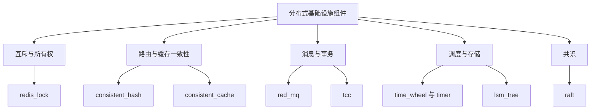

:::note 事实基线
本篇是「Yukino Go 分布式基础设施组件」带解答题库，共 **92 题**，事实来源为 `content/be/yukino-go-components.md`，对照本地仓库 `$HOME/github/yukino.go`（子路径 `components`）@ `facf5d6a` 核验。九个组件（redis_lock、consistent_hash、consistent_cache、red_mq、tcc、time_wheel、timer、lsm_tree、raft）都是 `go.work` 下的独立 Go module，可单独引用。本篇重点回答三个问题：它为什么这样设计、边界在哪里、什么时候不该用它。
:::

本篇是「Yukino Go 分布式组件」题库。这九个组件覆盖互斥、路由、缓存一致性、消息投递、分布式事务、延迟调度与共识，是面试里「**你实现过哪些分布式组件**」「**分布式锁/一致性哈希/LSM/Raft 怎么实现**」的直接素材。本篇按组件组织，每个组件先讲「解决什么问题」，再讲「关键机制」，最后讲「边界与不该用的场景」。

**主线一览**



## 一、组件地图与组合

### Q1. 九个组件各解决什么问题？核心机制是什么？

| 组件             | 解决的问题                   | 核心机制                                             | 形态          |
| ---------------- | ---------------------------- | ---------------------------------------------------- | ------------- |
| redis_lock       | 跨进程互斥                   | token 所有权 + Lua 比较再执行 + 看门狗续期 + RedLock | 库            |
| consistent_hash  | 键到节点的稳定映射与数据搬迁 | 加权虚拟节点环 + 所有权索引 + 迁移 diff              | 库            |
| consistent_cache | 缓存与数据库的读写一致       | 读路径禁写标记抑制回填                               | 库            |
| red_mq           | 可靠消息投递                 | Redis Streams 消费者组 + 逐消息重试 + 死信           | 库            |
| tcc              | 跨参与方事务的最终一致       | 日志先行的 Try/Confirm/Cancel + 监控恢复             | 库            |
| time_wheel       | 海量延迟任务调度             | 槽位时间轮（进程内）与分钟分片 zset（分布式）        | 库            |
| timer            | 秒级定时任务平台             | cron 预展开 + 分片锁调度 + HTTP 回调                 | 可执行服务    |
| lsm_tree         | 高写入吞吐的本地存储引擎     | WAL + 跳表 memtable + 块式 SSTable + 分级 compaction | 库            |
| raft             | 多副本强一致复制             | 选举 + 日志复制 + ReadIndex + 成员变更               | 库 + 示例服务 |

### Q2. 组件间的实际依赖有哪些？timer 为什么是自包含的？

组件间的实际依赖只有两条，都是对 redis_lock 的复用：① consistent_hash 的 Redis 环后端把环级互斥委托给 redis_lock，保证拓扑变更（增删节点、迁移）不并发发生（进程内跳表环后端则自带本地锁，不依赖 Redis）；② tcc 的参考实现用 redis_lock 实现多协调者之间的监控循环互斥，事务日志落在 MySQL。

**timer 常被误认为是上述原语的组装，但它实际上完全自包含**：不 import 其余八个组件，自带基于 token 所有权的 Redis 分布式锁（`ReentrantDistributeLock`）、按天的布隆过滤器、有界工作池、包装 robfig/cron/v3 的解析器，并基于 libs/yukino_http 提供 REST API。

### Q3. 九个组件共享的工程风格是什么？

**用尽可能少的原语表达清晰的所有权与幂等语义，把正确性建立在显式的持久化状态与原子操作上，而不是隐含的时序假设**。redis_lock 用 token 表达所有权，consistent_hash 用所有权索引驱动迁移，consistent_cache 用标记抑制竞态，red_mq 用逐消息计数界定失败，tcc 用日志先行支撑崩溃恢复，time_wheel 用 Lua 原子弹出保证不重复触发，timer 用预展开压缩热路径，lsm_tree 用分级合并平衡读写放大，raft 用多数派与任期维持一致。

一个值得记住的分层原则：**这些组件都在回答「如何把一次操作安全地交给另一个进程或另一段时间」，而它们共同的前提是业务侧能够提供一个确定性的标识（锁 token、任务 key、事务 ID）。标识是幂等与恢复的锚点，缺少它，再精巧的组件也无法保证「只执行一次」**。

## 二、redis_lock：所有权安全的分布式锁

### Q4. redis_lock 用 token 表达所有权是什么意思？

加锁时生成一个唯一 token 作为锁的值，解锁时**先比较 token 再删除**（用 Lua 脚本原子完成 `compare-and-delete`）。这样保证「**只有加锁者能解锁**」——如果锁因 TTL 过期被别人拿走，原持有者的 token 对不上，不会误删别人的锁。

**采分点**：能说出「**解锁必须是原子的 compare-and-delete，不能拆成 GET + DEL 两条命令**」——拆开后，GET 到 DEL 之间锁可能过期被别人拿走，DEL 会误删别人的锁。Lua 脚本保证原子。

### Q5. 看门狗（watchdog）解决什么问题？

固定 TTL 的锁有一个两难：TTL 设短了，业务没执行完锁就过期（互斥失效）；设长了，持有者崩溃后锁要等很久才释放。**看门狗**：加锁后启动一个后台协程，在锁快过期时**自动续期**（只要业务还在执行就持续续），业务结束时停止续期。这样 TTL 可以设得较短（快速发现崩溃），又不会因为业务耗时而提前失效。

**采分点**：能说出「**固定 TTL 短于业务耗时会直接破坏互斥，未知耗时的临界区应使用看门狗**」——这是 redis_lock 适用边界的核心。

### Q6. RedLock 是什么？它的代价是什么？

RedLock 是 Redis 作者提出的「在 N 个独立 Redis 实例上分别加锁，多数派成功才算加锁成功」的算法，目的是规避「单 Redis 主从切换导致锁丢失」的问题（主节点加锁后还没同步到从就宕机，从升主后锁丢失）。

**代价**：① 需要多个独立的 Redis 实例（运维复杂）；② 加锁延迟与失败率上升（要等多数派）；③ 时钟依赖（各实例时钟漂移会影响 TTL）；④ 业界对其正确性有争议（Martin Kleppmann 与 antirez 的著名论战）。**需要强一致的协调应交给 etcd、ZooKeeper 这类共识系统，而不是 RedLock**。

**采分点**：能说出「**RedLock 规避的是主从切换丢锁，但代价高且有争议，强一致协调应该用共识系统**」——这体现对分布式锁能力边界的清醒认知。

### Q7. redis_lock 不该用在什么场景？

① **把它当选主共识用**——redis_lock 是互斥原语，不是共识，无法保证「谁是唯一 leader」的强一致（主从切换可能双主）；② **固定 TTL 短于业务耗时**——互斥会被破坏；③ 需要强一致保证的场景——Redis 是 AP 倾向，网络分区时可能有两个持有者。

## 三、consistent_hash：带迁移计划的一致性哈希

### Q8. consistent_hash 解决什么问题？比取模哈希好在哪？

**取模哈希在节点增减时会把几乎所有键重新映射**，引发缓存雪崩与全量数据搬迁。**一致性哈希把扰动限制在新节点与其前驱之间的弧段**。该组件的定位是把两者都做完：维护环，并**在增删节点的副作用中直接算出需要迁移的键集与迁移方向**（通常一致性哈希库只维护环，「找出弧段里的键并搬走」留给调用方）。

### Q9. 虚拟节点、权重与所有权索引是什么？

环上的桶由虚拟节点构成。**每个物理节点按权重贡献 `weight × replicas` 个虚拟节点**，权重被钳制在 1 到 10 之间，replicas 默认 5。**权重决定容量占比，replicas 决定环的平滑程度，两个旋钮相互独立**。

环还维护两套簿记：节点到虚拟节点数，以及**节点到数据键的所有权索引**（`DataKeys`/`AddNodeToDataKeys`/`DeleteNodeToDataKeys`）。**所有权索引是关键**——`GetNode` 解析键归属时会登记「这个数据键属于哪个节点」，于是迁移 diff 有了数据源，**不需要扫描全量数据就能算出应迁集合**。

**采分点**：能说出「**所有权索引让迁移不用扫全量数据**」——这是一致性哈希「带迁移计划」的核心，区别于只维护环的实现。

### Q10. migrateIn 的区间推导与回绕处理怎么做？

`AddNode` 的顺序：先拿全局环锁、查重、登记副本数、逐个虚拟节点计算分数并上环、每上环一个就调 `migrateIn` 计算迁入键集、最后批量执行迁移。

`migrateIn` 的核心是**区间推导**：对新虚拟节点，先找它的环上前驱（`Floor(score-1)`）与后继（`Ceiling(score+1)`），其中 +1/-1 在 0 与 `MaxInt32-1` 之间**显式回绕**。**落在左开右闭区间（前驱分数，本虚拟节点分数] 内的键才是应迁给新节点的**，这些键从后继节点的所有权索引里取出，同步更新双方索引。**当区间跨越分数区间的 0 点时，代码用有符号 32 位算术把分数减去 MaxInt32 归一后再比较，显式处理回绕，而不是假设环是单调的**。

**采分点**：能说出「**环是环形的，区间可能跨 0 点，必须显式处理回绕**」——这是一致性哈希实现里最容易错的细节。

### Q11. 迁移回调为什么必须幂等？

所有迁移回调以独立 goroutine 并发执行并各自 recover，单个迁移任务 panic 不会中断整批；`AddNode`/`RemoveNode` 通过 WaitGroup 等待全部迁移完成后才返回——**迁移不是发射后不管的异步操作，但对并发修改同一批键的其他调用方而言仍存在短暂的双写窗口，Migrator 必须幂等**。

**采分点**：能说出「**环的最终一致语义意味着迁移窗口内同一键可能被并发读写，调用方必须让 Migrator 幂等**」——这是 consistent_hash 的适用边界。

### Q12. 两种环后端的区别？

- **进程内跳表环**（`local.SkiplistHashRing`）：适合测试与单机。环状态由独立读写锁保护；环锁是本地的带过期时间的互斥实体（owner token + 到期自动释放），与锁租约解耦，不依赖 Redis。
- **Redis zset 环**（`redis.RedisHashRing`）：适合多实例共享。环用有序集合存储（分数是虚拟节点分数，成员是该分数上节点列表的 JSON）；环锁直接复用 redis_lock；另有哈希键维护节点到副本数，以及每节点一个字符串键存储数据键集合的 JSON。

### Q13. consistent_hash 不该用在什么场景？

① **键空间极小或节点基本不动时，直接取模更简单**；② **需要严格一致的分片归属**（例如基于它做存储分区）时，环的最终一致语义意味着迁移窗口内同一键可能被并发读写，调用方必须让 Migrator 幂等。

## 四、consistent_cache：用抑制而非加锁解决缓存竞态

### Q14. 经典 cache-aside 的并发竞态是什么？

```text
read  : cache.Get -> miss -> db.Get -> cache.Set
write : db.Put -> cache.Del
```

并发下它会竞态：**一个在写入发生前就 miss 的慢读者，会在写入删除缓存之后把旧值回填**，于是缓存一直提供陈旧数据直到 TTL 到期。加锁能解决但会让读路径阻塞在写路径上。

### Q15. consistent_cache 的「抑制而非加锁」怎么工作？

该组件选择另一条路：**写路径开启一个短暂的读路径禁写标记，标记存在期间所有回填都被抑制，从而关闭旧值窗口。正确性来自抑制，读路径永不阻塞**。

**写路径**（`Service.Put`）依次执行：写禁写标记（Redis 中是 `Enable_Lock_Key_{key}` 键，SET EX）→ 删除旧缓存 → 落库 → 通过一个异步 goroutine 重新启用读路径。「重新启用」的实现不是等待，而是**对标记键执行 PEXPIRE，把剩余寿命压缩到配置的启用延迟（默认 1000 毫秒）**，让标记在延迟后自然消失，使所有在途读先落库，避免刚释放标记就被慢读者污染。

**采分点**：能说出「**重新启用不是删除标记，而是 PEXPIRE 压缩剩余寿命**」——这样让标记平滑过期，给在途读留出落库时间，避免刚释放就被污染。

### Q16. 读路径与负缓存哨兵怎么工作？

**读路径**（`Service.Get`）先查缓存：命中且值为**负缓存哨兵**（`NullData`）直接返回 `ErrorDataNotExist`；命中则反序列化返回。未命中则回源数据库；**数据库也确实没有时写入哨兵防止穿透**（热 miss 不会反复打到数据库）；数据库命中则尝试回填。**哨兵与正常值走的是同一条受控写入路径 `PutWhenEnable`，即负缓存的写入同样受禁写标记抑制，不存在绕过标记的旁路**。

**禁写标记的检查与回填在一次 Lua 调用里原子完成**（`PutWhenEnable`）：先读标记键，存在则返回 0，否则 `SET key value EX ttl` 并返回 1。**若拆成两条命令，检查与写入之间就会被写路径插入**。

**采分点**：能说出「**检查标记与回填必须一次 Lua 原子完成**」+「**负缓存防穿透也走受控路径，没有旁路**」——这两个细节是正确性的关键。

### Q17. consistent_cache 的关键约束与不该用的场景？

**关键约束**：禁写标记的 TTL 必须覆盖最慢的一次写——如果标记先于写完成而过期，读路径会提前重新开放，旧值窗口重新出现。默认的 10 秒标记加 1 秒延迟对多数负载足够保守，但慢写业务需要调大。

**不适合**：需要强一致读的场景（该方案只保证「最终不会有旧值」而不是「读一定最新」）。适合读多写少、能接受「短暂回源」、业务方不希望引入分布式锁的场景。

## 五、red_mq：Redis Streams 之上的重试与死信

### Q18. red_mq 在 Redis Streams 原语上补齐了什么策略？

Redis Streams 已经提供了可靠投递所需的原语：追加写、消费者组、每消费者的待确认列表（PEL）、显式确认。**缺的是策略层：一条消息失败几次算失败，毒消息去哪里，消费者崩溃后遗留的消息由谁接手**。red_mq 就是在这些原语上补齐策略。

### Q19. 消费者主循环的每一轮做什么？

消费者由（流，消费者组，消费者）三元组定位。主循环每一轮：① 若配置了被遗弃消息回收，先 `XAUTOCLAIM` 认领空闲超时的遗留消息（每轮最多 1 条，认领游标跨轮推进）；② 再以 `>` 读取尚未投递给本组的新消息（每次 1 条，阻塞等待 receiveTimeout 默认 2 秒）；③ 处理完成后投递死信；④ 最后走一遍本消费者已分配但未确认的消息（PEL，从 "0-0" 起读）。回调成功则确认并清除该消息的失败计数；失败则计数加一；**回调 panic 被 recover 后同样计为一次失败**。接收出错时退避 1 秒再重试。

### Q20. 死信投递的顺序约定为什么重要？

失败计数是按消息维护的进程内 map。当某条消息的失败次数达到上限（默认 3 次），它被交给可插拔的死信信箱（`DeadLetterMailbox` 接口）处理。**这里有一个重要的顺序约定：必须先成功投递到死信，再确认原消息；投递失败则消息保留在 PEL 中不确认，下一轮继续重试死信投递，保证毒消息不会静默消失**。

**采分点**：能说出「**先投死信再确认，投死信失败就不确认**」——顺序反了会导致毒消息被确认但没进死信，静默丢失。

### Q21. red_mq 的边界是什么？

**进程内重试计数不跨重启**——失败计数是进程内 map，消费者重启后计数清零。需要「跨重启的失败次数」时要业务侧唯一键兜底。适合可靠异步任务投递，不适合需要跨重启精确失败计数的场景。

## 六、tcc：日志先行的分布式事务管理器

### Q22. TCC 的三阶段是什么？困难在哪？

TCC（Try-Confirm-Cancel）把一次分布式事务拆成三阶段：**Try 预留并冻结资源，Confirm 提交预留，Cancel 释放预留**。**困难不在正常路径，而在协调者在 Try 与 Confirm 之间崩溃时如何收场**。该组件的答案是**把事务日志作为第一公民：在任何网络调用发生之前先落日志，每个参与方的 Try 结果即时持久化，崩溃后由后台监控循环重放未完成事务推进到终态**。

### Q23. 事务终态怎么从 Try 结果推导？超时推断失败防什么？

事务的终态不是直接存储的，而是从组件 Try 结果推导（`getStatus`）：① 全部 Try 成功，判定 successful；② 任一 Try 失败，判定 failure；③ **仍有未决组件且事务创建时间早于（当前时间 - Timeout），也判定 failure——这是超时推断失败，防止资源预留因协调者反复失去联系而永久泄漏**；④ 其余情况判定 hanging，在超时前被监控循环跳过。

**采分点**：能说出「**超时推断失败防止资源预留永久泄漏**」——如果协调者崩溃后不推断失败，Try 预留的资源会一直被冻结。

### Q24. 监控恢复循环怎么工作？

监控循环每隔 MonitorTick（默认 10 秒）扫描一次。它先尝试获取全局锁（租约为 Timeout+1 秒），拿不到就跳过且不视为错误（多半是别的实例在干活）；拿到后拉取未完成事务，用 8 个 worker 并发推进：推导状态为 successful 则逐组件 Confirm，否则逐组件 Cancel，**每个响应必须 ACK**，全部成功后 TXSubmit 提交终态；释放锁用的是脱离监控 context 的新 context，避免扫描超时的取消连带释放锁失败。单个事务出错不影响整批；循环自身出错时下一轮周期从配置周期开始翻倍退避（2 倍、4 倍……），上限为配置周期的 8 倍，成功后恢复配置周期。

### Q25. tcc 的状态迁移与幂等约束有哪些？

存储选型不被绑定，参考实现把日志落在 MySQL 的 tx_record 表，锁用 redis_lock；**对记录的每次修改都包在 `SELECT ... FOR UPDATE` 行锁事务内，组件 Try 状态只允许从 hanging 单向迁移到 successful/failure（同状态重复提交幂等返回），TXSubmit 的终态写入带互斥校验——已判定 failure 的事务不能再被提交为 successful，反之亦然**。

### Q26. tcc 不该用在什么场景？最常见的落地错误？

**不适合**：参与方无法提供预留语义的场景（此时 Saga 更合适）；也不能把它当作强一致事务——在终态达成前，数据处于「已预留未提交」的中间态，所有读取方都必须理解这个中间态。**Confirm/Cancel 非幂等是最常见的落地错误，会导致重试不断产生副作用**。

## 七、time_wheel 与 timer

### Q27. 时间轮相对堆/time.Timer 的取舍是什么？

用堆或 `time.Timer` 管理海量延迟任务，每次插入是 O(log n)，且容易退化成「一个任务一个 goroutine/定时器」。**时间轮把任务按到期时刻映射到槽位，游标每 tick 前进一步，插入与删除都是 O(1)，且由单个 goroutine 驱动全部任务**。代价是精度受 tick 间隔限制，且实现需要处理「超过一圈」的任务。

### Q28. 进程内时间轮怎么处理「超过一圈」的任务？

进程内实现是一个槽位数组（默认 10 槽，tick 间隔默认 1 秒），每个槽挂一条任务链表，另有「key 到链表元素」的索引用于 O(1) 取消；以相同 key 重复 AddTask 会先移除旧任务再挂入新任务，天然支持重新调度。调度时把到期时刻转换成（槽位，圈数）：**延迟除以（槽数 × tick 间隔）得整商作为圈数，余下的 tick 数加上当前游标位置对槽数取模决定槽位；游标每经过一圈把圈数减一，归零才真正执行**。这样一个小轮子也能承载任意远的未来任务。所有状态由单 goroutine 独占，通过 select 串行处理 tick、新增、删除三类事件，因此无需加锁。

### Q29. 分布式时间轮为什么用分钟分片 zset + Lua 原子弹出？

分布式时间轮用「分钟桶 ZSET」：每个分钟一个 zset，score 是到期时刻。**触发时用 Lua 脚本原子弹出到期的成员**——原子弹出保证「不重复触发」（多个实例同时触发时，只有一个能弹出）。**取消必须携带原执行时刻**（因为要定位到正确的分钟桶）。

**采分点**：能说出「**Lua 原子弹出保证多实例不重复触发**」——这是分布式时间轮正确性的关键。

### Q30. timer 平台的核心机制是什么？

timer 是面向生产的秒级定时任务平台：**cron 预展开**（把 cron 表达式提前展开成具体的触发时刻，压缩热路径）、**分片加锁调度**（分片数固定配置）、**按天的布隆过滤器去重**、**有界工作池**、HTTP 回调。它完全自包含（Q2）。

**不适合**：需要任意精度或复杂依赖编排的调度（Airflow 之类的 DAG 引擎更合适）；分片不支持动态扩缩，分片数需要按峰值负载人工估算。

## 八、lsm_tree：从 WAL 到分级合并的存储引擎

### Q31. LSM-Tree 的核心思想与代价是什么？

**LSM-Tree 的思想是把随机写转换为顺序写**：写入先进内存缓冲与预写日志，再批量顺序落盘，后台持续合并。**代价是同一份数据可能存在多个层级，读取需要从新到旧逐层查找，空间放大与读放大都需要 compaction 来控制**。该组件是无外部依赖的完整实现，覆盖预写日志、跳表内存表、块式磁盘表、布隆过滤与分级合并。

### Q32. 写入路径与 WAL 的边界是什么？

写操作先追加预写日志，再写内存表。日志记录采用变长整数编码（键长度、值长度、键、值），文件以 O_APPEND 追加方式打开，崩溃后重开不会覆盖已写内容；日志文件按内存表世代命名，重放时逐条解析并灌回内存表。

**需要明确的边界**：当前日志记录只有长度前缀与原始字节，**没有校验和字段，也没有 fsync**，因此无法检测尾部截断之外的数据损坏，进程崩溃前的写入也可能仍在页缓存中。**这是教学实现的取舍，生产存储必须补上校验与 fsync 策略**。

**采分点**：能主动说出「**没有校验和与 fsync 是教学取舍，生产必须补**」——这体现对存储引擎正确性边界的清醒认知。

### Q33. SSTable 的块结构与读取顺序是什么？

磁盘表文件由三类块加一个固定 32 字节的尾部组成：**数据块、每个数据块对应的布隆过滤器块、索引块**。数据块内的记录做**前缀压缩**（共享前缀长度、非共享键长、值长三个变长整数 + 键后缀 + 值），每块目标大小 16KB。索引项保留一个分隔键加该数据块的偏移与长度，因此定位是二分而非扫描。

**单次读取的顺序**：活跃内存表、只读内存表（新者优先）、层级零的各个表（新者优先）、层级一到层级 N 每层做一次层内二分（层内键区间不重叠，至多命中一个表）。命中候选表后，先在索引上二分定位数据块，用该数据块的布隆过滤器判断键「可能存在」，再读块逐条比对。

### Q34. 布隆过滤器怎么减少不存在键的读取？

布隆过滤器以 FNV-1a 为基础、**旋转双哈希生成 k 个位**（k 按 `0.69 × m / 键数` 钳制在 1 到 30，m 默认 1024 位），把不存在键的读取大幅减少。加载时把每个表的布隆过滤器与索引一次性读入内存，运行期读表只碰数据块。

### Q35. 分级 compaction 的触发与级联下推是什么？

后台合并由单个 goroutine 驱动，监听两个信号：内存表刷盘与层间合并。内存表刷盘把只读内存表写成层级零的表，从只读列表摘除后删除其 WAL。**层间合并的触发条件是该层总大小超过 `SSTSize × 10^层数 × 每层表数上限`**：取该层第一个表与中间表的键范围并集作为参与区间，收集该层与下一层中与之重叠的表，用一个临时内存表归并去重后写出新的下一层表，单表大小上限随层数按十倍递增，超出即切分为多个表。旧表先从层级索引摘除，再由独立 goroutine 异步关闭句柄并删除文件，**随后触发下一层的合并检查，形成级联下推**。

### Q36. lsm_tree 不该存放什么数据？

当前实现对外只有 Put/Get 两个操作，**没有 Delete、没有任何形式的墓碑，也没有 MVCC 与 fsync 策略调优，不应存放不能丢失的数据**。适合需要高写入吞吐、键值语义简单、能接受后台带宽开销的本地引擎；教学与嵌入式审计日志。

## 九、raft：从零实现的共识核心

### Q37. raft 的提交索引怎么推进？日志一致性检查怎么做？

领导者通过追加日志与定期心跳（HeartbeatTick）维持权威，**提交索引在多数派 Match 达到且该位置任期等于当前任期时推进**；跟随者收到追加请求时做日志一致性检查，冲突时以 RejectHint 提示领导者回退 Next。

**采分点**：能说出「**提交索引推进要求该位置任期等于当前任期**」——这是 Raft 防止「旧任期的日志被新领导者提交」的关键（Figure 8 问题）。

### Q38. 成员变更为什么同一时刻只允许一条待决变更？

成员变更以 EntryConfChange 类型的日志条目提交，**同一时刻只允许一条待决的变更条目（pendingConf）**：已有待决变更时，后续提议中的变更条目会被降级为普通条目追加；提交索引与应用索引之间还存在未应用的变更条目时，节点会直接拒绝发起选举。变更经上层应用（ApplyConfChange）后改变集群配置并清除 pendingConf。

**采分点**：能说出「**限制单条待决变更是为了避免两个重叠的成员变更导致脑裂**」——这是 Raft 成员变更安全的核心约束。

### Q39. ReadIndex 线性读怎么工作？为什么比追加日志便宜？

**线性一致读不追加日志，而是走 ReadIndex**：单节点集群直接返回当前提交索引；多节点时，领导者先确认提交索引处条目的任期等于当前任期（**防止新领导者用旧提交应答**），记录当前提交索引并广播一次带请求上下文的心跳，收到多数派应答后即可确认自己仍是领导者，再把读状态交给调用方。**这样读的代价是一次心跳往返，而不是一条日志**。

**采分点**：能说出「**ReadIndex 用一次心跳往返确认 leader 身份，避免读走日志复制**」——这是线性读的标准优化。

### Q40. raft 示例服务的边界是什么？

**必须强调示例服务的边界**：示例是单节点配置（ID 为 1，peers 只有自己），ElectionTick 10、HeartbeatTick 1，预投票未开启；传输层置空，存储默认在内存中；HTTP 层只接受 PUT（写提议）与 POST（加节点），没有读接口——**线性读能力存在于共识核心，示例并未接线**。因此它适合单进程验证状态机、驱动模型与日志语义，**不能用于真实多节点部署。若需要生产共识，应使用成熟的 etcd/raft 实现**。

**采分点**：能主动说出「**内置 raft 传输层置空，仅作教学与单机嵌入，生产用 etcd/raft**」——这体现对项目边界的诚实认知。

## 十、组合选型与深挖

### Q41. 按问题定位，什么时候用哪个组件？

| 你的问题                 | 优先选择              | 需要警惕                                     |
| ------------------------ | --------------------- | -------------------------------------------- |
| 跨进程互斥               | redis_lock            | 固定 TTL 短于业务耗时；把它当选主共识用      |
| 节点动态增减下的数据分片 | consistent_hash       | 迁移回调必须幂等，存在短暂双写窗口           |
| 缓存与库的最终一致       | consistent_cache      | 禁写标记 TTL 必须覆盖最慢写                  |
| 可靠异步任务投递         | red_mq                | 进程内重试计数不跨重启，需要业务侧唯一键兜底 |
| 跨服务最终一致           | tcc                   | 参与方必须能预留资源且 Confirm/Cancel 幂等   |
| 海量延迟任务（内存）     | time_wheel 的进程内轮 | 精度受 tick 限制                             |
| 跨实例延迟回调           | time_wheel 的分布式轮 | 取消必须携带原执行时刻                       |
| 完整定时任务平台         | timer                 | 分片数固定配置，schema 由运维负责            |
| 高写入本地存储           | lsm_tree              | 无 Delete/事务/校验和，不存放不可丢数据      |
| 多副本强一致             | 生产 etcd/raft        | 内置 raft 传输层置空，仅作教学与单机嵌入     |

### Q42-Q92. 快速自检与深挖补充

**Q42. 一句话解释 redis_lock 的 token 所有权。** 加锁生成唯一 token 作锁值，解锁用 Lua 原子 compare-and-delete——只有加锁者能解锁，避免误删别人的锁。

**Q43. 一句话解释为什么解锁不能拆成 GET+DEL。** GET 到 DEL 之间锁可能过期被别人拿走，DEL 会误删别人的锁——Lua 脚本保证原子。

**Q44. 一句话解释看门狗的两难。** TTL 设短了业务没执行完锁就过期，设长了崩溃后要等很久——看门狗在锁快过期时自动续期，TTL 可以设短又不会提前失效。

**Q45. 一句话解释 RedLock 规避什么。** 规避单 Redis 主从切换丢锁（主加锁后没同步到从就宕机）——但代价高且有争议，强一致应该用共识系统。

**Q46. 一句话解释为什么 redis_lock 不能当选主。** 它是互斥原语不是共识，主从切换可能双主——选主要用 etcd/ZooKeeper。

**Q47. 一句话解释一致性哈希相对取模的优势。** 取模在节点增减时几乎所有键重映射，一致性哈希把扰动限制在新节点与前驱之间的弧段。

**Q48. 一句话解释虚拟节点的两个旋钮。** weight 决定容量占比，replicas 决定环的平滑程度，相互独立——每物理节点贡献 weight × replicas 个虚拟节点。

**Q49. 一句话解释所有权索引的价值。** GetNode 解析键归属时登记「键属于哪个节点」，迁移 diff 有数据源，不用扫全量数据就能算出应迁集合。

**Q50. 一句话解释 migrateIn 的左开右闭区间。** 落在（前驱分数，本虚拟节点分数] 内的键才应迁给新节点，从前驱的所有权索引取出——跨 0 点要显式回绕。

**Q51. 一句话解释 migrateOut 怎么找下一个属主。** 取本节点全部数据键，选落在自己弧段内的，找下一个合法属主（跳过同节点其他虚拟节点，用已访问集合防无限递归）。

**Q52. 一句话解释为什么迁移回调要幂等。** 迁移窗口内同一键可能被并发读写（双写窗口），Migrator 必须幂等——环是最终一致语义。

**Q53. 一句话解释 cache-aside 的旧值回填竞态。** 写入前就 miss 的慢读者，会在写入删缓存后把旧值回填，缓存一直陈旧到 TTL——加锁会阻塞读路径。

**Q54. 一句话解释 consistent_cache 的抑制思路。** 写路径开短暂禁写标记，标记期间所有回填被抑制，关闭旧值窗口——正确性来自抑制，读路径永不阻塞。

**Q55. 一句话解释 PEXPIRE 压缩寿命的作用。** 重新启用不是删标记，而是把剩余寿命压缩到启用延迟，让标记平滑过期，给在途读留出落库时间。

**Q56. 一句话解释负缓存哨兵防什么。** 数据库确实没有时写入哨兵，热 miss 不会反复打到数据库（防穿透）——哨兵也走受控写入路径，没有旁路。

**Q57. 一句话解释 PutWhenEnable 为什么一次 Lua。** 检查标记与回填必须原子，拆成两条命令则检查与写入之间会被写路径插入。

**Q58. 一句话解释 consistent_cache 的关键约束。** 禁写标记 TTL 必须覆盖最慢的一次写，否则标记先过期、读路径提前开放、旧值窗口重现。

**Q59. 一句话解释 red_mq 补齐的策略层。** Redis Streams 有原语（追加写/消费者组/PEL/确认），缺策略（失败几次算失败/毒消息去哪/崩溃遗留谁接手）——red_mq 补策略。

**Q60. 一句话解释 XAUTOCLAIM 的作用。** 认领空闲超时的遗留消息（消费者崩溃后的 PEL 消息），每轮最多 1 条，游标跨轮推进。

**Q61. 一句话解释回调 panic 为什么计为失败。** panic 被 recover 后计为一次失败——失败计数不因 panic 而漏计，达到上限进死信。

**Q62. 一句话解释死信顺序约定。** 先投死信再确认原消息，投死信失败就不确认（留在 PEL 下轮重试）——保证毒消息不静默消失。

**Q63. 一句话解释 red_mq 重试计数的边界。** 失败计数是进程内 map，不跨重启——需要跨重启精确失败计数要业务侧唯一键兜底。

**Q64. 一句话解释 TCC 三阶段。** Try 预留冻结资源、Confirm 提交预留、Cancel 释放预留——困难在协调者 Try 与 Confirm 之间崩溃怎么收场。

**Q65. 一句话解释 tcc 日志先行的意义。** 任何网络调用前先落日志，每个 Try 结果即时持久化，崩溃后监控循环重放未完成事务推进到终态。

**Q66. 一句话解释超时推断失败。** 仍有未决组件且事务创建早于（now - Timeout）就判 failure——防止资源预留因协调者失联永久泄漏。

**Q67. 一句话解释 tcc 监控循环的全局锁。** 先抢全局锁（租约 Timeout+1 秒），拿不到就跳过（别的实例在干活），拿到后 8 worker 并发推进未完成事务。

**Q68. 一句话解释 tcc 为什么二阶段用 WithoutCancel。** 二阶段（Confirm/Cancel）在脱离原 context 的新 context 执行，避免调用方取消连带中断二阶段——二阶段失败记日志交监控循环兜底。

**Q69. 一句话解释 tcc 状态单向迁移。** 组件 Try 状态只允许从 hanging 单向迁移到 successful/failure，同状态重复提交幂等返回——已判 failure 不能再提交 successful。

**Q70. 一句话解释 TCC 与 Saga 的选型。** 参与方能提供预留语义用 TCC，无法预留（只能正向操作 + 补偿）用 Saga。

**Q71. 一句话解释时间轮相对堆的优势。** 插入删除 O(1)，单 goroutine 驱动全部任务——堆是 O(log n) 且容易一任务一定时器。

**Q72. 一句话解释时间轮的圈数机制。** 延迟除以（槽数 × tick）得圈数，游标每圈减一，归零才执行——小轮子承载任意远的未来任务。

**Q73. 一句话解释进程内时间轮为什么无锁。** 所有状态由单 goroutine 独占，select 串行处理 tick/新增/删除——无需加锁。

**Q74. 一句话解释分布式时间轮的 Lua 原子弹出。** 触发时 Lua 原子弹出到期成员，多实例同时触发只有一个能弹出——保证不重复触发。

**Q75. 一句话解释分布式时间轮取消为什么要带原执行时刻。** 要定位到正确的分钟桶才能删除——取消必须携带原执行时刻。

**Q76. 一句话解释 timer 的 cron 预展开。** 把 cron 表达式提前展开成具体触发时刻，压缩热路径——配合分片锁调度、按天布隆去重、有界工作池。

**Q77. 一句话解释 LSM 把随机写转顺序写。** 写入先进内存缓冲与 WAL，再批量顺序落盘，后台持续合并——代价是多层级查找的读放大与空间放大。

**Q78. 一句话解释 WAL 为什么 O_APPEND。** 追加方式打开，崩溃后重开不会覆盖已写内容——重放时逐条解析灌回内存表。

**Q79. 一句话解释 lsm_tree 没有校验和/fsync 的边界。** 无法检测尾部截断之外的损坏，崩溃前写入可能仍在页缓存——教学取舍，生产必须补。

**Q80. 一句话解释 SSTable 前缀压缩。** 数据块内记录共享前缀长度 + 非共享键长 + 值长 + 键后缀 + 值——减少重复键的存储。

**Q81. 一句话解释读取为什么要逐层查找。** 活跃内存表 → 只读内存表 → L0 各表 → L1..Ln 层内二分——同一数据可能在多层，从新到旧找。

**Q82. 一句话解释布隆过滤器在 SSTable 的作用。** 读块前先用布隆过滤器判断键「可能存在」，把不存在键的读取大幅减少——FNV-1a + 旋转双哈希。

**Q83. 一句话解释层间合并的触发条件。** 该层总大小超过 SSTSize × 10^层数 × 每层表数上限——取第一个表与中间表键范围并集，归并去重写入下一层。

**Q84. 一句话解释级联下推。** 旧表摘除后触发下一层的合并检查——合并像波浪一样逐层向下推。

**Q85. 一句话解释 lsm_tree 为什么没有 Delete。** 教学实现只有 Put/Get，没有墓碑与 MVCC——不应存放不能丢的数据。

**Q86. 一句话解释 raft 提交索引推进的条件。** 多数派 Match 达到且该位置任期等于当前任期——防止旧任期日志被新领导者提交。

**Q87. 一句话解释日志一致性检查与 RejectHint。** 跟随者检查追加位置的前序日志是否匹配，冲突时用 RejectHint 提示领导者回退 Next。

**Q88. 一句话解释为什么限制单条待决成员变更。** 避免两个重叠的成员变更导致脑裂——已有 pendingConf 时后续变更降级为普通条目。

**Q89. 一句话解释 ReadIndex 为什么比日志便宜。** 线性读不追加日志，用一次心跳往返确认 leader 身份——代价是一次心跳而不是一条日志。

**Q90. 一句话解释 ReadIndex 为什么要校验任期。** 防止新领导者用旧提交应答——确认提交索引处条目任期等于当前任期。

**Q91. 一句话解释 raft 存储抽象的接口。** InitialState/Entries/Term/FirstIndex/LastIndex/Append/SetHardState——内置 MemoryStorage 可直接嵌入。

**Q92. 一句话总结九个组件的共同前提。** 都在回答「如何把一次操作安全地交给另一个进程或另一段时间」，前提是业务侧能提供确定性标识（锁 token/任务 key/事务 ID）——标识是幂等与恢复的锚点。

---

**延伸阅读**

- [Yukino HTTP 与 RPC 题库](/interview/qa/yukino-http-rpc)：同仓库的 Go HTTP 框架与 TCP RPC 框架。
- [Yukino 缓存与 ORM 题库](/interview/qa/yukino-cache-orm)：yukino_cache 分组缓存与 yukino_orm MongoDB 查询构建器。
- [Yukino Task Flow 题库](/interview/qa/yukino-task-flow)：这些组件被组装进真实调度与审计系统的完整案例。
- [分布式组件与一致性题库](/interview/qa/distributed-components)：分布式锁、一致性、消息队列的通用原理。
- [工作文档 · Yukino Go 分布式组件](/be/yukino-go-components)：本篇的事实来源。
