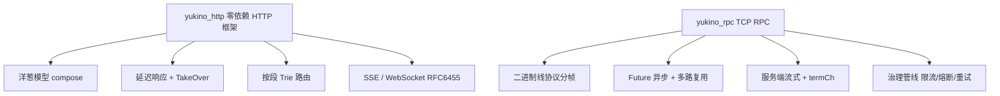

:::note 事实基线
本篇是「Yukino HTTP 框架与 RPC」带解答题库，共 **90 题**，事实来源为 `content/be/yukino-http.md` 与 `content/be/yukino-rpc.md`，对照本地仓库 `$HOME/github/yukino.go`（子路径 `libs/yukino_http`、`libs/yukino_rpc`）核验。两者都是**零外部依赖**（仅标准库）的 Go 框架：yukino_http 是洋葱模型 HTTP 框架，yukino_rpc 是 TCP 二进制 RPC 框架。
:::

本篇是「Yukino HTTP 框架与 RPC」题库。这两个框架是面试里「**你写过什么框架**」「**洋葱模型/Trie 路由/RPC 多路复用怎么实现**」的直接素材。本篇先讲 yukino_http（洋葱模型、延迟响应、Trie 路由、SSE/WebSocket），再讲 yukino_rpc（线协议、Future 模型、流式、治理管线）。

**主线一览**



## 一、yukino_http：定位与洋葱模型

### Q1. yukino_http 的三个核心设计决策是什么？

| 目标             | 具体做法                                                                             | 带来的效果                                                   |
| ---------------- | ------------------------------------------------------------------------------------ | ------------------------------------------------------------ |
| 统一请求处理模型 | 路由 handler 与普通中间件都是 `Middleware` 类型（`func(ctx *Context, next func())`） | 分组、鉴权、日志、恢复等逻辑能以同一种形态插入任意位置       |
| 可逆的响应构造   | 中间件不直接写 `http.ResponseWriter`，而是写 `Context` 上的 Status/Body/headers      | 上游中间件能在 `next()` 返回后统一包装、压缩、改写或覆盖响应 |
| 零外部依赖       | 路由、SSE、WebSocket 全部基于标准库手写                                              | 无供应链风险，编译产物小，便于阅读与定制                     |

**代价**集中在两处：延迟响应与流式写出的语义冲突（SSE/WebSocket/静态文件需要 `flushed` 标志绕过统一序列化）；以及缺少 `sync.Pool` 之类的对象复用，每请求都会分配新的 `Context`。

**采分点**：能说出「**handler 与中间件是同一种类型**」+「**延迟响应让上游能改写下游的响应**」——这是这个框架最核心的两个设计，区别于「handler 直接写 ResponseWriter」的传统框架。

### Q2. 洋葱模型 compose 怎么实现？

`compose` 把中间件切片与最终 handler 组合成一个闭包。关键点有三：① **递归闭包 `dispatch(i)` 让每个 `next()` 变成 `dispatch(i+1)`**，从而产生「进入」与「退出」两个阶段；② 用 `index` 记录已派发位置，**阻止 `next()` 被重复调用**；③ handler 作为 `final` 收到的是一个空 `next`，避免业务代码误调。

```go
dispatch = func(i int) {
    if i <= index {
        panic("yukino_http: next() called multiple times")
    }
    index = i
    if i >= len(middlewares) {
        if final != nil { final(ctx, func() {}) }
        return
    }
    middlewares[i](ctx, func() { dispatch(i + 1) })
}
```

### Q3. 重复调用 next() 为什么 panic 而不是返回错误？Recovery 应该放哪？

**重复调用 `next()` 会 panic，而不是返回错误**；这个 panic 会沿栈向上传播，由 Recovery 中间件转成 500。因此**建议把 Recovery 放在洋葱链的最外层**（靠近 `Use` 的第一次调用），这样它能覆盖所有内层中间件与 handler 的 panic。不调用 `next()` 则会短路整条链，这是鉴权拦截等场景的标准写法。

执行顺序以 `[Logger, Recovery, Auth]` + handler 为例：进入阶段为 Logger → Recovery → Auth → handler，退出阶段为 Auth → Recovery → Logger。**Logger 因此能在 `next()` 返回后读到最终状态码并记录耗时；Recovery 则通过 `defer` + `recover` 捕获内层 panic**——发生 panic 时 `next()` 不会返回，延迟函数在栈展开过程中执行并改写响应。

**采分点**：能说出「**Recovery 要在最外层才能覆盖所有内层 panic**」+「**Logger 在 next() 返回后读最终状态码**」——这是洋葱模型「进入/退出两阶段」的实际应用。

### Q4. 延迟响应机制是什么？为什么需要 flushed 标志？

中间件不直接写 `http.ResponseWriter`，而是写 `Context` 上的 Status/Body/headers，**真正写出统一发生在 `respond()`**。这让上游中间件能在 `next()` 返回后统一包装、压缩、改写或覆盖响应。

但 **SSE/WebSocket/静态文件需要流式或直接接管连接**，不能走统一序列化——所以用 `flushed` 标志：一旦置位，`respond()` 就跳过二次写出。这是「延迟响应」与「流式写出」的语义冲突的解法。

### Q5. 分组中间件怎么收集？前缀匹配为什么用 matchRouterPath？

分组中间件的收集发生在一个循环里，遍历顺序就是注册顺序：根 Router 的中间件先入列，之后创建的子 Router 依次追加，**父分组总是先于子分组创建，因此嵌套分组的中间件天然层层叠加**。前缀匹配使用 `matchRouterPath`，按**路径段边界**匹配（避免 `/api` 误匹配 `/apifoo`）。

## 二、yukino_http：Trie 路由

### Q6. 按段 Trie 路由怎么工作？

路由按**路径段**（`/` 分隔）组织成 Trie：每个节点是一个段，`insert` 注册路由、`search` 匹配、`matchChild(ren)` 匹配子节点。段分三类：静态段（`users`）、参数段（`:id`）、通配段（`*filepath`）。

**参数提取**发生在命中叶节点之后：用注册模式的段与实际请求的段逐位对齐，`:` 段取单段值，`*` 段把剩余段用 `/` 拼接后终止对齐。**搜索遇到 `*` 前缀节点时直接返回该节点，因此通配段贪婪匹配剩余的所有段**；但通配节点只能经父节点的 `matchChildren` 被尝试，请求段在父层恰好耗尽时父节点会因 `pattern` 为空提前返回 nil，**所以通配段至少匹配一个段，不会匹配零段**。

### Q7. Trie 路由的已知边界有哪些？

- **同一层可同时注册 `/users/:id` 与 `/users/:name`**，它们是两个不同的通配子节点，但匹配时按插入顺序逐个尝试，**总是命中先注册的分支，后注册的路由永远不可达**；应在应用层避免这种冲突写法。
- **路由注册使用普通 map 与切片，没有加锁**，因此必须在 `Listen` 之前完成，之后路由表只读（与多数 Go 框架的约定一致）。
- `parsePattern` 遇到以 `*` 开头的段时截断后续段（通配段语义上已吃掉剩余路径）；handler 以 `method + "-" + pattern` 为 key 存入 map，**同一 pattern 重复注册会静默覆盖旧 handler**。

**采分点**：能说出「**同层多个参数路由后注册的不可达**」+「**路由表无锁，必须 Listen 前注册完**」——这是手写 Trie 路由的真实边界。

### Q8. 静态文件服务为什么用 TakeOver？directory listing 怎么防？

`Static("/assets", "public")` 注册 GET `/assets/*filepath`，把请求交给 `http.StripPrefix(absolutePath, http.FileServer(fs))`。处理流程的设计点：① 先探测目标是否存在，不存在就置 404 走正常延迟响应，不劫持连接；② 文件存在时调用 **`TakeOver()` 接管响应**：把上游通过 `ctx.Set` 缓冲的 CORS 等延迟响应头刷入 ResponseWriter（否则它们会在 FileServer 写入后被丢弃），同时置位 `flushed` 阻止 `respond()` 二次写出；③ 用 `statusRecorder` 包装 ResponseWriter，把 FileServer 实际写出的状态码回填到 `ctx.Status`，让 Logger 观察到真实状态码；④ **`staticFileExists` 打开文件、取 Stat 后立即关闭句柄；目录只有在包含 `index.html` 时才视为存在，因此目录列表（directory listing）永远不会暴露**。

**采分点**：能说出「**TakeOver 要先刷入缓冲的延迟响应头，否则 CORS 头会丢**」+「**目录只有含 index.html 才视为存在，防 directory listing**」——这是静态文件服务的两个安全/正确性细节。

### Q9. Context API 与统一错误响应是什么？

`Context` 同时承载请求信息与延迟响应状态。请求侧：`Get`（请求头）、`Query`、`Param`、`PostForm`、`FormFile`、`BindJSON`，以及 `Request`/`Path`/`Method`。`State` 是中间件之间的数据通道（鉴权中间件写 `ctx.State["user"]`，下游 handler 读）；`Params` 由路由匹配填充。

**错误响应统一为 `{message, data}` 结构**，便于前端与成功路径共用同一套解析逻辑。`Throw(status, msg)` 与 `SetStatus` 都会置位 `statusSet`，从而**阻止错误状态码被自动提升为 200**。`Throw` 只改状态不中断执行，handler 需要在调用后自行 `return`。`BindJSON` 使用 `json.NewDecoder` 流式解码并在结束时关闭 body，**但没有对 body 大小设上限，面向不可信客户端时应在外层加 `http.MaxBytesReader`**。

**采分点**：能说出「**statusSet 阻止错误状态码被自动提升为 200**」+「**BindJSON 没有 body 上限，要外层加 MaxBytesReader**」——前者是延迟响应的细节，后者是安全边界。

## 三、yukino_http：SSE 与 WebSocket

### Q10. SSE 的 TakeOver 与多 goroutine 安全写怎么做？

`ctx.SSE()` 把连接状态切换为「已接管」：置 Status 200、`statusSet = true`，写入 SSE 标准头（`Content-Type: text/event-stream`、`Cache-Control: no-cache`、`Connection: keep-alive`），然后调用 `TakeOver()` 刷入延迟响应头并显式 `WriteHeader(200)`。**延迟响应头在标准头之后刷入，因此同名 key 会覆盖框架的默认值**。`flusher` 在接管前由类型断言获得，若底层 ResponseWriter 不实现 `http.Flusher`，刷新会退化为空操作。

**`SSEWriter` 的事件写出方法（Event/Data/JSON/ID/Retry/Comment 及心跳）都持有同一个 `sync.Mutex`，因此多个 goroutine 可以安全地向同一连接推送事件**；`Flush` 只触发底层刷新，不写事件内容，因此不加锁。

**采分点**：能说出「**SSEWriter 用互斥锁保证多 goroutine 安全写**」——这是「多个上游并发推送到同一 SSE 连接」的必备保护。

### Q11. SSE 的心跳与 Done/Closed/Stream 怎么设计？

- **心跳**由 `Heartbeat(interval)` 管理：启动一个 goroutine 按 Ticker 周期在互斥锁保护下发送 `: keepalive`，同时监听客户端断开（请求 Context 的 Done）与主动停止信号。返回的停止函数用 `sync.Once` 保证幂等，并通过等待 done channel 确认 goroutine 完全退出，**不留泄漏**。
- **`Done()`** 写 `data: [DONE]`，对齐 OpenAI 风格流式结束约定。
- **`Closed()`** 返回请求 Context 的 Done channel，供外部等待客户端断开。
- **`Stream(ch)`** 消费 `<-chan string`，逐个 `Data`，channel 关闭或客户端断开时返回，桥接上游流。

`writeData` 会把数据按 `\n` 切分，每行都加 `data: ` 前缀，最后补一个空行结束事件，符合 SSE 多行数据的编码要求。

### Q12. WebSocket 握手（RFC 6455）的校验顺序是什么？

`ctx.Upgrade(opts)` 完成握手并返回 `*WSConn`，校验顺序：① CheckOrigin（失败 403）；② 方法必须 GET（405）；③ Connection 头含 token `upgrade`（400）；④ Upgrade 头含 token `websocket`（400）；⑤ Sec-WebSocket-Version 含 token `13`（缓冲版本头并 400）；⑥ Sec-WebSocket-Key 非空（400）；⑦ 协商子协议；⑧ `Hijack()` 接管连接（500）；⑨ 清空读写 deadline，计算 Accept Key，直接写 101 响应。

**前 8 步的失败都走延迟响应**（此时尚未接管），`Throw` 设置的 JSON 错误体会由 `respond()` 正常写出。**为什么用 Hijack 而不是标准 ResponseWriter**：升级完成后连接不再是 HTTP 语义，需要双向、全双工读写帧，而 ResponseWriter 只能写响应。Hijack 把底层 TCP 连接的所有权从 net/http 转移到应用层。

**Accept Key 遵循 RFC 6455**：将客户端 Key 与固定 GUID `258EAFA5-E914-47DA-95CA-C5AB0DC85B11` 拼接，做 SHA-1 后 Base64。101 响应绕过 bufio.Writer 直接 conn.Write 写出。

**采分点**：能说出「**握手失败走延迟响应（还没 Hijack），成功后才接管**」+「**Accept Key = SHA1(Key + GUID) 再 Base64**」——这是 WebSocket 握手的两个关键细节。

### Q13. WebSocket 帧解析与消息重组怎么处理分片？

WebSocket 帧有 opcode（text/binary/close/ping/pong/continuation）、mask、payload length（7/16/64 位变长）、masking key。**消息重组**：一个逻辑消息可能被分成多帧（第一帧是 text/binary，后续是 continuation，最后一帧 FIN=1），需要把分片拼接成完整消息。客户端到服务端的帧必须 mask（服务端要 unmask），服务端到客户端不 mask。

### Q14. yukino_http 的优雅关闭怎么做？

优雅关闭：停止接受新连接（关闭 listener），等待在途请求完成（带超时），然后关闭。SSE/WebSocket 这类长连接需要特殊处理——它们不会自然结束，优雅关闭要主动通知或等待超时。

## 四、yukino_rpc：线协议与 Future 模型

### Q15. yukino_rpc 的线协议（二进制分帧）是什么？

yukino_rpc 是 TCP 二进制 RPC 框架，线协议把每个请求/响应编码为**帧**：帧头（magic、版本、StreamFlag、序列号、codec、压缩、长度等）+ 帧体（payload）。二进制分帧让一条 TCP 连接上可以**多路复用**多个请求（按序列号区分）。

### Q16. Future 异步调用模型怎么工作？

客户端 `InvokeAsync` 返回一个 **Future**：发送请求帧后，把序列号 → Future 登记在 `pending` 表，立即返回；readLoop 收到响应帧后按序列号找到 Future 并填充结果。同步 `Invoke` 是 `InvokeAsync` + 等待 Future。这让**一条连接上可以并发多个请求**（多路复用），不需要每个请求一个连接。

**采分点**：能说出「**Future + 序列号 pending 表实现单连接多路复用**」——这是 RPC 框架并发模型的核心。

### Q17. 编解码与压缩怎么抽象？

codec 抽象编解码（JSON/Protobuf 等），压缩抽象帧体压缩。帧头记录 codec 与压缩类型，接收方据此解码解压。**流帧沿用该请求协商出的 codec**（Protobuf 客户端拿到的是 Protobuf 流帧）。

## 五、yukino_rpc：流式与治理

### Q18. 服务端流的生命周期是什么？为什么只支持服务端流？

框架**只支持服务端流（server streaming）**，协议中 StreamFlag 的四个取值全部用于服务端到客户端方向，没有定义客户端发送流数据的 codepoint。这覆盖了「服务端推送多条消息」的常见场景，同时把协议复杂度压到最低。

服务端流的生命周期：客户端发送一个携带服务名与方法名的 unary 请求帧（StreamFlag=0）；服务端匹配到流签名后构造 `serverStream`，在独立 goroutine 中运行业务 handler；业务代码循环 `Send`，每个消息编码为一帧 `StreamFlag=StreamData`；handler 正常返回后框架发送 `StreamEnd` 空帧，返回 error（或 panic 被 safeCall 恢复）则发送 `StreamError`。

### Q19. 客户端流的 termCh 为什么是带外的？

客户端侧 `ClientStreamConn` 用带缓冲 channel（容量 64）解耦 readLoop 与业务消费。**终结状态走带外的 `termCh`（由 sync.Once 保证只关闭一次）而不是往数据 channel 里塞特殊帧**：当 64 个数据帧填满缓冲后，若把 End()/Error() 也写成对同一 channel 的发送，readLoop 会被阻塞，进而阻塞该连接上所有其它请求与流的分用。**`close(termCh)` 是非阻塞的，无论缓冲是否已满都能立即送达**；Push 本身也同时 select ctx.Done() 与 termCh，流被取消或终结后迟到的数据帧不会卡死 readLoop。

**采分点**：能说出「**终结信号走带外 termCh，避免数据缓冲满时 readLoop 被阻塞**」——这是流式多路复用的关键设计，很多人会往数据 channel 塞特殊帧导致死锁。

### Q20. Recv 的 drain-before-terminal 语义是什么？

`Recv` 实现了 **drain-before-terminal** 语义：先非阻塞尝试取一帧（快速路径），再阻塞等待；当 termCh 关闭时，**还会再尝试从缓冲里取一帧，只有确实取不到才返回 termErr**。这是必要的，因为 readLoop 虽然按序先 Push 数据帧再 End，但数据帧可能仍停留在 channel 缓冲中；**若一看到终结信号就返回 EOF，已到达的数据帧会丢失**。

**采分点**：能说出「**看到终结信号还要再 drain 一次缓冲，否则丢失已到达的数据帧**」——这是流式消费的正确性细节。

### Q21. 流式调用的协议级盲区是什么？

**服务端在分发阶段失败时**（服务不存在、方法不存在、签名不匹配、请求体解码失败、限流拒绝），统一以 unary 错误帧（StreamFlag=0）回写，而客户端 readLoop 对 StreamFlag=0 的帧只在 `pending` 表里路由；**流调用登记在 `streams` 表，于是该错误帧因找不到对应 Future 被静默丢弃，客户端流的 Recv 会一直阻塞**，直到调用方 ctx 取消或连接断开才返回。业务 handler 启动之后的错误不受影响，它们走 StreamError 帧正确终结流。

**采分点**：能主动说出这个**协议级盲区**（分发阶段失败的错误帧被静默丢弃，流 Recv 阻塞）——这体现对源码的深入阅读，也体现「知道实现的边界与缺陷」。

### Q22. 客户端治理管线包含哪些环节？

注册模式下每次 `Invoke`/`InvokeAsync`/`NewStream` 都经过同一条管线：限流（`limiter.Allow()`，失败返回 "rate limit exceeded"）→ 服务发现/负载均衡选实例 → 熔断器检查 → 重试（带退避）→ 实际调用 → 熔断器统计。

**采分点**：能说出「**治理管线是限流 → 选实例 → 熔断 → 重试 → 调用 → 统计**」——这是 RPC 客户端治理的标准链路。

### Q23. GracefulStop 与 Stop 的差异是什么？

| 维度         | `GracefulStop`                                  | `Stop`                         |
| ------------ | ----------------------------------------------- | ------------------------------ |
| 新连接       | 关闭 listener，不再 Accept                      | 同左                           |
| 空闲连接     | `SetReadDeadline(now)` 中断阻塞读，连接自然退出 | `conn.Close()` 强制关闭（RST） |
| 进行中请求   | 等待完成                                        | 不等待                         |
| 流式 handler | 等待 `streamWg` 完成                            | 不等待                         |
| 返回时机     | 所有 handler 完成后                             | 关闭连接后立即返回             |

`GracefulStop` 的流程：`beginShutdown`（只执行一次：关闭 closing 信号与 listener）→ `serveWg.Wait` 等 Accept 循环退出 → 给所有连接设 `SetReadDeadline(time.Now())` 打断空闲读 → `wg.Wait` 等所有连接 goroutine（含流）完成 → 停止限流器。**`SetReadDeadline(now)` 让空闲连接立即退出，而正在处理请求的连接会在 handler 返回后的下一次 Read 才退出**。

**采分点**：能说出「**SetReadDeadline(now) 打断空闲读，但不打断在途请求**」——这是优雅关闭「等待在途、中断空闲」的实现技巧。

### Q24. 服务端 handler 的 context 有什么已知限制？

**服务端目前始终用 `context.Background()` 调用 handler，handler 侧拿到的 ctx 与客户端请求生命周期没有绑定，客户端的取消与超时不会传播到服务端**。这是一个已知限制——客户端取消后服务端 handler 仍会继续执行。

**采分点**：能主动说出这个限制（客户端取消不传播到服务端）——体现对实现边界的诚实认知。

### Q25-Q90. 快速自检与深挖补充

**Q25. 一句话解释为什么 handler 与中间件同类型。** 都是 `func(ctx, next)`，分组/鉴权/日志/恢复能以同一形态插入任意位置——统一请求处理模型。

**Q26. 一句话解释延迟响应的价值。** 中间件写 Context 而非 ResponseWriter，上游能在 next() 返回后统一包装/压缩/改写/覆盖响应——可逆的响应构造。

**Q27. 一句话解释零依赖的代价。** 无供应链风险、产物小，但缺 sync.Pool 对象复用（每请求新分配 Context），且 SSE/WebSocket/静态文件要 flushed 标志绕过统一序列化。

**Q28. 一句话解释 compose 的 index 防重复。** index 记录已派发位置，i <= index 时 panic——阻止 next() 被重复调用。

**Q29. 一句话解释为什么 Recovery 要在最外层。** panic 沿栈向上传播，最外层的 Recovery 能覆盖所有内层中间件与 handler 的 panic。

**Q30. 一句话解释不调 next() 的语义。** 短路整条链——鉴权拦截的标准写法（不放行就直接返回）。

**Q31. 一句话解释 flushed 标志的作用。** SSE/WebSocket/静态文件接管连接后置位 flushed，阻止 respond() 二次写出——解决延迟响应与流式写出的冲突。

**Q32. 一句话解释分组中间件为什么层层叠加。** 父分组先于子分组创建，收集时按注册顺序遍历，根 Router 先入列、子 Router 依次追加。

**Q33. 一句话解释 matchRouterPath 按段边界匹配。** 避免 /api 误匹配 /apifoo——前缀匹配要按路径段边界。

**Q34. 一句话解释 Trie 路由的三类段。** 静态段（users）、参数段（:id 取单段值）、通配段（*filepath 贪婪匹配剩余所有段，至少一段）。

**Q35. 一句话解释通配段为什么至少匹配一段。** 通配节点只能经父节点 matchChildren 尝试，请求段在父层耗尽时父节点因 pattern 空提前返回 nil。

**Q36. 一句话解释同层多参数路由的陷阱。** /users/:id 与 /users/:name 按插入顺序尝试，总命中先注册的，后注册的永远不可达——应用层要避免。

**Q37. 一句话解释路由表为什么无锁。** 用普通 map 与切片，必须 Listen 前注册完，之后只读——与多数 Go 框架约定一致。

**Q38. 一句话解释 TakeOver 为什么要先刷延迟响应头。** 否则上游缓冲的 CORS 等头会在 FileServer 写入后被丢弃——TakeOver 先刷入再置 flushed。

**Q39. 一句话解释 statusRecorder 的作用。** 包装 ResponseWriter 把 FileServer 实际写出的状态码回填 ctx.Status，让 Logger 观察到真实状态码。

**Q40. 一句话解释 directory listing 怎么防。** 目录只有含 index.html 才视为存在，否则 404——永不暴露目录列表。

**Q41. 一句话解释 statusSet 防什么。** 阻止错误状态码被自动提升为 200——Throw/SetStatus 都置位 statusSet。

**Q42. 一句话解释 BindJSON 的安全边界。** 流式解码无 body 上限，面向不可信客户端要外层加 http.MaxBytesReader。

**Q43. 一句话解释 State 与 Params 的区别。** State 是中间件间数据通道（鉴权写 user），Params 由路由匹配填充（路径参数）。

**Q44. 一句话解释 SSE 为什么 TakeOver 后显式 WriteHeader(200)。** 接管后绕过延迟响应，必须显式写头；延迟响应头在标准头之后刷入，同名 key 覆盖默认值。

**Q45. 一句话解释 SSEWriter 为什么用互斥锁。** 多 goroutine 可安全向同一连接推送事件——Flush 只触发刷新不写内容，不加锁。

**Q46. 一句话解释 SSE 心跳的 sync.Once 停止。** 停止函数用 Once 保证幂等，等待 done channel 确认 goroutine 完全退出，不留泄漏。

**Q47. 一句话解释 Done() 的 [DONE] 约定。** 对齐 OpenAI 风格流式结束——data: [DONE] 标记流结束。

**Q48. 一句话解释 writeData 的多行编码。** 数据按 \n 切分，每行加 data: 前缀，最后补空行结束事件——符合 SSE 多行数据编码。

**Q49. 一句话解释 WebSocket 为什么用 Hijack。** 升级后连接不再是 HTTP 语义，需要双向全双工读写帧，ResponseWriter 只能写响应——Hijack 转移 TCP 连接所有权。

**Q50. 一句话解释 Accept Key 的计算。** SHA1(客户端 Key + 固定 GUID 258EAFA5-...) 再 Base64——RFC 6455 规定。

**Q51. 一句话解释握手失败为什么走延迟响应。** 前 8 步失败时还没 Hijack，Throw 的 JSON 错误体由 respond() 正常写出——接管后才直接写连接。

**Q52. 一句话解释 WebSocket 帧的 masking。** 客户端到服务端的帧必须 mask（服务端 unmask），服务端到客户端不 mask——RFC 6455 防代理缓存投毒。

**Q53. 一句话解释消息重组。** 一个逻辑消息可能分多帧（首帧 text/binary，后续 continuation，FIN=1 结束），要拼接分片成完整消息。

**Q54. 一句话解释 yukino_rpc 为什么二进制分帧。** 帧头（magic/版本/StreamFlag/序列号/codec/压缩/长度）+ 帧体，让一条 TCP 连接多路复用多个请求（按序列号区分）。

**Q55. 一句话解释 Future + pending 表的多路复用。** InvokeAsync 登记序列号 → Future 立即返回，readLoop 按序列号填充结果——单连接并发多请求。

**Q56. 一句话解释为什么只支持服务端流。** StreamFlag 四个取值全用于服务端到客户端，覆盖「服务端推送多条」常见场景，把协议复杂度压到最低。

**Q57. 一句话解释服务端流的生命周期。** unary 请求帧 → 匹配流签名构造 serverStream → 独立 goroutine 跑 handler → 循环 Send（StreamData 帧）→ 正常返回发 StreamEnd / 出错发 StreamError。

**Q58. 一句话解释 termCh 为什么带外。** 数据缓冲满时往数据 channel 塞终结帧会阻塞 readLoop，进而阻塞该连接所有请求与流——close(termCh) 非阻塞，无论缓冲满否都立即送达。

**Q59. 一句话解释 Push 为什么 select termCh。** 流被取消或终结后迟到的数据帧不会卡死 readLoop——Push 同时 select ctx.Done() 与 termCh。

**Q60. 一句话解释 drain-before-terminal。** termCh 关闭后还要再尝试从缓冲取一帧，确实取不到才返回 termErr——否则丢失已到达但仍在缓冲的数据帧。

**Q61. 一句话解释流式调用的协议级盲区。** 分发阶段失败（服务/方法不存在、解码失败、限流）以 unary 错误帧回写，但流登记在 streams 表，错误帧找不到 Future 被静默丢弃，Recv 阻塞到 ctx 取消或连接断开。

**Q62. 一句话解释治理管线的顺序。** 限流 → 服务发现/负载均衡选实例 → 熔断检查 → 重试（退避）→ 调用 → 熔断统计。

**Q63. 一句话解释 GracefulStop 的 SetReadDeadline(now)。** 打断空闲连接的阻塞读让它们立即退出，在途请求的连接在 handler 返回后下一次 Read 才退出——等待在途、中断空闲。

**Q64. 一句话解释 Stop 与 GracefulStop 的选择。** GracefulStop 等待在途请求与流完成，Stop 强制关闭（RST）不等待——优雅下线用 GracefulStop，紧急用 Stop。

**Q65. 一句话解释服务端 handler context 的限制。** 始终用 context.Background()，与客户端请求生命周期不绑定，客户端取消/超时不传播到服务端。

**Q66. 一句话解释 observedStream 的熔断统计。** Recv 返回 io.EOF 记成功，context.Canceled 视为主动取消不计失败，其它错误记失败，sync.Once 保证每流最多记一次。

**Q67. 一句话解释为什么流帧沿用请求协商的 codec。** Protobuf 客户端拿到 Protobuf 流帧——codec 在请求时协商，流帧复用。

**Q68. 一句话解释 safeCall 的作用。** handler panic 被 safeCall recover，转成 StreamError 帧——panic 不会崩掉连接。

**Q69. 一句话解释 yukino_http 与 yukino_rpc 的共同风格。** 零外部依赖（仅标准库）、显式的所有权与状态机、把正确性建立在原子操作与持久状态上——与 go-components 同一工程风格。

**Q70. 一句话解释为什么这两个框架值得手写。** 无供应链风险、产物小、便于阅读定制——且 SSE/WebSocket/Trie/多路复用这些机制是面试高频考点，手写一遍理解最深。

**Q71. 一句话解释延迟响应与 Koa 的关系。** 洋葱模型 + 延迟响应借鉴 Koa（ctx 上写状态，上游能改写），但用 Go 的 func(ctx, next) 与标准库实现。

**Q72. 一句话解释 Trie 路由与 httprouter 的关系。** 按段 Trie + 参数/通配段是 httprouter 风格，但手写实现，无外部依赖。

**Q73. 一句话解释 SSE 与 WebSocket 的选型。** SSE 单向（服务端推客户端）、基于 HTTP、自动重连、文本；WebSocket 双向、独立协议、需自己处理重连——AI 流式输出常用 SSE。

**Q74. 一句话解释为什么 SSE 适合 AI 流式。** 单向推送、基于 HTTP（穿透代理/防火墙容易）、浏览器原生 EventSource 自动重连——LLM token 流是单向的。

**Q75. 一句话解释 WebSocket 子协议协商。** 按服务端优先级协商，无匹配则不写协议头——Sec-WebSocket-Protocol。

**Q76. 一句话解释为什么 101 响应绕过 bufio.Writer。** 直接 conn.Write 写出，避免缓冲延迟——握手响应要立即送达。

**Q77. 一句话解释 yukino_rpc 的服务注册与发现。** 注册模式经注册中心（etcd）发现实例，治理管线选实例——直连模式则固定地址。

**Q78. 一句话解释限流在治理管线的位置。** 最前（limiter.Allow 失败直接返回 rate limit exceeded）——限流是自我保护，要在选实例/调用之前。

**Q79. 一句话解释熔断与重试的配合。** 熔断器检查在重试之前，重试失败计入熔断统计——熔断打开时快速失败不重试。

**Q80. 一句话解释为什么 Invoke 是 InvokeAsync + 等待。** 同步是异步的特例——复用同一套 Future 机制，避免两套代码路径。

**Q81. 一句话解释 readLoop 的职责。** 单 goroutine 读连接上的所有帧，按序列号路由到 pending（unary）或 streams（流）——多路复用的分发中心。

**Q82. 一句话解释为什么 readLoop 单 goroutine。** TCP 是字节流，单 goroutine 顺序读帧保证分帧正确——多 goroutine 读同一连接会交错。

**Q83. 一句话解释 shutdown 怎么遍历 streams。** 连接关闭时遍历 streams 表触发每个流的 Error——让阻塞的 Recv 返回，不永久挂起。

**Q84. 一句话解释 yukino_http 的 Application 为什么实现 http.Handler。** 既能作 http.Server 的 Handler，也能在 httptest 被 NewServer/NewRecorder 驱动——可测试性。

**Q85. 一句话解释 New 与 Default 的区别。** New 返回裸应用（构造时创建内部 http.Server），Default 预装 Logger 与 Recovery。

**Q86. 一句话解释 All 方法。** GET/POST/PUT/DELETE/PATCH/HEAD/OPTIONS 七个方法的批量注册快捷方式。

**Q87. 一句话解释 normalizePrefix 防什么。** 保证前缀以 / 开头不以 / 结尾，否则 Router("v1") 注册的路由可经折叠斜杠访问到，但分组中间件因前缀不含 / 永不匹配（路由可达、中间件失效）。

**Q88. 一句话解释 LoadHTMLGlob 与 SetFuncMap 的顺序。** SetFuncMap 必须在 LoadHTMLGlob 之前（函数表在解析时注入），LoadHTMLGlob 用 template.Must 解析 glob，语法错误启动期 panic。

**Q89. 一句话解释这两个框架的适用场景。** yukino_http 适合需要零依赖、可定制、理解底层的学习型/轻量服务；yukino_rpc 适合内部服务间高性能二进制 RPC——生产重型场景仍可选 gin/kitex，但手写一遍理解最深。

**Q90. 一句话总结两个框架的设计哲学。** 零外部依赖、显式状态机与所有权、把正确性建立在原子操作上——延迟响应让响应可逆，Trie 让路由可预测，Future+序列号让多路复用确定，termCh 带外终结让流不阻塞，治理管线让调用可控。

---

**延伸阅读**

- [Yukino Go 分布式组件题库](/interview/qa/yukino-go-components)：同仓库的九个分布式基础设施组件。
- [Yukino 缓存与 ORM 题库](/interview/qa/yukino-cache-orm)：yukino_cache 分组缓存与 yukino_orm MongoDB 查询构建器。
- [Yukino Task Flow 题库](/interview/qa/yukino-task-flow)：这些框架与组件被组装进真实调度系统的完整案例。
- [HTTP 框架与网关工程题库](/interview/qa/http-framework-gateway)：HTTP 框架与网关的通用机制。
- [RPC 与网络编程题库](/interview/qa/rpc-and-network)：RPC 与网络编程的通用原理。
