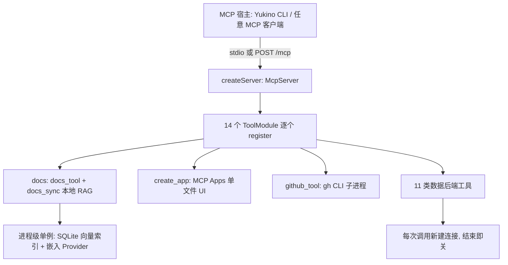

:::note 事实基线
本篇是「Yukino 官方 MCP 服务器」项目深挖带解答题库，共 **85 题**，事实来源为 `content/fe/yukino-mcp.md`，对照本地仓库 `~/github/yukino-code/apps/mcp` @ `7b9add5` 核验（frontmatter `local_commit` 与本机 HEAD 一致）。这是 `@yukino.js/mcp`：把本地 RAG 文档检索、MCP Apps 交互式 UI、`gh` CLI 与 PostgreSQL/MySQL/ClickHouse/Redis/MongoDB/Prometheus/Grafana/MinIO/etcd/Milvus/Kafka 十一类数据后端收敛成 **15 个 MCP 工具**，用 stdio 与无状态 Streamable HTTP 双传输对外暴露，并以进程级单例承载向量索引与连接生命周期。面试里它以「**介绍一个你做过的 MCP 服务器 / 工具集成项目**」的形式出现。
:::

本篇是「Yukino 官方 MCP 服务器」项目深挖题库。它的面试价值在于：**它是「如何把一批彼此正交的能力打包进同一个 MCP 进程」的工业级参考**——工具模块契约把「每会话注册」与「进程级状态」分开、双传输共享同一 `createServer()`、本地 RAG 用 `node:sqlite` 零外部依赖、数据工具「无白名单原样透传」把安全边界交给连接账号。本篇的组织顺序是：**先讲定位与能力边界 → 再讲架构总览与工具模块契约 → 再讲双传输层 → 再讲 docs 本地 RAG → 再讲 create_app → 再讲 github_tool → 再讲十一类数据后端四层 → 再讲配置体系 → 最后讲构建打包与适用边界**。

**主线一览**



## 一、定位与能力边界

### Q1. 这个 MCP 服务器的定位是什么？解决哪三类问题？

定位是「**官方工具集合**」：不做单一功能，而是把一批高频、彼此正交的能力打包进同一个进程，用一份配置、一次启动对外提供。它解决三类问题：① **给 Agent 一个本地知识库入口**——把 `YUKINO_DOCS_DIR`（默认 `~/.yukino/docs`）下的 Markdown/文本文档做向量化，提供语义检索（`docs_tool`）与增量同步（`docs_sync`）；② **给 Agent 一个「渲染结果」的出口**——通过 MCP Apps 扩展让模型产出自包含 HTML，在对话内以沙箱 iframe 呈现为可交互应用（`create_app`）；③ **给 Agent 一组「直连后端」的手**——一个 `github_tool` 覆盖全部 `gh` 子命令，十一个数据工具以「无限制、原样透传」方式执行 SQL、Redis 命令、MongoDB 命令、HTTP API、S3 签名请求与 Kafka 生产/消费。

### Q2. 服务器暴露多少个工具？由多少个模块注册？

服务器共暴露 **15 个工具**，由 **14 个模块**注册（`docs` 模块同时注册 `docs_tool` 与 `docs_sync`），工具名集中在 `src/tools/names.ts`，模块清单在 `src/tools/index.ts`。

### Q3. 设计上有哪两条鲜明取舍？

其一，数据类工具**不做任何白名单或只读模式**，以连接账号的完整权限原样执行，把安全边界交给「连的是哪个库、用什么账号」；其二，除文档向量索引使用内置 `node:sqlite` 外，**不引入任何常驻外部服务**，每次数据库调用都新建并在结束后关闭连接（Kafka 则是每次调用新建 Admin/Producer/Consumer，用完即关）。

**采分点**：能说出「**无白名单原样透传 + 无常驻外部服务（除 SQLite 索引）**」——并点出这意味着「生产库应使用最小权限账号，或干脆不配置对应环境变量」。

### Q4. 技术选型一览？

| 维度      | 选型                                                                                                           |
| --------- | -------------------------------------------------------------------------------------------------------------- |
| 协议      | `@modelcontextprotocol/server`（`McpServer` 与两种 transport）+ `@modelcontextprotocol/ext-apps`（MCP Apps）   |
| 传输      | stdio（默认）/ HTTP（无状态 Streamable HTTP），由 `--http` 或 `MCP_TRANSPORT=http` 切换                        |
| HTTP 框架 | `h3`（`H3` + `serve`）                                                                                         |
| 参数校验  | `zod` v4（工具入参 schema 与环境变量 schema 共用）                                                             |
| RAG       | `ai` + `@ai-sdk/openai-compatible` 生成向量，`@langchain/textsplitters` 做 Markdown 分块，`node:sqlite` 存索引 |
| 数据后端  | `pg` / `mysql2` / `redis` / `mongodb` 官方驱动 + `@platformatic/kafka` + 手写 S3 SigV4 + HTTP 透传             |

### Q5. 这个服务器适合什么场景？

适合：给 Yukino CLI 或任意 MCP 宿主一次性接入「本地文档 RAG + 结果可视化 + GitHub 操作 + 多数据库/中间件直连」的复合能力；需要在对话内交付可交互 HTML 应用（图表、仪表盘、演示）的场景；希望以完整权限让 Agent 直接操作开发/测试环境数据库、对象存储、消息队列与可观测栈的运维/排障流程。

## 二、架构总览与工具模块契约

### Q6. `main.ts` 入口的启动顺序为什么是「传输先就绪、init 后置」？

`main.ts` 是入口：先选择传输（stdio 直接 `createServer()` + `StdioServerTransport`；HTTP 则 `startHttpServer(host, port)`），**连接/监听完成之后才 fire-and-forget 触发各模块的 `init()`**。这个顺序是刻意的——传输先就绪，工具立刻可被 `list`；而真正的重活（打开索引、探测维度、后台同步文档）推迟到 init，工具调用内部会 `await` 同一个 init Promise，因此**首个调用不会被大知识库拖到客户端超时**。入口还在最前面依次 import `shared/quiet-sqlite-warning.js`（必须是第一个 import）与 `dotenv/config`。

### Q7. `ToolModule` 接口如何把「每会话注册」与「进程级状态」分开？

所有模块实现同一个 `ToolModule` 接口（`src/tools/types.ts`）：

```ts
interface ToolModule {
  name: string; // 唯一, 用于日志与去重
  register(server: McpServer): void; // 每个 server 实例调用一次
  init?(): Promise<void>; // transport 就绪后触发, 工具调用 await 同一 Promise
  shutdown?(): Promise<void>; // 进程退出时清理连接/句柄
}
```

`register` 之所以可能被调用多次，是因为 **HTTP 传输会为每个请求新建一个 `McpServer`**；而 `init`/`shutdown` 管理的是**进程级单例**（数据库句柄、向量缓存、嵌入 Provider）。这个分离让「每请求一个 server」的无状态 HTTP 模式与「进程级一份重资源」共存。

### Q8. 为什么模块加载时要先跑 `assertUniqueModuleNames()`？

因为 `registerTool` 遇到重名会抛错，在「每请求一个 server」的 HTTP 模式下这会变成**运行时错误**（每个请求都炸），所以宁可**启动即失败**——在模块加载时一次性断言模块名唯一，把错误压到启动期。

### Q9. 工具名的命名约定是什么？

工具名集中维护在 `names.ts`（`TOOL_NAMES` 常量 + `McpToolName` 类型），约定 **snake_case 且至少两个词**：单词工具加 `_tool` 后缀（`docs_tool`/`github_tool`），复合名保持不变（`create_app`/`docs_sync`）。

### Q10. `INSTRUCTIONS` 与版本号如何提供？

`createServer()` 还会把一段 `INSTRUCTIONS` 以 `{ instructions }` 传给 `McpServer`——它在 `initialize` 时下发给宿主，Yukino 会注入模型上下文，用于改善工具选择（告诉模型何时该查文档、何时该渲染 App、各数据与中间件工具的用途与连接方式）；服务器名常量为 `SERVER_NAME = "yukino-mcp"`。版本号由 `version.ts` 解析：构建期 `tsup` 通过 `define` 注入 `__YUKINO_MCP_VERSION__`；开发态（`tsx`）则回退读取相对自身的 `../package.json` 或 `../../package.json`（用 zod 校验出 `version` 字段），都找不到则抛错。

## 三、双传输层

### Q11. stdio 模式下为什么 stdout 必须完全归 JSON-RPC 帧所有？

stdio 模式下 **stdout 完全归 JSON-RPC 帧所有**，因此 `pino` 在 `shared/logger.ts` 里被显式定向到 **fd 2（stderr）**，任何杂散的 stdout 写入都会破坏协议流。这是 stdio MCP 服务器的铁律——日志、调试输出都不能碰 stdout。

### Q12. stdio 的 shutdown 如何做到幂等且不吊死？

SDK 的 transport 不会在 stdin EOF 时自动关闭，所以入口同时监听 `process.stdin` 的 `end`/`close` 与 `server.server.onclose`，触发统一的 `shutdown`。`shutdown` 是**幂等**的（`shuttingDown` 标志）：先关传输，再逐个 `await module.shutdown?.()`，最后 `process.exit(0)`，并挂一个 **`unref()` 的 5 秒兜底定时器强制退出**——任何卡死的传输或模块都不能让进程吊住不退出。SIGINT/SIGTERM 走同一条路径。

### Q13. HTTP 模式的「无状态 Streamable HTTP」体现在哪？

HTTP 模式用 `h3` 只暴露一种远程传输——**无状态 Streamable HTTP**：`POST /mcp` 每请求 `createServer()` + `WebStandardStreamableHTTPServerTransport({ enableJsonResponse: true })`，`transport.handleRequest(event.req)` 处理完在 `finally` 中关闭 transport 与 server；`GET /mcp` 直接 405（JSON `{ error: "Method Not Allowed" }`），因为无状态模式没有服务端主动通知流。**每请求一对 server/transport**，请求之间不共享会话状态。

### Q14. 为什么 `quiet-sqlite-warning.ts` 必须是入口第一个 import？

因为 ESM 会在任何模块体执行前先求值 import。`node:sqlite` 是实验性模块，静态引入会抢在过滤器安装之前拉起它，导致每次调用都打印 `ExperimentalWarning`。该过滤器 patch `process.emit`，吞掉消息匹配 `SQLite` 的 `ExperimentalWarning`——**必须是入口的第一个 import** 才能赶在 `node:sqlite` 被求值前装好。这也是 `node:sqlite` 用 `createRequire` 懒加载而非静态 import 的原因。

## 四、docs_tool / docs_sync：本地 RAG 检索

### Q15. docs 子系统的流水线与存储是什么？

这是服务器里最完整的子系统，一条 `扫描 → 分块 → 嵌入 → 索引 → 检索` 的流水线（`src/tools/docs/`），**全部落在本地 SQLite 上，不依赖任何外部向量库**。索引是一个 SQLite 文件（`YUKINO_INDEX_DB`，默认 `~/.yukino/index.sqlite`，目录不存在会 `mkdirSync` 递归创建；`:memory:` 则跳过建目录），通过 `node:sqlite` 的 `DatabaseSync` 打开，构造参数带 5 秒 busy timeout。打开后立即设 `journal_mode=WAL`（后台同步不阻塞读）与 `synchronous=NORMAL`，再执行建表 schema。

### Q16. 三张 STRICT 表分别存什么？

| 表        | 作用                                                                                                               |
| --------- | ------------------------------------------------------------------------------------------------------------------ |
| `meta`    | 键值对，存 `schema_version`（当前为 `"1"`）与向量维度 `dim`                                                        |
| `sources` | `source → 内容 sha256`，增量同步的判据                                                                             |
| `chunks`  | 分块正文、metadata（JSON 字符串）、创建时间与 `vector` BLOB（Float32 原始字节），另有 `chunks_source_idx` 二级索引 |

### Q17. 为什么索引被当作「可重建的缓存」而非「需迁移的数据」？

`ensureSchema` 发现存储的 schema 版本或维度与当前不符时，**直接 `DELETE` 全表并重写 meta，而不做迁移**。因为索引是从源文档派生的——源文档（`YUKINO_DOCS_DIR`）才是事实源，索引随时可以全量重建。把索引当缓存，就免去了「向量维度变更/schema 升级」的迁移复杂度。

**采分点**：能说出「**索引是可重建缓存，维度/schema 不符直接清库重嵌，不做迁移**」——这是「派生数据」与「事实数据」的区分。

### Q18. 分块参数与 section title 如何确定？

分块用 LangChain 的 `RecursiveCharacterTextSplitter.fromLanguage("markdown")`，`chunkSize=1000`、`chunkOverlap=200`——**远低于入库时 8192 字符的截断上限与嵌入 Provider 的输入上限，保证「被嵌入的文本」与「被存储的文本」完全一致**。每个分块附带一个 section title：取块内第一个 Markdown 标题（`/^#{1,6} +(.+)$/` 逐行匹配），没有则继承更早的块里最近一次出现的标题（块按文档顺序到达）；空白分块（trim 后为空）直接丢弃。

### Q19. 嵌入的批量大小为什么固定为 10？

嵌入走 `@ai-sdk/openai-compatible` 的 OpenAI 兼容端点，单条用 `ai` 的 `embed`、批量用 `embedMany`，**批量大小固定为 `EMBED_BATCH_SIZE = 10`**——因为兼容端点常限制单次输入条数，**SDK 默认的 2048 会触发 batch size 错误**。每次调用带 20 秒 `AbortSignal.timeout` 与 `maxRetries: 1`。

### Q20. 增量同步 `syncDocs` 的扫描与比对逻辑？

`syncDocs` 先用 `scanDocsDir` 扫描目录：递归 `readdir` 只收 `.md`/`.markdown`/`.txt` 普通文件，`source` 是归一化为 `/` 的相对路径，结果按 `localeCompare` 排序；目录不存在（`ENOENT`）是正常态，返回空；单个文件读取失败记 `content: null`（计 failed，保留该文件的既有索引）。随后对每个文件算内容 sha256 与 `sources` 里记录的比对：**相同则跳过（skipped），新增/变更则先嵌入再原子替换，磁盘上已删除的文件从索引移除（removed）**。

### Q21. 原子替换如何用 `BEGIN IMMEDIATE` 事务保证？锁冲突怎么处理？

原子性由 `indexer.ts` 的 `transact` 封装的 **`BEGIN IMMEDIATE` 事务**保证——它一上来就抢写锁，并发写者会在此处以 `SQLITE_BUSY`（errcode 5）显现并被翻译成 `LockConflictError`（**在同步统计里计为 skipped 而非 failed**），一个 `COMMIT` 完成「删旧分块 → upsert 新分块 → 更新 hash」的全有或全无替换；分块 id 是确定性的 `sha256(source):序号`，因此**重复索引同一文件是幂等的 upsert**。

### Q22. 嵌入为什么刻意放在拿写锁之前？

**嵌入刻意放在拿写锁之前**，且入库前校验向量数量一致、非空、全部有限，Provider 失败时旧分块与旧 hash 都原封不动。这样做的意义是：嵌入是慢操作（网络调用），如果持锁嵌入会长时间占用写锁阻塞其他写者；先嵌入再拿锁做快速替换，把锁的持有时间压到最短。写入时正文截断到 `MAX_CONTENT_LENGTH = 8192` 字符。单文件失败只记录并跳过，绝不中断整轮同步；每次写入结束都 `invalidateCache` 让检索缓存失效。

**采分点**：能说出「**慢嵌入在锁外、快替换在锁内，把写锁持有时间压到最短**」——这是「事务边界要排除慢 IO」的经典实践。

### Q23. 进程内单飞如何避免重复同步？

并发控制还有一层进程内的单飞：`runSync` 复用同一个 `syncPromise`，因此**后台同步与显式 `docs_sync` 调用不会重复跑**。`docs_sync` 无入参，会 `await` 进行中的同步，返回 `{indexed, skipped, removed, failed, chunks}` 统计（failed 非零时置 `isError`），同时进 `structuredContent`。

### Q24. 检索为什么不用 SQLite 做向量运算，而用内存矩阵点积？

检索把所有向量一次性载入一块连续的 `Float32Array` 行主序矩阵（`VectorCache`，建缓存时跳过字节长度不等于 `dim*4` 的坏行）。**向量入库时已 L2 归一化，于是余弦相似度退化为纯点积**，结果再夹到 `[-1, 1]`；在个人知识库规模（数千分块）下全量扫描只需个位数毫秒，远比往返外部索引划算。

### Q25. 检索缓存如何失效？

缓存失效靠 `PRAGMA data_version` 与缓存记录的版本号比对：本进程写入已显式 `invalidateCache`，而 `data_version` 还能捕捉**其他进程**对同一 SQLite 文件的写入——版本号变了就重建矩阵缓存。这让「多进程共享一个索引文件」也能保持检索结果新鲜。

### Q26. docs 的两阶段初始化与降级机制？

`docs` 模块用一个进程级 `EngineState`（`ready` / `degraded`）单例，初始化分两阶段：**快阶段（await）**——配置检查 → `openStore` 打开索引 → `ensureSchema` 维度探测 + schema 校验，其中 `ensureSchema` 有 **15 秒预算**（`INIT_TIMEOUT_MS`，客户端调用超时约 60 秒，卡住的 Provider 必须提前降级），完成后即可对既有数据查询；**后台阶段（fire-and-forget）**——增量文档同步，大知识库永不阻塞首个工具调用。

### Q27. docs 为什么「降级而非抛错」？降级后如何恢复？

任何失败都**降级而非抛错**：嵌入未配置、索引打不开、schema 初始化超时，都返回带明确原因的 `degraded`，工具调用据此回一句诚实的 `docs is unavailable: …`。降级状态有 **30 秒重试窗口**（`DEGRADED_RETRY_MS`）——Provider 可能在会话中途恢复，无需重启 CLI。维度探测（`embedText("dimension probe")`）**以模型实际输出为准，从不取静态配置**；维度或 schema 不匹配就清库，逼下次同步全量重嵌入。查询期若发现异常且数据库句柄已关闭（`db.isOpen` 为 false），会把状态切到 `degraded`（vector index connection lost）并关闭句柄，走同样的重试窗口恢复。

**采分点**：能说出「**维度探测以模型实际输出为准 + 降级 30 秒重试窗口 + 其余工具不受影响**」——「一个子系统降级不拖垮整个服务器」是工具集合服务器的关键韧性。

## 五、create_app：MCP Apps 交互式 UI

### Q28. `create_app` 基于什么扩展？注册了哪一对东西？

`create_app` 让模型产出一段完整、自包含的 HTML（内联 CSS/JS），在对话内渲染成可交互应用。它基于 `@modelcontextprotocol/ext-apps`，用其 `/server` 子路径注册**一对**东西：`registerAppTool(create_app)` 与 `registerAppResource(ui://create-app/create-app.html)`。

### Q29. `create_app` 工具的入参与 `_meta` 约定？

入参 `html`（≤ 200000 字符）与 `title`（≤ 120 字符，默认 `MCP App`），工具**定义**在 `_meta.ui.resourceUri` 指向 UI 资源 `ui://create-app/create-app.html`；处理器会先 `readAppHtml()` 确认外壳存在，再把完整 HTML 与标题放进结果的 `_meta.html`/`_meta.title`（title 同时进 `structuredContent`）；**宿主若无 MCP Apps 支持，只看到一句文本回退说明**。

### Q30. UI 资源为什么必须声明 CSP `resourceDomains` 白名单？

`registerAppResource` 返回一个**沙箱外壳** HTML，MIME 用扩展约定的 `RESOURCE_MIME_TYPE`，并在 `_meta.ui.csp.resourceDomains` 声明允许的 CDN 白名单（unpkg、jsdelivr、tailwindcss、cdnjs、esm.sh、Google Fonts 的 `fonts.googleapis.com` 与 `fonts.gstatic.com` 共 7 个）。外壳用同文档 `srcdoc` iframe 渲染用户 HTML，会**继承宿主对 app 资源的 CSP**——没有这份白名单，模型写的 HTML 里任何 CDN 脚本/字体/样式都会被静默拦截。

### Q31. 单文件外壳如何构建与加载？

外壳本身是一个 React 应用（`create-app.tsx` + `create-app.html` 入口），构建期由 `vite` + `vite-plugin-singlefile` 打成**一个自包含 HTML**（`dist/create-app.html`），样式是 Tailwind + daisyUI。运行时 `readAppHtml()` 优先读 `import.meta.url` 的兄弟路径（打包产物 `dist/main.js` 旁就是 `dist/create-app.html`），否则回退 `../../../dist/create-app.html`（源码布局）；外壳缺失时工具返回可读错误并提示 `pnpm build:app`。

### Q32. 外壳的运行时状态机由哪些事件驱动？

外壳通过 `PostMessageTransport`（指向 `window.parent`）与宿主建立 `App` 连接，监听一串事件驱动一个 waiting/streaming/ready/failed 的 `RenderState` 状态机：`toolinputpartial`（流式生成中，显示已产出字节数）、`toolinput`（入参完整，拿到 `html`/`title` 即渲染，并把入参存入 ref 备用）、`toolresult`（`isError` 则 failed，否则经 `resolveAppDocument` 取 HTML）、`hostcontextchanged`（应用宿主主题/样式变量/字体并同步容器高度约束）、`toolcancelled`（置为 failed）。

### Q33. 外壳的高度自适应如何实现？

高度自适应是外壳自己实现的（`frame-size.ts`）：渲染前 `withHeightReporter` 会在用户 HTML 的 `<head>` 之后注入一段带 `data-yukino-height-reporter` 标记的脚本，它在 `load` 与 `ResizeObserver` 回调里测量 `body.offsetHeight`，经 rAF 节流后向父窗口 `postMessage` `{source: "yukino-create-app", height}`；外壳用 zod 校验消息后按 `resolveFrameHeight` 更新 iframe 高度——取内容高度与「宿主最大高度 − 导航条高度」的较小值，iframe 初始高度 480。

### Q34. 为什么真正渲染用户 HTML 的 iframe 是「安全底座」？

真正渲染用户 HTML 的是一个 `sandbox="allow-scripts allow-forms allow-modals allow-popups"` 的 iframe，用 `srcDoc` 注入——**没有 storage、没有 cookie、无法访问宿主**，这是「让模型代码在对话里跑」的安全底座。模型生成的任意 JS 被关在这个沙箱 iframe 里，拿不到宿主会话与存储。

## 六、github_tool：任意 gh 命令

### Q35. `github_tool` 的入参与「无白名单」设计？

一个工具覆盖全部 GitHub CLI 能力：仓库、issue、PR/评审/合并、Actions、release、projects，以及经 `gh api` 的任意 REST/GraphQL。入参 `args` 是**不带前导 `gh` 的参数数组**，每个元素原样透传、**不经 shell 解析**，因此没有命令白名单也没有确认步骤；另有可选 `cwd`、`stdin`、`timeout_ms`（默认 60000）与 `response_format`（`text`/`base64`，后者保留二进制下载）。

### Q36. `runGh` 为什么要建独立进程组并 `kill(-pid)`？

执行层 `runner.ts` 的 `runGh` 用 `spawn("gh", args)` 直接拉起进程（`stdio: "pipe"`，启动前先 `throwIfAborted`），**在非 Windows 上以 `detached` 建独立进程组**：超时或 MCP 取消（`extra.mcpReq.signal` abort）时 `kill(-pid, SIGKILL)` 端掉整组再回退到单进程 kill，**因为 gh 别名/扩展可能派生继承管道的子进程**——只杀主进程会留下孤儿。

### Q37. `ghEnvironment()` 如何处理鉴权与 Enterprise host？

`ghEnvironment()` 在继承 `process.env` 的基础上强制 `GH_PROMPT_DISABLED=1`、`GH_PAGER=cat`（禁交互与分页器）；从 `GH_HOST` 或回退 `GITHUB_BASE_URL` 的主机名推导 Enterprise host（`api.github.com` 归一为 `github.com`）；配置了 token 时，host 既非 `github.com`/`api.github.com` 也不以 `.ghe.com` 结尾才注入 `GH_ENTERPRISE_TOKEN`（且仅在环境里没有同名变量时），否则注入 `GH_TOKEN`（同样不覆盖已有值）。`gh` 不在 PATH（`ENOENT`）时返回安装/鉴权提示，且**从不阻止服务器启动**。

## 七、数据与可观测工具面（十一类后端四层）

### Q38. 十一个后端工具共享的 `operations/shared.ts` 行为约定有哪些？

十一个后端工具按实现方式分为四层，但共享同一套行为约定：① **`unrestrictedAnnotations`**——`readOnlyHint: false, destructiveHint: true, idempotentHint: false, openWorldHint: true`，如实告诉宿主「这会改数据、不可假定幂等」；② **`operationResult`** 统一序列化——`JSON.stringify` 的 replacer 把 `bigint` 转字符串、`Error` 转 `{name, message}`、`Map`/`Set` 转普通结构，且 `structuredContent` 由同一份 JSON 反解析而来，保证文本结果与结构化结果一致；后端返回非 2xx/非零码时置 `isError: true` 但保留完整响应体；③ **`operationError`** 把工具级异常统一翻译成 `<tool> failed: <message>`；④ **未配置的后端在被调用时才报配置错误**（而非启动时），与文档索引（SQLite）完全无关。

**采分点**：能说出「**unrestrictedAnnotations 如实标注 destructive/非幂等 + 未配置后端调用时才报错**」——前者是 MCP 工具注解的诚实使用，后者是「一个后端缺失不拖垮整个服务器」。

### Q39. SQL 层三个工具的驱动与占位符差异？

`postgres_tool` 与 `mysql_tool` 共享 `sqlInputSchema`（`connection_url` 可选覆盖 + `sql` + `params` 默认 `[]`）与 `requireConnection`，**每次调用新建专用连接、结束即关，会话状态不跨调用保留**。

| 工具              | 驱动/协议         | 入参要点                                                                                   | 输出                                                                               |
| ----------------- | ----------------- | ------------------------------------------------------------------------------------------ | ---------------------------------------------------------------------------------- |
| `postgres_tool`   | `pg` Client       | `$1/$2` 占位；多语句需 `params` 为空；连接超时 10 秒                                       | 每条语句的 `command`/`row_count`/`rows`/`fields`（字段仅 `name` + `data_type_id`） |
| `mysql_tool`      | `mysql2/promise`  | `?` 占位；`multipleStatements`/`supportBigNumbers`/`bigNumberStrings` 开启；连接超时 10 秒 | 驱动 `results` + 规范化 `fields`                                                   |
| `clickhouse_tool` | HTTP 接口 `fetch` | `params` 映射 `param_<name>`；`settings` 直传；`format` 即 `default_format`，默认 JSON     | `{status_code, format, data}`；JSON 族格式（`/^JSON/i`）输出自动解析               |

### Q40. MySQL 的 `fields` 为什么要 `normalizeFields`？ClickHouse 凭据为什么只走单一通道？

MySQL 的 `fields` 经 `normalizeFields` **只发布协议元数据**（`catalog/schema/name/orgName/table/orgTable/characterSet/columnLength/type/flags/decimals`，其中 `type` 取 `columnType ?? type`），而不是 mysql2 私有的 `FieldPacket`（内部带协议缓冲区与偏移量）——避免把驱动私有结构泄漏给模型。

ClickHouse 的凭据**只走单一通道**：传了 `api_key` 就发 `x-clickhouse-key`（另有 user 时附 `x-clickhouse-user`），否则用 HTTP basic 头；**绝不与查询串里的 `user` 参数并存**——ClickHouse 会因双通道凭据直接 `AUTHENTICATION_FAILED`。

### Q41. 协议驱动层 redis_tool / mongodb_tool 的要点？

| 工具           | 驱动      | 入参要点                                                                                                                                      | 输出                                                                    |
| -------------- | --------- | --------------------------------------------------------------------------------------------------------------------------------------------- | ----------------------------------------------------------------------- |
| `redis_tool`   | `redis`   | `commands` 为参数数组的数组，单连接顺序执行（支持 `SELECT`/`MULTI`/`EXEC` 等状态性操作）；`connectTimeout` 10 秒且 `reconnectStrategy: false` | 有序 `results`；首个失败即停并给 `failed_command_index`，保留已完成回复 |
| `mongodb_tool` | `mongodb` | 原始 `command` 文档（zod refine 拒绝空文档），Extended JSON 表达 BSON；`database:"admin"` 做管理；`serverSelectionTimeoutMS` 10 秒            | `data` 为 canonical Extended JSON，保留 ObjectId/时间戳/游标批次        |

两个细节：Redis 的 `EXEC` 可能整体成功而队列中个别命令返回错误，故 `hasReplyError` **递归检查回复（含嵌套数组）里的 `Error`**；连接在 `finally` 中 `destroy()`。MongoDB 用 `BSON.EJSON.deserialize/serialize`（均 `relaxed: false`）在 Extended JSON 与 BSON 间无损往返。

### Q42. HTTP 透传层的共享管道是什么？

`operations/http.ts` 提供「鉴权 HTTP 透传」的共享管道，Prometheus 与 Grafana 直接复用它：`buildHttpPassthroughSchema` 生成统一入参（`base_url` 覆盖、`path`、`method` 七种默认 GET、`params`、`body`、`headers`、`timeout_ms` 默认 30000）；`runHttpPassthrough` 负责解析基址、注入 bearer/basic 认证、发请求、尝试 JSON 解析响应，并经 `isApiError` 钩子标记带内错误。**两个工具都没有端点白名单**，能调什么取决于服务端 RBAC 与账号权限。

### Q43. etcd 的 base64 双向翻译为什么必要？

etcd 的 v3 JSON 网关把 proto3 `bytes` 字段映射为 base64 字符串，直接传 `"mykey"` 这类明文要么被拒绝、要么被静默按 base64 解码成无关字节。`etcd/codec.ts` 因此做双向翻译：`encodeRequestBytes` 递归把请求体里 `key`/`range_end`/`value` 字段的 UTF-8 字符串编成 base64 上线；`decodeResponseBytes` 把响应里这三类字段用严格 UTF-8（`TextDecoder` fatal）解回字符串，解不出的二进制值保留 base64 原样；合法性判定用 base64 往返相等。**不支持流式端点**（`/v3/watch`、`/v3/maintenance/snapshot`）。

### Q44. minio_tool 为什么手写 SigV4 而不用 SDK？点段路径兼容是什么精妙点？

`minio_tool` 不用任何 SDK，而是**手写 AWS Signature V4 path-style 签名**（`minio/s3.ts`）：RFC 3986 逐段编码桶与对象键，查询参数按键再按值排序编码，规范化请求串依次是方法、URI、查询、签名头与载荷哈希，再派生 `AWS4 + secret → 日期 → 区域 → s3 → aws4_request` 签名密钥链。

一个精妙的兼容点：**`fetch` 的 URL 解析器会移除路径中的点段（`.`/`..`），而 S3 对象键完全可能含点段——那会改变被签名的路径**。`minio/http.ts` 的 `fetchS3` 检测到路径含点段时改走 Node 原生 `http`/`https` 的 `request` 并单独传 `path`，保证发出的路径与签名逐字节一致。

**采分点**：能说出「**fetch 会规范化掉点段导致签名路径不一致，含点段时改走原生 http.request**」——这是手写 S3 签名最容易踩的坑。

### Q45. kafka_tool 为什么选 `@platformatic/kafka`？消费是什么语义？

`kafka_tool` 基于 `@platformatic/kafka`（**纯 TypeScript 的 Kafka 协议客户端，非 kafkajs/librdkafka，无需原生构建**），通过 `operation` 枚举暴露十个操作（produce/consume/list_topics/describe_topics/describe_cluster/create_topic 等），结果统一为 `{operation, data}`。**Kafka 消费是「有界轮询窗口」**（`max_messages` + `timeout_ms`），不是常驻消费者；每次调用新建 Admin/Producer/Consumer，用完即关。

### Q46. 为什么「需要事务或会话相关语句序列时要放进同一次调用」？

因为**每次数据库调用新建并关闭连接，不维持连接池与会话状态**。所以需要事务或会话相关语句序列（如 Redis 的 `SELECT`/`MULTI`/`EXEC`、SQL 的多语句事务）时，必须放进**同一次调用**——跨调用连接已关，会话状态不保留。这是「无常驻连接」设计的直接推论。

## 八、配置体系

### Q47. 配置如何统一解析？哪两个细节体现「降级优先于崩溃」？

配置由 `shared/config.ts` 用一个 zod `EnvSchema` 统一解析。两个细节体现「**降级优先于崩溃**」：① `dropEmptyValues` 把空字符串视作未设置（占位用的空 env 不会掩盖默认值）；② `PORT` 用 `.catch(3300)` 兜底，环境里写了非法端口也退回默认而非让 stdio 服务器启动即挂。所有基址类配置统一去尾部斜杠。

### Q48. 嵌入配置 `resolveEmbedding` 如何裁决？

嵌入配置由 `resolveEmbedding` 单独裁决：**只实现 `openai` 协议**（其他值直接带原因失败），缺失 `EMBEDDING_MODEL`/`EMBEDDING_BASE_URL`/`EMBEDDING_API_KEY`（可回退 `OPENAI_API_KEY`）也返回带原因的 `ok: false`，**让 `docs` 工具优雅降级而非抛配置解析错**。这与 Q27 的降级机制呼应——嵌入未配置时 docs 降级，其余 14 个工具照常。

### Q49. 数据工具的「逐调用连接覆盖」是什么？

除文档索引外，**每个数据工具都接受逐调用的连接覆盖**（如 `connection_url`/`base_url`/`token` 等入参），因此同一进程可在多个后端间切换，无需重启。`.env.example` 给出全部可选后端的注释模板，提示取消注释并与自己的 docker-compose 端口对齐。

## 九、构建打包与适用边界（一句话速答）

**Q50. 一句话解释两条并行构建产物。** `pnpm build`（= `tsup && vite build`）一次产出：`tsup` 打服务端（入口 `src/main.ts`，ESM、`platform: node`、`target: node24`、`clean: true`），`vite` 打 UI 外壳（`root` 指向 `src/tools/create-app`，`viteSingleFile` 内联成单个 `dist/create-app.html`）。

**Q51. 一句话解释 tsup 为什么 `removeNodeProtocol: false`。** 保留 `node:` 前缀——tsup 默认会剥掉它，但 `sqlite` 是前缀专属内建模块，剥前缀后 `import ... from "sqlite"` 会在启动时 `ERR_MODULE_NOT_FOUND`。

**Q52. 一句话解释 tsup banner 为什么注入 `createRequire` 垫片。** 被打进 bundle 的 CJS 依赖（如 `dotenv`）会动态 `require()`，ESM 产物里没有 `require` 会抛 "Dynamic require of ... is not supported"。

**Q53. 一句话解释 vite 的 `emptyOutDir` 为什么必须为 false。** 因为 tsup 已经 `clean` 过 `dist/`，vite 若再 emptyOutDir 会抹掉刚产出的 `main.js`——两个构建对 `dist/` 的写入顺序被刻意编排。

**Q54. 一句话解释 `package.json` 的发布面。** 只发布 `dist/`，并声明 `bin.yukino-mcp → dist/main.js`，因此 `npx`/全局安装后可直接作为 MCP 服务器命令启动。

**Q55. 一句话解释测试如何端到端断言。** 通过 `@modelcontextprotocol/client` 的 `Client` 与 `InMemoryTransport` 连接真实 `createServer()` 产物做端到端断言，工具集与入参 schema 因此可被机器校验；`pnpm test` 先构建 UI（`create_app` 用例依赖 `dist/create-app.html` 存在）再跑 vitest。

**Q56. 一句话解释数据类工具的安全边界。** 无白名单、无只读模式、无确认步骤，权限等于连接账号的权限——生产库应使用最小权限账号，或干脆不配置对应环境变量。

**Q57. 一句话解释 HTTP 端点的鉴权边界。** HTTP 端点不鉴权，默认只绑 localhost（`127.0.0.1:3300`）；仅在可信网络开启，否则任何能访问该端口的人都能调用全部工具。

**Q58. 一句话解释文档 RAG 的外部依赖。** 依赖外部 OpenAI 兼容嵌入端点，未配置时 `docs_tool`/`docs_sync` 降级为诚实报错（30 秒后自动重试初始化），其余工具不受影响。

**Q59. 一句话解释 Node 版本要求。** 需要 Node.js ≥ 24.6.0（`node:sqlite`）；`create_app` 的 UI 外壳需先 `build:app` 生成 `dist/create-app.html`，且只在支持 MCP Apps 的宿主里可视化。

**Q60. 一句话解释 etcd 与 Kafka 的协议透传边界。** etcd 的流式端点（`/v3/watch`、`/v3/maintenance/snapshot`）与 Kafka 的遗留 librdkafka 风格配置键被明确拒绝，属于协议透传的边界外。

**Q61. 一句话解释 `docs_tool` 对空索引首次搜索的提示。** 若后台同步仍在进行，会提示「调用 docs_sync 等待后重试」——把「索引未就绪」变成可操作的指引而非空结果。

**Q62. 一句话解释 `resolveAppDocument` 的取值顺序。** HTML 依次取自结果 `_meta`、`structuredContent`、已送达的 tool-input 参数（宿主可能丢掉工具结果里的 `_meta`）；每个字段都用带 `.catch(undefined)` 的 zod schema 解析，避免一个坏字段拖垮整份结果。

**Q63. 一句话解释 `StatusChip` 的作用。** 顶部导航条用一个 `StatusChip` 反映 connecting/waiting/streaming/ready/failed 诸态——给用户 MCP App 渲染状态的可见反馈。

**Q64. 一句话解释 `setupSizeChangedNotifications` 的时机。** 连接成功后调用并按当前 host context 应用一次主题样式；连接失败则渲染错误提示。

**Q65. 一句话解释 daisyUI 如何跟随宿主主题。** `hostcontextchanged` 时 `applyDocumentTheme` 把宿主主题写到根元素 `data-theme` 与 `color-scheme`，daisyUI 靠它切换。

**Q66. 一句话解释 `response_format` 的四态（minio）。** `auto` 按 content-type 判定文本/base64、`text`/`base64` 强制、`none` 不内联；内联上限 `max_bytes`（默认 1,000,000）超出截断并置 `truncated`，给 `save_path` 则全量落盘。

**Q67. 一句话解释为什么文本体即使落盘也始终内联。** 文本体小且模型要读，始终内联；二进制体只在显式要求 base64 或无 `save_path` 兜底时才内联——避免大二进制撑爆上下文。

**Q68. 一句话解释 `unsigned_payload` 的用途。** 以 `UNSIGNED-PAYLOAD` 签名代替内容哈希，用于大文件上传——避免为签名先算一遍全量载荷哈希。

**Q69. 一句话解释 produce 的 tombstone 与分区校验。** `value: null` 写 tombstone（Kafka 删除语义）；任一消息指定 `partition` 时先查元数据校验分区存在。

**Q70. 一句话解释 consume 的两种模式。** 按 `topics` 订阅消费（加入消费组），或按 `assignments` 显式分区直取（不加入消费组）——后者用于精确读取特定分区。

**Q71. 一句话解释 `normalizeEtcdUrl` 的容错。** 容忍 `ETCD_ENDPOINTS` 的逗号分隔多端点列表，取第一项并在无协议时补 `http://`。

**Q72. 一句话解释 Milvus 为什么 REST 与 gRPC 共用端口。** Milvus 的 RESTful API v2 与 gRPC 共用同一端口（默认 19530），所以 `MILVUS_URL` 直接指向 gRPC 端口即可；9091 上的健康/指标端点可用绝对 `base_url` 访问。

**Q73. 一句话解释 `database` 注入 `dbName` 的「不覆盖」语义。** Milvus 工具把 `database` 注入 body 的 `dbName`，已存在则不覆盖——尊重调用方显式指定的库。

**Q74. 一句话解释 prometheus/grafana 的「无端点白名单」。** 能调什么取决于服务端 RBAC 与账号权限，反向代理路径前缀原样保留——工具只做透传，不做端点裁剪。

**Q75. 一句话解释 `isApiError` 钩子的作用。** 在 HTTP 透传管道里标记「带内错误」——HTTP 2xx 但响应体 `status: "error"`（Prometheus）或 `code` 非 0（Milvus）也置 `isError`。

**Q76. 一句话解释为什么 `structuredContent` 由同一份 JSON 反解析。** 保证文本结果与结构化结果一致——避免两份序列化产生分歧，宿主读哪个都一样。

**Q77. 一句话解释 bigint 为什么要转字符串。** `JSON.stringify` 不支持 bigint（会抛错），replacer 把 bigint 转字符串——数据库的大整数计数/ID 常见 bigint。

**Q78. 一句话解释这个 MCP 服务器与 yukino-chat/codegen 的关系。** yukino-chat 与 yukino-codegen 内嵌的 Yukino Agent 经 `mcp__*` 工具接入这个官方 MCP 服务器——它是「Agent 的本地知识库入口 + 结果可视化出口 + 直连后端的手」。

**Q79. 一句话解释为什么 docs 用 SQLite 而数据工具不用常驻连接。** docs 索引是「进程级单例的可重建缓存」，需要常驻句柄；数据工具是「逐调用、无会话状态」，用完即关——两种生命周期模型对应两种资源策略。

**Q80. 一句话解释 `YUKINO_INDEX_DB` 的 `:memory:` 用途。** 设为 `:memory:` 则跳过建目录，用内存 SQLite——适合测试或无需持久化索引的场景。

**Q81. 一句话解释 `journal_mode=WAL` 的收益。** 后台同步不阻塞读——增量同步写入时，检索读取仍可并发进行。

**Q82. 一句话解释 chunks 表为什么存 Float32 原始字节 BLOB。** 向量以 Float32 原始字节存 BLOB，检索时一次性载入连续 `Float32Array` 矩阵——避免每行解析开销，点积扫描是个位数毫秒。

**Q83. 一句话解释 `chunks_source_idx` 二级索引的用途。** 按 source 快速定位某文档的全部分块——增量同步「删旧分块」时按 source 批量删除。

**Q84. 一句话解释这个服务器最值得借鉴的设计。** ToolModule 契约把「每会话注册」与「进程级单例」分开、双传输共享同一 createServer、本地 RAG 用 node:sqlite 零外部依赖且索引是可重建缓存、数据工具无白名单原样透传把安全边界交给连接账号、一个子系统降级不拖垮整个服务器——「把一批正交能力打包进一个 MCP 进程」的参考实现。

**Q85. 一句话总结这个服务器的架构哲学。** 传输先就绪 init 后置（首个调用不被大知识库拖超时）、进程级单例承载向量索引而数据工具逐调用即关、docs 降级而非抛错且 30 秒重试、create_app 用 srcdoc 沙箱 iframe 关住模型代码、github_tool 建独立进程组 kill(-pid) 收孤儿、十一类后端共享 unrestrictedAnnotations 与统一序列化、配置降级优先于崩溃、tsup+vite 双构建对 dist 写入顺序刻意编排——一个「官方工具集合」MCP 服务器。

---

**延伸阅读**

- [MCP 协议与 Agent 安全题库](/interview/qa/mcp-and-agent-security)：MCP 传输、工具注解、宿主校验的通用协议机制。
- [生成式 UI 协议（A2UI 与 MCP Apps）题库](/interview/qa/generative-ui-protocols)：本篇 `create_app` 所属的 MCP Apps 扩展与 A2UI 的协议层对比。
- [Yukino Chat 自托管 IM 与内嵌 Agent 项目深挖题库](/interview/qa/yukino-chat-project)：经 `mcp__*` 工具接入本服务器的内嵌 Agent 宿主。
- [RAG 与检索深挖题库](/interview/qa/rag-and-retrieval)：分块、嵌入、向量检索、增量索引的通用原理。
- [工作文档 · Yukino MCP](/fe/yukino-mcp)：本篇的事实来源。
