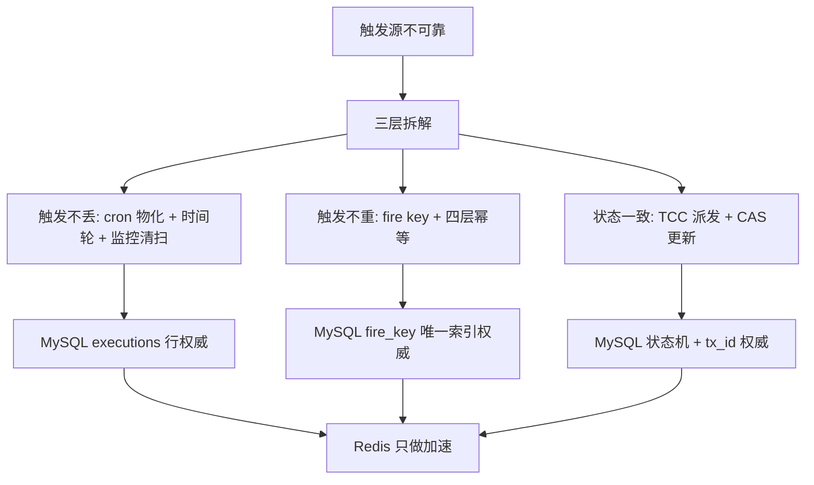

:::note 事实基线
本篇是「Yukino Task Flow」带解答题库，共 **82 题**，事实来源为 `content/be/yukino-task-flow.md`，对照本地仓库 `$HOME/github/yukino.go`（子路径 `apps/task_flow`）核验。taskflow 是一个**企业级定时/条件任务调度与审计系统**，它把 yukino.go 的十个分布式组件（red_mq、time_wheel、redis_lock、consistent_hash、consistent_cache、tcc、timer、lsm_tree、raft、yukino_cache）与 yukino_http 框架**组装进一个真实系统**，是「分布式组件如何落地」的完整案例。
:::

本篇是「Yukino Task Flow」题库。这个项目是面试里「**你做过最复杂的分布式系统**」「**怎么保证任务恰好执行一次**」的直接素材——它的核心价值是**把「触发不丢、触发不重、状态一致」三个分布式难题用 MySQL 权威 + Redis 加速 + 四层幂等防线解决**。本篇的组织顺序是：**先讲问题域与核心原则 → 再讲 fire key 与四层幂等 → 再讲定时任务（Migrator + 时间轮）→ 再讲条件任务（CDC + outbox）→ 再讲派发（TCC）与执行（Executor + LLM）→ 再讲集群协调与审计 → 最后讲保证边界**。

**主线一览**

## 一、问题域与核心原则

### Q1. taskflow 解决什么问题？三层拆解是什么？

企业里大量「周期性巡检」与「事件驱动审计」需求有一个共同点：**触发源不可靠（时钟漂移、节点宕机、消息重投），但业务上要求「某个时刻的定时任务、某条记录的条件任务恰好被执行一次」**。taskflow 把这个问题拆成三层：

| 关注点   | 手段                                                    | 权威来源                  |
| -------- | ------------------------------------------------------- | ------------------------- |
| 触发不丢 | cron 提前物化成执行行 + 分布式时间轮回调 + 监控清扫补发 | MySQL `executions` 行     |
| 触发不重 | 确定性 fire key + 四层幂等防线                          | MySQL `fire_key` 唯一索引 |
| 状态一致 | TCC 派发事务 + 带 `tx_id` 的条件更新（CAS）             | MySQL 状态机 + `tx_id`    |

### Q2. 核心设计原则「MySQL 权威 + Redis 加速」是什么？

**MySQL 是执行归属与幂等历史的唯一权威，Redis 只做加速**（快速认领、Stream 队列、时间轮分片、定义缓存、心跳、诊断镜像）。**Redis 丢了一条已发布消息、一个快速认领或一个时间轮条目，都能由 SQL 侧的恢复路径补偿；反过来 SQL 的唯一索引与条件更新保证即使 Redis 故障也不会产生第二个执行**。

**采分点**：能说出「**Redis 丢了能由 SQL 补偿，SQL 的唯一索引保证即使 Redis 故障也不会产生第二个执行**」——这是「缓存/队列是加速，数据库是权威」的分布式设计铁律，也是整个系统正确性的基石。

### Q3. 仓库布局与组件 replace 映射是什么？

`apps/task_flow` 用 11 条 `replace` 把全部基础组件指向仓库内源码：red_mq（exec/cond 两个 Redis Streams 主题）、time_wheel（分布式时间轮）、redis_lock（migrator/monitor/tccstore/哈希环的锁）、consistent_hash（单例角色归属）、consistent_cache（任务定义缓存）、tcc（派发事务框架）、timer（cron 解析、Bloom、worker 池、Murmur3）、lsm_tree（节点本地审计 journal）、raft（节点本地诊断 ledger）、yukino_cache（报告分组缓存）、yukino_http（HTTP 框架）。

**采分点**：能说出「**taskflow 是十个分布式组件 + HTTP 框架的真实组装案例**」——它不是玩具，而是把 go-components 篇的每个组件用在刀刃上的完整系统。

## 二、fire key 与四层幂等

### Q4. fire key 协议是什么？为什么全部确定性生成？

fire key 是「逻辑执行」的身份，**全部确定性生成，重试不产生新 key**：

| 来源             | 格式                                                                                                 |
| ---------------- | ---------------------------------------------------------------------------------------------------- |
| 定时计划         | `sched:{taskId}:{fireAt.Unix()}`                                                                     |
| 条件（中继路径） | `cond:{taskId}:change:{eventUUID}`                                                                   |
| 条件（直发路径） | `cond:{taskId}:{table}:{recordId}:{createdAtUnix}`                                                   |
| 手动触发         | `manual:{taskId}:{YYYYMMDDhhmmss}:{8位hex}`；带 `Idempotency-Key` 时 `manual:{taskId}:{sha256(key)}` |

**定时路径以计划时刻的 Unix 秒为后缀：同一 cron 计划点永远映射到同一个 key，即使被多个节点、多条路径重复物化。条件中继路径以 change 事件的 UUID 为后缀：同一条 change 行无论被 relay 重试多少次，都只会物化出同一个执行**。

**采分点**：能说出「**fire key 确定性生成是幂等的锚点——同一逻辑执行无论重试多少次都是同一个 key**」——这与 go-components 篇「确定性标识是幂等与恢复的锚点」一脉相承。

### Q5. 幂等的四层防线分别是什么？

同一个逻辑 fire 可能从多个入口同时到达（时间轮回调、monitor 补发、手动重试），Dispatcher 用四层防线逐层收窄：

**第 1 层：Bloom 预检（拒绝已知完成的重复）**。包装 timer 的 Redis bitmap Bloom（位图大小 `1<<24` bit，两个哈希位取 murmur3.Sum128 高低位）。`MaybeSeen` 检查今天与昨天两个 key，**Redis 出错或 key 缺失一律 fail-open 放行**；命中后再查 SQL：同 fire_key 且 status != pending 才真正抑制。**Bloom 只是省一次认领与事务，永远不是权威**。

**第 2 层：Redis SETNX 认领（互斥快路径）**。对 `idem:fire:{fireKey}` 执行 `SET ... NX EX`（TTL 默认 72h）。认领失败说明有人正在处理；此时重新读取执行行：如果仍是 pending 且 updated_at 超过 5 分钟（claimStuckThreshold），视为上一个认领者已死，接管继续；否则记录 "duplicate fire suppressed" 直接返回。

**第 3 层：MySQL 唯一索引（持久去重）**。`InsertPending` 依赖 fire_key 唯一索引 + OnConflict DoNothing + 回查。**即使前两层全部失效（Bloom 漏判、Redis 清空），数据库也只会有一行**。

**第 4 层：CAS 状态迁移（运行期互斥）**。`queued → running` 用 `TransitionOwned` 附带 tx_id 条件：两个消费者拿到同一条命令时，只有一个能把状态改成 running，另一个 affected == 0 后安静退出，不跑模型、不写报告。终态写入同样是 CAS，迟到的旧 worker 无法覆盖。

### Q6. 四层防线各自的失效模式是什么？为什么最终依据落在 SQL？

**四层各自的失效模式不同**：Bloom 有 false positive，且 Redis 出错时按未见过处理（fail-open）；SETNX 会随 TTL 过期或被误删；唯一索引不可绕过；CAS 依赖调用方检查 RowsAffected。**把它们叠起来，「至多一次执行」的最终依据始终落在 SQL**。

**采分点**：能说出「**Bloom fail-open（宁可放过不可错杀）、SETNX 会过期、唯一索引不可绕过、CAS 要检查 RowsAffected——四层叠加，权威在 SQL**」——这体现「多层防御，每层都可能失效，最终权威落在最可靠的一层」的分布式幂等设计精髓。

### Q7. 为什么 Bloom 要 fail-open 而不是 fail-closed？

Bloom 只是**省一次认领与事务的优化**，不是权威。如果 fail-closed（Redis 出错就拒绝），会导致 Redis 抖动时所有任务都被误判为「已见过」而跳过——**漏执行比多执行更严重**（多执行有后面三层兜底，漏执行就真丢了）。所以 Bloom fail-open：Redis 出错一律放行，让后面的 SETNX/唯一索引/CAS 去重。

**采分点**：能说出「**漏执行比多执行更严重，所以预检层 fail-open**」——这是「优化层不能成为正确性依赖」的体现。

### Q8. SETNX 认领的 claimStuckThreshold 接管逻辑是什么？

认领失败（SETNX 返回已存在）说明有人正在处理，但**那个认领者可能已经死了**（崩溃后 SETNX 键还在，TTL 72h 才过期）。所以重新读取执行行：如果仍是 pending 且 updated_at 超过 5 分钟（claimStuckThreshold），**视为上一个认领者已死，接管继续**；否则记录 "duplicate fire suppressed" 直接返回。

**采分点**：能说出「**认领失败要区分『真的有人在处理』与『认领者已死』——用 updated_at 超过阈值判断死锁，接管继续**」——这是「分布式认领的故障恢复」细节。

## 三、定时任务：Migrator 与时间轮

### Q9. Migrator 怎么把 cron 展开成执行行？

Migrator 是**单例角色**（见集群协调），每 `migrate_tick_seconds`（默认 30s）一个 tick。拿到角色后还要抢 redis_lock `lock:migrator`（租期 = tick 秒数 × 2），**双重互斥**。

物化窗口是 `[now - overdue_recover_minutes, now + migrate_step_minutes]`（默认向前回看 2 分钟、向后展开 60 分钟），对每个 enabled 的定时任务：① 用任务的 IANA timezone 加载时区（空或非法时退回 Asia/Shanghai，再退回 time.Local），`cronx.Parse` 解析 5 段标准 cron；② 从 `max(recoverStart, task.CreatedAt)` 开始循环 `schedule.Next(cursor)`，把所有不超过窗口末端的计划点逐个 `registerFire`。

**采分点**：能说出「**物化窗口向前回看 2 分钟（补偿错过的）+ 向后展开 60 分钟（提前物化）**」——回看窗口是「触发不丢」的补偿，提前物化是让时间轮有足够提前量。

### Q10. 为什么 cron 要提前物化成执行行，而不是到点直接触发？

**到点直接触发的问题**：① 时钟漂移/节点宕机会错过触发点；② 无法持久化「这个计划点已经触发过」（幂等无依据）；③ 无法补偿错过的触发。**提前物化成 MySQL 执行行**：① 执行行是持久的，节点宕机重启后仍在；② fire key 唯一索引保证同一计划点只有一行（幂等）；③ Migrator 的回看窗口能补偿错过的计划点（触发不丢）。

**采分点**：能说出「**物化把『时间触发』转成『持久状态 + 唯一索引』，让触发不丢与不重都有 SQL 依据**」——这是「用持久化状态替代易失的定时器」的核心思想。

### Q11. 分布式时间轮（分钟桶 ZSET）怎么工作？

物化的执行行按触发时刻放进**分钟桶 ZSET**（time_wheel 的分布式轮）：每个分钟一个 zset，score 是到期时刻。到点时时间轮**HTTP 回调** Dispatcher 触发执行。**取消必须携带原执行时刻**（定位到正确的分钟桶）。触发用 Lua 原子弹出保证多实例不重复触发（见 go-components 篇）。

### Q12. 触发入口与当前定义校验做什么？

时间轮回调触发时，Dispatcher 先做**当前定义校验**：检查任务定义是否还 enabled、cron 是否变过——如果定义已变（如任务被禁用），物化的执行行要作废。这防止「物化时有效、触发时已失效」的执行。

## 四、条件任务：CDC 与 outbox

### Q13. 条件任务的事务内 CDC 捕获怎么做？

条件任务由数据库变更触发（如「订单表插入新行时执行审计」）。捕获用 **MySQL AFTER INSERT/DELETE 触发器**：触发器在**业务事务内**把变更写入 `task_flow_changes` 表（outbox）。**事务内捕获保证「业务写入」与「变更记录」原子**——业务回滚则变更记录也回滚，不会出现「业务没成功但触发了任务」。

**采分点**：能说出「**触发器在业务事务内写 outbox，保证业务写入与变更记录原子**」——这是「事务内 CDC」的核心，区别于「业务提交后再异步记录变更」（后者会丢或重）。

### Q14. Relay 的两阶段中继是什么？

Relay 把 `task_flow_changes` 表的变更中继到 Redis Stream（cond 主题）：**两阶段**——① 读取未中继的 change 行；② 发布到 Stream 并标记已中继。两阶段保证「至少一次中继」（发布失败下次重读），配合 fire key（change 事件 UUID）的幂等（同一 change 中继多次只物化一个执行）。

### Q15. 条件消费者怎么处理 Stream 消息？

条件消费者用 red_mq 消费 cond 主题的 Stream 消息，每条消息对应一个 change 事件。消费时按 fire key（`cond:{taskId}:change:{eventUUID}`）走四层幂等防线，物化执行行并派发。**回调 panic 被 recover 计为失败，达到重试上限进死信**（red_mq 语义）。

## 五、派发与执行

### Q16. 派发漏斗的 TCC 事务做什么？

派发（把执行行从 queued 推到 running 并发消息给 Executor）用 **TCC 事务**：Try 预留（标记执行行为 dispatching + 写 tx_id）、Confirm 提交（发消息到 exec Stream + 状态置 queued）、Cancel 释放（回滚状态）。**TCC 保证「状态变更」与「消息发送」的最终一致**——协调者崩溃时监控循环重放推进到终态（见 go-components 篇 tcc）。

**采分点**：能说出「**派发用 TCC 保证状态变更与消息发送的最终一致，崩溃由监控循环兜底**」——这是「写库又发消息」双写一致性在任务派发上的应用（与数据链路篇的 outbox 同源）。

### Q17. Executor 从消息到报告做什么？

Executor 消费 exec 主题的 Stream 消息，每条对应一个要执行的任务：① CAS 把状态 queued → running（带 tx_id，第 4 层幂等）；② 执行任务（调 LLM Agent 或确定性逻辑）；③ 产出报告；④ CAS 把状态 running → succeeded/failed。终态写入是 CAS，迟到的旧 worker 无法覆盖。

### Q18. LLM Agent 与工具沙箱怎么做？

任务执行可能调 LLM Agent（如「分析这条记录并生成审计报告」）。Agent 的工具调用走**沙箱**：sql_policy 限制 SQL 工具（只读、限定库、超时），工具调用审计落库。**面向 LLM 的错误要可读**（工具失败返回结构化错误让模型换路径），与 dev-agent 篇的工具层降级同源。

### Q19. 报告产物与分布式缓存怎么做？

执行产出的报告用 **yukino_cache 分组缓存**（可带 etcd/gRPC peers）：报告按 key 缓存，多节点共享（一致性哈希归属），read-through 回源。这让「同一报告被多次查看」不重复生成，且缓存容量分散到集群。

## 六、集群协调与审计

### Q20. 集群协调的心跳、哈希环与单例角色是什么？

- **心跳**：每个节点定期向 Redis 写心跳（带 TTL），集群成员靠心跳存活判定。
- **哈希环**：consistent_hash 维护节点环，**单例角色（migrator/monitor）按哈希环归属**——环上某个位置对应的节点承担该角色，节点增减时角色重新归属。
- **单例角色**：migrator（物化 cron）与 monitor（清扫）是单例（同一时刻只有一个节点执行），靠 redis_lock + 哈希环归属双重保证。

**采分点**：能说出「**单例角色靠哈希环归属 + redis_lock 双重互斥**」——哈希环决定「谁该执行」，redis_lock 保证「同一时刻只有一个在执行」。

### Q21. Monitor 清扫与状态同步做什么？

Monitor 是单例角色，定期清扫：① **补发错过的触发**（物化窗口回看补偿的兜底）；② **回收卡死的执行**（running 超时未完成的，重置或标记失败）；③ **状态同步**（Redis 诊断镜像与 MySQL 权威状态对账）。这是「触发不丢」的最后一道兜底。

### Q22. 节点本地审计的 LSM journal 与 Raft ledger 是什么？

- **LSM journal**（lsm_tree）：节点本地的审计日志，把执行事件按 key 追加进 LSM 树（高写入吞吐，适合审计日志的追加模式）。
- **Raft ledger**（raft）：节点本地的诊断账本，单成员 Raft（教学/诊断用，非生产共识）。

**采分点**：能说出「**LSM journal 用于高吞吐审计追加，Raft ledger 是单成员诊断账本（非生产共识）**」——并诚实指出 raft 示例的边界（传输层置空，仅单机嵌入，见 go-components 篇）。

## 七、保证边界与适用场景

### Q23. taskflow 的保证边界是什么？

- **触发不丢**：cron 物化 + 时间轮 + monitor 清扫三重保证，但**极端情况（MySQL 与 Redis 同时长时间故障）仍可能延迟**。
- **触发不重**：四层幂等防线，**最终依据是 SQL 唯一索引与 CAS**——「至多一次执行」有保证，但「恰好一次」依赖四层都正确实现。
- **状态一致**：TCC + CAS 保证最终一致，**中间态（dispatching/running）是可见的**，读取方要理解。
- **不是强一致**：Redis 加速层是弱一致，MySQL 是权威——不要把它当强一致系统用。

### Q24. taskflow 适合与不适合的场景？

**适合**：企业级周期性巡检、事件驱动审计、需要「恰好执行一次」保证的定时/条件任务、需要完整审计追溯的场景。

**不适合**：需要任意精度或复杂依赖编排的调度（Airflow 类 DAG 引擎）、强一致事务、超低延迟触发（物化 + 时间轮有秒级延迟）。

### Q25-Q82. 快速自检与深挖补充

**Q25. 一句话解释「MySQL 权威 + Redis 加速」。** MySQL 是执行归属与幂等历史的唯一权威，Redis 只做加速——Redis 丢了能由 SQL 补偿，SQL 唯一索引保证即使 Redis 故障也不会产生第二个执行。

**Q26. 一句话解释三层拆解的权威来源。** 触发不丢→executions 行，触发不重→fire_key 唯一索引，状态一致→状态机 + tx_id——每层都有 MySQL 权威。

**Q27. 一句话解释 fire key 为什么确定性生成。** 同一逻辑执行无论重试多少次都是同一个 key——幂等的锚点，重试不产生新 key。

**Q28. 一句话解释定时 fire key 为什么用计划时刻 Unix 秒。** 同一 cron 计划点永远映射同一 key，即使被多节点多路径重复物化——去重的基础。

**Q29. 一句话解释条件 fire key 为什么用 change UUID。** 同一条 change 行无论 relay 重试多少次只物化一个执行——UUID 是 change 的唯一身份。

**Q30. 一句话解释手动触发的 Idempotency-Key。** 带 Idempotency-Key 时 fire key 是 sha256(key)，同一 key 重试是同一执行——客户端幂等。

**Q31. 一句话解释四层幂等的逐层收窄。** Bloom 预检（省认领）→ SETNX 认领（互斥快路径）→ 唯一索引（持久去重）→ CAS（运行期互斥）——每层失效模式不同，叠加后权威在 SQL。

**Q32. 一句话解释 Bloom 为什么检查今天与昨天两个 key。** 跨 UTC 日期边界时，昨天的 fire 今天仍可能被重试——检查两天避免边界漏判。

**Q33. 一句话解释 Bloom 命中后为什么还要查 SQL。** Bloom 有 false positive，命中只是「可能见过」——查 SQL 同 fire_key 且 status != pending 才真正抑制。

**Q34. 一句话解释 SETNX 的 value 为什么是纳秒时间戳。** 记录认领时刻，便于诊断与 claimStuckThreshold 判断——value 不只是占位。

**Q35. 一句话解释 claim TTL 为什么 72h。** 覆盖最长的任务执行 + 重试窗口——TTL 太短会导致执行中认领过期被别人接管。

Q36. 一句话解释唯一索引为什么不可绕过。** 数据库层面的硬约束，即使 Bloom 漏判、Redis 清空，InsertPending 的 OnConflict DoNothing 保证只有一行。

**Q37. 一句话解释 CAS 的 tx_id 条件。** queued→running 附带 tx_id 条件，两个消费者只有一个能改成功，另一个 affected==0 安静退出——运行期互斥。

**Q38. 一句话解释为什么终态写入也是 CAS。** running→succeeded/failed 是 CAS，迟到的旧 worker 无法覆盖新状态——防止状态回退。

**Q39. 一句话解释 Migrator 为什么双重互斥。** 单例角色（哈希环归属）+ redis_lock（lock:migrator）——角色决定「谁该执行」，锁保证「同一时刻只有一个」。

**Q40. 一句话解释物化窗口的回看与展开。** 向前回看 2 分钟补偿错过的，向后展开 60 分钟提前物化——回看是触发不丢的补偿。

**Q41. 一句话解释为什么从 max(recoverStart, CreatedAt) 开始。** 不早于任务创建时间（创建前的计划点不该触发），不早于回看起点（补偿窗口）。

**Q42. 一句话解释时区加载的三级回退。** 任务 IANA timezone → Asia/Shanghai → time.Local——空或非法时逐级回退，不因时区错误漏触发。

**Q43. 一句话解释 cron 物化相对到点触发的优势。** 执行行持久（宕机重启仍在）、fire key 唯一索引（幂等）、回看窗口（补偿错过）——用持久状态替代易失定时器。

**Q44. 一句话解释分布式时间轮的 HTTP 回调。** 到点时时间轮 HTTP 回调 Dispatcher——时间轮只管「何时触发」，触发后的逻辑在 Dispatcher。

**Q45. 一句话解释触发时为什么要校验当前定义。** 防止「物化时有效、触发时已失效」——任务被禁用或 cron 变过，物化的执行行要作废。

**Q46. 一句话解释事务内 CDC 为什么用触发器。** 触发器在业务事务内写 outbox，业务写入与变更记录原子——业务回滚则变更也回滚，不会误触发。

**Q47. 一句话解释 outbox 中继为什么两阶段。** 读取未中继 change → 发布 Stream 并标记——至少一次中继，配合 fire key 幂等收敛重复。

**Q48. 一句话解释条件消费者为什么走四层幂等。** 同一 change 可能被 relay 重试多次，fire key（change UUID）走四层防线保证只物化一个执行。

**Q49. 一句话解释派发为什么用 TCC。** 保证「状态变更」与「消息发送」最终一致——协调者崩溃时监控循环重放推进到终态。

**Q50. 一句话解释 TCC 派发的 Try/Confirm/Cancel。** Try 预留（标记 dispatching + 写 tx_id），Confirm 提交（发消息 + 置 queued），Cancel 释放（回滚状态）。

**Q51. 一句话解释 Executor 的 CAS 状态迁移。** queued→running（带 tx_id）→ 执行 → running→succeeded/failed（CAS）——每步都是条件更新，迟到 worker 无法覆盖。

**Q52. 一句话解释 LLM 工具沙箱的 sql_policy。** 限制 SQL 工具（只读、限定库、超时），工具调用审计落库——与 dev-agent 的 postgres_query 四层隔离同源。

**Q53. 一句话解释报告为什么用分组缓存。** yukino_cache 按 key 缓存报告，多节点共享（一致性哈希归属），read-through 回源——同一报告不重复生成，缓存分散到集群。

**Q54. 一句话解释心跳的 TTL 判定。** 节点定期写 Redis 心跳（带 TTL），超时未续视为下线——集群成员靠心跳存活判定。

**Q55. 一句话解释哈希环怎么决定单例角色。** migrator/monitor 角色按哈希环归属，环上某位置对应的节点承担——节点增减时角色重新归属。

**Q56. 一句话解释 Monitor 清扫的三件事。** 补发错过的触发、回收卡死的执行（running 超时）、状态同步（Redis 镜像与 MySQL 对账）——触发不丢的最后兜底。

**Q57. 一句话解释 LSM journal 为什么适合审计。** 高写入吞吐、追加模式——审计日志是只追加的，LSM 的顺序写正好匹配。

**Q58. 一句话解释 Raft ledger 的边界。** 单成员 Raft 诊断账本，传输层置空，仅单机嵌入——非生产共识，生产用 etcd/raft。

**Q59. 一句话解释 taskflow 的「至多一次」与「恰好一次」。** 四层幂等保证「至多一次执行」，「恰好一次」还依赖触发不丢（物化 + 时间轮 + 清扫）——两者合起来才是「恰好一次」。

**Q60. 一句话解释为什么中间态可见。** dispatching/running 是 TCC/CAS 的中间态，读取方要理解——这不是强一致系统，是最终一致。

**Q61. 一句话解释 taskflow 与 timer 的关系。** timer 是秒级定时任务平台（自包含），taskflow 是企业级调度审计系统（组装十个组件）——taskflow 用 timer 的 cron 解析/Bloom/worker 池/Murmur3。

**Q62. 一句话解释 exec 与 cond 两个 Stream 主题。** exec 是定时/手动触发的执行命令，cond 是条件任务的变更事件——两个主题分开，消费者独立。

**Q63. 一句话解释为什么 Redis Stream 而不是 Kafka。** taskflow 用 Redis 做加速层（Stream 队列），MySQL 是权威——Redis Stream 够用且运维简单，不需要 Kafka 的吞吐。

**Q64. 一句话解释 fire key 唯一索引与 InsertPending 的配合。** InsertPending 依赖唯一索引 + OnConflict DoNothing + 回查——冲突时不插入，回查拿到已存在的行 ID。

**Q65. 一句话解释集成测试怎么验证幂等。** TestTransactionalCaptureAndConcurrentRelay 用同一 fire key 重复调 InsertPending 十次，断言每次解析回同一 ID。

**Q66. 一句话解释为什么 Bloom 用 murmur3 两个位。** 位图 1<<24 bit，两个哈希位取 murmur3.Sum128 高低位——双哈希降低 false positive。

**Q67. 一句话解释 Bloom 的 Lua 原子置位。** SET 时一段 Lua 同时置两位并仅在无 TTL 时设置过期——原子置位避免竞态。

**Q68. 一句话解释 claimStuckThreshold 为什么 5 分钟。** 覆盖正常的认领处理时间，超过视为认领者已死——太短会误接管正在处理的，太长会延迟恢复。

**Q69. 一句话解释为什么认领失败要重读执行行。** 区分「真的有人在处理」（status 已变）与「认领者已死」（仍 pending 且 updated_at 超时）——前者退出，后者接管。

**Q70. 一句话解释 migrate_step_minutes 为什么 60。** 提前物化 60 分钟，给时间轮足够提前量——太短会导致物化跟不上触发。

**Q71. 一句话解释 overdue_recover_minutes 为什么 2。** 回看 2 分钟补偿错过的计划点（时钟漂移、tick 延迟）——太长会重复物化（但有 fire key 幂等兜底）。

**Q72. 一句话解释为什么物化要逐计划点 registerFire。** 每个计划点一个 fire key（sched:{taskId}:{fireAt.Unix()}），逐个物化保证每个计划点独立幂等。

**Q73. 一句话解释 taskflow 的 HTTP API 能力面。** 基于 yukino_http 提供任务 CRUD、手动触发、状态查询、审计查询等 REST API。

**Q74. 一句话解释配置文件的形态。** conf.yml（YAML），含 MySQL/Redis/etcd 连接、各组件参数（tick、TTL、窗口）、LLM 配置。

**Q75. 一句话解释部署形态。** docker-compose 单机（mysql + redis + server + client），cluster overlay（etcd×3、MySQL 副本、Redis Sentinel、第二 server）。

**Q76. 一句话解释 MySQL 复制与 Redis Sentinel 的作用。** MySQL GTID 复制（权威数据高可用），Redis Sentinel（加速层高可用）——权威与加速分别做高可用。

**Q77. 一句话解释 nginx least_conn 双节点反代。** 集群部署时 nginx 按最少连接负载均衡到两个 server 节点——无状态 server 可水平扩展。

**Q78. 一句话解释 client 工作台。** Lit 3 + Tailwind 4 + Vite 工作台，Playwright e2e——任务管理、状态查看、审计追溯的前端。

**Q79. 一句话解释 taskflow 的可观测性。** OpenTelemetry 初始化 + Sentry 错误上报——trace 与错误可观测。

**Q80. 一句话解释为什么 taskflow 是「组件组装的完整案例」。** 它把十个分布式组件用在刀刃上（red_mq 队列、time_wheel 调度、redis_lock 互斥、consistent_hash 角色、tcc 派发、lsm/raft 审计），每个组件解决一个具体子问题。

**Q81. 一句话解释 taskflow 与 go-components 的关系。** go-components 是原语库，taskflow 是把原语组装进真实系统的应用——理解 taskflow 就理解了「组件如何落地」。

**Q82. 一句话总结 taskflow 的设计哲学。** 触发源不可靠，但用「MySQL 权威 + Redis 加速 + 确定性 fire key + 四层幂等 + TCC 派发 + CAS 状态」把「恰好执行一次」建立在持久状态与原子操作上，而不是隐含的时序假设——与 go-components 同一工程哲学。

---

**延伸阅读**

- [Yukino Go 分布式组件题库](/interview/qa/yukino-go-components)：taskflow 组装的十个组件的逐个深挖。
- [Yukino HTTP 与 RPC 题库](/interview/qa/yukino-http-rpc)：taskflow 的 HTTP 框架（yukino_http）。
- [Yukino 缓存与 ORM 题库](/interview/qa/yukino-cache-orm)：taskflow 的报告缓存（yukino_cache）。
- [数据链路与 OLAP 题库](/interview/qa/data-pipeline-olap)：outbox/CDC、幂等消费、Kafka 的通用机制。
- [服务架构与任务系统题库](/interview/qa/service-architecture)：任务调度、状态机、熔断的通用设计。
- [工作文档 · yukino-task-flow](/be/yukino-task-flow)：本篇的事实来源（含 20 章教程与 10 个动手实验）。
