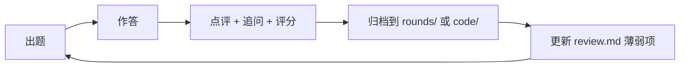

# AI 全栈面试练习 · 文档索引

> **边练边沉淀**。每轮闭环：出题 → 作答 → 点评/追问/评分 → 归档。
> 本目录独立于 `content/`，**不进入 Rspress 构建**，不污染知识库站点。

## 基本设定

| 项         | 值                                                         |
| ---------- | ---------------------------------------------------------- |
| 目标岗位   | AI 全栈 / Agent 工程（默认按 **2026 秋招** 设定）          |
| 默认难度   | 校招进阶 ~ 1–3 年社招                                      |
| 语言       | 题目与点评中文，技术术语保留英文                           |
| 作答方式   | 直接在对话中作答；**不查资料**；不会就写「不会」，优于编造 |
| 追问       | 每轮点评后追加 1–3 个深挖问题，可继续作答                  |
| **代码题** | **独立放 `code/`**，与问答/设计题分开；含可运行实现 + 自测 |
| 提交策略   | 练习过程中不自动 commit；成稿后按需一次性提交              |

:::warning 设定可改
岗位年限、难度、是否限时、是否加入手撕代码/系统设计白板，随时说一声即调整。
:::

## 练习闭环



## 评分标准（每题 0–5 分）

| 维度         | 权重 | 看什么                         |
| ------------ | ---- | ------------------------------ |
| **正确性**   | 30%  | 概念、机制、事实无硬伤         |
| **深度**     | 25%  | 能下钻到实现层，而非停留在名词 |
| **工程取舍** | 20%  | 知道 trade-off、成本、失败模式 |
| **表达结构** | 15%  | 分层清晰、先主干后细节         |
| **边界意识** | 10%  | 主动点出异常、安全、规模、降级 |

**评级**：`4.5+` 强 · `3.5–4.5` 达标 · `2.5–3.5` 需补 · `<2.5` 重点补。

## 能力矩阵

| 维度 | 覆盖内容                                                 | 首测轮次              |
| ---- | -------------------------------------------------------- | --------------------- |
| D1   | LLM 基础、prompt / tool calling、上下文工程              | R01 / R06             |
| D2   | Agent 执行链路、MCP、权限与恢复                          | R01 / R06             |
| D3   | RAG、检索评估、幻觉治理                                  | R05 / R08             |
| D4   | 后端服务：流式、并发、限流、幂等、存储                   | R01 / R02 / R04       |
| D5   | 前端：流式渲染、状态分层、取消与恢复                     | R01 / R07             |
| D6   | 系统设计、可观测性、成本与评测                           | R02 / R04 / R07 / R08 |
| D7   | Web 安全与协议基础（同源/同站、CSRF、CORS、cookie 属性） | R03                   |

## 轮次进度

| 轮次                                    | 日期       | 主题                                              | 题量 | 状态                       | 均分 |
| --------------------------------------- | ---------- | ------------------------------------------------- | ---- | -------------------------- | ---- |
| [R01](./rounds/round-01.md)             | 2026-11-05 | Agent 执行链路 / LLM 网关 / 流式前端              | 3    | 🟡 待作答                  | —    |
| [R02](./rounds/round-02.md)             | 2026-11-05 | 20 MB JSON × 数万并发（实战追问）                 | 1    | 🟣 教练示范已出 · 待复述   | —    |
| [R03](./rounds/round-03.md)             | 2026-11-05 | CSRF / SameSite / 真实场景（实战三连问）          | 3    | 🟣 教练示范已出 · 待复述   | —    |
| [R04 · Code 01](./code/rate-limiter.md) | 2026-11-05 | JS 手写限流器（代码题）                           | 1    | 🟢 参考实现已给 · 待手撕   | —    |
| [R05](./rounds/round-05.md)             | 2026-11-05 | `yukino-ecomm-agent` 项目深挖（9 连问）           | 9    | 🟢 源码事实已核对 · 待复述 | —    |
| [R06](./rounds/round-06.md)             | 2026-11-05 | Yukino Code 长期上下文 / 短期记忆 / 指标 baseline | 3    | 🟢 源码事实已核对 · 待复述 | —    |
| [R07](./rounds/round-07.md)             | 2026-11-05 | 续传 / 虚拟滚动 / 告警治理 / 死锁检测（7 连问）   | 7    | 🟢 已核对 · 待复述         | —    |
| [R08](./rounds/round-08.md)             | 2026-11-05 | RAG 语料 / 分块参数 / rerank / TTFT / 防幻觉模块  | 6    | 🟢 已核对 · 待复述         | —    |

:::tip 文档类型

- `rounds/`：问答 / 系统设计题。既有**待作答题**（R01，参考答案锁到作答后），也有**教练示范卡**（R02/R03，标准答法直接给出，再要求脱稿复述并打分）。
- `code/`：**代码题独立文档**。含题目语义辨析、可运行实现、自测、生产延伸、采分点与手撕区。
  :::

## 知识库锚点

复习时回看本仓库对应文档，答题与源码事实互证：

| 维度        | 文档                                                                                                                                             |
| ----------- | ------------------------------------------------------------------------------------------------------------------------------------------------ |
| Agent / MCP | `content/docs/claude-code.md`、`content/docs/pi.md`、`content/docs/mcp-app.md`、`content/fe/yukino-mcp.md`                                       |
| 框架        | `content/docs/langchain.md`、`content/docs/langgraph.md`                                                                                         |
| 后端        | `content/be/yukino-agent.md`、`content/be/yukino-agent-proxy.md`、`content/be/yukino-http.md`、`content/be/middleware.md`、`content/be/redis.md` |
| 前端        | `content/fe/fe.md`、`content/fe/react.md`、`content/fe/tanstack.md`、`content/fe/fetchpriority-swr.md`、`content/fe/yukino-chat.md`              |
| 沙箱        | `content/docs/docker-k8s-agent-sandbox.md`                                                                                                       |

## 资料摘录

> **2026-11-06 批量采集**：[Edge 全部标签页专题（8 份文档 + 索引）](./notes/2026-11-06-edge-tabs/index.md) — 遍历 Edge 全部 13 个标签页，按主题成文。

| 日期       | 文档                                                               | 来源                                                                                         |
| ---------- | ------------------------------------------------------------------ | -------------------------------------------------------------------------------------------- |
| 2026-11-05 | [活跃标签页知识点（第一轮）](./notes/2026-11-05-active-tabs.md)    | 浏览器 active tab：牛客「腾讯互娱 全栈开发(AI) 一面」+ 小林coding「MySQL面试题」（标题索引） |
| 2026-11-05 | [活跃标签页知识点（第二轮）](./notes/2026-11-05-active-tabs-02.md) | 牛客「腾讯微信后端一面，问麻了」+ MySQL 页前 12 题正文要点；含 MCP 传输模式事实校正          |
| 2026-11-05 | [活跃标签页知识点（第三轮）](./notes/2026-11-05-active-tabs-03.md) | 牛客「腾讯后端开发岗面经-01」21 组真题地图 + MySQL 索引/事务正文要点                         |
| 2026-11-05 | [活跃标签页知识点（第四轮）](./notes/2026-11-05-active-tabs-04.md) | 牛客「腾讯互娱 全栈开发(AI) 二面」会议音频 + RAG + MySQL 日志/调优/架构收尾                  |

:::warning 证据等级
`notes/` 是**外部网页摘录**，标注了来源 URL、抓取时间与完整性（订阅墙截断处不补写）。它与 `content/` 的源码事实**不是同一类证据**，答题时不要说成「我们项目里这么做」。
:::

## 目录

```
interview/
├── README.md          # 本页：规则、评分、进度、锚点
├── rounds/            # 问答 / 系统设计题：题目 + 作答 + 点评 + 采分点
├── code/              # 代码题：独立文档，含可运行实现与自测
├── notes/             # 外部资料摘录：知识点提炼与索引
└── review.md          # 薄弱项追踪与下轮计划
```
