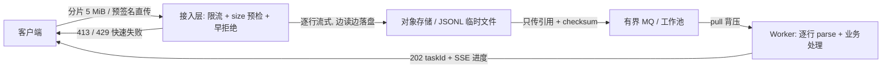

# Round 02 · 实战压力题：20 MB JSON × 数万并发

| 项   | 值                                                      |
| ---- | ------------------------------------------------------- |
| 来源 | **用户提供的真实面试追问**                              |
| 日期 | 2026-11-05                                              |
| 维度 | D1 / D4 / D6（协议分帧、大 body、并发容量、背压、削峰） |
| 形态 | 教练示范卡（标准答法已给）+ 复述作答                    |
| 状态 | 🟣 示范已出 · 待复述                                    |

## 题目原文

> 项目用 JSONL 作为传输格式。面试官追问：**如果用户上传了 20 MB 的 JSON，数万并发怎么办？**

## 事实基线（已核对本仓库文档）

| 项目既有做法                                                                                                                                                                                 | 来源                                 |
| -------------------------------------------------------------------------------------------------------------------------------------------------------------------------------------------- | ------------------------------------ |
| 大文件走**分片上传**：客户端 5 MiB/块（服务端上限 10 MiB 的一半，留 multipart 编码余量）、并发 3 用信号量限流、每块重试 3 次线性退避、总上限 2 GiB；服务端正则白名单校验 chunk hash 与扩展名 | `content/fe/yukino-chat.md`          |
| `POST /api/v1/telemetry/log` 只接收 **≤ 1 MiB** 合法 JSON，互斥锁追加到 `client-events.jsonl`，每行 `{received_at, payload}`                                                                 | `content/be/yukino-task-flow.md`     |
| telemetry file exporter 是 JSONL 追加且**无轮转**；`pool` 队列容量 `size*4`，`Submit` 队列满时阻塞（天然背压）                                                                               | 同上                                 |
| `activity.jsonl` 上限 10,000 条滚动淘汰，累计追加 20,000 条后重写 checkpoint                                                                                                                 | `content/docs/yukino/terminal-ui.md` |
| JSONL 追加友好，但**全部历史留在内存**，长跑 agent 应选 SQLite                                                                                                                               | `content/docs/pi.md`                 |
| 消息分帧需清晰边界：JSONL 换行、WebSocket 帧、SSE 事件                                                                                                                                       | `content/docs/a2ui.md`               |
| **拉取式背压**：消费方 `await` 下一个事件，循环才前进一步，无积压队列                                                                                                                        | `content/docs/yukino/yukino-code.md` |
| 流式 SSE 用原生 `fetch` + `ReadableStream`；chunk 以 JSON 字符串编码进 `data` 字段，避免换行破坏分帧                                                                                         | `content/fe/yukino-chatbot.md`       |
| 流式意味着更长连接生命周期、重试语义需业务定义、背压更复杂                                                                                                                                   | `content/be/middleware.md`           |

:::note 边界
上表是仓库文档记载的**项目事实**；下面的容量计算与架构建议是**面试答法推导**，不代表项目已实现。
:::

## 第一反应：先拆两个陷阱

1. **格式陷阱** — JSONL 是 **每行一个独立 JSON 值**，可逐行 `parse`，内存 `O(最长行)`。一个 20 MB 的**单个 JSON 文档不是 JSONL**：不能按行切，必须整体 `JSON.parse` 或改用 SAX 式流式 parser。开口应先澄清「上传的是 JSONL 文件，还是一个大 JSON 对象」；若协议定为 JSONL，正解是要求客户端按行拆分/分块上传。
2. **题型陷阱** — 这是**容量题**，不是 parser 题。「换个更快的 JSON parser」只解决单机内存，不解决带宽与并发。

## 量级先行（面试里最值钱的一步）

| 计算                                                      | 结果                              |
| --------------------------------------------------------- | --------------------------------- |
| 2 万并发 × 20 MB                                          | **400 GB** 在途 body              |
| 平均 10 s 传完                                            | **40 GB/s ≈ 320 Gbps** 入站       |
| 单 25 GbE 网卡 ≈ 3.1 GB/s                                 | 纯接流量就需 **≥ 13 台**          |
| 20 MB 文本 → 堆内对象图（经验 3–10×；中文 UTF-16 再翻倍） | 单请求峰值 **100–200 MB**         |
| 2 万并发同时全量 parse                                    | **2–4 TB** 堆内存 → OOM + GC 停顿 |

> **一句话结论**：必须让 20 MB **永远不以完整对象的形态**出现在 API 进程里。

## 标准答法骨架（分层防守）

| #   | 层                          | 关键动作                                                                                                                                                                                   | 项目锚点                                                                |
| --- | --------------------------- | ------------------------------------------------------------------------------------------------------------------------------------------------------------------------------------------ | ----------------------------------------------------------------------- |
| 1   | **接入层 · 早拒绝**         | `Content-Length` 预检 + 流式字节计数双校验，超限立即 `413` 并断流，**绝不读完整 body**；租户级令牌桶 + 连接数/字节双维度限流 + 有界队列，超限 `429` + `Retry-After`；防 Slowloris 慢速攻击 | `telemetry/log` 的 ≤ 1 MiB；`node-pool` 的 `maxWaitingClients` 快速失败 |
| 2   | **传输层 · 别用 JSON body** | 大文件改**分片上传**（5 MiB 块 / 并发 3 / 线性退避 / 总上限），或预签名 URL **直传对象存储**，服务端只收引用 + checksum + 幂等键；支持断点续传、乱序合并                                   | `yukino-chat.md` 分片方案                                               |
| 3   | **解析层 · 流式**           | JSONL 用 `readline` 逐行 parse，**限制单行长度**，边读边处理边落盘，禁止「读全量 → `JSON.parse`」；慢消费用 pull 式背压回传，不让队列堆积；单个大 JSON 则要求客户端拆行或换 SAX parser     | `yukino-code.md` 拉取式背压；`task-flow` `Submit` 阻塞背压              |
| 4   | **异步化 · 削峰**           | 请求只做「校验 → 落存储 → 写一条任务」即返回 `202 + taskId`；有界工作池消费，租户级公平调度防单租户打满；进度/结果走 SSE 或轮询                                                            | `pool` 队列 `size*4`；`yukino-chatbot.md` SSE                           |
| 5   | **存储与治理**              | JSONL 追加必须**按大小/时间轮转 + 压缩 + 生命周期**（无轮转会打满磁盘）；大文件触发 checkpoint 重写；需要随机查询/长跑时换 SQLite                                                          | `terminal-ui.md` checkpoint；`pi.md` SQLite 结论                        |
| 6   | **取消与止损**              | `AbortController` → 关流 → 取消传播到 MQ 任务/上游 LLM（`LangGraph` `cancel()` 触发内部 AbortController）；断连后按幂等键去重，避免重复计费                                                | `content/docs/langgraph.md`                                             |
| 7   | **可观测与压测**            | 看 P99 上传耗时、单行 parse 耗时、队列深度、`413/429` 拒绝率、堆内存/GC、磁盘水位；压测按「并发 × 字节」建模，不是按 QPS                                                                   | —                                                                       |

**降级路径**：小文件同步处理 / 大文件异步离线通道 / 超配额直接拒绝并给明确错误，而不是把请求堆在内存里。

## 采分点（面试官视角）

| 维度     | 加分表现                                                 | 扣分表现                   |
| -------- | -------------------------------------------------------- | -------------------------- |
| 正确性   | 指出 **20 MB 单 JSON ≠ JSONL**，先澄清格式               | 默认二者等价，直接谈优化   |
| 深度     | **先算 400 GB / 320 Gbps / TB 级堆**，再谈方案           | 一上来「用流式解析就好了」 |
| 工程取舍 | 分片/直传 vs 同步解析，异步化带来的延迟代价说清楚        | 只列技术名词，不讲成本     |
| 表达结构 | 接入 → 传输 → 解析 → 异步 → 存储 → 取消 → 观测，分层递进 | 想到哪说到哪               |
| 边界意识 | 坏行隔离、单行上限、慢速攻击、磁盘轮转、幂等             | 只考虑 happy path          |

## 追问链

1. JSONL 里**某一行坏了**，整批怎么处理？（错行隔离 + 死信，不能整批回滚）
2. 数万并发下限流按**连接数还是字节**？（两者都要，否则慢速连接能吃满连接数）
3. 分片**乱序/重复**到达怎么保证幂等？（chunk hash + offset，合并前校验 checksum）
4. 一个 20 MB 的 JSONL 里**单行就有 15 MB** 怎么办？（单行上限 + 拒绝，内存 bound 由最长行决定）
5. 若业务要求「上传后立刻问答」，异步化的延迟怎么交代？（分层 SLA：小文件同步、大文件异步 + 流式进度）

## 你的作答（复述区）

> 🕒 待填。**不看上面的骨架**，用自己的话讲一遍 3 分钟口述版；重点看「先澄清格式 / 先算量级 / 分层」三件事有没有自然出现。

## 点评与评分

> 🕒 待作答。

## 本轮沉淀 · 速记卡

- **结论**：大 body 不同步解析 → 分片或直传 + 逐行流式 + 有界队列异步削峰 + 早拒绝。
- **口诀**：_先算量级，再拆格式，最后分层拒绝_。
- **反模式**：`await 全量 body` → `JSON.parse` → 在 API 进程里做重活。
- **项目事实可直接引用**：5 MiB 分片 / ≤ 1 MiB JSON 日志 / 10,000 条滚动淘汰 + 20,000 条 checkpoint / 拉取式背压。
